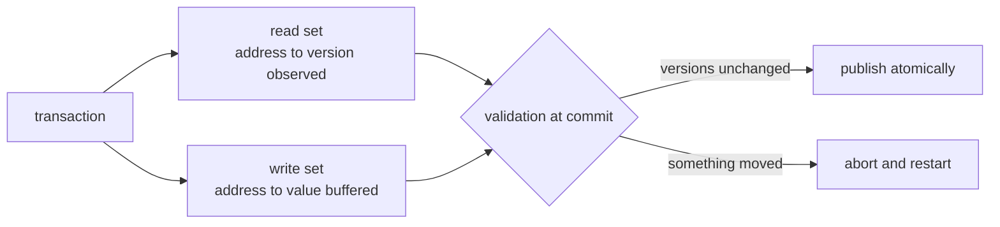
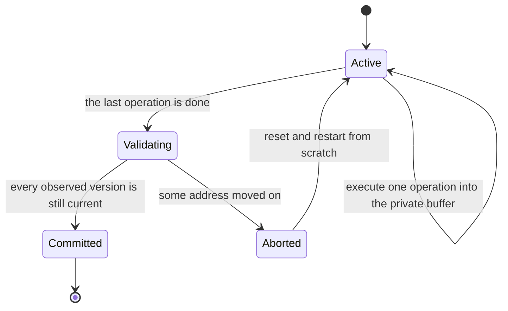
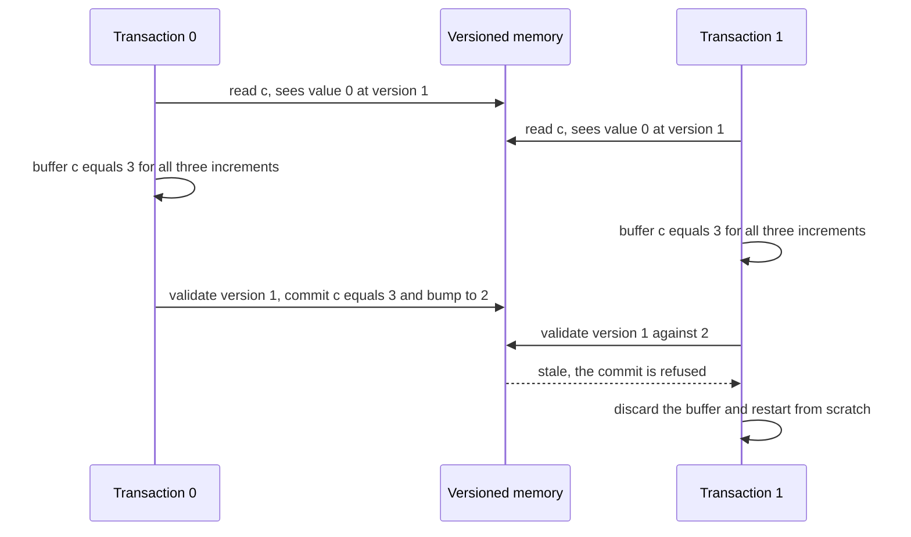

# 679 — Implement transactional memory conflict manager and bench.

> **Tier:** Expert · **CTCI chapter:** Beyond — Networking, OS & Real-Time
> **Task spec:** [679-implement-transactional-memory-conflict-manager-and-bench.md](../../../tasks/expert/679-implement-transactional-memory-conflict-manager-and-bench.md)
> **Solutions:** [Python](../../../solutions/python/expert/679-implement-transactional-memory-conflict-manager-and-bench/solution.py) ·
> [Java](../../../solutions/java/expert/679-implement-transactional-memory-conflict-manager-and-bench/Solution.java) ·
> [JavaScript](../../../solutions/javascript/expert/679-implement-transactional-memory-conflict-manager-and-bench/solution.js) ·
> [C#](../../../solutions/csharp/expert/679-implement-transactional-memory-conflict-manager-and-bench/Solution.cs)

## 1. Problem restatement

Implement an **optimistic software transactional memory** with versioned validation (the shape of TL2) plus
a benchmark that shows it doing its job, and verify the property that matters: the final memory must equal
the result of **some serial order** of the committed transactions.

Model:

| Element | Meaning |
| --- | --- |
| global memory | a value **and** a version per address; every write bumps the version |
| transaction | a program of `("load", addr, reg)`, `("add", reg, imm)`, `("store", addr, reg)`, `("store_value", addr, imm)` |
| private state | registers, `read_set` (address → version observed), `write_set` (address → buffered value), `write_versions` (address → version observed when buffering) |
| commit | validate every observed version; if anything changed, refuse and restart from scratch |
| scheduler | round-robin, one operation of one transaction per step, so the benchmark is reproducible |

Concrete expectations asserted by the checks:

- **Read-your-own-writes**: after `load x → r`, `add r 1`, `store x ← r`, a later `load x → s` sees `1`;
  memory is **untouched** before the commit (`{"x": 0, "y": 5}`) while the write set already holds
  `{"x": 1, "y": 9}`; `x` is removed from the read set (the buffered write subsumes it) and
  `write_versions["x"] == 1`; committing installs `{"x": 1, "y": 9}`.
- **Stale reads are refused**: a read followed by another transaction's commit makes `validate` false, a
  refused validation leaves memory byte-identical, and a **blind write** also notices the concurrent update.
- **Disjoint transactions never abort**: two transactions touching `a` and `b` give `0` aborts,
  `{"a": 2, "b": 3}`, `2` commits and exactly `15` execution steps — one per operation.
- **Contended counter**: three transactions × three increments on one address produce the counter value
  **9** (no lost updates), **more than zero** aborts, exactly `3` commits, and
  `versions["c"] == 1 + commits == 4`. The final state is confirmed serializable by brute force and the
  committed conflict graph is acyclic.
- **Hotter contention**: four transactions × two increments still reach **8**, with at least **2** aborts,
  and stay serializable.
- **Read-only and empty transactions**: read-only work commits cleanly, and a transaction with no operations
  commits once without touching memory or bumping a single version.
- Determinism, three rejected invalid operations/addresses, and a step guard that aborts loudly on a run that
  cannot finish.

## 2. Intuition

The pessimistic design takes a lock for every address a transaction might touch. It is correct and it is
slow: two transactions that only *read* a hot line would serialise, and a transaction that decides late to
touch another address must either lock everything up front or risk deadlock acquiring late.

The insight behind optimistic STM is that conflicts are rare, so pay only when one happens: let a
transaction read and buffer whatever it likes without locking anything, note the **version** of everything it
observed, and at commit time check that none of those versions moved. If they did, throw the work away and
run again.



Two details make it work. First, nobody can see a partially executed transaction, because every write lives
in the private buffer until the commit — atomicity is a consequence of the buffering, not of extra machinery.
Second, a **buffered** write is validated too (through `write_versions`), which is what protects a blind
write that never read the old value; without that check a write-only transaction could silently overwrite a
concurrent update.

## 3. Algorithm

1. **Memory** keeps `values` and `versions` (starting at 1) and counts version bumps; reading returns both the
   value and the version, writing updates both.
2. **A transaction step** executes one operation:
   - `load`: if the address is in the private write set, take the buffered value (read-your-own-writes);
     otherwise read memory and record the observed version in the read set.
   - `add`: pure register arithmetic.
   - `store`: record the observed version for the address the first time it is written, drop the address from
     the read set (the write subsumes the read), and buffer the register's value.
   - `store_value`: the same, with a constant.
3. **Validation** compares every version in `read_set` and every version in `write_versions` with the current
   one; a single mismatch means the transaction is stale.
4. **Commit**: on success install the buffered write set (in sorted address order) — each install bumps that
   address's version — mark the transaction committed and record it in the commit order. On failure bump the
   abort counter, `reset` the transaction (empty registers, sets and program counter) and let it run again.
5. **Scheduling**: one operation of one pending transaction per step in declaration order, so a conflicting
   write lands between another transaction's read and its commit; a step guard bounds the run.
6. **Serializability, two independent ways**:
   - **brute force**: enumerate every permutation of the committed transactions, replay each transaction's
     operations serially on plain values, and require the result to equal the simulated memory;
   - **conflict graph**: build the graph whose edges are read/write, write/write and read/write conflicts in
     commit order and require it to be acyclic.

```text
procedure step(self, memory)
    op = self.ops[self.pc]
    if op is a load then
        if addr is in self.write_set then
            value = self.write_set[addr]                 // read your own buffered write
        else
            (value, version) = memory.read(addr)
            self.read_set[addr] = version
        self.registers[register] = value
    else if op is an add then
        self.registers[register] = self.registers.get(register, 0) + immediate
    else if op is a store then
        recordVersionIfFirstWrite(self, memory, addr)
        self.write_set[addr] = self.registers[register]
    else
        recordVersionIfFirstWrite(self, memory, addr)
        self.write_set[addr] = immediate
    self.pc = self.pc + 1

procedure recordVersionIfFirstWrite(self, memory, addr)
    if addr is not in self.write_versions then
        self.write_versions[addr] = memory.versions[addr]
        remove addr from self.read_set                    // the write subsumes the read

function validate(self, memory)
    for (addr, version) in self.read_set do
        if memory.versions[addr] != version then return false
    for (addr, version) in self.write_versions do
        if memory.versions[addr] != version then return false
    return true

procedure run(self)
    pending = copy of self.transactions
    while pending is not empty do
        for transaction in copy of pending do
            if transaction is done then
                if validate(transaction, self.memory) then
                    for (addr, value) in sorted(transaction.write_set) do
                        self.memory.write(addr, value)
                    mark transaction committed and record it in the commit order
                    remove transaction from pending
                else
                    self.aborts = self.aborts + 1
                    reset(transaction)
                continue
            self.steps = self.steps + 1
            require self.steps <= self.max_steps
            step(transaction, self.memory)

function serializable(finalValues, committed, initial)
    for order in permutations(committed) do
        state = copy of initial
        for transaction in order do
            state = replay(transaction.ops, state)
        if state = finalValues then return true
    return false
```



## 4. Worked example

The **contended counter**: three transactions, each `load c; add 1; store c` three times, on `c = 0`
(version 1). The scheduler runs them in rounds, one operation each.

| Round | `t0` | `t1` | `t2` | Memory |
| --- | --- | --- | --- | --- |
| 1 | `load c → r = 0`, observes version **1** | `load c → r = 0`, observes **1** | `load c → r = 0`, observes **1** | `c = 0`, version 1 |
| 2 | `add r 1` | `add r 1` | `add r 1` | unchanged |
| 3 | `store c ← 1` (version 1 recorded) | `store c ← 1` | `store c ← 1` | unchanged — nothing visible before commit |
| … | three increments' worth of the same pattern | | | |
| 9 | `store c ← 3`, **done** | `store c ← 3`, **done** | `store c ← 3`, **done** | `c = 0`, version 1 |
| 10 | validate: recorded version 1 == current 1 → **commit** `c = 3` | validate: recorded version **1** vs current **2** → **abort** | validate: same → **abort** | `c = 3`, version 2 |
| … | — | `t1` restarts, rereads `c = 3` at version 2 | `t2` restarts the same way | |
| … | — | after three increments: commit `c = 6` on version 2 | validate **2** vs **3** → **abort** | `c = 6`, version 3 |
| … | — | — | restarts once more, reads version 3, commits `c = 9` | `c = 9`, version 4 |

The run ends with `commits == 3`, `aborts == 3` in this particular schedule (the checks require at least one),
`c == 9` — **no lost updates**, because the losing transactions never wrote anything — and
`versions["c"] == 1 + 3 == 4`, since only the three successful commits bumped the version. Both serializability
checks then run on the committed set: the brute force over all permutations and the acyclicity of the
conflict graph.



**Why the disjoint case is the control.** Two transactions touching `a` and `b` never invalidate each other,
so the benchmark records `0` aborts and exactly `15` steps — one per operation, no restarts. Together with the
hot counter (at least 2 aborts) that shows the abort counter is reacting to contention and not to the
scheduler.

## 5. Complexity

Let `n` be the total number of operations, `k` the number of transactions, `R` the read-set size, `W` the
write-set size and `A` the number of aborts.

| Step | Best | Average | Worst | Why the bound holds |
| --- | --- | --- | --- | --- |
| `step` | O(1) | O(1) | O(1) | a dictionary lookup for `load`, arithmetic for `add`, a buffered store otherwise |
| `validate` | O(1) | O(R + W) | O(R + W) | every observed version is compared once |
| commit | O(W) | O(W log W) | O(W log W) | the write set is installed in sorted address order |
| `run` | O(n) | O(n + A·n) | O(n + A·n) | without conflicts each operation runs once; each abort re-executes the whole transaction |
| `serializable` | O(k!) | O(k!·n) | O(k!·n) | brute force over the committed orders — only usable on the benchmark's small sets, which is the point |
| `conflict_graph_acyclic` | O(k²) | O(k²·(R + W)) | O(k²·(R + W)) | every pair of committed transactions is compared, then a DFS detects a cycle |
| Space | O(n) | O(n) | O(n) | the buffers plus the committed sets |

Aborts are the interesting cost. In this model each abort re-executes the transaction from the start, so the
worst case is unbounded in theory; the checks instead establish the practical property — **every transaction
eventually commits** — and the round-robin scheduler plus the step guard keep the benchmark reproducible.

## 6. Pitfalls and edge cases

- **Read-your-own-writes.** A `load` must check the private write set first; reading memory would return the
  pre-transaction value. The check asserts the second `load x` returns the buffered `1`.
- **Buffered writes are invisible.** Until the commit, `memory.values` must be untouched — that is the
  atomicity guarantee, and the check compares the memory image before and after the transaction runs.
- **A blind write must be validated too.** A transaction that only writes never records a read, so without
  `write_versions` a concurrent update would go undetected; the check exercises exactly that case.
- **The first write to an address removes it from the read set.** Keeping it would be harmless but redundant,
  and it would misreport the read set the conflict graph is built from.
- **A refused validation must not mutate memory.** The staleness test snapshots the memory before the failed
  validation and requires it unchanged.
- **Aborts must leave nothing behind.** `reset` clears the registers, both sets, the recorded versions and the
  program counter; a partly reset transaction would corrupt the retry.
- **Version bumps are proportional to *committed* writes.** The check `versions["c"] == 1 + commits`
  distinguishes the real STM from a naive in-place write: Java's baseline drops validation entirely and
  records lost updates, which is the whole reason the conflict manager exists.
- **Empty and read-only transactions.** A no-op transaction commits once and bumps no version; read-only work
  commits cleanly. Both are asserted, and both are cases a naive "always write back the buffer" implementation
  gets subtly wrong.
- **Determinism is part of the spec.** The scheduler is round-robin in declaration order, and the checks re-run
  the benchmark and compare the values, the abort count and the step count.
- **Invalid operations and unknown addresses raise**, and a step guard aborts a run that cannot make progress
  rather than looping forever.
- **Documented simplification (Python).** One value per address, no nested transactions, no write-write merge,
  and restart-after-abort rather than a contention manager with backoff.
- **Cross-language notes.** Java states the accounting identity `attempts == commits + aborts` with
  `retries >= aborts`, uses first-committer-wins, and reports how its naive mode loses updates. JavaScript
  benchmarks bank transfers, where the total balance is invariant under any interleaving, and checks the final
  state against **every** serial order. C# adds write-set locks acquired in ascending address order plus a
  revalidation under those locks, so lock acquisition can never cycle (deadlock freedom) and the version of an
  address increases by exactly one per transaction that wrote it.

## 7. Variants and follow-ups

- The hardware-level version of the same idea, which makes the memory model's relaxations visible →
  [678 — multiprocessor memory model litmus tests (TSO)](../../../tasks/expert/678-implement-multiprocessor-memory-model-litmus-tests-tso.md).
- The basics this is built on →
  [615 — transactional memory simulator basics](../../../tasks/expert/615-implement-transactional-memory-simulator-basics.md).
- Optimistic concurrency control with an explicit validation phase in a database →
  [640 — optimistic concurrency control simulation with validation](../../../tasks/expert/640-implement-optimistic-concurrency-control-simulation-with-validat.md).
- Serializability is a linearisability question once histories are involved →
  [618 — linearizability checker for concurrent histories](../../../tasks/expert/618-implement-linearizability-checker-for-concurrent-histories.md).

## 8. Check yourself

<details><summary>Show answer</summary>
**What makes the transaction atomic if there is no locking anywhere?** The private write buffer: no store
reaches memory until the commit installs the whole write set after a successful validation, so another
transaction can only see the before-image or the after-image, never a half-executed transaction.
</details>

<details><summary>Show answer</summary>
**Why must a blind write record a version even though it never read anything?** Otherwise a transaction that
only writes would validate trivially and could overwrite a concurrent update, which is a lost update. The
first write to an address records the version it saw and is validated like a read — the check with
`store_value` on a concurrently updated address pins it.
</details>

<details><summary>Show answer</summary>
**In the worked trace, why is `c` exactly 9 and not something smaller?** Every losing transaction's buffer is
discarded when its validation fails, so only the three successful commits ever wrote. Each successful
transaction had re-read the current value and added its three increments, giving `3 + 3 + 3 = 9`; a lost
update would show up as a smaller final value.
</details>

<details><summary>Show answer</summary>
**Why are two different serializability checks run?** The brute-force permutation replay is a direct
definition of serializability but costs `k!`; the conflict-graph test is cheap and catches a cycle of
read/write dependencies. Agreement between a definition-level check and a structural check is much stronger
evidence than either alone, and the brute force is only affordable on the small benchmark sets.
</details>

<details><summary>Show answer</summary>
**What does the disjoint benchmark demonstrate that the contended one does not?** That the abort counter
reacts to conflicts rather than to the scheduler: with no shared addresses there are zero aborts and the step
count is exactly the number of operations, so the extra aborts in the hot run must come from genuine
interference.
</details>
