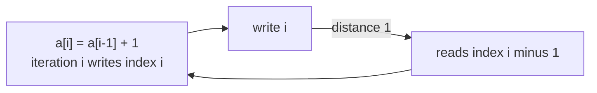
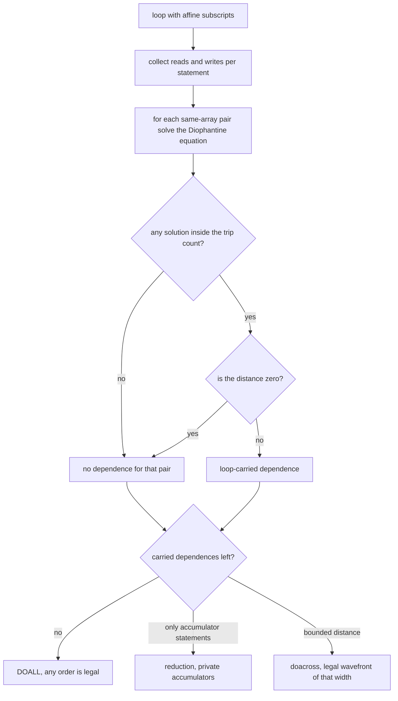
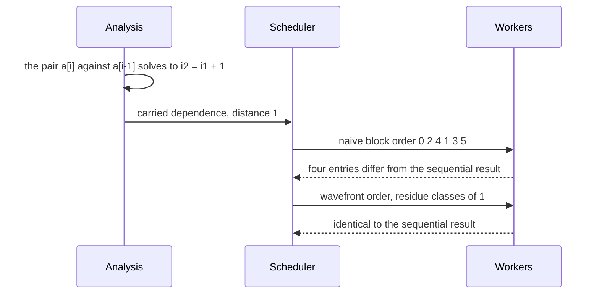

# 680 — Implement auto-parallelization heuristics for loops (dependence analysis).

> **Tier:** Expert · **CTCI chapter:** Beyond — Compilers, Languages & Solvers
> **Task spec:** [680-implement-auto-parallelization-heuristics-for-loops-dependence-a.md](../../../tasks/expert/680-implement-auto-parallelization-heuristics-for-loops-dependence-a.md)
> **Solutions:** [Python](../../../solutions/python/expert/680-implement-auto-parallelization-heuristics-for-loops-dependence-a/solution.py) ·
> [Java](../../../solutions/java/expert/680-implement-auto-parallelization-heuristics-for-loops-dependence-a/Solution.java) ·
> [JavaScript](../../../solutions/javascript/expert/680-implement-auto-parallelization-heuristics-for-loops-dependence-a/solution.js) ·
> [C#](../../../solutions/csharp/expert/680-implement-auto-parallelization-heuristics-for-loops-dependence-a/Solution.cs)

## 1. Problem restatement

Decide whether a one-dimensional loop with **affine array subscripts** can run its iterations in parallel,
and then prove the decision by *executing* the schedules the analysis permits.

Statements have the shape `dest[da·i + db] = …` with four operations:

| Op | Meaning |
| --- | --- |
| `set` | `dest[da·i + db] = src[sa·i + sb] + const` |
| `add` | `dest[da·i + db] = dest[da·i + db] + const` (in-place increment) |
| `plus` | `dest[da·i + db] = dest[da·i + db] + src[sa·i + sb] + const` |
| `sub` | `dest[da·i + db] = dest[da·i + db] − src[sa·i + sb] − const` |

A **dependence** exists when two accesses of the same array can touch the same element in *different*
iterations: `a1·i1 + b1 == a2·i2 + b2` with `i1 ≠ i2` in `[0, n)`. The **distance** is `|i1 − i2|`.

Concrete expectations asserted by the checks:

| Loop (n = 6) | Verdict | Why |
| --- | --- | --- |
| `a[i] = a[i] + 1` | **DOALL** | the read and the write are in the same iteration (distance 0) |
| `a[2i] = a[2i+1]` | **DOALL** | `2(i1 − i2) = 1` has no integer solution |
| `a[i] = a[i−1] + 1` | **doacross**, distance **1** | carried dependence one iteration back |
| `a[i] = a[i−2] + 1` | **doacross**, distance **2** | carried twice |
| `a[i] = a[i+2]` | **doacross**, distance **2** | a *forward* carried dependence |
| `s = s + a[i]` (scalar accumulator) | **reduction** | the only carried dependences are commutative accumulations |

Also asserted:

- The algebraic route matches the enumerative oracle on **all six** loops above, and on **200 random**
  subscript quadruples: `0` disagreements, with the sweep containing both dependent and independent pairs.
- The gcd test on its own: `a[2i]` versus `a[2i+1]` yields **no** solution; `a[2i]` versus `a[2i+2]` collides
  one iteration apart (distance 1); two accesses to the *same* scalar position always collide
  (`(True, 1)`).
- Execution: a DOALL loop is identical under the sequential order and under 1, 2, 3, 4 and 6 workers, and a
  parallel order is always a permutation of all iterations. The strided DOALL loop is identical with 3 workers.
- The refusal is justified: the carried loop under a 2-worker block schedule produces a **different** array
  while its distance-1 wavefront reproduces the sequential result exactly; the same holds for the distance-2
  loop and its distance-2 wavefront.
- Reductions: with 1, 2, 3 and 6 workers, the private-accumulator result equals the sequential sum, the
  initial value plus the partial sums equals the total, and there is exactly one partial per worker. Even the
  naive order sums the same total, because integer addition is commutative.
- Boundary cases: a length-one loop cannot carry anything (DOALL) but still executes its body; the `sub` form
  carries a dependence too; six malformed inputs are rejected; the analysis and the execution are
  deterministic.

## 2. Intuition

The naive parallelizer splits the iteration range into chunks and hopes. It works for `a[i] = b[i] + 1` and
silently corrupts `a[i] = a[i−1] + 1`, because iteration 3 reads what iteration 2 was supposed to write and
the chunk that owns iteration 3 may have already run.

The insight is that "can these iterations run in any order?" is a question about **subscript equations**, and
those can be decided exactly for affine subscripts instead of being guessed:

1. Two accesses conflict only if the same element is touched: `a1·i1 + b1 = a2·i2 + b2`.
2. That is a linear Diophantine equation in two unknowns, solvable exactly: the **gcd test**
   (`gcd(a1, a2)` must divide `b2 − b1`) rules out most pairs immediately, and when it does not rule out, the
   extended Euclidean algorithm produces the whole one-parameter solution family, which is then intersected
   with the trip-count bounds.
3. Iterations that collide *within* one iteration (`i1 = i2`) are harmless; only a collision across
   iterations — a **loop-carried** dependence — forbids a free reordering. And a carried dependence at
   distance `d` is still useful information: it says a **pipeline** of width `d` is legal.



The picture is the whole story: the write of iteration `i` must be visible to the read of iteration `i + 1`,
so iterations at the same residue class modulo the distance can run together but the classes must be ordered.

## 3. Algorithm

1. **Collect accesses.** Each statement yields a write of its destination, a read of the destination for the
   read-modify-write operations (`add`, `plus`, `sub`), and a read of the source when there is one.
2. **Per pair of accesses on the same array**, solve `a1·i1 + b1 = a2·i2 + b2`, `i1 ≠ i2`:
   - rewrite as `A·i1 + B·i2 = C` with `A = a1`, `B = −a2`, `C = b2 − b1`;
   - a trivial case: `A = B = 0` means both accesses are constant subscripts — they collide whenever `C = 0`
     and there are at least two iterations, giving distance 1;
   - apply the **gcd test**: no solution when `C mod gcd(A, B) ≠ 0`;
   - otherwise scale the extended-Euclid solution into a particular solution `(i1₀, i2₀)` and take the family
     `i1 = i1₀ + (B/g)·t`, `i2 = i2₀ − (A/g)·t`;
   - intersect that family with `0 ≤ i1, i2 < n` — a bound on `t` computed by integer division per coordinate
     — and scan it: at most `n` values, not `n²`;
   - return the minimum `|i1 − i2|` over the family, or nothing when no member is in range.
3. **Classify**: no carried dependence → `DOALL`; every carried dependence coming from a scalar accumulator
   statement (`plus`/`sub` into a `(0,0)` destination) → `reduction`; otherwise → `doacross` with the minimum
   positive distance.
4. **Cross-check** with the enumerative oracle, which simply tries every pair of iterations `(i1, i2)` and
   reports the same structure.
5. **Execute in each legal order** and compare with the sequential reference: DOALL under a strided worker
   order, the pipeline under a wavefront order (all iterations with the same residue modulo the distance run
   together, in residue order), and the reduction with private per-worker accumulators combined afterwards.

```text
function solveLinearRange(a1, b1, a2, b2, length)
    A = a1; B = -a2; C = b2 - b1
    if A = 0 and B = 0 then
        if C != 0 or length < 2 then return none
        return (carried true, distance 1)
    (g, x, y) = extendedGcd(A, B)
    if C mod g != 0 then return none
    scale = C / g
    i1_0 = x * scale; i2_0 = y * scale
    step1 = B / g; step2 = -(A / g)
    low = -infinity; high = infinity
    for (base, step) in ((i1_0, step1), (i2_0, step2)) do
        if step = 0 then
            if base is not in [0, length) then return none
        else if step > 0 then
            low = max(low, ceil((0 - base) / step))
            high = min(high, floor((length - 1 - base) / step))
        else
            low = max(low, ceil((length - 1 - base) / step))
            high = min(high, floor((0 - base) / step))
    if low > high then return none
    best = none
    for t = low to high do
        i1 = i1_0 + step1 * t
        i2 = i2_0 + step2 * t
        if i1 != i2 then best = min(best, |i1 - i2|)
    return (carried false, 0) if best is none else (carried true, best)

function analyse(loop)
    dependences = algebraicDependences(loop)
    carried = dependences with distance > 0
    if carried is empty then return "DOALL"
    accumulators = destinations of the plus and sub statements with subscript coefficients (0, 0)
    if accumulators is not empty and every carried dependence comes from an accumulator statement then
        return "reduction"
    return "doacross" with distance = minimum distance over carried

function execute(loop, order)
    state = copy of the initial arrays
    for i in order do
        for each statement of loop do
            perform the statement at iteration i on state
    return state

function wavefrontOrder(length, distance)
    require distance >= 1
    return [i for residue in 0 .. distance - 1 for i in residue, residue + distance, ... below length]
```



## 4. Worked example

**The carried loop** `a[i] = a[i−1] + 1`, `n = 6`, with the file's deterministic initial values
`a = [10, 6, 2, 9, 5, 1]` at indices `0..5` and `a[−1] = 3`.

Dependences: the write `a[i]` against the read `a[i−1]` is `1·i1 + 0 = 1·i2 + (−1)`, i.e. `i1 − i2 = −1`, so
`i2 = i1 + 1`: for every `i1 < 5` there is a collision with `i2 = i1 + 1`, distance **1**. The
read-modify-write of the destination is a `set`, so only that one pair exists.

| Order | Sequence of iterations | `a[0..5]` afterwards |
| --- | --- | --- |
| sequential | `0 1 2 3 4 5` | `[4, 5, 6, 7, 8, 9]` |
| naive 2-worker block order | `0 2 4 1 3 5` | `[4, 5, 7, 8, 10, 11]` — **differs in 4 entries** |
| wavefront, distance 1 | `0 1 2 3 4 5` | `[4, 5, 6, 7, 8, 9]` — exact |

The naive order is a perfectly legal permutation of the iterations, and it is wrong: iteration 2 read `a[1]`
before iteration 1 had written it. The wavefront of width 1 *is* the sequential order, which is why it is
exact — and that is the honest outcome: a dependence at distance 1 means no parallelism can be extracted from
this loop at all, only a legal scheduling of it.

**The distance-2 loop** `a[i] = a[i−2] + 1` allows more: iterations of one residue class modulo 2 are
independent, so the order `0 2 4 1 3 5` — exactly the naive block order that destroyed the previous loop —
reproduces the sequential result, and the file asserts that too.

**A genuinely parallel loop as the control.** For `a[i] = a[i] + 1` the read and the write are the *same*
access pair in the *same* iteration, so the only collisions have distance 0, no dependence is carried, and the
verdict is DOALL. The checks confirm that the sequential result `[11, 7, 3, 10, 6, 2]` is reproduced under 1,
2, 3, 4 and 6 workers — a different schedule, identical array.



## 5. Complexity

Let `n` be the trip count, `s` the number of statements (so at most `3s` accesses) and `d` the dependence
distance.

| Step | Best | Average | Worst | Why the bound holds |
| --- | --- | --- | --- | --- |
| `solve_linear_range` | O(1) | O(n) | O(n) | the gcd test is O(log n); the solution family is bounded to at most `n` values of `t`, never `n²` |
| `algebraic_dependences` | O(s²) | O(s²·n) | O(s²·n) | one solve per access pair |
| `dependence_pairs` (oracle) | O(s²) | O(s²·n²) | O(s²·n²) | it literally tries every pair of iterations |
| `analyse` | O(s²) | O(s²·n) | O(s²·n) | dominated by the algebraic pass |
| `execute(loop, order)` | O(n·s) | O(n·s) | O(n·s) | one pass over the statements per iteration |
| `execute_reduction` | O(n·s) | O(n·s + w) | O(n·s + w) | a sequential base run, then one partial per worker |
| `wavefront_order` | O(n) | O(n) | O(n) | one bucket per residue class |
| Space | O(n) | O(n) | O(n) | one array slot per index per array, extended by two on each side |

The algebraic route is the whole point of the exercise: `O(s²·n)` instead of the oracle's `O(s²·n²)`, and
exact rather than approximate, because a Diophantine equation with two unknowns can be solved rather than
sampled.

## 6. Pitfalls and edge cases

- **Only *carried* dependences matter.** `a[i] = a[i] + 1` has a read/write pair on the same element, but in the
  same iteration; treating it as carried would refuse a perfectly parallel loop, and the checks classify it
  DOALL.
- **A negative answer from the gcd test is a proof, a positive one is not.** `gcd` failing to divide `C` rules
  out every solution; when it divides, the family must still be intersected with the trip count, because the
  particular solution the extended Euclid returns may sit outside `[0, n)`.
- **Bound the family, do not enumerate pairs.** The scan over `t` is at most `n` steps; enumerating `(i1, i2)`
  pairs is `n²` and is only acceptable in the oracle.
- **Constant subscripts collide.** `A = B = 0` is the "same scalar position" case: it depends on
  `C = b2 − b1` being zero and on there being at least two iterations.
- **A forward dependence is still a dependence.** `a[i] = a[i+2]` reads *ahead*, and its distance is 2; the
  wavefront must still be legal, and the file checks that it reproduces the sequential result.
- **A distance does not mean arbitrary parallelism.** A distance-1 dependence allows only the sequential
  order (the wavefront of width 1), which the worked example shows; a distance-2 dependence allows the two
  residue classes to run side by side.
- **Reductions are not free of dependences — they are dependences of a special kind.** The scalar accumulator
  is written and read across iterations, so a naive analysis would call the loop serial. It is legal only
  because the operation is commutative, which is why the Java file shows that *subtraction* genuinely blocks
  parallelisation while addition and multiplication do not.
- **The refusal must be demonstrated.** A classification is only credible if the illegal schedule is shown to
  produce a different array: the checks compare the naive block order against the sequential result and
  require a difference.
- **Length-one loops cannot carry anything**, but they must still execute their body; both are asserted.
- **Malformed inputs raise**: a zero trip count, an unknown operation, a `set` without a source, an `add` with
  a source, and a zero worker count or a non-positive wavefront distance.
- **Documented simplification (Python).** One loop level (no nests, no loop interchange), integer arithmetic
  only, and affine subscripts of a single induction variable.
- **Cross-language notes.** Java handles nests of depth 1 or 2 — deciding existence *within the bounds* by
  intersecting the extended-Euclid family with the trip counts, enumerating the small range of the outer
  difference and solving for the inner one — and explicitly counts the mismatched depth-2 case as out of
  scope. JavaScript keeps a conservative analytic rule alongside the brute-force pair enumeration and checks
  that chunked and sequential execution agree for every loop classified parallel and disagree for the carried
  one. C# combines the GCD test with a **Banerjee test** (the extreme values of the subscript difference over
  the trip-count box) and never allows the analyser to claim independence unless one of them is conclusive,
  because a false positive there is a miscompile; it then executes every parallel verdict in two chunk orders
  and requires identical arrays.

## 7. Variants and follow-ups

- The loop nest version, where the interesting question is *which* level blocks parallelism →
  [673 — SSA construction and basic optimizations](../../../tasks/expert/673-implement-ssa-construction-and-basic-optimizations.md) and
  [674 — register allocation via graph coloring](../../../tasks/expert/674-implement-register-allocation-via-graph-coloring-simplified.md).
- The scheduling question once the dependences are known →
  [675 — instruction scheduling heuristics for a pipelined CPU model](../../../tasks/expert/675-implement-instruction-scheduling-heuristics-for-pipelined-cpu-mo.md).
- One loop iteration running on many parallel units, with the dependences handled by a scan →
  [699 — GPU-style parallel prefix-sum algorithm simulation](../../../tasks/expert/699-implement-gpu-style-parallel-prefix-sum-algorithm-simulation.md).
- Independent work mapped onto CPU threads →
  [681 — numeric GPU kernel mapping to CPU threads simulation](../../../tasks/expert/681-implement-numeric-gpu-kernel-mapping-to-cpu-threads-simulation.md).

## 8. Check yourself

<details><summary>Show answer</summary>
**Why does `a[2i] = a[2i+1]` have no dependence at all?** The equation is `2i1 = 2i2 + 1`, i.e.
`2(i1 − i2) = 1`, which has no integer solution — an even number cannot be odd. Formally `gcd(2, 2) = 2` does
not divide `1`, so the gcd test rules it out immediately.
</details>

<details><summary>Show answer</summary>
**Why is `a[i] = a[i] + 1` parallelisable although it reads and writes the same element?** The read and the
write happen inside one iteration, so the only collisions have `i1 = i2`, distance 0 — a loop-independent
dependence. Reordering iterations changes nothing, and the checks confirm the identical array under 1 to 6
workers.
</details>

<details><summary>Show answer</summary>
**What does a carried dependence at distance `d` actually permit?** A pipeline: iterations that are `d` apart
touch disjoint elements *within* the same pass, so all iterations with the same residue modulo `d` may run
together, provided the residue classes are ordered. The file builds exactly that wavefront order and shows it
reproduces the sequential result, while the naive block order does not.
</details>

<details><summary>Show answer</summary>
**Why does a scalar accumulation `s = s + a[i]` count as a reduction rather than a serial loop?** The
dependence is genuinely carried — every iteration reads and writes `s` — but integer addition is commutative,
so the per-iteration terms can be accumulated privately and combined afterwards. The checks assert the
combined value equals the sequential sum for every worker count, and the Java file shows subtraction, which is
*not* commutative, really does block parallelisation.
</details>

<details><summary>Show answer</summary>
**The gcd test says a solution exists — why is that not yet a dependence?** Because the solution may lie
outside the trip count. The extended-Euclid family must be intersected with `0 ≤ i1, i2 < n` and still contain
a member with `i1 ≠ i2`; the implementation bounds the family parameter and scans at most `n` candidates, which
is what turns the divisibility test into an exact dependence answer.
</details>
