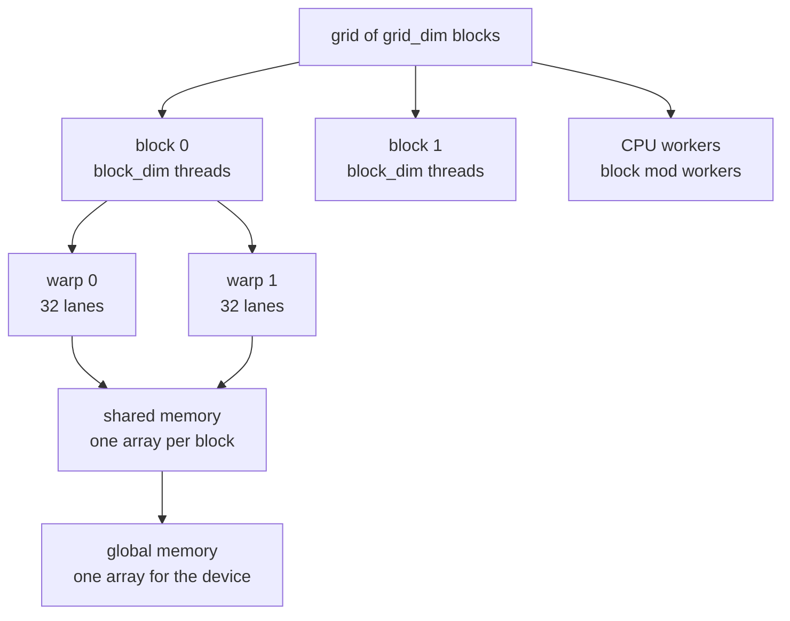
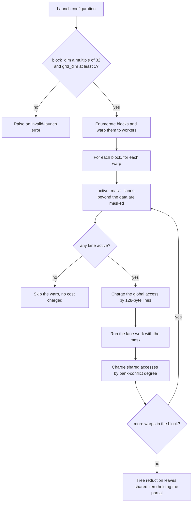
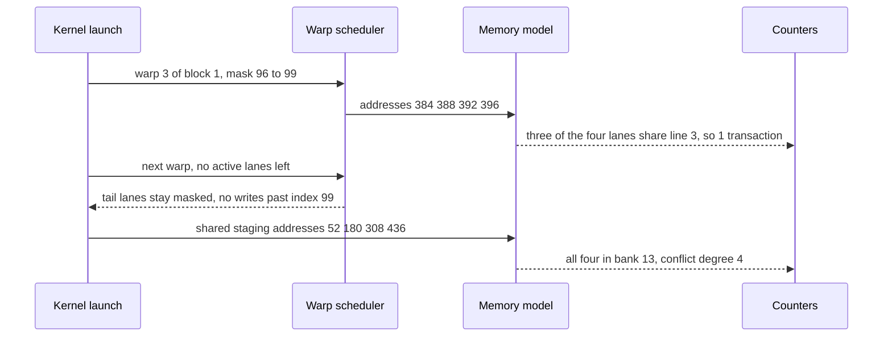

# 681 — Implement numeric GPU kernel mapping to CPU threads simulation

> **Tier:** Expert · **CTCI chapter:** Beyond — Compilers, Languages & Solvers
> **Task spec:** [681-implement-numeric-gpu-kernel-mapping-to-cpu-threads-simulation.md](../../../tasks/expert/681-implement-numeric-gpu-kernel-mapping-to-cpu-threads-simulation.md)
> **Solutions:** [Python](../../../solutions/python/expert/681-implement-numeric-gpu-kernel-mapping-to-cpu-threads-simulation/solution.py) ·
> [Java](../../../solutions/java/expert/681-implement-numeric-gpu-kernel-mapping-to-cpu-threads-simulation/Solution.java) ·
> [JavaScript](../../../solutions/javascript/expert/681-implement-numeric-gpu-kernel-mapping-to-cpu-threads-simulation/solution.js) ·
> [C#](../../../solutions/csharp/expert/681-implement-numeric-gpu-kernel-mapping-to-cpu-threads-simulation/Solution.cs)

## 1. Problem restatement

Simulate a CUDA-style launch of numeric kernels on a CPU: a **grid** of blocks, each block made of
whole **warps** of 32 **lanes**, a private **shared-memory** array per block, and one **global**
array. The launch geometry is
`global_id = block_idx * block_dim + thread_idx`, `warp = thread_idx / 32`,
`lane = thread_idx % 32`, and blocks are handed to `P` CPU workers. Five numeric kernels are
modelled: `saxpy` (`y[i] = a * x[i] + y[i]`, one lane per element, tail masked off),
`block_reduce` (a shared-memory tree reduction with 32-lane steps, one partial per block),
`tiled_matmul` (`C = A * B` with `tile x tile` shared-memory staging), `divergent_branch` (half the
lanes write `1`, half write `2`, so the warp runs two masked paths with complementary masks) and
`histogram` (a shared-memory privatised bin counter).

The simulation must also **account for the costs** a profiler would report: a warp-level global
access is charged the number of distinct **128-byte lines** its addresses touch, and a shared-memory
access is charged its **bank-conflict degree** (32 banks, each of 4-byte words, the degree being the
multiplicity of the busiest bank; a broadcast of the same word counts once). Launches are validated:
`block_dim` must be a multiple of 32 and at least 32, `grid_dim >= 1`, and the grid must cover every
thread. Results must be independent of the worker count.

Concrete results asserted by the checks:

- a coalesced warp reading addresses `0, 4, 8, ... 124` costs **1** transaction, the strided warp
  `0, 128, 256, ... 3968` costs **32**; the two accesses together leave the counter at **33**
  transactions and **2** warps.
- `bank_conflicts([4 * i for i in range(32)]) == 1`, a broadcast of one word is **1**, four addresses
  that land in bank 13 are a **4-way** conflict, and a warp whose 30 lanes hit one bank serialises to
  **30**.
- `saxpy` over **100** random values with `a = 3` equals `3 * x + y`, reports exactly **100** active
  lanes (the 28 tail lanes are masked) and at least **4** transactions; the result is identical for
  1, 2, 4 and 8 workers.
- `block_reduce` over **200** values in a `Device(1024, 64, 4)` launch returns block partials whose
  sum is the exact integer sum and masks that cover every element exactly once; **33** values in one
  64-thread block produce exactly **2** warps with masks of size **32** and **1**.
- the 4x4 `tiled_matmul` matches the naive triple loop, the 16-bin `histogram` of 300 samples
  matches the reference, and five invalid launches are rejected.

## 2. Intuition

The naive answer to "map a GPU kernel to CPU threads" is to start `P` threads and loop over the
array — which produces the right numbers and tells you nothing. The point of the exercise is that a
GPU kernel is a *mapping plus a cost model*, and both are lost in a plain loop:

1. **Which lane owns which element.** Rounding the data size up to whole warps creates lanes with no
   element (`warp_count(100) * 32 = 128` threads for 100 values); they must be **masked** so they
   neither read nor write, which is exactly the cost of the tail in real hardware.
2. **How the addresses of a warp line up with memory.** A warp whose 32 lanes read consecutive words
   is served by **one** 128-byte transaction; the same warp striding by 32 elements costs **32**
   transactions. Same instruction count, 32x the traffic.
3. **Which bank a shared-memory address lands in.** Shared memory is 32 banks of 4-byte words, bank
   `(address / 4) % 32`. 32 consecutive words spread over 32 banks (degree 1); four addresses in the
   same bank serialise into a 4-way conflict; a broadcast is free because all lanes read one word.
   And blocks are independent, so they may be distributed over workers in any order: the *result*
   must not depend on that order, only the schedule may.



The mapping `block -> block % workers` is deliberately trivial: what the checks verify is
*invariance*, not clever scheduling. Blocks are independent units of work, so any assignment of
blocks to workers produces the same bytes in global memory.

## 3. Algorithm

Build the launch, run each warp over its masked lane set, charge the access costs, then reduce.

1. **Validate the launch.** Reject `block_dim % 32 != 0`, `block_dim < 32`, `grid_dim < 1`, a
   requested worker count below 1, and a launch whose `block_dim * grid_dim` does not cover the
   thread count. Then **map blocks to workers** as `(block % workers, block)` pairs; the pair list
   is the work queue.
3. **Per warp, compute the active mask** `[first + lane : lane in 0..31, first + lane < total]`.
4. **Charge the global access** for the addresses of those lanes: one transaction per distinct
   `address / 128`.
5. **Do the lane work** — SAXPY arithmetic, a shared-memory store, the even/odd divergent writes,
   or the tile staging.
6. **Charge shared accesses** with the conflict degree and, for reductions, run the tree
   `shared[thread] += shared[thread + span]` for spans 1, 2, 4, ... `block_dim / 2`, which leaves the
   block partial in `shared[0]`. In `tiled_matmul` the same charging covers the `tile x tile` staging
   of `A` and `B` per k-tile, followed by the `tile x tile x tile` accumulation.
7. **Rebuild the result**, e.g. `saxpy` writes into global memory at offset `2 * n`, and finish with
   the counters (`transactions`, `bank_conflicts`, `masks`, `warps`, `active_lanes`).

```text
function warp_count(threads)
    return (threads + 31) / 32

function active_mask(first, total)
    return the lane indices first + lane for lane ← 0 to 31 with first + lane < total

function global_transactions(addresses, line_bytes)
    return the number of distinct values address / line_bytes over the addresses

function bank_conflicts(addresses)
    group the addresses by bank ← (address / 4) mod 32, keeping distinct addresses only
    return the largest group size, or 0 when there are no addresses

procedure thread_blocks(total_threads, workers)
    require workers ≥ 1
    require total_threads ≤ block_dim * grid_dim
    mapping ← empty list
    for block ← 0 to grid_dim - 1 do
        append (block mod workers, block) to mapping
    return mapping

procedure saxpy(device, a, x, y, workers)
    reset the counters
    copy x and y into the first 2 * length(x) words of global memory
    total ← length(x)
    for (worker, block) in thread_blocks(warp_count(total) * 32, workers) do
        for warp ← 0 to block_dim / 32 - 1 do
            first ← block * block_dim + warp * 32
            mask ← active_mask(first, total)
            if mask is empty then continue
            charge global_transactions([4 * i for i in mask])
            for i in mask do
                global[2 * total + i] ← a * global[i] + global[total + i]
    return global[2 * total .. 3 * total)

procedure block_reduce(device, values, workers)
    reset the counters
    copy values into global memory
    for (worker, block) in thread_blocks(warp_count(total) * 32, workers) do
        for each warp of the block do
            mask ← active_mask(first, total)
            charge global_transactions([4 * i for i in mask])
            for (lane, i) in mask do shared[warp * 32 + lane] ← global[i]
            record mask
        span ← 1
        while span < block_dim do
            for thread ← 0 to block_dim - 1 step 2 * span do
                if thread + span < block_dim then
                    shared[thread] ← shared[thread] + shared[thread + span]
            span ← span * 2
        append shared[0] to partials
    return partials and the recorded masks

procedure tiled_matmul(device, left, right, size, tile)
    side ← ceil(size / tile)
    for block ← 0 to side * side - 1 do
        row0 ← (block / side) * tile
        col0 ← (block mod side) * tile
        for k0 ← 0 to size - 1 step tile do
            stage left[row0 + r][k0 + c] and right[k0 + r][col0 + c] into shared,
            substituting 0 outside the matrix borders, and charge the staging access
            for r ← 0 to tile - 1, c ← 0 to tile - 1, k ← 0 to tile - 1 do
                result[row0 + r][col0 + c] ← result[row0 + r][col0 + c]
                    + shared[r * tile + k] * shared[tile * tile + k * tile + c]
    return result

procedure divergent_branch(device, values, workers)
    for every warp do
        even ← lanes of the mask with an even index
        odd ← lanes of the mask with an odd index
        record ("divergent", even, odd) as the mask pair of the warp
        for i in even do global[i] ← 1
        for i in odd do global[i] ← 2
    return global[0 .. total)
```



## 4. Worked example

Trace A — `saxpy(Device(1024, 64, 2), a = 3, x, y)` on 100 values. The grid covers 128 threads, so
the fourth warp is the tail and the last 28 lanes never run.

| Warp | block | threads | active mask | addresses | lines touched | transactions |
| --- | --- | --- | --- | --- | --- | --- |
| 0 | 0 | 0-31 | 0..31 | 0, 4, ... 124 | 1 | 1 |
| 1 | 0 | 32-63 | 32..63 | 128, ... 252 | 1 | 1 |
| 2 | 1 | 64-95 | 64..95 | 256, ... 380 | 1 | 1 |
| 3 | 1 | 96-127 | 96..99 | 384, 388, 392, 396 | 1 | 1 |

`active_lanes` ends at 100 (not 128) and `transactions` at 4, matching the assertions
`active_lanes == 100` and `transactions >= 4`. The result is compared against the plain Python list
comprehension `3 * a + b`, and the whole launch is repeated with 1, 2, 4 and 8 workers, so the block
to worker mapping cannot influence the output.

Trace B — `block_reduce(Device(64, 64, 1), values)` on 33 values. One block, two warps.

| Step | shared[0..7] | comment |
| --- | --- | --- |
| staging | `v0 v1 v2 v3 v4 v5 v6 v7` | warp 0 stores 32 values, warp 1 stores `v32` at `shared[32]` |
| span 1 | `v0+v1, v2+v3, v4+v5, v6+v7, ...` | 32 live pairs out of the 64 slots |
| span 2 | `v0..v3` | 16 live slots |
| span 4 | `v0..v7` | 8 live slots |
| span 8 to 32 | `shared[0]` | 4, 2 then 1 live slot |

The masks recorded for the block are `(0..31)` and `(32)`, i.e. sizes **32** and **1** — the
assertion `len(masks[0]) == 32 and len(masks[1]) == 1` and the coverage check
`sum(len(mask)) == len(values)` both hold because the masked lanes of warp 1 never store and their
shared slots stay `0`, which leaves the sum unchanged to the last bit.

Trace C — one shared-memory access with `same_bank = [4 * (13 + 32 * i) for i in range(4)]`, i.e.
addresses `52, 180, 308, 436` = words `13, 45, 77, 109`. Every word satisfies
`(word) mod 32 = 13`, so all four lanes sit in bank 13 with four *distinct* addresses and the
conflict degree is **4**; the check asserts both the oracle and the counter
(`shared_access(...) == 4`) agree. The pathological pattern `[4 * (13 + 32 * i) for i in range(30)]`
serialises the whole warp to degree 30, while `[0, 128]` — two distinct words, one bank — is only 2.



## 5. Complexity

Let `n` be the data size, `B` the number of blocks, `T = block_dim` the threads per block, `W = T / 32`
the warps per block and `P` the worker count.

| Quantity | Best | Average | Worst | Why the bound holds |
| --- | --- | --- | --- | --- |
| `saxpy` lane work | O(n) | O(n) | O(n) | one lane per element, `W - 1` warps per block at most partially masked; block mapping is O(B) |
| `saxpy` transactions | O(B · W) | O(n / 32) | O(n) | one line per warp when the addresses are consecutive; one line per lane when they stride |
| `block_reduce` | O(n + B · T) | O(n + B · T) | O(n + B · T) | one load per element plus the tree `T/2 + T/4 + ... = O(T)` shared additions per block |
| `tiled_matmul` | O(size³) | O(size³) | O(size³) | `ceil(size/tile)²` blocks, each doing `size/tile` k-tiles of `tile³` products |
| `tiled_matmul` global traffic | O(size²) | O(size³ / tile) | O(size³) | the tile is re-read `size/tile` times instead of `size` times, i.e. a factor-`tile` cut |
| `histogram` | O(n) | O(n) | O(conflicts · n) | one shared increment per sample; the conflict degree depends on the bucket distribution |
| Space | O(n) global + O(B · T) shared + O(B) masks | | | global holds `x`, `y` and the output; each block owns `T` shared words; one mask per warp |

The alternative — a plain CPU loop per worker — has the same asymptotic work but no model of the
costs, and a "one thread per element" mapping with no mask writes `28` out-of-range locations on the
100-element example. Java's solution recomputes the global load count of its tiled kernel and asserts
it beats the naive kernel by exactly the tile factor.

## 6. Pitfalls and edge cases

- **A launch that does not cover the data.** `thread_blocks(1 << 20, 1)` on a 64x1 device must raise;
  the Python check counts 5 rejected launches (`block_dim = 48`, `block_dim = 0`, `grid_dim = 0`,
  `workers = 0`, and the undersized grid).
- **Tail lanes must be masked, not clamped, and idle warps cost nothing.** Clamping would write
  element 99 several times and give a wrong sum; masking also keeps `active_lanes` honest (`100`,
  never `128`). With `block_dim = 64` and 100 elements the warps above the third have an empty mask
  and are skipped, so they must not be charged a transaction.
- **Empty input and idle blocks.** `saxpy(Device(64, 32, 1), 2, [], [])` returns `[]` and charges no
  lane; the JavaScript solution enumerates `n = 0` explicitly and reports a zero-block grid.
- **Broadcast is not a bank conflict, and banks are word based.** `bank_conflicts([8] * 32) == 1`
  although 32 lanes access one address — only *distinct* addresses in one bank serialise — and
  `[0, 128]` is a 2-way conflict because both are bank 0, so the model must map addresses to words
  before taking the bank.
- **Worker count invariance and determinism.** Blocks are independent, so 1, 2, 3, 4 and 8 workers
  must produce the same bytes; because the "threads" are simulated sequentially, repeated runs must
  compare equal, and the checks re-run SAXPY, the reduction, the tiled multiply and the histogram to
  confirm both.
- **Documented simplification.** One instruction issue per cycle per warp, no latency hiding, no
  asynchronous copies, and CPU threads are simulated by partitioning blocks among workers
  sequentially. The Java solution states the same simplification, the JavaScript solution adds an
  occupancy estimate and reports which limit binds, and the C# solution replaces timings with
  accounting identities (`waves`, `barrier waits`, masked lanes) recomputed from the launch geometry.

## 7. Variants and follow-ups

- Block-wide scans instead of plain per-element work: the same masking and shared-memory argument
  applies to a Blelloch/Hillis-Steele scan →
  [699 — GPU-style parallel prefix-sum simulation](../../../tasks/expert/699-implement-gpu-style-parallel-prefix-sum-algorithm-simulation.md).
- Collectives with a communication cost model instead of a memory-hierarchy model →
  [720 — ring all-reduce simulation](../../../tasks/expert/720-implement-ring-allreduce-simulation-and-communication-cost-model.md).
- Deciding which loops may be parallelised at all, from dependence analysis →
  [680 — auto-parallelization heuristics for loops](../../../tasks/expert/680-implement-auto-parallelization-heuristics-for-loops-dependence-a.md).
- A first CPU-level parallel sum, without the warp/coalescing layer →
  [352 — fork-join style parallel sum with threads](../../../tasks/intermediate/352-implement-fork-join-style-parallel-sum-threads.md).
- The data-parallel pipeline built on top of these primitives →
  [682 — map-reduce with combiner and partitioning under skew](../../../tasks/expert/682-implement-map-reduce-optimization-for-skewed-keys-combiner-parti.md).

## 8. Check yourself

<details><summary>Show answer</summary>
**Why is a warp reading `0, 4, 8, ... 124` charged one transaction while the same instruction
striding by 128 bytes costs 32?** Because the cost is the number of distinct 128-byte lines the
warp's addresses touch. The consecutive pattern spans 128 bytes and lives in line 0; the strided
pattern steps 128 bytes each time, so every lane lands in its own line — `global_transactions` is
exactly `len({address / 128})`.
</details>

<details><summary>Show answer</summary>
**What has to be true for `active_lanes == 100` on a 100-element launch?** The launch rounds the
data up to whole warps (128 threads over 4 warps) and the mask must exclude lanes whose index is not
below the element count. Counting the lanes that actually execute — not the threads launched — is
the check.
</details>

<details><summary>Show answer</summary>
**A warp has 13 lanes reading 13 consecutive words: how many bank conflicts is that?** One. The
conflict degree is the multiplicity of the busiest bank, and 13 consecutive words occupy 13 distinct
banks, so the maximum multiplicity is 1. The Python check asserts exactly this for
`[4 * i for i in range(13)]`.
</details>

<details><summary>Show answer</summary>
**Why does tiling reduce global traffic by a factor of the tile size?** Each output tile is produced
by one block, which walks `size / tile` k-tiles; a k-slice of A and B is read once per output tile
instead of once per output element, cutting the number of global loads by `tile` — the Java and C#
checks recompute both counts and assert the ratio.
</details>
