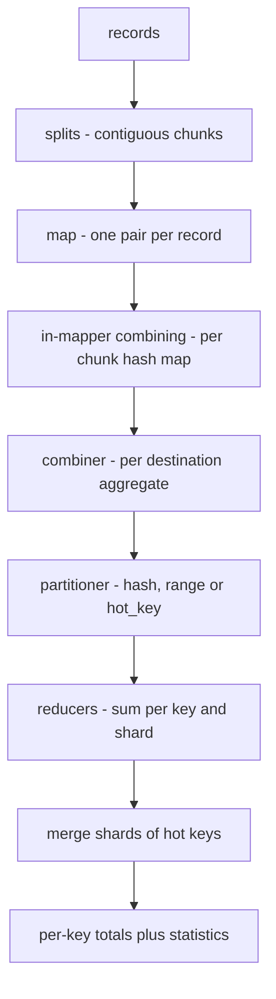
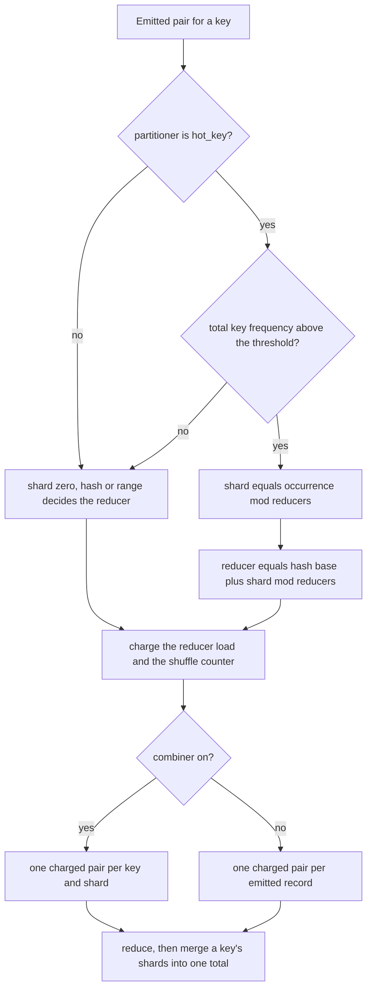
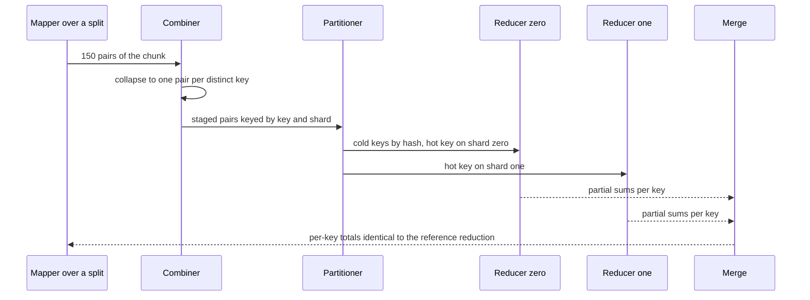

# 682 — Implement map-reduce optimization for skewed keys (combiner + partitioning)

> **Tier:** Expert · **CTCI chapter:** Ch 9 — System Design and Scalability
> **Task spec:** [682-implement-map-reduce-optimization-for-skewed-keys-combiner-parti.md](../../../tasks/expert/682-implement-map-reduce-optimization-for-skewed-keys-combiner-parti.md)
> **Solutions:** [Python](../../../solutions/python/expert/682-implement-map-reduce-optimization-for-skewed-keys-combiner-parti/solution.py) ·
> [Java](../../../solutions/java/expert/682-implement-map-reduce-optimization-for-skewed-keys-combiner-parti/Solution.java) ·
> [JavaScript](../../../solutions/javascript/expert/682-implement-map-reduce-optimization-for-skewed-keys-combiner-parti/solution.js) ·
> [C#](../../../solutions/csharp/expert/682-implement-map-reduce-optimization-for-skewed-keys-combiner-parti/Solution.cs)

## 1. Problem restatement

Build a word-count style MapReduce pipeline and make it survive **key skew** with the two classic
optimizations, measuring the effect instead of assuming it:

| Stage | What it does |
| --- | --- |
| split | cut the input into `splits` contiguous chunks (one per map task) |
| map | emit one `(key, value)` pair per record, `value = 1` |
| in-mapper combining | aggregate the pairs of a chunk **on the mapper** before anything leaves it |
| shuffle | group by `(key, shard)`; an optional **combiner** aggregates the pairs whose destination is the same reducer and counts what crossed the network |
| partition | assign each `(key, shard)` to a reducer with `hash`, `range` or `hot_key` |
| reduce + merge | sum the groups per key and merge the shards of a hot key back together |

Inputs: records `(key, value)` with integer values, a reducer count, a split count, flags for the
combiner and in-mapper combining, a partitioner name and an optional hot-key threshold. Output: the
per-key totals **plus** measured statistics — `shuffled`, `mapped`, `loads`, `max_load`,
`mean_load`, `imbalance = max_load / mean_load`, `groups`.

The results the checks assert:

- **Invariance.** All **144** configurations (3 partitioners x 4 reducer counts x 3 split counts x
  combiner on/off x in-mapper on/off) reproduce a single-machine reference reduction of the 600
  generated records exactly, and `sum(reference.values()) == 600`.
- **Skew is real.** In the generated dataset the top key `k000` holds **290** of the 600 records
  (48%) — far above the 15% the check demands.
- **The combiner pays.** Without either optimization every mapped pair crosses the network
  (`shuffled == 600`); with in-mapper combining and the combiner the shuffle volume on the standard
  dataset is **93** pairs, and no `(key, shard)` group exceeds one per key per shard (`groups <= 96`).
- **Partitioning under skew.** Hash partitioning leaves one reducer carrying at least the hottest
  key's own count (the checks measure `max_load == 338` of the 600 records, imbalance **2.25**);
  hot-key sharding lowers `max_load` to **163** and the imbalance to **1.09**, while both still
  return the exact answer.
- **The extreme case.** `[("only", 1)] * 200` with 4 reducers: hashing leaves `max_load == 200`, hot
  sharding gives `max_load == 100` and `groups == 2`.
- **Boundaries.** An empty input reduces to `{}` with `shuffled == 0` and `max_load == 0`; more
  splits than records is legal; 4 invalid configurations are rejected.

## 2. Intuition

The naive pipeline is *map every record, shuffle every pair, hash the key to a reducer*. It is
correct and it collapses the moment the key distribution is skewed: if one key owns half the
records, every one of those records is hashed to the same reducer while the other reducers idle, and
the job's wall time is the straggler's. Two independent levers fix it:

1. **Do the aggregation as early as possible.** Addition is associative and commutative, so
   aggregating 40 records that share 6 keys into 6 partial sums changes nothing but the volume that
   crosses the network. This works *per mapper* (in-mapper combining) and again *per reducer
   destination* (the combiner) — each stage can only shrink the stream.
2. **Break the hot key apart.** A single reducer cannot be fixed by a better hash: one key has one
   hash. Instead the hot key is **sharded** — its occurrences are spread over the reducers as
   `(key, shard)` pairs and the partial sums are merged after the reduce phase. That trades a second
   pass over one key's shards for a balanced load.



The statistics travel with the result (`shuffled`, `loads`, `imbalance`) because the whole point is
to *measure* the optimizations: the checks compare a configuration against the same configuration
with the optimization switched off, not against a claim.

## 3. Algorithm

1. **Generate or accept the records** and compute the reference answer with a plain dictionary pass.
   `key_counts` also precomputes the observed frequency of each key, which is what the skew test needs.
2. **Split** the record list into `splits` contiguous chunks (`size * (index + 1) // splits` marks
   each boundary), rejecting a split count below 1.
3. **Map** each chunk to its `(key, value)` pairs.
4. **Combine in the mapper** (optional): collapse a chunk's pairs into one pair per distinct key,
   iterated in sorted key order so the pipeline stays deterministic.
5. **Choose a shard per emitted pair.** `shard_of` returns `0` for `hash` and `range`; for `hot_key`
   it returns `occurrence mod reducers` when the key's total frequency exceeds the threshold, and
   `0` otherwise. The occurrence counter is updated per emitted pair, so a hot key's shards rotate.
6. **Combine per destination** (optional): stage `staged[(key, shard)]` sums, then emit **one pair
   per staged slot**, adding it to `groups` and charging the destination reducer's load and the
   `shuffled` counter. Without the combiner, every emitted pair is charged separately.
7. **Partition** with `reducer_for`: `hash` is `(sum of key code points * 31) mod reducers`,
   `range` maps the numeric part of the key into contiguous ranges
   (`min(reducers - 1, number * reducers // key_space)`), and `hot_key` is
   `(hash base + shard) mod reducers`, i.e. it rotates the hot key over the reducers.
8. **Reduce and merge**: sum the staged groups per key. Since a key may now live on several shards,
   the final loop adds all `(key, shard)` groups of a key into one total.

The default threshold is `max(1, len(records) // reducers)`: with 600 records and 4 reducers, any key
seen more than 150 times is treated as hot.

```text
function shard_of(key, occurrence, counts, reducers, partitioner, threshold)
    if partitioner = "hash" or partitioner = "range" then
        return 0
    if partitioner ≠ "hot_key" then
        raise "unknown partitioner"
    if counts[key] > threshold then
        return occurrence mod reducers
    return 0

function reducer_for(key, shard, reducers, partitioner, key_space)
    require reducers ≥ 1
    if partitioner = "hash" then
        return (sum of character codes of key * 31) mod reducers
    if partitioner = "hot_key" then
        return ((sum of character codes of key * 31) mod reducers + shard) mod reducers
    if partitioner = "range" then
        number ← numeric part of key
        return min(reducers - 1, number * reducers / key_space)
    raise "unknown partitioner"

procedure run_map_reduce(records, reducers, splits, use_combiner, use_in_mapper,
                         partitioner, hot_threshold)
    counts ← frequency of every key in records
    threshold ← hot_threshold when given, else max(1, length(records) / reducers)
    key_space ← largest numeric key plus one, or the number of distinct keys
    occurrence ← empty map, shuffled ← 0, mapped ← 0, loads ← zeros for each reducer
    groups ← empty map from (key, shard) to sum
    for chunk in split_records(records, splits) do
        emitted ← the pairs of chunk
        if use_in_mapper then
            collapsed ← sum of the values of chunk per key
            emitted ← the pairs of collapsed in sorted key order
        mapped ← mapped + length(chunk)
        staged ← empty map
        for (key, value) in emitted do
            shard ← shard_of(key, occurrence[key], counts, reducers, partitioner, threshold)
            occurrence[key] ← occurrence[key] + 1
            staged[(key, shard)] ← staged[(key, shard)] + value
        if use_combiner then
            for slot in sorted(staged) do
                reducer ← reducer_for(slot.key, slot.shard, reducers, partitioner, key_space)
                groups[slot] ← groups[slot] + staged[slot]
                loads[reducer] ← loads[reducer] + staged[slot]
                shuffled ← shuffled + 1
        else
            for (key, value) in emitted do
                shard ← shard_of(key, occurrence[key], counts, reducers, partitioner, threshold)
                occurrence[key] ← occurrence[key] + 1
                slot ← (key, shard)
                reducer ← reducer_for(key, shard, reducers, partitioner, key_space)
                groups[slot] ← groups[slot] + value
                loads[reducer] ← loads[reducer] + value
                shuffled ← shuffled + 1
    result ← empty map
    for (key, shard) in sorted(groups) do
        result[key] ← result[key] + groups[(key, shard)]
    return result, shuffled, mapped, loads, max(loads), mean(loads)
```



## 4. Worked example

Dataset: 600 records over 24 keys with a power-law-ish draw
(`key = keys * unit**4`, `unit` from splitmix64), 4 reducers, 4 splits, in-mapper and combiner on.

| Stage | Count | Note |
| --- | --- | --- |
| records | 600 | `mapped` sums to 600 |
| after map | 600 pairs | one pair per record |
| after in-mapper combining | at most 24 pairs per chunk | each of the 4 chunks of 150 records collapses to its distinct keys |
| after the combiner (`hash`) | **93** charged pairs | one pair per `(key, shard)`; `groups == 24` |
| after the combiner (`hot_key`) | **93** charged pairs | `groups == 27`, the hot key now occupying 4 shards |
| without any optimization | 600 charged pairs | `shuffled == 600`, the check's upper bound |

The hot key `k000` (290 of the 600 records, i.e. 48%) crosses the default threshold
`max(1, 600 // 4) = 150`, so `hot_key` rotates its occurrences over the four shards. The measured
reducer loads tell the story: `[100, 338, 77, 85]` under `hash` — one straggler at 338, an imbalance
of 2.25 — against `[163, 126, 148, 163]` under `hot_key`, an imbalance of 1.09. The uniform control
dataset (24 keys drawn evenly) tops out at 180, still worse than the sharded hot run.

The extreme case in the checks is the cleanest trace: `[("only", 1)] * 200` with 4 reducers and
`hot_key`. The key `only` has frequency 200 > threshold `max(1, 200 // 4) = 50`, its hash base is
`sum(ord(c) for c in "only") * 31 % 4 = 2`, and the 200 occurrences are dealt out as shards
`0, 1, 2, 3, 0, 1, ...` — each shard adding `1` to the base.

| Occurrence | shard `occurrence mod 4` | reducer `(2 + shard) mod 4` | group |
| --- | --- | --- | --- |
| 0 | 0 | 2 | `(only, 0)` |
| 1 | 1 | 3 | `(only, 1)` |
| 2 | 2 | 0 | `(only, 2)` |
| 3 | 3 | 1 | `(only, 3)` |
| 4 | 0 | 2 | `(only, 0)` again |

With 1 split the 200 records would land in 4 groups of 50; the check runs 2 splits, each of which
in-mapper-combines its 100 identical records into one pair before sharding, so the observed run has
`groups == 2`, `shuffled == 2` and `max_load == 100` — half of the `200` that plain hashing reports —
and the merge adds the two partial sums back to `{"only": 200}`.



## 5. Complexity

Let `N` be the number of records, `K` the number of distinct keys, `R` the reducer count, `S` the
split count and `P` the number of emitted pairs.

| Quantity | Best | Average | Worst | Why the bound holds |
| --- | --- | --- | --- | --- |
| map + in-mapper combining | O(N) | O(N) | O(N) | one hash insertion per record per chunk |
| combiner | O(P log P) | O(P) | O(P log P) | the staged slots are keyed by `(key, shard)`; the sorted iteration adds the log factor |
| shuffle volume | O(K · S) | O(K · S) | O(N) | one pair per `(key, shard)` at best, one pair per record without the combiner |
| partition | O(1) | O(1) | O(1) | a fixed hash or a couple of arithmetic operations per pair |
| reduce | O(N) | O(N) | O(N) | summing the groups touches each charged pair once |
| merge of shards | O(K) | O(K) | O(K · R) | one addition per `(key, shard)` group |
| `max_load`, `imbalance` | O(R) | O(R) | O(R) | a scan of the `R` load counters |
| Space | O(N) | O(N) | O(N) | the records, the per-chunk maps and the group map |
| Alternative: single machine | O(N) | O(N) | O(N) | the reference reduction; correct but no parallelism and no load distribution |

Skew is a *load* property, not an asymptotic one: hashing a single key of 200 records on 4 reducers
costs `max_load = 200` while the balanced answer would be 50, an imbalance factor of 4 — which is
exactly what the sharding check measures (`hot_single["max_load"] < 200`).

## 6. Pitfalls and edge cases

- **Non-commutative reduction.** The combiner is only legal because the reduction is associative and
  commutative; `is_combining_safe()` checks both on a fixed sample of pairs. A `max` or a
  concatenation would need a different treatment per direction.
- **A combiner that changes the answer.** Aggregating *before* partitioning is safe only if the
  destination of a pair does not depend on its value or its position in the stream; here the shard
  depends on the key and the occurrence index, so the combiner must stage per `(key, shard)`, not
  per key alone.
- **One key cannot be hashed apart.** `[("only", 1)] * 200` with `hash` leaves one reducer with
  everything; only sharding helps, and it needs the extra merge pass.
- **More splits than records.** Legal: `split_records` may hand a map task an empty chunk, and the
  pytest-style checks accept it; a split count below 1 is rejected.
- **Empty input.** `run_map_reduce([], 3, 2, True, True, "hash")` returns an empty result with
  `shuffled == 0` and `max_load == 0`; the same is asserted for zero records in the JavaScript
  solution.
- **Unknown partitioner, zero reducers.** Four invalid configurations are rejected:
  `reducers = 0`, `splits = 0`, a partitioner name that is not one of the three, and
  `split_records(records, 0)`.
- **Order dependence.** Mapper input order must not matter (the C# solution re-runs with a permuted
  order), so the in-mapper combination iterates keys in sorted order and the group map is traversed
  in sorted `(key, shard)` order.
- **Determinism.** The datasets are generated by splitmix64 from a fixed seed, and re-running the
  pipeline returns the same statistics dictionary, so the benchmark itself is reproducible.
- **Documented simplification.** Aggregation is integer addition, so no reducer-side sorting is
  needed, and there is **no network latency model** — only pair counts and load, which is precisely
  what partitioning changes. The Java solution goes one step further and compares its greedy load
  partitioner against the optimal key-to-partition assignment found by brute force on small key
  sets; the JavaScript solution's sampled-split partitioner sorts a sample and cuts equal ranges.

## 7. Variants and follow-ups

- The same shuffle machinery with two inputs, i.e. a join instead of a group by →
  [657 — distributed join shuffle simulation in map-reduce](../../../tasks/expert/657-implement-distributed-join-shuffle-simulation-in-map-reduce.md).
- A first, single-machine map-reduce aggregation →
  [469 — distributed aggregations map-reduce toy](../../../tasks/advanced/469-implement-distributed-aggregations-map-reduce-toy.md).
- Crash recovery for the map side, where a re-run must not double-count →
  [511 — checkpointed parallel map-reduce worker for crash recovery](../../../tasks/advanced/511-implement-checkpointed-parallel-map-reduce-worker-for-crash-reco.md).
- The lane-level primitives this pipeline is built from →
  [681 — numeric GPU kernel mapping to CPU threads](../../../tasks/expert/681-implement-numeric-gpu-kernel-mapping-to-cpu-threads-simulation.md).

## 8. Check yourself

<details><summary>Show answer</summary>
**Why can the combiner never change the final answer?** Because the aggregation it performs is
integer addition, which is associative and commutative, and because the pair it emits is destined for
the same reducer the individual pairs would have gone to — the destination is a function of the key
and the shard, not of the value. The pipeline is verified across all 144 configurations against a
single-machine reference.
</details>

<details><summary>Show answer</summary>
**With 600 records and 4 reducers, which keys does `hot_key` shard?** Those whose observed frequency
exceeds the default threshold `max(1, 600 // 4) = 150`. The dataset's top key holds 290 records, so it
is sharded into four `(key, shard)` groups — the run's `groups` count rises from 24 to 27 — and the
merge reassembles them into the exact per-key total.
</details>

<details><summary>Show answer</summary>
**Why is `max_load` for hash partitioning of one key of 200 records exactly 200?** Every record of a
key has the same hash, so all 200 land on one reducer: `max_load` is the key's own count, and the
imbalance ratio against the 50-record mean is 4.
</details>

<details><summary>Show answer</summary>
**What does in-mapper combining save that the combiner does not?** It removes pairs *before* they
leave the map task, so the saving applies to the mapper-to-reducer path itself; the combiner removes
pairs after the shard is known. On one split that emits 40 records over 6 keys, the mapper ships 6
pairs instead of 40.
</details>

<details><summary>Show answer</summary>
**Which of `hash`, `range` and `hot_key` place a key on several reducers, and what does that cost?**
Only `hot_key`: `reducer_for` adds the shard to the hash base, so one key occupies up to `R`
reducers, and the pipeline must merge the partial sums of a key afterwards. `hash` and `range` ignore
the shard, which is why the checks assert that `reducer_for` returns the same value for shard 0 and
shard 3 under those two partitioners.
</details>
