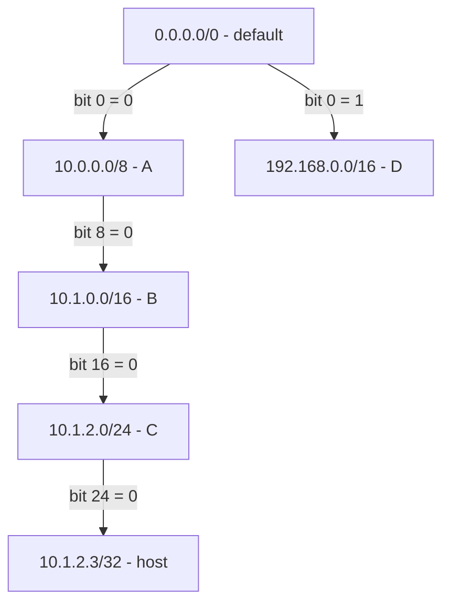
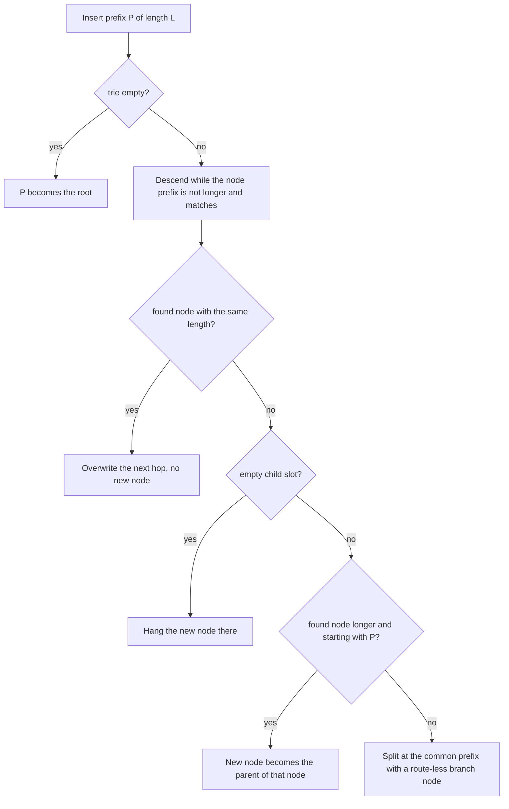
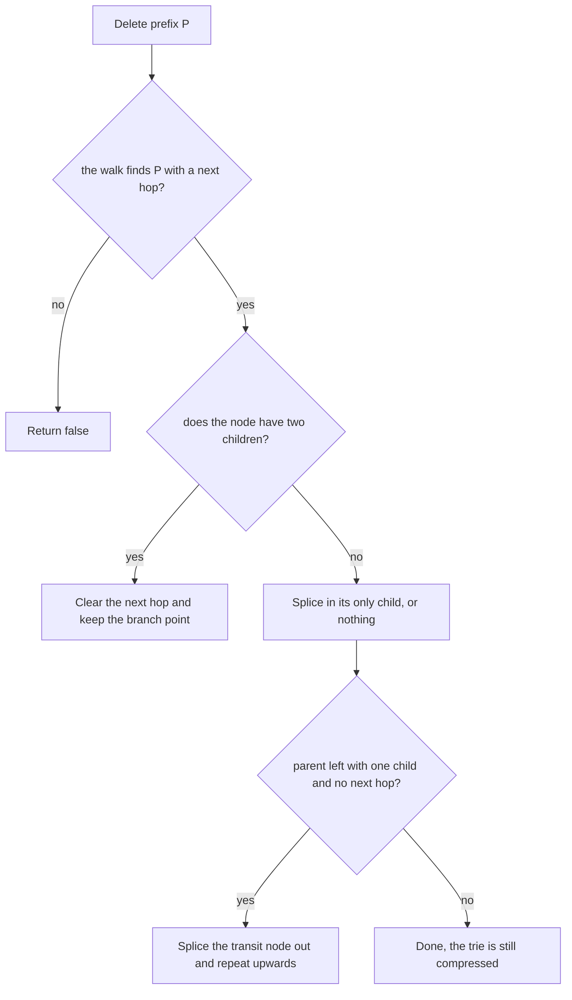
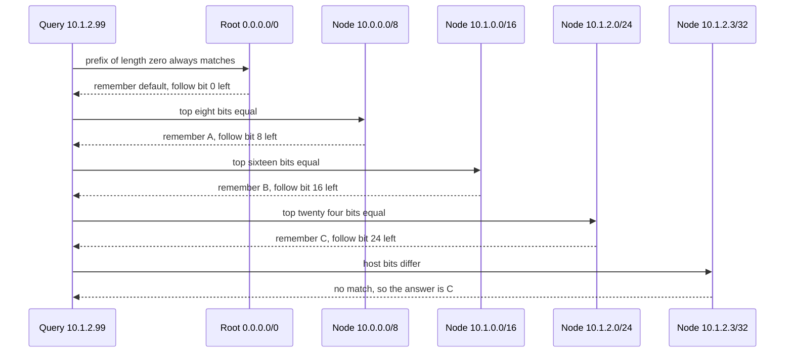

# 683 — Implement compacted trie (Patricia trie) for IP routing table simulation

> **Tier:** Expert · **CTCI chapter:** Beyond — Networking, OS & Real-Time
> **Task spec:** [683-implement-compacted-trie-patricia-trie-for-ip-routing-table-simu.md](../../../tasks/expert/683-implement-compacted-trie-patricia-trie-for-ip-routing-table-simu.md)
> **Solutions:** [Python](../../../solutions/python/expert/683-implement-compacted-trie-patricia-trie-for-ip-routing-table-simu/solution.py) ·
> [Java](../../../solutions/java/expert/683-implement-compacted-trie-patricia-trie-for-ip-routing-table-simu/Solution.java) ·
> [JavaScript](../../../solutions/javascript/expert/683-implement-compacted-trie-patricia-trie-for-ip-routing-table-simu/solution.js) ·
> [C#](../../../solutions/csharp/expert/683-implement-compacted-trie-patricia-trie-for-ip-routing-table-simu/Solution.cs)

## 1. Problem restatement

Implement a **path-compressed binary trie** (Patricia trie) for an IPv4 routing table and use it for
**longest-prefix match** (LPM):

| Operation | Contract |
| --- | --- |
| `insert(prefix, length, nexthop)` | install a route, or **update** the next hop of an existing prefix; returns whether the prefix was new |
| `search(address)` | LPM: the next hop of the longest installed prefix that contains the address, or none |
| `delete(prefix, length)` | remove a route, re-compacting the trie; returns whether it existed |
| `entries()` / `node_count()` / `problems()` | enumerate routes, count nodes, and re-check the structural invariants |

Every node stores a prefix (`bits` left-aligned plus its `length`) and an optional next hop. Nodes that
only exist to branch carry no next hop. The required invariants are: a child's prefix is strictly
longer than its parent's and extends it; a left child is reached by a `0` bit and a right child by a
`1`; **no node has a single child unless it also carries a next hop** (that is the compaction); and
the node count stays linear in the number of prefixes.

Concrete results asserted by the checks, on the classic table
`0.0.0.0/0` → `default`, `10.0.0.0/8` → `A`, `10.1.0.0/16` → `B`, `10.1.2.0/24` → `C`,
`192.168.0.0/16` → `D`, `10.1.2.3/32` → `host`:

- `search(10.1.2.3) == "host"` (a /32 beats the /24), `search(10.1.2.99) == "C"`,
  `search(10.1.9.9) == "B"`, `search(10.9.9.9) == "A"`, `search(192.168.5.5) == "D"` and
  `search(8.8.8.8) == "default"`.
- re-inserting `10.1.2.0/24` returns **false**, changes the next hop to `C2` and leaves `size` and
  `node_count()` unchanged — an update, not a new route.
- deleting the /24 makes `search(10.1.2.99)` fall back to `"B"`; deleting the /32 makes
  `search(10.1.2.3)` fall back to `"B"`; deleting `0.0.0.0/0` makes `search(8.8.8.8)` return none;
  deleting twice or deleting a route that was never installed returns **false**.
- the classic table occupies **6 nodes for 6 routes**, while the uncompressed per-bit trie built from
  the same table needs **49**; the two far-apart prefixes `128.0.0.0/1` and `10.0.0.0/32` share one
  branch node, so that trie needs at most **3** nodes.
- 60 random tables (8 to 19 prefixes over lengths 8, 12, 16, 20, 24, 28, 32) drive **3000** lookups
  that all agree with an independent linear scan, before and after deletions.

## 2. Intuition

The textbook structure for LPM is a binary trie in which every prefix is inserted bit by bit: the
node after `k` steps represents the prefix of length `k`. It works, and it wastes almost everything:
a /32 route occupies 32 nodes, and a table of `P` prefixes can need up to `32P` nodes — the classic
table's six routes need **49** nodes. Worse, most of those nodes have a single child and exist only to
carry the path forward.

The Patricia trie removes exactly those nodes. Two observations do it:

1. **The bits between a node and its child are implicit.** A node stores its own prefix; the child is
   reached by the *single bit that follows the parent's prefix length*, and the child's prefix may be
   much longer than `parent.length + 1`. Chains collapse into one long edge.
2. **A node is worth keeping only if it branches or holds a route.** Hence the invariant "every node
   has a next hop or two children". A node with one child and no route is a transit node and must be
   spliced out.

The consequence is that the trie has `O(P)` nodes, and a lookup walks at most one node per branching
step along the address — bounded by the 32 address bits (the Java solution states the bound as at most
33 node visits), not by the depth of a per-bit chain.



Each edge label is the bit index at which the child's prefix distinguishes itself from the parent's —
the parent's own prefix is already matched, so the walk only ever tests one bit per edge. The nested
routes `10/8 ⊃ 10.1/16 ⊃ 10.1.2/24 ⊃ 10.1.2.3/32` form a chain in which every node also carries a
next hop, which the invariant permits.

## 3. Algorithm

**Insert** (`prefix`, `length`, `nexthop`):

1. Empty trie → make the root this node; report "new".
2. Descend while the current node's prefix is **not longer** than the new one and matches it exactly
   (compare the node's own bits against the top `node.length` bits of the new prefix). Keep the
   parent and the bit that led to the child, so the new node can be reattached.
3. If the walk meets a node of the *same* length, it is the same prefix: overwrite the next hop and
   report whether it had one before.
4. If the child slot is empty, hang a new node there and report "new".
5. If the node found is longer and starts with the new prefix, the new prefix is an **ancestor**: make
   a node for it and put the found node below it, keyed by the bit right after the new prefix length.
6. Otherwise the new prefix **diverges** from the found node at a shared-prefix length: create an
   intermediate node at that length with no next hop and give it the found node and a new node as
   children, keyed by their bits at that position. Reattach it at the parent's child slot.

**Search** (`address`): walk down while the node's prefix matches the address's top `node.length`
bits; remember the last node that carries a next hop; from each node step to the child selected by
`address`'s bit at `node.length` (or stop at a /32). The last remembered next hop is the answer,
because prefix length strictly increases on the way down.

**Delete** (`prefix`, `length`): walk the same way, collecting the path. If the node has two children,
just clear its next hop — it is still needed as a branch point. Otherwise splice it out with its only
child (or nothing) as replacement, and walk back up: while a parent has one child and no next hop, it
is a transit node and is spliced out too.

```text
function common_prefix(node, prefix, length)
    for index ← 0 to min(node.length, length) - 1 do
        if bit(node, index) ≠ bit(prefix, index) then
            return index
    return min(node.length, length)

procedure insert(prefix, length, nexthop)
    require nexthop is not none
    if root is none then
        root ← new node(prefix, length, nexthop)
        size ← size + 1
        return true
    node ← root
    parent ← none
    while node is not none and node.length ≤ length and tops(node) = tops(prefix, node.length) do
        if node.length = length then
            created ← node.nexthop is none
            node.nexthop ← nexthop
            size ← size + created
            return created
        parent ← node
        parent_bit ← bit(prefix, node.length)
        node ← child(node, parent_bit)
    if node is none then
        attach new node(prefix, length, nexthop) at parent_bit of parent
    else if node.length > length and tops(node, length) = tops(prefix, length) then
        split ← new node(prefix, length, nexthop)
        child(split, bit(node, length)) ← node                     // the new prefix is an ancestor
    else
        shared ← common_prefix(node, prefix, length)
        split ← new node(prefix, shared, none)
        child(split, bit(node, shared)) ← node
        child(split, bit(prefix, shared)) ← new node(prefix, length, nexthop)
    attach split at parent_bit of parent, or as the root when parent is none
    size ← size + 1
    return true

function search(address)
    node ← root
    best ← none
    while node is not none and tops(address, node.length) = tops(node) do
        if node.nexthop is not none then
            best ← node.nexthop
        if node.length ≥ 32 then
            break
        node ← child(node, bit(address, node.length))
    return best

procedure delete(prefix, length)
    walk down, collecting (node, parent, parent_bit) into path
    if the last node does not exist, or has a different length, or has no next hop then
        return false
    if it has two children then
        clear its next hop and return true                    // still a branch point
    replacement ← its only child, or none
    for index ← length(path) - 1 down to 0 do
        node, parent, parent_bit ← path[index]
        install replacement at parent_bit of parent, or as the root when parent is none
        if parent is none or parent.nexthop is not none or parent has two children then
            return true
        replacement ← the only child of parent                // splice the transit node out
    return true
```



## 4. Worked example

Lookup of `10.1.2.99` (`0A 01 02 63`) in the classic table. Each row is one node visit; the address
bits are tested one per edge.

| Node visited | Prefix check | Next hop kept | Next edge |
| --- | --- | --- | --- |
| `0.0.0.0/0` | 0 bits, trivially equal | `default` | bit 0 of `0A...` is `0` → left |
| `10.0.0.0/8` | top 8 bits `0A` equal | `A` | bit 8 = `0` → left |
| `10.1.0.0/16` | top 16 bits `0A01` equal | `B` | bit 16 = `0` → left |
| `10.1.2.0/24` | top 24 bits `0A0102` equal | `C` | bit 24 = `0` → left |
| `10.1.2.3/32` | top 32 bits `0A010263` vs `0A010203` differ | — | stop |

The walk stops inside the /32 (which does not match) and returns `C` — the /24 covering the address.
The same walk on `10.1.2.3` reaches the /32 node with a matching prefix and returns `host`, and on
`10.1.9.9` it stops at the /24 test, keeping `B` from the previous level.

Deleting `10.1.2.0/24` from that state: the node `10.1.2.0/24` carries a next hop and has a single
child, so it is spliced out and the /32 host route takes its place under `B` (reached by bit 16 = `0`).
`B` keeps its next hop, so the compaction stops there; `search(10.1.2.99)` now falls back to `B`.
Deleting `0.0.0.0/0` is the mirror case: the root has **two** children, so it may not be spliced — only
its next hop is cleared, and `search(8.8.8.8)` returns none while the rest of the table stays intact.





Inserting `10.1.2.3/32` into a trie that holds the /24 is the **ancestor** case read in the other
direction: the descending walk stops at the /24 (the /32 is longer), sees an empty child slot, and
hangs the /32 there keyed by bit 24. A genuine split appears in the `deep` check: inserting
`128.0.0.0/1` (`1...`) and then `10.0.0.0/32` (`0...`) has a common prefix of zero bits, so an
intermediate route-less node of length 0 is created with the two routes as children by bit 0 — three
nodes for two far-apart routes, which the checks bound as `node_count() <= 3`.

## 5. Complexity

Let `P` be the number of installed prefixes, `W = 32` the address width, and `d` the number of nodes
visited on a walk (`d <= 33`, since each visit consumes at least one address bit).

| Operation | Best | Average | Worst | Why the bound holds |
| --- | --- | --- | --- | --- |
| `search` | O(1) | O(d) | O(W) | one address bit is consumed per edge; the walk stops at the first mismatch or at a /32 |
| `insert` (update path) | O(1) | O(d) | O(W) | the same descent, then a single next-hop write |
| `insert` (split) | O(d) | O(d) | O(W) | plus `common_prefix`, which compares at most `W` bits once |
| `delete` | O(1) | O(d) | O(W) | the descent plus the walk back up over the collected path, splicing transit nodes |
| `node_count` | O(P) | O(P) | O(2P) | the invariant keeps every node useful, so nodes are linear in routes (6 nodes for 6 routes in the classic table, and `<= 2 * P` asserted on random ones) |
| Space | O(P) | O(P) | O(2P) | one node per route plus one route-less branch per split |
| Uncompressed bit trie | O(P · W) | O(P · W) | O(P · W) | one node per bit of every prefix: 49 nodes for the classic table's six routes |

The linear-scan alternative has the same asymptotics only in a very loose sense: it costs `O(P)` per
lookup with a mask-and-compare per route, whereas the trie costs `O(W)` independent of `P`. The
checks use the scan as an oracle rather than a competitor, and they use the uncompressed trie to
demonstrate that the compaction is real (`node_count() < uncompressed.nodes`).

## 6. Pitfalls and edge cases

- **The default route is a prefix of length 0.** `parse_ipv4("0.0.0.0/0") == (0, 0)`; a /0 node
  matches every address when the walk tests zero bits, which is what makes
  `search(8.8.8.8) == "default"` work.
- **Host routes are a prefix of length 32.** `parse_ipv4("10.1.2.3")` without a slash is a /32; the
  walk stops at a /32 node because it may not step past the 32nd bit.
- **Host bits must be masked away.** Everything is compared through `mask_of(length)`; otherwise
  `10.1.2.99/24` and `10.1.2.0/24` would look like different routes.
- **Duplicates are updates.** `insert` on an existing prefix overwrites the next hop, returns false
  and must not add a node — the check asserts `node_count()` is unchanged.
- **Deletion must fall back, not delete the coverage.** Removing `10.1.2.0/24` leaves `/16 B`
  answering for the same address; removing the /32 leaves the /16 as well.
- **A branch point must survive its route.** Deleting a node with two children clears only its next
  hop; the `problems()` invariant "single-child node without a next hop" would flag anything else.
- **Transit nodes reappear after deletion.** Splicing a leaf can leave its parent with one child and
  no route, so the splice loop walks back up until it meets a node that carries a next hop or has two
  children.
- **Malformed text.** Six inputs are rejected: a non-numeric length, `/33`, three octets, an octet
  above 255, the empty string and a negative length.
- **Empty and emptied tries.** `search` on an empty trie returns none; deleting every route of a
  20-route table leaves `size == 0`, `node_count() == 0` and no invariant problems.
- **Documented simplification.** IPv4 only, **one next hop per prefix**, no metric or tie-breaking
  between equal-length prefixes, and no incremental updates from a routing protocol — the Java and C#
  solutions state the same scope and add an extra structural check that a node's prefix length equals
  the bit index it tests and that bit indices strictly increase along every root-to-leaf path.

## 7. Variants and follow-ups

- The same lookup pushed all the way down to bit tricks and memory layout →
  [684 — longest-prefix-match lookup optimized (binary trie)](../../../tasks/expert/684-implement-longest-prefix-match-lookup-optimized-binary-trie.md)
  and [685 — fast IP routing with TCAM-like behaviour](../../../tasks/expert/685-implement-fast-ip-routing-simulation-with-tcam-like-behavior-bit.md).
- The uncompressed cousin, for the plain radix-tree mechanics →
  [253 — compressed trie (radix tree) basics](../../../tasks/intermediate/253-implement-compressed-trie-radix-tree-basics.md).
- Compaction applied to integers with persistence instead of IPv4 prefixes →
  [583 — compressed persistent trie for integers](../../../tasks/advanced/583-implement-compressed-persistent-trie-for-integers-binary-trie-pe.md).
- What the routing table is *for* once lookups are fast: policy between paths →
  [686 — BGP path-vector with simplified policy](../../../tasks/expert/686-implement-bgp-path-vector-simplified-policy-simulation.md).

## 8. Check yourself

<details><summary>Show answer</summary>
**Why can a node have only one child in this trie, and when is that allowed?** Because chains are
compressed: a route like `10.1.2.0/24` whose only descendant is `10.1.2.3/32` needs the intermediate
node to store the /24's own next hop. The invariant is therefore "a node has a next hop or two
children" — a single-child node without a route would be a useless transit node and `problems()`
reports it.
</details>

<details><summary>Show answer</summary>
**The trie holds 6 nodes for the classic table and the uncompressed trie 49: where does the
difference come from?** The uncompressed trie stores one node per bit of every prefix
(`0 + 8 + 16 + 24 + 16 + 32 = 96` bit-steps before sharing), while the compressed trie stores one node
per route plus one route-less node per genuine split. With no split in this table, 6 routes are 6
nodes.
</details>

<details><summary>Show answer</summary>
**Why does the walk stop at a /32 node instead of moving to a child?** There is no bit 32 to test: a
host route's prefix covers the whole address, so the node is either a match or a mismatch, and the walk
ends there — exactly the case where `10.1.2.3` matches `host` and `10.1.2.99` keeps the /24 from the
previous level.
</details>

<details><summary>Show answer</summary>
**After deleting `10.1.2.0/24`, why is the answer for `10.1.2.99` the /16 rather than the /32 host
route?** The /32 is `10.1.2.3/32`; it only matches that one address, so `10.1.2.99` fails its prefix
test and the walk keeps the last successful route, which is `B` on `10.1.0.0/16`.
</details>

<details><summary>Show answer</summary>
**What does the linear scan add to the tests if the trie is asymptotically better?** It is an
independent oracle: it re-derives the longest match with a mask-and-compare over the whole table, so
the 3000 comparisons across 60 random tables detect any divergence of the trie's answer — including
after deletions, where the remaining routes alone define the expected result.
</details>
