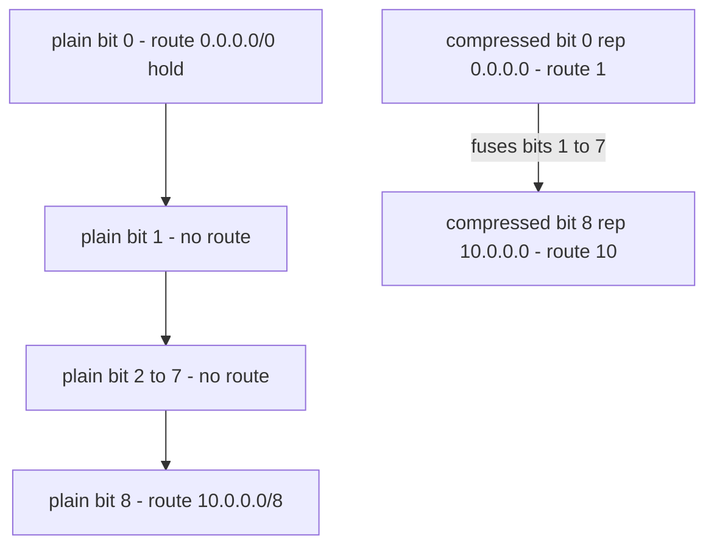
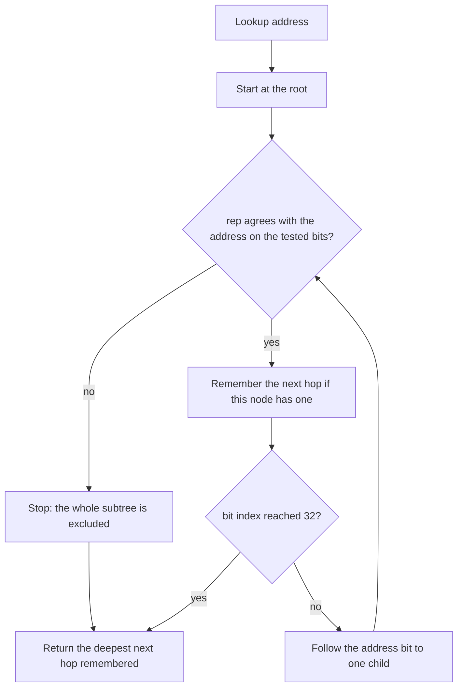
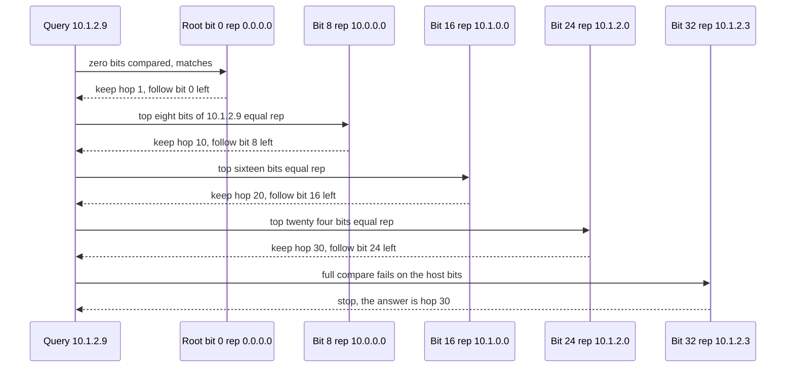

# 684 — Implement longest-prefix-match lookup optimized (binary trie)

> **Tier:** Expert · **CTCI chapter:** Beyond — Networking, OS & Real-Time
> **Task spec:** [684-implement-longest-prefix-match-lookup-optimized-binary-trie.md](../../../tasks/expert/684-implement-longest-prefix-match-lookup-optimized-binary-trie.md)
> **Solutions:** [Python](../../../solutions/python/expert/684-implement-longest-prefix-match-lookup-optimized-binary-trie/solution.py) ·
> [Java](../../../solutions/java/expert/684-implement-longest-prefix-match-lookup-optimized-binary-trie/Solution.java) ·
> [JavaScript](../../../solutions/javascript/expert/684-implement-longest-prefix-match-lookup-optimized-binary-trie/solution.js) ·
> [C#](../../../solutions/csharp/expert/684-implement-longest-prefix-match-lookup-optimized-binary-trie/Solution.cs)

## 1. Problem restatement

Store one IPv4 prefix table in a **binary trie** and make the longest-prefix-match (LPM) lookup as
cheap as possible, measuring the result rather than claiming it. Two structures are built over the
same table and cross-checked:

| Structure | Idea |
| --- | --- |
| `BinaryTrie` | the textbook one-node-per-bit trie: a node at bit index `b` tests bit `b`, a prefix of length `L` is stored after exactly `L` tests |
| `CompressedTrie` | the optimized variant: hop-less unary chains are fused away, and each surviving node keeps `rep`, the `bit` address bits that led to it in the plain trie, so one mask compare verifies the whole fused path |

Both are measured with a `visits` counter (nodes touched per lookup), and an independent
`brute_force_lpm` linear scan is the oracle for every lookup. `validate()` audits the plain trie:
a child sits exactly one bit below its parent, a node holding a next hop sits at bit index equal to
the prefix length, and every stored prefix agrees with the path that reaches it.

Concrete results asserted by the checks, on the table
`0.0.0.0/0` → `1`, `10.0.0.0/8` → `10`, `10.1.0.0/16` → `20`, `10.1.2.0/24` → `30`,
`10.1.2.3/32` → `40`, `192.168.0.0/16` → `50`:

- `lookup(10.1.2.3) == 40` (the /32 beats the /24), `lookup(10.1.2.9) == 30`,
  `lookup(10.1.9.9) == 20`, `lookup(10.9.9.9) == 10`, `lookup(172.16.0.1) == 1`,
  `lookup(192.168.5.5) == 50`.
- the plain trie needs **49 nodes** with the deepest tested bit at **32**; the compressed trie needs
  **6 nodes** and its longest root-to-leaf path is **5** nodes. The same lookups cost **33** visits
  plain versus **5** compressed for `10.1.2.3`, and **7** versus **2** for `8.8.8.8`.
- after deleting `0.0.0.0/0`, `lookup(172.16.0.1)` is none; after deleting `10.1.2.0/24`,
  `lookup(10.1.2.9)` falls back to **20**, then to **10** once the /16 goes too; deleting twice
  returns false; re-inserting restores all 6 prefixes.
- 64 host routes `10.0.0.k.1/32` share long unary chains: the plain trie needs **more than 64**
  nodes, the fused trie exactly `2 * 64 - 1 = 127`, and fusing strictly reduces the visits.
- four 220-prefix random tables (built with prefix lengths capped at 8, 16, 24, 32) drive
  **880** lookups against the scan, plus 120 compressed lookups each, with
  `compressed.visits <= plain.visits` for every query.

## 2. Intuition

The naive LPM is a scan: sort the prefixes, mask the address once per prefix, keep the longest match.
That is `O(P)` per lookup, and it cannot exploit the fact that the table is a hierarchy.

A bit-by-bit trie turns LPM into a **single downward pass** with no backtracking: the address's bits
select exactly one child at every node, and every node on the way *matches the address by
construction*, because reaching it already proved all the bits above. So the answer is simply the
deepest node on the path that carries a next hop, and the other child never has to be explored —
which is exactly the property a sorted list of prefixes lacks.

The plain trie still pays for structure: 49 nodes for 6 routes, 657 for the 64-host-route chain, and
up to 33 node visits per lookup. The compressed variant removes the waste:

1. **Fuse unary, route-less chains.** If a node has no next hop and one child, it carries no
   information — skip it and record the bit that was skipped in `rep`.
2. **Verify the fused path with one compare.** `addr & mask(bit) == rep & mask(bit)` replaces
   walking the skipped bits.
3. **Stop early on a mismatch.** Prefixes along a root-to-leaf path are nested proper extensions, so
   if `rep` disagrees with the address, every prefix in the subtree disagrees too: the descent ends
   there. That is why the fused trie visits at most as many nodes as the plain one, and often far
   fewer.



The two chains above are the same route table; the compressed node remembers only that it is tested
at bit 8 with `rep = 10.0.0.0`, so a lookup of `8.8.8.8` fails its compare and stops after 2 visits —
the plain trie walks 7 nodes before discovering that `8.8.8.8` is not under `10.0.0.0/8`.

## 3. Algorithm

**Insert (plain trie).** Start at the root at bit 0; while the node's bit index is below the prefix
length, create the missing child for the address's bit at that index and step down. At the node whose
bit index equals the prefix length, store the next hop, the length and the masked prefix.

**Lookup (plain trie).** Walk down; at every node remember its next hop if it has one; step to the
child selected by the address's bit at the node's index; stop at bit 32 or at a missing child. The
last remembered next hop is the longest match.

**Delete (plain trie).** Walk to the node at the prefix length, clear its next hop, then walk back up
pruning any child that ends up with no next hop and no children — that keeps the trie canonical.

**Build (compressed trie).** Insert every route into a plain trie, then recursively copy it: a node
with no next hop, at a bit index below 32 and with exactly one child, is skipped, and the child is
built with `rep` extended by that skipped bit. Everything else becomes a node carrying the absolute
bit index, `rep`, and its route.

**Lookup (compressed trie).** At each node, compare `addr & mask(bit)` with `rep & mask(bit)`. A
mismatch ends the walk (the whole subtree is out); otherwise remember the next hop and step to the
child chosen by the address's bit at `bit`; stop at bit 32.

```text
function mask_for(plen)
    return all ones shifted left by 32 - plen, or zero when plen is zero

procedure insert(addr, plen, hop)                       // plain trie
    if root is none then
        root ← new node at bit 0
    node ← root
    while node.bit < plen do
        index ← bit of addr at position node.bit
        if node.children[index] is none then
            node.children[index] ← new node at bit node.bit + 1
        node ← node.children[index]
    node.hop ← hop
    node.plen ← plen
    node.addr ← addr & mask_for(plen)

function lookup(addr)                                   // plain trie
    best ← none
    node ← root
    while node is not none do
        if node.hop is not none then
            best ← node.hop
        if node.bit ≥ 32 then
            break
        node ← node.children[bit of addr at position node.bit]
    return best

procedure delete(addr, plen)                            // plain trie
    walk down to the node at bit index plen, collecting the path
    if the node does not exist or carries no next hop then
        return false
    clear its next hop, length and address
    while the path is not empty do
        parent ← the last node pushed
        index ← bit of addr at position parent.bit
        child ← parent.children[index]
        if child carries no next hop and has no children then
            parent.children[index] ← none
        else
            break
    return true

function build(node, rep)                               // compressed trie
    if node carries no next hop and node.bit < 32 and node has exactly one child then
        index ← the index of that single child
        return build(node.children[index], rep with bit node.bit set to index)
    fused ← new compressed node at bit node.bit with path rep, carrying node's route
    for index ← 0 to 1 do
        if node.children[index] is not none then
            fused.children[index] ← build(node.children[index],
                                          rep with bit node.bit set to index)
    return fused

function compressed_lookup(addr)
    best ← none
    node ← root
    while node is not none do
        if addr & mask_for(node.bit) ≠ node.rep & mask_for(node.bit) then
            break                                       // the subtree cannot match either
        if node.hop is not none then
            best ← node.hop
        if node.bit ≥ 32 then
            break
        node ← node.children[bit of addr at position node.bit]
    return best
```



Java's solution adds a third level of the same idea: a **first-byte fast path** with 256 cached entry
points, each recording the node reached after the top 8 bits plus the best route seen inside those 8
bits, so a lookup starts 8 levels down. It also exposes `nodeCount()`, bounded by
`1 + sum(prefix lengths)`, which is the arithmetic reason a trie beats a scan.

## 4. Worked example

Lookups on the six-route table. The table shows nodes visited by each structure, measured with the
`visits` counter (run of the Python solution).

| Address | Answer | Plain visits | Compressed visits | Why it stops |
| --- | --- | --- | --- | --- |
| `10.1.2.3` | 40 | 33 | 5 | the /32 is the deepest route; the compressed walk goes root, /8, /16, /24, /32 |
| `10.1.2.9` | 30 | 29 | 5 | the /32's `rep` disagrees on the last octet, so the /24's hop stands |
| `10.1.9.9` | 20 | 21 | 4 | the /24 node fails its 24-bit compare |
| `10.9.9.9` | 10 | 13 | 3 | the /16 node fails its compare after the /8 matched |
| `192.168.5.5` | 50 | 17 | 2 | the root is followed straight to the fused /16 node |
| `8.8.8.8` | 1 | 7 | 2 | the /8 node fails, leaving the default route from the root |
| `172.16.0.1` | 1 | 2 | 2 | the /8 node fails immediately, default route stands |

The compressed walk for `10.1.2.9` in detail:

| Node | Bit index | `rep` | Compare | Hop kept |
| --- | --- | --- | --- | --- |
| root | 0 | `0.0.0.0` | 0 bits, equal | 1 (default) |
| `/8` | 8 | `10.0.0.0` | top 8 bits equal | 10 |
| `/16` | 16 | `10.1.0.0` | top 16 bits equal | 20 |
| `/24` | 24 | `10.1.2.0` | top 24 bits equal | 30 |
| host | 32 | `10.1.2.3` | `10.1.2.9` differs | — |

The chain case is where fusing pays most: 64 host routes inside `10.0.0.0/8` create a plain trie of
**657** nodes (each host route shares long unary runs) against **127** fused nodes, exactly
`2 * 64 - 1` — one node per branch point plus one per route. The fused root even rejects an unrouted
address in a **single** visit: `lookup(10.0.99.0)` compares `rep = 10.0.0.0/8` against `10.0.99.0`,
fails, and returns none without touching a second node.



## 5. Complexity

Let `P` be the number of prefixes, `W = 32` the address width and `s = sum(prefix lengths)`.

| Quantity | Plain trie | Compressed trie | Why |
| --- | --- | --- | --- |
| Lookup time | O(W) visits | O(depth) visits, `<= O(W)` | one bit per level; fusing plus the `rep` early exit never visits more nodes, which the checks assert per query |
| Insert time | O(W) | built from the plain trie in O(nodes) | the plain insert creates at most one level per bit; the fused build is a single traversal |
| Delete time | O(W) | — | descend to the node, then prune the unary tail upwards |
| Node count | `<= 1 + s` | `<=` plain node count | shared prefixes occupy one chain (Java's `nodeCount()` bound); fusing only removes nodes, and for the 64-host-route chain it lands exactly at `2P - 1` |
| Space | O(P · W) | O(P) to O(P · W) | 49 nodes for 6 routes plain, 6 compressed; 657 versus 127 for the chain |
| Oracle scan | O(P) per lookup | O(P) per lookup | mask and compare once per prefix — correct but linear, so it is used only as the reference |
| First-byte fast path (Java) | — | starts 8 levels down | 256 cached entry points, each with the best route inside the first byte |

Time and space are both measured, not assumed: the checks compare `compressed.visits` against
`plain.visits` for every query and `c_nodes <= trie.nodes` for every table, so an "optimization" that
made lookups longer would fail the suite rather than pass unnoticed.

## 6. Pitfalls and edge cases

- **The default route must be storable at bit 0.** A /0 prefix matches everything, so the root
  carries a next hop; after deleting it, unmatched addresses return none.
- **Host bits are not part of the key.** `parse_prefix("10.1.2.77/24")` masks to `10.1.2.0`; a bare
  address without a slash is a /32 host route.
- **Strict parsing.** Nine malformed forms are rejected, including `10.0.0.256/8`, `10.0.0/8`,
  `/8`, `10.0.0.a/8`, `010.0.0.1/8` (leading zero), `10.0.0.0/2x` and `1.2.3.4/5/6`.
- **The compression must not lose routes.** `CompressedTrie` is built from the plain trie and every
  lookup is compared with the scan; the invariant `child.bit > node.bit` is checked while building
  the fused structure so a fusion can never reverse the order.
- **Stopping early is only valid because prefixes nest.** A `rep` mismatch excludes the whole
  subtree, which is true because every prefix below extends the path; a trie with unrelated routes
  inside one subtree would break it, and the invariant checks reject that shape.
- **Pruning after deletion.** A deleted route can leave a chain of route-less single-child nodes;
  the plain trie prunes them on the way back up, otherwise later node counts and visit counts would
  drift. The JavaScript solution does the same by recomputing `bestDepth` bottom-up and unlinking
  childless leaves, and it exposes `bestDepth` as a second early-exit rule: a subtree with no prefix
  at all ends the walk.
- **Empty tables.** `BinaryTrie().validate() == []` and `CompressedTrie([]).lookup(...)` returns
  none — an empty trie has no root and no prefixes.
- **Re-insertion after deletion.** Delete then re-insert must restore exactly `len(prefixes)`
  entries; the checks re-add the /16, the /24 and the default route and re-validate.
- **Determinism.** The random tables come from a fixed-seed splitmix64 generator, so the 880
  generated prefixes are the same on every run and the measurements are reproducible.
- **Documented simplification.** Real routers walk pipelined hardware stages or TCAM banks; here the
  trie is a pointer structure with one port per node, one next hop per prefix and no metric
  tie-breaking. The C# solution states the same scope in its own terms: it keeps the prefix bits of a
  node's path, so a route lives at the node whose depth equals the route length and a lookup touches
  at most 33 nodes.

## 7. Variants and follow-ups

- The compressed-but-not-fused ancestor of this structure, with insert/delete re-compaction →
  [683 — Patricia trie for an IP routing table](../../../tasks/expert/683-implement-compacted-trie-patricia-trie-for-ip-routing-table-simu.md).
- Bitwise lookups pushed into TCAM-like behaviour instead of a pointer tree →
  [685 — fast IP routing with TCAM-like behaviour](../../../tasks/expert/685-implement-fast-ip-routing-simulation-with-tcam-like-behavior-bit.md).
- The same fusion on integer keys with persistence →
  [583 — compressed persistent trie for integers](../../../tasks/advanced/583-implement-compressed-persistent-trie-for-integers-binary-trie-pe.md).
- Where the fast path goes when the table changes often, i.e. update streams from a protocol →
  [688 — distance-vector routing (RIP) with split horizon](../../../tasks/expert/688-implement-distance-vector-routing-rip-with-split-horizon.md).

## 8. Check yourself

<details><summary>Show answer</summary>
**Why does LPM on a bit trie need no backtracking?** Because the address determines one child at every
level: walking bit `b` down the trie means the current node's prefix is a prefix of the address. Every
node on the path therefore matches, and the deepest one holding a next hop is the longest match — the
other child can never contain a longer match.
</details>

<details><summary>Show answer</summary>
**What exactly does `rep` buy in the compressed trie?** It replaces the walk over fused levels with a
single `addr & mask(bit) == rep & mask(bit)` test, and because a mismatch also excludes the entire
subtree, it lets the descent stop early. On the six-route table that turns 33 visits for `10.1.2.3`
into 5, and 7 visits for `8.8.8.8` into 2.
</details>

<details><summary>Show answer</summary>
**Why is the fused node count exactly `2P - 1` for the 64-host-route chain?** The 64 host routes in
`10.0.0.0/8` form a binary tree of branch points with 64 leaves, and fusing removes everything that is
not a branch point or a route: `64 + 63 = 2 * 64 - 1 = 127` nodes.
</details>

<details><summary>Show answer</summary>
**After deleting `10.1.2.0/24` and then `10.1.0.0/16`, what answers for `10.1.2.9` and why?** The /8
route: each deletion removes one level of coverage, and the check asserts the fallback in that order
(30 → 20 → 10), which is the same rule `brute_force_lpm` applies over the remaining prefix list.
</details>

<details><summary>Show answer</summary>
**What does the linear scan contribute if the trie is faster?** It is an independent oracle: it
recomputes the answer by masking every prefix, so 880 lookups on random tables plus the hand-written
cases detect any disagreement — including tables whose prefix lengths are capped at 8, 16 or 24, where
most addresses fall back to a short prefix or to nothing at all.
</details>
