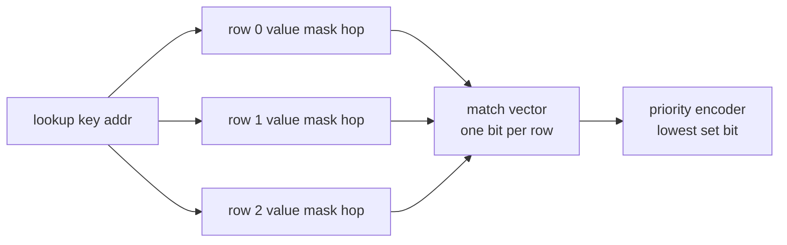
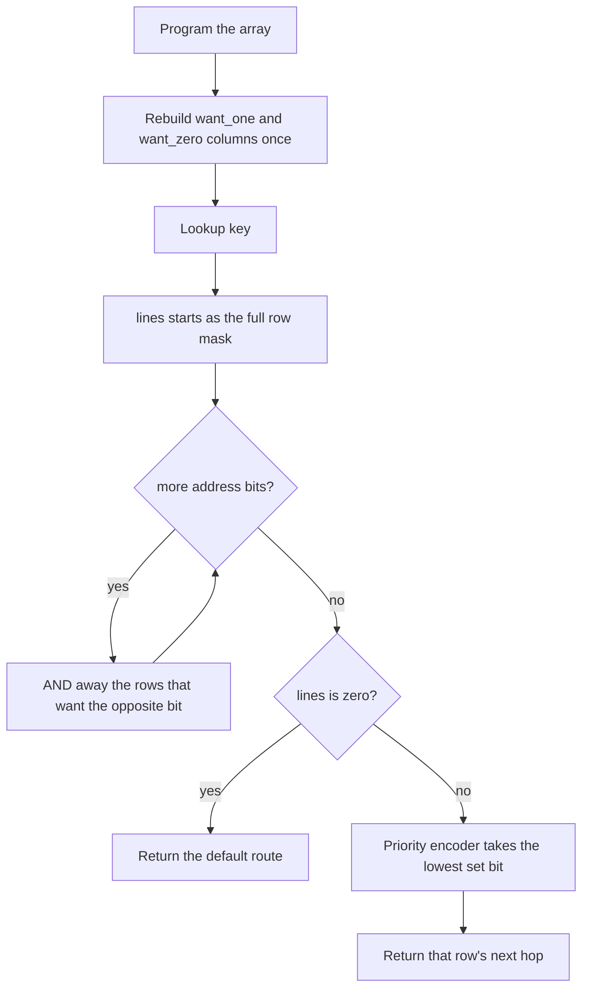
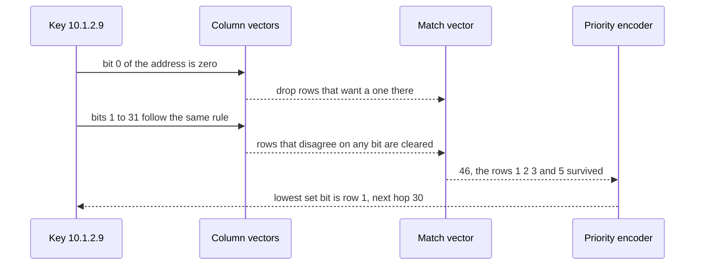

# 685 — Implement fast IP routing simulation with TCAM-like behavior (bitwise)

> **Tier:** Expert · **CTCI chapter:** Beyond — Networking, OS & Real-Time
> **Task spec:** [685-implement-fast-ip-routing-simulation-with-tcam-like-behavior-bit.md](../../../tasks/expert/685-implement-fast-ip-routing-simulation-with-tcam-like-behavior-bit.md)
> **Solutions:** [Python](../../../solutions/python/expert/685-implement-fast-ip-routing-simulation-with-tcam-like-behavior-bit/solution.py) ·
> [Java](../../../solutions/java/expert/685-implement-fast-ip-routing-simulation-with-tcam-like-behavior-bit/Solution.java) ·
> [JavaScript](../../../solutions/javascript/expert/685-implement-fast-ip-routing-simulation-with-tcam-like-behavior-bit/solution.js) ·
> [C#](../../../solutions/csharp/expert/685-implement-fast-ip-routing-simulation-with-tcam-like-behavior-bit/Solution.cs)

## 1. Problem restatement

Simulate a **ternary content-addressable memory** (TCAM) at the bit level and use it as an IPv4
forwarding table.

| Element | Contract |
| --- | --- |
| rule / entry | a `(value, mask)` pair — a rule matches when `addr & mask == value`; mask bits that are `0` are "don't care" |
| validation | `value & ~mask == 0`, otherwise the rule can never match and is **rejected** |
| `match_lines(addr)` | the bit-vector of matching rows: bit `r` set iff row `r` matches |
| `lookup(addr, default)` | the next hop of the **lowest-index** matching row (the priority encoder), or the default |
| `load(entries)` / `write(entry)` | program the array; index order **is** priority order |

Prefix rules are ordinary ternary rules — a `/L` prefix is a mask with `L` leading ones — so
**longest-prefix match is a consequence of the programming order**, not a special case: sort by
prefix length descending and first-match equals LPM. Two independent oracles check the model:
`sequential_match_vector` rebuilds the match vector row by row without bit packing, and
`brute_force_lpm` scans the prefix list. Non-contiguous masks exercise the ternary power a plain
trie cannot express.

Concrete results asserted by the checks, on the table
`10.1.2.3/32` → `40`, `10.1.2.0/24` → `30`, `10.1.0.0/16` → `20`, `10.0.0.0/8` → `10`,
`192.168.0.0/16` → `50`, `0.0.0.0/0` → `1` (already in descending length order):

- `lookup(10.1.2.3) == 40`, `lookup(10.1.2.9) == 30`, `lookup(10.1.9.9) == 20`,
  `lookup(10.9.9.9) == 10`, `lookup(172.16.0.1) == 1`.
- `match_lines(10.1.2.9)` has exactly **4** bits set — rows `/0`, `/8`, `/16` and `/24`, i.e. the
  vector `(1<<1) | (1<<2) | (1<<3) | (1<<5)` — and equals the row-by-row oracle. The `/32` host route
  of `10.1.2.3` must **not** match `10.1.2.9`.
- programming the same two rules as `[/8, /16]` returns `10` for `10.1.2.3` (the long prefix is
  shadowed), while `[/16, /8]` returns `20`: order is the whole difference.
- an all-zero mask matches every address; an empty array returns none or the supplied default;
  a sparse mask `0x00FF00FF` matches `9.1.7.1` but not `9.2.7.1`; a 16-bit-wide array behaves the
  same way; four 180-rule arrays (length caps 8, 16, 24, 32) drive **600** lookups that agree with
  both oracles.

## 2. Intuition

A TCAM answers "which rows match this key?" **in parallel**, and the natural software answer —
"loop over the rows and return the first match" — throws away the structure that makes a TCAM fast:

1. **A comparison is one bitwise step per row.** `(key ^ value) & mask == 0` tests the whole width at
   once; the mask turns it into a ternary match, and `value & ~mask == 0` guarantees a row can never
   be malformed.
2. **The match vector is the useful intermediate.** One bit per row: with masks packed as column
   vectors (`want_one[bit]`, `want_zero[bit]`), a lookup ANDs one precomputed vector per address bit
   and the cost is `O(width)` — the same 32 steps for 6 rows or for 4000.
3. **The answer is the lowest set bit.** `lines & -lines` isolates the highest-priority match,
   exactly the hardware priority encoder.
4. **Order is policy.** Because the encoder takes the lowest index, putting `/16` before `/8` shadows
   the longer prefix; sorting by length descending is what turns the array into an LPM table.



In a real device every row compares simultaneously. In software the same vector falls out of the
column packing: each of the 32 iteration steps ANDs away every row that disagrees with one bit of the
key, so the loop finishes with exactly the rows that survived all 32 tests — the bit-parallel
formulation the Python solution implements and the row-by-row oracle must reproduce.

## 3. Algorithm

1. **Validate a rule.** Reject `value & ~mask != 0`; derive the prefix length as the mask's
   population count when it is not given, and keep a label for diagnostics.
2. **Program the array.** `load` replaces the entries in order (rejecting more than 4096 rows — the
   capacity of the simulated silicon), `write` appends. Both rebuild the column vectors once, so a
   load of `P` rules costs one rebuild, not `P`.
3. **Rebuild the columns.** For every row `r` and every bit `b`, if the mask has bit `b` set, set bit
   `r` of `want_one[b]` when the value's bit is 1, else of `want_zero[b]`.
4. **Match.** Start from the full row mask and, for each bit of the address, AND away
   `~want_zero[b]` when the address bit is 1, `~want_one[b]` when it is 0. The result is the match
   vector.
5. **Encode priority.** If the vector is zero, return the default; otherwise take the index of the
   lowest set bit and return that row's next hop.
6. **Program prefix rules in the right order.** Sort the routes by prefix length descending (stable,
   so equal lengths keep the table order) before loading, which makes the priority encoder compute
   LPM.

```text
procedure rebuild_columns(entries)
    want_one ← vector of zeros, one per bit position
    want_zero ← vector of zeros, one per bit position
    for row ← 0 to length(entries) - 1 do
        row_bit ← 1 shifted left by row
        for bit ← 0 to width - 1 do
            if the mask of entries[row] has bit set then
                if the value of entries[row] has bit set then
                    want_one[bit] ← want_one[bit] or row_bit
                else
                    want_zero[bit] ← want_zero[bit] or row_bit
    row_mask ← (1 shifted left by length(entries)) - 1

function match_lines(addr)
    lines ← row_mask
    for bit ← 0 to width - 1 do
        if bit of addr is 1 then
            lines ← lines and not want_zero[bit]
        else
            lines ← lines and not want_one[bit]
    return lines and row_mask

function lookup(addr, default)
    lines ← match_lines(addr)
    if lines = 0 then
        return default
    index ← position of the lowest set bit of lines
    return the next hop of entries[index]

procedure load(entries)
    require length(entries) < 4096
    entries ← the copies of the given rows, left to right, index order is priority order
    rebuild_columns(entries)

procedure lookup_lpm(routes, addr)
    sort routes by prefix length descending, keeping the order of equal lengths
    load the prefix rules in that order
    return lookup(addr)
```



## 4. Worked example

The six-route table loaded in descending length order. `lookup(10.1.2.9)`:

| Row | Rule | Mask | Matches `10.1.2.9`? | Vector bit |
| --- | --- | --- | --- | --- |
| 0 | `10.1.2.3/32` | `0xFFFFFFFF` | no — host bits differ | — |
| 1 | `10.1.2.0/24` | `0xFFFFFF00` | yes | `1 << 1` |
| 2 | `10.1.0.0/16` | `0xFFFF0000` | yes | `1 << 2` |
| 3 | `10.0.0.0/8` | `0xFF000000` | yes | `1 << 3` |
| 4 | `192.168.0.0/16` | `0xFFFF0000` | no | — |
| 5 | `0.0.0.0/0` | `0x00000000` | yes | `1 << 5` |

The vector is `(1<<1) | (1<<2) | (1<<3) | (1<<5)` = 46, `lines & -lines` isolates bit 1, and the
answer is row 1's hop, `30`. Four rows match, exactly what the check asserts
(`bin(lines).count("1") == 4`), and the row-by-row oracle `sequential_match_vector` builds the same
integer without any packing.

Column packing in miniature, for the two rows that discriminate the third octet: bit 15 of a row is
usable only when the mask has it set. Every address bit is tested once, so the cost is 32 AND operations
whether the array holds 6 rows or 4096 — the property the sequential oracle exists to confirm.

Shadows are a programming-order effect, not a matching effect. With the rows `[10.0.0.0/8, 10.1.0.0/16]`
both match `10.1.2.3`, the encoder returns the lowest index (row 0, hop `10`), which is why a table
manager sorts by length before writing the array; swapping the two rows makes the same query return
`20`. Deleting and inserting rules is modelled as a rebuild cost: `program_ops` counts one column
rebuild per `load` or `write`, so loading 180 rules is 1 rebuild and appending one rule is 1 rebuild.



## 5. Complexity

Let `P` be the number of rows and `W` the width (32 for IPv4, 16 in the port-width example).

| Operation | Cost | Why |
| --- | --- | --- |
| `program` (write one rule) | O(W) column bits recomputed for the new row | the rebuild is over the rows times bits, charged as one "program operation" |
| `load(P rows)` | O(P · W) for the rebuild, 1 program operation | the columns are rebuilt once for the whole array (`program_ops == 1` after a load) |
| `match_lines` | O(W) | one AND per address bit, independent of `P` |
| `lookup` | O(W) + O(1) | plus `lines & -lines` and an index lookup |
| `sequential` oracle | O(P) | the reference implementation compares row by row |
| Space | O(P) for the rows + O(W) words for the columns | the columns hold one bit per row per bit position, i.e. `128` words for 4096 rows and 32 bits |
| Alternative: linear scan | O(P) per lookup | mask and compare each row in priority order — correct, and exactly what the TCAM replaces |
| Alternative: binary trie | O(W) per lookup, O(P · W) nodes | the trie cannot express a non-contiguous mask at all |

The two asymptotics are the point of the exercise: a scan is `O(P)` per packet, a TCAM lookup is
`O(W)` per packet, and the Java solution measures the simplification explicitly by modelling the
parallel match as a 64-bit vector and approximating update cost by the number of entries shifted.

## 6. Pitfalls and edge cases

- **Malformed rows must be rejected.** `value & ~mask != 0` means the row can never match; the
  `Rule(0xFF, 0x0F, ...)` case must raise, which is what a table manager does before programming.
- **Capacity is finite.** `load` rejects an array of 4096 rows or more, mirroring the silicon limit.
- **An empty array matches nothing** — `lookup` returns none unless a default route is supplied, and
  `TCAM().lookup(8.8.8.8, default=77) == 77`.
- **An all-zero mask is the catch-all.** `Rule(0, 0, 99)` matches `0.0.0.0`, `10.1.2.3` and
  `255.255.255.255`, and `match_lines` still reports exactly one matching row.
- **Order, not length, decides.** The `[10.0.0.0/8, 10.1.0.0/16]` array returns `10` for
  `10.1.2.3`, demonstrating that first-match is priority semantics; LPM has to be *programmed* in,
  by sorting the routes by length descending.
- **Non-contiguous masks.** A mask like `0x00FF00FF` matches positionally (`9.1.7.1` hits it,
  `9.2.7.1` does not) — something a binary trie cannot express, and the reason the checks exercise
  it separately.
- **Prefix length is derived from the mask** when it is not supplied (`bin(mask).count("1")`), so a
  mask written by mistake shows up as a wrong priority position; `Rule.prefix` keeps the declared
  length instead.
- **Width is a parameter.** The 16-bit-wide array with `0x0100/0xFF00` → `"ssh"` and
  `0x0080/0xFFF0` → `"dns"` shows the same code path for a port field; `lookup(0x0180)` takes the
  first rule, `lookup(0x0080)` the second.
- **Rebuild accounting.** Every `write` costs one rebuild, so an implementation that rebuilds per row
  during a load would show `program_ops == P` instead of `1`; the checks pin that down.
- **Determinism.** Random tables come from a fixed-seed splitmix64 generator, so the 4 x 180 rules and
  600 lookups are reproducible, and the vectors are compared with the row-by-row oracle on every one.
- **Documented simplification.** A real TCAM has one comparator per cell and answers in one cycle;
  here the parallel match is emulated with a bit-vector and the comparison is issued sequentially by
  the CPU. The C# solution states its own version of that scope — a 32-bit address plus a 16-bit port
  packed into a 64-bit key word, with the parallel match lines, the priority encoder and the cost
  model as the simulated parts — and adds a word-parallel fast path that ORs every entry's masked
  mismatch to decide whether a whole chunk matches at once.

## 7. Variants and follow-ups

- The same forwarding decision without ternary masks, i.e. pure prefix semantics and a tree →
  [684 — longest-prefix-match lookup optimized (binary trie)](../../../tasks/expert/684-implement-longest-prefix-match-lookup-optimized-binary-trie.md)
  and [683 — Patricia trie for an IP routing table](../../../tasks/expert/683-implement-compacted-trie-patricia-trie-for-ip-routing-table-simu.md).
- The protocol that programs the table in the first place →
  [686 — BGP path-vector with simplified policy](../../../tasks/expert/686-implement-bgp-path-vector-simplified-policy-simulation.md).
- Packets matched against ternary patterns in a different domain: the wildcard-nibble pattern
  compiler in the JavaScript solution is the same idea applied to non-address keys.
- The protocol that computes the routes the array is programmed with →
  [687 — link-state routing (OSPF) with LSAs](../../../tasks/expert/687-implement-routing-algorithm-link-state-ospf-simulation-with-lsas.md).
- Where the priority ordering has to stay correct while the table churns →
  [688 — distance-vector routing (RIP) with split horizon](../../../tasks/expert/688-implement-distance-vector-routing-rip-with-split-horizon.md).

## 8. Check yourself

<details><summary>Show answer</summary>
**Why is `lookup` a priority encoder instead of a longest-prefix test?** Because the array has no
notion of prefix length: the match vector only says which rows matched, and the hardware rule is
"lowest index wins". LPM is obtained by *programming* the rows in descending prefix length, after
which the first match is by construction the longest one.
</details>

<details><summary>Show answer</summary>
**Why does a lookup cost `O(width)` and not `O(rows)`?** The masks are pre-packed into column
vectors, so each address bit eliminates every disagreeing row with a single AND against
`want_one[bit]` or `want_zero[bit]`. The Python solution's `match_lines` performs exactly one such
step per bit, and the row-by-row oracle confirms the surviving set.
</details>

<details><summary>Show answer</summary>
**`10.1.2.9` matches four rows of the six-rule table — which ones, and why not the fifth?** It matches
`0.0.0.0/0`, `10.0.0.0/8`, `10.1.0.0/16` and `10.1.2.0/24`. The `/32` `10.1.2.3/32` does not match,
because a `/32` mask keeps all 32 bits and the last octet differs; the vector is therefore
`(1<<1) | (1<<2) | (1<<3) | (1<<5)`.
</details>

<details><summary>Show answer</summary>
**What does the ternary part buy over a trie?** Rules whose mask has holes. `value 0x00010001` with
mask `0x00FF00FF` matches any address whose second and fourth octets are `1` — `9.1.7.1` matches,
`9.2.7.1` does not — a pattern no prefix mask and no trie path can express.
</details>

<details><summary>Show answer</summary>
**Loading 180 rules costs `program_ops == 1`: what would a naive implementation report?** One rebuild
per inserted row, i.e. 180 rebuilds of the column vectors. The check asserts a single rebuild per
`load` (and one per `write`), which is the difference between programming the array once and
reprogramming it row by row.
</details>
