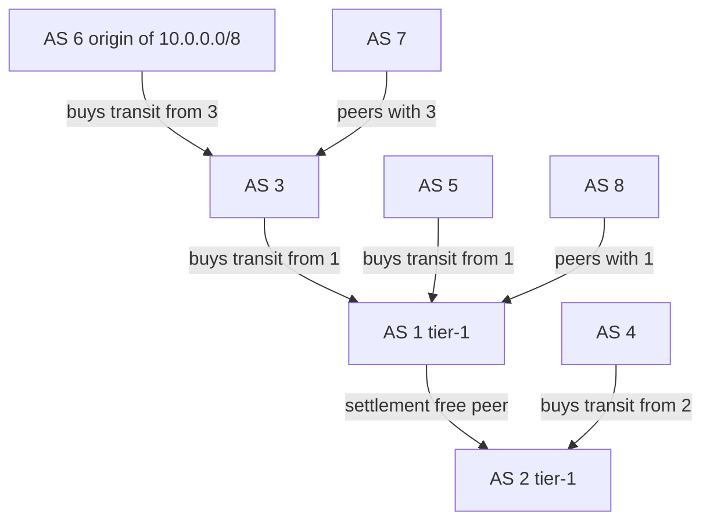
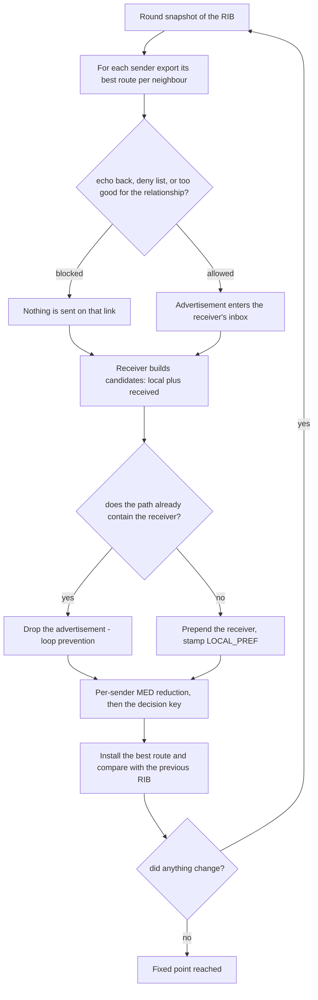
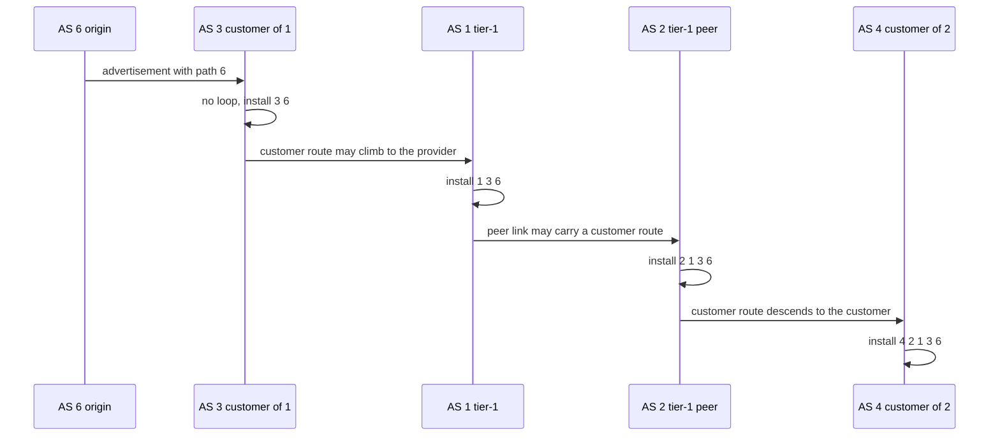

# 686 — Implement BGP path-vector simplified policy simulation

> **Tier:** Expert · **CTCI chapter:** Beyond — Networking, OS & Real-Time
> **Task spec:** [686-implement-bgp-path-vector-simplified-policy-simulation.md](../../../tasks/expert/686-implement-bgp-path-vector-simplified-policy-simulation.md)
> **Solutions:** [Python](../../../solutions/python/expert/686-implement-bgp-path-vector-simplified-policy-simulation/solution.py) ·
> [Java](../../../solutions/java/expert/686-implement-bgp-path-vector-simplified-policy-simulation/Solution.java) ·
> [JavaScript](../../../solutions/javascript/expert/686-implement-bgp-path-vector-simplified-policy-simulation/solution.js) ·
> [C#](../../../solutions/csharp/expert/686-implement-bgp-path-vector-simplified-policy-simulation/Solution.cs)

## 1. Problem restatement

Simulate **BGP path-vector** routing between autonomous systems (ASes) for one prefix, with the two
mechanisms that define the protocol:

| Mechanism | Rule |
| --- | --- |
| loop prevention | a route carries its whole AS path, and a receiver **drops any advertisement whose path already contains its own ASN** — no global knowledge needed |
| export policy (Gao-Rexford) | customers receive everything; providers and peers receive only an AS's **own** routes and routes learned from its **customers**; a route is never echoed to the neighbour it came from |
| decision process | highest `LOCAL_PREF`, then shortest AS path, then lowest `ORIGIN`, then lowest `MED` — where MED is compared **only between routes from the same neighbour AS**, so candidates are first reduced per sender |

Rounds are synchronous: every AS advertises its current best route, then every AS re-selects. The run
ends at a genuine fixed point. A policy-free variant (`gao_rexford = False`) is compared against an
independent oracle that enumerates **all simple paths** and minimises by `(length, hop sequence)`.

Concrete results asserted by the checks, on an eight-AS two-tier topology (1 and 2 tier-1 peers, 3/5
buy from 1, 4 from 2, 6 from 3, 7 peers 3, 8 peers 1) with AS 6 originating `10.0.0.0/8`:

- the converged paths (receiver first, origin last) are `6 → (6)`, `3 → (3,6)`, `1 → (1,3,6)`,
  `5 → (5,1,3,6)`, `2 → (2,1,3,6)`, `4 → (4,2,1,3,6)`, `7 → (7,3,6)`, `8 → (8,1,3,6)`.
- the run needs **6 rounds** and the final round carries **7 advertisements**; one further round
  changes nothing, and a fresh run reproduces the same RIB.
- every path is valley-free and loop-free, and every advertisement respects the export policy.
- with AS 2 originating `20.0.0.0/8`: `1 → (1,2)`, `3 → (3,1,2)`, `5 → (5,1,2)`, `4 → (4,2)`, while
  `7` and `8` have **no route** — a provider/peer route is never handed to a peer.
- with `LOCAL_PREF` 200 set for the route via AS 20, AS 10 chooses `(10,20,25,30)` over the shorter
  `(10,21,30)`; the policy-free run's longest path is **5 hops**; `99.0.0.0/8`, which nobody
  originates, converges empty in **1 round**.

## 2. Intuition

A distance-vector protocol circulates a *cost*; BGP circulates a *path*. That single change removes
the need for global knowledge: since the AS path travels with the route, a receiver that finds itself
in the path knows the advertisement is a loop and drops it, and the tie-breaking rules can compare
paths directly.

Policy is the second half of the story. Without it, ASes would transit traffic for free between their
own providers and peers — the classic "valley" that no one is paid for. Gao-Rexford exports make the
converged paths **valley-free**: a route flows up from a customer and then down to other customers, or
across a single peer link, but never provider → peer → provider for free.



The decision process is a strict priority list, and every level matters on some real topology:

1. **LOCAL_PREF** first — it is local policy, and the checks show a 4-hop path beating a 3-hop path
   because the import preference is higher.
2. **AS path length** next — the classic shortest-path intent.
3. **ORIGIN**, then **MED**, with MED restricted to routes from the same neighbouring AS (it is the
   neighbour's input metric, so comparing it across neighbours is meaningless).

## 3. Algorithm

1. **Build the topology.** Each router keeps `peers` (neighbour ASN → relationship as *this* AS sees
   it), the inverse relationship on the other side, per-neighbour `import_local_pref`, deny sets and
   the prefixes it originates.
2. **Originate.** `local_routes(prefix)` returns a single route with path `(self.asn,)` when this AS
   originates the prefix, otherwise nothing.
3. **Advertise.** For each sender in sorted order and each neighbour, `export_route` decides: skip if
   the neighbour is on the export deny list, skip if the route came from that neighbour (never echo
   back), let the route out freely to a **customer** (or when policy is off), and otherwise let it out
   only when it was learned from a customer or is self-originated.
4. **Import.** The receiver drops the route when its own ASN is already in the path (loop prevention)
   or when the prefix is denied on import, and otherwise prepends itself to the path and stamps its
   `LOCAL_PREF` for that neighbour.
5. **Select.** `select_best` first reduces the candidates **per sender** (keeping each sender's best
   MED), then minimises the tuple `(-local_pref, len(path), origin, next_hop)`.
6. **Round.** All advertisements are computed from the *snapshot* of the current RIB, then all
   selections are computed from the snapshot of the advertisements — a simultaneous update, which is
   what makes the iterate order-independent.
7. **Converge.** Repeat until a round produces a RIB identical to the previous one (or a round budget
   is exhausted), and check the fixed point by re-running one round by hand.

```text
procedure export_route(neighbour, route)
    if neighbour is in export_denied then
        return none
    if route.learned_from = neighbour then
        return none                                 // never echo a route back
    if policy is off or the neighbour is a customer of this AS then
        return route
    if route.learned_from is none then
        return route                                // our own prefix
    return route when the neighbour we learned from is a customer, else none

procedure import_route(neighbour, route)
    if this ASN is in route.path or route.prefix is in denied then
        return none                                 // loop prevention and import filter
    return a route with path (this ASN) followed by route.path,
           next hop neighbour,
           local preference import_local_pref[neighbour] or the default

function select_best(candidates)
    if candidates is empty then
        return none
    per_sender ← for each route's sender keep the route with the smallest MED
    return the route of per_sender minimising
           (-local_pref, length of path, origin, next hop)

procedure round_step(rib, prefix, order)
    advertisements ← empty map
    for sender in sorted ASNs do
        route ← rib[sender]
        if route is not none then
            for receiver in order[sender] do
                sent ← export_route(receiver, route)
                if sent is not none then
                    advertisements[(sender, receiver)] ← sent
    new_rib ← empty map
    for receiver in sorted ASNs do
        candidates ← local_routes(receiver, prefix)
        for sender in order[receiver] do
            sent ← advertisements[(sender, receiver)]
            if sent is not none then
                imported ← import_route(sender, sent)
                if imported is not none then
                    append imported to candidates
        new_rib[receiver] ← select_best(candidates)
    return new_rib and advertisements

procedure simulate(prefix, max_rounds)
    rib ← all ASNs mapped to none, rounds ← 0
    while rounds < max_rounds do
        rounds ← rounds + 1
        new_rib and advertisements ← round_step(rib, prefix, order)
        if new_rib = rib then
            return rib, advertisements, rounds, converged ← true
        rib ← new_rib
    return rib, advertisements, rounds, converged ← false
```



## 4. Worked example

Trace of the two-tier topology with AS 6 originating `10.0.0.0/8`. Paths are written receiver first,
so `(3,6)` means "receive from 3, then reach the origin 6".

| Round | Newly installed paths | What happened |
| --- | --- | --- |
| 1 | `6 → (6)` | the origin originates |
| 2 | `3 → (3,6)` | 3 accepts its customer's own route and installs it |
| 3 | `1 → (1,3,6)`, `7 → (7,3,6)` | 3 exports a *customer* route to its provider 1 and to its peer 7 |
| 4 | `5 → (5,1,3,6)`, `8 → (8,1,3,6)`, `2 → (2,1,3,6)` | 1 sends a customer-learned route to its customers 5, 8 and its peer 2 |
| 5 | `4 → (4,2,1,3,6)` | 2 sends the customer-learned route to its customer 4 |
| 6 | — | nothing changes: the fixed point, reached in **6** rounds with **7** advertisements in the last round |

Every path is valley-free: `4` is a customer at the bottom of the ladder, the route climbs
`4 ← 2 ← 1` across the settlement-free peer link, then descends `1 → 3 → 6` to the origin. The check
`valley_free` verifies that no interior AS passes a provider/peer-learned route on to a
provider/peer, and `check_advertisements` re-tests that on every advertisement of the final round.

The second prefix, `20.0.0.0/8` originated by AS 2, is where policy bites:

| AS | Path | Why |
| --- | --- | --- |
| 2 | `(2)` | origin |
| 1 | `(1,2)` | learned over the peer link, acceptable for 1 |
| 3 | `(3,1,2)` | 1 may export a *peer*-learned route to its **customer** 3 |
| 5 | `(5,1,2)` | same reason |
| 4 | `(4,2)` | 4 is 2's customer and hears it directly |
| 7, 8 | none | 3 cannot export a provider/peer-learned route to its peer 7, and 1 cannot do it for 8 |



Preference beats length: in the five-AS chain `10 - 20 - 25 - 30` and `10 - 21 - 30`, AS 10 normally
takes the shorter `(10,21,30)`; setting `import_local_pref[20] = 200` against `21 = 100` makes it
install the longer `(10,20,25,30)`. MED behaves symmetrically but *narrowly*: two routes from the same
sender are reduced by MED (`5` beats `50`), while a MED of `1` from a different sender does not
override a shorter AS path.

## 5. Complexity

Let `R` be the number of ASes, `E` the number of links, and `L` the number of rounds to convergence.

| Quantity | Cost | Why |
| --- | --- | --- |
| one round | O(E · L) | every advertisement is examined once per link and each receiver reduces a candidate list of at most its degree |
| `export_route` / `import_route` | O(path length) | the loop test is a membership check over the AS path |
| `select_best` | O(k log k) for `k` candidates | per-sender MED reduction plus one minimisation |
| convergence | at most `R` rounds on this topology (measured: **6**) | each usable simple path has at most `R` ASes; the Java solution states the bound as at most `n` rounds and checks the fixed-point condition directly |
| space | O(E + R · L) | the topology plus one best route per AS, each carrying a path |
| policy-free oracle | exponential in `R` | it enumerates every simple path, which is exactly why it is only used as a reference |

The exhaustive oracle is deliberately the *slow* side of the comparison: `enumerate_simple_paths`
enumerates all simple paths from each receiver to the origin and minimises by
`(length, hop sequence)`, sharing no code with the distributed iteration. The policy-free simulation
must reproduce it exactly, which is the strongest available statement that the round machinery itself
(not the policy) computes shortest simple paths.

## 6. Pitfalls and edge cases

- **Loop prevention must be per receiver, not per route.** The check drops a route whose path already
  contains the receiving ASN (`import_route` returns none), which is the whole reason a path vector
  needs no global topology.
- **Never echo a route back.** `export_route` returns none when `route.learned_from == neighbour`; the
  check asserts it directly for a synthetic route.
- **Policy must be symmetric in the topology builder.** Declaring 3 as 1's customer requires 1 to be
  3's provider; the `{PROVIDER: CUSTOMER, CUSTOMER: PROVIDER, PEER: PEER}` inversion is where an
  asymmetric mis-declaration would silently disable the export rules.
- **MED is only comparable between routes from the same neighbour.** `select_best` reduces per sender
  first, so a `MED` of `1` from another neighbour does not beat a shorter path; the checks pin both
  behaviours.
- **Import preference overrides path length.** That is the point of the LOCAL_PREF check, and a
  decision process that sorted by path length first would fail it.
- **Order independence.** Advertisements are built from the RIB snapshot and selections from the
  advertisement snapshot, so shuffling each AS's neighbour list (four deterministic shuffles) must
  leave the converged RIB unchanged.
- **Fixed point, not just "stops changing".** The checks re-run a single round against the converged
  RIB and demand identical output, which catches a scheduler that merely exhausts its round budget.
- **A prefix nobody originates converges empty.** `99.0.0.0/8` produces all-`None` routes in exactly
  **1** round, because the first round's RIB equals the initial one.
- **Import filters remove routes.** With `denied` containing `1.0.0.0/8`, AS 2 ends with no route while
  AS 1 keeps its own; the same code path serves both.
- **Peer routes do not transit.** For `20.0.0.0/8`, AS 7 and AS 8 stay empty — the "no free transit"
  property the valley-free check encodes through export policy.
- **Documented simplification.** One prefix per run, no iBGP or route reflectors, no route dampening,
  no communities, no AS_PATH prepending; synchronised rounds stand in for timers and the neighbour ASN
  replaces the BGP router id. The Java solution adds the alternative tie-break rule
  (lexicographically smallest AS path) and the C# solution re-runs a policy change from scratch to
  prove it converges to the same RIB as a fresh simulation, plus a deterministic byte-identical
  output check.

## 7. Variants and follow-ups

- The interior-gateway protocol that computes the routes a BGP speaker advertises →
  [687 — link-state routing (OSPF) with LSAs](../../../tasks/expert/687-implement-routing-algorithm-link-state-ospf-simulation-with-lsas.md)
  and [688 — distance-vector routing (RIP) with split horizon](../../../tasks/expert/688-implement-distance-vector-routing-rip-with-split-horizon.md).
- Forwarding decisions once a path is chosen, as a ternary lookup table →
  [685 — fast IP routing with TCAM-like behaviour](../../../tasks/expert/685-implement-fast-ip-routing-simulation-with-tcam-like-behavior-bit.md).

## 8. Check yourself

<details><summary>Show answer</summary>
**Why does a path vector make loop prevention local?** Because the AS path travels inside the
advertisement: a receiver finds its own ASN in the path and drops the route. No AS needs the global
topology, which a distance vector (RIP) does not have — the cost of that convenience is the longer
path carried in every update.
</details>

<details><summary>Show answer</summary>
**Why do AS 7 and AS 8 get no route to `20.0.0.0/8` although AS 1 and AS 2 do?** AS 1 learned that
prefix from its **peer** 2, not from a customer, and Gao-Rexford only lets a route learned from a peer
or provider be exported to **customers**. AS 3 and AS 5 are customers of 1, so they hear it; AS 7 (peer
of 3) and AS 8 (peer of 1) do not, which is the valley-free property in action.
</details>

<details><summary>Show answer</summary>
**What removes the `MED` ambiguity?** The per-sender reduction: MED is the neighbour's suggested
entry metric, so it is only meaningful between routes from the same neighbouring AS. `select_best`
keeps the best MED per sender and only then compares the survivors by the global key.
</details>

<details><summary>Show answer</summary>
**How does the simulation prove it reached a fixed point rather than a round budget?** `simulate`
stops when a round leaves the RIB unchanged, and the checks additionally call `round_step` once more
by hand and assert the result equals the converged RIB, so a scheduler that merely exhausted its
round budget would fail.
</details>

<details><summary>Show answer</summary>
**What does the simple-path oracle establish that an internal consistency check cannot?** It computes,
from the raw edge list, the shortest simple path by `(length, hop sequence)`. Since it shares no code
with the round iteration, agreement on all eight ASes shows that the distributed fixed point — not
just its own bookkeeping — is the correct answer when policy is switched off.
</details>
