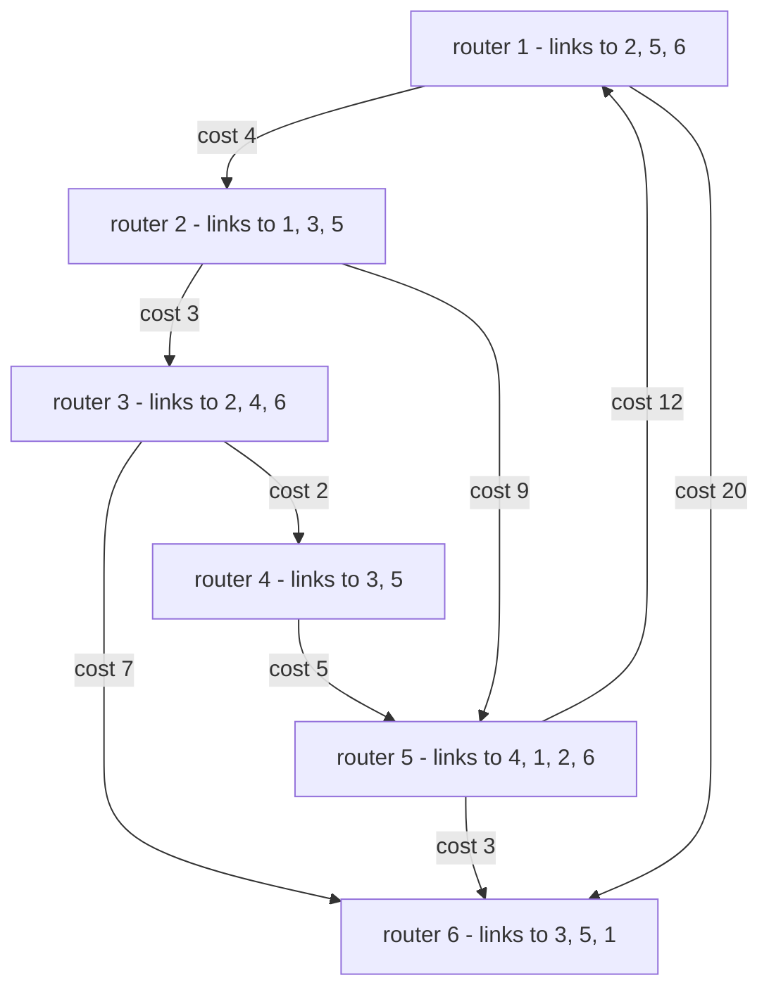
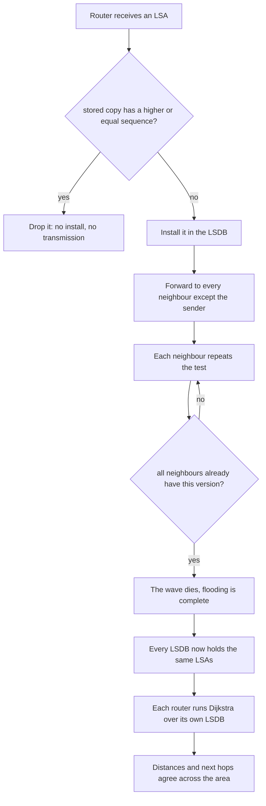
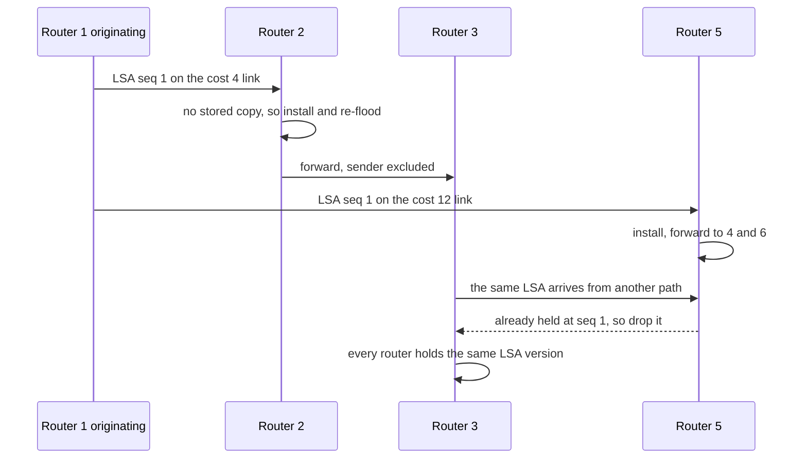

# 687 — Implement routing algorithm link-state (OSPF) simulation with LSAs

> **Tier:** Expert · **CTCI chapter:** Beyond — Networking, OS & Real-Time
> **Task spec:** [687-implement-routing-algorithm-link-state-ospf-simulation-with-lsas.md](../../../tasks/expert/687-implement-routing-algorithm-link-state-ospf-simulation-with-lsas.md)
> **Solutions:** [Python](../../../solutions/python/expert/687-implement-routing-algorithm-link-state-ospf-simulation-with-lsas/solution.py) ·
> [Java](../../../solutions/java/expert/687-implement-routing-algorithm-link-state-ospf-simulation-with-lsas/Solution.java) ·
> [JavaScript](../../../solutions/javascript/expert/687-implement-routing-algorithm-link-state-ospf-simulation-with-lsas/solution.js) ·
> [C#](../../../solutions/csharp/expert/687-implement-routing-algorithm-link-state-ospf-simulation-with-lsas/Solution.cs)

## 1. Problem restatement

Simulate single-area **link-state routing (OSPF)** with router-LSAs:

| Element | Contract |
| --- | --- |
| router-LSA | `(router id, sequence number, links)` where `links` is the sorted list of `(neighbour, cost)` |
| LSDB | one LSA per router, kept at the **highest sequence number seen**; a stale or duplicate copy is dropped **without being re-flooded** |
| flooding | an accepted LSA is forwarded to every neighbour **except the one it arrived on** |
| SPF | each router runs Dijkstra over the graph rebuilt from **its own LSDB** (not from the live links), producing `(distance, next hop)` per destination |

The checks verify the properties that make link-state routing correct: all LSDBs are identical after
any change, the flooding cost for one LSA is exactly `deg(origin) + sum over the other routers of
(deg - 1) = 2E - n + 1`, every distance matches an independently written `O(n²)` label-setting
Dijkstra oracle, and every next hop `h` towards `d` decomposes the tree exactly
(`dist(r,d) == cost(r,h) + dist(h,d)`).

Concrete results asserted by the checks, on the topology `1-2:4, 2-3:3, 3-4:2, 4-5:5, 5-1:12, 2-5:9,
3-6:7, 5-6:3, 1-6:20`:

- 6 routers, 9 links; flooding one LSA costs **13** transmissions, exactly the expected
  `2E - n + 1 = 18 - 6 + 1`.
- distances from router 1 are `[0, 4, 7, 9, 12, 14]` for routers `1..6`; the direct link `1-6` costs
  **20** but the route through 2 → 3 costs **14**, so 6 is reached via neighbour **2**.
- re-flooding a known LSA installs nothing and costs **0** transmissions; a lower sequence number is
  rejected and leaves the LSDB untouched, and an *equal* sequence number with different content is
  ignored too.
- after `change_cost(2,3,12)` the distance to 3 becomes **16** with next hop **2**, and only routers 2
  and 3 re-originated (`seq == 2`); after the failure of `5-1`, 5 is **13** away via **2** (the
  9-cost link), symmetrically from 5 back to 1.
- removing `3-6`, `5-6` and `1-6` isolates router 6: it reports **no route** to anything and no next
  hops at all, its LSA carries no links, and the rest of the area cannot reach it — yet every distance
  vector still *names* router 6.

## 2. Intuition

Distance-vector protocols exchange conclusions ("I reach `d` in 5 hops"); link-state protocols
exchange **facts** ("my link to X costs 3") and let every router compute the same conclusion locally.
Two mechanisms make that exchange reliable:

1. **Sequence numbers make flooding terminate.** An LSA carries a monotonically increasing sequence
   number, and a router installs it only when it is strictly newer than the copy it holds. When the
   flood reaches a router that already has the LSA, nothing happens — the wave simply dies out. That
   is why the total cost is a static function of the topology (`2E - n + 1`) instead of a retry count.
2. **SPF is run per router over the LSDB, not over the live links.** The graph is rebuilt from the
   received advertisements, which is what makes the result reproducible: if every LSDB is identical,
   every shortest-path tree is identical, and no loop can form from inconsistent views.



The metric is **cost, not hop count**, and the table above is built to show it: the direct `1-6` link
of cost 20 is never used while the two-hop detour `1 → 2 → 3 → 6` costs 14. A hop-counting protocol
would pick the direct link and get the topology wrong.

## 3. Algorithm

1. **Build the area** from a link list, creating a `Router` per endpoint and installing each link
   symmetrically on both sides.
2. **Originate.** `originate()` bumps the router's sequence number and returns a fresh LSA with its
   links sorted, so equal LSAs compare equal.
3. **Install.** `install(receiver, lsa)` replaces the stored copy only when the new one has a strictly
   greater sequence number; otherwise it returns false — the stale/duplicate rule.
4. **Flood.** Push `(origin, no sender, lsa)` onto a stack. Pop `(receiver, sender, lsa)`: if the
   install fails, stop this branch (nothing is re-flooded); otherwise count one install and push the
   LSA to every neighbour except `sender`, charging one transmission per push.
5. **Rebuild the graph** from a router's LSDB: for every LSA, add both directions of each of its
   links, but only between routers that the LSDB actually knows.
6. **Run Dijkstra** (`spf`): a heap of `(cost, first hop, node)` starting at the router itself; on
   settling a node, relax its edges; carry the *first hop* along the path so the next-hop table falls
   out of the same walk.
7. **React to changes.** `change_cost` / `remove_link` update the live links and re-originate **only**
   the affected routers' LSAs, which is why their sequence numbers move and the others do not.
8. **Audit.** After every change the checks compare all LSDBs for equality, compare every distance
   with the oracle, and verify the tree decomposition and the "next hop is a neighbour" invariant.

```text
procedure originate(router)
    router.seq ← router.seq + 1
    return LSA(router.rid, router.seq, sorted links of router)

function install(rid, lsa)
    current ← lsdb[rid][lsa.router]
    if current is not none and current.seq ≥ lsa.seq then
        return false                     // duplicate or stale: drop, do not re-flood
    lsdb[rid][lsa.router] ← lsa
    return true

procedure flood_lsa(origin, lsa)
    stack ← [(origin, none, lsa)], installs ← 0
    while stack is not empty do
        receiver, sender, current ← pop(stack)
        if not install(receiver, current) then
            continue                     // this branch of the wave dies here
        installs ← installs + 1
        for neighbour in sorted links of receiver do
            if neighbour = sender then
                continue                 // never back out of the receiving interface
            transmissions ← transmissions + 1
            push (neighbour, receiver, current) onto stack
    return installs

function graph(rid)                       // the topology as described by this router's LSDB
    adjacency ← one empty map per router in lsdb[rid]
    for lsa in lsdb[rid] do
        for (neighbour, cost) in lsa.links do
            if neighbour is in adjacency then
                adjacency[lsa.router][neighbour] ← cost
                adjacency[neighbour][lsa.router] ← cost
    return adjacency

function spf(rid)
    adjacency ← graph(rid)
    distance ← every router mapped to none, next_hop ← empty map
    distance[rid] ← 0, heap ← [(0, rid, rid)], settled ← empty set
    while heap is not empty do
        cost, first_hop, node ← pop the smallest entry
        if node is in settled then
            continue
        add node to settled
        if node ≠ rid then
            next_hop[node] ← first_hop
        for (neighbour, link_cost) in sorted adjacency[node] do
            if neighbour is in settled then
                continue
            candidate ← cost + link_cost
            if distance[neighbour] is none or candidate < distance[neighbour] then
                distance[neighbour] ← candidate
                hop ← neighbour when node = rid else first_hop
                push (candidate, hop, neighbour) onto heap
    return distance and next_hop

procedure change_cost(a, b, cost)
    set the cost in both live link tables
    originate_and_flood only the routers a and b
```



## 4. Worked example

Flooding cost for a single LSA. Router 1 has degree 3, and every other router re-floods the LSA to
`deg - 1` neighbours (all but the one it arrived on).

| Router | Degree | Transmissions contributed | Note |
| --- | --- | --- | --- |
| 1 (origin) | 3 | 3 | sent to 2, 5, 6 |
| 2 | 3 | 2 | received from 1, forwards to 3 and 5 |
| 3 | 3 | 2 | received from 2, forwards to 4 and 6 |
| 4 | 2 | 1 | received from 3, forwards to 5 |
| 5 | 4 | 3 | received from 1, forwards to 4, 2, 6 |
| 6 | 3 | 2 | received from 3, forwards to 5 and 1 |
| total | 18 | **13** | `2E - n + 1 = 18 - 6 + 1` |

Every one of those pushes comes from a router that *installed* the LSA, so the wave never revisits a
router: as soon as a neighbour holds the same sequence number, `install` returns false and that branch
ends. Re-flooding a known LSA afterwards costs **0** transmissions and installs nothing.

Shortest-path computation from router 1 (heap pops in cost order; the first hop travels with each
entry):

| Destination | Distance | Next hop | Why |
| --- | --- | --- | --- |
| 1 | 0 | — | the source |
| 2 | 4 | 2 | direct link |
| 3 | 7 | 2 | `1-2:4` plus `2-3:3` beats nothing else |
| 4 | 9 | 2 | `7 + 2` through 3 |
| 5 | 12 | 5 | the direct `1-5:12` beats `1-2-5 = 13` |
| 6 | 14 | 2 | `1-2-3-6 = 4 + 3 + 7` beats the direct `1-6:20` |

The distance vector is `[0, 4, 7, 9, 12, 14]`. When `2-3` is re-costed to 12, routers 2 and 3
re-originate (`seq == 2` for both, the others unchanged), the distance to 3 becomes **16** through the
neighbour 2, and the oracle agrees. Removing `5-1` forces 5 onto the long way: `1-2-5 = 4 + 9 = 13`,
and 5 sees the symmetric 13 back to 1. Removing the three links to router 6 leaves it isolated — it
computes `distance[1] = None` and an empty next-hop map, its own LSA lists no links, and router 1's
distance vector still contains the entry for 6, set to `None`.



## 5. Complexity

Let `n` be the number of routers, `E` the number of links, `deg` a router's degree and `L` the length
of a path.

| Quantity | Cost | Why |
| --- | --- | --- |
| originate one LSA | O(deg log deg) | the link list is sorted so equal LSAs compare equal |
| flood one LSA | **O(E)** transmissions in total, exactly `2E - n + 1` on a connected area (measured: 13) | each router re-floods to `deg - 1` neighbours and only if it installed the new version |
| duplicate/stale LSA | O(1) | one sequence-number comparison, no transmission |
| rebuild the graph from an LSDB | O(n + E) | every LSA contributes its links |
| SPF per router | O((n + E) log n) | heap Dijkstra over the LSDB graph; the oracle's label-setting variant is O(n²) |
| all routers | O(n · (n + E) log n) | every router computes its own tree, which is the price of no shared state |
| a cost change | O(E) flooding + O(n · (n + E) log n) SPF | only the two endpoints re-originate, but everyone recomputes |
| next-hop table | O(n) | one entry per reachable router, derived inside the same Dijkstra |
| space | O(n · E) for all LSDBs, O(n) per router | each LSDB holds one LSA per router with its links |

The oracle is an `O(n²)` label-setting Dijkstra written over the raw link list: it shares no code with
the SPF and is the reference for every distance on every topology state, which is how the tutorial's
numbers are pinned down rather than asserted. Java's solution compares against Floyd-Warshall instead,
and the C# solution against Bellman-Ford — three independent algorithms over the same database.

## 6. Pitfalls and edge cases

- **Sequence numbers decide, not content.** A lower sequence number is rejected even if the content
  would change the topology, and an *equal* sequence number with new content is ignored too; both
  checks assert the LSDB is left untouched.
- **Duplicates must not be re-flooded.** `install` returning false has to stop that branch of the
  flood, otherwise the cost would depend on the retry policy instead of on `2E - n + 1`.
- **Never send back out of the receiving interface.** The `sender` is excluded from the forwarding
  set, which prevents immediate two-node echoing and keeps the transmission count exact.
- **Cost, not hops.** The direct `1-6` link of cost 20 loses to the three-link path of cost 14; a
  hop-counting implementation would produce a different (and wrong) tree.
- **The graph must come from the LSDB.** `graph(rid)` deliberately ignores the live link table, so a
  router that has not yet received an update cannot silently use fresher information than its peers.
- **Only the endpoints re-originate on a change.** After `change_cost(2,3,12)` the checks pin
  `seq == 2` on routers 2 and 3, so an implementation that bumped everyone would be caught.
- **Symmetry of costs.** The area is built with the same cost on both sides, which the audit relies on
  when it recomputes distances from the raw link list (`a < b` de-duplication).
- **Partitions leave `None`, not a bogus route.** After the three removals, router 6 has no next hops
  and `distance[1] is None`, while the other routers keep an entry for 6 that is `None` — the
  distance vector still names the destination.
- **Documented simplification.** No LSA ageing or periodic refresh, no checksums, no DR/BDR election,
  no stub networks or summarisation, symmetric link costs and one flat area; a partition cannot be
  flooded at all, so `publish_everywhere` models the converged state that ageing leaves behind after
  the isolated router's own LSA has been flushed. The Java solution instead models reliable flooding
  with acknowledgements and retransmission of lost transmissions, the JavaScript solution drops
  aging/MaxAge/DoNotAge and equal-cost multipath and adds a deterministic tie-break on the smallest
  forwarding id, and the C# solution layers the flood into rounds (bounded by the network diameter)
  and rate-limits LSRefresh re-origination with a MinLSInterval, so the re-origination count after a
  run of ticks stays bounded.

## 7. Variants and follow-ups

- The distance-vector counterpart, which needs split horizon precisely because views differ →
  [688 — distance-vector routing (RIP) with split horizon](../../../tasks/expert/688-implement-distance-vector-routing-rip-with-split-horizon.md).
- Where the trees computed here are advertised **between** areas and policies applied →
  [686 — BGP path-vector with simplified policy](../../../tasks/expert/686-implement-bgp-path-vector-simplified-policy-simulation.md).
- Installing the resulting routes as ternary lookup entries →
  [685 — fast IP routing with TCAM-like behaviour](../../../tasks/expert/685-implement-fast-ip-routing-simulation-with-tcam-like-behavior-bit.md)
  and [683 — Patricia trie for an IP routing table](../../../tasks/expert/683-implement-compacted-trie-patricia-trie-for-ip-routing-table-simu.md).

## 8. Check yourself

<details><summary>Show answer</summary>
**Why is the flooding cost exactly `2E - n + 1`?** The origin sends its LSA on all `deg(origin)`
links, and every other router that installs it forwards it on `deg - 1` links (all but the incoming
one). Summed over all routers that is `sum(deg) - (n - 1) = 2E - n + 1`; on this area that is
`18 - 6 + 1 = 13`, matching the measured count.
</details>

<details><summary>Show answer</summary>
**What stops a flood from circulating forever?** The sequence number. A router installs an LSA only
when it is strictly newer than the stored copy; when the wave returns to a router that already holds
that version, `install` returns false and nothing is forwarded, so each version traverses each link at
most once.
</details>

<details><summary>Show answer</summary>
**Router 1 reaches router 6 in cost 14 although they share a direct link of cost 20 — what does that
tell you about OSPF's metric?** That shortest path is measured in accumulated **cost**, not in hop
count. The path `1 → 2 → 3 → 6` pays `4 + 3 + 7 = 14`, so the next hop towards 6 is the neighbour 2,
and the direct link is simply never chosen.
</details>

<details><summary>Show answer</summary>
**After `change_cost(2,3,12)`, why do only routers 2 and 3 have `seq == 2`?** Because only their link
sets changed, and each router originates its own LSA. Every other router's advertisement is unchanged,
so re-flooding it would be pointless — and the checks assert exactly that.
</details>

<details><summary>Show answer</summary>
**What is the significance of computing SPF from the LSDB instead of from the live links?** It models
the real invariant: every router acts on the same globally flooded facts, so identical databases yield
identical trees. If SPF read live links, a router would route on information its neighbours do not
have, which is exactly the inconsistency that link-state routing is designed to avoid.
</details>
