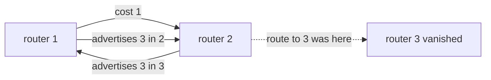
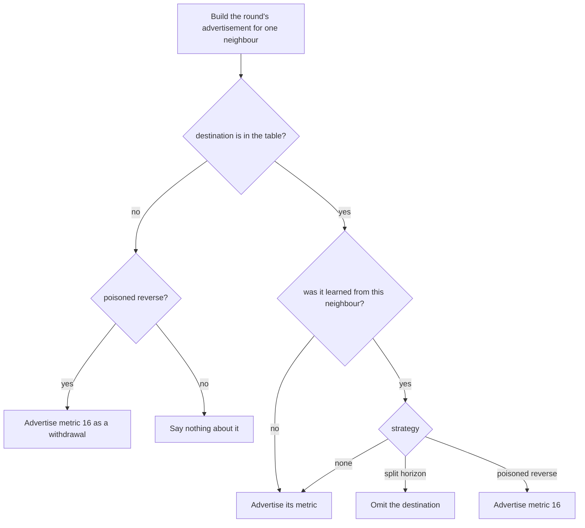
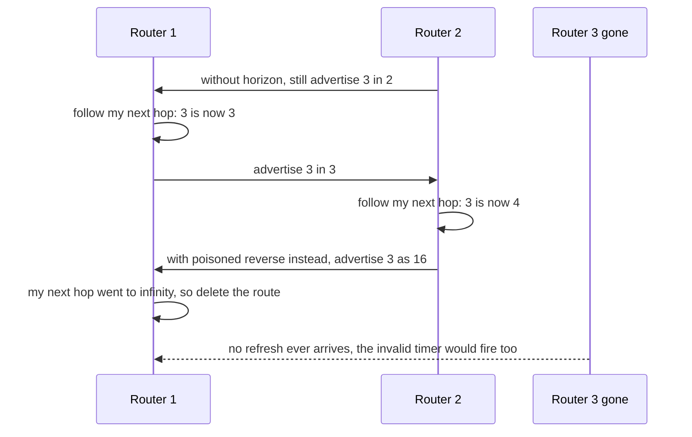

# 688 — Implement distance-vector routing (RIP) with split horizon

> **Tier:** Expert · **CTCI chapter:** Beyond — Networking, OS & Real-Time
> **Task spec:** [688-implement-distance-vector-routing-rip-with-split-horizon.md](../../../tasks/expert/688-implement-distance-vector-routing-rip-with-split-horizon.md)
> **Solutions:** [Python](../../../solutions/python/expert/688-implement-distance-vector-routing-rip-with-split-horizon/solution.py) ·
> [Java](../../../solutions/java/expert/688-implement-distance-vector-routing-rip-with-split-horizon/Solution.java) ·
> [JavaScript](../../../solutions/javascript/expert/688-implement-distance-vector-routing-rip-with-split-horizon/solution.js) ·
> [C#](../../../solutions/csharp/expert/688-implement-distance-vector-routing-rip-with-split-horizon/Solution.cs)

## 1. Problem restatement

Run **RIP** — Bellman-Ford executed by the routers themselves — over a small area and implement the
two rules that make it survivable:

| Element | Contract |
| --- | --- |
| table | per router: destination → `(metric, next hop)`; a router's own network is metric `0` |
| metric | hop count, **capped at 16**: `16` means unreachable, so `15` is the longest usable path |
| update rule | adopt an advertisement when `link cost + advertised metric` beats what is stored; but a route **already owned through that neighbour is refreshed even when it gets worse** — the rule that makes withdrawals work and loops visible |
| split horizon | never advertise a destination back to the neighbour it was learned from |
| poisoned reverse | instead of staying silent, advertise that destination to that neighbour as metric **16** |
| invalid timer | drop a route no neighbour refreshed for `TIMEOUT_ROUNDS = 4` rounds (standing in for RIP's 180 s) |

Three strategies are compared on the same failure: `none`, `split_horizon`, `poisoned_reverse`. Every
converged table must satisfy the **Bellman-Ford fixed-point equation** *and* match an independent
Dijkstra oracle, and the checks also cover triggered updates and determinism.

Concrete results asserted by the checks:

- on the area `1-2:1, 2-3:2, 3-4:1, 4-5:4, 1-5:7` all three strategies converge to oracle distances in
  at most `n + 4` rounds; periodic updates take **4 rounds / 40 advertisements / 140 route entries**
  and triggered updates the same 4 rounds but only **100 entries**.
- in a 17-router chain (`i-i+1` for `i = 1..17`) router 2 is exactly **15** hops from 17 and router 1
  has **no** route to 17 — the metric limit, confirmed by the oracle.
- after the destination's router **silently disappears** from `1 - 2 - 3`, router 1's metric climbs
  `[2, 4, 4, 6, 6, 8, 8, 10, 10, 12, 12, 14, 14, ...]` and the route finally vanishes: classic
  count-to-infinity. With split horizon the metric at 1 never exceeds **2** and the stale route dies
  on the invalid timer within **7** rounds; with poisoned reverse every metric stays `<= 2` and the
  withdrawal completes within **4** rounds.
- no stored metric ever exceeds 15 and no advertisement ever exceeds 16 (the only place 16 appears is
  the poison); a cheaper link (`1-5` from 7 to 2) is adopted after re-convergence by router 1 (2) and
  by the deeper router 4 (4); a `3-4` link failure re-converges to the oracle of the remaining links.

## 2. Intuition

Distance vector is *gossip about distances*: **split horizon** and **poisoned reverse** are not
optimizations, they are the answer to the protocol's single failure mode. Take the two-router
aftermath of a silent failure in `1 - 2 - 3`:

1. Router 2 had "3 in 1 hop" and router 1 had "3 in 2 hops through 2". Router 3 disappears without a
   word, so router 2 removes its route (the interface is down).
2. Without split horizon, router 1 keeps advertising "3 in 2" to router 2, which happily installs
   "3 in 1 + 1 = 3", and advertises that back; the metric climbs two per round until it reaches 16.
3. **Split horizon** breaks this by not advertising a route back to its next hop: router 1 stays
   silent towards 2 about the route it learned from 2, so 2 cannot re-learn it.
4. **Poisoned reverse** goes one step further and sends metric 16 explicitly, so the neighbour drops
   the stale route immediately instead of waiting for its own invalid timer.



The same subtlety explains the **refresh-even-when-worse** rule: a route whose next hop is the sender
is not a candidate to be beaten, it *is* the path — the metric must follow the neighbour's number
wherever it goes, including up. That is what lets a withdrawal propagate at all, and it is also why
the protocol needs both horizon rules and an invalid timer to forget a route nobody refreshes.

## 3. Algorithm

1. **Build** one router per id, each holding symmetric links, a table with its own network at metric
   `0`, an age counter per destination, a `refreshed` set, a `dirty` set for triggered updates and a
   `withdrawn` map for poison repeats.
2. **Advertise** to a neighbour: for the whole table (periodic) or only the dirty set plus anything
   being withdrawn (triggered). Skip a destination whose next hop **is** that neighbour — silently
   under split horizon, as metric `16` under poisoned reverse, and normally when there is no
   suppression at all.
3. **Update** on receipt: for each advertised destination, compute
   `candidate = min(16, link_cost + advertised)`. If the current route already goes through this
   neighbour, mark it refreshed and take the candidate even when it is **worse** (deleting the route
   when the candidate is 16); otherwise adopt only a strictly better metric, never a 16.
4. **Age.** After the round, every destination that was not refreshed increments its age; those past
   `TIMEOUT_ROUNDS` are removed, marked for withdrawal for `WITHDRAW_ROUNDS` rounds and added to the
   dirty set.
5. **Round.** Advertisements are all computed first (from the tables as they are at the start of the
   round), then applied, so a round is one update interval. With `triggered=True`, whole-table
   advertisements happen every `refresh` rounds and the rest carry only changes.
6. **Stop** when a round changes nothing *and* no entry is still ageing towards the invalid timer.
7. **Failures.** `fail_router` deletes the router, drops every route its neighbours had through it and
   marks them withdrawn; `fail_link` does the same for the two routes over that link.

```text
function advertise(router, neighbour, strategy, dirty)
    out ← empty map
    keys ← all destinations when dirty is none, else dirty ∪ withdrawn
    for dst in sorted(keys) do
        entry ← router.table[dst]
        if entry is none then
            if strategy = poisoned_reverse then
                out[dst] ← 16                       // withdrawal: announce the route is gone
            continue
        metric, hop ← entry
        if hop = neighbour and strategy ≠ none then
            if strategy = poisoned_reverse then
                out[dst] ← 16                       // the poison that kills the two-router loop
            continue                                // split horizon says nothing at all
        out[dst] ← metric
    return out

function update(router, neighbour, advertised, link_cost)
    changed ← false
    for (dst, metric) in sorted(advertised) do
        if dst = router.rid then
            continue
        candidate ← min(16, link_cost + metric)
        current ← router.table[dst]
        if current is not none and current.hop = neighbour then
            mark dst refreshed
            if candidate = current.metric then
                continue
            if candidate ≥ 16 then
                delete router.table[dst] and its age
            else
                router.table[dst] ← (candidate, neighbour)
            mark dst dirty, changed ← true
            continue
        if current is not none and candidate ≥ current.metric then
            continue
        if candidate ≥ 16 then
            continue                                // an unreachable metric is never adopted
        router.table[dst] ← (candidate, neighbour)
        router.age[dst] ← 0, mark dst refreshed and dirty
        changed ← true
    return changed

procedure age_round(router)
    for dst in sorted(router.table) with dst ≠ router.rid do
        if dst was refreshed then
            router.age[dst] ← 0
        else
            router.age[dst] ← router.age[dst] + 1
            if router.age[dst] > timeout then
                delete router.table[dst]
                router.withdrawn[dst] ← withdraw_rounds
                mark dst dirty
    decrement every withdrawn counter and forget the ones that reach zero
    clear the refreshed set

procedure converge(strategy, triggered, refresh)
    repeat
        for sender in sorted routers do
            if this is a whole-table round or the sender is dirty then
                for receiver in sender's links do
                    advertised ← advertise(sender, receiver, strategy, dirty set)
                    record one message and length(advertised) entries
        apply every advertisement with update
        for router in routers do age_round(router)
    until nothing changed and no entry is still ageing
```



## 4. Worked example

The failure scenario: `1 - 2 - 3` with unit costs, router 3 owning the destination, and router 3
disappearing silently. Router 1's metric for destination 3, round by round (measured by the
`observe` hook):

| Round | Metric at 1 | What happens |
| --- | --- | --- |
| before | 2 | learned through neighbour 2 |
| 1 | 2 | router 2's interface is gone, but the old table is still advertised this round |
| 2 | 4 | router 1 still owns the route through 2, so it follows 2's advertisement upwards |
| 3-4 | 4 | the value is refreshed; the two routers exchange the promise |
| 5-6 | 6 | the climb continues, two per round |
| 7-12 | 8, 10, 12 | still climbing |
| 13-14 | 14 | one step below infinity |
| 15+ | gone | the metric reaches 16 on the wire and the route is dropped |

The measured ramp is `[2, 4, 4, 6, 6, 8, 8, 10, 10, 12, 12, 14, 14, None, ...]`, and the check
asserts both that it is non-decreasing and that it never exceeds 15 in a stored table.

| Strategy | Highest metric at 1 | Route disappears |
| --- | --- | --- |
| `none` | 14 (climbing to 16) | after the climb — the count-to-infinity |
| `split_horizon` | **2** | on the invalid timer, within 7 rounds |
| `poisoned_reverse` | **2** | immediately, within 4 rounds |

Split horizon works because router 1 learned the route from router 2, so it simply never mentions
destination 3 to router 2; router 2 therefore has nothing to re-learn and 1's own entry ages out after
`TIMEOUT_ROUNDS + something` rounds. Poisoned reverse removes even that wait: router 2 tells router 1
"3 is at 16", and the refresh-through-this-neighbour rule deletes the route on the spot.



The 17-router chain shows the other hard limit: hop count 16 is infinity, so router 2 at distance
**15** from router 17 has the longest usable route and router 1 has none. A second, friendlier trace is
a cost reduction: lowering `1-5` from 7 to 2 makes router 1 adopt the direct link at cost 2 and the
deeper router 4 follow, recomputed against the oracle for the cheaper link set.

## 5. Complexity

Let `n` be the number of routers, `E` the links, `d` the diameter and `P` the number of destinations
tracked (here one per router).

| Quantity | Best | Average | Worst | Why the bound holds |
| --- | --- | --- | --- | --- |
| one round | O(E · P log P) | O(E · P) | O(E · P log P) | each router builds an advertisement per link (sorted destinations) and applies the received ones |
| messages per round | O(E) | O(E) | O(E) | one transmission per link, or none on a quiet triggered round |
| entries carried | O(E · P) | O(E · P) | O(E · P) | whole-table periods; triggered updates are bounded by the changed set, measured as 100 vs 140 entries |
| convergence | O(d) rounds | O(d) | O(P) rounds | distance-vector news travels one hop per round; the 5-router area stabilises in 4 rounds |
| count-to-infinity (no horizon) | — | O(P) rounds | 16 metric steps × 2 per round | the metric climbs until it hits 16, which is the only reason the protocol terminates without a horizon |
| invalid timer | O(P) | O(P) | O(P) | one age increment per destination per round |
| space | O(P) per router, O(n · P) total | | | one `(metric, next hop)` entry per destination |
| Oracle (Dijkstra) | O(n²) | — | O(n²) | the reference for every converged table; distances ≥ 16 map to unreachable |

The classic comparison inside the family is also measured: link-state (OSPF) needs no split horizon
because every router computes over the same database, whereas here the loop-freedom comes from the two
horizon rules, which is exactly what the ramp above demonstrates.

## 6. Pitfalls and edge cases

- **Refresh through the next hop, even when worse.** Without that rule a withdrawal could never
  propagate and the count-to-infinity would be invisible; with it, the metric is allowed to rise to 16
  and the route disappears.
- **16 is infinity, 15 is the last usable metric.** A 16-hop destination is unreachable: router 2 is 15
  hops from router 17 in the chain and router 1 has no route at all.
- **Never adopt a metric of 16 as an improvement.** A metric of 16 arriving from another neighbour is
  ignored, while a candidate that *becomes* 16 through the current next hop deletes the route.
- **Split horizon must be silent, not "16-less".** The check verifies that under split horizon a router
  never advertises a destination whose next hop is that neighbour, and that under poisoned reverse it
  sends exactly 16 in that case — the two behaviours are deliberately different.
- **A silent interface failure is the interesting case.** `fail_router` removes the interface and the
  routes through it without any notification, which is precisely what the horizon rules defend
  against; a failure that announced itself would hide the difference between the strategies.
- **The invalid timer needs a sentinel.** A route nobody refreshes is dropped after `TIMEOUT_ROUNDS`
  rounds, which is what ends the split-horizon case; `pending_timeouts` keeps the run from declaring
  stability while an entry is still ageing.
- **Triggered updates must reach the same table.** The checks compare the triggered tables with the
  periodic ones entry by entry, and require strictly fewer carried entries (100 vs 140) — a triggered
  scheme that lost or duplicated a destination would fail the equality check.
- **Cost reductions are not implemented as failures.** Lowering `1-5` from 7 to 2 must be adopted as an
  improvement (router 1 → 5 at cost 2, router 4 → 1 at cost 4) rather than waiting for a timeout.
- **Two-router loops must be impossible under a horizon rule.** For every installed route the checks
  look at the next hop's own entry and assert it does not point back, which is the local formulation
  of loop-freedom.
- **Determinism.** Two identically built areas converge to identical tables; the traversal order of
  destinations and neighbours is sorted everywhere.
- **Documented simplification.** No triggered/periodic timing subtleties beyond a configurable refresh,
  no hold-down or flush timers, symmetric link costs, one destination per router and metric arithmetic
  capped at 16 exactly as RIP defines it. The Java solution reproduces the count-to-infinity with an
  in-place (Gauss-Seidel) update order, the JavaScript solution uses the classic "creeps up one per
  round" wording with a Floyd-Warshall oracle and notes that a 16-router chain is routable end to end
  while a 17-router one is not, and the C# solution adds the periodic timer, a route timeout and an
  18-router line for the same metric-limit check.

## 7. Variants and follow-ups

- The link-state counterpart, which avoids split horizon by flooding facts instead of conclusions →
  [687 — link-state routing (OSPF) with LSAs](../../../tasks/expert/687-implement-routing-algorithm-link-state-ospf-simulation-with-lsas.md).
- Policy-driven path selection between autonomous systems, where a path vector replaces the hop
  count → [686 — BGP path-vector with simplified policy](../../../tasks/expert/686-implement-bgp-path-vector-simplified-policy-simulation.md).
- The tables these routes populate and the lookups they serve →
  [683 — Patricia trie for an IP routing table](../../../tasks/expert/683-implement-compacted-trie-patricia-trie-for-ip-routing-table-simu.md)
  and [684 — longest-prefix-match lookup optimized](../../../tasks/expert/684-implement-longest-prefix-match-lookup-optimized-binary-trie.md).

## 8. Check yourself

<details><summary>Show answer</summary>
**Why does a distance-vector router keep a route it learned from a neighbour even when the metric gets
worse?** Because the route *is* that neighbour's path: if the neighbour says the distance grew, our
distance through it grows too. Refusing a worse metric would freeze the stale value forever and
withdrawals could never arrive — the rule is what makes `16` reach us in the first place.
</details>

<details><summary>Show answer</summary>
**How does split horizon stop the `1 - 2 - 3` count-to-infinity?** Router 1 learned destination 3 from
router 2, so it never advertises 3 back to 2. Router 2 has no source that could refill its table, so
the stale entry simply ages out on the invalid timer instead of being refreshed with an ever-growing
metric.
</details>

<details><summary>Show answer</summary>
**What does poisoned reverse do that split horizon does not?** It notifies rather than staying silent:
the destination is advertised to the next-hop neighbour with metric `16`, and the
refresh-through-this-neighbour rule deletes the route immediately, so the withdrawal completes within
4 rounds instead of waiting for the invalid timer.
</details>

<details><summary>Show answer</summary>
**Why is router 17 unreachable from router 1 in a 17-router chain while router 2 can still reach it?**
Because RIP defines 16 as infinity and stores metrics up to 15: router 2 is 15 hops away, which is
usable, and router 1 would need 16, which the protocol treats as unreachable — the oracle agrees.
</details>

<details><summary>Show answer</summary>
**Why do triggered updates matter if the converged tables are the same?** They change the volume, not
the answer: the checks assert the triggered run carries fewer route entries than the periodic one (100
versus 140 on the 5-router area) while producing entry-for-entry identical tables.
</details>
