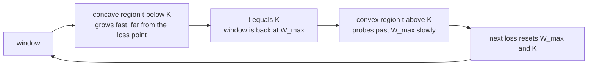
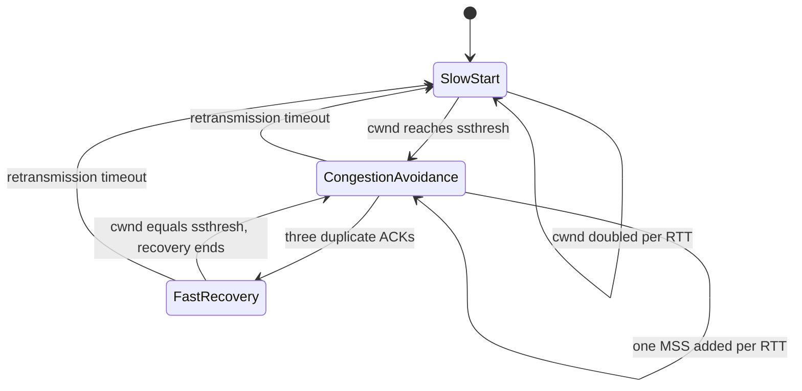
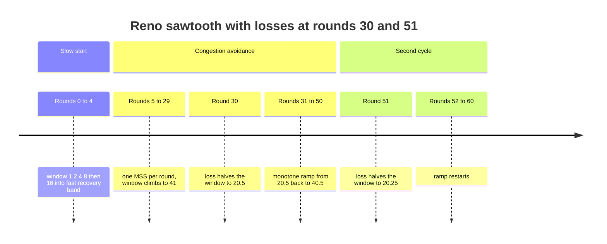

# 689 — Implement congestion control algorithms simulator (TCP Reno/CUBIC)

> **Tier:** Expert · **CTCI chapter:** Beyond — Networking, OS & Real-Time
> **Task spec:** [689-implement-congestion-control-algorithms-simulator-tcp-reno-cubic.md](../../../tasks/expert/689-implement-congestion-control-algorithms-simulator-tcp-reno-cubic.md)
> **Solutions:** [Python](../../../solutions/python/expert/689-implement-congestion-control-algorithms-simulator-tcp-reno-cubic/solution.py) ·
> [Java](../../../solutions/java/expert/689-implement-congestion-control-algorithms-simulator-tcp-reno-cubic/Solution.java) ·
> [JavaScript](../../../solutions/javascript/expert/689-implement-congestion-control-algorithms-simulator-tcp-reno-cubic/solution.js) ·
> [C#](../../../solutions/csharp/expert/689-implement-congestion-control-algorithms-simulator-tcp-reno-cubic/Solution.cs)

## 1. Problem restatement

Drive **two congestion controllers** with the same deterministic event schedule and compare their
reactions, one round = one RTT, window measured in MSS-sized segments.

| Algorithm | Behaviour |
| --- | --- |
| **Reno** (RFC 5681) | slow start doubles `cwnd` per RTT until `ssthresh`; congestion avoidance adds 1 MSS per RTT; a triple duplicate ACK sets `ssthresh = cwnd / 2` and `cwnd = ssthresh` (fast recovery, no slow start); a timeout sets `ssthresh = cwnd / 2` and `cwnd = 1` |
| **CUBIC** (RFC 8312) | after a loss it remembers `W_max` and follows `W_cubic(t) = C (t - K)^3 + W_max` with `C = 0.4`, `beta = 0.7` and `K = cbrt(W_max (1 - beta) / C)`, floored by the TCP-friendly estimate `W_est(t) = W_max beta + 3 (1 - beta) / (1 + beta) * t / RTT` |

Invariants: `cwnd >= 1` MSS and `ssthresh >= 2` MSS (`MIN_SSTHRESH`) after **every** single event, and
loss events are an explicit schedule (`loss_rounds`), with time advancing one RTT per round.

Concrete results asserted by the checks:

- Reno doubles: `simulate(7 rounds)` gives `[1, 2, 4, 8, 16, 32, 64]` and then **65**, i.e. slow start
  hands over at `ssthresh = 64`; after 9 rounds the window is **67**.
- from `cwnd = 40`, a triple duplicate ACK gives `cwnd = ssthresh = 20` and the next ACK round gives
  **21**; a timeout from the same window gives `cwnd = 1`, `ssthresh = 20`; from `cwnd = 3` a timeout
  clamps `ssthresh` to the floor **2**.
- the classic sawtooth (start `cwnd = 1`, `ssthresh = 16`, losses at rounds 30 and 51): the first loss
  lands at `cwnd = 41` and drops it to **20.5**, the cycle runs **20.5 → 40.5**, its average is
  **30.50** MSS against `0.75 * 40.5 = 30.38` (within 2%), and the second loss halves it to **20.25**.
- Reno on a lossy link: with per-RTT loss probability `p * cwnd` for `p` in `0.004, 0.01, 0.04` the
  measured average window is within **25%** of the Mathis formula `1.22 / sqrt(p)` (which gives
  `19.29`, `12.20` and `6.10` MSS/RTT respectively) over 4000 rounds.
- CUBIC: after 200 ACK rounds `W_max = 16754.15` is remembered, the loss drops the window to
  `beta * W_max = 11727.91`, `K = 23.25 s` is exactly `cbrt(W_max (1 - beta) / C)`, `W_cubic(K)` is
  `W_max` again, the curve is **concave below K** and **convex above** it, and it probes past `W_max`
  after `K`.
- on the shared schedule (losses at rounds 5 and 60, `ssthresh = 20`) CUBIC's average window is much
  larger than Reno's, and Reno's average stays inside the 40-90 MSS band (measured **80.58**);
  after 200 seconds with losses every 20 s the long-RTT/short-RTT ratio is **0.49** for Reno (the
  shorter RTT starves the longer one) and **0.83** for CUBIC, which is RTT-fairer.

## 2. Intuition

Both algorithms answer the same question — *how fast may I send after a loss?* — and differ in the
shape of the answer:

1. **Reno is a sawtooth.** Multiplicative decrease (halve) plus additive increase (one MSS per RTT)
   produces a linear ramp that is cut in half at every loss. The sawtooth's average is the classic
   `0.75 * W_max`, and its convergence speed is governed by the RTT: a flow with twice the RTT grows
   half as fast per second, which is why Reno is not RTT-fair.
2. **CUBIC is a cubic curve around the loss point.** The window restarts at `beta * W_max = 0.7 W_max`
   and returns to `W_max` exactly at `t = K`. Below `K` the curve is concave, so it climbs quickly when
   it is far from the previous loss (good for high bandwidth-delay products); above `K` it is convex
   and slows down, so it *probes* past `W_max` cautiously instead of hammering the link.
3. **CUBIC never falls below the friendly estimate.** Where the cubic curve dips under `W_est(t)`, the
   flow follows the line — the "TCP-friendly region" — so CUBIC is never less aggressive than Reno.



Loss classification is the second half of the model: a loss that destroys at least half the window
starves the ACK clock and is observed as a **timeout**, while a lighter loss still delivers three
segments behind it and is observed as **duplicate ACKs** — fast retransmit rather than a collapse to
one segment.

## 3. Algorithm

**Reno.** `on_ack_round` doubles `cwnd` (capped at `ssthresh`) while `cwnd < ssthresh`, otherwise adds
1 MSS, and advances `time` by one RTT. `on_loss(kind)` computes `ssthresh = max(cwnd / 2, 2)`; for a
triple duplicate ACK it sets `cwnd = ssthresh` (fast recovery), for a timeout `cwnd = 1` (slow start
again), then clamps `cwnd` at one MSS.

**CUBIC.** `epoch_k` returns `K = cbrt(w_max (1 - beta) / C)`; `cubic_target(t)` returns
`C (t - K)^3 + W_max`; `friendly_target(t)` returns `W_max beta + 3 (1 - beta) / (1 + beta) * t / RTT`.
`on_ack_round` advances time; below `ssthresh` it behaves exactly like Reno's slow start; otherwise it
starts an epoch if needed, evaluates the cubic target **one RTT ahead** and the friendly target at the
current epoch time, then either snaps to the friendly value (when the cube is below it) or moves a
fraction `(target - cwnd) / max(cwnd, 1)` towards the target. `on_loss` sets `w_max = cwnd`,
`ssthresh = max(cwnd * beta, 2)`, and either restarts an epoch at `cwnd = ssthresh` (duplicate ACKs) or
collapses to 1 MSS (timeout).

**Driver.** `simulate(flow, rounds, loss_rounds, kind)` replaces the ACK round with a loss event when
its index is in the schedule and returns the whole `cwnd` trace; `simulate_seconds` does the same with
a time budget so flows of different RTT can be compared at equal wall time.

```text
procedure on_ack_round(flow)                     // Reno
    if flow.cwnd < flow.ssthresh then
        flow.cwnd ← min(2 * flow.cwnd, flow.ssthresh)
    else
        flow.cwnd ← flow.cwnd + 1
    flow.time ← flow.time + flow.rtt

procedure on_loss(flow, kind)                    // Reno
    flow.losses ← flow.losses + 1
    flow.ssthresh ← max(flow.cwnd / 2, 2)
    if kind = triple_dup_ack then
        flow.cwnd ← flow.ssthresh                // fast recovery, no slow start
    else
        flow.cwnd ← 1                            // timeout
    flow.cwnd ← max(flow.cwnd, 1)

function epoch_k(flow)                           // CUBIC
    return cube_root(flow.w_max * (1 - 0.7) / 0.4)

function cubic_target(flow, t_epoch)
    return 0.4 * (t_epoch - flow.k) ** 3 + flow.w_max

function friendly_target(flow, t_epoch)
    return flow.w_max * 0.7 + 3 * (1 - 0.7) / (1 + 0.7) * (t_epoch / flow.rtt)

procedure on_ack_round(flow)                     // CUBIC
    flow.time ← flow.time + flow.rtt
    if flow.cwnd < flow.ssthresh then
        flow.cwnd ← min(2 * flow.cwnd, flow.ssthresh)
        return
    if flow is not inside an epoch then
        flow.epoch_start ← flow.time
        flow.k ← epoch_k(flow)
    t_epoch ← flow.time - flow.epoch_start
    target ← cubic_target(flow, t_epoch + flow.rtt)
    friendly ← friendly_target(flow, t_epoch)
    if target < friendly then
        flow.cwnd ← friendly                    // the TCP-friendly region
    else
        flow.cwnd ← flow.cwnd + (target - flow.cwnd) / max(flow.cwnd, 1)
    flow.cwnd ← max(flow.cwnd, 1)

procedure on_loss(flow, kind)                    // CUBIC
    flow.losses ← flow.losses + 1
    flow.w_max ← flow.cwnd
    flow.ssthresh ← max(flow.cwnd * 0.7, 2)
    if kind = triple_dup_ack then
        flow.cwnd ← flow.ssthresh
        start a new epoch
    else
        flow.cwnd ← 1
    flow.cwnd ← max(flow.cwnd, 1)

procedure simulate(flow, rounds, loss_rounds, kind)
    trace ← [flow.cwnd]
    for round ← 1 to rounds do
        if round is in loss_rounds then
            on_loss(flow, kind)
        else
            on_ack_round(flow)
        append flow.cwnd to trace
    return trace
```



## 4. Worked example

The shared schedule: `[1, 2, 3]`-style flow with `cwnd = 1`, `ssthresh = 20`, 200 rounds, losses
scheduled at rounds 5 and 60. Traces measured by running the Python solution.

| Round | Reno `cwnd` | CUBIC `cwnd` | Note |
| --- | --- | --- | --- |
| 0-4 | 1, 2, 4, 8, 16 | 1, 2, 4, 8, 16 | identical slow start in both |
| 5 (loss) | **8** | **11.2** | Reno halves to `ssthresh = 8`; CUBIC takes `0.7 * 16 = 11.2` and restarts its curve |
| 6 | 9 | 11.63 | Reno adds 1 MSS per RTT; CUBIC is concave, so it climbs slowly at first |
| 7-9 | 10, 11, 12 | 12.02, 12.51, 13.43 | CUBIC accelerates as it leaves the loss point |
| 10-11 | 13, 14 | 15.14, 17.96 | the cubic term takes over |
| 60 (loss) | 62 → **31** | 1265.3 → **885.71** | both re-apply their deletion: half versus `beta = 0.7` |
| average over 200 rounds | **80.58** MSS | **2083.91** MSS | CUBIC keeps the pipe much fuller on this schedule |

The Python model has no bottleneck capacity, so CUBIC's window keeps growing while Reno keeps
oscillating; the Java, JavaScript and C# solutions add a droptail bottleneck with a fixed per-round
capacity, which is where the checks measure the "timeouts only on heavy losses" and
"capacity-1 degenerate link" cases instead.

Reno's sawtooth is the second trace: with `ssthresh = 16` and losses at rounds 30 and 51 the window
ramps `1 → 41`, the loss cuts it to `20.5`, the cycle rises monotonically back to `40.5`, and its mean
of **30.50** MSS matches `0.75 * W_max = 30.38` to within 2 percent — the number that makes Reno's
throughput predictable from its loss rate via Mathis (`1.22 / sqrt(p)`).



## 5. Complexity

Let `R` be the number of rounds, `S` the number of scheduled loss events and `W` the window size at a
loss.

| Quantity | Best | Average | Worst | Why the bound holds |
| --- | --- | --- | --- | --- |
| one round | O(1) | O(1) | O(1) | a doubling or a single addition (Reno), a cube plus a division (CUBIC) |
| full simulation | O(R) | O(R) | O(R) | exactly one event per round, and the loss schedule is a membership test |
| slow start to `ssthresh` | O(log ssthresh) rounds | O(log ssthresh) | O(log ssthresh) | the window doubles every round |
| congestion-avoidance cycle | O(W) rounds | O(W) | O(W) | one MSS per RTT from `W/2` back to `W` |
| CUBIC to recover `W_max` | O(K) rounds | O(K) | O(K) | `K = cbrt(W_max (1 - beta) / C)`, measured 23.25 s at `W_max = 16754.15` |
| space | O(1) state, O(R) for the trace | | | one flow keeps `cwnd`, `ssthresh`, `time`, `w_max`, `K`, `epoch_start` |
| Alternative (Mathis) | O(1) | O(1) | O(1) | `1.22 / sqrt(p)` predicts the average without simulating anything; the checks use it as the oracle within 25% |

The interesting complexity is not the loop but the *shape*: Reno's window average is
`0.75 * W_max` regardless of the RTT (the checks verify this identity to within 2%), whereas CUBIC's
recovery time is a function of the window itself (`K ∝ cbrt(W_max)`), which is what makes it
independent of the RTT ratio that hurts Reno.

## 6. Pitfalls and edge cases

- **`ssthresh` floors at 2 MSS.** A timeout from `cwnd = 3` must leave `ssthresh = 2`, not `1.5`; both
  algorithms clamp it, and `cwnd >= 1` is asserted after every event in the random-loss sweep.
- **Fast recovery is not slow start.** A triple duplicate ACK sets `cwnd = ssthresh`, so the flow
  continues in congestion avoidance immediately (20 → 21 on the next round); only a timeout restarts
  at one MSS.
- **Timeout versus duplicate ACKs is a classification problem.** The Java and JavaScript solutions
  decide it from how much of the window survived the bottleneck, and the Java check asserts that
  timeouts happen only on heavy losses. In Python the kind is passed explicitly to `simulate`, which is
  the documented simplification.
- **`W_max` must be remembered, not re-derived.** CUBIC's whole curve is anchored at the previous
  loss point; the checks assert `W_max` equals the window at the loss and that the post-loss window is
  exactly `0.7 * W_max`.
- **`W_cubic(K) == W_max` and `W_cubic(0) == beta * W_max`.** These two analytic identities are the
  fastest way to catch an off-by-one in `K` or in the epoch start.
- **Concave then convex.** The finite-difference check on either side of `K` fails if the cube is
  written with the wrong sign or if `t` is measured from the wrong origin.
- **The friendly region must be a floor, not an alternative.** Where `W_cubic < W_est` the flow
  follows `W_est`; dropping that rule makes CUBIC less aggressive than Reno, which the
  "keeps a fuller pipe" check would also catch.
- **RTT fairness is a property, not an accident.** Two flows with 2 s and 1 s RTT under the same loss
  schedule end with a window ratio of **0.49** under Reno (the long-RTT flow starves) and **0.83**
  under CUBIC; `simulate_seconds` exists precisely to compare flows at equal wall time rather than at
  equal round counts.
- **A zero-round run is legal.** `simulate(flow, 0, set())` returns a single-element trace holding the
  initial window, so the trace always has `rounds + 1` entries.
- **Determinism.** Random losses in the Python sweep come from a fixed-seed splitmix64 generator, and
  the Java/JS/C# solutions drive a deterministic droptail bottleneck instead of a random one, so every
  reported number is reproducible.
- **Documented simplification.** One flow, no queue model, no SACK, no fast-convergence adjustment of
  `W_max` in Python, no RTT jitter, loss events given as an explicit schedule, one RTT per round. The
  JavaScript solution adds a droptail bottleneck and states that the per-RTT increment is the per-ACK
  increment; the Java and C# solutions add the fast-convergence heuristic and note that CUBIC behaves
  like plain TCP before its first loss, because the cubic function needs a `W_max` reference.

## 7. Variants and follow-ups

- A rate-based controller that abandons window halving altogether →
  [690 — rate-based congestion control (BBR outline)](../../../tasks/expert/690-implement-rate-based-congestion-control-bbr-outline.md).
- The pure AIMD dynamics behind the sawtooth, without Reno's slow start or fast recovery →
  [691 — additive-increase multiplicative-decrease (AIMD) simulation](../../../tasks/expert/691-implement-additive-increase-multiplicative-decrease-aimd-simulat.md).
- Reliable delivery above the congestion controller, where losses must still be repaired in order →
  [692 — reliable ordered multicast with failure handling](../../../tasks/expert/692-implement-reliable-ordered-multicast-with-failure-handling.md).

## 8. Check yourself

<details><summary>Show answer</summary>
**Why is the average window of a Reno sawtooth `0.75 * W_max`?** The window rises linearly from
`W_max / 2` to `W_max`, and the mean of a linear ramp is the midpoint of its endpoints:
`(0.5 W_max + W_max) / 2 = 0.75 W_max`. The measured cycle in the tutorial is `20.5 → 40.5` with mean
30.50 against `0.75 * 40.5 = 30.38`.
</details>

<details><summary>Show answer</summary>
**What is `K` and why does it have a closed form?** `K` is the time the cubic curve needs to climb
from `beta * W_max` back to `W_max`. Setting `C (t - K)^3 + W_max = W_max` at `t = 0` gives
`C K^3 = W_max (1 - beta)`, hence `K = cbrt(W_max (1 - beta) / C)`; the tutorial's run yields
`K = 23.25 s` for `W_max = 16754.15`.
</details>

<details><summary>Show answer</summary>
**Why does CUBIC need a TCP-friendly region?** Because the cubic function is not always above Reno's
additive increase: near the loss point it can be below the line
`W_est(t) = W_max beta + 3 (1 - beta) / (1 + beta) * t / RTT`. Following the line there keeps CUBIC from
being less aggressive than the AIMD flows it shares the link with.
</details>

<details><summary>Show answer</summary>
**Two flows, 2 s and 1 s RTT, same loss schedule: what do the checks measure?** The ratio of the
long-RTT window to the short-RTT window: **0.49** under Reno, i.e. the shorter-RTT flow takes roughly
twice the share, and **0.83** under CUBIC, which is much closer to fair because its recovery time
depends on `W_max` rather than on how many additive increases fit into a second.
</details>

<details><summary>Show answer</summary>
**Why does the Python model let CUBIC's window grow to thousands of MSS?** Because it has no
bottleneck: the driver only applies the scheduled losses, so between them CUBIC keeps moving towards
its algebraic target. The Java, JavaScript and C# solutions add a deterministic link capacity, which
supplies losses continuously and keeps the window in a realistic band.
</details>
