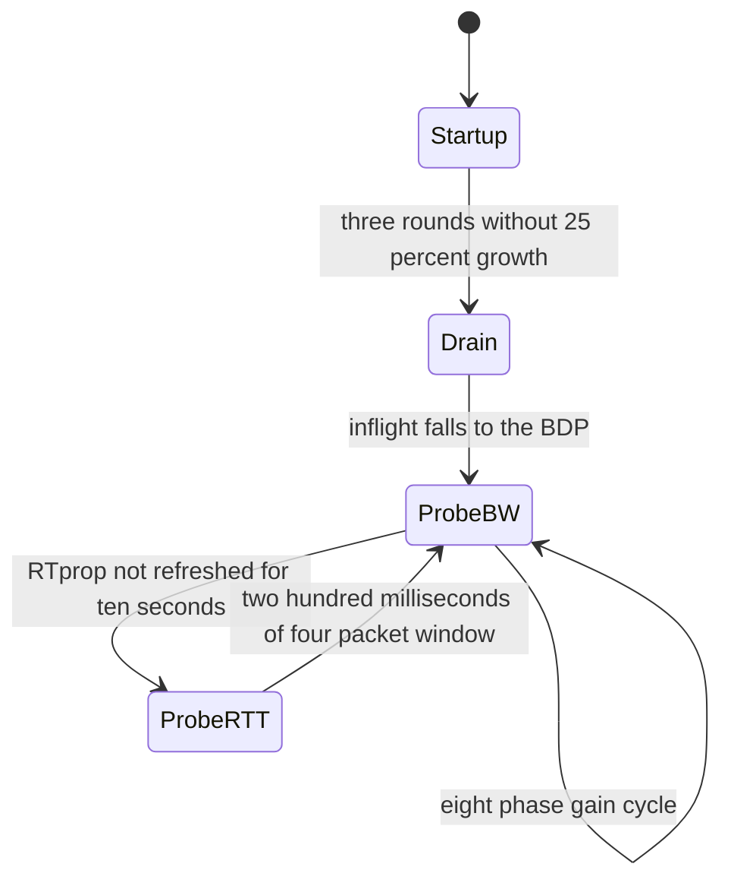
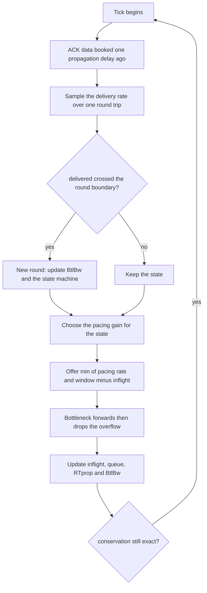
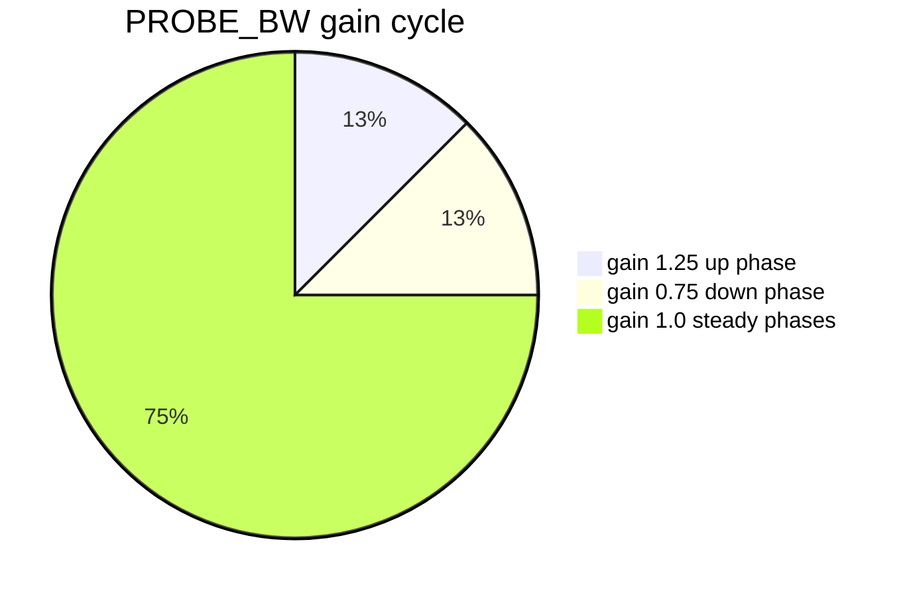

# 690 — Implement rate-based congestion control (BBR outline)

> **Tier:** Expert · **CTCI chapter:** Beyond — Networking, OS & Real-Time
> **Task spec:** [690-implement-rate-based-congestion-control-bbr-outline.md](../../../tasks/expert/690-implement-rate-based-congestion-control-bbr-outline.md)
> **Solutions:** [Python](../../../solutions/python/expert/690-implement-rate-based-congestion-control-bbr-outline/solution.py) ·
> [Java](../../../solutions/java/expert/690-implement-rate-based-congestion-control-bbr-outline/Solution.java) ·
> [JavaScript](../../../solutions/javascript/expert/690-implement-rate-based-congestion-control-bbr-outline/solution.js) ·
> [C#](../../../solutions/csharp/expert/690-implement-rate-based-congestion-control-bbr-outline/Solution.cs)

## 1. Problem restatement

Implement the **BBR outline**: a *rate-based* controller that paces at an estimate of the bottleneck
bandwidth instead of filling the buffer until something is lost.

| Element | Definition |
| --- | --- |
| `BtlBw` | maximum delivery rate sampled over the last **10 rounds** (a windowed max filter) |
| `RTprop` | minimum round trip observed over a **10 s** window (a windowed min filter) |
| pacing rate | `pacing_gain * BtlBw`, floored before the first estimate by `initial cwnd / RTprop` |
| inflight cap | `cwnd = max(4, BtlBw * RTprop * cwnd_GAIN)` with `cwnd_GAIN = 2` (two BDPs) |
| STARTUP | gain **2.885**, exit after **three** rounds without **25%** rate growth |
| DRAIN | gain **1 / 2.885**, exit once `inflight <= BDP` |
| PROBE_BW | the eight-step gain cycle `1.25, 0.75, 1, 1, 1, 1, 1, 1` |
| PROBE_RTT | collapse the window to **4 packets** for **200 ms** when `RTprop` has not been refreshed for 10 s |
| bottleneck | a fluid droptail link: forward up to `capacity`, buffer the rest, drop the overflow, delay `RTprop + queue / capacity` |

Concrete results asserted by the checks:

- the constants: `STARTUP_GAIN == 2.885`, `DRAIN_GAIN == 1 / 2.885`, the cycle is eight phases starting
  `1.25, 0.75`, and its mean is exactly **1.0** — the probe is paid for by the drain.
- the bottleneck behaves as a fluid FIFO: `transmit(30)` on a capacity-10/buffer-25 link leaves
  **20** queued and drops nothing; a following `transmit(25)` drops **10**; a packet's delay is
  `RTprop + queue / capacity` (**21.5** ticks with 15 queued), and an empty queue shows the
  propagation delay alone (**20**). Fluid conservation holds to `1e-9`.
- over **30000** ticks the state order is `STARTUP → DRAIN → PROBE_BW`, `PROBE_RTT` is entered **2**
  times, `BtlBw` converges to the capacity **10.00** (within 5%), `RTprop` to **20.00** ticks, every
  PROBE_RTT really drives `inflight` down to four packets, and each lasts at least 200 ms.
- BBR's mean round trip is **20.60** ticks (**0.60** of standing queue) against a loss-based AIMD
  sender on the same link at **29.22** ticks (**9.22** of queueing delay) — more than **8x** more
  delay — while both saturate the link (**0.976** versus **0.935** of capacity).
- BBR drops less than **1%** of what it forwards, never exceeds the buffer, and two identical runs
  produce identical offers, state logs and estimates.

## 2. Intuition

Loss-based controllers use a *symptom* (a dropped packet) as their congestion signal, which means the
only way to know the path's capacity is to overfill it — the buffer stays full by construction. BBR
inverts this: it keeps a **model of the path** (`BtlBw` and `RTprop`) and paces at a gain times that
model, so the queue stays close to empty while the link stays busy.

1. **Two filters, not one counter.** `BtlBw` is a max filter (the path never delivered faster than
   this) and `RTprop` is a min filter (the path never had a shorter round trip than this). Both are
   windowed, so the estimates can *decay* as well as improve.
2. **Gains encode intent.** `2.885` in STARTUP doubles the rate each round (the logarithm of two plus
   one); `1/2.885` in DRAIN empties what STARTUP built; the PROBE_BW cycle probes at `1.25` and then
   yields at `0.75`, averaging exactly one so the flow is sustainable while it looks for more.
3. **PROBE_RTT is the safety valve.** If `RTprop` has not improved for 10 s, the window drops to four
   packets for 200 ms so the queue empties and a fresh minimum can be measured.
4. **The window is an inflight cap, not the control loop.** The pacing rate decides *when* to send;
   `cwnd = 2 * BDP` only bounds how much may be outstanding.



The model also makes the *purpose* measurable: on the same bottleneck the tutorial compares BBR with a
minimal window-driven AIMD sender that keeps increasing until the droptail buffer overflows. Both
saturate the link; only one of them sits in the buffer.

## 3. Algorithm

1. **Sample the delivery rate** once per round trip: keep a log of `(tick, delivered)`, drop entries
   older than one `RTprop`, and record `delivered_now - delivered_then` over the elapsed span as a
   `(round, rate)` sample. `BtlBw` is the maximum of the samples in the last 10 rounds.
2. **Sample `RTprop`** as the minimum of the round trips seen within the last 10 s, where the round
   trip reported by the link is `RTprop + queue / capacity`.
3. **Detect a round.** When `delivered` passes `next_round_delivered`, a new round begins: update
   `BtlBw`, run the state transitions, advance the PROBE_BW gain index, and remember the bandwidth at
   the round start.
4. **Transitions.** STARTUP → DRAIN after three rounds without 25% growth; DRAIN → PROBE_BW once
   `inflight <= BDP`; anything → PROBE_RTT when the RTprop stamp is older than 10 s; PROBE_RTT →
   PROBE_BW after 200 ms, with the stamp refreshed.
5. **Pace.** `pacing_rate = max(BtlBw, 4 / RTprop) * pacing_gain(state)`, and the amount offered this
   tick is `min(pacing_rate, window - inflight)` where the window is 4 packets in PROBE_RTT and
   `flight_size()` (two BDPs) otherwise. A dropped packet leaves `inflight` immediately.
6. **Transmit into the bottleneck**, which returns how much was forwarded, how much was dropped and
   the delay an arriving packet sees; forwarded data is booked to be ACKed one propagation delay
   later.
7. **Account** for fluid conservation: everything offered is forwarded, dropped, or still queued
   (`conservation_error()` must stay at floating-point zero).

```text
function delivery_rate(sender)
    keep only samples with round > sender.round - 10
    return the largest sample rate, or 0 when there is none

function windowed_rtprop(sender, tick)
    keep only round trip samples with tick within the last ten seconds
    return the smallest of them, or the current RTprop when there are none

function pacing_gain(sender)
    if sender.state = startup then return 2.885
    if sender.state = drain then return 1 / 2.885
    if sender.state = probe_bw then return probe_bw_gains[sender.gain_index]
    return 1.0                                  // probe_rtt paces at the estimate

function pacing_rate(sender)
    return max(sender.btl_bw, 4 / sender.rt_prop) * pacing_gain(sender)

function flight_size(sender)
    return max(4, max(sender.btl_bw, epsilon) * sender.rt_prop * 2)

procedure on_new_round(sender, tick)
    sender.round ← sender.round + 1
    sender.btl_bw ← max(sender.btl_bw, delivery_rate(sender))
    if sender.state = startup then
        grew ← sender.btl_bw ≥ 1.25 * sender.bw_at_round_start
        sender.stall_rounds ← 0 when grew else sender.stall_rounds + 1
        if sender.stall_rounds ≥ 3 then
            change_state(sender, drain, tick)
    else if sender.state = drain then
        if sender.inflight ≤ sender.btl_bw * sender.rt_prop then
            change_state(sender, probe_bw, tick)
    else if sender.state = probe_bw then
        sender.gain_index ← (sender.gain_index + 1) mod 8
    sender.bw_at_round_start ← sender.btl_bw

procedure update_state(sender, tick)
    if sender.state = probe_rtt then
        if tick - sender.state_since ≥ 200 then
            change_state(sender, probe_bw, tick)
            sender.rtprop_stamp ← tick
    else if sender.state = drain and sender.inflight ≤ bdp(sender) then
        change_state(sender, probe_bw, tick)
    else if tick - sender.rtprop_stamp ≥ 10000 then
        change_state(sender, probe_rtt, tick)

procedure step(sender, tick)
    acknowledge whatever was booked for this tick, reducing inflight
    sample the delivery rate
    if sender.delivered ≥ sender.next_round_delivered then
        on_new_round(sender, tick)
    update_state(sender, tick)
    window ← 4 when in probe_rtt else flight_size(sender)
    allowed ← min(pacing_rate(sender), max(0, window - sender.inflight))
    forwarded, dropped, delay ← transmit(sender.link, allowed)
    sender.inflight ← sender.inflight + allowed - dropped
    book forwarded data for an ACK at tick + link.rtprop
    refresh the RTprop estimate from the reported delay
    sender.btl_bw ← max(sender.btl_bw, delivery_rate(sender))
```



## 4. Worked example

The bottleneck in isolation (`capacity = 10`, `buffer = 25`, `RTprop = 20`):

| Call | Queue before | Forwarded | Dropped | Queue after | Reported delay |
| --- | --- | --- | --- | --- | --- |
| `transmit(30)` | 0 | 10 | 0 | 20 | `20 + 20/10 = 22.0` |
| `transmit(25)` | 20 | 10 | 10 | 25 | `20 + 25/10 = 22.5` |
| `transmit(0)` | 25 | 10 | 0 | 15 | `20 + 15/10 = 21.5` |
| `transmit(0)` on an empty link | 0 | 0 | 0 | 0 | `20` |

The first call exceeds the capacity (30 offered, 10 forwarded) and the excess queues; the second
exceeds capacity **and** the buffer, so the 10 packets above the buffer are dropped. The delay reported
to the *sender* is the standing queue over the capacity, which is how BBR observes congestion without
losing anything.

Over a 30000-tick run the estimates settle and the states cycle:

| Quantity | Measured | Meaning |
| --- | --- | --- |
| state order | `STARTUP → DRAIN → PROBE_BW` | three stall rounds end STARTUP, the BDP test ends DRAIN |
| `BtlBw` | **10.00** pkt/tick | exactly the link capacity |
| `RTprop` | **20.00** ticks | exactly the propagation delay |
| PROBE_RTT events | **2** in 30 s | the 10 s window expires twice |
| mean round trip | **20.60** ticks | only 0.60 ticks of standing queue |
| drops | < 1% of forwarded | pacing avoids overflow |
| utilisation | **0.976** of capacity | and none of that is achieved by queueing |

The control loop behind those numbers is the gain cycle. In PROBE_BW the pacing gain walks
`1.25 → 0.75 → 1 → 1 → 1 → 1 → 1 → 1`, so the up-phase builds a queue that the down-phase drains, and
the mean gain is exactly one.



The comparison that gives all of this meaning is the same bottleneck driven by a minimal loss-based
sender, which increases its window until the droptail buffer overflows and halves it on every drop:

| Sender | Mean round trip | Standing queue | Link utilisation |
| --- | --- | --- | --- |
| BBR | **20.60** ticks | **0.60** ticks | 0.976 |
| loss-based AIMD | **29.22** ticks | **9.22** ticks | 0.935 |

Both keep the link busy; the difference is delay, and the ratio of standing queues is more than 8x.

## 5. Complexity

Let `T` be the number of ticks, `W = 10` the bandwidth window in rounds and `S` the number of round
trip samples retained.

| Quantity | Best | Average | Worst | Why the bound holds |
| --- | --- | --- | --- | --- |
| one tick | O(1) | O(1) | O(1) | a handful of arithmetic operations plus one queue update |
| delivery-rate sample | O(1) | O(1) | O(W) | the log is pruned to one round trip; the max filter scans the retained samples |
| `RTprop` refresh | O(1) | O(S) | O(S) | the min filter scans the window; samples are dropped once they age out |
| whole run | O(T) | O(T) | O(T · S) | one step per tick, with an occasional filter refresh |
| STARTUP exit | 3 rounds | 3 rounds | 3 rounds | the stall counter, independent of the window |
| PROBE_BW cycle | 8 rounds | 8 rounds | 8 rounds | one gain phase per round, mean gain exactly 1 |
| PROBE_RTT | 200 ms | 200 ms | 200 ms | the state exits on the duration, not on the queue |
| space | O(S + W) | | | the sample window, the round rate log and a dict of pending ACKs |
| Alternative (loss-based) | O(T) | O(T) | O(T) | same per-tick cost, but the steady state is a full buffer, i.e. 9.22 ticks of delay |

The interesting comparison is not asymptotic: both senders are `O(T)`. BBR trades a small amount of
bookkeeping (two windowed filters and a state machine) for a steady-state queue of 0.60 ticks instead
of 9.22 — a delay difference with the same throughput.

## 6. Pitfalls and edge cases

- **The gain constants are not tunable decoration.** `2.885` is `ln 2 + 1`, and DRAIN's `1 / 2.885` is
  its exact reciprocal; the checks assert both and the mean of the eight PROBE_BW gains.
- **PROBE_BW must average exactly one.** A cycle that probed without yielding would inflate the
  standing queue every round, which is the failure mode the `0.75` step prevents.
- **Estimates must be windowed, not cumulative.** A never-decaying maximum would keep an obsolete
  bandwidth forever after the path changes; the Python model retains 10 rounds of rate samples and
  10 s of round trips.
- **PROBE_RTT must actually empty the pipe.** The checks require the flight size to reach four packets
  and each PROBE_RTT to last at least 200 ms; a probe that ends early would leave `RTprop` stale.
- **A dropped packet leaves `inflight` immediately.** Otherwise the sender would throttle itself for
  data that is gone, and the conservation identity would not hold.
- **Conservation must be exact.** `offered == forwarded + dropped + queued` is asserted to `1e-9` per
  call and `1e-6` over the run, which catches double-counted or lost fluid.
- **The queue must never exceed the buffer.** Dropping the overflow is what makes the loss-based
  comparison meaningful; `overflow_ticks` proves the AIMD sender really does overflow.
- **The initial pacing rate needs a floor.** Before any bandwidth sample exists, BBR uses
  `initial cwnd / RTprop`; without it the flow would never start.
- **Determinism.** Two identical runs must produce identical offers, state logs, `BtlBw` and PROBE_RTT
  counters — no randomness anywhere in the controller.
- **Boundary ticks.** A 50-tick run is still in STARTUP (`state_log[0] == (0, STARTUP)`), and a
  3000-tick run has already left it, so the machine must be driven by rounds rather than by wall time
  alone.
- **Documented simplification (outline).** No packet framing, no SACK or retransmission timers — a
  dropped packet is simply resent and only consumes capacity — one flow, no receive-rate model, and a
  round trip is taken as `RTprop` because round counting is coarse in a fluid model. The Java solution
  shortens the 10 s RTprop lifetime to a 60-round window and PROBE_RTT to two rounds; the JavaScript
  solution uses a delay line so the ACK rate equals the service rate `propRtt` rounds earlier and
  grants one measurement per round; the C# solution drops to one RTT granularity with no
  retransmission at all and advances the gain cycle once per round.

## 7. Variants and follow-ups

- The loss-based controllers BBR is designed to avoid queueing behind →
  [689 — congestion control simulator (TCP Reno/CUBIC)](../../../tasks/expert/689-implement-congestion-control-algorithms-simulator-tcp-reno-cubic.md).
- The AIMD dynamics in isolation, as the analytic baseline of the cycle →
  [691 — additive-increase multiplicative-decrease (AIMD) simulation](../../../tasks/expert/691-implement-additive-increase-multiplicative-decrease-aimd-simulat.md).
- Delay and loss as observable signals in a reliable-delivery protocol →
  [692 — reliable ordered multicast with failure handling](../../../tasks/expert/692-implement-reliable-ordered-multicast-with-failure-handling.md).

## 8. Check yourself

<details><summary>Show answer</summary>
**Why is `BtlBw` a maximum filter and `RTprop` a minimum filter?** The bottleneck bandwidth is the
fastest the path has ever delivered, and the propagation delay is the shortest round trip it has ever
had — both are physical properties that degrade as soon as a queue forms, so only the extremes are
meaningful. Both filters are windowed so that a *better* path (more bandwidth, shorter delay) is also
detected.
</details>

<details><summary>Show answer</summary>
**Why does the PROBE_BW cycle contain a 0.75 step?** The `1.25` probe deliberately oversends and
builds a small queue to test whether more bandwidth exists. The `0.75` step drains exactly what the
probe added, so the cycle's mean gain is 1.0 and the flow stays sustainable instead of accumulating
queue round after round.
</details>

<details><summary>Show answer</summary>
**What is PROBE_RTT for, and how is it verified?** It empties the pipe so a fresh minimum round trip
can be measured when no better `RTprop` has been seen for 10 s: the window collapses to four packets
for 200 ms. The checks require at least two PROBE_RTT events in a 30 s run, each lasting at least
200 ms, and the flight size really reaching four packets.
</details>

<details><summary>Show answer</summary>
**What is the measured advantage over the loss-based sender on the same link?** Throughput is
essentially identical (0.976 versus 0.935 of capacity) while the standing queue is 0.60 versus 9.22
ticks — more than 8x less queueing delay, because BBR paces at `BtlBw` instead of probing for capacity
by overflowing the buffer.
</details>

<details><summary>Show answer</summary>
**Why is the cwnd an inflight cap rather than the control loop?** The pacing rate decides when data is
sent; `cwnd = 2 * BDP` only limits how much may be outstanding, so the queue stays short even when the
window is generous. If the window were the control variable, BBR would degrade into a loss-based
sender.
</details>
