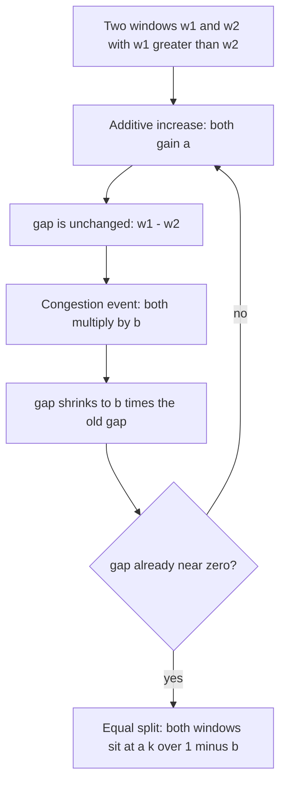
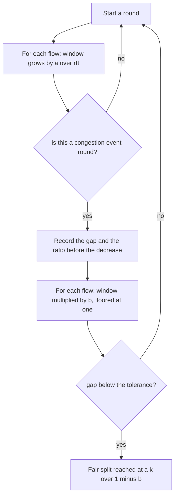
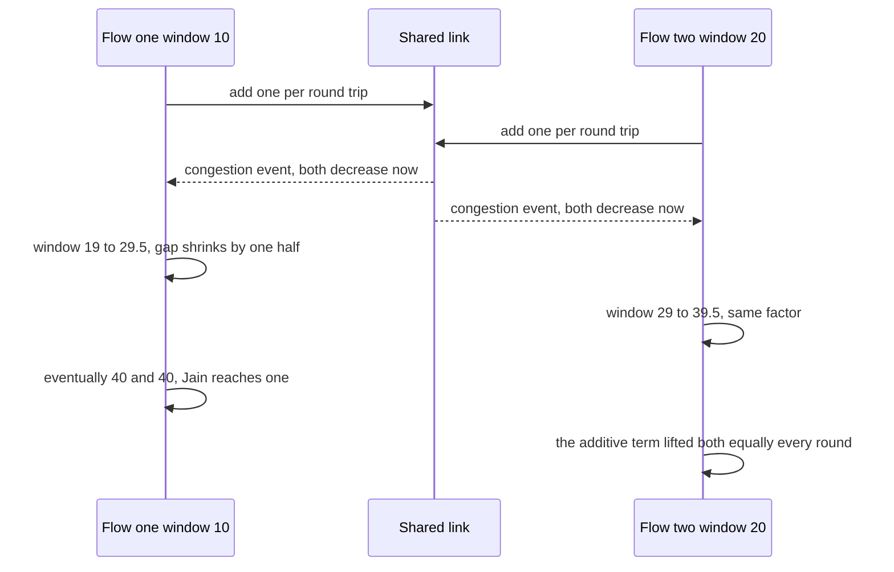

# 691 — Implement additive-increase multiplicative-decrease (AIMD) simulation

> **Tier:** Expert · **CTCI chapter:** Beyond — Networking, OS & Real-Time
> **Task spec:** [691-implement-additive-increase-multiplicative-decrease-aimd-simulat.md](../../../tasks/expert/691-implement-additive-increase-multiplicative-decrease-aimd-simulat.md)
> **Solutions:** [Python](../../../solutions/python/expert/691-implement-additive-increase-multiplicative-decrease-aimd-simulat/solution.py) ·
> [Java](../../../solutions/java/expert/691-implement-additive-increase-multiplicative-decrease-aimd-simulat/Solution.java) ·
> [JavaScript](../../../solutions/javascript/expert/691-implement-additive-increase-multiplicative-decrease-aimd-simulat/solution.js) ·
> [C#](../../../solutions/csharp/expert/691-implement-additive-increase-multiplicative-decrease-aimd-simulat/Solution.cs)

## 1. Problem restatement

Simulate the **AIMD control law** — `w ← w + a` per round trip while the path is clean, `w ← b * w` at a
congestion event — and, more importantly, verify the algebra that makes it the Internet's choice. Four
laws are defined as `(add_up, mul_up, mul_down, add_down)` tuples:

| Law | Increase | Decrease | What it is |
| --- | --- | --- | --- |
| `aimd` | `+1` per RTT | `* 0.5` | the reference: additive increase, multiplicative decrease |
| `mimd` | `* 1.1` per RTT | `* 0.9` | multiplicative on both sides |
| `aiad` | `+1` per RTT | `-1` | additive on both sides |
| `miad` | `* 1.01` per RTT | `-1` | multiplicative increase, additive decrease |

Two flows sharing one link, with a synchronous congestion event every `period` rounds (a droptail
bottleneck signals all senders at once), obey

- `w_1 - w_2 → b * (w_1 - w_2)` at every event, because the additive terms cancel — the fairness gap
  shrinks geometrically;
- `w_i = a_i * k / ((1 - b) * rtt_i)` at equilibrium with `k` rounds between events — which is where
  AIMD's RTT bias comes from.

Concrete results asserted by the checks:

- a single flow with `a = 1`, `b = 0.5`, `period = 20` converges to the peak limit
  `a * period / (1 - b) = 40` (measured **39.96** after 10 cycles), its peaks obey
  `W_next = 0.5 * W + 20` exactly, each ramp rises monotonically, the event halves it, and the mean of
  a 20-round ramp is exactly `W - 9.5` (**30.46**), i.e. the classic `0.75 * W_max` continuum result
  to within 2%.
- a pair of AIMD flows started at windows 10 and 20 converges to an equal split: the gap goes
  `-10 → -1.8e-11` over 40 events, both windows land on **40.0**, and Jain's index reaches
  **1.0000**.
- `mimd` preserves the ratio **exactly** (Jain's index is unchanged at its starting value), `aiad`
  preserves the *difference* exactly (`-10.0` after forty events), and `miad` moves the split strictly
  away from fair at **every** event, settling below `0.9 *` its initial ratio with Jain below `0.85`.
- RTT bias: two flows with equal start windows and RTTs 1 and 2 end with the long-RTT flow holding
  **half** the window (ratio 0.5) and getting **4.00x** less throughput, Jain **0.735**.
- AIMD on a random-loss process with per-RTT probability `p * cwnd` for `p` in `0.002, 0.01, 0.05`
  stays within 25% of Mathis's `1.22 / sqrt(p)`; the SQRT formula `sqrt(3 / (2p))` agrees with Mathis
  to within a percent at `p = 0.02`.

## 2. Intuition

AIMD is one line of arithmetic, so the interesting part is *why* these two words and not any other
pair. Take two flows with windows `w_1 > w_2` and watch one congestion event:

1. **The additive terms are equal**, so `w_1 + a - (w_2 + a) = w_1 - w_2`: the increase never changes
   the gap, it only lifts both flows — it is what keeps throughput climbing after a loss.
2. **The decrease multiplies both windows**, so the gap becomes `b (w_1 - w_2)`: with `b < 1` the gap
   *shrinks by the same factor* at every event. Repeat and the pair converges to equality no matter
   how far apart it started.
3. **That is exactly what the other combinations fail to do.** Multiplicative increase preserves the
   *ratio* (`1.1 w_1 / 1.1 w_2 = w_1 / w_2`) so the split never improves; additive decrease preserves
   the *difference* (`w_1 - 1 - (w_2 - 1) = w_1 - w_2`) so the distance to fair never shrinks; and
   multiplicative increase with additive decrease actively pushes the ratio away from one.



The equilibrium arithmetic is the second half. Between two events a flow adds `a` per RTT but a flow
with a longer RTT fits fewer RTTs into the same wall-clock `k` rounds, so its window ends lower:
`w_i = a_i k / ((1 - b) rtt_i)`. Normalised by RTT, the *rates* then satisfy
`rate_1 / rate_2 = (a_1 / rtt_1) / (a_2 / rtt_2)` — the well-known RTT bias of pure AIMD, measured
here as a 4x throughput ratio for an RTT ratio of 2.

## 3. Algorithm

1. **Define the laws** as four-coefficient tuples so a single `increase`/`decrease` pair covers every
   combination; both operations floor the window at `MIN_WINDOW = 1` packet.
2. **`sawtooth(a, b, window, period, cycles)`** drives a single flow: `period` rounds of additive
   increase, then one multiplicative decrease, recording the whole trace and the peaks.
3. **`run_pair(law_one, law_two, windows, rounds, period, rtts)`** drives two flows: each round both
   windows increase by `a / rtt` (so RTT enters through the increase term), at every `period` both are
   decreased synchronously, and the gap, the ratio and the window snapshots are recorded at each
   event.
4. **Throughput formulas** are the oracles: `mathis_throughput(p) = 1.22 / sqrt(p)` and
   `sqrt_throughput(p) = sqrt(3 / (2p))`, in MSS per RTT.
5. **`jain_index(values) = (sum x)^2 / (n * sum x^2)`** turns a window vector into one fairness number
   between `1/n` and `1`.
6. **Random losses** are a memoryless per-RTT test against `p * cwnd` (every packet of the window may
   be dropped), driven by a fixed-seed splitmix64 generator so the experiment is reproducible.

```text
function increase(window, law, rounds)
    if law.mul_up > 0 then
        return window * law.mul_up ^ rounds
    return window + law.add_up * rounds

function decrease(window, law)
    if law.mul_down > 0 then
        return max(window * law.mul_down, 1)
    return max(window - law.add_down, 1)

procedure sawtooth(a, b, window, period, cycles)
    trace ← [window], peaks ← empty list
    for cycle ← 1 to cycles do
        repeat period times: window ← window + a, append window to trace
        append window to peaks
        window ← max(window * b, 1)
        append window to trace
    return trace and peaks

function run_pair(law_one, law_two, windows, rounds, period, rtts)
    state ← windows as floats, gap ← [], ratio ← [], snapshots ← []
    for event ← 1 to rounds / period do
        for round ← 1 to period do
            for i ← 1 to 2 do
                state[i] ← max(increase(state[i], law_i, 1 / rtts[i]), 1)
        append (state[1] - state[2]) to gap
        append (state[1] / state[2]) to ratio
        append copy of state to snapshots
        for i ← 1 to 2 do
            state[i] ← decrease(state[i], law_i)
    return gap, ratio, snapshots and the final state

function jain_index(values)
    total ← sum of values, squares ← sum of squares
    return total * total / (length(values) * squares), or 1 when squares is zero
```



## 4. Worked example

Single flow: `a = 1`, `b = 0.5`, `period = 20` rounds of increase per event, start `window = 1`. The
peaks follow the recurrence `W_next = b * W + a * period = 0.5 W + 20`.

| Cycle | Start of ramp | Peak reached | After the event | Mean of the 20-round ramp |
| --- | --- | --- | --- | --- |
| 1 | 1.0 | 21.0 | 10.5 | 11.5 |
| 2 | 10.5 | 30.5 | 15.25 | 21.0 |
| 3 | 15.25 | 35.25 | 17.625 | 25.75 |
| 4 | 17.625 | 37.625 | 18.8125 | 28.125 |
| limit | 20.0 | **40.0** | 20.0 | 30.5 |
| cycle 10 (measured) | — | **39.96** | — | **30.46** |

The ramp mean is exactly `W - 9.5` because the 20 values span `W - 19 ... W`, and `30.46 / 39.96`
lands within 2% of the classic `0.75 * W_max` continuum result. The peak limit
`a * period / (1 - b) = 40` is the point where the decrease removes exactly what one ramp adds.

Two flows started deliberately apart (`10` and `20`, same RTT, event every 20 rounds). The gap is
recorded at the top of each cycle, just before the decrease, so it is the *increase* that leaves it
untouched and the *decrease* of the previous cycle that halves it:

| Event | Window 1 | Window 2 | Gap | Jain's index |
| --- | --- | --- | --- | --- |
| 0 | 30.0 | 40.0 | -10.0 | 0.9800 |
| 1 | 35.0 | 40.0 | -5.0 | 0.9956 |
| 2 | 37.5 | 40.0 | -2.5 | 0.9990 |
| 3 | 38.75 | 40.0 | -1.25 | 0.9997 |
| 40 (final) | 40.0 | 40.0 | -1.8e-11 | **1.0000** |

The gap halves at every event while both windows climb towards the same equilibrium `40` — the
fairness property that the other three laws do not have.



## 5. Complexity

Let `E` be the number of congestion events, `P` the rounds per event, `R = E * P` the run length and
`F` the number of flows.

| Quantity | Best | Average | Worst | Why the bound holds |
| --- | --- | --- | --- | --- |
| one round of one flow | O(1) | O(1) | O(1) | one multiplication or one addition plus a floor |
| full pair run | O(R · F) | O(R · F) | O(R · F) | every round updates every flow, out of `R / P` events |
| single sawtooth | O(R) | O(R) | O(R) | one window value stored per round |
| fairness measurement | O(F) | O(F) | O(F) | Jain's index is one pass over the windows |
| gap convergence | O(log(1/eps)) events | O(log(1/eps)) | O(log(1/eps)) | the gap is multiplied by `b` per event (40 events took `-10` to `1.8e-11`) |
| equilibrium computation | O(1) | O(1) | O(1) | `a k / ((1 - b) rtt)` in closed form; the run only confirms it |
| space | O(E) | O(E) | O(R) | one snapshot per event, plus the trace for a single flow |
| Oracle (throughput) | O(1) | O(1) | O(1) | Mathis `1.22/sqrt(p)` and SQRT `sqrt(3/(2p))` predict the average without simulating |

The geometry of the gap is the whole story: `E` events reduce it by `b^E`, so 40 events take a
10-packet difference to `1.8e-11` — and a law whose decrease is additive (`aiad`) reduces it by `0`
events' worth, forever.

## 6. Pitfalls and edge cases

- **The additive terms must be equal for the gap argument.** If the two flows used different `a`, the
  gap would not shrink by exactly `b`; the checks assert `gap[k+1] == 0.5 * gap[k]` to `1e-9` for two
  identical AIMD flows.
- **Multiplicative increase preserves the ratio.** `mimd` is checked to keep `w_2 / w_1 = 0.5`
  *exactly* and to leave Jain's index unchanged — a MIMD network never converges to fairness.
- **Additive decrease preserves the difference.** After forty events `aiad` still has a gap of
  `-10.0`, so the pair is exactly as unfair as at the start.
- **MIAD moves away from fair at every single event.** The checks assert strict monotonic growth of
  `|ratio - 1|`; a stable but unfair point (ratio below `0.9 *` the initial one, Jain below `0.85`) is
  the trap a naive implementation would fall into by "settling".
- **The window floor matters.** Both operations clamp at one packet, so a long run cannot produce a
  zero or negative window; the random-loss sweep asserts the floor on every round.
- **RTT enters through the increase term.** A flow with twice the RTT gains half as much per round,
  which produces the equilibrium ratio `w_long / w_short = 0.5` and a throughput ratio of 4 — the
  classic bias, not a bug to be smoothed over.
- **Identical flows stay identical.** Two flows started at the same window and RTT match round for
  round and score exactly 1.0 on Jain's index, which is the sanity check for the driver.
- **More events leave smaller windows.** Halving the event period from 20 to 40 rounds changes the
  number of recorded events (`800 // period`) and leaves both windows larger; conflating the round
  budget with the event count breaks the trace lengths.
- **The random loss process is per RTT, not per packet.** The chance of losing something in a round is
  `min(1, p * cwnd)`, so a large window is much likelier to dip; this is the model that reproduces
  Mathis within 25%.
- **Determinism.** A fixed-seed splitmix64 generator drives every random loss, and the algebraic
  checks are exact to `1e-9`, so the whole experiment is reproducible.
- **Documented simplification.** No queue dynamics, no slow start, no SACK or reordering effects, and
  the congestion signal is a schedule or a loss process rather than a real buffer. The Java solution
  additionally derives the asynchronous steady state `E[W] = 2(1 - p) / p` as a closed form and
  simulates the `beta = 1` variant that never backs off; the JavaScript solution shows pure additive
  increase collapsing (offered load grows while goodput stays pinned and the loss rate is 100%) and a
  MIMD variant with factor 1.05; the C# solution accounts packets explicitly with a max-min fair split
  of the capacity, so an aggressive `alpha = 4` flow can be seen claiming a multiple of a polite
  flow's bandwidth.

## 7. Variants and follow-ups

- The two controllers that wrap this law in a state machine and a loss signal →
  [689 — congestion control simulator (TCP Reno/CUBIC)](../../../tasks/expert/689-implement-congestion-control-algorithms-simulator-tcp-reno-cubic.md).
- The rate-based alternative that deliberately gives up the sawtooth →
  [690 — rate-based congestion control (BBR outline)](../../../tasks/expert/690-implement-rate-based-congestion-control-bbr-outline.md).
- Being fair not just between flows but between callers of a shared resource, where the same
  "increase while idle, back off when contended" reasoning shows up as a rate limiter →
  [507 — throttling middleware simulation (sliding window counters)](../../../tasks/advanced/507-implement-throttling-middleware-simulation-sliding-window-counte.md).

## 8. Check yourself

<details><summary>Show answer</summary>
**Why does AIMD converge to fairness while MIMD does not?** The decrease multiplies both windows by the
same `b < 1`, so the difference between them is multiplied by `b` at every event and shrinks
geometrically; the additive increase adds the same `a` to both and therefore cannot change the
difference. A multiplicative increase instead multiplies the ratio by `1.1 / 1.1 = 1`, so the split is
preserved exactly and no event ever moves the pair towards equality.
</details>

<details><summary>Show answer</summary>
**What is the peak of a sawtooth with `a = 1`, `b = 0.5` and 20 rounds per event, and why that
number?** The peak limit is `a * period / (1 - b) = 40`: at equilibrium the decrease `(1 - b) W`
removes exactly the `a * period` added during one ramp. The measured 10-cycle peak is 39.96, with the
recurrence `W_next = 0.5 W + 20` verified exactly.
</details>

<details><summary>Show answer</summary>
**Where does AIMD's RTT bias come from?** From the increase side: a flow adds `a` per RTT, so in the
same wall-clock interval a flow with twice the RTT adds half as much and its equilibrium window is
`a k / ((1 - b) rtt)` — half. Since the rate is `w / rtt`, the throughput ratio for an RTT ratio of 2
is 4, which is why pure AIMD is measured at Jain 0.735 on that pair.
</details>

<details><summary>Show answer</summary>
**Why is the mean of a 20-round AIMD ramp exactly `W - 9.5`?** The ramp holds the 20 values
`W - 19, W - 18, ... W`, whose mean is the midpoint `W - 9.5`. Dividing by the peak `W` gives the
classic `0.75`-ish utilisation: the measured cycle mean of 30.46 against a peak of 39.96 is 0.762,
within the 2% tolerance the checks apply.
</details>

<details><summary>Show answer</summary>
**What do the Mathis and SQRT formulas add to a simulation that already measures the window?** They are
independent oracles: `1.22 / sqrt(p)` and `sqrt(3 / (2p))` predict the average window from the loss
rate alone, without any knowledge of the control loop. The random-loss sweep requires the simulation
to stay within 25% of Mathis for three different `p`, so the driver cannot be tuned to a precomputed
trace.
</details>
