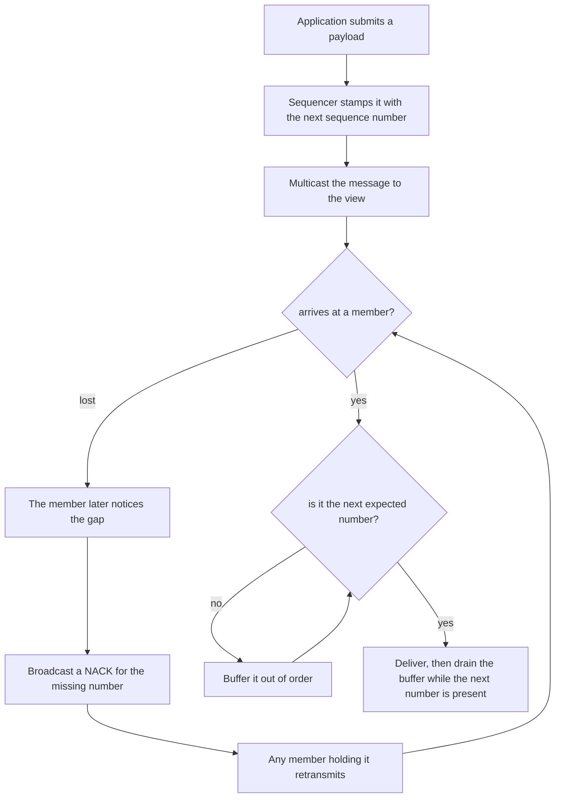
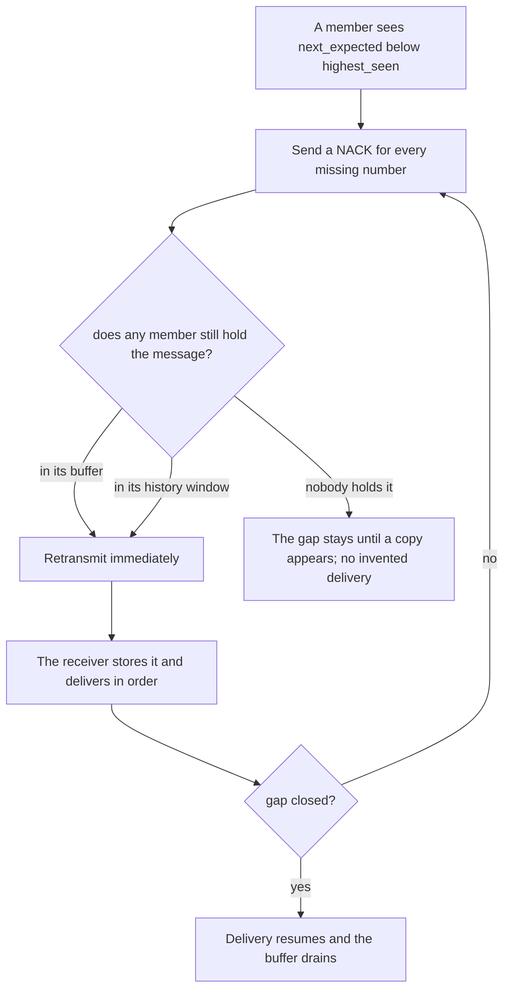
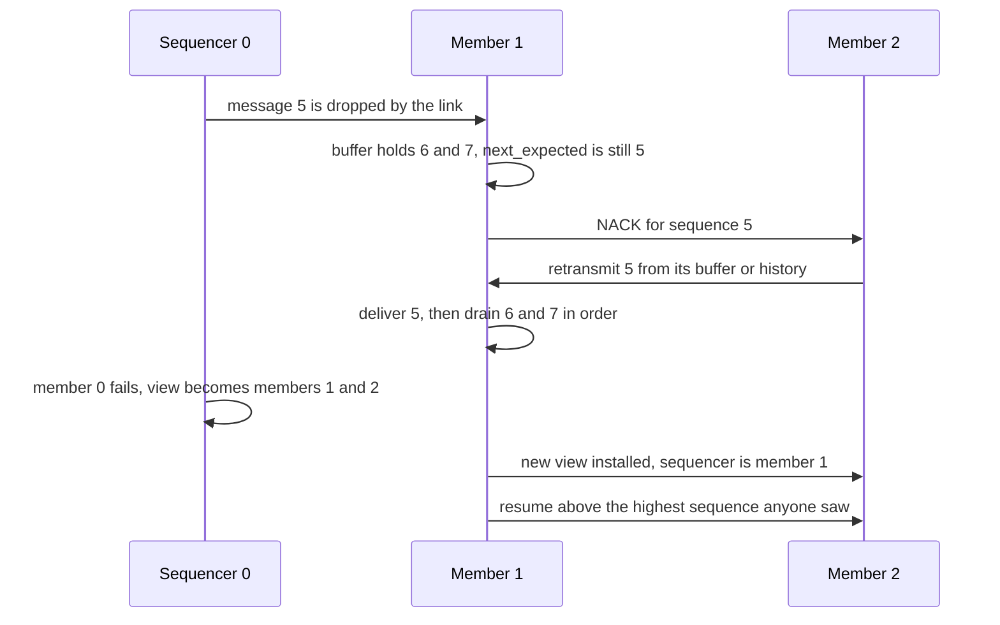

# 692 — Implement reliable ordered multicast with failure handling

> **Tier:** Expert · **CTCI chapter:** Ch 9 — System Design and Scalability
> **Task spec:** [692-implement-reliable-ordered-multicast-with-failure-handling.md](../../../tasks/expert/692-implement-reliable-ordered-multicast-with-failure-handling.md)
> **Solutions:** [Python](../../../solutions/python/expert/692-implement-reliable-ordered-multicast-with-failure-handling/solution.py) ·
> [Java](../../../solutions/java/expert/692-implement-reliable-ordered-multicast-with-failure-handling/Solution.java) ·
> [JavaScript](../../../solutions/javascript/expert/692-implement-reliable-ordered-multicast-with-failure-handling/solution.js) ·
> [C#](../../../solutions/csharp/expert/692-implement-reliable-ordered-multicast-with-failure-handling/Solution.cs)

## 1. Problem restatement

Build a **sequencer-based total-order multicast** with the failure handling that makes it reliable.

| Element | Contract |
| --- | --- |
| sequencer | the **lowest-id** member of the current view; it stamps every message with a monotonically increasing sequence number and multicasts `(seq, sender, payload)` |
| delivery | a member buffers out-of-order messages and delivers strictly in sequence order, so all members deliver the same sequence — total order, and FIFO per sender as a by-product |
| reliability | a member with a gap broadcasts a **NACK** for the missing sequence number; any member that still has the message — in its pending buffer or in the retransmission window (history) it keeps after delivery — sends it again |
| failure | a **view change** removes the failed member; the survivors keep the pending buffers, the new sequencer is the next lowest id, and it continues from the **highest sequence number anyone has seen** |

Retransmitting from the members' buffers rather than only from the original sender is what makes the
protocol survive the loss of the sequencer itself. The simulation is deterministic: each ordered pair
of members has its own link whose drops come from a fixed-seed splitmix64 stream.

Concrete results asserted by the checks:

- a lossless link drops nothing over 20 sends and a 100 %-loss link drops everything; three members at
  10 % loss deliver `1..10` in identical order, with no gaps, a prefix-closed delivery log and **empty**
  buffers at the end, and `dropped() > 0` proves the repair path really ran.
- four members, clean first phase of 8 messages, then `fail(0)` mid-stream: the new sequencer is
  member **1**, `resume()` returns **9**, the 8 further messages become sequence numbers `9..16`, and
  every survivor delivers `1..16` while the failed sequencer's log stops exactly where it died
  (`1..8`). The survivors agree on one total order, and `set(delivered) == set(1..16)` shows nothing
  was skipped.
- a message lost on **every** link (`0→1` and `0→2` at 100 %) is delivered by the sender itself
  (`0 → [1]`, payload intact) while members 1 and 2 deliver nothing at all and report **no missing
  sequence numbers** — they cannot know about a sequence they never saw, so they must not invent a
  delivery or a gap.
- 12 messages at 10 % loss, stopped after 6 rounds, show every member with a hole-free **prefix**;
  after settling, all gaps are filled, no duplicate is delivered, and every member ends with
  `highest_seen == 12` and `next_expected == 13`.
- a failed **non-leader** changes nothing about numbering: after `fail(1)` and `resume() == 7` the
  remaining three members still deliver `1..10`, and the view has shrunk by exactly one.

## 2. Intuition

Ordering and reliability are two problems, and the sequencer solves them with one trick each.

1. **Ordering: let one member number everything.** If a single member assigns consecutive sequence
   numbers, "the same order everywhere" reduces to "deliver `1, 2, 3, ...` in order", which every
   member can enforce locally by buffering what arrives early. No agreement protocol is needed at
   delivery time, only a rule: never deliver `n` before `n - 1`.
2. **Reliability: repair from the group, not from the sender.** A missing number is detected locally
   as a gap, and any member that still holds the message can answer the NACK — including messages it
   already delivered, kept in a retransmission window. That is why the protocol survives the failure
   of the original sender: the surviving copies are enough.



A **view change** combines the two: the members agree on the new view, the new sequencer resumes above
the highest number anyone has seen (so a message that reached at least one survivor keeps its identity
and is still delivered), and the pending buffers are carried over so the messages the dead sequencer
had already sent are not lost.

## 3. Algorithm

1. **Submit.** The sequencer takes the next sequence number, puts the message into its own buffer,
   records `highest_seen`, and multicasts `MSG(seq, sender, payload)` to every other view member.
2. **Send and drop.** Every transmission goes through a per-link drop test; a carried message is queued
   as in-flight `(sender, receiver, kind, seq, payload)` for the next round.
3. **Receive.** In one synchronous round, each in-flight item is handled: a `MSG` with `seq >=
   next_expected` is stored in the buffer (older ones are duplicates), `highest_seen` is updated and an
   `ACK` is sent back; a `NACK` for a sequence number still in the buffer **or in the history** triggers
   a retransmission; a `VIEW` message installs the new view.
4. **Deliver.** Each live member drains its buffer while `next_expected` is present, appending to its
   delivery log and moving the message into `history` (the retransmission window).
5. **Detect gaps.** `missing = {next_expected, ..., highest_seen}`; every missing number is NACKed
   again each round, which is what makes the repair survive a lost NACK.
6. **Quiesce.** `settle()` steps until nothing is in flight and no live member has a gap.
7. **Fail.** `fail(name)` marks the member dead, removes it from the view, drops in-flight traffic to
   and from it, and recomputes the sequencer as `view[0]`; `announce_view()` broadcasts the new view;
   `resume()` sets `next_sequence = max(next_sequence, highest_seen + 1)` so the new sequencer never
   reuses a number.

```text
procedure submit(multicast, payload)
    sender ← multicast.sequencer
    seq ← multicast.next_sequence, then increment it
    put (seq, sender, payload) into the sender's buffer
    sender.highest_seen ← max(sender.highest_seen, seq)
    for receiver in multicast.view except sender do
        transmit MSG(seq, sender, payload) over the link sender to receiver

procedure step(multicast)
    inbox ← the in-flight messages, then clear the in-flight list
    for (sender, receiver, kind, seq, payload) in inbox do
        member ← multicast.members[receiver]
        if member is not alive then continue
        if kind = msg then
            if seq ≥ member.next_expected then
                buffer seq in member, keeping an earlier copy
            member.highest_seen ← max(member.highest_seen, seq)
            transmit ACK(seq) back to sender
        else if kind = nack then
            stored ← member.buffer[seq] or member.history[seq]
            if stored exists then transmit MSG(seq, stored.payload) back to the nacker
        else if kind = view then
            multicast.view ← payload
    for name in the view do
        member ← multicast.members[name]
        if member is not alive then continue
        while member.next_expected is in member.buffer do
            entry ← remove member.next_expected from the buffer
            append entry to member.delivered
            member.history[entry.seq] ← entry                 // retransmission window
            append (name, entry.seq, entry.sender) to the delivery log
            member.next_expected ← member.next_expected + 1
        member.missing ← all sequence numbers from next_expected to highest_seen
        for seq in sorted(member.missing) do
            broadcast NACK(seq) to the view

procedure fail(multicast, name)
    mark that member not alive
    multicast.view ← the view without it
    drop every in-flight message whose sender or receiver is it
    multicast.sequencer ← multicast.view[0]

function resume(multicast)
    highest ← the largest highest_seen over all members
    multicast.next_sequence ← max(multicast.next_sequence, highest + 1)
    return multicast.next_sequence
```



## 4. Worked example

The sequencer-failure run: four members `0, 1, 2, 3`, clean first phase, then `fail(0)` and a second
phase at 10 % loss.

| Phase | Action | State |
| --- | --- | --- |
| 1 | 8 messages submitted, `loss_percent = 0` | all four members deliver `1..8`; `next_expected = 9`, `highest_seen = 8` |
| 2 | `set_loss(10)`, `fail(0)`, `announce_view()` | view becomes `[1, 2, 3]`; member 0 is dead; sequencer is **1** |
| 3 | `resume()` | returns **9**, because the highest sequence number anyone saw is 8 |
| 4 | 8 more payloads submitted | they are stamped `9..16` by member 1 and multicast to the survivors |
| 5 | `settle(120)` | drops are NACKed and repaired from peers' buffers and histories; survivors deliver `1..16` with no gaps and one shared order |
| 6 | check | member 0's log stops at `1..8` — exactly where it died |

The interesting part is step 5 with a message lost on the link from the old sequencer: the survivors
already hold 1-8 (member 1 also holds the pending buffer contents), so a NACK for a missing number in
`9..16` can be answered by any peer that received it, and the delivery order stays `1..16` for
everyone.

The pathological case is the mirror image: with `0→1` and `0→2` at 100 % loss and a single payload
submitted, members 1 and 2 never learn that sequence number 1 exists.

| Member | Delivered | `missing` | Why |
| --- | --- | --- | --- |
| 0 (sequencer) | `[1]` with the original payload | `{}` | it delivered its own proposal |
| 1 | `[]` | `{}` | it never saw `1`, so `highest_seen` is 0 and there is nothing to NACK |
| 2 | `[]` | `{}` | same |

A member may only report gaps it can *prove*: inventing a delivery would break agreement, and NACKing a
sequence number it never heard about would be meaningless.



## 5. Complexity

Let `M` be the number of members, `N` the number of submitted messages, `P` the rounds to quiesce and
`G` the number of missing numbers a member reports per round.

| Quantity | Best | Average | Worst | Why the bound holds |
| --- | --- | --- | --- | --- |
| `submit` | O(M) | O(M) | O(M) | one multicast per view member |
| one round | O(M · N + M · G) | O(M · N) | O(M · N · log N) | every in-flight message is handled once, then each member drains and NACKs its sorted gap set |
| `settle` | O(P · M · N) | O(P · M · N) | O(P · M · N log N) | a NACK is repeated each round, so a lost repair only costs a round; `P` is bounded by the round budget (120 in the failure test) |
| delivery per member | O(N) | O(N) | O(N) | each sequence number is delivered once; `history` grows with `N` |
| failure handling | O(M) | O(M) | O(M) | mark dead, filter the view and the in-flight list, recompute `view[0]` |
| space | O(M · N) | O(M · N) | O(M · N) | buffers plus the retransmission history per member, and the delivery log |
| Alternative (sender-based repair) | O(M · N) | — | O(M · N) | retransmitting only from the original sender is cheaper in messages but loses every message the source no longer holds — including all of them when the source dies |

The retransmission *window* is what buys the failure behaviour: memory is `O(N)` per member, and in
exchange a repair can come from any peer, which is exactly what the mid-stream `fail(0)` trace
requires.

## 6. Pitfalls and edge cases

- **Never deliver out of order.** A member with `6, 7` buffered but `next_expected == 5` must wait; the
  checks assert the delivery log is always a prefix `1..k` at every member, at every round.
- **Duplicates are not deliveries.** A retransmitted message that arrives after delivery is dropped by
  the `seq >= next_expected` test, and the checks assert no member's log has a repeated number.
- **A gap must be provable.** Members that never saw sequence 1 report nothing rather than a missing
  entry, because `highest_seen` is 0 for them; the greedy alternative — NACKing "1" because it is the
  first number — would invent knowledge.
- **NACKs must be repeated.** A single lost NACK would leave a permanent hole, so the gap set is
  re-broadcast every round until it is filled; `settle` stops only when nothing is in flight and no
  live member has a gap.
- **The retransmission window is not the buffer.** After delivery the message moves to `history`, and
  the NACK handler looks in both places; dropping history after delivery would make repairs
  impossible once every member had delivered the message.
- **Resume above the highest number anyone saw.** `resume()` takes the maximum `highest_seen` over all
  members and returns `highest + 1` — in the trace, **9** after 8 messages, which is why the failed
  sequencer's log ends at 8 and no number is ever reused.
- **Failure must not stall the survivors.** Removing the member from the view and dropping its
  in-flight traffic keeps the remaining members delivering; the check requires the view to shrink by
  exactly one.
- **A failed non-leader must not disturb numbering.** After `fail(1)`, `resume()` still returns 7 and
  the remaining members deliver `1..10`.
- **Delivery must be provably loss-free.** After every scenario the checks compare
  `set(delivered)` with the expected sequence set, so a message that reached at least one survivor may
  not be dropped by the protocol.
- **Determinism.** Each link's loss stream comes from a fixed-seed splitmix64 sequence keyed by the
  ordered pair of members, so the same run happens on every machine and the same drops occur in every
  test.
- **Documented simplification.** A deterministic round-based model: rounds are the scheduling unit (no
  timers or threads), retransmission is driven by NACKs from the members rather than by a
  sender-side ack timer, and `settle` assumes the round budget is generous. The Java solution models
  the ACK side of the bookkeeping and states that a copy is dropped only on its first transmission
  attempt; the JavaScript solution makes delivery depend on **stability** (every expected member has
  acknowledged) with a failure detector that stops expecting a silent member after a threshold, and
  notes that a sequencer crash stops ordering (nothing new can be created) without breaking the safety
  of messages already ordered; the C# solution stamps `(epoch, seq)` and has the first entry of a new
  epoch announce the previous epoch's last sequence number, so the barrier across a handover preserves
  one global order.

## 7. Variants and follow-ups

- The map-reduce shuffle, which needs the same total-order property to join two inputs →
  [657 — distributed join shuffle simulation in map-reduce](../../../tasks/expert/657-implement-distributed-join-shuffle-simulation-in-map-reduce.md).
- Replicated logs whose integrity is provable rather than merely linear →
  [902 — self-verifying distributed logs with Merkle trees](../../../tasks/master/902-implement-self-verifying-distributed-logs-with-merkle-trees-and.md).
- Sharing the link fairly while retransmissions compete with new data →
  [691 — additive-increase multiplicative-decrease (AIMD) simulation](../../../tasks/expert/691-implement-additive-increase-multiplicative-decrease-aimd-simulat.md).

## 8. Check yourself

<details><summary>Show answer</summary>
**Why does numbering by a single sequencer give total order for free?** Because "the same order" becomes
"consecutive numbers in sequence order". Every member enforces the same local rule — never deliver `n`
before `n - 1` — and buffers anything that arrives early, so agreement on the order follows from the
numbering rather than from a vote at delivery time.
</details>

<details><summary>Show answer</summary>
**Why is the repair done by peers instead of by the original sender?** A NACK can be answered by any
member that still holds the message, either in its pending buffer or in the post-delivery retransmission
window. If only the sender could repair, the loss of that sender would leave permanent holes — the
`fail(0)` trace shows survivors reconstructing `1..16` without member 0.
</details>

<details><summary>Show answer</summary>
**A message is dropped on a member's only inbound link. What does that member report, and why is that
correct?** Nothing: `highest_seen` stays below the lost sequence number, so `missing` is empty and no
NACK is sent. Inventing a delivery would break agreement, and NACKing a number it has no evidence
exists would be guesswork.
</details>

<details><summary>Show answer</summary>
**Why does the new sequencer resume at `highest_seen + 1` rather than at its own next number?** Because a
message that already reached some survivor may still be pending there; reusing its number would give two
different payloads the same position in the order. Taking the maximum over all members guarantees every
already-announced number keeps its identity — `resume()` returns 9 after eight messages.
</details>

<details><summary>Show answer</summary>
**What breaks if a member delivers as soon as a message arrives instead of waiting for its turn?**
Total order: two members could deliver different sequences, and a later retransmission of the missing
number would then be a duplicate delivery out of sequence. The checks catch both by asserting a
hole-free prefix at every member and no repeated sequence number in any log.
</details>
