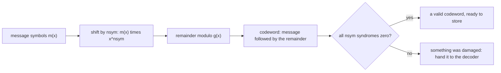
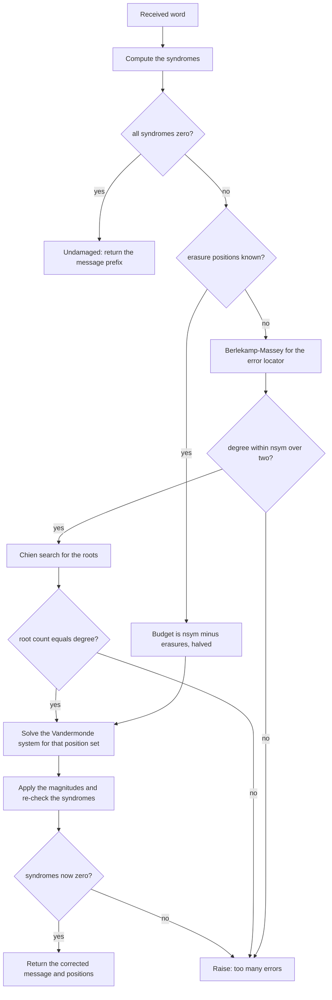
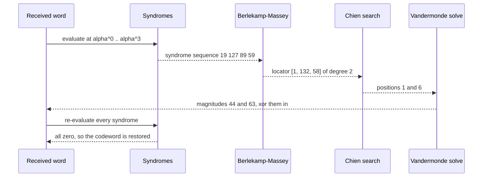

# 693 — Implement erasure coding (Reed-Solomon) encoder/decoder small GF(2^8)

> **Tier:** Expert · **CTCI chapter:** Ch 9 — System Design and Scalability
> **Task spec:** [693-implement-erasure-coding-reed-solomon-encoder-decoder-small-gf-2.md](../../../tasks/expert/693-implement-erasure-coding-reed-solomon-encoder-decoder-small-gf-2.md)
> **Solutions:** [Python](../../../solutions/python/expert/693-implement-erasure-coding-reed-solomon-encoder-decoder-small-gf-2/solution.py) ·
> [Java](../../../solutions/java/expert/693-implement-erasure-coding-reed-solomon-encoder-decoder-small-gf-2/Solution.java) ·
> [JavaScript](../../../solutions/javascript/expert/693-implement-erasure-coding-reed-solomon-encoder-decoder-small-gf-2/solution.js) ·
> [C#](../../../solutions/csharp/expert/693-implement-erasure-coding-reed-solomon-encoder-decoder-small-gf-2/Solution.cs)

## 1. Problem restatement

Build a complete **systematic Reed-Solomon code over GF(2^8)** from the field up, and decode both
erasures (known positions) and unknown errors.

| Element | Definition |
| --- | --- |
| field | GF(2^8) with the primitive polynomial `x^8 + x^4 + x^3 + x^2 + 1` (**0x11D**) and `alpha = 2`; multiplication through discrete logarithms |
| generator | `g(x) = prod_{i < nsym} (x + alpha^i)` |
| encoding | systematic: append the remainder of `m(x) * x^nsym mod g(x)`, so the first `k` symbols **are** the message and every codeword divides by `g` (all `nsym` syndromes vanish) |
| syndromes | `S_j = r(alpha^j)` for `j < nsym` |
| error location | **Berlekamp-Massey** on the syndromes (the shortest LFSR that reproduces them is the error locator) followed by a **Chien search** for its roots |
| magnitudes | solving the Vandermonde system `S_j = sum_i e_i X_i^j` by Gaussian elimination over GF(256) — Forney's result computed directly |
| erasures | known positions need no locator: their magnitudes come straight from the same system, and only the **unknown** errors are searched for |

Because the code is MDS, `nsym` parity symbols repair up to `nsym` erasures or up to `nsym / 2`
unknown errors.

Concrete results asserted by the checks:

- the field: `EXP[8] == 0x1D`, `gf_mul(0x02, 0x80) == 0x1D`, `gf_mul(0x03, 0x0F) == 0x11` (a hand
  computation `(x+1)(x^3+x^2+x+1) = x^4+1`), commutativity, inverses, distributivity and
  `log`/`exp` inverses.
- the generator of degree 4 is `[1, 15, 54, 120, 64]`, vanishes at `alpha^0..alpha^3`, and its
  constant term is the product of its roots; `rs_encode([0x12,0x34,0x56,0x78,0x9A], 4)` is
  `[0x12,0x34,0x56,0x78,0x9A,0x38,0x3A,0x7D,0xED]` — 9 symbols, message prefix intact, all four
  syndromes zero.
- round trips succeed for every error count `0..nsym/2` at `nsym = 2, 4, 6`, and the exhaustive sweep
  covers **108** two-error patterns (`3 x 36`), **126** four-erasure patterns (`C(9,4)`) and **36**
  two-erasures-plus-one-error patterns of the 9-symbol word.
- an independent brute-force decoder (subset search, no locator) agrees on **4** hand-picked
  two-error patterns.
- beyond capacity, of the **84** three-error patterns **84 are detected** and **0** are silently
  corrected to the right message — and a mis-decode, had there been one, would still have landed on a
  *different valid codeword*, which is the honest limitation the checks pin down instead of hiding. A
  realistic `RS(255, 251)` run encodes 251 symbols to 255, recovers from two errors at positions `0`
  and `254`, and from three erasures at `0, 100, 254`; an empty message, a 300-symbol message, and 5
  erasures with only 4 parity symbols are rejected.

## 2. Intuition

Reed-Solomon is linear algebra over a finite field, and the whole design follows from two facts.

1. **A codeword is a polynomial with prescribed roots.** Multiplying by `x^nsym` and taking the
   remainder modulo `g(x)` produces the word of lowest weight change that is divisible by `g`; since
   `g` vanishes at `alpha^0 ... alpha^(nsym-1)`, every codeword evaluates to zero there — and those
   evaluations are the syndromes.
2. **The syndromes are a linear system in the damage.** `S_j = sum_i e_i X_i^j`, where `X_i` is the
   field element of the damaged position and `e_i` its magnitude, so known positions would reduce to
   one Gaussian elimination. Locating them is the hard part, and that is what Berlekamp-Massey plus
   Chien contribute: the shortest recurrence generating the syndrome sequence has the positions as
   its roots.



Erasures are cheap because the expensive step — finding the positions — is already done: a storage
system knows exactly which shard failed. That is why the budget is asymmetric, `nsym` erasures versus
`nsym / 2` errors, and why the decoder takes the known positions as an input rather than discovering
them.

## 3. Algorithm

**Field.** Build `EXP`/`LOG` by repeatedly doubling and reducing with `0x11D`; then
`gf_mul(a,b) = EXP[LOG[a] + LOG[b]]`, `gf_div` subtracts the logs, `gf_inv` negates one,
`gf_pow` multiplies by the exponent modulo 255.

**Polynomials.** Coefficients are stored highest-power first except where a name says `_low`;
`poly_eval` is Horner, `poly_mul` is the schoolbook convolution, and `poly_mod` is synthetic division
returning the last `deg(divisor) - 1` coefficients.

**Encoding.** Reject an empty message, more than 255 total symbols, or symbols outside a byte; compute
`poly_mod(message + [0] * nsym, generator_poly(nsym))` and append the remainder.

**Decoding.**

1. Sort and de-duplicate the known erasure positions; reject out-of-range positions and more erasures
   than parity symbols; then compute the syndromes — all zero returns the received word unchanged.
2. **With erasures**: the budget for unknown errors is `(nsym - erasure_count) / 2`; try every subset
   of that size, solve the Vandermonde system for that position set, apply the magnitudes, and accept
   the first correction whose syndromes vanish. Otherwise fail.
3. **Without erasures**: run Berlekamp-Massey; reject if `2 * degree > nsym`; run the Chien search and
   reject if the number of roots differs from the degree; solve the Vandermonde system for the
   magnitudes; apply them; verify the syndromes vanish and reject if not.

```text
function generator_poly(nsym)
    g ← [1]
    for i ← 0 to nsym - 1 do
        g ← poly_mul(g, [1, gf_pow(alpha, i)])
    return g

function rs_encode(message, nsym)
    require message is not empty
    require length(message) + nsym ≤ 255
    require every symbol is a byte
    remainder ← poly_mod(message followed by nsym zeros, generator_poly(nsym))
    return message followed by remainder

function syndromes(received, nsym)
    return [poly_eval(received, gf_pow(alpha, j)) for j ← 0 to nsym - 1]

function position_to_element(position, length)
    return gf_pow(alpha, (length - 1 - position) mod 255)

function berlekamp_massey(synd, nsym)
    locator ← [1], previous ← [1], degree ← 0, shift ← 1, last_delta ← 1
    for k ← 0 to nsym - 1 do
        pad locator to length degree + 1
        delta ← synd[k] xor sum over i of locator[i] * synd[k - i]
        if delta = 0 then
            shift ← shift + 1, continue
        update ← poly_scale(poly_shift(previous, shift), delta / last_delta)
        if 2 * degree ≤ k then
            saved ← copy of locator
            locator ← poly_add_low(locator, update)
            degree ← k + 1 - degree
            previous ← saved, last_delta ← delta, shift ← 1
        else
            locator ← poly_add_low(locator, update)
            shift ← shift + 1
    return locator and its degree

function chien_search(locator, length)
    return every position whose element makes the reversed locator evaluate to zero

function solve_magnitudes(synd, positions, length)
    build the matrix with rows [X_i^j ... | synd[j]] for j ← 0 to size - 1
    Gauss-Jordan elimination over GF(256) with the first non-zero pivot in each column
    return the last column

function rs_decode(received, nsym, erasures)
    length ← length(received)
    require erasures are in range and count ≤ nsym
    synd ← syndromes(received, nsym)
    if every syndrome is zero then
        return the message part of the received word, the word itself, and no positions
    if there are erasures then
        budget ← (nsym - length(erasures)) / 2
        for count ← 0 to budget do
            for extra in every subset of the non-erasure positions of size count do
                positions ← erasures plus extra
                magnitudes ← solve_magnitudes(synd, positions, length)
                corrected ← received with the magnitudes xor'ed in
                if every syndrome of corrected is zero then
                    return its message part, corrected and positions
        raise "more damage than the parity symbols can describe"
    locator, degree ← berlekamp_massey(synd, nsym)
    if 2 * degree > nsym then raise "too many errors for the parity available"
    positions ← chien_search(locator, length)
    if length(positions) ≠ degree then raise "the error locator has fewer roots than its degree"
    magnitudes ← solve_magnitudes(synd, positions, length)
    corrected ← received with the magnitudes xor'ed in
    if any syndrome of corrected is non-zero then raise "the correction did not produce a codeword"
    return the message part, corrected and positions
```



## 4. Worked example

Encoding `[0x12, 0x34, 0x56, 0x78, 0x9A]` with `nsym = 4`:

| Step | Value |
| --- | --- |
| `g(x)` of degree 4 | `[1, 15, 54, 120, 64]` |
| shifted message | `m(x) * x^4`, 9 coefficients |
| remainder mod `g` | the four parity symbols |
| codeword | `[0x12, 0x34, 0x56, 0x78, 0x9A, 0x38, 0x3A, 0x7D, 0xED]` |
| syndromes | `(0, 0, 0, 0)` — a codeword by construction |
| systematic check | the first five symbols equal the message |

Now damage two positions of a different message, `m = [7, 11, 13, 17, 19]`, whose codeword is
`[7, 11, 13, 17, 19, 35, 216, 48, 200]`:

| Step | Value |
| --- | --- |
| damage | position 1 `xor 0x2C`, position 6 `xor 0x3F` |
| received word | `[7, 39, 13, 17, 19, 35, 231, 48, 200]` |
| syndromes | `[19, 127, 89, 59]` |
| Berlekamp-Massey locator | `[1, 132, 58]` (low-first), degree **2** |
| Chien search | positions **`[1, 6]`** — exactly where the damage was |
| magnitudes | `[44, 63]` = `0x2C, 0x3F` — exactly the damage magnitudes |
| result | message `[7, 11, 13, 17, 19]`, codeword restored, positions `[1, 6]` |

The position elements are `alpha^(8 - i)`, so position 0 corresponds to `0x1D` (`alpha^8`) and
position 8 to `1`; the Vandermonde system uses those powers, which is why the recovered magnitudes
come out as positive field elements rather than a search over 256 possibilities per position.

The erasure path is shorter: with erasures declared at positions 0 and 4, the budget for unknown
errors is `(4 - 2) / 2 = 1`, and the two erasures alone already yield a valid codeword, so the system
is solved **once**.



The budget asymmetry shows up in the exhaustive sweeps: a 9-symbol word with `nsym = 4` repairs all
**126** four-erasure patterns and all **108** two-error patterns (three magnitudes times 36 position
pairs), plus **36** patterns with two erasures and one error. Beyond that — **84** three-error
patterns — the decoder detects **all 84**; in general a beyond-radius word may instead be
"corrected" into a *different valid codeword*, which is the fundamental limitation of an MDS code.

## 5. Complexity

Let `n` be the codeword length, `nsym = n - k` the parity symbols, `v` the number of unknown errors and
`f` the number of erasures.

| Operation | Best | Average | Worst | Why the bound holds |
| --- | --- | --- | --- | --- |
| field multiply | O(1) | O(1) | O(1) | one table lookup pair and an addition |
| `generator_poly` | O(nsym²) | O(nsym²) | O(nsym²) | `nsym` multiplications of polynomials of growing degree |
| `rs_encode` | O(n · nsym) | O(n · nsym) | O(n · nsym) | synthetic division of `n` coefficients by a degree-`nsym` divisor |
| syndromes | O(n · nsym) | O(n · nsym) | O(n · nsym) | `nsym` Horner evaluations over `n` symbols |
| Berlekamp-Massey | O(nsym²) | O(nsym²) | O(nsym²) | the recurrence runs `nsym` steps, each over up to `nsym` coefficients |
| Chien search | O(n · v) | O(n · v) | O(n · v) | one Horner evaluation per code position |
| magnitudes | O(v³) or O((v + f)³) | — | — | Gauss-Jordan on a `(v + f) x (v + f)` Vandermonde system |
| space | O(256) tables + O(n) words | | | the log/exp tables are 512 and 256 entries; the working polynomials are `O(n)` |
| Alternative (brute force) | O(n^t) | — | O(n^t) | the oracle tries every subset of up to `t` positions, which is exact and exponential — used only on 9-symbol words |

The MDS property makes the budget statement exact: `nsym` parity symbols give minimum distance
`nsym + 1`, so `f` erasures plus `v` errors are decodable exactly when `f + 2v <= nsym`.

## 6. Pitfalls and edge cases

- **The field polynomial must match the tables, and the edges need care.** `EXP[8] == 0x1D` and
  `gf_mul(0x02, 0x80) == 0x1D` are the cheapest checks that the reduction is right, while `gf_mul`
  must return 0 when either operand is 0 (`LOG[0]` is undefined) and `gf_div`/`gf_inv` must raise on a
  zero argument rather than return garbage.
- **A zero syndrome vector is not a parity-only attribute.** Every codeword has all syndromes zero, so
  the decoder's first test is also its fast path — damage shows up as non-zero values.
- **The generator's roots are `alpha^0 ... alpha^(nsym-1)`.** Using `alpha^1 ... alpha^nsym` instead
  shifts every position mapping; the checks evaluate the generator at each root and compare the
  constant term with the product of the roots.
- **Systematic means the message is a prefix.** The checks assert `codeword[:k] == message` and that
  `poly_mod(codeword, g)` is all zeros, which catches an encoder that prepends parity.
- **An erasure budget is not the same as an error budget.** With 2 erasures and 4 parity symbols the
  decoder may search for at most `(4 - 2) / 2 = 1` unknown error; searching for 2 would accept
  corrections the code cannot justify. The locator degree must also equal the number of roots, and the
  corrected word must be re-verified against the syndromes, because a wrong position set still yields
  *some* magnitude vector.
- **Beyond the radius, failure and miscorrection are both possible.** Of the 84 three-error patterns in
  the sweep, 84 were detected here, but the checks are written so a mis-decode is allowed as long as
  the returned word is a *valid codeword* — and `wrong_messages == 0` confirms none of them silently
  returned the right message by accident.
- **Parameter limits and determinism.** An empty message, a message longer than `255 - nsym`, symbols
  outside a byte, more erasures than parity symbols, and an out-of-range erasure position must all be
  rejected; `RS(255, 251)` is the largest usable code. Everything else is exact field arithmetic on
  fixed inputs, so the exhaustive sweeps and the 255-symbol run reproduce identically.
- **Documented simplification.** Magnitudes come from solving the Vandermonde system directly rather
  than from Forney's error-evaluator polynomial — equivalent, and easier to audit; the erasure path
  uses a bounded subset search over unknown positions instead of folding the erasure locator into
  Berlekamp-Massey. The Java solution also solves erasures over the generator matrix restricted to any
  `k` survivors; the JavaScript solution formulates the code as evaluations of a degree-`< k`
  polynomial and cross-checks every product against a Russian-peasant multiply; the C# solution
  implements the textbook pipeline with the erasure locator folded in, the modified syndrome
  polynomial and Forney's formula, reporting uncorrectable words as null instead of guessing.

## 7. Variants and follow-ups

- The same code applied to a storage cluster with repair traffic instead of a single word →
  [694 — distributed erasure-coded storage with repair](../../../tasks/expert/694-implement-distributed-erasure-coded-storage-simulation-with-repa.md),
  and the bandwidth-bounded scheduling of exactly those repairs →
  [695 — anti-entropy repair scheduling with bandwidth bounds](../../../tasks/expert/695-implement-anti-entropy-repair-scheduling-with-bandwidth-bounds.md).

## 8. Check yourself

<details><summary>Show answer</summary>
**Why does the systematic encoder append a remainder instead of a parity polynomial of its own?** The
remainder of `m(x) * x^nsym` modulo `g(x)` is the smallest-degree polynomial that makes the whole word
divisible by `g`. Divisibility by `g` is exactly the statement `c(alpha^j) = 0` for
`j = 0..nsym-1`, so the remainder *is* valid parity, and putting the message in the high positions makes
the code systematic.
</details>

<details><summary>Show answer</summary>
**What does Berlekamp-Massey compute, and why is that the error locator?** A damaged word has
syndromes `S_j = sum_i e_i X_i^j`, which is precisely the output of a linear recurrence whose
characteristic roots are the `X_i`. The shortest LFSR that reproduces the syndrome sequence therefore
has those roots, i.e. it is `prod_i (1 - X_i x)` up to a scale — the error locator. The Chien search
turns its roots back into code positions.
</details>

<details><summary>Show answer</summary>
**Why can `nsym` parity symbols repair `nsym` erasures but only `nsym / 2` unknown errors?** An erasure's
position is known, so only its magnitude is unknown: one linear unknown per erasure. An unknown error
contributes two unknowns — the position and the magnitude — and the position is found by a search whose
validity costs an extra factor of two in the parity budget: `f + 2v <= nsym`.
</details>

<details><summary>Show answer</summary>
**In the worked trace, how do we know the correction `[1, 6] -> [44, 63]` is the true damage?** By the
final verification: after xoring those magnitudes the syndromes vanish, so the word is a codeword, and
the independent brute-force decoder finds the same word and the same two positions.
</details>

<details><summary>Show answer</summary>
**Why is "detected 84 of 84" not the same as "Reed-Solomon always detects damage beyond its radius"?**
Because an MDS code beyond its correction radius may instead map the damaged word to a *different*
valid codeword at distance `<= t`. That is intrinsic, not an implementation bug, so the checks accept
it and only require that a mis-decode still returns a valid codeword and never silently returns the
right message (measured as `wrong_messages == 0`).
</details>
