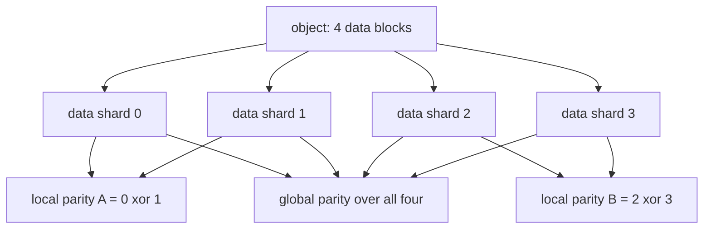
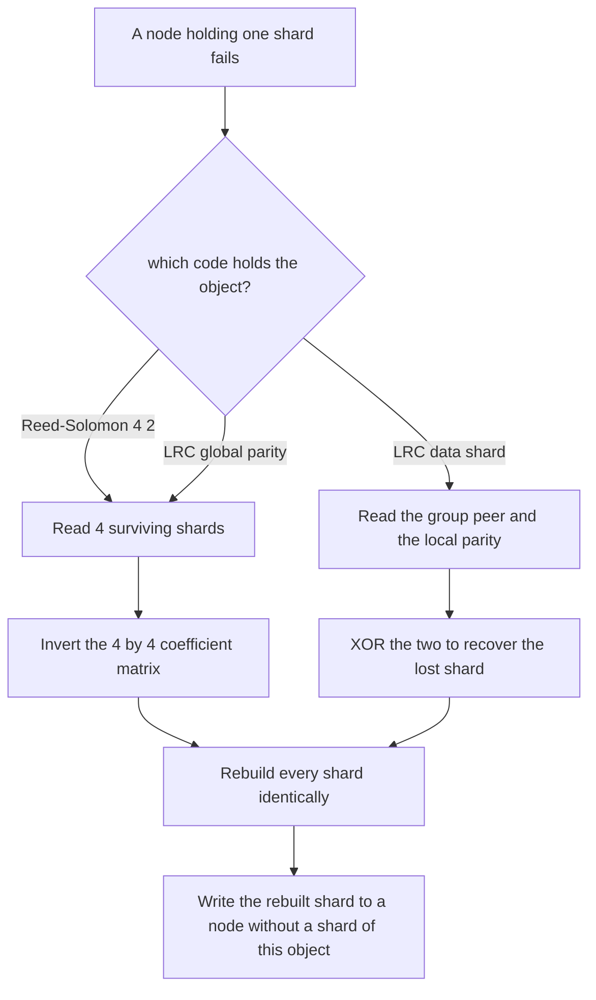
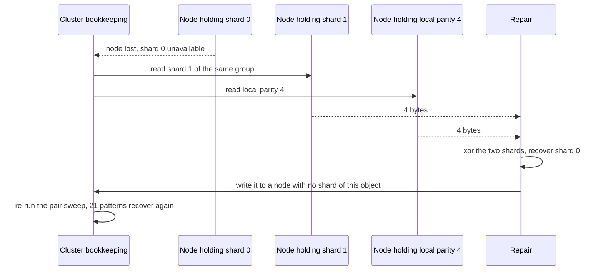

# 694 — Implement distributed erasure-coded storage simulation with repair

> **Tier:** Expert · **CTCI chapter:** Ch 9 — System Design and Scalability
> **Task spec:** [694-implement-distributed-erasure-coded-storage-simulation-with-repa.md](../../../tasks/expert/694-implement-distributed-erasure-coded-storage-simulation-with-repa.md)
> **Solutions:** [Python](../../../solutions/python/expert/694-implement-distributed-erasure-coded-storage-simulation-with-repa/solution.py) ·
> [Java](../../../solutions/java/expert/694-implement-distributed-erasure-coded-storage-simulation-with-repa/Solution.java) ·
> [JavaScript](../../../solutions/javascript/expert/694-implement-distributed-erasure-coded-storage-simulation-with-repa/solution.js) ·
> [C#](../../../solutions/csharp/expert/694-implement-distributed-erasure-coded-storage-simulation-with-repa/Solution.cs)

## 1. Problem restatement

Compare two real storage codes over GF(2^8) on a simulated cluster, and measure the trade-off that
makes erasure coding interesting: **storage overhead versus repair bandwidth**.

| Code | Layout | Overhead | Repair of one lost data shard |
| --- | --- | --- | --- |
| **Reed-Solomon (4,2)** | 4 data + 2 parity shards, parity rows taken from a **Cauchy matrix** (every square submatrix of a Cauchy matrix is invertible, hence MDS) | **6/4 = 1.50x** | reads k = 4 shards = `4S` bytes |
| **LRC(4,2,1)** | 4 data shards in two groups of two, one **local** parity per group, one **global** parity: 7 shards | **7/4 = 1.75x** | reads only its group = `2S` bytes |

Both codes are swept exhaustively over every erasure pattern they are supposed to survive, then placed
one shard per node on a cluster that fails, repairs and fails again.

Concrete results asserted by the checks:

- the RS code is systematic (`shards[:4] == payload`), the two parity shards differ, storage is
  **6 x 4 = 24** bytes for a **16**-byte object (1.50x), and all **15** of the `C(6,4)` four-shard
  subsets rebuild the object identically while reading exactly **4** shards each.
- all **15** two-failure patterns survive; every three-failure pattern leaves only three shards and is
  **refused** with `ValueError`.
- the LRC has 7 shards with the data systematic; parity 4 is the XOR of shards 0 and 1 and parity 5 the
  XOR of shards 2 and 3 — one local parity per group; storage is 28 bytes (1.75x).
- all **21** `C(7,2)` failure pairs of the LRC recover, and **8 of the 35** triples are fatal — the
  measurable price of locality.
- repair cost: RS **4 reads (4S)**, LRC data shard **2 reads (2S)** with `sources` confined to
  `{1, 4}` (its own group), so the local repair is **2x** cheaper; the LRC *global* parity still costs
  **4 reads**.
- two failed data shards are repaired with **4 shard reads** in total (`2S + 2S`), and the whole
  **21**-pair sweep passes again on the repaired cluster, i.e. full redundancy is restored.

## 2. Intuition

Replication has a flat cost: 3 copies, 3x storage, one read to repair. Erasure coding breaks that
flatness into two independent knobs, and this task makes both measurable.

1. **Storage is `(k + m) / k`.** RS(4,2) pays 1.5x and survives any two failures; the LRC pays 1.75x
   and survives any two failures as well — the extra shard is the premium for the second knob.
2. **Repair bandwidth is where the designs differ.** A plain MDS code must read `k` shards to rebuild
   one, because the lost shard is a linear combination of *all* `k` data blocks. Adding a **local
   parity per group** breaks that: a lost data shard is recoverable from its own group alone, so the
   repair reads two shards instead of four.
3. **Locality costs fault tolerance.** With 4 data + 2 local + 1 global shard, the LRC has 7 shards
   and 3 parity symbols, yet 8 of the 35 triple failures are fatal — the guarantee is only
   "any 2 failures", not "any 3".



The layout diagram is the whole design: the two local parities make group-local repair possible, and
the global parity is what lifts the guarantee back to "any two failures" (and lets a lost *parity*
shard be rebuilt at all).

## 3. Algorithm

**Field and linear algebra.** Build the log/exp tables with `0x11D`; `gf_mul`, `gf_div`, `gf_inv`,
`gf_pow` as usual; `invert_matrix` is Gauss-Jordan over GF(256) and raises on a singular matrix;
`solve_linear` performs elimination on a possibly over-determined system, rejects an inconsistent one,
and rejects a system with fewer independent equations than unknowns — that is exactly the condition for
"this erasure pattern is fatal".

**RS(4,2) with a Cauchy parity matrix.** `parity[row][column] = gf_inv((k + row) ^ column)`, so
`[I_k | C]` is the generator and every `k` rows are invertible (MDS). `encode` computes each parity
byte as the XOR of the data bytes scaled by the appropriate Cauchy entry. `reconstruct(shards,
available)` takes any `k` surviving indices, inverts their coefficient matrix, recovers the `k` data
blocks byte by byte, and re-encodes to produce *every* shard — so it returns both the rebuilt word and
the number of reads used.

**LRC(4,2,1).** Encoding appends the two group XORs and one global parity
`gf_inv(17 + column)` per data block. `equations(available)` turns the surviving shards into rows over
the four data blocks (identity rows for data, group rows for local parities, the global row for the
global parity); `reconstruct` solves those rows per byte offset, so an over-determined pattern is
resolved by independence rather than by count.

**Repair cost.** `repair_reads(code, index, available)` returns `2` reads from the shard's own group
for an LRC data shard (group peer plus its local parity, filtered to what survives) and `k = 4` for
everything else.

```text
function cauchy_parity(k, m)
    return the m by k matrix with entry (k + row) xor column inverted in GF(256)

procedure encode_rs(data, parity)
    for row ← 0 to m - 1 do
        shard ← for each byte: xor over column of parity[row][column] * data[column][byte]
        append shard to the shard list
    return the data shards followed by the parity shards

procedure reconstruct(shards, available, parity)
    require length(available) ≥ k
    known ← the first k indices of available
    matrix ← the coefficient rows of those shards
    inverse ← invert_matrix(matrix)                  // raises when the pattern is fatal
    for each byte offset do
        data[column][byte] ← xor over position of inverse[column][position] * shards[known[position]][byte]
    return encode_rs(data, parity) and length(known)

procedure encode_lrc(data, group_size, global_row)
    for group ← 0 to 4 / group_size - 1 do
        append the per byte xor of the group's data shards
    append the global parity: for each byte, xor over column of global_row[column] * data[column][byte]

function lrc_equations(available)
    for index in sorted(available) do
        if index < 4 then add the identity row for that data block
        else if index < 6 then add the row selecting that group's two blocks
        else add the global row
    return the rows together with the shard index each came from

procedure lrc_reconstruct(shards, available)
    rows ← lrc_equations(available)
    for each byte offset do
        solution ← solve_linear(rows' coefficients, the surviving bytes at this offset)
    return encode_lrc(the four solved blocks) and length(rows)

function repair_reads(code, shard_index, available)
    if code is locally repairable and shard_index < 4 then
        group ← shard_index / group_size
        sources ← the group's other data shard and its local parity, kept only when surviving
        return length(sources) and sources
    return 4 and the first four surviving shards
```



## 4. Worked example

The RS(4,2) code on a 16-byte object `payload` of four 4-byte blocks:

| Property | Value |
| --- | --- |
| shards | 6 (4 data + 2 parity), 4 bytes each |
| storage | 24 bytes for a 16-byte object = **1.50x** |
| `shards[:4]` | equal to the payload (systematic) |
| reconstruction subsets | all `C(6,4) = 15`, each reading exactly **4** shards |
| two-failure patterns | all `C(6,2) = 15` survive |
| three-failure patterns | all refused — only three shards remain, below `k = 4` |

The LRC on the same object:

| Property | Value |
| --- | --- |
| shards | 7 (4 data + 2 local + 1 global), 4 bytes each |
| storage | 28 bytes = **1.75x** |
| parity 4 | XOR of shards 0 and 1 only |
| parity 5 | XOR of shards 2 and 3 only |
| two-failure patterns | all `C(7,2) = 21` recover |
| three-failure patterns | **8 of 35** are fatal |

The repair arithmetic is the point of the exercise. With shard 0 lost:

| Code | Sources | Reads | Bytes |
| --- | --- | --- | --- |
| RS(4,2) | four surviving shards | **4** | `4S` |
| LRC(4,2,1) | shard 1 and parity 4 (its group) | **2** | `2S` |
| LRC global parity lost | four surviving shards | **4** | `4S` |

So a lost *data* shard costs half as much to repair under the LRC, at the price of the extra shard and
the weaker triple guarantee. Two simultaneous node failures (shards 1 and 3) cost `2S + 2S = 4` shard
reads in total, and afterwards the full 21-pair sweep passes again — redundancy is fully restored.



## 5. Complexity

Let `n = k + m` be the shard count, `S` the shard size in bytes and `P` the number of erasure patterns
swept.

| Quantity | RS(4,2) | LRC(4,2,1) | Why |
| --- | --- | --- | --- |
| encode | O(k · m · S) | O(k · S + m · S) | one field multiply per data shard per parity byte, or an XOR for local parities |
| decode / reconstruct | O(k³ + k · S) | O(k³ + k · S) | the coefficient matrix is inverted **once** per pattern and applied to every byte offset |
| memory | O(n · S) | O(n · S) | one shard per node, 24 or 28 bytes for the example object |
| storage overhead | **1.50x** | **1.75x** | `(k + m) / k` |
| repair of a data shard | `k = 4` reads | `2` reads | locality versus full-stripe regeneration |
| repair of a parity shard | 4 reads | 4 reads | the global row mixes all data blocks |
| faults tolerated | any 2 (and every 3 refused) | any 2, 8 of 35 triples fatal | MDS distance `m + 1` versus the LRC's locality-limited guarantee |
| exhaustive sweep | `C(6,4) = 15` subsets, 15 pairs, 20 triples | 21 pairs, 35 triples | the same measures used in the checks |
| Alternative (3x replication) | 3x storage, 1 read to repair | — | the baseline the codes are judged against |

The trade-off is therefore explicit and measured: `1.50x` with `4S` repair, or `1.75x` with `2S`
repair — and the extra 0.25x of storage is exactly what buys the cheaper repair.

## 6. Pitfalls and edge cases

- **The parity matrix must be MDS.** Cauchy entries `1 / (x_i ^ y_j)` guarantee that every square
  submatrix is invertible, which is why *any* four of the six shards work; the constructor asserts the
  entries really are reciprocals, and the sweep proves all 15 subsets rebuild identically.
- **A fatal pattern is a refusal, not a guess.** `reconstruct` raises when fewer than `k` shards
  survive, and `solve_linear` raises when the surviving equations are dependent — the LRC's 8 fatal
  triples are detected, not silently mis-decoded.
- **The data blocks must be solved, not the parity.** The LRC solves for the four data blocks and then
  *re-encodes* to rebuild the shards, so a lost parity shard comes back byte-identical too.
- **Encoding must be deterministic.** Repaired shards are compared with the originals, which only works
  because the same input always produces the same shards; the checks re-encode and compare.
- **Storage accounting is part of the contract.** `object_size(shards)` must be `6 * 4` for RS and
  `7 * 4` for the LRC; the printed overheads (1.50 and 1.75) come from that count.
- **Local parities are per group, not global.** Parity 4 must equal the XOR of shards 0 and 1 only —
  a global XOR in that slot would double the repair cost and drop the locality claim.
- **Repair sources must be confined to the group.** The check asserts `set(sources) <= {1, 4}` for a
  lost shard 0; a repair that reached outside the group would still work but would cost `4S`.
- **Anti-affinity: one shard per node.** The placement map puts shard `i` on node `i`, and the repair
  policy writes the rebuilt shard to a node that holds no shard of the same object — otherwise two
  failures could take two shards of one stripe.
- **Redundancy must actually return.** After the repairs the checks re-run the whole 21-pair sweep on
  the repaired cluster, which is the only way to show that "repaired" means "MDS again".
- **Different objects give different shards, the same object gives the same shards.** Both directions
  are asserted, which pins determinism without forbidding collision in general.
- **Documented simplification.** One object per stripe, no rebalancing policy, no latency or scrubber,
  instant repairs, and simple placement (round-robin in Java, least-loaded with anti-affinity in C#,
  a heuristic with explicit `addNode`/`drop` in JavaScript). The JavaScript solution also counts read
  and written bytes so the replication trade-off arithmetic can be checked directly, and the C# 
  solution marks a stripe that lost more than `m` chunks as **lost** so reads fail instead of returning
  wrong bytes.

## 7. Variants and follow-ups

- The codec this storage layer is built on, including the decoder pipeline in full →
  [693 — erasure coding (Reed-Solomon) encoder/decoder over small GF(2^8)](../../../tasks/expert/693-implement-erasure-coding-reed-solomon-encoder-decoder-small-gf-2.md).
- Scheduling which repairs run when, under a bandwidth budget →
  [695 — anti-entropy repair scheduling with bandwidth bounds](../../../tasks/expert/695-implement-anti-entropy-repair-scheduling-with-bandwidth-bounds.md).
- Detecting which shards disagree before repairing them, with authenticated structures →
  [632 — anti-entropy Merkle tree reconciliation demo](../../../tasks/expert/632-implement-anti-entropy-merkle-tree-reconciliation-demo.md).

## 8. Check yourself

<details><summary>Show answer</summary>
**Why exactly is Reed-Solomon (4,2) MDS, and what does that buy here?** The generator `[I_4 | C]` uses
a Cauchy parity matrix, and every square submatrix of a Cauchy matrix is invertible, so any four of the
six rows are linearly independent. Consequently any four shards determine the object — all 15 subsets
rebuild it identically — and any two simultaneous failures are survivable.
</details>

<details><summary>Show answer</summary>
**The LRC has 7 shards and 3 parity symbols, so why are 8 of the 35 triple failures fatal?** Because the
guarantee is *any 2 failures*, not any 3. Two of the parity symbols are group-local, so they only
protect their own two data shards; the single global parity cannot cover the combinations that wipe out
a group plus the global shard. The checks measure exactly that boundary instead of assuming it away.
</details>

<details><summary>Show answer</summary>
**Repairing one lost data shard costs `4S` under RS and `2S` under the LRC — where does the difference
come from?** Under a plain MDS code the lost shard is a linear combination of all `k` data blocks, so
regeneration must read `k` shards. The LRC's local parity is the XOR of its own group, so the shard is
recovered from the group peer and that parity alone — two reads — while parity shards (including the
global one) still need a full `4S` rebuild.
</details>

<details><summary>Show answer</summary>
**What does the cluster do after a repair, and how is that verified?** It writes the rebuilt shard to a
node holding no other shard of the same object (anti-affinity), and the checks then re-run the complete
`C(7,2) = 21` pair sweep on the repaired state — the only evidence that redundancy, not just the bytes,
was restored.
</details>

<details><summary>Show answer</summary>
**Why does `reconstruct` invert a matrix instead of solving per byte?** Because the coefficient matrix
depends only on *which* shards survived, not on the data: invert once per erasure pattern and apply the
inverse to every byte offset. That is `O(k³ + k · S)` instead of `O(k³ · S)`, and it mirrors what a
storage node does when it serves a degraded read.
</details>
