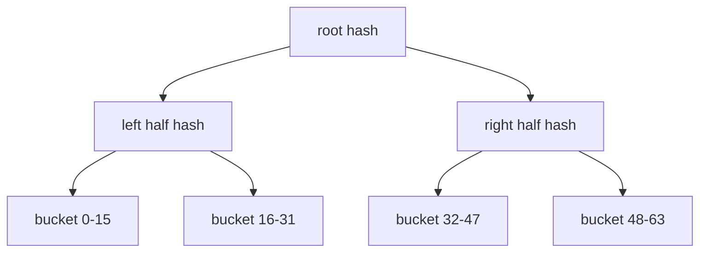
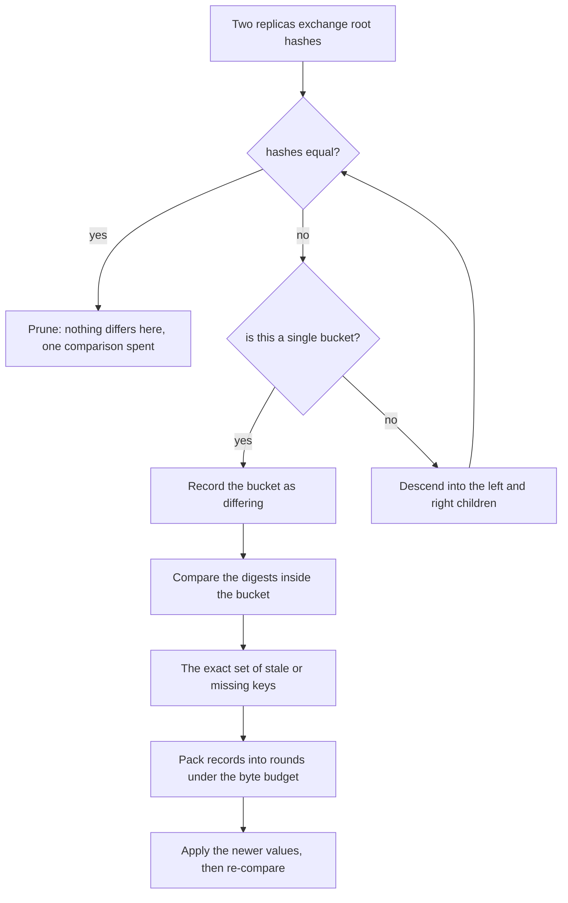
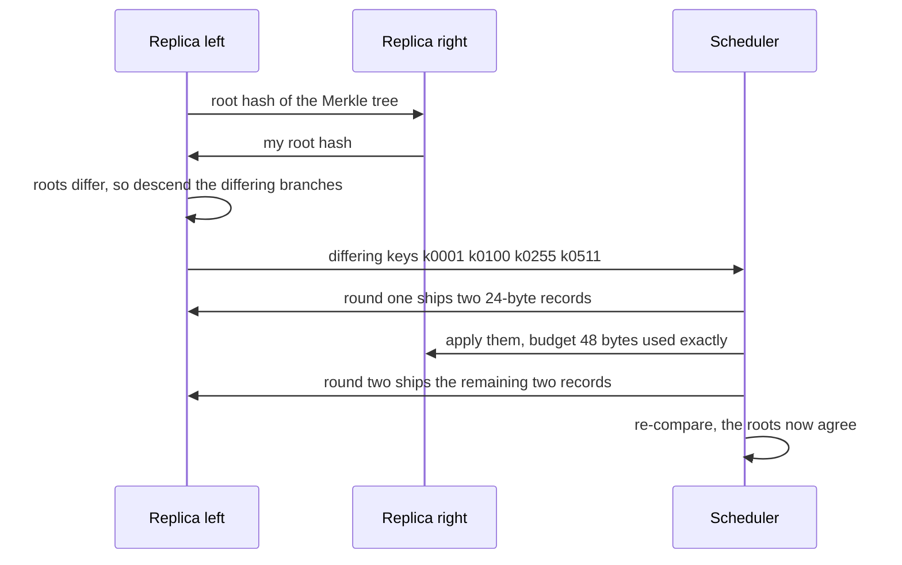

# 695 — Implement anti-entropy repair scheduling with bandwidth bounds

> **Tier:** Expert · **CTCI chapter:** Ch 9 — System Design and Scalability
> **Task spec:** [695-implement-anti-entropy-repair-scheduling-with-bandwidth-bounds.md](../../../tasks/expert/695-implement-anti-entropy-repair-scheduling-with-bandwidth-bounds.md)
> **Solutions:** [Python](../../../solutions/python/expert/695-implement-anti-entropy-repair-scheduling-with-bandwidth-bounds/solution.py) ·
> [Java](../../../solutions/java/expert/695-implement-anti-entropy-repair-scheduling-with-bandwidth-bounds/Solution.java) ·
> [JavaScript](../../../solutions/javascript/expert/695-implement-anti-entropy-repair-scheduling-with-bandwidth-bounds/solution.js) ·
> [C#](../../../solutions/csharp/expert/695-implement-anti-entropy-repair-scheduling-with-bandwidth-bounds/Solution.cs)

## 1. Problem restatement

Two parts of a self-healing replica store, both measured rather than assumed.

| Part | Contract |
| --- | --- |
| divergence detection | each replica builds a **Merkle tree** over the sorted key space (leaf = a group of key/value digests, parent = hash of its two children); two replicas compare roots and descend **only** into subtrees whose hashes differ, so the cost tracks the divergence, not the data set |
| repair scheduling | the differing keys are repair items of fixed wire size (`KEY_SIZE + VALUE_SIZE = 24` bytes); each round may ship at most `budget` bytes, so **which** differences go first matters |
| policies | key order, and **hot-first** (largest read weight first, the "hot" score standing in for read traffic), compared by the read-weighted staleness clients still see |

Concrete results asserted by the checks, on a 512-key space with leaf size 8 (64 buckets):

- the tree invariant holds (every parent is the hash of its two children), identical replicas have equal
  roots, and comparing them costs exactly **1** comparison and finds **nothing**.
- one stale key (`k0100`) is found exactly, at a cost of **13** comparisons — far below the 512 a full
  comparison would need. Four differences (`k0001`, `k0100`, `k0255`, `k0511`, mixing stale values and a
  missing key) cost **37** comparisons at leaf size 8 and **29** at leaf size 16, and both leaf sizes
  find the same keys.
- **40** scattered differences out of 512 keys cost **125** hash comparisons, versus 512 for a
  leaf-by-leaf scan.
- a budget of 48 bytes per round ships four 24-byte records in **2** rounds with no round over budget;
  a budget of exactly one record (24 bytes) needs **40** rounds for the 40 differences, shipping every
  key exactly once; 72 bytes per round (three records) needs **14** rounds.
- after any complete repair a re-comparison finds **nothing**, and an empty divergence needs **no**
  rounds at all; a budget too small to carry one record is **refused**.
- hot-first scheduling ships exactly the ten hottest differences in its first ten rounds and reduces
  read-weighted staleness from **60 to 35** after twenty repairs, dominating key order at every observed
  step.
- a difference that appears *during* a repair (`k0200`) is still detected and repaired, so no key
  starves.

## 2. Intuition

Shipping the differences is easy; **finding** them cheaply is the hard part, and that is what the Merkle
tree is for.

1. **Hashes make comparison hierarchical.** If two subtrees hash equal, their contents are equal with
   overwhelming probability, so the whole subtree is pruned with one comparison. Only the branches on
   the path to a difference are opened: 40 differences out of 512 keys cost 125 comparisons, and zero
   differences cost one.
2. **The cost is divergence plus a logarithmic prefix**, not the size of the key space — the property
   that lets a large store be compared in the background at all.
3. **The repair itself is a bin-packing problem.** Records have a fixed wire size and each round has a
   byte budget, so with a tight budget the only remaining lever is *order*: shipping the hottest stale
   keys first reduces the read-weighted staleness clients experience, at no cost in total bytes.



The descent uses exactly this shape: compare the two roots, and wherever the hashes agree, stop — the
divergence is confined below the lowest disagreeing nodes, which is why the comparison count is bounded
by the number of paths to the differing buckets rather than by the number of buckets.

## 3. Algorithm

1. **Fingerprint.** `fingerprint(text)` is FNV-1a over the UTF-8 bytes modulo `2^64` — deterministic,
   dependency-free, and wide enough that a collision needs deliberate effort.
2. **Digest a key** as `key|version|value`, so both a changed value and a changed version show up; a
   missing key digests as `(0, "")`, which makes absent and empty distinguishable from present.
3. **Build the tree.** Split the sorted keys into buckets of `leaf_size`; a leaf hashes the digests of
   its keys, an internal node hashes `str(left) + ":" + str(right)`, memoised per comparison.
4. **Descend.** `walk(low, high)` costs one comparison; equal hashes prune; else recurse into both
   halves, and a single-bucket range that still differs is recorded as a differing leaf.
5. **Resolve to keys.** Inside each differing leaf, compare the individual digests — that is the exact
   divergence, and the checks cross-check it against a linear scan of the key space.
6. **Schedule.** Order the differences by key, or by `(-hotness, key)` for the hot-first policy, then
   pack each round first-fit until the byte allowance runs out, apply the source values to the target,
   and repeat until nothing is left. A round that cannot carry even one record raises.
7. **Measure.** `staleness(replica, truth, keys, hotness)` sums the read weights of the keys that still
   differ, which is the client-visible cost of a partially completed repair.

```text
function fingerprint(text)
    h ← 0xCBF29CE484222325
    for byte in the UTF-8 bytes of text do
        h ← h xor byte
        h ← (h * 0x100000001B3) mod 2^64
    return h

function subtree_hash(replica, buckets, low, high, memo)
    if (low, high) is in memo then
        return memo[(low, high)]
    if high - low = 1 then
        value ← fingerprint of the digests of buckets[low] joined by "|"
    else
        middle ← low + (high - low) / 2
        value ← fingerprint of str(subtree_hash(low, middle)) + ":" + str(subtree_hash(middle, high))
    memo[(low, high)] ← value
    return value

procedure compare_replicas(left, right, keys, leaf_size)
    buckets ← the keys split into groups of leaf_size
    differing ← empty list, cost ← 0
    walk(0, length(buckets))
        cost ← cost + 1
        if subtree_hash(left, ...) = subtree_hash(right, ...) then
            return                                   // pruned with one comparison
        if the range is a single bucket then
            append the bucket index to differing, return
        walk(low, middle) and walk(middle, high)
    return sorted(differing) and cost

procedure schedule_repair(source, target, different, budget, hot_first)
    ordered ← sorted(different), or sorted by decreasing hotness and then by key
    rounds ← empty list, remaining ← ordered
    while remaining is not empty do
        allowance ← budget, shipped ← empty list
        for key in a copy of remaining do
            if record_size ≤ allowance then
                allowance ← allowance - record_size
                append key to shipped, remove key from remaining
        if shipped is empty then
            raise "the budget cannot even carry one record"
        for key in shipped do
            version and value ← source.get(key)
            target.put(key, value, version)
        append shipped to rounds
    return rounds

function staleness(replica, truth, keys, hotness)
    return the sum of hotness[key] over keys where replica.digest(key) differs from truth.digest(key)
```



## 4. Worked example

Comparison costs on the 512-key space, measured by running the Python solution:

| Scenario | Leaf size | Merkle comparisons | Full scan would cost |
| --- | --- | --- | --- |
| identical replicas | 8 | **1** | 512 |
| one stale key (`k0100`) | 8 | **13** | 512 |
| four differences (three stale, one missing) | 8 | **37** | 512 |
| the same four differences | 16 | **29** | 512 |
| 40 scattered differences | 8 | **125** | 512 |

The first row is the pruning property: equality at the root ends the comparison. The middle rows show
the logarithmic prefix — every difference adds the path from the root down to its bucket — and the last
row shows that even 40 differences across all 64 buckets stay far below a linear scan.

Repair under a byte budget, with `RECORD_SIZE = 24`:

| Difference count | Budget per round | Rounds | Note |
| --- | --- | --- | --- |
| 4 | 48 bytes | **2** | two records per round |
| 40 | 24 bytes | **40** | exactly one record per round |
| 40 | 72 bytes | **14** | three per round; `3 x 13 < 40`, so a fourteenth is needed |
| 0 | any | **0** | nothing to ship |



Order matters when the budget is tight. With one record per round and 40 differences, key order takes
the lowest key first; hot-first takes the most-read stale key first, which the checks verify by asserting
that the first ten shipped records are exactly the ten hottest differences. The client-visible effect is
measured as read-weighted staleness after twenty repairs: **60 → 35** under hot-first versus key order,
with hot-first dominating at every observed step.

## 5. Complexity

Let `K` be the key space size, `L` the leaf size, `B = K / L` the bucket count, `d` the number of
differing buckets and `n` the number of differing keys.

| Quantity | Best | Average | Worst | Why the bound holds |
| --- | --- | --- | --- | --- |
| one leaf hash | O(L) | O(L) | O(L) | the digests of `L` keys are hashed in one pass |
| tree build (memoised) | O(K) | O(K) | O(K) | every leaf and internal node is hashed once per comparison |
| Merkle descent | O(1) | O(d log B) | O(B) | one comparison per visited node; equal subtrees prune; the worst case is a difference in every bucket |
| measured | **1** comparison for 0 differences, **13** for 1, **125** for 40 out of 512 | | | matches `d log B + 1` |
| full scan comparison | O(K) | O(K) | O(K) | the baseline the tree replaces (512 comparisons) |
| one repair round | O(budget / record_size) | — | O(1) per record | records are packed first-fit until the allowance is exhausted |
| total rounds | O(1) | O(n · record_size / budget) | O(n) | one record per round in the worst case; measured 2, 14 and 40 rounds |
| staleness evaluation | O(K) | O(K) | O(K) | one digest comparison per key, weighted by hotness |
| space | O(K) digests + O(B) hashes | | | the key/value map per replica plus the memoised tree |

The two halves have different shapes: divergence detection is `O(d log B + 1)` — better than linear
whenever the store is mostly in sync — while the repair is a bin-packing problem with the trivial lower
bound `ceil(n · record_size / budget)` and the trivial upper bound of `n` rounds.

## 6. Pitfalls and edge cases

- **A missing key must be distinguishable from an empty value.** The digest is `key|version|value` with
  `(0, "")` for absent keys, so a deleted key shows up as a difference instead of silently matching.
- **`put` is last-write-wins by version.** An older version never overwrites a newer one, so the checks
  have to *simulate* staleness with `lag` rather than writing a stale value directly — an implementation
  that lets stale writes through would fail the invariant check.
- **Pruning must be checked, not assumed.** `tree_invariant_holds` re-derives every parent from its
  children, and the identity case asserts exactly one comparison, so a descent that always opened both
  halves would be caught.
- **Leaf size is a parameter, not a constant.** Leaf size 16 finds the same four keys as leaf size 8 with
  a different cost (29 versus 37), which makes the tree shape an explicit trade-off.
- **The budget must be respected exactly.** Every round is asserted to carry at most `budget` bytes, and
  a budget smaller than one record raises instead of spinning.
- **Rounds are counted, not guessed.** Four records at 48 bytes are exactly 2 rounds; 40 records at one
  per round are 40 rounds; 40 records at three per round are 14 rounds because `3 x 13 < 40`.
- **An empty divergence is a valid, cheap operation.** `schedule_repair` with nothing to ship returns no
  rounds, which matters for a scheduler that runs on a timer.
- **Order changes staleness, not correctness.** Both policies converge to identical replicas with every
  key shipped exactly once; only the read-weighted staleness differs, and hot-first must not be worse at
  any observed step.
- **Differences can appear mid-repair.** A key that goes stale after the comparison must still be found
  by a later comparison and repaired, which the checks assert explicitly so no key starves.
- **Determinism.** FNV-1a hashing, sorted key order and deterministic ties make the whole simulation
  reproducible, and the divergence found by the tree is cross-checked against a linear scan.
- **Documented simplification.** One pair of replicas at a time, instantaneous transfers inside a round,
  a complete graph of peers (no topology discovery), no network latency, and the exact optimum only for
  small instances. The Java solution turns the repair into first-fit-decreasing bin packing and compares
  the round count against a dynamic-programming optimum within one round; the JavaScript solution uses
  LPT list scheduling and compares its makespan against the `max(ceil(total / B), max weight)` lower
  bound and an exact branch-and-bound optimum; the C# solution adds a per-node budget on top of the
  per-pair budget, splits ranges larger than the link budget across rounds, and orders pairs by largest
  divergence or most stale.

## 7. Variants and follow-ups

- Where the divergence comes from in the first place, i.e. coded storage that loses and rebuilds shards →
  [694 — distributed erasure-coded storage with repair](../../../tasks/expert/694-implement-distributed-erasure-coded-storage-simulation-with-repa.md).
- Reconciling divergent key ranges with authenticated trees, the sibling of this comparison →
  [632 — anti-entropy Merkle tree reconciliation demo](../../../tasks/expert/632-implement-anti-entropy-merkle-tree-reconciliation-demo.md).
- The codec underneath the shards being compared →
  [693 — erasure coding (Reed-Solomon) over small GF(2^8)](../../../tasks/expert/693-implement-erasure-coding-reed-solomon-encoder-decoder-small-gf-2.md).

## 8. Check yourself

<details><summary>Show answer</summary>
**Why does comparing two identical replicas cost one comparison instead of 512?** Because the
comparison starts at the roots. Equal root hashes mean the subtrees are equal, so the descent stops
immediately — one hash comparison for the whole key space. Any difference forces the walk down only the
paths that lead to it.
</details>

<details><summary>Show answer</summary>
**What is the comparison cost model, and what does the tutorial measure?** Cost is one comparison per
visited node: `O(d log B + 1)` for `d` differing buckets out of `B`. Measured on 512 keys with 64
buckets: 1 comparison for no differences, 13 for one, 37 for four (29 with a coarser leaf size), and 125
for 40 — against 512 for a linear scan.
</details>

<details><summary>Show answer</summary>
**A repair has a 72-byte budget and 40 differing records of 24 bytes: how many rounds, and why not 13?**
Fourteen: three records per round consume 39 of the 40 records in 13 rounds, and the last record needs a
fourteenth round. The lower bound is `ceil(40 x 24 / 72) = 14`, which the schedule attains.
</details>

<details><summary>Show answer</summary>
**What does hot-first scheduling change, if both policies ship the same bytes?** Only the order. Key
order repairs the lowest key first; hot-first repairs the highest read-weight stale key first, which the
checks confirm by asserting the first ten shipped records are exactly the ten hottest differences. The
read-weighted staleness after twenty repairs drops from 60 to 35, dominating key order at every step.
</details>

<details><summary>Show answer</summary>
**Why does the design need `version` inside the digest rather than only the value?** Because a replica
can hold the right bytes at the wrong version (or an older write ordered after a newer one); digesting
`key|version|value` makes both the content and the ordering visible, which is what last-write-wins
application and the divergence check operate on.
</details>
