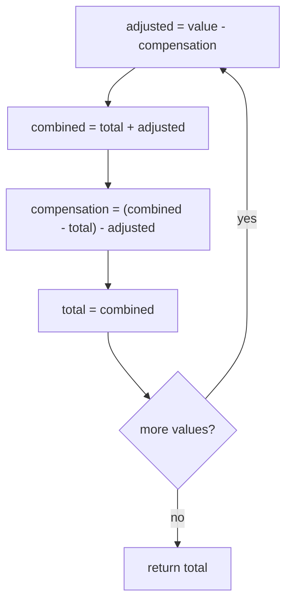
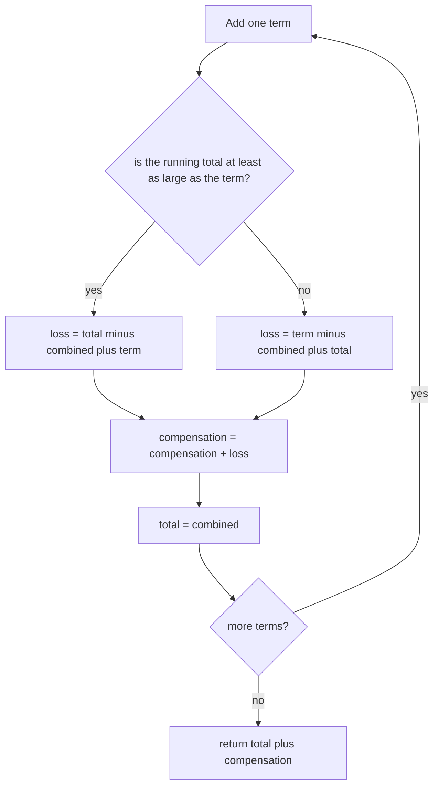
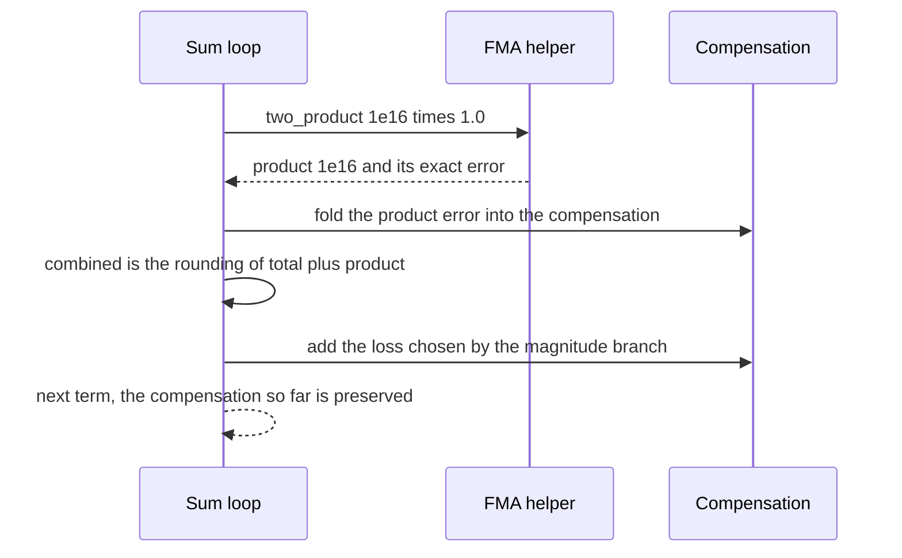

# 696 — Implement compensated arithmetic for numerical stability (Kahan)

> **Tier:** Expert · **CTCI chapter:** Beyond — Numerical & Scientific Computing
> **Task spec:** [696-implement-compensated-arithmetic-for-numerical-stability-kahan.md](../../../tasks/expert/696-implement-compensated-arithmetic-for-numerical-stability-kahan.md)
> **Solutions:** [Python](../../../solutions/python/expert/696-implement-compensated-arithmetic-for-numerical-stability-kahan/solution.py) ·
> [Java](../../../solutions/java/expert/696-implement-compensated-arithmetic-for-numerical-stability-kahan/Solution.java) ·
> [JavaScript](../../../solutions/javascript/expert/696-implement-compensated-arithmetic-for-numerical-stability-kahan/solution.js) ·
> [C#](../../../solutions/csharp/expert/696-implement-compensated-arithmetic-for-numerical-stability-kahan/Solution.cs)

## 1. Problem restatement

Floating-point addition is not associative, so a running sum quietly drops low-order bits. Implement
four summation strategies plus a compensated dot product, and measure each against an **exact** oracle:

| Strategy | Idea | Error growth |
| --- | --- | --- |
| `naive_sum` | `total += value` | linear in the number of adds |
| `kahan_sum` | recover what each addition lost (`c = (combined - total) - adjusted`) and re-inject it into the next addend | second order, independent of `n` |
| `neumaier_sum` | Kahan-Babuska: pick the recovery term from whichever operand dominates, which fixes the case plain Kahan mishandles | as Kahan, but correct when an addend outgrows the running total |
| `pairwise_sum` | divide and conquer with a small base case: the error grows with `log n` | logarithmic, with no extra state |

The oracle is exact: `exact_sum` converts every float to a `fractions.Fraction` and sums in rational
arithmetic, rounding once at the end, with `math.fsum` as a second opinion. The dot product uses
`two_product(a, b) = (a*b, math.fma(a, b, -a*b))`, so the products contribute no error of their own.

Concrete results asserted by the checks:

- `u = 2^-53` equals `ulp(1.0) / 2`; small-integer sums are exactly `6.0`, `15.0` for every strategy.
- the catastrophe `[1e16] + [1.0]*10 + [-1e16]`: **naive 0.0**, **Kahan 10.0**, **Babuska 10.0**,
  **pairwise 4.0**, exact 10.
- Kahan's own weakness `[1, 1e100, 1, -1e100]`: naive 0.0, **Babuska 2.0**, exact 2.0, and Babuska's
  relative error is strictly smaller than Kahan's.
- `[1e17, 1.0, -1e17]`: naive 0.0 and Neumaier 1.0, while **Kahan is not 1.0** — the case where the
  addend outgrows the running total.
- 5000 random integers: every strategy is **exact**. A 473-term geometric ladder
  (`1e9 / 2^k` for `k = 1..59`, mirrored with signs, plus a final `1.0`) has exact sum **1.0**, with
  naive relative error **1.192e-07** and Kahan/Babuska error **0.0**.
- error bounds: naive relative error is within `n * u * sum|x|`, the compensated one within
  `4u * sum|x|`, and pairwise never loses to naive.
- dot product: on `[1e16, 1, -1e16, 1] · [1, 1, 1, 1]` the naive result is **1.0** and the compensated
  one **2.0** (the true value); the compensated result is scale invariant at `1.0`, `1e-5` and `1e5`.

## 2. Intuition

Adding a small number to a large one rounds the small one away entirely. Compensated arithmetic does not
prevent that rounding — it *records* it and puts it back:

1. **Recover the loss.** For `combined = total + adjusted`, the exact identity
   `adjusted = (combined - total) + lost` holds, so `(combined - total) - adjusted` is exactly the
   negative of what was lost, in floating point. That value is the compensation.
2. **Re-inject it.** The next addend is `value - compensation`, so the loss of step `k` is repaired in
   step `k + 1` and the error becomes second order instead of first.
3. **Watch which operand is bigger.** Recovering `total`'s loss when the *addend* is the larger operand
   requires the mirrored formula; that is the whole difference between Kahan and Kahan-Babuska, and it is
   the difference between `0.0` and `2.0` on `[1, 1e100, 1, -1e100]`.
4. **Or avoid the problem structurally.** Pairwise summation halves the list recursively, so a partial
   sum is added to a comparable partial sum instead of accumulating hundreds of tiny terms against one
   giant one — `log n` growth, no compensation needed, and no state.



The diagram is Kahan's entire algorithm: four assignments and a loop. The subtlety is that the third
assignment would be exactly zero in exact arithmetic — it is precisely the rounding error of the second
one, which floating point can recover because `combined - total` is exact when no overflow occurs.

## 3. Algorithm

1. **Naive.** Accumulate left to right; every addition's rounding error is lost.
2. **Kahan.** As in the diagram: adjust the addend by the running compensation, add, then recompute the
   compensation from the *actual* rounded sum. Return `total`.
3. **Neumaier.** Add without adjusting, then accumulate the loss into a separate `compensation`
   variable, choosing the formula by magnitude: if `|total| >= |value|` use `(total - combined) + value`,
   else use `(value - combined) + total`. Return `total + compensation`.
4. **Pairwise.** Recurse by halves down to a base case of at most 8 elements, summed naively.
5. **Two-product.** `product = a * b`, `error = math.fma(a, b, -product)`, so `product + error` is the
   exact product (FMA computes `a*b - product` without a second rounding).
6. **Compensated dot product.** Per term, take the two-product pair, add `product` with the Neumaier
   rule (magnitude branch included), and fold the `product_error` into the compensation; return
   `total + compensation`.
7. **Verify exactly.** `exact_sum` sums `Fraction(value)` and rounds once; `relative_error` divides by
   the reference magnitude, or returns an absolute error when the reference is exactly zero.

```text
function kahan_sum(values)
    total ← 0.0, compensation ← 0.0
    for value in values do
        adjusted ← value - compensation
        combined ← total + adjusted
        compensation ← (combined - total) - adjusted
        total ← combined
    return total

function neumaier_sum(values)
    total ← 0.0, compensation ← 0.0
    for value in values do
        combined ← total + value
        if abs(total) ≥ abs(value) then
            compensation ← compensation + ((total - combined) + value)
        else
            compensation ← compensation + ((value - combined) + total)
        total ← combined
    return total + compensation

function pairwise_sum(values)
    if values is empty then
        return 0.0
    if length(values) ≤ 8 then
        accumulate naively and return
    middle ← length(values) / 2
    return pairwise_sum(first half) + pairwise_sum(second half)

function two_product(left, right)
    product ← left * right
    return product and math.fma(left, right, -product)

function compensated_dot(left, right)
    total ← 0.0, compensation ← 0.0
    for (a, b) in zip(left, right) do
        product, product_error ← two_product(a, b)
        combined ← total + product
        if abs(total) ≥ abs(product) then
            compensation ← compensation + ((total - combined) + product) + product_error
        else
            compensation ← compensation + ((product - combined) + total) + product_error
        total ← combined
    return total + compensation

function exact_sum(values)
    total ← the rational number zero
    for value in values do
        total ← total + Fraction(value)
    return float(total)
```



## 4. Worked example

The catastrophe `[1e16] + [1.0] * 10 + [-1e16]`, where the running total is `1e16` and the spacing of
representable doubles is `ulp(1e16) = 2`:

| Strategy | First additions | What the state holds after the ten ones | Final result |
| --- | --- | --- | --- |
| naive | `total` stays exactly `1e16` for every one of the ten additions | nothing | `1e16 - 1e16 = 0.0` |
| Kahan | the compensation makes the effective addends alternate `1, 2, 1, 2, ...`, so `total` advances by the ulp (2) | the residual low-order part lives in `compensation` | **10.0** |
| Babuska | `total` never moves, but the branch keeps adding each loss to `compensation` (it reaches 10) | `compensation = 10` | `0 + 10 = 10.0` |
| pairwise | the ten ones are grouped, so their partial sum (4) is added before the big cancellation | a partial sum of 4 | **4.0** |
| exact oracle | rational arithmetic, one final rounding | — | **10.0** |

Kahan's trace in detail:

| Step | `value` | `adjusted` | `combined` | `compensation` after |
| --- | --- | --- | --- | --- |
| 0 | `1e16` | `1e16` | `1e16` | `0.0` |
| 1 | `1.0` | `1.0` | `1e16` | `-1.0` |
| 2 | `1.0` | `2.0` | `1.0000000000000002e16` | `0.0` |
| 3 | `1.0` | `1.0` | `1.0000000000000004e16` | `1.0` |
| 4 | `1.0` | `1.0` | `1.0000000000000004e16` | `0.0` |

The step-1 row is the recovery: the addend `1.0` was swallowed, and `(combined - total) - adjusted`
reports exactly `-1.0`, which the next iteration adds back by handing `2.0` to the adder. Neumaier's
table is even simpler — the total stays at `1e16` and the compensation counts `1, 2, 3, ... 10` — which
is why the final cancellation `-1e16` leaves the compensation as the whole answer.

The 473-term ladder shows the same effect statistically: the exact sum is `1.0`, the naive relative
error is **1.192e-07**, and Kahan/Babuska land exactly on `1.0` (error `0.0`), within the
`4u * sum|x|` bound.



## 5. Complexity

Let `n` be the number of terms, `u = 2^-53` the unit roundoff and `S = sum|x_i|`.

| Quantity | Naive | Kahan / Neumaier | Pairwise |
| --- | --- | --- | --- |
| time | O(n) | O(n) | O(n) |
| extra state | none | one compensation accumulator | none (but O(log n) stack) |
| error bound | `n · u · S` | about `2u · S` (measured within `4u · S`) | `O(u log n · S)` |
| measured error on the ladder | **1.192e-07** | **0.0** | at most the naive error |
| measured on the catastrophe | 0.0 | **10.0** (exact) | 4.0 (of 10) |
| exactness | fails when magnitudes differ widely | exact on integer-valued inputs | exact on integer-valued inputs |
| dot product | O(n) | O(n) with one FMA per term | not applicable |
| Space | O(1) | O(1) | O(log n) recursion depth |

The oracle is deliberately outside the floating-point world: `Fraction`-based summation in Python
(`BigInteger` decomposition in JavaScript and C#, `long` arithmetic in Java) is exact by construction,
so every bound above is *measured* against truth rather than against another double computation.

## 6. Pitfalls and edge cases

- **Naive summation on the catastrophe returns exactly 0.0.** Any tutorial claim about compensation has
  to be anchored on this: the ten ones are individually representable and collectively lost, and the
  final `-1e16` cancels the giant term completely.
- **Plain Kahan is not the best compensated formula.** On `[1, 1e100, 1, -1e100]` Kahan does not return
  the exact `2.0` while Neumaier does, and on `[1e17, 1.0, -1e17]` Kahan returns something other than
  `1.0`; the checks assert the inequality, so an implementation that silently uses Kahan's branch for
  everything fails.
- **The magnitude branch must be `>=`, not `>`.** The two formulas are mirror images; picking the wrong
  one when `|total| == |value|` is harmless only by luck, and the dot product inherits the same branch.
- **`two_product` needs a real FMA.** `math.fma(a, b, -product)` returns the exact product error in one
  rounding; computing `a*b - product` in plain doubles gives zero and would silently disable the
  product compensation.
- **Pairwise summation recovers only part of the loss.** It returns 4.0 on the catastrophe where the
  compensated loops return 10.0 — a useful reminder that `log n` growth is not the same as exactness.
- **`Pairwise` base case matters.** Summing the base case naively with a threshold of 8 keeps the error
  at `O(u log n)`; a base case of 1 would recurse `n` deep.
- **Integer-valued input is exact for every strategy.** 5000 random integers sum exactly even naively,
  so a test suite built only on such data cannot distinguish the strategies; the crafted cases exist for
  that reason.
- **Empty and single-element inputs.** All strategies return `0.0` for an empty list; a single element
  comes back untouched; `kahan_sum([2**60, 2**-60])` equals the naive result because there is nothing to
  compensate.
- **Scale invariance of the dot product.** The same inputs scaled by `1e-5` and `1e5` must still match
  the exact value to `1e-14`, which catches an implementation that hard-codes a tolerance instead of
  compensating.
- **Oracle agreement.** `exact_sum` must equal `float(sum(Fraction(v) ...))` (it is deterministic) and
  `math.fsum` on the crafted cases; the checks use both, so a broken oracle cannot make a strategy look
  good by accident.
- **Documented simplification.** The comparison is at the level of summation kernels, not a full
  library: one summation flavour per strategy, a fixed pairwise base case, and the "exact" oracle built
  from arbitrary-precision integers/rationals rather than from interval arithmetic. The Java solution
  additionally verifies Welford's online variance against the one-pass `E[X²] - E[X]²` formula, which
  collapses under cancellation, and uses closed forms such as `(n² - 1) / 12` as its exact reference;
  the JavaScript solution builds the oracle by decomposing doubles into `sign x mantissa x 2^(e - 1075)`
  and summing in units of `2^-1074`, and also checks NaN/infinity propagation; the C# solution adds the
  error-free transformations `TwoSum` and `TwoProduct` (via `Math.FusedMultiplyAdd`), a compensated mean
  and both a compensated two-pass variance and Welford's variance, and asserts the size bound on the
  compensation itself.

## 7. Variants and follow-ups

- Numerical stability inside an integrator, where summation error compounds over time →
  [786 — advanced numerical integrator (Runge-Kutta 4) and stability tests](../../../tasks/expert/786-implement-advanced-numerical-integrator-runge-kutta-4-and-stabil.md).
- Verifying an implementation against a known-good one instead of an exact oracle →
  [932 — differential testing between CPU and GPU implementations](../../../tasks/master/932-implement-differential-testing-between-cpu-gpu-implementations-f.md).
- A gradient check, where the same cancellation reasoning shows up in finite differences →
  [512 — gradient check numerical derivative utility](../../../tasks/advanced/512-implement-gradient-check-numerical-derivative-utility.md).

## 8. Check yourself

<details><summary>Show answer</summary>
**How can floating point compute `(combined - total) - adjusted` exactly when the mathematical value of
that expression is zero?** In exact arithmetic it *is* zero, but `combined` is the rounded value of
`total + adjusted`. When no overflow occurs, `combined - total` is computed exactly (Sterbenz-style
cancellation of nearby values), and subtracting `adjusted` then yields exactly the negative of the
rounding error introduced by the addition. That recovered quantity is what the compensation carries
forward.
</details>

<details><summary>Show answer</summary>
**Why does plain Kahan fail on `[1, 1e100, 1, -1e100]` while Kahan-Babuska succeeds?** When the running
total is much smaller than the new addend, the loss to recover belongs to the *total*, not to the addend,
and Kahan's single formula only looks for the addend's loss. Neumaier's magnitude branch picks the
mirrored formula in that case, so the `1` is preserved and the exact `2.0` comes out.
</details>

<details><summary>Show answer</summary>
**The catastrophe gives naive 0.0, Kahan 10.0 and pairwise 4.0 — what does that say about pairwise
summation?** That `log n` error growth is not exactness: the recursion groups the ten ones into partial
sums, so four of the ten survive the big cancellation while the compensated loops keep all ten by
re-injecting each lost unit. Pairwise is a good default when no extra state is affordable, not a
replacement for compensation.
</details>

<details><summary>Show answer</summary>
**Why is the oracle built with `Fraction` (or `BigInteger`) instead of a double-precision reference?**
Because measuring a rounding error needs the true value. Every finite double is exactly representable as
a rational (or as `mantissa * 2^exponent`), so summing in that representation is lossless, and rounding
the result once gives the exactly rounded answer. Comparing two double computations would only show that
they differ, not which one is right.
</details>

<details><summary>Show answer</summary>
**What does the compensated dot product need beyond compensated summation?** The products themselves. A
plain `a * b` rounds, so `two_product` uses `math.fma(a, b, -product)` to obtain the exact product error,
which is then folded into the same compensation accumulator as the sum; without it the dot product would
inherit the product rounding even when the summation is perfect.
</details>
