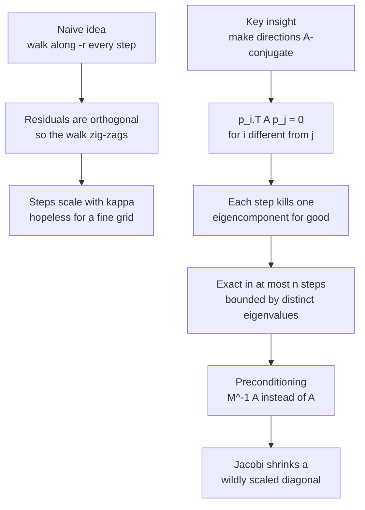
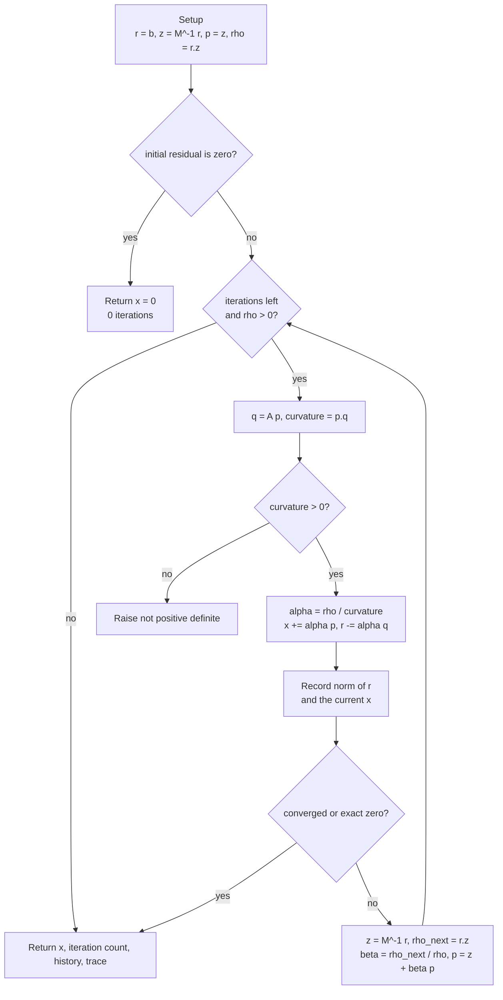
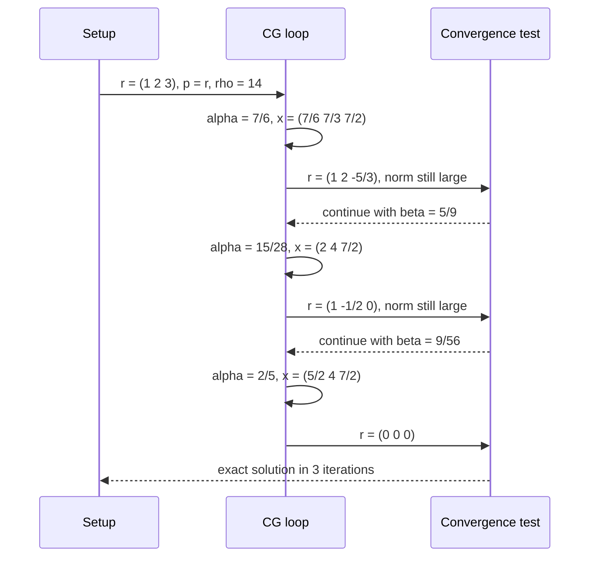

# 697 — Implement iterative linear solver (CG) with preconditioning demo

> **Tier:** Expert · **CTCI chapter:** Beyond — Numerical & Scientific Computing
> **Task spec:** [697-implement-iterative-linear-solver-cg-with-preconditioning-demo.md](../../../tasks/expert/697-implement-iterative-linear-solver-cg-with-preconditioning-demo.md)
> **Solutions:** [Python](../../../solutions/python/expert/697-implement-iterative-linear-solver-cg-with-preconditioning-demo/solution.py) ·
> [Java](../../../solutions/java/expert/697-implement-iterative-linear-solver-cg-with-preconditioning-demo/Solution.java) ·
> [JavaScript](../../../solutions/javascript/expert/697-implement-iterative-linear-solver-cg-with-preconditioning-demo/solution.js) ·
> [C#](../../../solutions/csharp/expert/697-implement-iterative-linear-solver-cg-with-preconditioning-demo/Solution.cs)

## 1. Problem restatement

Solve `A x = b` for a **symmetric positive definite** matrix `A` with the **conjugate gradient**
method, optionally preconditioned, and *prove* the classical facts about it inside the same program.
The four solutions expose the same pieces:

| Piece | What it does |
| --- | --- |
| `laplacian(size)` | the 1-D Poisson matrix: `2` on the diagonal, `-1` off it — SPD, bad conditioning |
| `diagonal_dominant(size, ladder)` | SPD with a diagonal spanning a chosen range |
| `apply_matrix`, `dot`, `norm` | the dense kernels the iteration is built from |
| `is_positive_definite(matrix)` | Cholesky without pivoting; also rejects asymmetry |
| `jacobi_preconditioner(matrix)` | `M^-1 = diag(A)^-1` returned as a closure `z = M^-1 r` |
| `cg(matrix, rhs, preconditioner, tolerance, max_iterations)` | the solver; returns `x`, `iterations`, the residual history, the iterate trace and the relative residual reached |
| `gaussian_solve(matrix, rhs)` | independent dense oracle with partial pivoting |
| `cg_exact(matrix, rhs)` | the same recurrence in `fractions.Fraction`, so orthogonality is tested with `==` |

Concrete results the checks assert:

- The 5×5 Laplacian with `b = [1, 0, 0, 0, 1]` finishes in **at most 5 iterations** and matches
  `gaussian_solve` to `1e-12`, with a reported relative residual `<= 1e-12`.
- `cg_exact` on `[[2, -1, 0], [-1, 2, -1], [0, -1, 2]]`, `b = [1, 2, 3]` ends with a residual that is
  **exactly zero**, in at most 3 steps, with the residuals pairwise exactly orthogonal and the
  directions exactly `A`-conjugate.
- A diagonal matrix with the diagonal `[1, 2, 3]` repeated has only **3 distinct eigenvalues**, and
  `cg_exact` on it stops after exactly **3** iterations.
- Jacobi preconditioning on `diagonal_matrix([1, 1e4, 1e-4, 1e6, 2, 1e-6])` converges in **one**
  iteration, because `M^-1 A` is the identity there; on the badly scaled `1 + 1000*i` diagonal it
  strictly cuts the iteration count.
- `is_positive_definite` rejects `[[1, 2], [2, 1]]` (symmetric but indefinite) and `[[2, 0], [1, 2]]`
  (asymmetric). A zero right-hand side returns **0 iterations** with the zero solution.

## 2. Intuition

The naive iterative method is steepest descent: from `x`, walk along the residual `r = b - A x`,
because `-r` is the direction in which the quadratic form `f(x) = ½ xᵀAx - bᵀx` decreases fastest.
The catch is that a new residual is orthogonal to the previous one, so the walk is forced to
zig-zag across the valley instead of down it — the number of steps scales with the condition number
`kappa`, which for the 20-point Laplacian is `(1 + cos(pi/21)) / (1 - cos(pi/21))`, roughly 178.

The fix is to stop asking each direction to be orthogonal to the old *residual* and ask it to be
orthogonal to the old *direction* in the `A` inner product: `p_iᵀ A p_j = 0` for `i != j`. Directions
with that property never undo each other's work, so each step annihilates one more component of the
error in the eigenbasis and the method terminates **exactly** in at most `n` steps (in exact
arithmetic, and in at most the number of *distinct* eigenvalues).



## 3. Algorithm

One `cg` iteration is nine lines of linear algebra:

1. Start from `x = 0`, so `r = b`; apply the preconditioner `z = M^-1 r` (with `M = I` when none is
   given) and set `p = z`, `rho = r · z`, remember `initial = ||r||`.
2. If `initial == 0` the system is already solved: return 0 iterations.
3. Loop while `iterations < max_iterations` and `rho > 0`:
   `q = A p`; `curvature = p · q`. If `curvature <= 0` the matrix is not positive definite — raise.
4. `alpha = rho / curvature`; then `x += alpha p` and `r -= alpha q`.
5. Record `||r||` and a copy of `x` in the history (the trace is what the energy-norm checks need).
6. Stop when `||r|| == 0` or `||r|| <= tolerance * initial`.
7. Otherwise `z = M^-1 r`, `rho_next = r · z`, `beta = rho_next / rho`, `p = z + beta p`, `rho = rho_next`.

`cg_exact` is the same loop over `Fraction` values with the Jacobi step removed and every equality
test exact; `is_positive_definite` runs a Cholesky factorisation first, since `curvature <= 0` inside
the loop is only a symptom, not a test.

```text
procedure cg(A, b, preconditioner, tolerance, max_iterations)
    n ← length(b)
    x ← zero vector of length n
    r ← copy of b
    z ← apply_preconditioner(preconditioner, r)
    p ← copy of z
    rho ← dot(r, z)
    initial ← norm(r)
    history ← [initial]
    trace ← [copy of x]
    iterations ← 0
    if initial = 0 then return x, 0, history, trace
    while iterations < max_iterations and rho > 0 do
        q ← apply_matrix(A, p)
        curvature ← dot(p, q)
        if curvature <= 0 then raise "the matrix is not positive definite"
        alpha ← rho / curvature
        for i ← 0 to n - 1 do
            x[i] ← x[i] + alpha * p[i]
            r[i] ← r[i] - alpha * q[i]
        length ← norm(r)
        history.append(length)
        trace.append(copy of x)
        iterations ← iterations + 1
        if length = 0 or length <= tolerance * initial then break
        z ← apply_preconditioner(preconditioner, r)
        rho_next ← dot(r, z)
        beta ← rho_next / rho
        rho ← rho_next
        for i ← 0 to n - 1 do
            p[i] ← z[i] + beta * p[i]
    return x, iterations, history, trace
end

procedure cg_exact(A, b, max_iterations)
    x ← zero rational vector
    r ← rational copy of b
    p ← copy of r
    rho ← dot(r, r)
    residuals ← [copy of r]
    directions ← [copy of p]
    iterations ← 0
    while iterations < max_iterations and rho != 0 do
        q ← A times p in exact rational arithmetic
        curvature ← dot(p, q)
        if curvature = 0 then break
        alpha ← rho / curvature
        x ← x + alpha * p
        r ← r - alpha * q
        rho_next ← dot(r, r)
        iterations ← iterations + 1
        residuals.append(copy of r)
        if rho_next = 0 then break
        beta ← rho_next / rho
        p ← r + beta * p
        directions.append(copy of p)
        rho ← rho_next
    return x, iterations, residuals, directions
end
```



## 4. Worked example

Take the 3×3 tridiagonal `A` and `b = [1, 2, 3]` that the exact-arithmetic checks use. Every value
below is a `Fraction`, so the arithmetic is reproducible by hand.

| Iteration | `rho = r·z` | `curvature = p·Ap` | `alpha` | `x` after the step | `r` after the step | `beta` for the next step |
| --- | --- | --- | --- | --- | --- | --- |
| start | 14 | — | — | `(0, 0, 0)` | `(1, 2, 3)` | — |
| 1 | 14 | 12 | `7/6` | `(7/6, 7/3, 7/2)` | `(1, 2, -5/3)` | `5/9` |
| 2 | `70/9` | `1176/81` | `15/28` | `(2, 4, 7/2)` | `(1, -1/2, 0)` | `9/56` |
| 3 | `5/4` | `25/8` | `2/5` | `(5/2, 4, 7/2)` | `(0, 0, 0)` | — |

Check `A x = [2*(5/2) - 4, -5/2 + 8 - 7/2, -4 + 7] = [1, 2, 3] = b`. The residuals
`r1 = (1, 2, -5/3)`, `r2 = (1, -1/2, 0)`, `r3 = (0, 0, 0)` have pairwise dot products
`1 - 1 + 0 = 0`, and the directions `p1 = (1, 2, 3)`, `p2 = (14/9, 28/9, 0)`,
`p3 = (5/4, 0, 0)` satisfy `p1ᵀ A p3 = 0` and so on — that is what `cg_exact` asserts with `==`.



The float version tells a different story on bigger systems: on the 20-point Laplacian with `b` all
ones and `tolerance = 1e-8` the residual never becomes exactly zero, so the loop exits on the
relative-tolerance test, and the energy-norm error `||x_k - x*||_A` is what the checks compare
against `2 * decay^k * ||x_0 - x*||_A` with `decay = (sqrt(kappa) - 1) / (sqrt(kappa) + 1)`.

## 5. Complexity

| Measure | Bound | Why |
| --- | --- | --- |
| Time per iteration | `O(n²)` dense, `O(nnz(A))` sparse | one `apply_matrix` plus three `O(n)` vector operations |
| Iterations, exact arithmetic | `≤ n`, and `≤` the number of distinct eigenvalues | each step spans one more Krylov vector; the minimum polynomial divides the characteristic one |
| Iterations, floating point | `O(sqrt(kappa) * log(1/eps))` typical | the textbook bound `2 * decay^k * ||r_0||` in the `A`-norm; the solution predicts `int(0.5 * sqrt(kappa) * log(2/eps)) + 1` and asserts the run stays under it |
| Total time | `O(n³)` dense worst case | `n` iterations of `O(n²)` work |
| Space | `O(n)` for `x`, `r`, `z`, `p`, history and trace | the matrix is dense `O(n²)` in these solutions |
| Best case | 0 iterations | `b = 0` returns immediately; Jacobi makes a diagonal system take exactly 1 step |
| Alternative: Gaussian elimination | `O(n³)` time, `O(n²)` space, no accuracy feedback | the solutions keep it only as the oracle |

## 6. Pitfalls and edge cases

- **Not every symmetric matrix is positive definite.** `[[1, 2], [2, 1]]` is symmetric but indefinite;
  `is_positive_definite` returns false for it, and `cg` raises when `curvature <= 0` instead of
  dividing by a non-positive number.
- **Asymmetry is rejected first.** `[[2, 0], [1, 2]]` is caught by the `abs(A[i][j] - A[j][i]) > 1e-12`
  test, because a Cholesky factor only exists for the symmetric part.
- **Zero right-hand side** short-circuits: `iterations == 0` and the solution is exactly the zero
  vector; the preconditioned Poisson case in Java asserts `max(x) == 0.0`.
- **A singular preconditioner** (`diag(A)` with a zero entry) must be reported, not silently
  swallowed — Java asserts the rejection.
- **Floating-point residuals wobble.** The preconditioned residual `sqrt(r · z)`, like the plain one,
  can rise for a step on badly conditioned systems; the quantity that provably decreases is the
  `A`-norm of the error, which is why the solutions track `x` and compare it with `gaussian_solve`.
- **Default iteration budget** is `4 * n`; without it a breakdown can spin forever.
- **`rho == 0` before convergence** means the residual lives in a numerically exhausted Krylov space;
  the loop exits rather than dividing by zero.
- **Exact arithmetic is not a luxury here.** `Fraction` is what turns "the residuals are orthogonal"
  into `value == 0`; a tolerance-based version of the same test would pass even for a buggy `beta`.

## 7. Variants and follow-ups

- **A better preconditioner instead of more iterations.** Jacobi is one sweep; SSOR/ICholesky, or a
  whole multigrid cycle used as `M^-1`, flatten the spectrum much harder. The C# solution already
  carries SSOR, and
  [698 — multigrid for Poisson](../../../tasks/expert/698-implement-multigrid-method-outline-for-poisson-equation-small-gr.md)
  builds exactly the hierarchy that makes such a preconditioner cheap.
- **Parallelising the dense kernels.** `apply_matrix` and `dot` dominate the runtime and are
  embarrassingly parallel scans; a GPU-style scan is the subject of
  [699 — GPU-style parallel prefix sum](../../../tasks/expert/699-implement-gpu-style-parallel-prefix-sum-algorithm-simulation.md).
- **Splitting the work across machines.** For a cluster-sized solve the matrix-vector product and the
  two dot products have to be partitioned over heterogeneous workers, which is
  [700 — work partitioning heuristics for heterogeneous clusters](../../../tasks/expert/700-implement-work-partitioning-heuristics-for-heterogeneous-cluster.md).
- **Nonsymmetric systems.** CG does not apply at all; the usual answers are GMRES or BiCGStab, which
  keep the Krylov idea but drop the three-term recurrence.
- **Stopping criteria.** The solutions report the relative residual; production codes often stop on
  the `A`-norm of the error instead, which is what the classical bound is stated in.

## 8. Check yourself

<details><summary>Show answer</summary>

**1. Why does CG need `A` symmetric positive definite, while a plain residual descent does not?**

Descent only needs a direction that decreases `f`; CG's whole construction — orthogonality of the
residuals, conjugacy of the directions, the three-term recurrence and the termination-in-`n` theorem —
rests on symmetry, and the division by `p ᵀ A p` needs positiveness. Both solutions defend the
assumption: a structural `is_positive_definite` test plus a runtime `curvature <= 0` check.

</details>

<details><summary>Show answer</summary>

**2. The 3×3 example stops after exactly 3 steps with `r = (0, 0, 0)`. When is `n` not the right bound?**

When `A` has repeated eigenvalues: the Krylov space saturates at the number of *distinct* eigenvalues.
The diagonal matrix built from `[1, 2, 3]` repeated ten times has three distinct values and
`cg_exact` reports exactly 3 iterations.

</details>

<details><summary>Show answer</summary>

**3. Why does Jacobi make the diagonal system converge in one iteration, but only cut the count on the Laplacian?**

For `A = diag(d)` the preconditioned operator is `M^-1 A = diag(d)^-1 diag(d) = I`, which has a single
distinct eigenvalue, so one step is exact. For the Laplacian, `diag(A) = 2 I` is a multiple of the
identity, so `M^-1 A` is only `A` rescaled: the spectrum — and therefore the iteration count — is
essentially unchanged. Preconditioning pays exactly where the diagonal *varies*.

</details>

<details><summary>Show answer</summary>

**4. What does `cg` return besides the solution, and why keep the iterate trace?**

`x`, `iterations`, the residual-norm history, the per-step iterate trace and the relative residual
reached. The residual history shows convergence stall or wobble; the trace is what allows the
energy-norm error `||x_k - x*||_A` to be formed against the dense solve and checked against the
textbook bound and its monotone decrease.

</details>

<details><summary>Show answer</summary>

**5. Why does the Python solution implement the recurrence twice?**

Because the structural claims (`r_i · r_j == 0`, `p_i ᵀ A p_j == 0`, exact termination) are only
observable without rounding, and `float` cannot demonstrate them. `cg_exact` in `Fraction` makes them
`==` checks; `cg` in binary64 is the version you would actually ship, validated against
`gaussian_solve` to `1e-12`.

</details>
