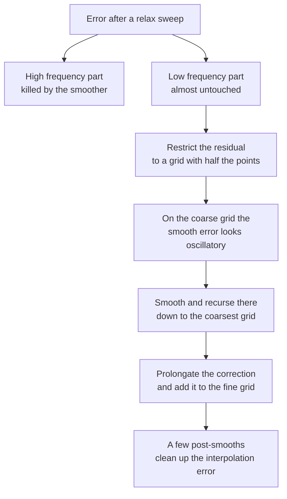
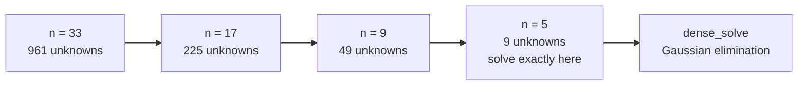
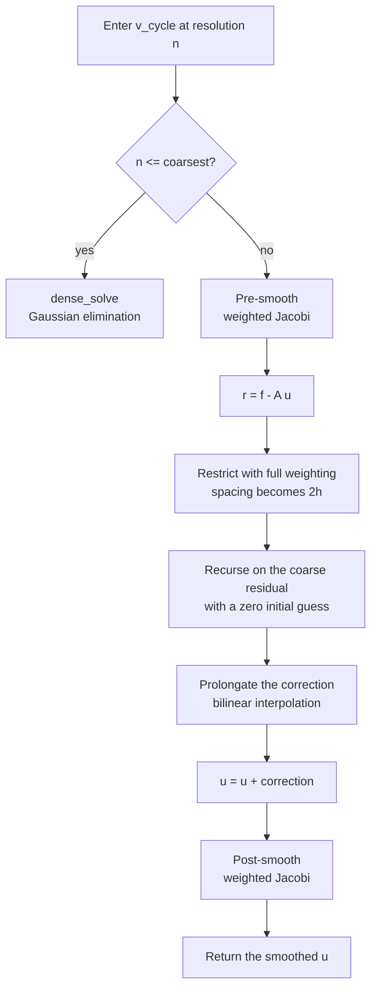
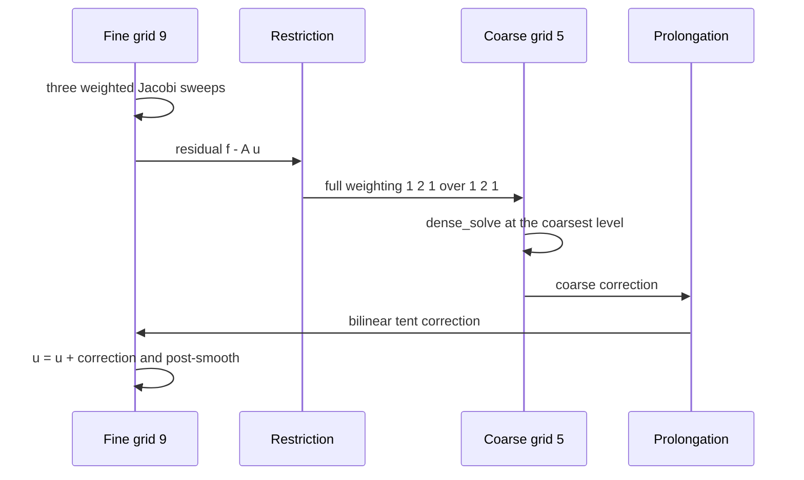

# 698 — Implement multigrid method outline for Poisson equation small grid

> **Tier:** Expert · **CTCI chapter:** Beyond — Numerical & Scientific Computing
> **Task spec:** [698-implement-multigrid-method-outline-for-poisson-equation-small-gr.md](../../../tasks/expert/698-implement-multigrid-method-outline-for-poisson-equation-small-gr.md)
> **Solutions:** [Python](../../../solutions/python/expert/698-implement-multigrid-method-outline-for-poisson-equation-small-gr/solution.py) ·
> [Java](../../../solutions/java/expert/698-implement-multigrid-method-outline-for-poisson-equation-small-gr/Solution.java) ·
> [JavaScript](../../../solutions/javascript/expert/698-implement-multigrid-method-outline-for-poisson-equation-small-gr/solution.js) ·
> [C#](../../../solutions/csharp/expert/698-implement-multigrid-method-outline-for-poisson-equation-small-gr/Solution.cs)

## 1. Problem restatement

Solve the Poisson problem `-Laplace(u) = f` on the unit square with zero Dirichlet data, discretised
by the standard five-point stencil on an `n x n` grid with `h = 1 / (n - 1)`, using a geometric
**multigrid V-cycle**. The pieces, exactly as the solutions define them:

| Component | Definition in the code |
| --- | --- |
| `apply_operator(u, n, h)` | `(4 u[i][j] - left - right - down - up) / h^2`, boundary untouched |
| `residual(u, f, n, h)` | `f - A u` on the interior |
| `jacobi_smooth(u, f, n, h, sweeps, omega)` | weighted Jacobi `u <- (1-omega) u + omega/4 * (h^2 f + sum of neighbours)`, `omega = 2/3` |
| `full_weighting(fine, n)` | restrict to the `(n+1)/2` grid with the `(1,2,1) x (1,2,1) / 16` stencil |
| `bilinear_prolongation(coarse, fine_n)` | inject the coarse values at even points, average the odd ones |
| `dense_solve(n, h, f)` | Gaussian elimination on the coarsest interior — the bottom of the recursion |
| `v_cycle(u, f, n, h, pre=3, post=3, coarsest=5)` | smooth, restrict, recurse, prolongate, correct, smooth |

The 1-D version in the Java and JavaScript solutions uses `A = tridiag(-1, 2, -1) / h^2`,
`R = 1/4 [1 2 1]`, `P = 1/2 [1 2 1]^T`, a Thomas solve at the bottom and a V(2,2) schedule; the C#
solution runs the 2-D hierarchy `15 -> 7 -> 3 -> 1` and adds a W-cycle.

What the checks assert, and therefore what the tutorial can quote:

- The stencil's truncation error falls like `h^2`: `truncation[33] < truncation[17]/3 < truncation[9]/9`.
- `dot(A a, b) == dot(a, A b)` (symmetry) and `dot(a, A a) > 0` (positive definiteness) on the interior.
- `dot(restricted, coarse) == 0.25 * dot(fine, prolonged)`: restriction is the adjoint of prolongation
  up to the factor `1/4`; in 1-D, `P = 2 R^T`.
- Prolongation reproduces the coarse values **exactly** at the even points.
- Three Jacobi sweeps leave less than **5 %** of the oscillatory checkerboard mode but more than
  **80 %** of the smooth mode — at least ten times slower damping, which is the point of the smoother.
- On `n <= 5` the V-cycle reduces to the exact dense solve: the `n = 5, frequency = 1.5` case matches
  `dense_solve` to `1e-9`.
- For `n = 17` and `n = 33`: every V-cycle cuts the residual to less than **0.2** of the previous
  value, the residual falls monotonically, the two factors differ by less than **0.1** and the cycle
  counts by at most **2** (grid independence), and the `n = 33` solution is within `1e-3` of the
  manufactured sine.

## 2. Intuition

One relaxation sweep can never solve this system quickly, and the reason is visible in the Fourier
picture. Jacobi replaces each value by a local average, so the **high-frequency** part of the error
(the checkerboard mode, which neighbours flip sign on) is annihilated immediately — one sweep with
`omega = 2/3` multiplies it by `1 - 2 * omega * (1/3)`-style factors that the C# checks pin to the
theoretical damping. The **smooth** part survives almost untouched, because averaging a nearly linear
function returns the same function. Refining the grid makes the smooth part worse: the number of
sweeps needed to reach a fixed tolerance grows like `O(1/h^2)`, so plain Jacobi is a dead end.

The insight is that a smooth error is *not* smooth on a coarse grid: after restriction it looks
oscillatory, so the same cheap smoother can attack it there. Multigrid therefore does not try to fix
the smooth part on the fine grid at all. It smooths what the smoother is good at, transfers the
remaining (now smooth) residual to a grid with half the points, solves the small problem by
recursion, and interpolates the correction back.



The grid hierarchy that makes this concrete, with the levels the Python solution actually uses:



## 3. Algorithm

1. Build the operator `A` and the right-hand side `f` at resolution `h`; the boundary stays zero.
2. **Pre-smooth**: run `pre` weighted Jacobi sweeps with `omega = 2/3` (three in the Python version).
3. **Residual**: `r = f - A u` on the interior.
4. **Restrict**: `r_c = R r` with full weighting, onto the grid of `(n+1)/2` points and spacing `2h`.
5. **Recurse**: if the coarse grid is still bigger than `coarsest`, start from a zero coarse guess and
   run another V-cycle there; otherwise call `dense_solve` and stop the recursion.
6. **Prolongate and correct**: `u += P e_c` with bilinear interpolation; the coarse values land exactly
   at the even fine points.
7. **Post-smooth**: `post` more weighted Jacobi sweeps.
8. Repeat the whole cycle `cycles` times, recording the residual norm after each cycle.

```text
procedure v_cycle(u, f, n, h, pre, post, coarsest)
    if n <= coarsest then return dense_solve(n, h, f)
    u ← jacobi_smooth(u, f, n, h, pre, omega = 2/3)
    coarse_n ← (n + 1) / 2
    coarse_residual ← full_weighting(residual(u, f, n, h), n)
    coarse_correction ← v_cycle(zeros(coarse_n), coarse_residual, coarse_n, 2 * h, pre, post, coarsest)
    correction ← bilinear_prolongation(coarse_correction, n)
    for i ← 1 to n - 2 do
        for j ← 1 to n - 2 do
            u[i][j] ← u[i][j] + correction[i][j]
    return jacobi_smooth(u, f, n, h, post, omega = 2/3)
end

procedure jacobi_smooth(u, f, n, h, sweeps, omega)
    repeat sweeps times
        candidate ← copy of u
        for i ← 1 to n - 2 do
            for j ← 1 to n - 2 do
                neighbours ← u[i-1][j] + u[i+1][j] + u[i][j-1] + u[i][j+1]
                candidate[i][j] ← (1 - omega) * u[i][j]
                                   + omega * 0.25 * (h * h * f[i][j] + neighbours)
        u ← candidate
    return u
end

procedure full_weighting(fine, n)
    coarse_n ← (n + 1) / 2
    for i ← 1 to coarse_n - 2 do
        for j ← 1 to coarse_n - 2 do
            a ← 2 * i, b ← 2 * j
            coarse[i][j] ← (4 * fine[a][b]
                            + 2 * (fine[a-1][b] + fine[a+1][b] + fine[a][b-1] + fine[a][b+1])
                            + fine[a-1][b-1] + fine[a+1][b-1]
                            + fine[a-1][b+1] + fine[a+1][b+1]) / 16
    return coarse
end

procedure bilinear_prolongation(coarse, fine_n)
    fine ← zeros(fine_n)
    for each interior coarse point (i, j) do
        fine[2 * i][2 * j] ← coarse[i][j]
    for each interior fine point (i, j) not already set do
        if i is even then fine[i][j] ← 0.5 * (fine[i][j-1] + fine[i][j+1])
        else if j is even then fine[i][j] ← 0.5 * (fine[i-1][j] + fine[i+1][j])
        else fine[i][j] ← 0.25 * (fine[i-1][j-1] + fine[i+1][j-1] + fine[i-1][j+1] + fine[i+1][j+1])
    return fine
end
```



## 4. Worked example

Take the fine grid `n = 5` (`h = 1/4`), so the coarse grid is `3 x 3` and the only interior coarse point
is `(1, 1)`, which samples the fine point `(2, 2)`. Put the linear ramp `fine[i][j] = 3 * (i - 1) + (j - 1) + 1`
on the interior, with a zero pad around it:

```
1 2 3        4 5 6        7 8 9      at fine indices (1..3) x (1..3)
```

The full-weighting stencil at `(2, 2)` collects `4 * 5` from the centre, `2 * (2 + 8 + 4 + 6)` from the
four edge neighbours and `1 * (1 + 7 + 3 + 9)` from the four corners:

| Quantity | Value |
| --- | --- |
| `4 * fine[2][2]` | `20` |
| `2 * (up + down + left + right)` | `2 * 20 = 40` |
| `corners` | `20` |
| `coarse[1][1]` | `(20 + 40 + 20) / 16 = 5` |

Because the ramp is linear, the weighted average returns its centre value exactly — a useful sanity
check on the stencil weights.

Prolongating a coarse grid that holds only `coarse[1][1] = 5` (everything else in the pad is zero)
gives the bilinear tent, in the order the code fills it:

| Stage | Fine entries written | Value |
| --- | --- | --- |
| injection | `fine[2][2]` | `5` |
| even row, odd columns | `fine[2][1]`, `fine[2][3]` | `0.5 * (0 + 5) = 2.5` |
| odd rows, even column | `fine[1][2]`, `fine[3][2]` | `0.5 * (0 + 5) = 2.5` |
| odd rows and columns | `fine[1][1]`, `fine[1][3]`, `fine[3][1]`, `fine[3][3]` | `0.25 * (0 + 0 + 0 + 5) = 1.25` |

A full cycle on, say, `n = 9` therefore looks like this:

| Step | Level | Operation | Outcome |
| --- | --- | --- | --- |
| 1 | `n = 9`, `h = 1/8` | three weighted Jacobi sweeps, `omega = 2/3` | oscillatory error mostly gone |
| 2 | `n = 9` | `r = f - A u` | smooth residual |
| 3 | `n = 9 -> 5` | full weighting, spacing `2h = 1/4` | 9 interior unknowns |
| 4 | `n = 5` | `5 <= coarsest`, so `dense_solve` | exact coarse correction |
| 5 | `n = 5 -> 9` | bilinear prolongation | tent-shaped correction |
| 6 | `n = 9` | `u += correction`, then three more sweeps | residual reduced by the cycle factor |



## 5. Complexity

| Measure | Bound | Why |
| --- | --- | --- |
| One Jacobi sweep | `O(N)` with `N = (n-2)^2` interior unknowns | each unknown touches five neighbours, and a constant number of sweeps is used |
| Restriction and prolongation | `O(N)` | a fixed-size stencil per coarse point, plus one pass per fine row and column |
| One 2-D V-cycle | `O(N)` | `T(N) = c N + T(N/4)` has the geometric sum `4/3 * c N` |
| One 1-D V-cycle | `O(N)` | `T(N) = c N + T(N/2)`, sum `2 c N` |
| Coarsest solve | `O(m^3)` for `m` coarse unknowns | dense Gaussian elimination; small by construction (`m = 9` at `n = 5`) |
| Storage | `O(N)` | the levels form a geometric series, `1 + 1/4 + 1/16 + ...` |
| Cycles to a tolerance | constant, independent of `n` | the solution asserts a per-cycle factor below `0.2` for `n = 17` and `n = 33`, with the factors and cycle counts agreeing to `0.1` and `2` |
| Alternative: plain Jacobi/steepest descent | `O(1/h^2)` sweeps | each sweep kills only high frequencies, so the iteration count grows with the grid |

## 6. Pitfalls and edge cases

- **Odd interior sizes only.** Halving `n -> (n+1)/2` needs `n` odd; the C# hierarchy `15 -> 7 -> 3 -> 1`
  satisfies `M_coarse = (M - 1) / 2` and an even interior size is rejected because it cannot be coarsened.
- **The smoother is not a solver.** After three sweeps less than 5 % of the checkerboard mode is left but
  more than 80 % of the smooth mode — a smoother-only loop stalls, and the bottom of the recursion must
  be an exact solve.
- **The adjointness constant matters.** `restricted` and `prolonged` are related by `dot(R u, v) = 0.25 * dot(u, P v)`
  (1-D: `P = 2 R^T`). Dropping the `1/4` breaks the Galerkin coarse operator and the cycle stops being a
  contraction.
- **Do not assemble `A_c` by eye.** The coarse operator is the Galerkin product `R A P`, verified
  numerically to be proportional to the coarse stencil, symmetric, consistent (interior rows sum to zero)
  and an M-matrix.
- **Halve the spacing.** The recursive call uses `2h`; forgetting it rescales the operator by four and
  destroys the correction.
- **Boundary rows stay zero.** The pad is part of the arrays, so prolongation reads zeros from it; writing
  into it corrupts the Dirichlet data on the next residual computation.
- **Degenerate sizes.** `n = 1` and `n = 3` have no interior or a single interior point; the JavaScript
  solution asserts those cases and a zero right-hand side (which must cost zero cycles) explicitly.
- **`coarsest` is a policy, not a detail.** With `coarsest = 5` a 9-grid level is solved directly, which
  is exact and cheap; pushing the cutoff lower costs cycles, pushing it higher makes the bottom expensive.
- **Accuracy is not the same as convergence.** The `n = 33` discretisation is only within `1e-3` of the
  analytic sine; the `h^2` truncation error is checked separately by `truncation[33] < truncation[17]/3 < truncation[9]/9`.
- **Grid independence is asserted with tolerances** (`0.1` on the factor, `2` cycles), not exactly, because
  it is an asymptotic statement about the two smallest grids tested.

## 7. Variants and follow-ups

- **F-cycles and full multigrid (FMG).** Revisiting intermediate levels turns the V into an F-cycle and cuts
  the cycle count further; FMG solves on the coarsest grid first and uses the prolongated solution as the
  initial guess, which is the optimal-use pattern. The JavaScript solution deliberately stops at a single
  V-cycle, and the C# solution adds a W-cycle, which is at least as strong as the V-cycle.
- **Stronger smoothers.** Weighted Jacobi is the simplest; red-black Gauss-Seidel, ILU or a small
  polynomial smoother all keep the same cycle. The C# solution already demonstrates SSOR-like ideas on the
  linear-solver side of
  [697 — CG with preconditioning](../../../tasks/expert/697-implement-iterative-linear-solver-cg-with-preconditioning-demo.md),
  and a V-cycle is exactly the `M^-1` that makes CG grid independent there.
- **Parallel smoothers.** A Jacobi sweep is a stencil update with no loop-carried dependency, and the
  residual reduction inside a cycle is a scan; the GPU-shaped version of those scans is
  [699 — GPU-style parallel prefix sum](../../../tasks/expert/699-implement-gpu-style-parallel-prefix-sum-algorithm-simulation.md).
- **Distributed hierarchies.** The coarse grids are where communication dominates, so level sizes and
  partitions must be balanced across heterogeneous machines —
  [700 — work partitioning heuristics for heterogeneous clusters](../../../tasks/expert/700-implement-work-partitioning-heuristics-for-heterogeneous-cluster.md).
- **Other operators and dimensions.** The 5-point stencil generalises to 7 points in 3-D and to
  variable-coefficient problems, where the transfer operators have to be chosen per level.

## 8. Check yourself

<details><summary>Show answer</summary>

**1. Why is a smoother alone useless, and how does the coarse grid fix that?**

A relaxation sweep is a local averaging: it removes the error components that vary fastest between
neighbours and barely changes components that are nearly linear, so the smooth part converges at a rate
that degrades as `h` shrinks. Restricted to a coarser grid, that same smooth component becomes
oscillatory, so the identical smoother is effective again — the work of the fine grid is reduced to what
it is good at.

</details>

<details><summary>Show answer</summary>

**2. What exactly does the code assert about restriction and prolongation?**

That they are adjoints up to a constant: `dot(full_weighting(fine), coarse) == 0.25 * dot(fine, bilinear_prolongation(coarse))`,
and that prolongation is an exact injection at the even points plus bilinear averages elsewhere. Both are
checked with dot products on pseudo-random vectors, so a wrong stencil weight cannot hide.

</details>

<details><summary>Show answer</summary>

**3. Compute the coarse value for the ramp `fine[i][j] = 3(i-1) + (j-1) + 1` at the fine point `(2, 2)`.**

`(4*5 + 2*(2 + 8 + 4 + 6) + (1 + 7 + 3 + 9)) / 16 = 80 / 16 = 5`, which is the centre value itself — as
expected, since full weighting is exact for linear functions.

</details>

<details><summary>Show answer</summary>

**4. Why must the recursion bottom out in a direct solve?**

Because the smoother does not reduce the smooth component, any finite number of sweeps leaves a residual
that the cycle cannot remove. Solving the coarsest system exactly removes it completely, and cheaply: the
bottom problem has only a handful of unknowns. In these solutions it is Gaussian elimination (`dense_solve`)
or a Thomas solve in the 1-D versions.

</details>

<details><summary>Show answer</summary>

**5. How is grid independence demonstrated, and why only approximately?**

The harness builds the manufactured solution `u = sin(pi x) sin(pi y)` with `f = 2 pi^2 u` on `n = 17` and
`n = 33`, runs 12 cycles, and compares the last per-cycle residual factors (both below `0.2`), the cycle
counts needed for a `1e-8` reduction (within `2` of each other) and the two factors (within `0.1`). The
tolerances exist because the claim is asymptotic: the smallest grids still feel the boundary and the
discretisation error.

</details>
