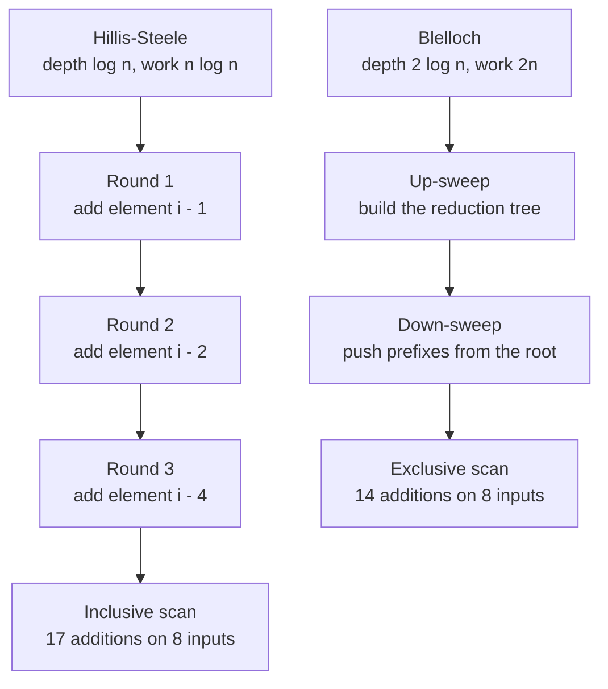
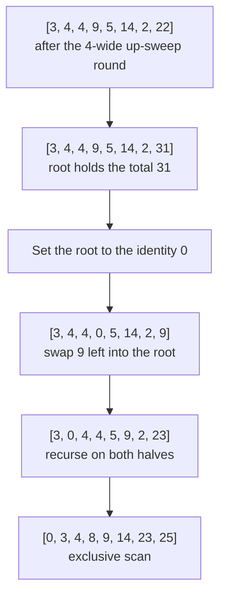
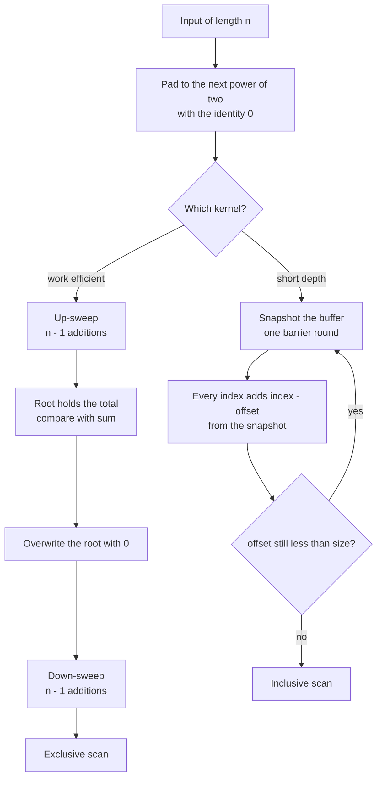
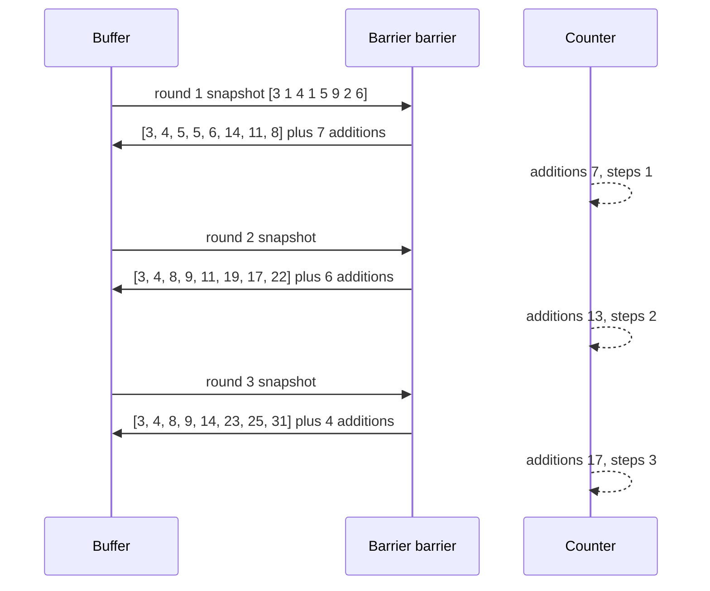

# 699 — Implement GPU-style parallel prefix-sum algorithm simulation

> **Tier:** Expert · **CTCI chapter:** Beyond — Networking, OS & Real-Time
> **Task spec:** [699-implement-gpu-style-parallel-prefix-sum-algorithm-simulation.md](../../../tasks/expert/699-implement-gpu-style-parallel-prefix-sum-algorithm-simulation.md)
> **Solutions:** [Python](../../../solutions/python/expert/699-implement-gpu-style-parallel-prefix-sum-algorithm-simulation/solution.py) ·
> [Java](../../../solutions/java/expert/699-implement-gpu-style-parallel-prefix-sum-algorithm-simulation/Solution.java) ·
> [JavaScript](../../../solutions/javascript/expert/699-implement-gpu-style-parallel-prefix-sum-algorithm-simulation/solution.js) ·
> [C#](../../../solutions/csharp/expert/699-implement-gpu-style-parallel-prefix-sum-algorithm-simulation/Solution.cs)

## 1. Problem restatement

Simulate the two classic GPU prefix-sum (scan) kernels on a CPU, but model the **cost** that makes the
comparison interesting: every addition and every barrier-separated round is counted. The interface in
the Python solution is:

| Function | Result |
| --- | --- |
| `next_power_of_two(length)` | `1, 4, 64, ...` — the padded size |
| `sequential_scan(values)` | inclusive prefix sums, the oracle |
| `sequential_exclusive(values)` | `[0] + accumulate(values)[:-1]` |
| `hillis_steele(values, counter)` | inclusive scan, `ceil(log2 n)` rounds, every element updated from a snapshot |
| `blelloch(values, counter)` | **exclusive** scan via up-sweep and down-sweep |
| `reduction_total(values)` | the root of the up-sweep tree — it must equal `sum(values)` |
| `block_scan(values, block_size, counter)` | per-block Blelloch, scan of block totals, add-back pass |
| `exact_prefixes(values)` | rational prefixes for the precision cross-check |
| counters | a dict of `additions` and `steps` |

Concrete results that the checks assert (every number below is in the solutions):

- On the 8-element sample `[3, 1, 4, 1, 5, 9, 2, 6]`: Hillis-Steele costs `8 * 3 - 7 = 17` additions
  in `log2(8) = 3` steps; Blelloch costs exactly `2 * 8 - 2 = 14` additions in `2 * 3 = 6` steps, and
  is therefore strictly cheaper.
- Exclusive + input equals inclusive, and `exclusive[0] == 0`.
- For lengths `0, 1, 2, 3, 5, 8, 13, 17, 31, 64, 100, 256` (padding to `1, 4, 8, ..., 256`): Blelloch
  always costs `2 * padded - 2`, Hillis-Steele always `padded * log2(padded) - (padded - 1)` and
  `log2(padded)` steps; Blelloch is cheaper whenever `padded >= 8`, and *more* expensive at
  `padded == 4` (`6 >= 5`).
- `block_scan` matches the sequential exclusive scan for block sizes `2, 4, 8, 16` and lengths
  `0, 1, 7, 32, 100`, with the exact work predicted by the per-block trees plus the totals pass plus
  the add-back pass, and a critical path shorter than the summed work (the blocks are independent).
- Floating-point orders disagree: on `[0.1] * 16` the sequential, Hillis-Steele and Blelloch orders
  each stay within `1e-15` relative of the **exact rational** prefixes.
- Empty input is `[]` for all three scans; `[7]` is `[7]` inclusive and `[0]` exclusive.

The Java solution checks its three kernels for every length up to 33 and runs a 4096-element case; the
JavaScript solution parameterises the combine operator (add, min, max, BigInt); the C# solution adds a
32-lane warp scan, five shuffle rounds, and a 32-bank conflict model.

## 2. Intuition

A sequential scan is trivially cheap in *work* (`n - 1` additions) but its depth is `n`: element `i`
cannot be finished before element `i - 1`. A GPU has thousands of lanes, so the currency is not work but
**depth** — the number of rounds separated by a barrier at which every element is updated
simultaneously.

**Hillis-Steele** buys depth with work. In round `k` every element adds the value `2^k` positions to its
left, taken from the *previous* round's snapshot (double buffering, or a barrier). After `log2 n` rounds
each element has summed a contiguous window of length `2^log2 n = n`, i.e. everything to its left. It is
dead simple and perfectly parallel, but it re-adds the same values over and over:
`n log2 n - (n - 1)` additions.

**Blelloch** reduces the work by reusing the tree. An up-sweep builds partial sums at every internal
node (`n - 1` additions), then a down-sweep walks the same tree from the root with the identity `0` and
converts the node sums into an **exclusive** scan (another `n - 1` additions, most of them swaps rather
than new sums). Total: exactly `2n - 2` additions in `2 log2 n` rounds — work-efficient, at the price of
twice the depth and a non-power-of-two requirement solved by padding with the identity `0`.



The same two shapes for a 4-element input make the reuse visible: Hillis-Steele performs `4 + 4 = 8`
additions (its closed form gives `4 * 2 - 3 = 5` on the *padded* array of 4), while Blelloch's tree
performs 3 up-sweep plus 3 down-sweep additions.



## 3. Algorithm

Both kernels start by padding the input to the next power of two with the identity value `0` — the
neutral element for addition, so the extra terms do not change any prefix sum.

**Hillis-Steele:**
1. Copy the input into a padded buffer of `size` slots.
2. For `offset = 1, 2, 4, ... < size`: take a snapshot of the whole buffer, then for every index
   `>= offset` set `buffer[index] = snapshot[index - offset] + snapshot[index]`, and count one round.
3. Return the first `n` slots.

**Blelloch:**
1. Pad the input to `size`, then up-sweep for `offset = 1, 2, 4, ... < size`: for each block start in
   steps of `2 * offset`, do `tree[start + 2*offset - 1] += tree[start + offset - 1]` and count a round.
2. Set `tree[size - 1] = 0`, halve `offset`, and down-sweep while `offset >= 1`: for each block start,
   save `left = tree[start + offset - 1]`, move `tree[start + 2*offset - 1]` into
   `tree[start + offset - 1]`, then add the saved `left` back into `tree[start + 2*offset - 1]`, and
   count a round.
3. Return the first `n` slots — the exclusive scan.

**Block scan (the real multi-block kernel):**
1. Split the input into contiguous blocks of `block_size`.
2. Run Blelloch on each block (counted), and compute each block's total (counted as
   `len(block) - 1` additions).
3. Run Blelloch on the vector of block totals to get the block offsets.
4. Add each block's offset to every element of that block (counted as `n` additions).

```text
procedure next_power_of_two(length)
    size ← 1
    while size < length do size ← size * 2
    return size
end

procedure hillis_steele(values, counter)
    if values is empty then return [], counter
    size ← next_power_of_two(length(values))
    buffer ← values padded with 0 to size
    offset ← 1
    while offset < size do
        snapshot ← copy of buffer
        for index ← 0 to size - 1 do
            if index >= offset then
                buffer[index] ← snapshot[index - offset] + snapshot[index]
                counter.additions ← counter.additions + 1
        counter.steps ← counter.steps + 1
        offset ← offset * 2
    return first length(values) slots of buffer, counter
end

procedure blelloch(values, counter)
    if values is empty then return [], counter
    size ← next_power_of_two(length(values))
    tree ← values padded with 0 to size
    offset ← 1
    while offset < size do                                  // up-sweep
        for start ← 0 to size - 1 step 2 * offset do
            tree[start + 2 * offset - 1] ← tree[start + 2 * offset - 1] + tree[start + offset - 1]
            counter.additions ← counter.additions + 1
        counter.steps ← counter.steps + 1
        offset ← offset * 2
    tree[size - 1] ← 0                                      // the identity starts the down-sweep
    offset ← offset / 2
    while offset >= 1 do                                    // down-sweep
        for start ← 0 to size - 1 step 2 * offset do
            left ← tree[start + offset - 1]
            tree[start + offset - 1] ← tree[start + 2 * offset - 1]
            tree[start + 2 * offset - 1] ← tree[start + 2 * offset - 1] + left
            counter.additions ← counter.additions + 1
        counter.steps ← counter.steps + 1
        offset ← offset / 2
    return first length(values) slots of tree, counter
end

procedure block_scan(values, block_size, counter)
    if values is empty then return [], counter
    blocks ← consecutive slices of values of length block_size
    for each block do
        scanned ← blelloch(block, counter)
        append scanned to locals
        total ← sum(block), counting length(block) - 1 additions
        append total to totals
    offsets ← blelloch(totals, counter)
    for each block index do
        for each value in locals[block index] do
            result.append(value + offsets[block index])
            counter.additions ← counter.additions + 1
    return result, counter
end
```



## 4. Worked example

Input `[3, 1, 4, 1, 5, 9, 2, 6]`, `n = 8`, already a power of two so no padding.

**Hillis-Steele — three rounds, 17 additions:**

| Round | `offset` | Buffer after the round | Additions this round |
| --- | --- | --- | --- |
| 1 | 1 | `[3, 4, 5, 5, 6, 14, 11, 8]` | 7 |
| 2 | 2 | `[3, 4, 8, 9, 11, 19, 17, 22]` | 6 |
| 3 | 4 | `[3, 4, 8, 9, 14, 23, 25, 31]` | 4 |

The last row is the inclusive scan (`3, 4, 8, 9, 14, 23, 25, 31`), and
`7 + 6 + 4 = 17 = 8 * 3 - 7`, matching the closed form `n * log2(n) - (n - 1)`.

**Blelloch — up-sweep, 7 additions:**

| Round | `offset` | Tree after the round |
| --- | --- | --- |
| 1 | 1 | `[3, 4, 4, 5, 5, 14, 2, 8]` |
| 2 | 2 | `[3, 4, 4, 9, 5, 14, 2, 22]` |
| 3 | 4 | `[3, 4, 4, 9, 5, 14, 2, 31]` |

The root `31` equals `sum(values)`, which is the tree invariant the checks use.

**Blelloch — down-sweep, 7 more additions (14 = 2n - 2 in total, 6 rounds):**

| Round | `offset` | Tree after the round |
| --- | --- | --- |
| 0 | — | `[3, 4, 4, 9, 5, 14, 2, 0]` (root overwritten with the identity) |
| 1 | 4 | `[3, 4, 4, 0, 5, 14, 2, 9]` |
| 2 | 2 | `[3, 0, 4, 4, 5, 9, 2, 23]` |
| 3 | 1 | `[0, 3, 4, 8, 9, 14, 23, 25]` |

The exclusive scan `[0, 3, 4, 8, 9, 14, 23, 25]` plus the input gives the inclusive scan back, and its
first entry is the identity `0`, exactly as `sequential_exclusive` produces.



## 5. Complexity

Let `padded` be `n` rounded up to a power of two, `s = log2(padded)`.

| Algorithm | Work (additions) | Depth (barrier rounds) | Space |
| --- | --- | --- | --- |
| Sequential scan | `n - 1` | `n` | `O(n)` |
| Hillis-Steele | `padded * s - (padded - 1)` | `s` | `O(padded)` buffer plus a snapshot each round |
| Blelloch | exactly `2 * padded - 2` | `2 * s` | `O(padded)` tree |
| Block scan | per-block `2 * 2^ceil(log2 |block|) - 2`, plus `2 * 2^ceil(log2 #blocks) - 2` for the totals, plus `sum(|block| - 1)` block sums, plus `n` add-backs | `2 * log2(pow2(block_size)) + 2 * log2(pow2(#blocks))` | `O(n)` |

Reasons: every round of Hillis-Steele doubles the window each element has absorbed, so `s` rounds
suffice and each round performs at most `padded - 1` additions; Blelloch's up-sweep touches each
internal tree node once and the down-sweep once more, giving `2 * (padded - 1)` and `2s` rounds. The
crossover is asserted, not assumed: for `padded == 4` the closed forms give Blelloch `6` and
Hillis-Steele `5`, so the tree is *worse* work-wise below eight elements; from `padded >= 8` Blelloch is
strictly cheaper. The block scan's counted work is the sum of exactly those parts, and its critical path
is strictly shorter than the summed rounds whenever there is more than one block, because blocks run
independently.

## 6. Pitfalls and edge cases

- **Empty input** returns `[]` from all three scans with zero counted work — the block-scan check asserts
  `additions == 0`.
- **Singleton** input: inclusive `[7]`, exclusive `[0]`; Blelloch has no internal node, so the up-sweep
  loop never runs and the root write sets the single slot to `0`.
- **Non-power-of-two lengths** are padded with `0`, the identity for addition. A prime length such as
  3 or 17 therefore costs `2 * padded - 2` additions, not `2n - 2`: the counter follows the padded size,
  which is what a device kernel does too.
- **The work-efficiency crossover** is real and checked: Blelloch is *not* always cheaper. Below eight
  padded elements the naive loop wins on work; the solutions assert `>=` there and `<` above it.
- **The barrier is not decoration.** Hillis-Steele reads a snapshot: reading `buffer[index - offset]`
  after it has already been updated in the same round is the classic in-place race, and it silently
  produces wrong sums.
- **Floating-point addition is not associative.** `[0.1] * 16` genuinely differs between the sequential,
  Hillis-Steele and Blelloch orders; the solutions bound every order to `1e-15 * max(1, |reference|)`
  against the exact `Fraction` prefixes, and the JavaScript solution goes past `2^53` with BigInt.
- **Block scan needs the add-back pass counted.** Skipping it gives per-block-correct but globally wrong
  offsets; the work formula `per-block trees + block sums + totals scan + n` catches a missing pass.
- **Bank conflicts are a separate cost from work.** The C# solution maps a warp's shared-memory accesses
  onto 32 banks and shows the standard layout result: interleaved ownership (`lane t` owns
  `t + k * 32`) is conflict free, while contiguous ownership (lane `t` owns `8t .. 8t + 7`) serialises
  eight ways at stride 8.
- **Blocks are simulated sequentially.** The JavaScript header states the simplifications explicitly: no
  memory hierarchy, no divergence, no thread execution — "steps" are barriers, not clock cycles.

## 7. Variants and follow-ups

- **Other combine operators.** A scan needs only associativity: min, max, multiplication and, as the
  JavaScript solution demonstrates, arbitrary-precision addition. Prefix-min and prefix-max are checked
  against a brute-force oracle for every size.
- **Segmented scans.** Real workloads scan many independent segments in one launch; the flag-based
  variant of the same tree is the standard answer.
- **Decoupled look-back.** For very large inputs the three-phase block scan becomes one kernel that
  lets each block read its predecessors' partial windows, trading phase boundaries for extra traffic.
- **Scans inside solvers.** Dot products, norm computations and the direction updates of a Krylov method
  are reductions and scans; see
  [697 — CG with preconditioning](../../../tasks/expert/697-implement-iterative-linear-solver-cg-with-preconditioning-demo.md)
  and [698 — multigrid for Poisson](../../../tasks/expert/698-implement-multigrid-method-outline-for-poisson-equation-small-gr.md).
- **Partitioning the same work differently.** Choosing block sizes so the phases stay balanced on
  heterogeneous hardware is the subject of
  [700 — work partitioning heuristics for heterogeneous clusters](../../../tasks/expert/700-implement-work-partitioning-heuristics-for-heterogeneous-cluster.md).

## 8. Check yourself

<details><summary>Show answer</summary>

**1. Why does Hillis-Steele need a snapshot (or double buffering) at every round?**

Because every element reads a value another lane is writing in the same round. With a barrier the write
is only visible after the round, so a snapshot of the previous round is a faithful model of the
`__syncthreads()` semantics; without it the result depends on lane order and is wrong.

</details>

<details><summary>Show answer</summary>

**2. Give the exact addition counts for `n = 8` and explain the difference.**

Hillis-Steele: `8 * 3 - 7 = 17`. Blelloch: `2 * 8 - 2 = 14`. Hillis-Steele recomputes overlapping
windows every round, so work grows as `n log n`; Blelloch's tree visits each internal node twice,
so work stays linear. Blelloch pays for that with `2 log n = 6` rounds against `3`.

</details>

<details><summary>Show answer</summary>

**3. Why is the exclusive/inclusive distinction more than cosmetics?**

Blelloch's down-sweep naturally produces the exclusive scan, because it pushes the identity down from the
root. Any consumer that wants inclusive sums must add the input back elementwise — which the solutions
check as an identity rather than assume.

</details>

<details><summary>Show answer</summary>

**4. You scan a 100-element array with block size 16. What does the counter report?**

`ceil(100 / 16) = 7` blocks, the last with 4 real elements (Blelloch pads it to 4, i.e. no padding).
Work: per-block trees `2 * padded - 2` summed over the seven blocks, plus the block sums
`sum(block length - 1)`, plus the totals scan `2 * pow2(7) - 2 = 14`, plus 100 add-backs. The Python
solution checks exactly this closed form for lengths `0, 1, 7, 32, 100`.

</details>

<details><summary>Show answer</summary>

**5. Why compare against exact rational prefixes instead of against a sequential float scan?**

Because both parallel orders are legitimate but different floating-point orders, so floating-point
comparison cannot distinguish "different rounding" from "wrong algorithm". Comparing each order to the
`Fraction` prefixes bounds the rounding error itself, and the solutions then bound each order against the
sequential one separately.

</details>
