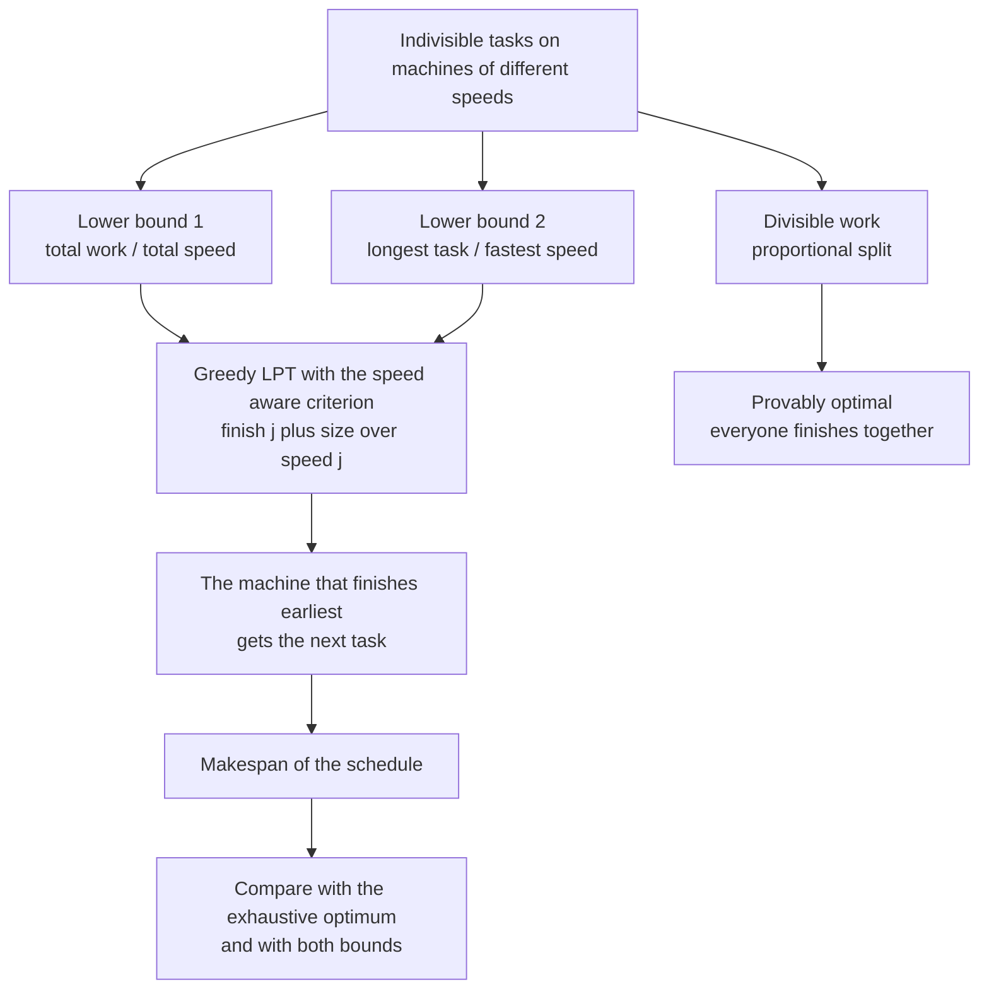
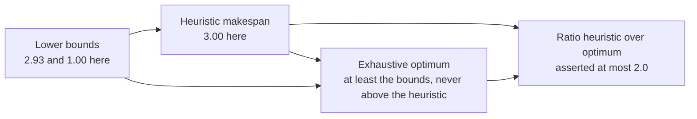
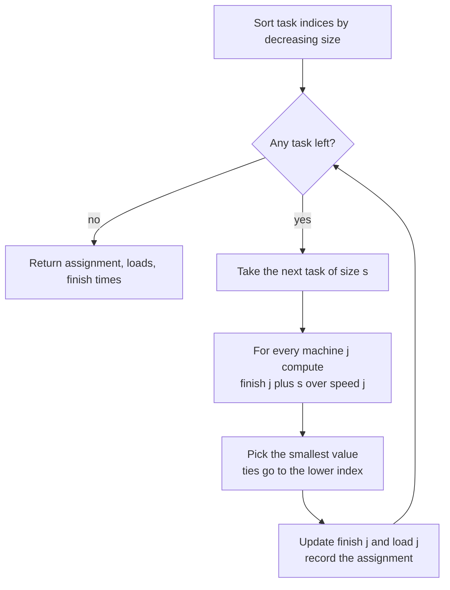
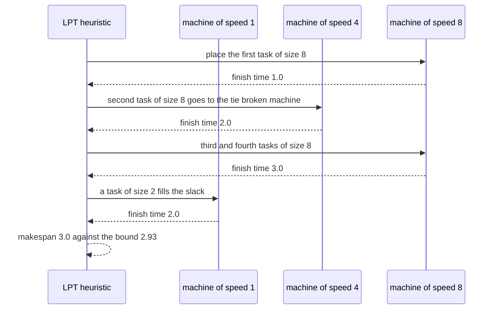

# 700 — Implement work partitioning heuristics for heterogeneous clusters

> **Tier:** Expert · **CTCI chapter:** Ch 9 — System Design and Scalability
> **Task spec:** [700-implement-work-partitioning-heuristics-for-heterogeneous-cluster.md](../../../tasks/expert/700-implement-work-partitioning-heuristics-for-heterogeneous-cluster.md)
> **Solutions:** [Python](../../../solutions/python/expert/700-implement-work-partitioning-heuristics-for-heterogeneous-cluster/solution.py) ·
> [Java](../../../solutions/java/expert/700-implement-work-partitioning-heuristics-for-heterogeneous-cluster/Solution.java) ·
> [JavaScript](../../../solutions/javascript/expert/700-implement-work-partitioning-heuristics-for-heterogeneous-cluster/solution.js) ·
> [C#](../../../solutions/csharp/expert/700-implement-work-partitioning-heuristics-for-heterogeneous-cluster/Solution.cs)

## 1. Problem restatement

Given `n` indivisible tasks with sizes and `m` machines with different throughputs (size units per
second), choose an assignment minimising the **makespan** `max_j (load_j / speed_j)`. The solutions
implement the heuristics a real scheduler uses and check them against the **true optimum** and against
two universal lower bounds.

| Function (Python) | Meaning |
| --- | --- |
| `makespan(assignment, tasks, speeds)` | `max_j` of the machine's assigned size over its speed |
| `list_schedule(tasks, speeds)` | LPT with the speed-aware criterion `finish[j] + size/speed[j]` |
| `proportional_split(work, speeds)` | divisible work: share `work * speed_j / total_speed` |
| `chunked_split(work, speeds, chunk)` | the proportional split quantised to whole chunks |
| `brute_force_optimum(tasks, speeds)` | every one of the `m^n` assignments — the oracle |
| `lower_bounds(tasks, speeds)` | `total_work / total_speed` and `max_task / max_speed` |
| `make_prng(seed)` + `generate_instance` | splitmix64, so every reported ratio is reproducible |

The other solutions add the neighbouring strategies: Java implements LIST (arrival order),
LPT, ROUND-ROBIN and a SPEED-PROPORTIONAL target-load rule; JavaScript implements roundRobin,
listSchedule, lptSchedule, a speed-aware `minMax` and a `fluid` divisible reference; C# adds
GreedyInOrder, RoundRobin and an `Improved` pairwise-exchange pass over the LPT assignment.

Concrete results the checks assert:

- `makespan([0, 0, 1, 1], [4, 3, 4, 3], [1, 1]) == 7.0` — the hand-checked instance.
- `proportional_split(120, [1, 2, 3])` gives shares `[20, 40, 60]` and **every machine finishes at
  exactly `20.0`**, which equals the lower bound `total_work / total_speed`.
- `lower_bounds([4, 4, 3, 3], [1, 1])[0] == 7.0` and `lower_bounds([20, 1], [4, 1])[1] == 5.0`.
- Over 40 generated heterogeneous instances (6–7 tasks, 3–4 machines): the heuristic never beats the
  exhaustive optimum, the optimum is strictly better in at least one instance, and the speed-aware ratio
  stays within `2.0`.
- Over 30 identical-machine instances (8 tasks, 3 machines of speed 1): LPT stays inside the classical
  `(4/3 - 1/(3m)) * optimum` bound.
- `[40, 1, 1, 1]` on `[4, 2, 2, 1]`: makespan exactly `10.0`, which *is* the longest-task lower bound,
  and the giant task lands on the fastest machine.
- `[8, 8, 8, 8, 4, 4, 2, 2]` on `[1, 2, 4, 8]`: the fastest machine carries more work than the slowest
  one, and the finish times differ by less than the work bound.
- `chunked_split` allocates exactly `1000, 1013, 17, 3` units for those inputs with chunk `10`.

## 2. Intuition

If the work were butter, the answer would be trivial: give machine `j` the fraction
`speed_j / sum(speeds)` of it and every machine stops at the same instant, `total_work / total_speed`.
That value is a hard lower bound for *any* schedule, divisible or not, and the second bound
`max_task / max_speed` says a single enormous task cannot be finished any faster than by running it
whole on the fastest machine.

The whole difficulty is that tasks are **indivisible**. Two rules follow from the bounds:

- Sort the tasks **largest first** and give each to the machine that would finish it earliest. Placing
  the big tasks while the machines are still empty is what keeps the final gap small; that is
  longest-processing-time-first, and on identical machines it is provably within
  `4/3 - 1/(3m)` of the optimum.
- The criterion must be **time, not load**. A machine that is twice as fast should be given twice the
  work, so `finish[j] + size / speed[j]` — not `load[j] + size` — is the right number to minimise.
  Solving the same instance with a load-based rule is the classic `2x` failure the JavaScript header
  calls out, and its `minMax` rule is the fix.



The two quantities that make the comparison meaningful are the bounds, and the checks verify that
neither the heuristics nor the true optimum ever dip below them:



## 3. Algorithm

1. Compute the lower bounds: `total_work / total_speed` and `max_task / max_speed`.
2. Sort the task indices by **decreasing** size.
3. Keep `finish[j]`, the completion time of the work already assigned to machine `j`, and `load[j]`, the
   size assigned to it (needed only for reporting).
4. For each task in that order, pick the machine minimising `finish[j] + size / speed[j]`, breaking ties
   by the smaller machine index so the schedule is deterministic.
5. Update `finish[machine] += size / speed[machine]` and `load[machine] += size`; record the assignment.
6. The makespan is `max(finish)`. Compare it against `brute_force_optimum` (enumerate all `m^n`
   assignments) and against both bounds.
7. For divisible work, skip the loop entirely: `share_j = work * speed_j / total_speed`, and the finish
   time of every machine is `work / total_speed`.
8. Quantised version: `count_j = floor(share_j / chunk)`, put the leftover on the fastest machine, and
   subtract the unused tail of its last chunk so the assigned sizes still sum to `work`.

```text
procedure list_schedule(tasks, speeds)
    order ← task indices sorted by decreasing size
    finish ← zeros of length m
    load ← zeros of length m
    assignment ← array of length n
    for index in order do
        machine ← the j minimising (finish[j] + tasks[index] / speeds[j], j)
        finish[machine] ← finish[machine] + tasks[index] / speeds[machine]
        load[machine] ← load[machine] + tasks[index]
        assignment[index] ← machine
    return assignment, load, finish
end

procedure brute_force_optimum(tasks, speeds)
    best ← none
    for code ← 0 to m^n - 1 do
        assignment ← the mixed radix digits of code base m
        span ← makespan(assignment, tasks, speeds)
        if best is none or span < best then best ← span
    return best
end

procedure proportional_split(work, speeds)
    total_speed ← sum(speeds)
    shares ← [work * speed / total_speed for each speed]
    make ← [share / speed for each share and speed]
    return shares, make
end

procedure chunked_split(work, speeds, chunk)
    shares ← proportional_split(work, speeds)
    counts ← [floor(share / chunk) for each share]
    leftover ← work - sum(counts) * chunk
    fastest ← index of the maximum speed
    counts[fastest] ← counts[fastest] + ceil(leftover / chunk)
    load ← [count * chunk for each count]
    load[fastest] ← load[fastest] - (sum(load) - work)
    return load
end
```



## 4. Worked example

Two traces, both taken from instances the checks assert.

**Hand-checked instance `tasks = [4, 3, 4, 3]`, `speeds = [1, 1]`.** The assignment
`[0, 0, 1, 1]` puts `4 + 3 = 7` on each machine, so `makespan = 7.0`, and the work bound
`14 / 2 = 7.0` is attained: on two equal machines this greedy cannot do better.

**Heterogeneous instance `tasks = [8, 8, 8, 8, 4, 4, 2, 2]`, `speeds = [1, 2, 4, 8]`.** LPT processes
the four 8s first, then the 4s, then the 2s; each row shows the candidate value
`finish[j] + size / speed[j]` for the four machines.

| Task size | Candidates for machines of speed 1, 2, 4, 8 | Chosen | `finish` after |
| --- | --- | --- | --- |
| 8 | `8.00, 4.00, 2.00, 1.00` | machine 3 | `0, 0, 0, 1` |
| 8 | `8.00, 4.00, 2.00, 2.00` | machine 2 (tie on `2.00`, lower index) | `0, 0, 2, 1` |
| 8 | `8.00, 4.00, 4.00, 2.00` | machine 3 | `0, 0, 2, 2` |
| 8 | `8.00, 4.00, 4.00, 3.00` | machine 3 | `0, 0, 2, 3` |
| 4 | `4.00, 2.00, 3.00, 3.50` | machine 1 | `0, 2, 2, 3` |
| 4 | `4.00, 4.00, 3.00, 3.50` | machine 2 | `0, 2, 3, 3` |
| 2 | `2.00, 3.00, 3.50, 3.25` | machine 0 | `2, 2, 3, 3` |
| 2 | `4.00, 3.00, 3.50, 3.25` | machine 1 | `2, 3, 3, 3` |

Final loads are `[2, 6, 12, 24]` and the makespan is `3.0`; the work bound is `44 / 15 ≈ 2.933`, the
task bound is `8 / 8 = 1.0`. The fastest machine carries `24` units against `2` on the slowest — the
speed-aware criterion really does hand out work in proportion to speed, and the finish times differ by
`1.0`, less than the work bound, exactly as the solution asserts.



**Divisible work.** `proportional_split(1000, [1, 3, 4])` gives shares `[125, 375, 500]` and every
machine finishes at `125`, the lower bound itself. With `chunk = 10`, `counts = [12, 37, 50]` allocate
`990` units, so the leftover `10` goes to the fastest machine as one chunk: loads `[120, 370, 510]`,
finishing at `120`, `123.33` and `127.5` — an extra `2.5` time units over the optimum, bounded by one
chunk on the slowest machine (`10 / 1 = 10`). At `work = 17` the same rule gives `counts = [0, 0, 2]`
and a load of `20` on the fastest machine, corrected down by the unused tail to exactly `17`.

## 5. Complexity

| Strategy | Time | Space | Guarantee |
| --- | --- | --- | --- |
| `list_schedule` (LPT, speed-aware) | `O(n log n + n m)` | `O(n + m)` | `4/3 - 1/(3m)` on identical machines; within `2.0` on the generated heterogeneous instances |
| LIST (arrival order) | `O(n m)` | `O(n + m)` | `2 - 1/m` on identical machines (Java header) |
| Round robin | `O(n)` | `O(n + m)` | none — it distributes jobs, not work, and the checks show it violating the bound |
| Pairwise exchange (`Improved`) | `O(n² m)` after LPT | `O(n + m)` | never worse than LPT; it only accepts improvements |
| Divisible proportional split | `O(m)` | `O(m)` | **optimal**: finish time `work / total_speed` |
| Chunked split | `O(m)` | `O(m)` | within one chunk of the optimum on the slowest machine |
| `brute_force_optimum` | `O(m^n)` | `O(n)` | exact, only for the small instances (`3^8` in C#) |
| Lower bounds | `O(n)` | `O(1)` | no schedule can beat them |

The greedy is linear in the number of machines per task because the criterion is a minimum, and the
`n log n` term is the decreasing-size sort that makes it LPT. Speed scaling is linear: doubling every
speed halves the makespan of the same assignment, which the C# checks assert.

## 6. Pitfalls and edge cases

- **The criterion must be time, not load.** A load-based rule gives the slow machine the same work as
  the fast one; the JavaScript solution demonstrates the classic `2x` failure of plain LPT on a
  heterogeneous cluster and the `minMax` rule that avoids it.
- **Ties and determinism.** `min(..., key=lambda j: (finish[j] + size/speed[j], j))` breaks ties by
  machine index, which is what makes the reported ratios reproducible; reversing it would silently
  return a different schedule.
- **A dominant task fixes the makespan.** `[40, 1, 1, 1]` on `[4, 2, 2, 1]` ends at exactly `10.0`, the
  longest-task bound `40 / 4`; no heuristic can improve on it, and the check asserts that equality.
- **LPT is not optimal.** In at least one of the 40 generated instances the exhaustive optimum is
  strictly better; the tests assert both directions (`span >= optimum` and `optimum <= span`) so a
  heuristic can never be claimed better than it is.
- **Round robin is a baseline, not a strategy.** It ignores both size and speed; distributing *jobs*
  evenly is not distributing *work* evenly.
- **Empty and degenerate inputs** — no tasks, a single machine, zero-size tasks, a single task — must
  all return a valid assignment; the JavaScript header lists them as separately checked cases.
- **Invalid input is rejected**, not repaired: C# refuses an empty machine list, a non-positive speed or
  a negative weight.
- **Indivisibility has a price, and it can be measured.** The gap between the heuristic makespan and the
  divisible bound is what the fluid reference is for; many small tasks shrink it, which is why real
  systems batch work into fine chunks.
- **Chunk quantisation must not lose or invent work.** The fastest machine's last chunk is only partly
  used, so its load is corrected by `sum(load) - work`; the checks assert the total is exact for
  `1000, 1013, 17, 3` units.
- **Exhaustive enumeration is only an oracle.** `m^n` explodes; it is used with 6–8 tasks and 3–4
  machines, and JavaScript replaces it with branch and bound for the same reason.

## 7. Variants and follow-ups

- **Preemption and divisible loads.** If a task may be cut anywhere, the proportional split is optimal
  and the scheduling problem disappears; the interesting residue is the quantisation cost, which the
  chunked split models. Scanning the resulting chunks in parallel is what
  [699 — GPU-style parallel prefix sum](../../../tasks/expert/699-implement-gpu-style-parallel-prefix-sum-algorithm-simulation.md)
  does with an explicit block structure.
- **Iterative workloads.** When the machines produce more work as they go (solvers, search), static
  partitioning fails and work stealing or dynamic chunking takes over; the Krylov iterations in
  [697 — CG with preconditioning](../../../tasks/expert/697-implement-iterative-linear-solver-cg-with-preconditioning-demo.md)
  and the level hierarchy of
  [698 — multigrid for Poisson](../../../tasks/expert/698-implement-multigrid-method-outline-for-poisson-equation-small-gr.md)
  are exactly the shapes whose per-machine cost differs by level.
- **Better assignments than LPT.** Local search (the C# pairwise exchange), LPT followed by a
  rebalancing pass, or an LP/rounding argument all shrink the gap without giving up the greedy skeleton.
- **Real schedulers add constraints.** Data locality, heterogeneous task requirements, failures,
  preemption and unknown sizes all break the clean model; the headers of the solutions list the ones
  they deliberately drop (independent tasks, known sizes, uniform machines, no failures).

## 8. Check yourself

<details><summary>Show answer</summary>

**1. Why is `total_work / total_speed` a valid lower bound even for indivisible tasks?**

Summing the machine times gives `sum_j load_j / speed_j`; by the speed-weighted harmonic argument the
minimum of that sum over all divisions of a fixed total is attained when every machine finishes at the
same time, namely `total_work / total_speed`. Removing the indivisibility only relaxes the problem, so
the bound holds for every schedule — which is why the checks assert it for the heuristics, the brute-force
optimum and the proportional split alike.

</details>

<details><summary>Show answer</summary>

**2. What exactly does the speed-aware LPT criterion minimise, and what happens if you use load instead?**

`finish[j] + size / speed[j]`, the completion time the machine would have if it took this task — so a
machine that is twice as fast is offered roughly twice the work. Using `load[j] + size` ignores speed and
hands equal sizes to unequal machines, giving the classic `2x` blow-up that the JavaScript `minMax`
comparison is written to expose.

</details>

<details><summary>Show answer</summary>

**3. In the `[1, 2, 4, 8]` trace, why does the fastest machine end with load 24 while the slowest has 2?**

Because the criterion is a *time*, not a size: adding 8 to the speed-8 machine costs `1.0` time unit,
while adding it to the speed-1 machine would cost `8.0`. The greedy keeps the completion times close
(`2, 3, 3, 3`) and therefore accepts a very uneven load. The final finish times differ by `1.0`, below
the work bound `2.93`, which is the property the check asserts.

</details>

<details><summary>Show answer</summary>

**4. When is LPT not good enough, and what bounds it in each regime?**

On identical machines LPT is within `4/3 - 1/(3m)` of the optimum, and plain list scheduling within
`2 - 1/m`; round robin has no such guarantee. On heterogeneous machines the ratio can reach `2x` unless
the criterion accounts for speed. Beyond those bounds the honest answer is "run the exhaustive or
branch-and-bound optimum on small instances", which is what all four solutions do to certify their
heuristics.

</details>

<details><summary>Show answer</summary>

**5. What is the cost of quantising the divisible split into chunks of size 10?**

At most one extra chunk per machine, i.e. at most `chunk / min_speed` extra time. For
`proportional_split(1000, [1, 3, 4])` the exact optimum finishes at `125`; the chunked load
`[120, 370, 510]` finishes at `127.5`, an overhead of `2.5` against the worst case of `10 / 1 = 10`.
Smaller chunks shrink the overhead but increase the number of scheduling decisions.

</details>
