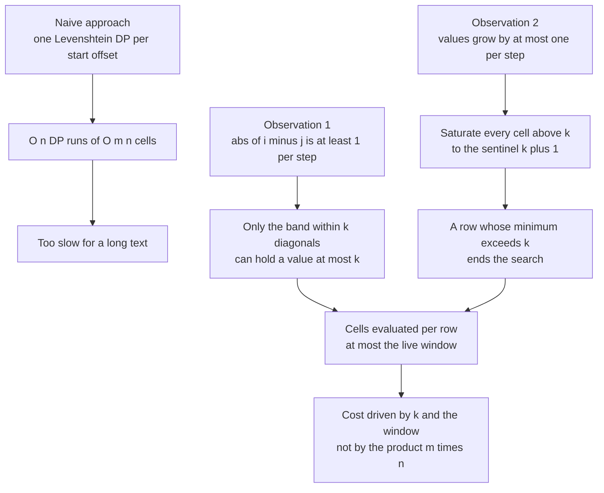
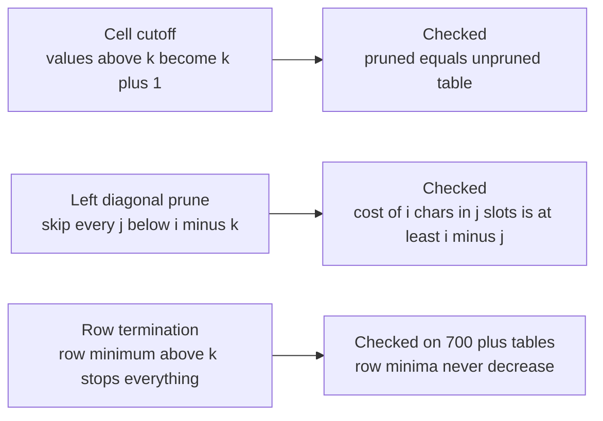
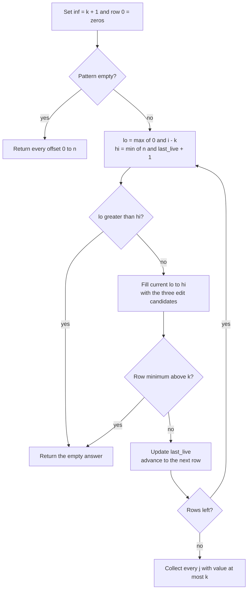
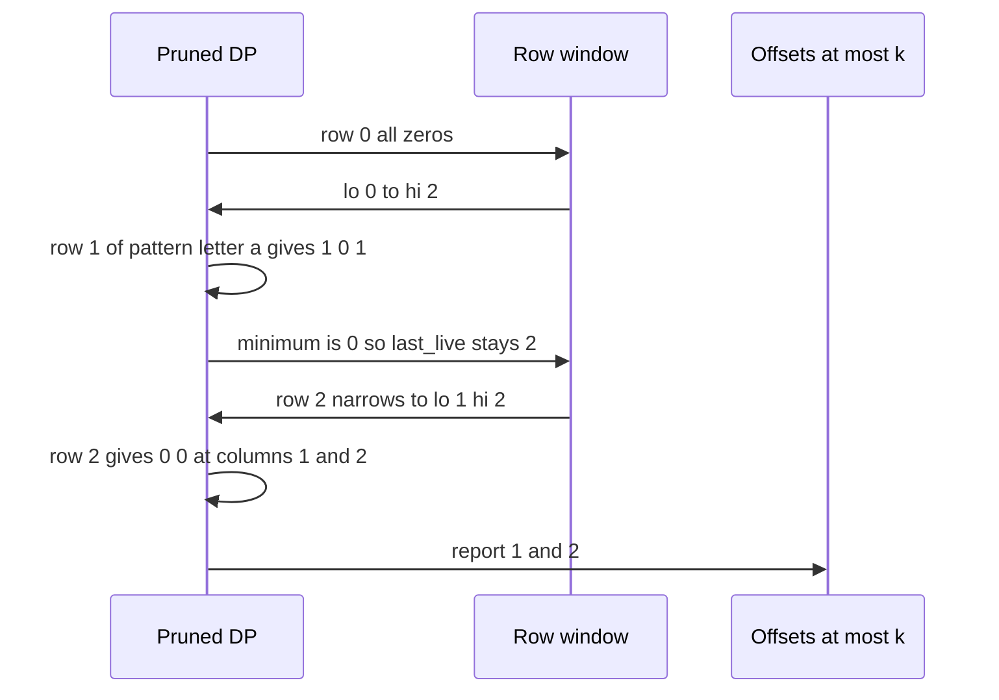

# 701 — Implement approximate string matching with edit distance threshold using Ukkonen

> **Tier:** Expert · **CTCI chapter:** Beyond — Advanced Data Structures & Algorithms
> **Task spec:** [701-implement-approximate-string-matching-with-edit-distance-thresho.md](../../../tasks/expert/701-implement-approximate-string-matching-with-edit-distance-thresho.md)
> **Solutions:** [Python](../../../solutions/python/expert/701-implement-approximate-string-matching-with-edit-distance-thresho/solution.py) ·
> [Java](../../../solutions/java/expert/701-implement-approximate-string-matching-with-edit-distance-thresho/Solution.java) ·
> [JavaScript](../../../solutions/javascript/expert/701-implement-approximate-string-matching-with-edit-distance-thresho/solution.js) ·
> [C#](../../../solutions/csharp/expert/701-implement-approximate-string-matching-with-edit-distance-thresho/Solution.cs)

## 1. Problem restatement

Report every end offset `j` (0-based, exclusive) such that **some** substring `T[s:j]` of the text is
within `k` edits of the pattern, i.e. every `j` with
`D[m][j] = min over s of edit_distance(P, T[s:j]) <= k`. The match may start anywhere, so the text
before it is free — this is the *Sellers* recurrence `D[0][j] = 0`, `D[i][0] = i`, and

```text
D[i][j] = min(D[i-1][j] + 1, D[i][j-1] + 1, D[i-1][j-1] + (P[i-1] != T[j-1]))
```

The unpruned table is `(m+1) x (n+1)` cells; Ukkonen's cutoffs make it far cheaper:

| Cutoff | Rule |
| --- | --- |
| cell cutoff | every value above `k` is stored as the sentinel `inf = k + 1`, because a cell `> k` can only feed successors that are also `> k` |
| left diagonal prune | matching `i` pattern characters inside `j` text characters costs at least `abs(i - j)`, so every `j < i - k` is never evaluated |
| row termination | the row minima `min_j D[i][j]` are non-decreasing in `i`; the first row whose minimum exceeds `k` proves row `m` has no value `<= k`, and the search stops with an empty answer |
| right window edge | a `<= k` cell of row `i+1` needs a `<= k` cell of row `i` to its left or directly above, so the live window can advance at most one column per row |

Concrete results the checks assert (all of them hand-verified in the Python solution):

- `("a", "a", 0) -> [1]`, `("ab", "ab", 1) -> [1, 2]`, `("abc", "abcabc", 0) -> [3, 6]`,
  `("abc", "abcabc", 1) -> [2, 3, 4, 5, 6]`, `("aa", "aaa", 1) -> [1, 2, 3]`,
  `("abcd", "bcd", 1) -> [3]`, `("xyz", "abcd", 2) -> []`.
- `k = 0` degenerates to exact substring search: `"the"` in `"the theory of thermometers"` returns
  exactly the offsets where `text.startswith("the", i)`.
- On 90 random two-letter instances (`m < 5`, `n < 7`, `k` in `0..2`) and 80 random three-letter
  instances (`m` in `1..6`, `n < 9`, `k` in `0..3`) the pruned run equals the **unpruned** full-table
  run and the brute-force oracle that tries every start with a textbook Levenshtein DP.
- Exhaustive sweep over `>= 700` full tables (alphabet `ab`, `m < 4`, `n < 5`, `k` in `0..2`) confirms
  the row minima are non-decreasing.
- The absent pattern `"Ω" * 30` in `"g" * 400` with `k = 2` terminates after at most `k + 1 = 3` rows
  and evaluates fewer than `1/5` of the `31 * 401 = 12431` full-table cells.
- `"gattaca"` in `"g" * 400` with `k = 2` terminates at row 4 — three substitutions have blown the
  budget. `"abc"` in `"abc" * 100` with `k = 1` does **not** terminate and reports 299 offsets, the
  first being `2`.
- Boundaries: empty pattern and empty text `-> [0]`; empty pattern in `"abc"` `-> [0, 1, 2, 3]`;
  `"abc"` in `""` with `k = 2` `-> []`; `"ab"` in `""` with `k = 2` `-> [0]`; `"aaaa"` in `"aa"` with
  `k = 2` `-> [2]`; `"abc"` in `"xyz"` with `k = 3` `-> [0, 1, 2, 3]`; a negative `k` raises.

## 2. Intuition

The naive answer is to run a Levenshtein DP for every start offset `s`, which is
`O(n)` DP runs of `O(m n)` cells each. Two structural facts collapse that.

First, a match with at most `k` edits aligns the pattern against a text window whose length lies in
`[m - k, m + k]`: you cannot absorb more than `k` insertions or `k` deletions. So a window can only
start in a narrow range relative to its end, and the DP values that matter live in the band
`abs(i - j) <= k` of the edit graph — everything outside the band costs more than `k` by the simple
argument `edit distance >= abs(i - j)`.

Second, distance values only grow by one per step, so "more than `k`" is a **terminal** state for
pruning: a cell above `k` can only produce successors above `k`. Once a whole row is above `k`, and
because the row minima never decrease, no later row can be `<= k` and the search is over.



The three cutoffs in one picture — each one is a proof obligation, and each one is checked:



## 3. Algorithm

1. Reject a negative threshold; set `inf = k + 1`.
2. Row 0 is all zeros — a match may start at any column, and the text before it is free. Track
   `last_live`, the rightmost column of the previous row whose value is `<= k` (initially `n`).
3. If the pattern is empty, every offset matches at cost 0: return `[0 .. n]`.
4. For each pattern row `i` from `1` to `m`:
   - `lo = max(0, i - k)` (left diagonal prune), `hi = min(n, last_live + 1)` (window edge).
   - If `lo > hi`, no cell of this row can be `<= k`: report termination and return `[]`.
   - Fill `current[j]` for `j` in `[lo, hi]` with the recurrence; `j == 0` gets `D[i][0] = i`; the insert
     candidate `current[j-1] + 1` is skipped when `j - 1 < lo`; any value above `inf` is clamped.
   - Count each evaluated cell in `stats["cells"]`.
   - If the row minimum exceeds `k`, terminate and return `[]`.
   - Otherwise recompute `last_live` as the rightmost `j` with `current[j] <= k` and move on.
5. After row `m`, the answer is every `j` in `[lo, hi]` with `D[m][j] <= k` — sorted, unique and in
   range by construction.

```text
procedure sellers_matches(pattern, text, k)
    if k < 0 then raise "threshold must be non-negative"
    m ← length(pattern)
    n ← length(text)
    inf ← k + 1
    if m = 0 then return [0 .. n]
    previous ← zeros of length n + 1        // D[0][j] = 0 for every j
    last_live ← n
    for i ← 1 to m do
        lo ← max(0, i - k)                  // left diagonal prune
        hi ← min(n, last_live + 1)          // right window edge
        if lo > hi then return []           // no cell of this row can be at most k
        current ← vector of inf of length n + 1
        for j ← lo to hi do
            if j = 0 then value ← i         // D[i][0] = i
            else
                value ← inf
                if previous[j] < inf then value ← min(value, previous[j] + 1)      // delete
                if j - 1 >= lo then value ← min(value, current[j - 1] + 1)          // insert
                if previous[j - 1] < inf then
                    value ← min(value, previous[j - 1] + (pattern[i-1] != text[j-1]))
                value ← min(value, inf)     // cell cutoff
            current[j] ← value
        if min(current[lo .. hi]) > k then return []     // row termination
        last_live ← the largest j with current[j] <= k
        previous ← current
    return every j in [lo .. hi] with previous[j] <= k
end
```



The four solutions instantiate this differently, and the differences are documented in their headers:
Python runs the pruned free-start recurrence with the row window; Java runs the banded recurrence on a
window of `min(n - s, m + k)` characters **per candidate start** (at most `2k + 1` windows per end) and
keeps an *unsound* free-start cutoff variant so the checks can exhibit the occurrence it misses
(`"abc"` in `"xabcx"` with `k = 0`); JavaScript runs the banded DP on the at-most-`2k + 1` candidate
windows ending at each position and cross-checks it against a bit-parallel `k`-error automaton and an
exhaustive `O(n^2 m^2)` scan; C# keeps the furthest-reaching diagonal band
`X[e][d] =` the furthest text index reachable on diagonal `d` with at most `e` differences, working in
`O(k (n + m))` band states.

## 4. Worked example

Pattern `"ab"`, text `"ab"`, `k = 1`, so `inf = 2`. Row 0 is `[0, 0, 0]` and `last_live = 2`.

**Row 1** (`pattern[0] = 'a'`): `lo = max(0, 1 - 1) = 0`, `hi = min(2, 2 + 1) = 2`.

| `j` | delete `D[0][j] + 1` | insert `current[j-1] + 1` | match `D[0][j-1] + cost` | `current[j]` |
| --- | --- | --- | --- | --- |
| 0 | — | — | — | `1` (`D[1][0] = 1`) |
| 1 | `0 + 1 = 1` | `1 + 1 = 2` | `0 + 0 = 0` | `0` |
| 2 | `0 + 1 = 1` | `0 + 1 = 1` | `0 + 1 = 1` | `1` |

Row minimum `0 <= k`, so the run continues; `last_live = 2` (the rightmost cell `<= 1`).

**Row 2** (`pattern[1] = 'b'`): `lo = max(0, 2 - 1) = 1` — column 0 is pruned, `hi = min(2, 3) = 2`.

| `j` | delete `D[1][j] + 1` | insert `current[j-1] + 1` | match `D[1][j-1] + cost` | `current[j]` |
| --- | --- | --- | --- | --- |
| 1 | `0 + 1 = 1` | skipped (`j - 1 < lo`) | `0 + 0 = 0` | `0` |
| 2 | `1 + 1 = 2` | `0 + 1 = 1` | `0 + 0 = 0` | `0` |

The final row over `[1, 2]` is `[0, 0]`, so the answer is `[1, 2]` — the curated expectation.



**Termination in practice.** Pattern `"gattaca"` in `"g" * 400` with `k = 2`: row 1 matches the leading
`g` at cost 0, but every following pattern letter diverges from the homopolymer, so the row minima walk
`0, 1, 2, 3` and the run stops at **row 4** — one row after the budget `k = 2` is exceeded. For the
absent pattern `"Ω" * 30` in the same text the cut fires after `k + 1 = 3` rows, and the measured work is
under a fifth of the `31 * 401 = 12431` cells of the full table.

## 5. Complexity

| Variant | Time | Space | Note |
| --- | --- | --- | --- |
| Full Sellers table (no pruning) | `O(m n)` | `O(n)` rolling rows | the oracle the pruned runs must equal |
| Brute force over all starts | `O(n² m)` | `O(n)` | Java/JavaScript keep it as a third oracle |
| Python: pruned free-start DP | window cells plus early termination, measured in `stats["cells"]` | `O(n)` | asserted to be strictly fewer cells than the full table, `< 1/5` on the terminated case |
| Java: banded windows per start | `O(n k (m + k))` worst case, at most `2k + 1` cells per row | `O(m + k)` | the classical band bound; window length is at most `m + k` |
| C#: furthest-reaching diagonal band | `O(k (n + m))` band states | `O(k (n + m))` | the `X[e][d]` formulation |
| JavaScript: banded windows per end | `O(k m)` per window, `2k + 1` windows | `O(m)` | cross-checked against a bit-parallel automaton |
| Empty pattern | `O(n)` | `O(n)` | every offset matches at cost 0 |

The reason each bound holds: the band contains at most `2k + 1` diagonals per column, so a row costs
`O(k)` cells; the row-minimum cutoff removes the tail of the table once no cell can be `<= k`; and the
left diagonal prune removes `i - k` leading columns of row `i`. The Python header is explicit that it
implements the *measured* window cost rather than the textbook `O(n k)` band: what is verified is that
the pruning changes no answer.

## 6. Pitfalls and edge cases

- **The band is only sound relative to the right origin.** Java documents this precisely: laying an
  anchored band over the free-start recurrence is unsound, and the file keeps the broken variant to show
  it missing the exact occurrence of `"abc"` in `"xabcx"` at `k = 0` — row 1 saturates on the leading
  `x` while an exact occurrence follows.
- **Do not claim cell-wise monotonicity.** `D[i][j] <= D[i+1][j]` is **false** (the classic counterexample
  is `"kitten"` vs `"sitting"`); what holds, and what the termination needs, is that
  `min_j D[i][j] <= min_j D[i+1][j]`.
- **A cell exactly at `k` must survive.** Saturating "above `k`" is right; saturating "at or above `k`"
  silently drops matches, which is why the curated case `("aa", "aaa", 1) -> [1, 2, 3]` is checked.
- **`D[i][0] = i` is not a formality.** It encodes deleting `i` pattern characters before the text
  begins; discarding it breaks cases such as `("ab", "", 2) -> [0]`.
- **The insert candidate must respect `lo`.** Inside a pruned row, `current[j-1]` may not have been
  computed; the solutions guard it with `j - 1 >= lo`.
- **Negative or non-integer `k`** is rejected (`ValueError` in Python, `RangeError` in JavaScript,
  `assertThreshold`/`assert` elsewhere) instead of being coerced to 0.
- **Empty pattern** matches at every offset with cost 0 — `[0]` for an empty text, `[0, 1, 2, 3]` for
  `"abc"` — because the free-start recurrence gives `D[0][j] = 0` for all `j`.
- **Pattern longer than the text** needs `k >= m - n`: `"aaaa"` in `"aa"` with `k = 2` reports `[2]`,
  while `"abc"` in `""` with `k = 2` reports nothing.
- **The reported offsets must be sorted, unique and in range**; the free-start recurrence produces each
  end offset once, and the checks assert `hits == sorted(set(hits))`.
- **A successful search must not terminate early**: `"abc"` in `"abc" * 100` with `k = 1` asserts
  `stats["terminated"]` is false and that all 299 offsets from `2` upwards are reported.

## 7. Variants and follow-ups

- **Bit-parallel `k`-error automaton.** Myers'/Wu-Manber encode the band in machine words and run it in
  `O(n * ceil(m / w))`, which is why JavaScript cross-checks its DP against that formulation; the free
  start is supplied by shifting a `1` into bit 0 at every step.
- **Furthest-reaching diagonals.** C#'s `X[e][d]` representation skips long exact-match runs with a
  direct character scan, which is the standard way to get the band below `O(n k)` on similar strings.
- **Other distance models.** Hamming distance with a length constraint drops the insert/delete branches
  and the band becomes a simple sliding comparison; weighted edit distance changes which cutoffs are
  admissible.
- **Index-backed approximate search.** Inside a full-text index the same band is applied over suffix
  array intervals instead of the raw text — see
  [604 — compressed suffix array](../../../tasks/expert/604-implement-compressed-suffix-array-csa-advanced.md)
  and [608 — BWT-based full-text index with fast locate](../../../tasks/expert/608-implement-bwt-based-full-text-index-with-fast-locate.md).
- **Many patterns at once.** Extending the band to a trie of patterns (or an Aho-Corasick automaton
  with an edit budget) is the dictionary version of this task; the per-row cutoffs stay the same.

## 8. Check yourself

<details><summary>Show answer</summary>

**1. Why can a cell with `abs(i - j) > k` never be part of a match?**

`i` pattern characters must be aligned with `j` text characters, and each misalignment costs at least
one edit, so the distance is at least `abs(i - j)`. Any alignment using such a cell is already over
budget, which is exactly the left diagonal prune `j >= i - k`.

</details>

<details><summary>Show answer</summary>

**2. What makes the row-minimum cutoff valid, and what weaker claim is false?**

Row minima are non-decreasing in `i`: deleting the last pattern character from an optimal alignment of
`P[0..i+1)` against a text suffix leaves an alignment of `P[0..i)` that is no more expensive
(the Python header spells out this argument). Hence if `min_j D[i][j] > k`, every value of every later
row is `> k` and the search is provably empty. The false claim is the *cell-wise* version
`D[i][j] <= D[i+1][j]`, disproved by `"kitten"` vs `"sitting"`.

</details>

<details><summary>Show answer</summary>

**3. Trace `("ab", "ab", 1)` by hand and say where the pruning bites.**

Row 0 is `[0, 0, 0]`. Row 1 with `lo = 0` gives `[1, 0, 1]`; row 2 with `lo = 1` skips column 0 and
gives `[_, 0, 0]` over columns 1 and 2. The answer is `[1, 2]`. The pruning bites in row 2, where the
column that would need two pattern characters before one text character is never evaluated because its
cost is already above `k`.

</details>

<details><summary>Show answer</summary>

**4. Why does the Python solution measure cells instead of quoting the textbook `O(n k)` bound?**

Because it deliberately omits two of Ukkonen's accelerations — the diagonal/streaming formulation and
the bit-parallel inner loop — so its real cost is the window cells plus early termination, which depends
on the data. The header says exactly that, and the verification focuses on the property that matters:
the pruning preserves every answer (pruned == unpruned == brute force on 170 random instances).

</details>

<details><summary>Show answer</summary>

**5. When does the search finish in a couple of rows instead of scanning the text?**

When the pattern diverges from the text faster than the budget allows: `"gattaca"` in `"g" * 400` dies at
row 4 with `k = 2` (three substitutions), and the absent `"Ω" * 30` pattern dies after `k + 1 = 3` rows,
evaluating under a fifth of the full table's cells. If the pattern matches often the run cannot
terminate early — `"abc"` in `"abc" * 100` with `k = 1` reports all 299 offsets and asserts that the
cutoff did *not* fire.

</details>
