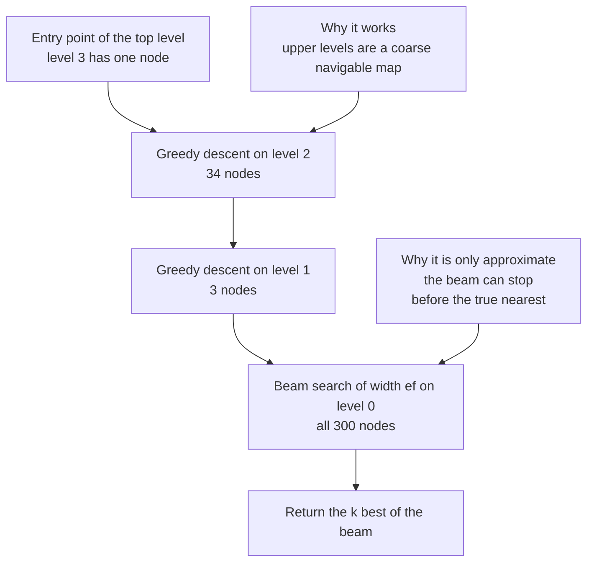
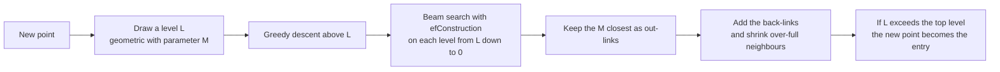
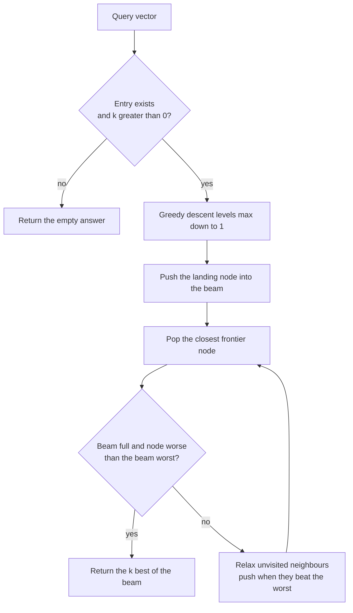
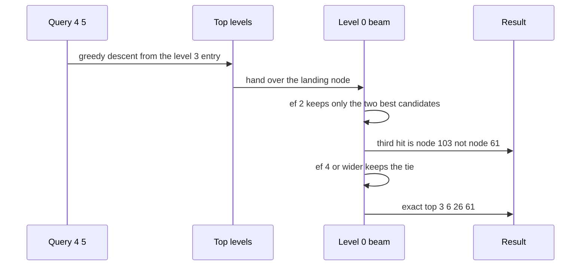

# 702 — Implement advanced approximate nearest neighbor via HNSW sketch

> **Tier:** Expert · **CTCI chapter:** Beyond — Advanced Data Structures & Algorithms
> **Task spec:** [702-implement-advanced-approximate-nearest-neighbor-via-hnsw-sketch.md](../../../tasks/expert/702-implement-advanced-approximate-nearest-neighbor-via-hnsw-sketch.md)
> **Solutions:** [Python](../../../solutions/python/expert/702-implement-advanced-approximate-nearest-neighbor-via-hnsw-sketch/solution.py) ·
> [Java](../../../solutions/java/expert/702-implement-advanced-approximate-nearest-neighbor-via-hnsw-sketch/Solution.java) ·
> [JavaScript](../../../solutions/javascript/expert/702-implement-advanced-approximate-nearest-neighbor-via-hnsw-sketch/solution.js) ·
> [C#](../../../solutions/csharp/expert/702-implement-advanced-approximate-nearest-neighbor-via-hnsw-sketch/Solution.cs)

## 1. Problem restatement

Index a set of vectors so that a top-`k` nearest-neighbour query costs far fewer than the `n` distance
evaluations a brute-force scan needs, while keeping the answer close to exact. The structure is HNSW
(Malkov & Yashunin): a stack of proximity graphs, each level a thinning of the one below.

| Piece (Python) | Definition |
| --- | --- |
| `squared_distance(a, b)` | integer squared Euclidean distance — the whole metric |
| `_draw_level()` | `floor(-ln(u) * mL)` with `mL = 1 / ln(M)` and `u` uniform in `(0, 1)` |
| `_greedy(vector, node, level)` | walk to the locally closest neighbour until no improvement |
| `_search_layer(vector, entries, ef, level)` | best-first beam search of width `ef`, returns `(distance, node)` sorted |
| `_shrink(node, level)` | prune a neighbour list to `2M` on level 0 and `M` above |
| `add(vector)` | draw a level, descend greedily, then connect on every level down to 0 |
| `search(vector, k, ef)` | greedy descent above level 0, then a beam of width `max(ef, k)` at level 0 |
| `brute_force(vector, k)` | the exact oracle |
| `recall_at_k(index, queries, k, ef)` | overlap of the beam answer with the oracle, averaged |

Concrete results the checks assert:

- Graph invariants after **every** insertion: no self loops, symmetric back-links, degree caps `2M = 16`
  on level 0 and `M = 8` above, a node present on layer `lev` exactly when `lev <= its level`, the entry
  point on the top level, `len(layers) == max_level + 1`, and level 0 **connected** by BFS from node 0.
- Self-queries are exact: querying the stored vector of a node returns that node first at distance `0`.
- On the tie-heavy instance (300 points, 2 dimensions, only 8 distinct coordinates per axis, 40 held-out
  queries) the measured recall@10 is `0.685` at `ef = 8`, `0.8875` at `ef = 16`, `1.0` at `ef = 32` and
  `1.0` at `ef = 200`; recall@1 at `ef = 16` is `1.0`. The checks assert the shape of that curve:
  `0.4 <= narrow <= 0.95`, non-decreasing in `ef`, and exactly `1.0` from `ef = 32` on.
- On well-spread data (250 points, 6 dimensions) recall@10 at `ef = 50` is `1.0`.
- Result shape: `min(k, n)` distinct, distance-ascending, in-range results for `k in (1, 3, 10, 120, 200)`;
  `k = 0` and `k = -3` return `[]`.
- Boundaries: an empty index returns `[]` (and the oracle agrees), a single point `[[5, 5]]` queried at
  `[0, 0]` returns distance `50 = 25 + 25`, and `[[0, 0], [0, 0], [1, 1]]` queried at `[0, 0]` returns
  both duplicates at distance `0` before the third point.
- Level thinning on a 300-point build: `[300, 34, 3, 1]` nodes at levels `0..3`, non-increasing, with
  `1 <= max_level <= 10`.

## 2. Intuition

Brute force is `n` distance evaluations for every query, accurate but hopeless past a few thousand
points. A plain proximity graph halves that but gets stuck in local minima; a skip list is fast but
cannot express "closest in a metric space". HNSW is the combination: the *upper* levels are a sparse
graph that behaves like a skip list — few nodes, long edges, used only to land near the answer — and
level 0 is a dense navigable graph where a beam search does the accurate work.

Every point is promoted to level `L` with probability `exp(-L / mL)`, i.e. geometrically thinning as
`M^-l`, so with `M = 8` roughly one point in eight survives to level 1 and one in sixty-four to level 2.
The search starts at the single entry point of the top level, moves greedily to a local minimum there,
drops a level, repeats, and only at level 0 spends a beam of width `ef`.



Insertion follows the same path in reverse: descend to the new point's own level, then on every level
from there down to 0 collect `efConstruction` candidates, link the `M` closest, and shrink every
neighbour that exceeds its degree cap. Shrinking is what keeps the graph navigable: an over-full
neighbour list turns the greedy walk into a scan.



## 3. Algorithm

**Insertion** `add(vector)`:

1. Append the vector, draw its level `L` from the geometric law, and create empty neighbour lists on
   layers `0 .. L` (creating the layers if needed).
2. If the index was empty, this point becomes the entry and the maximum level.
3. Otherwise start at the entry point and greedily descend from `max_level` down to `L + 1`, one step per
   level.
4. Then for each level `lev` from `min(L, max_level)` down to `0`: run `_search_layer` with `ef = ef_construction`,
   keep the `M` closest as the new point's neighbours, add the symmetric back-links and shrink each
   neighbour whose list exceeds its cap; continue the descent from the closest chosen neighbour.
5. If `L > max_level`, promote the new point to entry point and raise `max_level`.

**Search** `search(vector, k, ef)`:

1. Return `[]` for an empty index or `k <= 0`; otherwise use `max(ef, k)`.
2. Starting at the entry point, descend greedily from `max_level` down to level 1.
3. Run `_search_layer` with the beam at level 0 and return the first `k` entries.

**Beam search** `_search_layer(vector, entries, ef, level)`:

1. Mark the entry points visited; push them into a min-heap `frontier` and a bounded max-heap `beam`
   (storing `-distance` so the worst of the beam is on top).
2. Pop the closest frontier node. Stop when the beam is full and this node is farther than the beam's
   worst — nothing reachable from it can improve the answer.
3. For each unvisited neighbour: mark visited; if the beam is not full or the neighbour beats the beam's
   worst, push it into both heaps and trim the beam back to `ef`.
4. Return the beam as an ascending, tie-broken list of `(distance, node)`.

```text
procedure add(vector)
    node ← next identifier
    vectors[node] ← vector
    level ← floor(-ln(uniform in (0, 1)) / ln(m))
    create empty neighbour lists on layers 0 to level
    if entry is none then
        entry ← node
        max_level ← level
        return node
    current ← entry
    for lev ← max_level down to level + 1 do
        current ← greedy(vector, current, lev)
    for lev ← min(level, max_level) down to 0 do
        candidates ← search_layer(vector, [current], ef_construction, lev)
        chosen ← the m closest nodes of candidates
        neighbours[lev][node] ← chosen
        for each neighbour in chosen do
            neighbours[lev][neighbour].add(node)
            shrink(neighbour, lev)
        if chosen is not empty then current ← the closest of chosen
    if level > max_level then
        max_level ← level
        entry ← node
    return node
end

procedure search(vector, k, ef)
    if entry is none or k <= 0 then return []
    width ← max(ef, k)
    current ← entry
    for lev ← max_level down to 1 do
        current ← greedy(vector, current, lev)
    return the first k entries of search_layer(vector, [current], width, 0)
end

procedure search_layer(vector, entries, ef, level)
    visited ← set of entries
    frontier ← min-heap of entries keyed by distance
    beam ← max-heap of entries keyed by negative distance, capacity ef
    while frontier is not empty do
        distance, node ← pop the closest from frontier
        if size(beam) >= ef and distance > worst(beam) then break
        for each neighbour of node on this level do
            if neighbour in visited then continue
            visited.add(neighbour)
            neighbour_distance ← distance_to(vector, neighbour)
            if size(beam) < ef or neighbour_distance < worst(beam) then
                push (neighbour_distance, neighbour) into frontier and beam
                while size(beam) > ef do pop the worst from beam
    return beam sorted by distance then node
end
```



## 4. Worked example

Build the tie-heavy instance the checks use — `random_vectors(300, 2, 8, 0xC0FFEE)` with
`M = 8`, `ef_construction = 32`, `seed = 0xABCDEF1234567890` — and inspect the hierarchy. Running the
shipped helper produces:

| Quantity | Value |
| --- | --- |
| `max_level` | `3` |
| nodes per level `0..3` | `[300, 34, 3, 1]` |
| levels of nodes `0..11` | `[0, 0, 0, 0, 0, 1, 0, 0, 0, 0, 0, 0]` |
| entry point | the single level-3 node |

Level 0 holds everything, level 1 about a ninth of the points (`34 / 300`), level 2 about a ninth of
that, and the top level has one node — exactly the geometric thinning `exp(-L / mL)` predicts, and the
shape the invariant check asserts (`counts[0] == n`, non-increasing, `1 <= max_level <= 10`).

Now query `[4, 5]` (the first held-out query of `random_vectors(40, 2, 8, 0x5EED)`) and vary the beam:

| `ef` | Result for `k = 3` | Matches the oracle? |
| --- | --- | --- |
| oracle | `[(0, 6), (0, 26), (0, 61)]` | — |
| 2 | `[(0, 6), (0, 26), (0, 103)]` | no — the third tie is missed |
| 4 | `[(0, 6), (0, 26), (0, 61)]` | yes |
| 8 | `[(0, 6), (0, 26), (0, 61)]` | yes |
| 16 | `[(0, 6), (0, 26), (0, 61)]` | yes |
| 32 | `[(0, 6), (0, 26), (0, 61)]` | yes |
| 64 | `[(0, 6), (0, 26), (0, 61)]` | yes |

The query is exactly equal to several stored vectors, so the true distances are all `0`; with `ef = 2`
the beam terminates on a worse third candidate and the approximation becomes visible. Aggregate recall
on this instance behaves the same way: `0.685` at `ef = 8`, `0.8875` at `ef = 16`, `1.0` at `ef = 32`
and `1.0` at `ef = 200` for `k = 10`, while recall@1 at `ef = 16` is already `1.0`.



## 5. Complexity

| Phase | Cost | Why |
| --- | --- | --- |
| Distance evaluation | `O(d)` | one pass over the coordinates |
| Greedy descent | `O(log n)` steps typical | each higher level holds roughly `1/M` of the level below |
| Level-0 beam search | `O(ef)` distance evaluations typical | the beam holds at most `ef` nodes and every expanded node relaxes its capped neighbour list |
| Insertion | greedy descent plus `ef_construction`-wide search on each level down to 0 | the neighbour lists are capped at `M` (or `2M` on level 0) |
| Space | `O(n (M + M_0))` links plus the stored vectors | each node keeps at most `M` links per level it appears on |
| Brute force oracle | `O(n d)` per query, `O(n log n)` to sort | exact, but it scales with the whole data set |
| Reachable if `ef = n` | exactly the brute-force top-`k` | Java asserts that identity |

The solutions deliberately do **not** claim the paper's formal `O(log n)` search bound: the C# header
states plainly that trading the diversity heuristic for the plain `M`-closest rule costs a little recall,
so the claim they make — and measure — is recall against exact k-NN, plus the invariant that a top-`k`
answer can never be closer than the exact nearest one.

## 6. Pitfalls and edge cases

- **An empty index has no entry point.** `search` must return `[]` before touching `max_level = -1`;
  `brute_force` agrees.
- **`k <= 0` returns `[]`**, and `k > n` returns only `min(k, n)` results — the shape checks cover
  `k in (1, 3, 10, 120, 200)` on a 120-point index.
- **Ties are the honest measure of approximation.** With integer coordinates and a small range, many
  exact distances coincide, and a narrow beam picks the wrong one of several equally close nodes — the
  `[(0, 6), (0, 26), (0, 103)]` result at `ef = 2` is that failure, and the recall range
  `0.4 <= narrow <= 0.95` exists so the test cannot silently become exact.
- **Duplicate vectors are legal and must be reachable**: `[[0, 0], [0, 0], [1, 1]]` queried at `[0, 0]`
  returns both duplicates at distance `0`.
- **Degree caps are per level**: `2M` at level 0, `M` elsewhere. A node that exceeds the cap during
  insertion must shrink, and the shrink must drop the link from *both* sides or symmetry breaks.
- **Level 0 must stay connected.** Every inserted point receives at least one back-link, and the level-0
  BFS check from node 0 confirms that all `n` points are reachable — otherwise recall collapses.
- **The entry point must sit on the top level**, and `len(layers) == max_level + 1`; a new point that
  lands above `max_level` becomes the entry.
- **The beam's stop rule needs the "full" guard.** The search may only stop when the beam already holds
  `ef` candidates *and* the frontier's closest node is worse than the beam's worst; without the guard
  `worst(beam)` is undefined at the start.
- **Determinism.** Seeds drive both the level draws (`splitmix64`) and the synthetic data, so graphs and
  answers are reproducible; Java and C# assert that two builds from the same seed produce identical
  graphs.
- **`ef` must never be below `k`**, which is why `search` uses `max(ef, k)`.

## 7. Variants and follow-ups

- **The diversity heuristic.** The paper's `selectNeighborsHeuristic` keeps a candidate only when it is
  closer to the query than to every already-chosen neighbour; the JavaScript solution implements it, the
  Python, Java and C# solutions use plain `M`-closest and document the trade. That single change is the
  usual recall knob.
- **Deletion and updates.** All four solutions skip deletion; the standard patch marks nodes deleted,
  repairs broken links, and occasionally rebuilds a level.
- **Quantised codes instead of raw vectors.** Product quantisation or binary sketches shrink the
  distance evaluation itself, which is orthogonal to the graph — the "sketch" in this task's title means
  the layered proximity graph, not a lossy code.
- **Other metrics.** Squared Euclidean is used throughout because it is integer-exact and symmetric; any
  metric that supports a triangle-inequality prune can replace it.
- **The exact counterpart.** When the data set fits in memory, the brute-force oracle *is* the answer;
  when it does not, a different family of structures takes over — the space-efficient indexes in
  [604 — compressed suffix array](../../../tasks/expert/604-implement-compressed-suffix-array-csa-advanced.md)
  and [608 — BWT-based full-text index with fast locate](../../../tasks/expert/608-implement-bwt-based-full-text-index-with-fast-locate.md)
  solve the string version of "find the closest match without scanning everything".
- **Approximate matching with a threshold.** If the query is a pattern rather than a point, the same
  philosophy applies in the band-pruned DP of
  [701 — approximate string matching with Ukkonen](../../../tasks/expert/701-implement-approximate-string-matching-with-edit-distance-thresho.md).

## 8. Check yourself

<details><summary>Show answer</summary>

**1. Why does HNSW need a hierarchy instead of one navigable graph?**

A single proximity graph gives short greedy walks but local minima; one graph with long edges gives fast
descent but poor final precision. The hierarchy separates the concerns: sparse top levels act as a skip
list for a coarse jump towards the answer, and the dense level 0 does the accurate beam search. The
geometric level law (`M^-l`) makes each level about `M` times smaller than the one below, which is what
keeps the descent logarithmic.

</details>

<details><summary>Show answer</summary>

**2. What exactly does `ef` trade, and where did the tutorial get its numbers?**

`ef` is the beam width on level 0: larger `ef` means more candidates expanded, more distance
evaluations, and higher recall. The numbers come from running the shipped index on the tie-heavy
instance: recall@10 is `0.685` at `ef = 8`, `0.8875` at `ef = 16` and `1.0` from `ef = 32`, which is why
the checks assert a *range* (`0.4 .. 0.95`) for the narrow beam instead of pretending approximation is
invisible.

</details>

<details><summary>Show answer</summary>

**3. Why must neighbour lists be pruned, and why must the prune be symmetric?**

A neighbour list that grows without bound turns the greedy walk into a scan and destroys the speed
advantage, so every list is capped at `M` (`2M` on level 0) and the over-full node keeps its closest
links. Dropping a link must remove it on both sides — otherwise the graph becomes asymmetric, a back-link
check fails, and the walk can move into a node it can never leave.

</details>

<details><summary>Show answer</summary>

**4. The query `[4, 5]` returns nodes 6, 26 and 61 all at distance 0. What does `ef = 2` return, and why?**

`[(0, 6), (0, 26), (0, 103)]`. With a beam of only two candidates the search stops as soon as the
frontier's closest node is worse than the beam's worst, so it never visits the region containing
node 61; all three candidates tie at distance zero, and the tie makes the miss visible. Widening the
beam to `ef = 4` recovers the exact top 3.

</details>

<details><summary>Show answer</summary>

**5. Which documented simplifications do the solutions carry, and what do they refuse to claim?**

Neighbour selection keeps the `M` closest candidates instead of the paper's diversity heuristic (the
JavaScript solution is the exception), there is no deletion, links are kept symmetric (a stronger
invariant than the paper requires), and levels come from a deterministic PRNG instead of `random()`.
Because of the selection simplification the solutions do not claim the paper's `O(log n)` search bound;
they claim and measure recall against exact k-NN, with `ef = n` reproducing brute force exactly.

</details>
