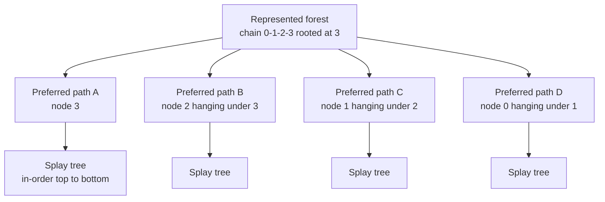
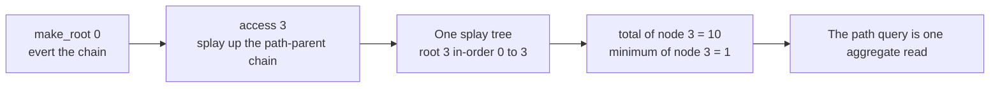
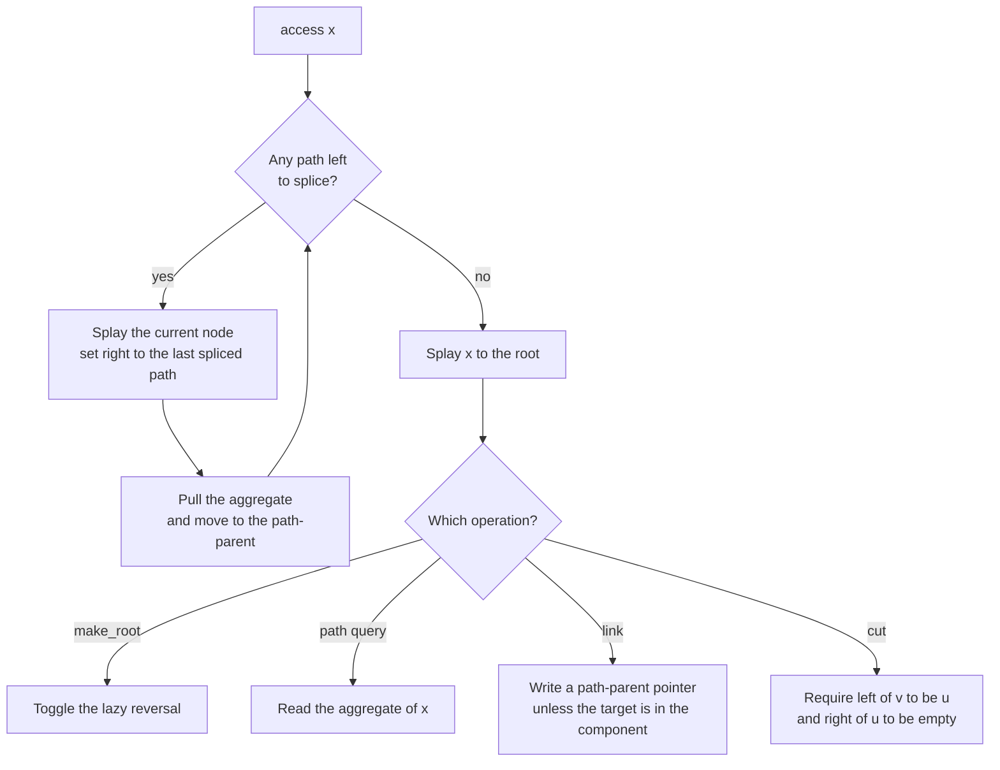
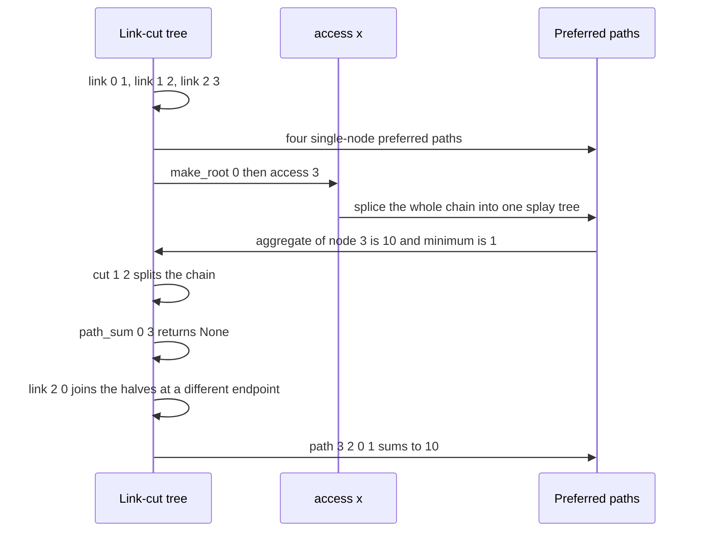

# 703 — Implement dynamic graph connectivity with link-cut trees in practice

> **Tier:** Expert · **CTCI chapter:** Ch 4 — Trees and Graphs
> **Task spec:** [703-implement-dynamic-graph-connectivity-with-link-cut-trees-in-prac.md](../../../tasks/expert/703-implement-dynamic-graph-connectivity-with-link-cut-trees-in-prac.md)
> **Solutions:** [Python](../../../solutions/python/expert/703-implement-dynamic-graph-connectivity-with-link-cut-trees-in-prac/solution.py) ·
> [Java](../../../solutions/java/expert/703-implement-dynamic-graph-connectivity-with-link-cut-trees-in-prac/Solution.java) ·
> [JavaScript](../../../solutions/javascript/expert/703-implement-dynamic-graph-connectivity-with-link-cut-trees-in-prac/solution.js) ·
> [C#](../../../solutions/csharp/expert/703-implement-dynamic-graph-connectivity-with-link-cut-trees-in-prac/Solution.cs)

## 1. Problem restatement

Maintain a **forest** under three mutations and three queries, in logarithmic amortised time per
operation:

| Operation | Meaning |
| --- | --- |
| `link(u, v)` | add the edge `u-v`; **false** if it would create a cycle |
| `cut(u, v)` | remove the edge `u-v`; **false** if the two are not adjacent |
| `make_root(x)` | evert: re-root `x`'s represented tree at `x` |
| `connected(u, v)` | do the two nodes lie in one component? |
| `path_sum(u, v)` / `path_min(u, v)` | aggregate over the node values on the `u-v` path, or `None` when disconnected |

The structure is the Sleator-Tarjan **link-cut tree**: a forest represented as *preferred paths*, each
of which is a splay tree whose in-order traversal is the path from top to bottom, plus a *path-parent*
pointer from the top of each path to the node it hangs from.

| Piece (Python) | Role |
| --- | --- |
| `left`, `right`, `parent` | splay structure plus one extra meaning: `parent` of a splay root is its path-parent |
| `reversed` | lazy evert flag |
| `value`, `total`, `minimum` | node value and the `(sum, min)` aggregates over the splay subtree |
| `_pull`, `_apply_reverse`, `_push`, `_push_to_root` | aggregate recomputation and lazy propagation |
| `_rotate`, `_splay` | the zig / zig-zig / zig-zag splay, counting calls in `splays` |
| `access(x)` | make the represented-root to `x` path one preferred path ending at `x` |
| `find_root(x)`, `connected`, `link`, `cut`, `path_sum`, `path_min` | the public API |
| `verify_structure` | the invariant checker against a brute-force forest |

Concrete results the checks assert:

- Single node `[5]`: `connected(0, 0)`, `path_sum(0, 0) == 5`, `path_min(0, 0) == 5`, and both
  `link(0, 0)` and `cut(0, 0)` return **false**.
- Chain `0-1-2-3` with values `[1, 2, 3, 4]`: `path_sum(0, 3) == 10` **in both directions**,
  `path_min(0, 3) == 1`, `path_min(2, 3) == 3`, `path_sum(1, 1) == 2`, `link(0, 3)` is refused,
  `cut(1, 2)` splits the tree so `path_sum(0, 3) is None` while `path_sum(2, 3) == 7`, a second
  `cut(1, 2)` and `cut(0, 3)` both return false, and after `link(2, 0)` the new path
  `3-2-0-1` gives `path_sum(3, 1) == 10` and `path_min(1, 3) == 1`.
- 400 random link/cut/query operations on 14 nodes with values `((i * 37) % 19) - 9` (negative values
  included) agree with the BFS simulation at every step, and at the end
  `components == nodes - links + cuts`.
- A star on values `[3, 1, 4, 1, 5, 9, 2, 6]`: leaf-to-leaf queries cross the hub, and
  `path_min(1, 1) == values[1]`.
- A 200-node random forest under 300 connectivity/sum/min queries: every aggregate equals the BFS path
  aggregate, and `verify_structure` passes.
- Java and C# additionally split every **edge** into its own node so path aggregates can carry edge
  weights (`220` and `400` random operations against an adjacency-matrix forest); JavaScript adds `LCA`
  and counts splay rotations.

## 2. Intuition

A union-find handles connectivity in near-constant time but supports neither `cut` nor path queries; a
BFS per query costs `O(n + m)` and is hopeless in a loop. The link-cut tree pays `O(log n)` amortised per
operation by keeping the forest **implicit**: each represented tree is partitioned into preferred paths,
and each path is stored as a splay tree ordered by depth. Nothing about the original tree is copied —
only the paths that a query actually touches are restructured.

Three ideas carry the whole design:

1. **A splay tree is the path.** In-order traversal of a path's splay tree lists the nodes top-to-bottom,
   so a rotation sequence can rebalance the path without changing the represented tree.
2. **A path-parent pointer stitches paths together.** The topmost node of a preferred path stores a
   pointer to the node it hangs from; because the pointer lives on the splay root, the `parent` array
   carries either a splay parent or a path-parent depending on context — the distinction is exactly
   `is_splay_root`.
3. **`access(x)` collects the path.** Walking up the path-parent chain, splaying each path and re-hanging
   the right spine makes the represented-root to `x` path a single splay tree. Every query is `access`
   plus an aggregate read; `make_root` is `access` plus a lazy reversal.



After `access(3)` (preceded by `make_root(0)`) the same forest is a **single** preferred path, and the
aggregate of its splay root is the answer to the path query:



## 3. Algorithm

1. **Splay plumbing.** `is_splay_root(x)` is true when `x` has no parent or its parent does not point at
   it. `_pull(x)` recomputes `total` and `minimum` from `x` and its children; `_apply_reverse(x)` swaps
   the children and toggles the lazy flag; `_push(x)` propagates that flag one level down;
   `_push_to_root(x)` collects the ancestor stack and pushes top-down before any rotation.
2. **`_rotate(x)`** re-hangs `x` above its parent, fixes the middle subtree and the grandparent link,
   then `_pull`s the two changed nodes.
3. **`_splay(x)`** pushes lazy flags down, then rotates until `x` is a splay root, using zig-zig when
   `x` and its parent are on the same side and zig-zag otherwise; each call increments the `splays`
   counter.
4. **`access(x)`** repeats: splay `node`, set `right[node] = last` (detaching the old preferred child and
   splicing in the previously processed path), reparent `last`, `pull(node)`, then move to
   `parent[node]` (the path-parent). Finally splay `x`. Afterwards `x`'s splay tree is exactly the
   represented-root to `x` path.
5. **`make_root(x)`** is `access(x)` followed by `_apply_reverse(x)` — the lazy flip turns the
   root-to-`x` path into `x`-to-root order, i.e. re-roots the whole tree at `x`.
6. **`find_root(x)`** is `access(x)`, then walk the left spine with `_push` until there is no left child;
   that node is the represented root. `connected(u, v)` compares the two roots (`u == v` short-circuits).
7. **`link(u, v)`** everts `u` and refuses if `find_root(v) == u` (same component, would create a cycle);
   otherwise it writes the path-parent pointer `parent[u] = v`.
8. **`cut(u, v)`** everts `u`, `access(v)`, and requires `left[v] == u` **and** `right[u] == -1`, which is
   exactly the condition "the edge `u-v` exists and nothing lies between them"; then it severs both
   pointers.
9. **`path_sum` / `path_min`** first compare the roots (returning `None` when they differ), then
   `make_root(u)`, `access(v)` and read `total[v]` / `minimum[v]`.

```text
procedure access(x)
    last ← -1
    node ← x
    while node != -1 do
        splay(node)
        right[node] ← last                  // splice the previously collected path in
        if last != -1 then parent[last] ← node
        pull(node)
        last ← node
        node ← parent[node]                 // now the path-parent
    splay(x)
    return last
end

procedure make_root(x)
    access(x)
    apply_reverse(x)                        // lazy evert of the whole represented tree
end

procedure find_root(x)
    access(x)
    node ← x
    while true do
        push(node)
        if left[node] = -1 then break
        node ← left[node]
    splay(node)
    return node
end

procedure link(u, v)
    make_root(u)
    if find_root(v) = u then return false        // same component: a cycle
    parent[u] ← v
    return true
end

procedure cut(u, v)
    make_root(u)
    access(v)
    if left[v] != u or right[u] != -1 then return false
    left[v] ← -1
    parent[u] ← -1
    pull(v)
    return true
end

procedure path_aggregate(u, v)
    if find_root(u) != find_root(v) then return None
    make_root(u)
    access(v)
    return aggregate at v                    // total[v] or minimum[v]
end
```



## 4. Worked example

Chain `0-1-2-3` with values `[1, 2, 3, 4]`, exactly the sequence the handcrafted check performs. Running
the shipped class and inspecting the preferred-path decomposition after each step gives the table below
(`paths` counts the splay trees, i.e. the preferred paths).

| Step | Returns | Preferred paths after the step |
| --- | --- | --- |
| `link(0, 1)`, `link(1, 2)`, `link(2, 3)` | `true`, `true`, `true` | 4 paths, each a single node: `0` hangs under `1`, `1` under `2`, `2` under `3`; represented root `3` |
| `path_sum(0, 3)` | `10` | **1 path** rooted at `3` covering the whole chain (`make_root(0)` then `access(3)`) |
| `path_min(0, 3)` | `1` | 1 path, re-rooted again |
| `path_sum(3, 0)` | `10` | 1 path — the aggregate is direction independent because `make_root` everts instead of copying |
| `cut(1, 2)` | `true` | 4 paths again: component `{0, 1}` rooted at `1`, component `{2, 3}` rooted at `2` |
| `path_sum(0, 3)` | `None` | unchanged — the two nodes are in different trees |
| `path_sum(2, 3)` | `7` | the surviving half keeps its aggregate (`3 + 4`) |
| `cut(1, 2)` again | `false` | the edge is gone, so nothing happens |
| `cut(0, 3)` | `false` | the pair was never adjacent |
| `link(2, 0)` | `true` | 3 paths: `1` and `0` share one preferred path, `2` hangs under `0`, `3` hangs under `2` |
| `path_sum(3, 1)`, `path_min(1, 3)` | `10`, `1` | the new path is `3-2-0-1`, i.e. `4 + 3 + 1 + 2 = 10` |

The counter `splays` records every splay call; that short sequence costs **108** of them, which is the
price of re-rooting the forest three times plus the splices of `access`.



The structural invariants are checked mechanically after every mutation by `verify_structure`:
parent and child back-pointers agree; every stored `sum`/`min` equals the aggregate over the splay
subtree's in-order sequence; in-order consecutive nodes in a splay tree are adjacent in the forest and
their depth rises by exactly one; the path-parent of a path's splay root is adjacent to the top node of
that path and sits one level above it; a path-parent never lies inside its own preferred path; and the
in-order adjacencies plus the path-parent links account for **every** forest edge exactly once.

## 5. Complexity

| Aspect | Bound | Why |
| --- | --- | --- |
| `access` | `O(log n)` amortised | its splay operations form a splay-tree access sequence |
| `make_root`, `link`, `cut`, `connected`, `path_sum`, `path_min` | `O(log n)` amortised | each is a constant number of `access` / `find_root` calls plus `O(1)` pointer writes |
| `_pull` / `_rotate` | `O(1)` | the aggregate combines two children |
| Space | `O(n)` | six parallel arrays over the node ids, no per-edge bookkeeping |
| Build of `n` isolated nodes | `O(n)` | one array initialisation each |
| Alternative: union-find | `O(alpha(n))` per link/connected | no `cut`, no path aggregates, no evert |
| Alternative: Euler tour tree | `O(log n)` per link/cut/connectivity | component-level only, no path aggregate |
| Alternative: BFS per query | `O(n + m)` per query | exact, but the whole forest is re-walked every time |

The Python header is explicit that the amortised bound is **not measured** here: the point of the task
is the correctness of the dynamic structure, so the checks are oracle comparisons (400 random operations
on 14 nodes, 300 queries on a 200-node forest, hand-computed chains and stars) rather than timing
evidence. The JavaScript solution observes the bound indirectly by counting splay rotations.

## 6. Pitfalls and edge cases

- **`link` inside a component must be refused, not silently applied.** `make_root(u)` then
  `find_root(v) == u` detects the cycle; without it the structure stops being a forest.
- **`cut` of a non-edge must be refused.** The precise test `left[v] == u and right[u] == -1` after
  `make_root(u); access(v)` is what distinguishes "adjacent" from "connected through something";
  `cut(1, 2)` twice and `cut(0, 3)` all return false.
- **`connected(u, u)` is true**, and `link(0, 0)` / `cut(0, 0)` are both rejected — a self edge is not an
  edge.
- **Path queries need the connectivity guard.** `path_sum(0, 3)` returns `None` after the split; the
  Python header documents `None` as the value for a disconnected pair and both `path_sum` and `path_min`
  honour it.
- **Queries mutate the structure.** `path_sum` calls `make_root` on its first argument, so the
  represented root changes; the JavaScript header warns that an `LCA` is only defined relative to a
  root and pins the root before comparing.
- **Lazy reversals must be pushed before every rotation.** `_push_to_root` walks the splay-root chain and
  pushes top-down; skipping it corrupts the path order, which `verify_structure`'s in-order checks catch.
- **Node counts are fixed and indexed `0..n-1`** in these solutions: vertices are never inserted or
  deleted, and the constructor asserts at least one node.
- **Negative and duplicate values are legal.** The random instance uses `((i * 37) % 19) - 9`, so the
  aggregates cannot assume non-negativity; `path_min(1, 1) == values[1]` pins the single-vertex case.
- **Edge weights need edge nodes.** Java and C# materialise every edge as its own node linked between its
  endpoints, so path aggregates can combine vertex and edge contributions and a cut is just severing the
  edge node's two links.
- **A path-parent must sit directly above the top of its path** and must not be inside the path it hangs
  from — the two checks that catch a splice that forgot to detach the old preferred child.
- **`find_root` must push while descending the left spine**, otherwise a lazily reversed path reports the
  wrong endpoint as the represented root.

## 7. Variants and follow-ups

- **Offline dynamic connectivity.** If connectivity is all that is needed and the operations are known
  in advance, segment-tree divide-and-conquer over time with a rollback union-find answers every query
  without a single splay — the subject of
  [704 — offline dynamic connectivity with divide & conquer + UF rollback](../../../tasks/expert/704-implement-offline-dynamic-connectivity-with-divide-conquer-uf-ro.md).
  The link-cut tree is the online answer to the same question, and the two make a good pair to compare.
- **Aggregates on edges and subtrees.** Java and C# show the edge-node split for path-maximum queries;
  subtree aggregation needs a different decomposition (top trees or a link-cut variant that keeps virtual
  subtrees).
- **Euler tour trees.** `O(log n)` link/cut/connectivity with a balanced BST over an Euler tour of each
  tree — simpler for pure connectivity, weaker for path aggregates.
- **Application: dynamic Steiner forests and flow structures.** Repeatedly connecting and disconnecting
  terminal sets on a growing graph is exactly where link-cut trees show up in practice, for instance in
  the approximation of
  [705 — Steiner forest approximations for large graphs](../../../tasks/expert/705-implement-steiner-forest-approximations-large-graphs.md).
- **Application: bottlenecks on paths.** The `path_min` aggregate is one push-relabel-style step away
  from augmenting along a path, the primitive behind
  [706 — max flow with lower and upper bounds and circulation feasibility](../../../tasks/expert/706-implement-max-flow-with-lower-upper-bounds-and-circulation-feasi.md).

## 8. Check yourself

<details><summary>Show answer</summary>

**1. What exactly does `access(x)` leave in `x`'s splay tree?**

The path from the represented root of `x`'s tree down to `x`, and nothing else: each iteration of the
path-parent walk splays a path, detaches its old preferred child by overwriting `right[node]` with the
previously collected path, and climbs to the next path-parent. After the final `splay(x)` the in-order
traversal of `x`'s splay tree is that root-to-`x` path, which is why one aggregate read answers a path
query.

</details>

<details><summary>Show answer</summary>

**2. Why is `make_root` just `access` plus a lazy reversal?**

`access(x)` puts the root-to-`x` path into `x`'s splay tree in top-to-bottom order. Reversing that
sequence turns it into `x`-to-root order, which means the represented tree is now rooted at `x` — and the
reversal is one flag on one node, so nothing else in the forest has to be touched. The `parent` array
double-duties as the path-parent pointer, so the rest of the structure is unaffected.

</details>

<details><summary>Show answer</summary>

**3. Trace the chain `0-1-2-3` with values `[1, 2, 3, 4]`: what do `path_sum(0, 3)`, `cut(1, 2)` and the follow-up queries return?**

`path_sum(0, 3) = 10` and `path_min(0, 3) = 1`, in either argument order. `cut(1, 2)` returns `true` and
splits the chain, so `path_sum(0, 3)` becomes `None` while `path_sum(2, 3) = 7`. A second `cut(1, 2)` and
`cut(0, 3)` both return `false`, and `link(2, 0)` rebuilds a path `3-2-0-1` with sum `10` and minimum `1`.

</details>

<details><summary>Show answer</summary>

**4. Which invariant must hold after every mutation, and how is it checked?**

That the preferred paths really partition the forest: every splay tree's in-order traversal must be a
contiguous top-to-bottom path (consecutive nodes adjacent, depth rising by one), every stored aggregate
must equal the in-order aggregate, every parent/child pointer must agree, and the in-order adjacencies
plus path-parent links must cover every forest edge exactly once. `verify_structure` checks all of that
against a BFS model of the forest, and the random test calls it every fifth operation.

</details>

<details><summary>Show answer</summary>

**5. When would you prefer a union-find or an Euler tour tree to a link-cut tree?**

Union-find when edges are only added and connectivity is the only question — it is faster, simpler, and
`O(alpha(n))`. Euler tour trees when edges come *and* go but only component queries are needed. A
link-cut tree earns its complexity when you need `cut`, `evert` and aggregates along paths as well. If
every operation is known offline, divide-and-conquer over time with UF rollback beats all three for pure
connectivity.

</details>
