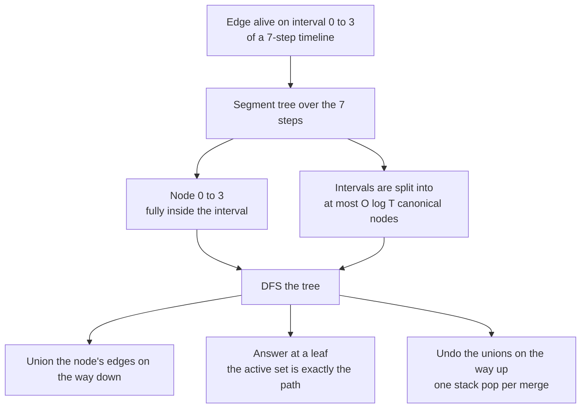
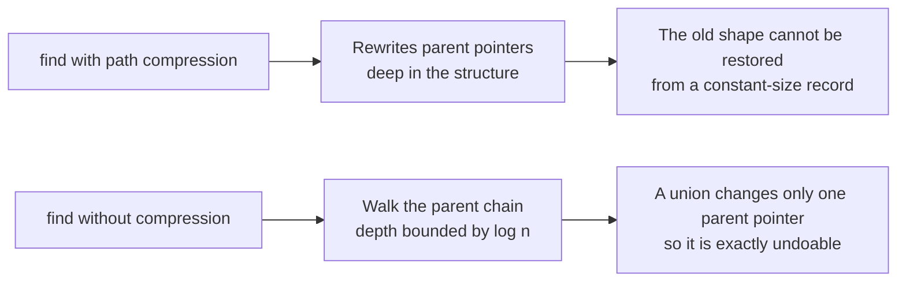
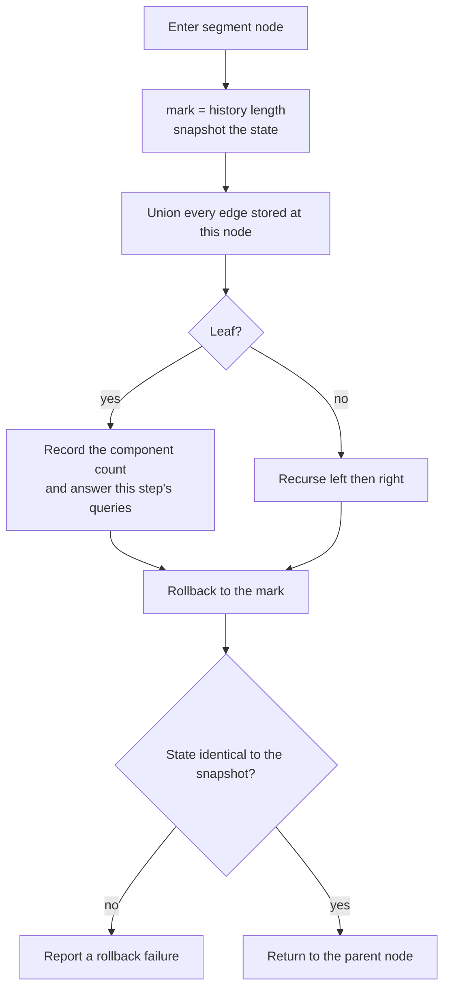
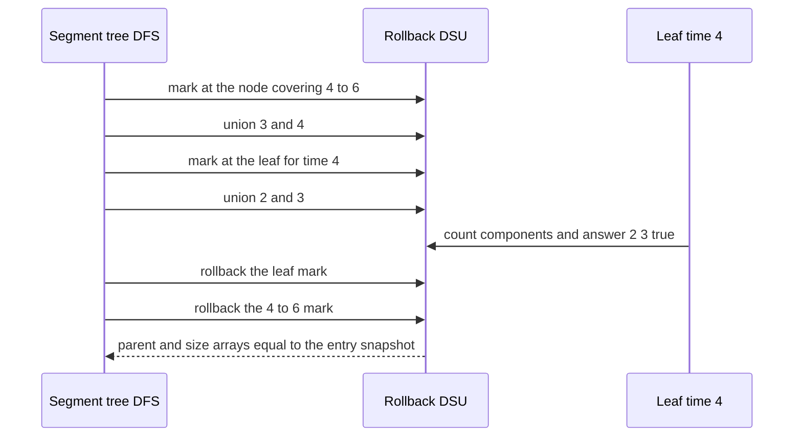

# 704 — Implement offline dynamic connectivity with divide & conquer + UF rollback

> **Tier:** Expert · **CTCI chapter:** Ch 4 — Trees and Graphs
> **Task spec:** [704-implement-offline-dynamic-connectivity-with-divide-conquer-uf-ro.md](../../../tasks/expert/704-implement-offline-dynamic-connectivity-with-divide-conquer-uf-ro.md)
> **Solutions:** [Python](../../../solutions/python/expert/704-implement-offline-dynamic-connectivity-with-divide-conquer-uf-ro/solution.py) ·
> [Java](../../../solutions/java/expert/704-implement-offline-dynamic-connectivity-with-divide-conquer-uf-ro/Solution.java) ·
> [JavaScript](../../../solutions/javascript/expert/704-implement-offline-dynamic-connectivity-with-divide-conquer-uf-ro/solution.js) ·
> [C#](../../../solutions/csharp/expert/704-implement-offline-dynamic-connectivity-with-divide-conquer-uf-ro/Solution.cs)

## 1. Problem restatement

Answer every connectivity question on a graph whose edge set changes over time, when **the whole
timeline is known in advance**. Each edge is alive on a time interval `[first, last]` of the `steps`
time steps; the task is to report, for every step, the number of connected components, and to answer
`(time, u, v)` connectivity questions.

| Function (Python) | Role |
| --- | --- |
| `RollbackDSU(n)` | union by size, **no path compression**, history stack, `components` counter |
| `union(a, b)` | merges two roots, recording `(child, root, child_size)` — or `None` for a no-op |
| `mark()` / `rollback(mark)` | the O(1)-per-union undo pair |
| `snapshot()` | the full `(parent, size, components)` triple used to prove rollback is exact |
| `place_interval(tree, node, lo, hi, left, right, edge)` | canonical segment-tree decomposition of an interval |
| `edges_at_time(tree, time, spans)` | the edges on the root-to-leaf path of a time — the placement invariant |
| `solve(n, edges, steps, queries)` | the divide-and-conquer pass; returns component counts, answers and measured work |
| `brute_counts` / `brute_connected` | BFS oracles that rebuild the graph per step |

Concrete results the checks assert:

- Handcrafted instance `n = 5`, `steps = 7`, edges `(0,1,0,3) (1,2,0,3) (0,2,0,3) (2,3,4,4) (3,4,4,6)`:
  component counts `[3, 3, 3, 3, 3, 4, 4]`, `connected(0, 2)` at time 0 is **true** (the triangle),
  `connected(2, 3)` is **false** at time 3 and **true** at time 4 (the bridge), `connected(0, 4)` at
  time 4 is **false**, and the canonical decomposition uses **5 placements** for 5 edges.
- Rollback DSU unit test: 8 nodes, `union(0,1)` leaves 7 components; after marking, three more unions
  reach 4; a repeated union is a no-op but is still recorded; rolling back restores 7 components, then
  the identity arrays exactly. On 64 nodes the find depth stays at most `floor(log2 64) = 6`.
- Canonical placement invariant, `steps = 12` and 5 edges: for **every** time, the edges on the
  root-to-leaf path equal exactly the edges alive at that time, and the placement count stays within
  `2 * m * ceil(log2 T)`.
- 25 random instances (`n` in `2..8`, `steps` in `1..8`, up to 9 edges, one query per step) match the
  BFS oracles for both counts and all answers.
- Boundary cases: `solve(1, [], 1) -> [1]`; no edges `-> [4] * 5`; two permanent edges `-> [2] * 5`;
  an edge alive for one step only `-> [4, 4, 3, 4, 4]`; self loops never merge anything; parallel and
  duplicated intervals are not double counted; `first > last` is rejected with `"bad interval"` and an
  out-of-range endpoint with `"bad endpoints"`.
- Large instance (`n = 30`, `steps = 64`, 70 random intervals, seed `0xFACEFEED12345678`): **127**
  segment-tree nodes visited, **211** unions, **246** rollbacks, deepest find **3**, counts equal to the
  oracle, and `rollbacks >= unions` — every union is eventually undone.

## 2. Intuition

Rebuilding the graph once per time step costs `T` BFS runs, i.e. `O(T (n + m))`, and an online
structure that supports deletion (a link-cut tree, or a fully dynamic connectivity structure) is heavy
machinery. When the timeline is known in advance, both are unnecessary: an edge alive on an interval is
just an interval, and intervals can be distributed over a **segment tree of time**.

The trick is the *canonical decomposition*: any interval can be written as the disjoint union of
`O(log T)` nodes of the segment tree, each covering a sub-range completely inside the interval. Every
edge is placed in those nodes. Then a single DFS over the segment tree maintains the union-find of "all
edges placed on the root-to-current-node path" — at a leaf, that set is exactly the edges alive at that
step, for free.

The one structural requirement is that the union-find must be **undoable**. That rules out path
compression: compression rewrites parent pointers that cannot be reconstructed. Union by size with no
compression changes a constant amount of state per merge (one parent pointer, two sizes, one counter), so
a stack entry per merge makes rollback exact and O(1) per union.



Why path compression has to go, in one picture:



## 3. Algorithm

1. Validate every interval (`0 <= first <= last < steps`) and every endpoint.
2. Build a segment tree over `[0, steps - 1]` and insert each edge into its canonical nodes with
   `place_interval`, which recurses left and right and stores the edge whenever the node's range is
   fully contained in the interval.
3. Group the queries by time step.
4. DFS the segment tree. At entry, take `mark = dsu.mark()` and, when verification is on, a full
   `snapshot()`. Union every edge stored at this node.
5. At a leaf, record `counts[time] = dsu.components` and answer each query of that step with
   `find(u) == find(v)`.
6. At an internal node, recurse into the left and then the right child.
7. On the way out, `dsu.rollback(mark)` — every union made at this node is undone, including the
   recorded no-ops — and, when verification is on, assert the state equals the snapshot taken on entry.
8. After the DFS the history stack must be empty and the DSU back to `n` singletons.

```text
procedure union(a, b)
    root_a ← find(a)
    root_b ← find(b)
    if root_a = root_b then
        history.append(none)                 // still recorded, so callers can undo by length
        return false
    if size[root_a] < size[root_b] then swap(root_a, root_b)
    child_size ← size[root_b]
    parent[root_b] ← root_a
    size[root_a] ← size[root_a] + child_size
    components ← components - 1
    history.append((root_b, root_a, child_size))
    return true
end

procedure rollback(mark)
    while length(history) > mark do
        entry ← history.pop()
        if entry is none then continue
        child, root, child_size ← entry
        size[root] ← size[root] - child_size
        parent[child] ← child
        components ← components + 1
end

procedure place_interval(tree, node, lo, hi, left, right, edge)
    if right < lo or hi < left then return 0
    if left <= lo and hi <= right then
        tree[node].append(edge)              // fully inside: this node is canonical
        return 1
    mid ← (lo + hi) / 2
    return place_interval(tree, 2*node, lo, mid, left, right, edge)
         + place_interval(tree, 2*node+1, mid+1, hi, left, right, edge)
end

procedure solve(n, edges, steps, queries)
    tree ← empty lists for 4 * steps nodes
    for each edge (u, v, first, last) do place_interval(tree, 1, 0, steps - 1, first, last, (u, v))
    dsu ← RollbackDSU(n)
    procedure dfs(node, lo, hi)
        mark ← dsu.mark()
        for each (u, v) in tree[node] do dsu.union(u, v)
        if lo = hi then
            counts[lo] ← dsu.components
            for each query (u, v) at time lo do answers[(lo, u, v)] ← dsu.find(u) = dsu.find(v)
        else
            mid ← (lo + hi) / 2
            dfs(2 * node, lo, mid)
            dfs(2 * node + 1, mid + 1, hi)
        dsu.rollback(mark)
    dfs(1, 0, steps - 1)
    return counts, answers, measured work
end
```



## 4. Worked example

The handcrafted fixture: `n = 5`, `steps = 7`, edges

| Edge | Interval | Where it lives |
| --- | --- | --- |
| `(0, 1)` | `0..3` | one canonical node covering `0..3` |
| `(1, 2)` | `0..3` | one canonical node covering `0..3` |
| `(0, 2)` | `0..3` | one canonical node covering `0..3` |
| `(2, 3)` | `4..4` | the leaf for time 4 |
| `(3, 4)` | `4..6` | one canonical node covering `4..6` |

Five edges, five placements. Walking the timeline:

| Time | Edges alive | DSU state | `counts` |
| --- | --- | --- | --- |
| 0 | triangle `0-1-2` | one component `{0,1,2}`, plus `{3}` and `{4}` | 3 |
| 1, 2, 3 | triangle `0-1-2` | unchanged | 3 |
| 4 | bridge `2-3` and `3-4` (the triangle has died) | `{2,3,4}`, plus `{0}` and `{1}` | 3 |
| 5, 6 | `3-4` only | `{3,4}`, plus `{0}`, `{1}`, `{2}` | 4 |

The component count stays at 3 across the transition from time 3 to time 4 for a subtle reason: the
triangle disappears and the bridge appears in the same step, and both configurations happen to have
three components. Times 5 and 6 are four, because the edge `2-3` was alive for a single step only.

Queries: `(0, 0, 2) -> true` (both in the triangle), `(3, 2, 3) -> false` (the bridge is not alive yet),
`(4, 2, 3) -> true` (the bridge appears), `(4, 0, 4) -> false` (node 0 is stuck in the triangle and the
bridge to `4` runs through `3`).

The measured work on the larger instance (`n = 30`, `steps = 64`, 70 random intervals) shows the
recursion behaving exactly as promised:

| Metric | Value | Meaning |
| --- | --- | --- |
| segment-tree nodes visited | `127` | the DFS touches about `2 * steps` nodes |
| unions performed | `211` | one per edge placement that actually merged something |
| rollbacks | `246` | at least as many pops as unions, because no-op unions are recorded too |
| deepest `find` | `3` | union by size keeps the forest shallow (`<= 5` is asserted for `n = 30`) |



## 5. Complexity

Let `T` be the number of time steps, `E` the number of interval edges, `Q` the number of queries and
`alpha` the inverse Ackermann factor.

| Quantity | Bound | Why |
| --- | --- | --- |
| Canonical placement | `O(E log T)` node entries | an interval decomposes into at most about `2 log T` canonical nodes, asserted as `placements <= 2 * E * ceil(log2 T)` |
| DFS traversal | `O(T)` nodes | the segment tree over `T` leaves has `2T - 1` nodes |
| Unions over the whole DFS | `O(E log T)` | every placement is unioned once per node it is stored in |
| `find` | `O(log n)` worst case | union by size with **no** path compression bounds the depth by `floor(log2 n)` (`<= 6` at `n = 64`, `3` observed at `n = 30`) |
| `rollback` | `O(1)` per recorded entry | one parent pointer, one size and the component counter are restored |
| Total | `O((E log T + Q) * log n)` | `find` dominates the union work |
| Space | `O(n + E log T)` | the DSU arrays plus the segment tree |
| Alternative: rebuild per step | `O(T (n + E))` | exact but re-walks the whole graph `T` times |
| Alternative: link-cut tree | `O(log n)` per operation, online | handles interleaved queries but is far more code |

## 6. Pitfalls and edge cases

- **No path compression.** It rewrites parent pointers deep in the structure, so a constant-size history
  entry cannot restore them; the Java and C# headers call this out as the reason the classic structure
  drops it. Union by size keeps the `O(log n)` depth instead.
- **No-op unions must still be recorded.** Callers undo by history length, so a merge that found both
  endpoints in the same component appends `None` and consumes a rollback; the large run shows
  `rollbacks = 246 > unions = 211`.
- **Empty and degenerate intervals.** `first > last` must be rejected up front (`"bad interval"`), and an
  interval of one step (`2..2`) is legal and produces `[4, 4, 3, 4, 4]` in the boundary test.
- **Self loops never merge anything** — `(0, 0)` and `(1, 1)` leave the component count at `n` — and
  endpoints outside `0..n-1` are rejected with `"bad endpoints"`.
- **Parallel and duplicated intervals are the same edge for connectivity**: two edges `(0,1)` on
  `0..0` and `1..2`, or the same interval twice, must not double count.
- **The root-to-leaf path invariant is the whole argument.** `edges_at_time` reconstructs the alive set
  from the tree and the test compares it with the interval filter at every time step — a mis-split
  interval shows up there immediately.
- **Rollback must be verified, not assumed.** The DFS compares the full `(parent, size, components)`
  snapshot at every node, and the run must end with an empty history and `n` singleton components.
- **`T = 1` is legal**: a single node, a single step, one component, zero unions when there are no edges.
- **Queries are grouped by time**, and a query for a disconnected pair still needs both endpoints inside
  the graph; the oracle `brute_connected` is a plain BFS on the alive edge set.
- **Segments beyond the boundary stay `None`/false**: `connected(0, 4)` at time 4 is false even though
  the bridge exists, because node 0 belongs to another component.

## 7. Variants and follow-ups

- **Online counterpart.** When the operations are interleaved with the queries and cannot be read in
  advance, the same job needs a link-cut tree or a fully dynamic structure — that is
  [703 — dynamic graph connectivity with link-cut trees](../../../tasks/expert/703-implement-dynamic-graph-connectivity-with-link-cut-trees-in-prac.md).
  Comparing the two shows the exact price of losing foreknowledge.
- **Edges as an event stream.** The solutions take intervals directly; the usual preprocessing turns
  `add`/`remove` events into intervals by remembering when each edge last appeared, which is the only
  extra bookkeeping needed.
- **Weighted or counted answers.** The same recursion supports "sum of weights of alive edges",
  "number of components of size >= s" or bipartiteness checks, as long as the DSU can undo it — for
  bipartiteness the parity array becomes part of the history entry.
- **Batching with bitsets.** For dense time lines and small `n`, a per-step bitset transitive closure
  can beat the offline structure; the crossover is around `T` comparable to `n`.
- **Other structural queries.** Replace connectivity with "is the alive graph a forest" (count merges
  that find the same component) or with planarity checks, both of which fit the same segment-tree shell.

## 8. Check yourself

<details><summary>Show answer</summary>

**1. Why is the offline structure so much simpler than an online one?**

Because the timeline inverts the problem: instead of a structure that survives deletions, each edge
becomes an interval, intervals are stored in the `O(log T)` segment-tree nodes that cover them, and a
single DFS walks time while maintaining "all edges on the current root-to-leaf path". Deletions never
happen — they are the act of leaving a node during the DFS.

</details>

<details><summary>Show answer</summary>

**2. Why does the union-find have to drop path compression?**

Because path compression rewrites an unbounded number of parent pointers, and rollback would have to
restore all of them. Without compression a union changes one parent pointer, one size and the component
counter, all of which fit in a single stack entry — so `rollback` is `O(1)` and exact. Union by size
alone still bounds the depth by `floor(log2 n)`.

</details>

<details><summary>Show answer</summary>

**3. How many segment-tree nodes does an interval `[0, 3]` occupy in a 7-step timeline, and why?**

One: the node covering `0..3` is fully inside the interval, so it is canonical and the recursion stops.
That is why the handcrafted fixture with five edges reports five placements — each interval landed in a
single node. In general an interval splits into at most about `2 log T` canonical nodes, and the test
asserts the count stays within `2 * E * ceil(log2 T)`.

</details>

<details><summary>Show answer</summary>

**4. Why is a no-op union still pushed onto the history?**

Because callers roll back by *length*: `mark()` records `len(history)` and `rollback(mark)` pops until
the length matches again. If a merge that found both endpoints already in one component were not
recorded, the counts would drift and a later rollback would undo someone else's merge. The large
instance asserts `rollbacks >= unions` precisely because of these `None` entries.

</details>

<details><summary>Show answer</summary>

**5. What does the run on the 30-node, 64-step instance confirm?**

That the recursion is cheap and exact: 127 segment-tree nodes visited, 211 unions for 70 random
intervals, 246 rollbacks (including the no-op records), a deepest `find` of 3 against the `floor(log2 30)`
bound, component counts identical to the BFS oracle at every step, and — the structural claim — the DSU
state is bit-for-bit identical to the entry snapshot after every node's rollback, ending with an empty
history.

</details>
