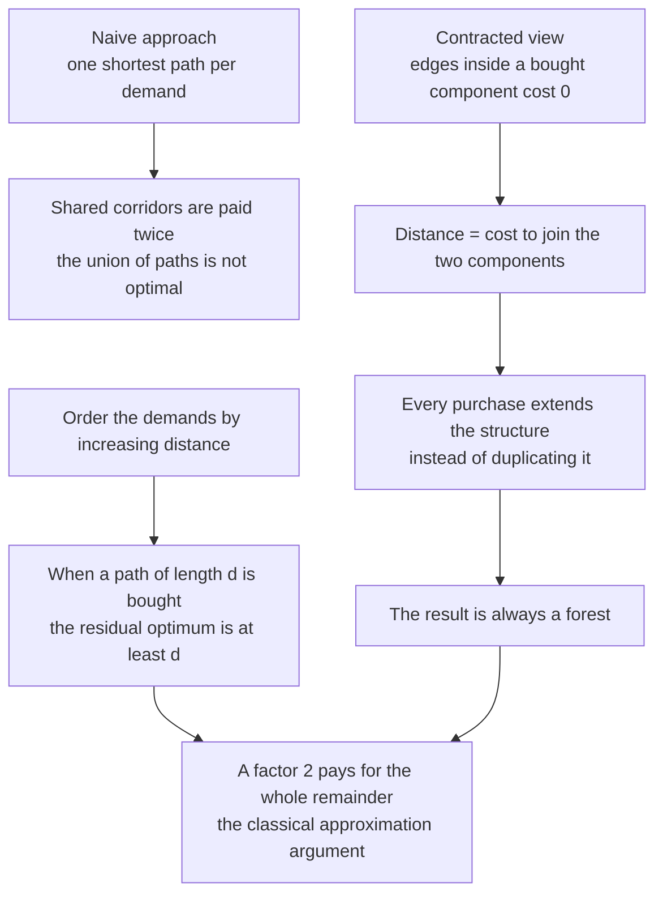
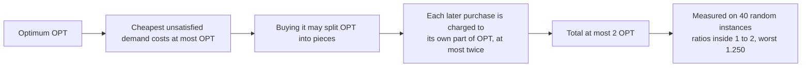
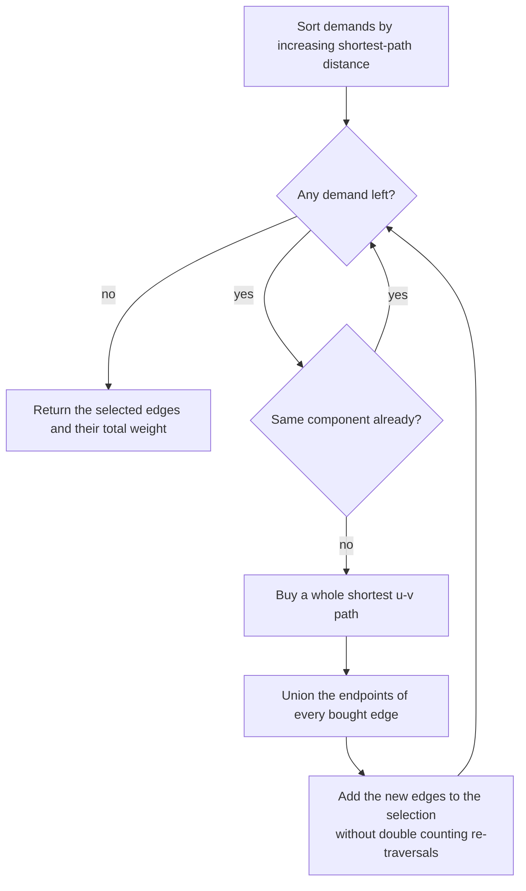
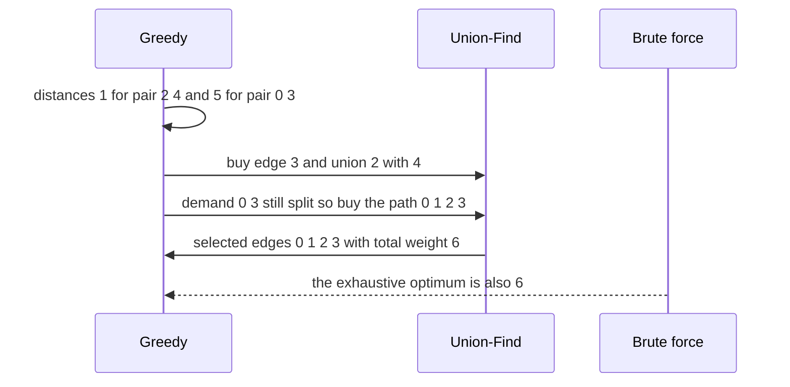

# 705 — Implement Steiner forest approximations for large graphs

> **Tier:** Expert · **CTCI chapter:** Ch 4 — Trees and Graphs
> **Task spec:** [705-implement-steiner-forest-approximations-large-graphs.md](../../../tasks/expert/705-implement-steiner-forest-approximations-large-graphs.md)
> **Solutions:** [Python](../../../solutions/python/expert/705-implement-steiner-forest-approximations-large-graphs/solution.py) ·
> [Java](../../../solutions/java/expert/705-implement-steiner-forest-approximations-large-graphs/Solution.java) ·
> [JavaScript](../../../solutions/javascript/expert/705-implement-steiner-forest-approximations-large-graphs/solution.js) ·
> [C#](../../../solutions/csharp/expert/705-implement-steiner-forest-approximations-large-graphs/Solution.cs)

## 1. Problem restatement

Given an undirected weighted graph and a list of **demand pairs**, buy the cheapest set of edges that
connects every pair. A single pair is the Steiner tree problem; several pairs make it a Steiner forest,
and both are NP-hard, so the solutions implement the classical greedy approximation and check it
against an exhaustive optimum.

| Function (Python) | Role |
| --- | --- |
| `build_graph(n, edges)` | adjacency list, rejecting negative weights and endpoints outside the graph |
| `dijkstra(adjacency, source)` | distances plus a predecessor tree, deterministic tie-breaking |
| `shortest_path(adjacency, source, target)` | `(cost, edge indices)` of one shortest path, or `None` |
| `steiner_forest(n, edges, demands)` | the greedy; returns `(selected edge indices, cost, diagnostics)` or `(None, None, {"infeasible": (u, v)})` |
| `solution_is_feasible` / `selected_is_forest` | independent DSU checks of the answer |
| `brute_force_optimum(n, edges, demands)` | the exhaustive oracle over all `2^m` edge subsets |
| `metric_closure_mst(n, edges, terminals)` | MST over terminal-to-terminal shortest path distances |

The algorithm, exactly as the Python header describes it:

1. compute `d(u, v)` for every demand pair by Dijkstra on the ordinary graph;
2. **sort the demands by increasing distance** — this is what makes the 2-approximation argument work,
   because when a path of length `d` is bought, the residual instance has optimum at least `d`, so a
   factor of two on that demand pays for the whole remainder;
3. walk the demands in that order and, whenever a still-unsatisfied pair sits in two different
   components of the solution bought so far, buy an entire shortest `u-v` path and merge the components
   it crosses; satisfied pairs cost nothing.

Concrete results the checks assert:

- One demand on a 4-node graph: the greedy returns exactly the shortest path, `cost == 6` for the path
  `0-1-2-3` with weights `1 + 1 + 4`, and the brute-force optimum agrees.
- Two commodities sharing structure: edges `(0,1,2) (1,2,1) (2,3,2) (2,4,1)`, demands `(0,3)` and
  `(2,4)` give `cost == 6 == optimum` with exactly **4** selected edges.
- A Steiner detour pays off: with edges `(0,1,1) (1,2,1) (2,3,1) (0,3,8)` the greedy buys the detour for
  **3** instead of the direct edge costing 8.
- All-pairs demands on a 5-node graph cost exactly the **MST**, which is also the brute-force optimum.
- Degenerate demands: no demands `-> []` and cost `0` with zero Dijkstras; a self demand `(1,1)` is free;
  a zero-weight path is free and selects both zero-weight edges; a demand that cannot be connected makes
  the whole instance infeasible (`selected is None`, `stats["infeasible"] == (1, 2)`).
- 40 random instances (`n` in `3..7`, `3..10` edges, weights `1..6`, `1..3` demands) are all feasible
  and the measured ratio `cost / optimum` lies in `[1, 2]` — the worst observed value is **1.250**, and
  exactly **1** of the ≥20 feasible instances was strictly suboptimal.
- A large connected graph (240 nodes, 599 edges, 14 terminal demands from node 0) is solved with
  `cost = 95` using **33** edges, against a terminal-metric-closure MST of `85`; the certified bounds
  `closure / 2 <= cost <= 2 * closure` hold, the solver is deterministic, and at most one residual
  Dijkstra per demand is run.

## 2. Intuition

The naive reading of "connect every demand pair" is to run one shortest path per pair and union the
results. That is exactly what fails: two pairs whose paths share a corridor pay for the corridor twice,
even though the second traversal is free once the corridor is bought.

The classical fix is to make the already-bought part of the graph **free**. In its contracted form, a
Dijkstra from the component of `u` treats every edge whose endpoints already lie in the same component
as cost 0, so the "distance" between two nodes is the cost of joining their components, not the cost of
a fresh path. Each purchase therefore *extends* the existing structure instead of duplicating it, and
the result is always a forest: a bought path only ever merges components, so a cycle can never appear.



Where the constant comes from, and why the order matters:



## 3. Algorithm

1. Validate the graph: endpoints inside `0..n-1`, no negative weights; validate the demands.
2. For each demand `(u, v)`: if `u == v` the distance is `0`; otherwise run a Dijkstra. If the pair is in
   different graph components the instance is infeasible, and this is reported instead of approximated.
3. Sort the demands by increasing distance into a work list.
4. Keep a union-find over the vertices, initially `n` singletons, and an empty set of selected edges.
5. For each demand in order: if `find(u) == find(v)` it is already satisfied and costs nothing; otherwise
   recompute its shortest path and buy every edge on it, unioning the endpoints of each bought edge.
6. The solution's cost is the **sum of the distinct selected edges** — not the sum of the path costs,
   because a later path may re-traverse edges bought earlier (the diagnostics keep both numbers).
7. Return the selected edge indices, the cost, and the diagnostics: residual Dijkstra count, remaining
   components and the raw path-cost total.

```text
procedure steiner_forest(n, edges, demands)
    adjacency ← build_graph(n, edges)                     // rejects negative weights
    order ← empty list
    for each demand (u, v) do
        if u = v then order.append((0, u, v))
        else
            found ← shortest_path(adjacency, u, v)
            if found is none then return none, none, {infeasible: (u, v)}
            order.append((found.cost, u, v))
    sort(order) by increasing cost                        // the 2-approximation ordering

    dsu ← DisjointSet(n)
    selected ← empty set
    dijkstras ← 0
    for each (cost, u, v) in order do
        if dsu.find(u) = dsu.find(v) then continue        // already satisfied: free
        found ← shortest_path(adjacency, u, v)
        dijkstras ← dijkstras + 1
        for each edge index in found.path do
            selected.add(edge index)
            dsu.union(edge.u, edge.v)                     // buys merge components, never cycle
    solution_cost ← sum of weights of the distinct selected edges
    return sorted(selected), solution_cost, {dijkstras, components, path_cost_total}
end

procedure dijkstra(adjacency, source)
    dist ← infinity for every node, previous ← none, dist[source] ← 0
    queue ← min-heap containing (0, source)
    while queue is not empty do
        d, node ← pop the smallest
        if already settled then continue
        mark node settled
        for each (neighbour, weight) of node do
            if d + weight < dist[neighbour] then
                dist[neighbour] ← d + weight
                previous[neighbour] ← (node, edge index)
                push (dist[neighbour], neighbour)
    return dist, previous
end
```



The other solutions vary the same skeleton: Java walks the demands repeatedly and buys the globally
cheapest *contracted* join, then runs a reverse-delete pass so the answer is inclusion minimal; the
JavaScript solution implements the metric-closure MST heuristic and the shortest-path-to-tree
(Takahashi-Matsuyama) heuristic for the single-tree case, with the `2 (1 - 1/|L|)` bound; the C#
solution keeps the contracted-distance variant and reports infeasible instances explicitly. All of them
compare against the exhaustive subset optimum.

## 4. Worked example

The two-commodity fixture: `n = 5`, edges `(0,1,2) (1,2,1) (2,3,2) (2,4,1)` indexed `0..3`, demands
`(0,3)` and `(2,4)`.

**Step 1 — distances on the original graph**: `d(0,3)` is the path `0-1-2-3`, costing `2 + 1 + 2 = 5`;
`d(2,4) = 1` through edge 3.

**Step 2 — order by increasing distance**: `[(1, 2, 4), (5, 0, 3)]`.

| Demand | Satisfied already? | Action | Selected edges | Cost so far |
| --- | --- | --- | --- | --- |
| `(2, 4)`, `d = 1` | no | buy edge 3 (`2-4`, weight 1) | `{3}` | 1 |
| `(0, 3)`, `d = 5` | no | buy the path `0-1-2-3`: edges 0, 1, 2 | `{0, 1, 2, 3}` | 1 + 5 = 6 raw path total |

The reported **solution cost** is the weight of the distinct selected edges,
`2 + 1 + 2 + 1 = 6`, which equals the brute-force optimum, and the solution uses 4 edges. The
diagnostics count **2** residual Dijkstras — the maximum is one per demand — while the initial distance
pass is not counted.



Two smaller traces show the boundary behaviour:

| Instance | Demand | Outcome |
| --- | --- | --- |
| `(0,1,1) (1,2,1) (2,3,1) (0,3,8)` | `(0,3)` | the detour costs `3`, so the greedy ignores the direct edge of weight 8 |
| `(0,1,0) (1,2,0) (0,2,7)` | `(0,2)` | both zero-weight edges are bought, `cost == 0` |
| `(0,1,1) (2,3,1)`, `n = 4` | `(0,1)`, `(1,2)` | infeasible: `selected is None`, diagnostics report the pair `(1, 2)` |

On the random battery the greedy is not always optimal, and the checks say so explicitly: across 40
generated instances every feasible ratio stays inside `[1, 2]`, the **worst measured ratio is 1.250**,
and exactly **1** instance was strictly suboptimal. On the large connected instance (240 nodes, 599
edges, 14 demands from terminal 0) the greedy produced `cost = 95` from **33** edges while the terminal
metric closure MST — a lower bound on the Steiner tree optimum of that terminal set — is `85`, so the
certified bracket `closure / 2 <= cost <= 2 * closure` is `42.5 <= 95 <= 170`.

## 5. Complexity

| Quantity | Bound | Why |
| --- | --- | --- |
| Distance pass | `O(k m log n)` | one Dijkstra per demand, `k` demands, `m` edges, binary heap |
| Sorting the demands | `O(k log k)` | the 2-approximation ordering |
| Greedy loop | at most one Dijkstra per demand | a satisfied pair is skipped in `O(alpha(n))` |
| Total | `O(k m log n)` | the dominant term is the Dijkstra runs |
| Union-find | `O(alpha(n))` per union or find | standard DSU with union by size and path halving |
| Space | `O(n + m)` | adjacency lists, distance and predecessor arrays, DSU arrays |
| Output size | at most `n - 1` edges | the bought set is always a forest |
| Quality (single tree) | `2 (1 - 1/|L|)` for the MST and shortest-path-to-tree heuristics | the classical bound, quoted in the JavaScript header |
| Quality (forest) | ratios measured inside `[1, 2]` on 40 random instances, worst `1.250` | the Python check asserts the bracket rather than claiming a tighter constant |
| Oracle | `O(2^m)` | exhaustive subset enumeration, only for tiny instances |
| Bracket from the closure MST | `closure / 2 <= cost <= 2 * closure` | `OPT <= closure` and the greedy is within `2 OPT` |

The Python header is explicit that the *forest* case does not carry a proved constant here: the
primal-dual moat-growing argument of Agrawal-Klein-Ravi is not implemented, so the checks measure the
gap against the exact optimum on many small instances and bound it empirically.

## 6. Pitfalls and edge cases

- **Do not sum the path costs and call it the answer.** A later path can re-traverse edges bought
  earlier; the reported cost sums the *distinct* selected edges, while the diagnostics keep
  `path_cost_total` separately. The two numbers coincide on the two-commodity fixture but not in general.
- **Satisfied pairs must be skipped.** Buying a path for a pair already in one component is pure waste,
  and it can even add cycles; the `find(u) == find(v)` guard is what makes the output a forest.
- **Infeasible instances must be reported, not approximated.** A demand split across two graph
  components returns `selected is None` with `stats["infeasible"] == (u, v)`; silently returning a
  partial solution would be wrong.
- **Self demands are free** (`u == v`, distance 0, no Dijkstra), and an empty demand list returns an
  empty forest of cost 0 with `dijkstras == 0`.
- **Zero-weight edges are legitimate** and can make a whole instance free; the greedy must still buy the
  edges so the tree is actually connected (`selected == [0, 1]` in the check).
- **Negative weights are rejected** by `build_graph`, since Dijkstra is not valid for them; demands
  outside `0..n-1` are rejected as well.
- **A Steiner node can beat a direct edge.** With weights `1,1,1` along `0-1-2-3` and a direct `0-3` edge
  of weight 8, the detour costs 3 and the direct edge is never bought — the reason the problem is not a
  shortest-path problem.
- **All-pairs demands reduce to an MST.** When every vertex is a terminal, the greedy cost equals the
  MST weight, which the check verifies against an independently computed MST and against the oracle.
- **Determinism.** Dijkstra's heap orders by `(distance, node)`, the demand list is sorted before use,
  and the selected set is returned sorted; the large-instance check re-runs the solver and asserts an
  identical answer.
- **Parallel edges and ties.** The adjacency list keeps every parallel edge with its own index, and the
  strict `<` comparison keeps the first-found predecessor, so the tie-breaking rule is fixed and
  reproducible.
- **The oracle is only for tiny instances.** `2^m` enumerations are limited to a handful of edges; the
  large instance is validated against the closure-MST bracket instead.

## 7. Variants and follow-ups

- **Primal-dual (moat growing).** The Agrawal-Klein-Ravi / Goemans-Williamson algorithms grow moats
  simultaneously from every component until two touch, which yields the proven 2-approximation for the
  forest case; the Python header notes it is deliberately not implemented, which is why no constant is
  claimed there.
- **Reverse delete.** Java adds a pass that walks the bought edges in decreasing weight order and drops
  any edge whose removal keeps all demands connected, making the answer *inclusion minimal* — a cheap
  way to shave a few percent without touching the approximation argument.
- **Single-tree heuristics.** For one demand, or when the demands all share the root of a quorum, the
  metric-closure MST and the shortest-path-to-tree (Takahashi-Matsuyama) heuristics give the
  `2 (1 - 1/|L|)` bound and are simpler than the general forest walk (both are in the JavaScript
  solution).
- **Same structure, different objective.** Network-design questions with capacities instead of
  connectivity are the linear-programming relatives of this task; the lower/upper-bound circulation
  form appears in
  [706 — max flow with lower and upper bounds and circulation feasibility](../../../tasks/expert/706-implement-max-flow-with-lower-upper-bounds-and-circulation-feasi.md), and the
  feasibility core of both is a union-find or a flow, not a search.
- **Dynamic versions.** If the graph keeps changing, the components the greedy relies on need a
  structure that supports link and cut — see
  [703 — dynamic graph connectivity with link-cut trees](../../../tasks/expert/703-implement-dynamic-graph-connectivity-with-link-cut-trees-in-prac.md) —
  or, if all operations are known in advance,
  [704 — offline dynamic connectivity](../../../tasks/expert/704-implement-offline-dynamic-connectivity-with-divide-conquer-uf-ro.md).
- **Better constants.** Local search, edge swapping or an LP relaxation followed by rounding can beat
  the plain greedy on medium instances; the exhaustive oracle in this repository only reaches a handful
  of edges, so larger instances are bounded rather than solved.

## 8. Check yourself

<details><summary>Show answer</summary>

**1. Why does the naive "one shortest path per demand" fail, and what does the contracted distance fix?**

Two demands whose paths share a corridor pay for the corridor twice, and the union of independent
shortest paths can be far from optimal. Contracting the already-bought component and pricing edges
inside it at 0 turns "distance" into "cost of joining the two components", so every purchase extends
the bought structure. That is also why the result is a forest: a purchase can only merge components.

</details>

<details><summary>Show answer</summary>

**2. Why must the demands be processed in increasing distance order?**

Because that is what licenses the factor of two. When the greedy buys a path of length `d` from the
original distances, no remaining demand can be joined more cheaply than `d`, so the residual instance
has optimum at least `d` — charging `2d` for that purchase against the remaining optimum pays for the
whole remainder. Processing the demands in arbitrary order loses that argument.

</details>

<details><summary>Show answer</summary>

**3. Trace the two-commodity instance and give the reported cost.**

Distances: `d(2,4) = 1` (edge 3) and `d(0,3) = 5` (path `0-1-2-3`), so the order is `(2,4)` then `(0,3)`.
The first purchase buys edge 3; the second buys edges 0, 1 and 2. The distinct selected edges weigh
`2 + 1 + 2 + 1 = 6`, which equals the exhaustive optimum, and the raw path-cost total is also 6 here.
Two residual Dijkstras were run — one per unsatisfied demand.

</details>

<details><summary>Show answer</summary>

**4. What exactly is verified, and what does the implementation therefore refuse to claim?**

Verified: every returned set is a subset of the input edges whose weight equals the reported cost, it
connects every demand pair (independent DSU), it forms a forest, it never beats the exhaustive optimum,
and on 40 random instances the ratio lies in `[1, 2]` with a worst measured value of 1.250. Not claimed:
a proved approximation constant for the forest case, because the primal-dual machinery is not
implemented — only the empirical bracket is asserted.

</details>

<details><summary>Show answer</summary>

**5. How is the large instance validated without an exhaustive oracle?**

By bracketing with the terminal metric closure: compute all terminal-to-terminal shortest path distances,
take the MST of that complete graph, and use the facts `OPT <= closure` and `greedy <= 2 * OPT` to get
`closure / 2 <= greedy <= 2 * closure`. On the 240-node instance that bracket is `42.5 <= 95 <= 170`,
alongside structural checks (forest, feasibility, at most `n - 1` edges, deterministic re-run).

</details>
