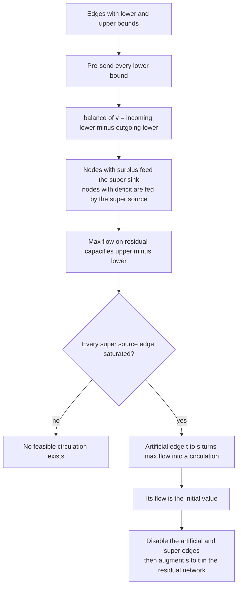
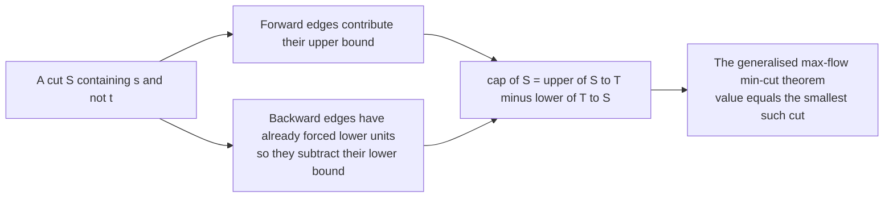
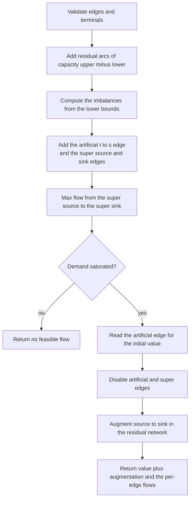
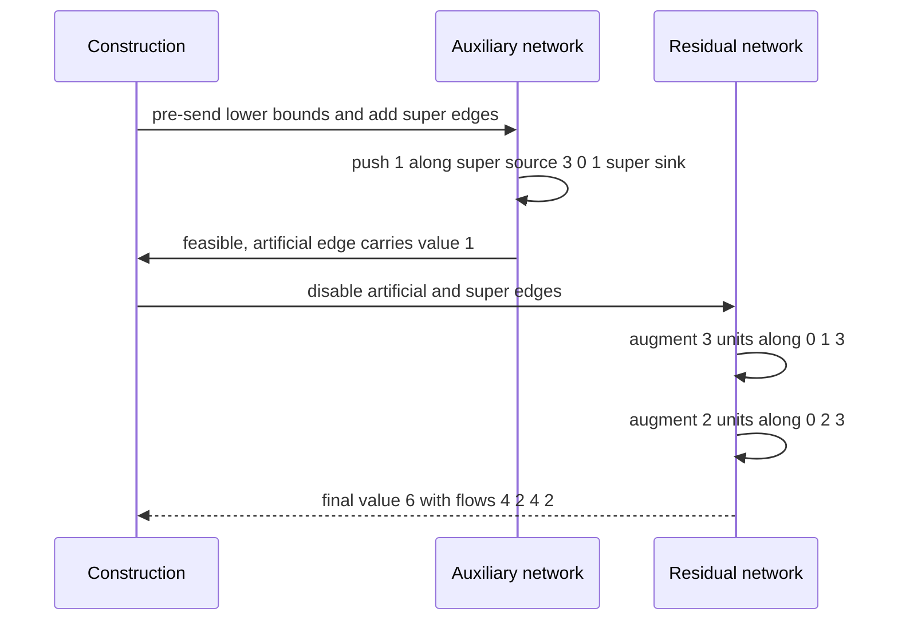

# 706 — Implement max flow with lower and upper bounds and circulation feasibility

> **Tier:** Expert · **CTCI chapter:** Ch 4 — Trees and Graphs
> **Task spec:** [706-implement-max-flow-with-lower-upper-bounds-and-circulation-feasi.md](../../../tasks/expert/706-implement-max-flow-with-lower-upper-bounds-and-circulation-feasi.md)
> **Solutions:** [Python](../../../solutions/python/expert/706-implement-max-flow-with-lower-upper-bounds-and-circulation-feasi/solution.py) ·
> [Java](../../../solutions/java/expert/706-implement-max-flow-with-lower-upper-bounds-and-circulation-feasi/Solution.java) ·
> [JavaScript](../../../solutions/javascript/expert/706-implement-max-flow-with-lower-upper-bounds-and-circulation-feasi/solution.js) ·
> [C#](../../../solutions/csharp/expert/706-implement-max-flow-with-lower-upper-bounds-and-circulation-feasi/Solution.cs)

## 1. Problem restatement

Every edge carries an interval `[lower, upper]` instead of a bare capacity, and a flow must satisfy
`lower <= f(e) <= upper` on every edge plus conservation at every non-terminal node. Two questions are
implemented on top of the same machinery: **is a circulation feasible at all**, and, if so, what is the
maximum `s-t` flow value?

| Function (Python) | Role |
| --- | --- |
| `Dinic(n)` | max flow on arc pairs, with `disable_edge`, `residual`, counters for phases and augmentations |
| `max_flow(source, sink, ceiling)` | augments the *current* flow and returns only the additional value |
| `flow_with_bounds(n, edges, source, sink)` | the whole two-phase construction; returns `(value, flows)` or `(None, None)` |
| `flow_invariants` | bound and conservation checks plus the implied value |
| `brute_force_flow` | enumerates every integral flow inside the bounds — the oracle |
| `cut_capacity(edges, side)` | `sum upper(S -> T) - sum lower(T -> S)`, the bound every flow must respect |
| `min_cut(n, edges, source, sink)` | the generalised min cut over all `2^(n-2)` sides |

Concrete results the checks assert:

- A 3-cycle with every edge `[1, 3]` is feasible with value `0` and flows `[1, 1, 1]` — the cheapest
  circulation sends exactly the lower bounds.
- A cycle `[2, 2] [2, 2] [0, 1]` is **infeasible** (`(None, None)`), as is a node forced to lose 3 with
  only 1 unit of outgoing capacity; a balanced pair `(0,1,[3,5])` and `(1,0,[3,4])` sends `[3, 3]` and
  has value `0`.
- Classic 4-node instance `(0,1,0,4) (0,2,0,3) (1,3,1,5) (2,3,0,2)` from `0` to `3`: **value 6** with
  flows `[4, 2, 4, 2]`, respecting the mandatory unit on `1 -> 3`; the brute-force optimum agrees.
- `(0,1,2,2) (0,2,0,5) (1,3,2,2) (2,3,0,5)`: value **7** (the `5` path plus the forced `2`).
- A **mandatory reverse edge** `(1,0,[2,3])` alongside `(0,1,[0,5])` and `(1,2,[0,4])` pins the value at
  `3`; a single edge `(1,0,[5,8])` from the sink into the source makes an `s-t` flow **impossible**.
- Cut checks: the value never exceeds `cut_capacity` for any side containing the source, it **equals**
  the generalised min cut, and that cut is strictly smaller than the bound of a neighbouring side.
- 25 random instances with all lower bounds 0 satisfy `value == min_cut == brute force`; 60 random
  bounded instances split into **24 feasible** and **36 infeasible**, with `0` cases below the cut bound,
  integral flows and invariants holding.
- Boundaries: empty instance `-> 0` with `flows == []`; `lower == upper == 4` forces value `4`; a self
  loop `(0,0,[2,4])` keeps value `2`; parallel edges add to `5`; a direct forced unit gives `1`; no path
  gives `0`; `lower > upper` and out-of-range endpoints are rejected.
- A 60-node, 258-edge instance (a chain, 200 random extra edges and one forced 3-cycle) is feasible with
  value **11**, below the single-node cut bound `16` of the source.

## 2. Intuition

With only upper bounds, max flow is a search problem: find any augmenting path, push, repeat. Lower
bounds destroy that, because a lower bound is *pre-committed* flow that already violates conservation at
both endpoints — you cannot start from the zero flow at all.

The standard transform makes the obstruction visible and then removes it:

1. **Send the lower bounds unconditionally.** Set `f(e) = lower(e)` and let the remaining variable be
   `x(e)` with `0 <= x(e) <= upper(e) - lower(e)`. Each node now has a forced imbalance
   `balance[v] = sum of lower on incoming edges - sum of lower on outgoing edges`.
2. **Repair the imbalance with a super source and super sink.** A node with `balance[v] > 0` has surplus
   inflow and gets an edge to the super sink; a node with `balance[v] < 0` needs inflow and is fed from
   the super source. Every repair flows through the residual capacities `upper - lower`. A circulation
   exists **iff** a max flow saturates every super-source edge — Ford-Fulkerson's theorem on the
   auxiliary network.
3. **Turn max `s-t` flow into a circulation.** Add an artificial edge `t -> s` with a very large upper
   bound. In the enlarged network a feasible circulation exists exactly when a feasible `s-t` flow does,
   and the flow on the artificial edge *is* its value. Then disable the artificial and the super edges
   and keep augmenting `s -> t` inside the residual network of `x` — the final value is the initial value
   plus the augmentation.



Where the cut bound comes from, and why it is not the classical formula:



## 3. Algorithm

1. Validate: endpoints inside `0 .. n-1`, `0 <= lower <= upper`, terminals inside the graph.
2. Build a Dinic network on `n + 2` nodes; for each edge add an arc `u -> v` with capacity
   `upper - lower`, keeping the arc index.
3. Compute the imbalance of every node from the lower bounds.
4. Add the artificial edge `sink -> source` with capacity `1 + sum(upper)` when `source != sink`.
5. Add `super_source -> v` with capacity `balance[v]` for surplus nodes and `v -> super_sink` with
   capacity `-balance[v]` for deficit nodes; sum the demand.
6. Run `max_flow(super_source, super_sink)` until no more flow is pushed. If the delivered amount is less
   than the demand, return `(None, None)` — the instance is infeasible.
7. The initial value is the flow on the artificial edge (zero when the source equals the sink, i.e. a pure
   circulation question).
8. Disable the artificial edge and every super edge, so they cannot be used again, then augment from the
   source to the sink in the residual network and add the augmentation to the value.
9. Report each edge's flow as `lower + flow on its residual arc`.

```text
procedure flow_with_bounds(n, edges, source, sink)
    validate every edge and terminal
    super_source ← n, super_sink ← n + 1
    network ← Dinic(n + 2)
    for each edge (u, v, lower, upper) do
        arcs.append(network.add_edge(u, v, upper - lower))
        balance[v] ← balance[v] + lower
        balance[u] ← balance[u] - lower
    big ← 1 + sum of all upper bounds
    if source != sink then artificial ← network.add_edge(sink, source, big)
    demand ← 0
    for node ← 0 to n - 1 do
        if balance[node] > 0 then
            supply_arcs.append(network.add_edge(super_source, node, balance[node]))
            demand ← demand + balance[node]
        else if balance[node] < 0 then
            supply_arcs.append(network.add_edge(node, super_sink, -balance[node]))
    delivered ← 0
    repeat
        pushed ← network.max_flow(super_source, super_sink)
        delivered ← delivered + pushed
    until pushed = 0
    if delivered != demand then return none, none            // infeasible
    value ← network.flow[artificial] if artificial exists else 0
    if artificial exists then network.disable_edge(artificial)
    for each arc in supply_arcs do network.disable_edge(arc)
    if source != sink then value ← value + network.max_flow(source, sink)
    flows ← [lower + network.flow[arcs[index]] for each edge]
    return value, flows
end

procedure max_flow(source, sink, ceiling)
    added ← 0
    while true do
        build the level graph by BFS over arcs with positive residual
        if sink is unreachable then return added
        iterator ← zero for every node
        while true do
            pushed ← dfs_with_blocking_flow(source, sink, ceiling, level, iterator)
            if pushed = 0 then break
            added ← added + pushed
end
```



## 4. Worked example

The classic instance: `n = 4`, edges `(0,1,0,4) (0,2,0,3) (1,3,1,5) (2,3,0,2)` with source `0` and
sink `3`. Only edge 2 has a positive lower bound.

**Phase 1 — pre-send the lower bounds.** Edge 2 sends `1`, so `balance[1] = -1` (a deficit) and
`balance[3] = +1` (a surplus). The residual capacities become `4, 3, 4, 2`.

| Auxiliary edge | Capacity | Why |
| --- | --- | --- |
| `super_source -> 3` | `1` | node 3 has surplus 1 |
| `1 -> super_sink` | `1` | node 1 has deficit 1 |
| `3 -> 0` (artificial) | `15` | `1 + sum(upper) = 1 + 14` |

| Step | Route | Amount |
| --- | --- | --- |
| 1 | `super_source -> 3 -> 0 -> 1 -> super_sink` | `1` |

The demand `1` is saturated, so the instance is feasible and the artificial edge carries
**value = 1** — a feasible `s-t` flow of value 1 exists (the mandatory unit plus a compensating unit on
`0 -> 1`).

**Phase 2 — maximise.** Disable the artificial edge and the two super edges, then augment `0 -> 3` in
the residual network of the residual capacities:

| Path | Residual bottlenecks | Amount |
| --- | --- | --- |
| `0 -> 1 -> 3` | `0->1` has `3` left, `1->3` has `3` left | `3` |
| `0 -> 2 -> 3` | `0->2` has `3`, `2->3` has `2` | `2` |

Final value `1 + 3 + 2 = 6`, and the edge flows `lower + residual flow` are `[4, 2, 4, 2]`, exactly what
the check asserts — with `flows[2] = 4 >= 1`, so the mandatory unit is honoured.



Other fixtures pin the edge cases:

| Instance | Outcome |
| --- | --- |
| 3-cycle, all edges `[1, 3]` | value `0`, flows `[1, 1, 1]` — a pure circulation |
| 3-cycle `[2,2] [2,2] [0,1]` | infeasible: the third edge cannot carry the demand |
| `(0,1,[3,5])`, `(1,2,[0,1])` | infeasible: node 1 is forced to lose 3 but can send 1 |
| `(1,0,[5,8])` | infeasible: a mandatory edge into the source needs a negative value |
| `(0,0,[2,4])` and `(0,1,[0,2])` | value `2`, self-loop flow `2`, so a self loop is harmless |
| `(0,1,[0,2])`, `(0,1,[0,3])` | value `5`: parallel edges simply add up |

On the random sweep the checks measured **24 feasible** and **36 infeasible** instances out of 60, with
**0** feasible cases strictly below the generalised cut bound — that is, the solver hit the min cut every
time on this battery.

## 5. Complexity

Let `V = n + 2` and `E = m + n + 1` be the sizes of the auxiliary network, and `k = sum(upper)` the
bound used for the artificial edge.

| Phase | Cost | Why |
| --- | --- | --- |
| Validation and construction | `O(m)` | one pass over the edges |
| Lower-bound bookkeeping | `O(m)` | one addition per edge |
| Super edges | `O(n)` | one per node with a non-zero imbalance |
| Max flow on the auxiliary network | Dinic's bound, `O(V² E)` in general and `O(E sqrt(V))` on unit capacities | BFS level graph plus blocking flow with a current-arc pointer; the solutions count `phases` and `augmentations` rather than timing |
| Phase 2 augmentation | one more Dinic run of the same order | the residual network of the residual capacities |
| Space | `O(n + m)` | arc arrays with flow, capacity, reverse index and the active flag |
| Oracle `brute_force_flow` | `O(prod (upper_i - lower_i + 1))` | enumeration of every integral flow in the boxes |
| Oracle `min_cut` | `O(2^(n-2) * m)` | every side containing `s` and not `t` |
| Value bound | `value <= cut_capacity(S)` for every cut `S` | the generalised max-flow min-cut theorem, checked for every enumerated cut in the cut test |

## 6. Pitfalls and edge cases

- **The zero flow is not a starting point.** Lower bounds force flow into nodes, so the transform
  (pre-send, then repair) is not an optimisation but a prerequisite; skipping it produces flows that
  violate conservation.
- **Feasibility is a saturation test, not a value.** The instance is feasible exactly when the max flow
  from the super source delivers the whole demand; a shortfall means `(None, None)`, and the brute-force
  oracle independently proves infeasibility on those instances.
- **The artificial edge must be disabled before phase 2**, along with every super edge, and its flow
  zeroed — otherwise the augmentation could push flow back through `t -> s` and inflate the value.
- **A mandatory edge into the source is infeasible**, not a negative value: `(1,0,[5,8])` from `0` to `1`
  has no non-negative `s-t` flow, which the solutions report as `None`.
- **Lower bounds also bound the backward residual.** In the residual graph a backward arc can only undo
  down to the lower bound, not down to zero; the Java header states the same rule
  (`backward residual f - lo`).
- **The flow on the artificial edge is the value**, so the capacity `1 + sum(upper)` only has to be large
  enough to never bind; making it infinite in code (as some implementations do) risks integer overflow,
  which is why a finite bound is computed.
- **Self loops are legal and harmless** (`(0,0,[2,4])` plus `(0,1,[0,2])` still gives value `2`), and
  parallel edges add up (`[0,2]` and `[0,3]` give `5`).
- **`lower > upper` is rejected up front**, as are endpoints outside `0..n-1` and terminals outside the
  graph — the messages are asserted, not just the fact of failure.
- **The answer must stay integral.** Capacities and lower bounds are integers and the flow is
  integral throughout; the sweep asserts `isinstance(f, int)` for every returned flow.
- **The generalised cut bound is not the classical one.** Forward edges contribute their upper bound and
  backward edges *subtract* their lower bound; using plain `sum(upper)` over a cut would overestimate and
  hide bugs. The cut test also asserts that the min cut is strictly smaller than a neighbouring side's
  bound, so the check is not vacuous.
- **Determinism.** The same instance must return the same flows; the boundary test runs it twice and
  compares the full result.
- **A 60-node instance proves nothing about scaling**, and the solutions do not claim otherwise: they
  report `value = 11` against the cut bound `16` and keep the instance small on purpose.

## 7. Variants and follow-ups

- **Feasibility only.** Dropping phase 2 leaves the circulation question, which is the whole content of
  "does a transportation plan with mandatory shipments exist" — the same auxiliary network, one max flow.
- **Min-cost versions.** Adding costs per unit turns the same construction into min-cost circulation,
  where the first phase fixes feasibility and the second uses successive shortest paths.
- **Cut structure.** The generalised min cut is the natural certificate: `value = min over cuts of
  (upper(S -> T) - lower(T -> S))`. Extracting the actual cut from Dinic's final level graph is one BFS
  and gives a human-checkable proof of optimality.
- **Flows on a growing graph.** When the network itself changes, the components underneath a flow
  computation move: dynamic connectivity is the primitive in
  [703 — dynamic graph connectivity with link-cut trees](../../../tasks/expert/703-implement-dynamic-graph-connectivity-with-link-cut-trees-in-prac.md)
  and [704 — offline dynamic connectivity](../../../tasks/expert/704-implement-offline-dynamic-connectivity-with-divide-conquer-uf-ro.md).
- **Multiple commodities.** A single flow cannot model several commodities that share capacities; the
  multi-commodity relaxation and its approximation are
  [707 — multi-commodity flow approximate algorithm outline](../../../tasks/expert/707-implement-multi-commodity-flow-approximate-algorithm-outline.md).
- **Network design.** Choosing which edges to buy so that demands can be routed is the graph-design
  sibling; the connectivity half of it is
  [705 — Steiner forest approximations for large graphs](../../../tasks/expert/705-implement-steiner-forest-approximations-large-graphs.md).

## 8. Check yourself

<details><summary>Show answer</summary>

**1. Why can't you just start from the zero flow and augment?**

Because the lower bounds are mandatory flow: sending `lower(e)` already changes the net balance at both
endpoints, so the zero-flow-plus-augmentations picture never satisfies conservation. The transform
pre-sends the lower bounds and then looks for a repair flow in the residual capacities `upper - lower`.

</details>

<details><summary>Show answer</summary>

**2. What exactly makes an instance feasible?**

A feasible circulation exists if and only if a maximum flow in the auxiliary network saturates every edge
out of the super source — the super source feeds exactly the nodes that need inflow, the super sink
drains the nodes with surplus, and any shortfall means some node's imbalance cannot be repaired. The
solver reports infeasibility as `(None, None)`, and the brute-force oracle independently confirms it.

</details>

<details><summary>Show answer</summary>

**3. Trace the instance `(0,1,0,4) (0,2,0,3) (1,3,1,5) (2,3,0,2)` from 0 to 3.**

Phase 1 pre-sends the unit on `1 -> 3`, giving node 3 a surplus of 1 and node 1 a deficit of 1. The
super flow `super_source -> 3 -> 0 -> 1 -> super_sink` delivers 1, so the instance is feasible and the
artificial `3 -> 0` edge carries value 1. Phase 2 disables that edge and augments 3 units along
`0 -> 1 -> 3` and 2 units along `0 -> 2 -> 3`, giving value `1 + 3 + 2 = 6` and flows `[4, 2, 4, 2]`.

</details>

<details><summary>Show answer</summary>

**4. Why is a mandatory edge from the sink into the source infeasible rather than negative?**

Because the value of an `s-t` flow is defined as the net outflow of the source, and the
solutions only accept non-negative values. `(1,0,[5,8])` forces 5 units into the source with no way to
send them out, so no non-negative feasible flow exists — the checks confirm both the solver and the
brute-force oracle return "infeasible" for it.

</details>

<details><summary>Show answer</summary>

**5. What is the correct cut bound with lower bounds, and how is it verified?**

`cap(S) = sum of upper on edges from S to T - sum of lower on edges from T to S`, minimised over sides
`S` containing the source and not the sink; the max-flow min-cut theorem in this form says the maximum
value equals that minimum. The checks enumerate all `2^(n-2)` cuts, confirm the value never exceeds any
bound, confirm it equals the minimum, and confirm the minimum is strictly below a neighbouring side's
bound so the comparison is meaningful.

</details>
