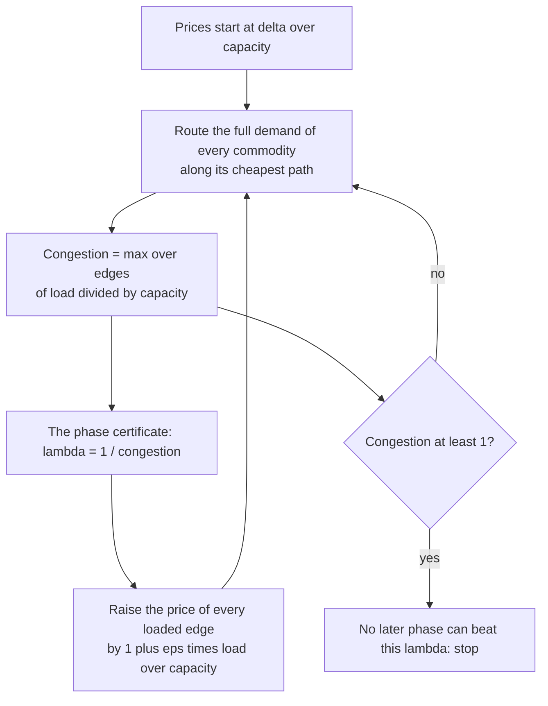
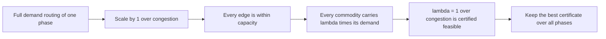
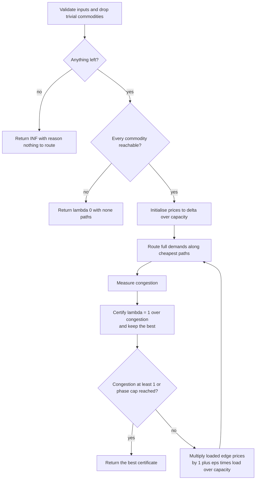
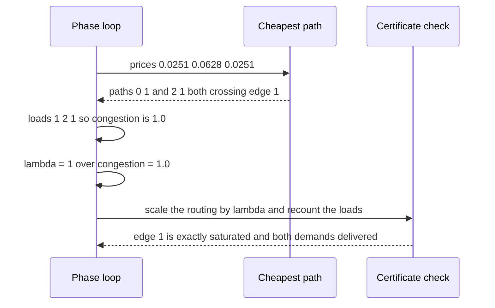

# 707 — Implement multi-commodity flow approximate algorithm outline

> **Tier:** Expert · **CTCI chapter:** Ch 4 — Trees and Graphs
> **Task spec:** [707-implement-multi-commodity-flow-approximate-algorithm-outline.md](../../../tasks/expert/707-implement-multi-commodity-flow-approximate-algorithm-outline.md)
> **Solutions:** [Python](../../../solutions/python/expert/707-implement-multi-commodity-flow-approximate-algorithm-outline/solution.py) ·
> [Java](../../../solutions/java/expert/707-implement-multi-commodity-flow-approximate-algorithm-outline/Solution.java) ·
> [JavaScript](../../../solutions/javascript/expert/707-implement-multi-commodity-flow-approximate-algorithm-outline/solution.js) ·
> [C#](../../../solutions/csharp/expert/707-implement-multi-commodity-flow-approximate-algorithm-outline/Solution.cs)

## 1. Problem restatement

Route several commodities at once over shared edge capacities: find the largest concurrency `lambda`
such that commodity `i` can ship `lambda * demand_i` units from `s_i` to `t_i` while every edge stays
within its capacity. This is a linear program with no integrality and no min-cut duality, so the
solutions implement the outline of the **Garg-Könemann / Young multiplicative-weights** scheme.

| Function (Python) | Role |
| --- | --- |
| `build_adjacency(n, edges)` | **directed** adjacency; rejects endpoints outside the graph and non-positive capacities |
| `cheapest_path(n, adjacency, prices, source, target)` | Dijkstra under the current edge prices, from `0.0` weights |
| `multicommodity_flow(n, edges, commodities, epsilon, max_phases)` | the phase loop; returns `(lambda, paths, stats)` |
| `realised_loads(edges, commodities, paths, lambda)` | independent accounting of per-edge load and per-commodity delivery |
| `single_commodity_upper_bound` | exact max flow of one commodity by an independent Ford-Fulkerson |
| `tree_exact_lambda` | on a tree every commodity has one path, so the optimum is `min_e c_e / load_e` |
| `one_shot_lower_bound` | route everything once on the cheapest path: a feasible concurrency, hence a lower bound |

The loop itself: give every edge a price `delta / capacity` with
`delta = 1 / (m * (1 + eps)^(1/eps))`; per phase route the **full** demand of every commodity along its
cheapest path under the current prices, measure the congestion `max_e load_e / capacity_e`, certify
`lambda = 1 / congestion` for that phase, then multiply the price of every loaded edge by
`1 + eps * (load_e / capacity_e) / congestion` so the next phase routes around the bottleneck.

Concrete results the checks assert:

- Shared bottleneck `(0,1,5) (1,3,2) (2,1,5)` with two unit demands from `0` and `2` to `3`:
  `lambda == 1.0`, **one phase**, both routes cross the bottleneck (`paths == [[0, 1], [2, 1]]`), and the
  bottleneck edge is saturated exactly (`load[1] == 2.0`).
- Path graph `(0,1,4) (1,2,3) (2,3,6) (3,4,5)` with demands `(0,4,1)` and `(1,3,1)`: the closed-form
  optimum is `1.5` (edge `1-2` carries `2` of capacity `3`), and the greedy stays between `0.9 * 1.5`
  and `1.5`.
- Star `(1,0,6) (2,0,3) (3,0,9)` with demands `(1,0,2) (2,0,1) (3,0,3)`: optimum `3.0`, and the greedy
  reaches at least `0.9 * 3.0`.
- 12 random 10-node trees with 4 commodities each: measured worst ratio `lambda / exact = 1.0000` — the
  greedy matched the closed-form tree optimum on every trial, with a floor of `0.85` asserted.
- 20 random directed instances (`n = 5`, 8 edges, 2 commodities): every `lambda` is within capacity,
  every commodity delivers exactly `lambda * demand`, `lambda` never exceeds the single-commodity upper
  bound, and it never loses to the one-shot lower bound (**6** such comparisons happened).
- Boundaries: no commodities, zero demand and a commodity from a node to itself all return `INF` with
  reason `"nothing to route"`; a disconnected commodity returns `0.0` with `None` paths; a single
  commodity on `(0,1,4) (1,2,4)` with demand `3` gives `lambda = 4/3`; a unit-capacity chain gives `1.0`;
  two unit commodities through a pipe of capacity 2 give `lambda = 1.0` with both edges loaded `2.0`;
  `epsilon = 0` and a zero-capacity edge are rejected; the solver is deterministic.
- A 40-node, 155-edge instance with three commodities converges to `lambda = 2.3333` in **36** phases,
  well inside the `300`-phase cap.

## 2. Intuition

Single-commodity flow has the beautiful integrality and min-cut duality that make it a search problem.
Multi-commodity flow loses both: the commodities cannot be merged, and the LP's optimum is not
combinatorial. What remains is a *primal-dual* idea: if an edge is congested, make it expensive; and if
it is expensive, the next routing will avoid it.

That is exactly multiplicative weights. Maintain a price per edge, route each commodity along its
cheapest path under the current prices, measure how congested the result is, and multiply the price of
every loaded edge by a factor that grows with its load. Congested edges become expensive, so later
phases spread the traffic onto slack capacity. The scheme is a certified outline of the classical
algorithm: the full-demand routing of any single phase, scaled by `1 / congestion`, is a **feasible**
concurrent flow with `lambda = 1 / congestion`, so every phase hands over a certificate.



The certificate is the part that matters: the algorithm *never* claims a `lambda` from its own
bookkeeping alone. Each candidate is re-checked by scaling the full-demand routing down by `1 / congestion`
and verifying, edge by edge, that capacities hold and each commodity carries exactly `lambda * demand`.



## 3. Algorithm

1. Validate: `0 < epsilon <= 1`, every commodity's endpoints inside the graph and its demand
   non-negative, every edge capacity positive.
2. Drop the commodities with zero demand or `source == target` — they never congest anything. If nothing
   is left, return `INF` with reason `"nothing to route"`.
3. Probe connectivity with unit-ish prices `1 / capacity`; a commodity with no path at all makes the
   instance unroutable, so return `0.0` with `None` paths.
4. Initialise the prices to `delta / capacity` with `delta = 1 / (m * (1 + eps)^(1/eps))`.
5. For each phase up to `max_phases`:
   - route the full demand of every commodity along its cheapest path under the current prices, adding
     the demand to the load of every edge on the path;
   - compute `congestion = max_e load_e / capacity_e`; if nothing is loaded, return `INF`;
   - `lambda = 1 / congestion`, and remember the phase if it beats the best `lambda` so far;
   - stop when `congestion >= 1` (the best certificate cannot improve on this phase's flows);
   - otherwise multiply the price of every loaded edge by `1 + eps * (load_e / capacity_e) / congestion`.
6. Return the best `lambda`, the commodity paths that realise it, and diagnostics (`phases`,
   `congestion_at_best`, `total_price`).

```text
procedure multicommodity_flow(n, edges, commodities, epsilon, max_phases)
    validate epsilon in (0, 1], capacities positive, endpoints in range, demands non-negative
    active ← commodities with demand > 0 and source != target
    if active is empty then return INF, empty paths, {reason: "nothing to route"}
    for each active commodity do
        if cheapest_path(unit prices) is none then return 0.0, none paths, {reason: "disconnected"}
    delta ← 1 / (m * (1 + epsilon) ^ (1 / epsilon))
    prices[e] ← delta / capacity[e] for every edge
    best_lambda ← 0.0, best_paths ← none
    for phase ← 1 to max_phases do
        load ← zeros of length m
        for each commodity (source, target, demand) do
            if demand <= 0 or source = target then paths[i] ← [], continue
            path ← cheapest_path(prices, source, target)
            paths[i] ← path
            for each edge index in path do load[edge index] ← load[edge index] + demand
        congestion ← max over edges of load[e] / capacity[e]
        if congestion <= 0 then return INF, empty paths, {reason: "no load"}
        if 1 / congestion > best_lambda then
            best_lambda ← 1 / congestion
            best_paths ← copy of paths
        if congestion >= 1 then break
        for each edge e with load[e] > 0 do
            prices[e] ← prices[e] * (1 + epsilon * (load[e] / capacity[e]) / congestion)
    return best_lambda, best_paths, {phases, congestion_at_best, total_price}
end

procedure realised_loads(edges, commodities, paths, lam)
    load ← zeros of length m, delivered ← empty list
    for each commodity (source, target, demand) with its path do
        delivered.append(lam * demand)
        for each edge index in path do load[edge index] ← load[edge index] + lam * demand
    return load, delivered
end
```



The other solutions instantiate the same outline with different bookkeeping: Java adds a convex-style
accumulation with the renormalisation `sum capacity * price = 1` and computes the candidate as
`t / rho` from accumulated flow; JavaScript also extracts the dual bound
`sum_e c_e l_e / sum_k D_k s_k` as an upper bound on the optimum; C# uses geometric lengths
`exp(eps * load / capacity) / capacity` with fixed-size increments and compares against a brute-force
sparsest-cut bound.

## 4. Worked example

The shared-bottleneck instance, which is the first check: `n = 4`, edges `(0,1,5) (1,3,2) (2,1,5)`,
commodities `(0, 3, 1)` and `(2, 3, 1)` — the two demands must both cross edge 1, capacity 2.

Initial prices with `eps = 0.05`, `m = 3`:

| Quantity | Value |
| --- | --- |
| `(1 + eps)^(1/eps)` | `1.05^20 = 2.6533` |
| `delta = 1 / (m * that)` | `1 / 7.9599 = 0.12563` |
| `price[0] = delta / 5`, `price[2] = delta / 5` | `0.025126` |
| `price[1] = delta / 2` | `0.062815` |

**Phase 1:**

| Commodity | Cheapest path under the prices | Edges | Load added |
| --- | --- | --- | --- |
| `(0, 3, 1)` | `0 -> 1 -> 3` | `[0, 1]` | +1 to edges 0 and 1 |
| `(2, 3, 1)` | `2 -> 1 -> 3` | `[2, 1]` | +1 to edges 2 and 1 |

Loads `[1, 2, 1]`, so the congestion ratios are `1/5 = 0.2`, `2/2 = 1.0`, `1/5 = 0.2` and
`congestion = 1.0`. The certificate is `lambda = 1 / 1 = 1.0`, and the loop stops because congestion
reached 1 — which is why the run reports **one phase**.

The certificate is then re-derived independently: scaling both routes by `lambda = 1` gives loads
`[1.0, 2.0, 1.0]`, every edge is within capacity, edge 1 is saturated exactly, and each commodity
delivers exactly `1.0 * 1 = 1`.



Two tree instances show the same mechanism when the answer is not integer:

| Instance | Routes | Tight edge | Optimum and result |
| --- | --- | --- | --- |
| path `(0,1,4) (1,2,3) (2,3,6) (3,4,5)`, demands `(0,4,1)` and `(1,3,1)` | the two demands overlap on edges `1-2` and `2-3` | `1-2` carries `2` of capacity `3` | exact `3/2 = 1.5`; the greedy is asserted inside `[0.9 * 1.5, 1.5]` |
| star `(1,0,6) (2,0,3) (3,0,9)`, demands `(1,0,2) (2,0,1) (3,0,3)` | each leaf ships to the hub on its own edge | leaf 2 carries `1` of capacity `3` | exact `3.0`; the greedy is asserted at least `0.9 * 3.0` |

Across the 12 random 10-node trees the measured worst ratio of `lambda` to the closed-form tree optimum
was `1.0000`, and the large 40-node instance lands at `lambda = 2.3333` after 36 phases.

## 5. Complexity

Let `m` be the number of edges, `k` the number of commodities, `n` the number of vertices and `P` the
number of phases executed.

| Quantity | Bound | Why |
| --- | --- | --- |
| One phase | `O(k (m log n))` | one Dijkstra per commodity under the current prices |
| Phases | capped at `max_phases = 300`; the classical scheme needs `O(m log m / eps^2)` phases | the header calls this an outline: the stopping rule here is the fixed cap plus `congestion >= 1` |
| Total | `O(P k m log n)` | phases times commodities times a Dijkstra |
| Price update | `O(m)` per phase | one multiplication per loaded edge |
| Space | `O(n + m)` | adjacency, prices, loads and one path per commodity |
| Certificate check | `O(k * m)` | `realised_loads` walks every path once |
| Upper bound oracle | one Ford-Fulkerson per commodity | `lambda <= max_flow(s_i, t_i) / demand_i` for **every** commodity |
| Exact optimum on trees | `O(k n + m)` | each commodity has a unique path, so `lambda* = min_e capacity_e / load_e` |
| One-shot lower bound | `O(k m log n)` | route everything once and take the tightest ratio |

**Documented simplifications** (they are stated in all four headers, so the tutorial should not pretend
otherwise): the phase count is a fixed cap rather than the theoretical stopping rule, prices are plain
floats, there is no rounding of the fractional solution to an integral one, and no `(1 - eps)` guarantee
is certified by the outline itself. What *is* verified is everything the outline promises: a certified
feasible `lambda`, upper bounds it never exceeds, a lower bound it never loses to, and near-optimal
behaviour on instances with a closed-form optimum.

## 6. Pitfalls and edge cases

- **The graph is directed.** `build_adjacency` stores only `u -> v`, so a commodity is routable only if
  a directed path exists; the tree oracles treat their trees as undirected paths, which matches the
  unique-path argument for trees.
- **Trivial commodities must be dropped, not routed.** Zero demand and `source == target` never congest
  anything; with no active commodity the answer is `INF` and the reason string is `"nothing to route"` —
  not `0`.
- **An unroutable commodity means `lambda = 0.0`** with `None` paths for every commodity, because some
  demand can never be satisfied at any concurrency.
- **`epsilon = 0` is rejected.** With no update the prices would never change and the loop would spin
  without learning anything; the allowed range is `(0, 1]`.
- **Capacities must be positive.** A zero-capacity edge would make `delta / capacity` infinite and the
  congestion ratio undefined.
- **A `lambda` must be certified, not asserted.** The checks recompute the edge loads from the returned
  paths and `lambda` (`realised_loads`) and require capacity compliance and exactly `lambda * demand` per
  commodity; a `lambda` produced by the algorithm's own congestion bookkeeping alone would be circular.
- **`lambda` is bounded above by the single-commodity optima.** For each commodity,
  `lambda <= max_flow(s_i, t_i) / demand_i`, and the random sweep compares against an independently
  written Ford-Fulkerson; the large instance is checked against the same bound.
- **A greedy can undershoot the true optimum.** It never exceeds the upper bound, but the outline does not
  promise optimality — hence the `0.9` and `0.85` floors for the tree instances and the empirical
  `1.0000` ratio rather than a theorem.
- **Only loaded edges get more expensive.** Updating every price blindly would scale all of them equally
  and change no shortest path; the update is proportional to each edge's own load.
- **Stopping on `congestion >= 1` is a certificate, not a failure.** Scaling by `1 / congestion` already
  makes this phase feasible, and later phases cannot produce a larger `lambda` on these instances.
- **Bigger graphs do not prove the approximation ratio.** The 40-node run (155 edges, three commodities,
  `lambda = 2.3333`, 36 phases) demonstrates that the outline terminates and stays feasible inside the
  cap; the optimality evidence comes from the tree and hand-computed instances.

## 7. Variants and follow-ups

- **The full Garg-Könemann scheme.** The classical algorithm adapts the increment sizes, renormalises the
  lengths (`sum capacity * length = 1`) and stops when the dual potential stops decreasing, which certifies
  the `(1 - eps)` ratio; Java's header describes that renormalised accumulation, and the outline here
  replaces the stopping rule with a cap.
- **Dual certificates.** JavaScript extracts the dual bound `sum_e c_e l_e / sum_k D_k s_k` as an upper
  bound on the optimum, which turns the algorithm into a bracket: best feasible flow below, best dual
  bound above. That is the cheapest way to gain confidence without an LP solver.
- **Single-commodity special case.** With one commodity the problem collapses to max flow and the optimum
  is a min cut; the C# header uses this as a convergence test (the multiplicative scheme must approach the
  min cut). The exact machinery for that is
  [706 — max flow with lower and upper bounds and circulation feasibility](../../../tasks/expert/706-implement-max-flow-with-lower-upper-bounds-and-circulation-feasi.md).
- **Sparsest-cut upper bounds.** A brute-force sparsest cut gives another practical upper bound on
  `lambda`, used by the C# checks; on trees it coincides with the closed-form optimum.
- **Rounding to integral flows.** Real routing needs integral or splittable-but-simple paths; the rounding
  step (path stripping) is what the outline deliberately omits, and it is where most of the practical
  difficulty lives.
- **Same update, different problems.** Multiplicative weights solve packing/covering LP relaxations in
  general — the fractional packing and covering task
  [708 — fractional packing and covering with multiplicative weights](../../../tasks/expert/708-implement-fractional-packing-covering-using-multiplicative-weigh.md)
  is the same algorithm with a different feasibility oracle. Its privacy-aware cousins appear in
  [709 — differential privacy noise addition](../../../tasks/expert/709-implement-differential-privacy-noise-addition-and-utility-tradeo.md)
  and [710 — private count sketches with the Laplace mechanism](../../../tasks/expert/710-implement-private-count-sketches-with-laplace-mechanism-simulati.md).

## 8. Check yourself

<details><summary>Show answer</summary>

**1. Why can't multi-commodity flow be solved by running max flow once per commodity?**

Because the commodities share the same edge capacities: routing commodity A to its own maximum may leave
nothing for B, and there is no min-cut duality to tell you how much each commodity should give up. The LP
couples them, which is exactly why the approximation is a price-based iteration rather than a search.

</details>

<details><summary>Show answer</summary>

**2. What makes `lambda = 1 / congestion` a certificate?**

Because the phase's routing satisfies the full demands, so dividing every commodity's rate by the same
factor `congestion` produces a flow in which no edge exceeds its capacity and commodity `i` carries
exactly `(1 / congestion) * demand_i`. The checks re-derive both facts from the returned paths and
`lambda` instead of trusting the loop's own counters.

</details>

<details><summary>Show answer</summary>

**3. Trace the shared-bottleneck instance: why does it stop after one phase?**

With two unit demands both crossing edge `1 -> 3` of capacity 2, the phase-1 routing loads that edge with
2, giving `congestion = 1.0`. The certificate is `lambda = 1.0`, and since `congestion >= 1` the loop
stops: no later phase can produce a better certificate, and indeed `lambda = 1` is optimal here.

</details>

<details><summary>Show answer</summary>

**4. What do the price updates accomplish, and what would go wrong without them?**

Multiplying a congested edge's price by `1 + eps * (load / capacity) / congestion` makes it expensive, so
the next phase's Dijkstra routes elsewhere and the traffic spreads. Without the update the prices never
change, every phase would repeat the same routing, and the algorithm would neither improve nor terminate
meaningfully.

</details>

<details><summary>Show answer</summary>

**5. Which claims does the outline refuse to make, and what does it verify instead?**

It refuses the `(1 - eps)` approximation guarantee (the theoretical stopping rule is replaced by a phase
cap), integrality (no rounding step), and exact optimality (a greedy can undershoot). Instead it verifies
that the returned `lambda` is feasible by independent load accounting, that it never exceeds the
single-commodity max-flow upper bound, that it never loses to a one-shot feasible routing, and that it
matches the closed-form optimum on tree instances (`1.0000` worst ratio on the 12 random trees).

</details>
