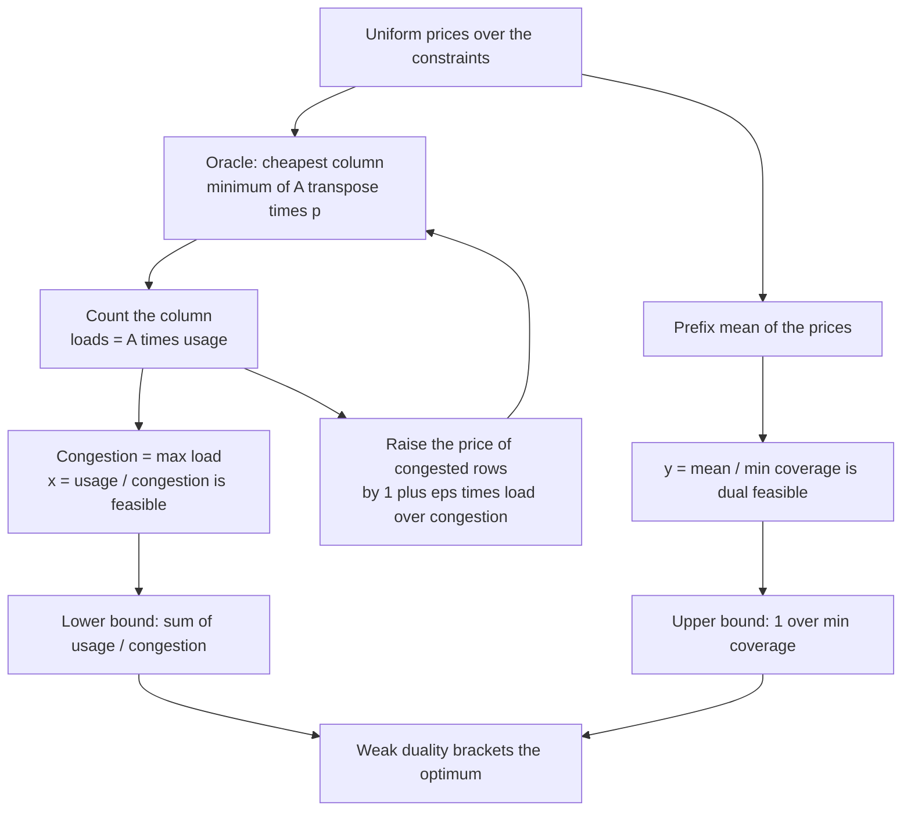
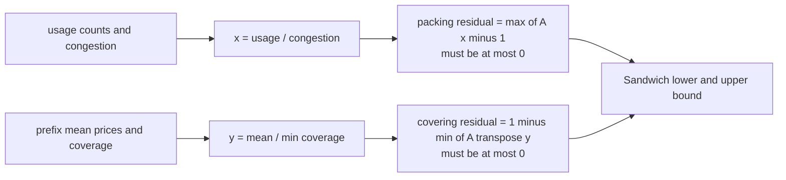
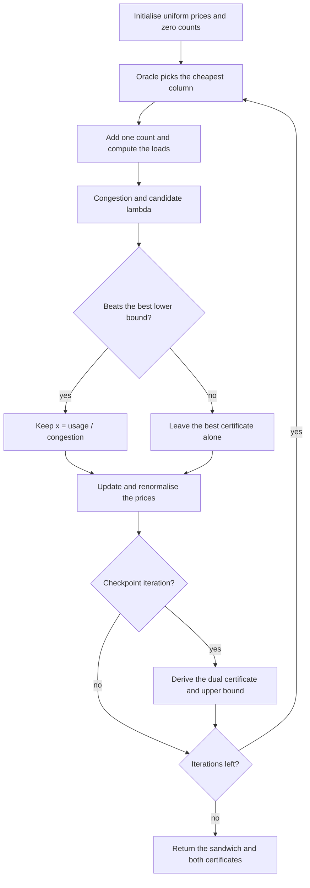
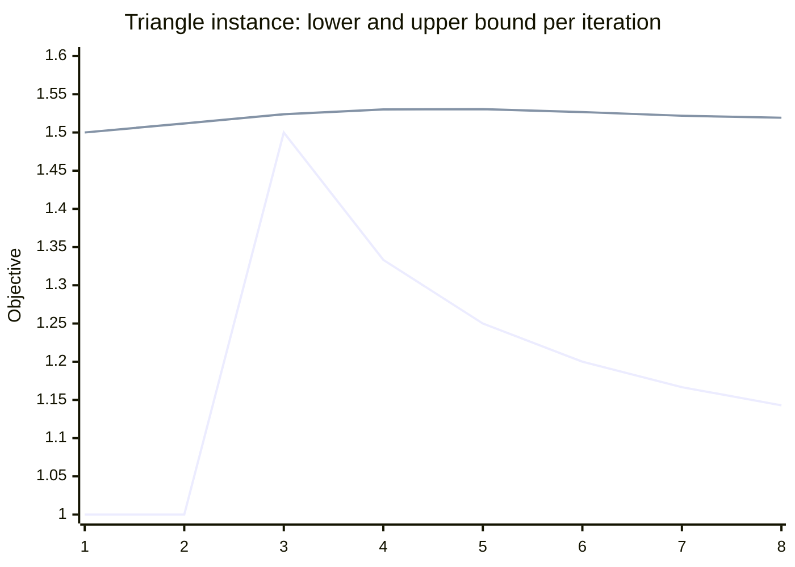
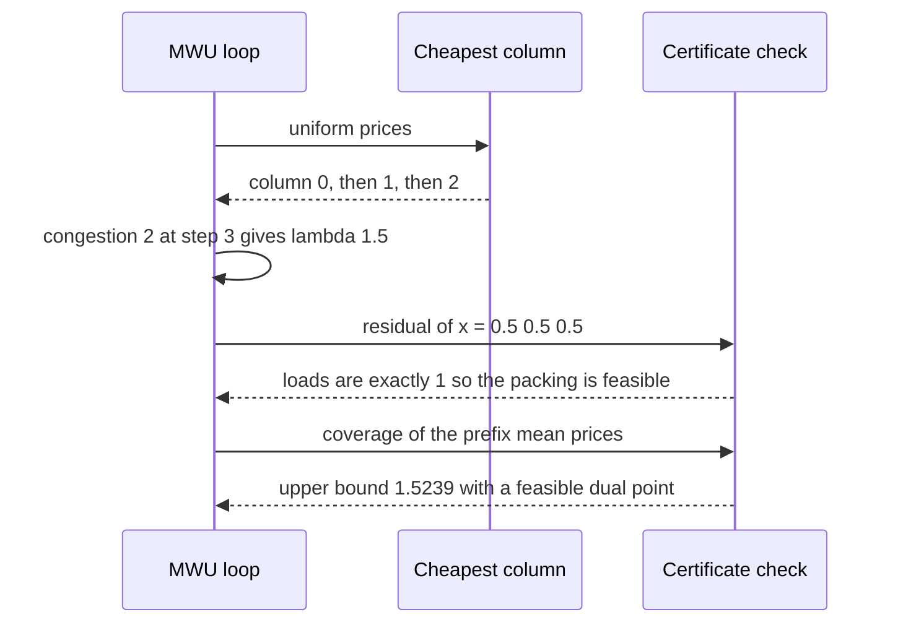

# 708 — Implement fractional packing and covering using multiplicative weights

> **Tier:** Expert · **CTCI chapter:** Ch 4 — Trees and Graphs
> **Task spec:** [708-implement-fractional-packing-covering-using-multiplicative-weigh.md](../../../tasks/expert/708-implement-fractional-packing-covering-using-multiplicative-weigh.md)
> **Solutions:** [Python](../../../solutions/python/expert/708-implement-fractional-packing-covering-using-multiplicative-weigh/solution.py) ·
> [Java](../../../solutions/java/expert/708-implement-fractional-packing-covering-using-multiplicative-weigh/Solution.java) ·
> [JavaScript](../../../solutions/javascript/expert/708-implement-fractional-packing-covering-using-multiplicative-weigh/solution.js) ·
> [C#](../../../solutions/csharp/expert/708-implement-fractional-packing-covering-using-multiplicative-weigh/Solution.cs)

## 1. Problem restatement

Solve the fractional packing LP and its dual covering LP with a single multiplicative-weights run, and
return **both sides of a sandwich** around the unknown optimum:

```text
packing:  max 1^T x   subject to  A x <= 1, x >= 0
covering: min 1^T y   subject to  A^T y >= 1, y >= 0          (A >= 0, both capacities 1)
```

| Function (Python) | Role |
| --- | --- |
| `oracle_pick(A, prices)` | the linear optimisation oracle: the column minimising the weighted cost `(A^T p)_j` |
| `packing_loads(A, usage)` | `A x` for the accumulated counting vector |
| `multiplicative_weights(A, iterations, epsilon)` | the loop; returns `(lb, x, ub, y, stats)` |
| `packing_residual(A, x)` | `max_i (A x)_i - 1 <= 0` certifies that `x` is feasible |
| `covering_residual(A, y)` | `1 - min_j (A^T y)_j <= 0` certifies that `y` is dual feasible |
| `exact_packing_optimum` / `exact_covering_optimum` | exact optima by vertex enumeration over `Fraction`s |

The loop: keep a probability vector `p` over the `m` packing constraints, started uniform; pick the
cheapest column `j = argmin_j (A^T p)_j`; count it once in `usage`; the loads are `A · usage` and the
congestion is `max_i loads_i`, so `x = usage / congestion` is a **feasible** packing solution with
objective `lambda = sum(usage) / congestion`, which gives the lower bound. Then multiply the price of
every congested row by `1 + eps * (loads_i / congestion)` and renormalise, so the next oracle call
avoids the bottleneck. On the dual side, the prefix mean of the prices `a = (1/t) sum of the prices so
far` satisfies `(A^T a)_j <= (1/t) sum of the oracle values`, so `y = a / min_j (A^T a)_j` is dual
feasible with objective `1 / min_j (A^T a)_j` — the **upper bound**, evaluated at roughly two dozen
checkpoints.

Concrete results the checks assert:

- `A = [[1,1],[1,0],[0,1]]`: exact optimum `1`; the lower bound never exceeds it, the upper bound never
  falls below it, both `x` and `y` are certified feasible, and `sum(x) == lb`, `sum(y) == ub`.
- Triangle `A = [[1,1,0],[0,1,1],[1,0,1]]`: exact optimum `3/2` for **both** LPs (strong duality), and
  the measured sandwich is `[1.5, 1.5239]` at the third iteration — a gap of `1.016`, well inside the
  asserted `ub / lb <= 1.35`.
- Diagonal `A = [[1,0,0],[0,1,0],[0,0,1]]`: lower bound exactly `3.0` and `2.0 <= ub <= 2.02` for
  `[[1,0],[0,1]]`, with both columns ending positive.
- 20 random instances (`m, n` in `2..4`, entries in `0..2`): the two exact optima agree, the sandwich
  contains them, both residuals are non-positive, and the measured **worst gap is `1.0275`** against an
  asserted ceiling of `1.6`.
- More iterations tighten the sandwich: on a `4 x 4` instance the gaps at `10, 40, 160, 640` iterations
  are `[1.4915, 1.0393, 1.0345, 1.0045]` — non-widening, and below `1.1` at `640`.
- Degenerate cases: an empty matrix reports `INF` with `"unbounded"`; a column missing every constraint
  reports `INF` with `"misses every constraint"`; `[[4]]` gives `lb == ub == 0.25`; `[[1]]` gives
  `lb == ub == 1.0`; `epsilon = 0`, a negative entry and a non-rectangular matrix are rejected.
- A 24-row, 30-column instance returns `lb = 1.8572`, `ub = 1.8983`, a gap of `1.0221`.

## 2. Intuition

The packing LP asks "how much of each column can I take before some resource runs out", and the
covering LP asks "how cheaply can I buy resources so every column is covered". Weak duality says every
feasible packing is at most every feasible covering, so a good pair of one of each *brackets* the
optimum without ever solving it exactly.

Multiplicative weights produce that pair from a single greedy walk. Resource `i` has a price; the oracle
picks the column that is cheapest per unit of objective; counting the picks gives a load vector and
therefore a **scaling certificate** — dividing the counts by the congestion makes them feasible. Then
congested resources get pricier, so the oracle's next choice avoids them, which is the adaptive
behaviour that makes the walk converge instead of stalling.



The two sides come from the *same* run, and both are re-derived from scratch before they are believed —
`packing_residual` recomputes `max_i (A x)_i` and `covering_residual` recomputes `min_j (A^T y)_j`, so a
bookkeeping bug in the loop cannot produce a bogus certificate.



## 3. Algorithm

1. Validate `0 < eps <= 1`, `iterations >= 1`, a rectangular, non-negative `A`.
2. Report the two unbounded-shaped degeneracies immediately: no constraints, or a column that no
   constraint touches (`INF` with a reason string).
3. Start with uniform prices `1 / m`, an empty counting vector `usage`, a zero price-sum vector and
   `best_lb = 0`, `best_ub = INF`.
4. Pre-compute ~24 checkpoints (plus the last iteration) at which the dual side is evaluated — the upper
   bound costs `O(m n)` and need not be recomputed every step.
5. Per iteration: add the current prices to the running sum; call the oracle; increment the chosen
   column's count; recompute the loads; compute the congestion and the candidate `lambda = sum(usage) /
   congestion`; keep it (with `x = usage / congestion`) if it beats the best lower bound.
6. Multiply the price of every loaded row by `1 + eps * (load_i / congestion)`, then renormalise the price
   vector so it stays a probability vector.
7. At a checkpoint: `a = price_sum / step`, `coverage_j = (A^T a)_j`, `smallest = min_j coverage_j`; if
   positive, `1 / smallest` is an upper bound and `y = a / smallest` the matching dual certificate. Keep
   the smallest upper bound seen.
8. Return the best `(lb, x)` and `(ub, y)` plus diagnostics: iteration count, oracle calls, checkpoint
   count and the best lower bound.

```text
procedure multiplicative_weights(A, iterations, epsilon)
    validate epsilon in (0, 1], iterations at least 1, rectangular non-negative A
    if A has no rows then return INF, none, INF, none, {reason: "unbounded"}
    if some column is zero in every row then return INF, none, INF, none, {reason: "misses every constraint"}
    prices ← 1 / m for each of the m constraints
    usage ← zeros of length n, price_sum ← zeros of length m
    best_lb ← 0, best_x ← zeros, best_ub ← INF, best_y ← none
    for step ← 1 to iterations do
        price_sum ← price_sum + prices
        j ← the column minimising sum over i of A[i][j] * prices[i]      // the oracle
        usage[j] ← usage[j] + 1
        loads ← A times usage
        congestion ← max over i of loads[i]
        if congestion > 0 and sum(usage) / congestion > best_lb then
            best_lb ← sum(usage) / congestion
            best_x ← usage / congestion
        for each row i with loads[i] > 0 do
            prices[i] ← prices[i] * (1 + epsilon * (loads[i] / congestion))
        prices ← prices / sum(prices)
        if step is a checkpoint then
            average ← price_sum / step
            coverage[j] ← sum over i of A[i][j] * average[i] for every column j
            smallest ← min over j of coverage[j]
            if smallest > 0 and 1 / smallest < best_ub then
                best_ub ← 1 / smallest
                best_y ← average / smallest
    return best_lb, best_x, best_ub, best_y, {iterations, oracle_calls, ub_checks}
end

procedure packing_residual(A, x)
    return max over i of (A x)_i - 1          // at most 0 means feasible
end

procedure covering_residual(A, y)
    return 1 - min over j of (A transpose y)_j    // at most 0 means dual feasible
end
```



The other solutions run the same framework with different step policies: Java takes the *largest* step a
column allows (`1 / max_i A_ij`) so its binding row hits exactly one, and flips the update for the
covering side (`1 + eps * (1 - A_ij * step)`); JavaScript implements the Grigoriadis-Khachiyan exponential
potential with profit-per-weight ratios and adds a two-column local search because an increase-only walk
can stall; C# solves fractional set cover with weights divided by `1 + eps` on covered elements and a
damped water-filling ascent for the dual.

## 4. Worked example

The triangle instance `A = [[1,1,0],[0,1,1],[1,0,1]]`, `eps = 0.1`, starting from uniform prices
`[1/3, 1/3, 1/3]`. Each row shows the oracle's pick, the accumulated counts, the loads `A · usage`, the
congestion, the certificate `lambda = t / congestion`, and the sandwich after the update.

| Step | Oracle column | `usage` | loads `A·usage` | congestion | `lambda` | best `lb` | dual `ub` |
| --- | --- | --- | --- | --- | --- | --- | --- |
| 1 | 0 | `[1, 0, 0]` | `[1, 0, 1]` | 1 | 1.0 | 1.0 | 1.5 |
| 2 | 1 | `[1, 1, 0]` | `[2, 1, 1]` | 2 | 1.0 | 1.0 | 1.5118 |
| 3 | 2 | `[1, 1, 1]` | `[2, 2, 2]` | 2 | **1.5** | **1.5** | 1.5239 |
| 4 | 2 | `[1, 1, 2]` | `[2, 3, 3]` | 3 | 1.3333 | 1.5 | 1.5301 |
| 5 | 2 | `[1, 1, 3]` | `[2, 4, 4]` | 4 | 1.25 | 1.5 | 1.5305 |
| 6 | 1 | `[1, 2, 3]` | `[3, 5, 4]` | 5 | 1.2 | 1.5 | 1.5267 |
| 7 | 1 | `[1, 3, 3]` | `[4, 6, 4]` | 6 | 1.1667 | 1.5 | 1.5219 |
| 8 | 1 | `[1, 4, 3]` | `[5, 7, 4]` | 7 | 1.1429 | 1.5 | 1.5193 |

At step 3 the certificate is `x = [1, 1, 1] / 2 = [0.5, 0.5, 0.5]` with loads exactly `[1, 1, 1]`,
objective `1.5` — the exact optimum from `exact_packing_optimum`, which is `Fraction(3, 2)`. Steps 4 to 8
keep counting columns but the congestion grows faster than the count, so the candidate `lambda` *falls*:
this is the stall the JavaScript solution fixes with a local search, and it is why the loop keeps the best
certificate instead of the last one. Meanwhile the dual side slowly improves: the prefix-mean prices give
coverage `min_j (A^T a)_j` and an upper bound that walks from `1.5` down to `1.5193`, so the retained
sandwich at step 8 is `[1.5, 1.5193]`, a gap of about `1.013`.





Verified on the wider battery: the exact optima of the packing and the covering LPs agree on all 20
random instances (strong duality, verified independently by vertex enumeration over `Fraction`s), the
sandwich always contains the optimum, and the measured worst gap was `1.0275`. Increasing the iteration
budget tightens the bracket on a `4 x 4` instance: gaps `[1.4915, 1.0393, 1.0345, 1.0045]` at
`10, 40, 160, 640` iterations.

## 5. Complexity

Let `m` be the number of constraints, `n` the number of columns and `T` the iteration count.

| Quantity | Bound | Why |
| --- | --- | --- |
| Oracle call | `O(m n)` | a linear scan over the columns computing `(A^T p)_j` — the documented simplification over a min-cost-flow or knapsack oracle |
| Load recomputation | `O(m n)` naive | `A · usage`; the solutions recompute it each iteration for clarity |
| Price update | `O(m)` | one multiplication and one renormalisation per row |
| Dual side | `O(m n)` at ~24 checkpoints | a prefix mean, a matrix product and a minimum, not every iteration |
| Total | `O(T m n)` | dominated by the per-iteration oracle and load product |
| Iterations needed for a `(1 + eps)` gap | `O(m log m / eps^2)` in the classical analysis | the header states the count is a parameter here, not an adaptive rule |
| Space | `O(m n)` for the matrix, `O(m + n)` for the iterates | prices, usage, price sums, one certificate each side |
| Exact oracle | vertex enumeration over subsets, exact `Fraction` arithmetic | exponential, only for the tiny instances used by the checks |
| Certificate checks | `O(m n)` each | `packing_residual` and `covering_residual` recompute from scratch |

**Documented simplifications** (from the Python header): the oracle is a linear scan rather than a
min-cost-flow or knapsack oracle, all capacities are 1 (an instance with general `b` is pre-scaled), and
`iterations`/`epsilon` are parameters rather than chosen adaptively.

## 6. Pitfalls and edge cases

- **A certificate must be recomputed, not trusted.** `x` and `y` are re-checked by
  `packing_residual` / `covering_residual` before the bounds are believed; otherwise a bookkeeping bug
  would produce a confident, wrong answer.
- **A column that no constraint touches makes the packing unbounded.** The loop returns `INF` with
  `"misses every constraint"` instead of iterating forever; an empty matrix reports `"unbounded"`.
- **All-zero matrices and zero optima need care.** The random sweep skips instances whose exact optimum
  is `0`, because the ratio `ub / lb` is then undefined.
- **`epsilon = 0` is rejected.** Without an update the prices never change and the oracle repeats itself.
- **The update must be per-row and proportional to the load.** Raising every price uniformly changes no
  oracle decision; raising only congested rows is the entire mechanism.
- **Renormalisation keeps the prices a probability vector**, so `(A^T p)_j` stays comparable across
  iterations and the prefix mean remains a valid dual candidate.
- **The lower bound is not monotone.** After the walk saturates a column the candidate `lambda` falls
  (steps 4–8 of the trace), so the loop must keep the *best* certificate rather than the last one.
- **The upper bound is evaluated only at checkpoints.** It is `O(m n)` and its value is a running
  minimum, so sampling cannot widen the reported bracket; the checks assert the gap never grows with more
  iterations on the `4 x 4` instance.
- **Degenerate shapes must still be exact**: `[[4]]` gives `lb == ub == 0.25` and `[[1]]` gives
  `lb == ub == 1.0`, so a single-row instance is solved by the certificate itself.
- **Negative or ragged matrices are rejected** (`"non-negative"`, `"rectangular"`), and the exact oracle
  only accepts well-posed systems — a singular vertex system simply contributes no candidate.
- **One oracle call per iteration** is asserted (`stats["oracle_calls"] == iterations`), which keeps the
  cost model honest when the iteration count is tuned.

## 7. Variants and follow-ups

- **Exact verification.** For small instances the vertex enumeration over `Fraction`s gives both optima
  exactly, which turns "the sandwich should contain the answer" into a theorem-checked assertion; the
  same trick validates any generalised LP the reader writes.
- **Stronger oracles.** The framework only needs "pick the most promising column": a knapsack, a
  min-cost flow, or even an expensive-heuristic oracle plugs in unchanged, which is why the scheme is the
  standard approach for packing problems with hard subproblems.
- **Largest-step policies.** Java takes the largest step that keeps the chosen column's binding row at
  exactly 1 and flips the update on the covering side; JavaScript uses the exponential potential of
  Grigoriadis-Khachiyan and adds a two-column local search to escape a stalled vertex.
- **The flow connection.** Multi-commodity flow is the packing LP where the oracle itself is a shortest
  path computation — the same loop with a different oracle, as implemented in
  [707 — multi-commodity flow approximate algorithm outline](../../../tasks/expert/707-implement-multi-commodity-flow-approximate-algorithm-outline.md).
  The exact single-commodity counterpart, with its min-cut certificate, is
  [706 — max flow with lower and upper bounds and circulation feasibility](../../../tasks/expert/706-implement-max-flow-with-lower-upper-bounds-and-circulation-feasi.md).
- **Privacy-aware packing.** Multiplicative weights are the workhorse behind private LP and counting
  mechanisms once noise is injected: see
  [709 — differential privacy noise addition and utility tradeoff](../../../tasks/expert/709-implement-differential-privacy-noise-addition-and-utility-tradeo.md)
  and [710 — private count sketches with the Laplace mechanism](../../../tasks/expert/710-implement-private-count-sketches-with-laplace-mechanism-simulati.md).
- **Dynamic or streaming matrices.** When rows and columns arrive over time, the same walk runs online;
  the interesting questions become regret bounds instead of a final certificate.

## 8. Check yourself

<details><summary>Show answer</summary>

**1. Why does a single run produce two bounds instead of just one solution?**

Because the packing iterate and the averaged price vector are feasibility certificates for the two dual
LPs: `usage / congestion` is a feasible packing, and `a / min_j (A^T a)_j` is a feasible covering. Weak
duality then sandwiches the optimum between their objectives, so the run returns both a lower and an upper
bound without ever solving either LP exactly.

</details>

<details><summary>Show answer</summary>

**2. What is the oracle, and why is a linear scan acceptable here?**

`argmin_j (A^T p)_j`: the column with the smallest weighted resource cost, i.e. the most objective per
unit of weighted resource. A scan is `O(m n)` per iteration. The Python header states this as a
deliberate simplification — in a generalised framework the oracle could be a min-cost-flow or knapsack
solve — and it is exact for the small instances used here.

</details>

<details><summary>Show answer</summary>

**3. Trace the triangle instance: what happens at step 3 and after?**

At step 3 the oracle has picked each column once, so `usage = [1, 1, 1]`, every load is exactly 2 and
`congestion = 2`; the certificate `x = [0.5, 0.5, 0.5]` has objective `1.5`, exactly the optimum. After
that the congested rows become expensive, the counts grow faster than the congestion and the candidate
`lambda` falls (`1.3333, 1.25, ...`), which is why the loop keeps the best certificate and not the last
one.

</details>

<details><summary>Show answer</summary>

**4. Where does the upper bound come from, and why is it only evaluated at checkpoints?**

From the prefix mean of the prices: `(A^T a)_j <= (1/t) sum of oracle values`, so scaling the mean by
`1 / min_j (A^T a)_j` gives a feasible dual point whose objective bounds the optimum from above. It costs
`O(m n)` to evaluate, so the solutions sample roughly two dozen iterations and keep the running minimum;
the tests confirm the bracket never widens as iterations increase.

</details>

<details><summary>Show answer</summary>

**5. Which degeneracies are reported rather than looped over, and why?**

An empty constraint set (the packing is unbounded) and any column that no constraint touches (it can be
increased forever at zero resource cost). Both return `INF` with a reason string, because no finite
optimum exists; a naive loop would look like it was still converging. The remaining shapes (`[[4]]`,
`[[1]]`, anti-diagonal, all-zero matrices) are handled by the ordinary loop, with the sweep skipping
instances whose exact optimum is zero because the ratio is undefined there.

</details>
