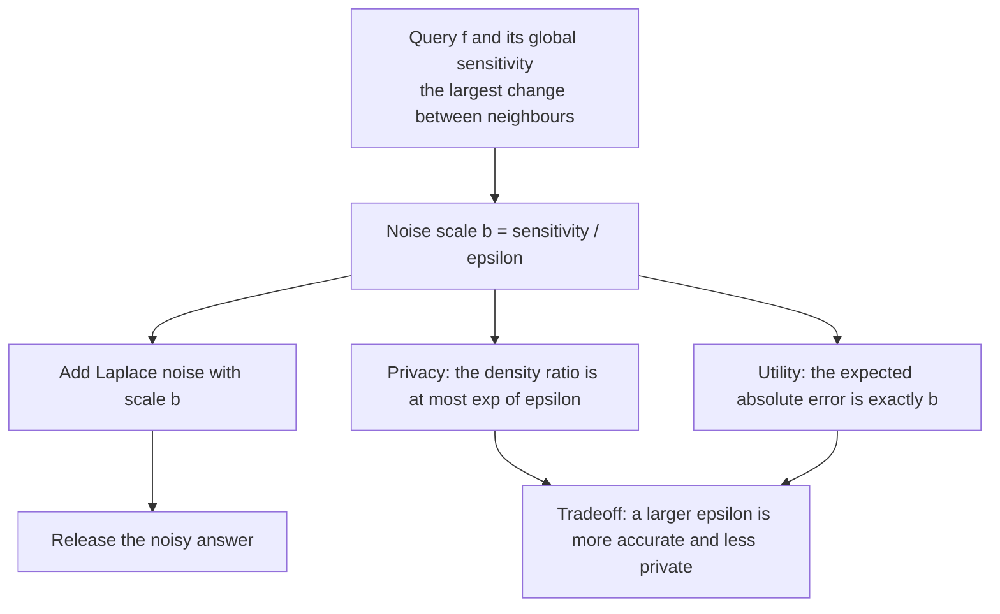
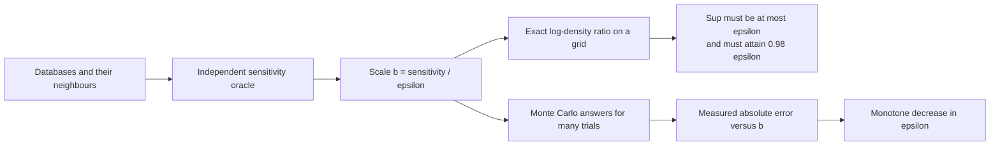
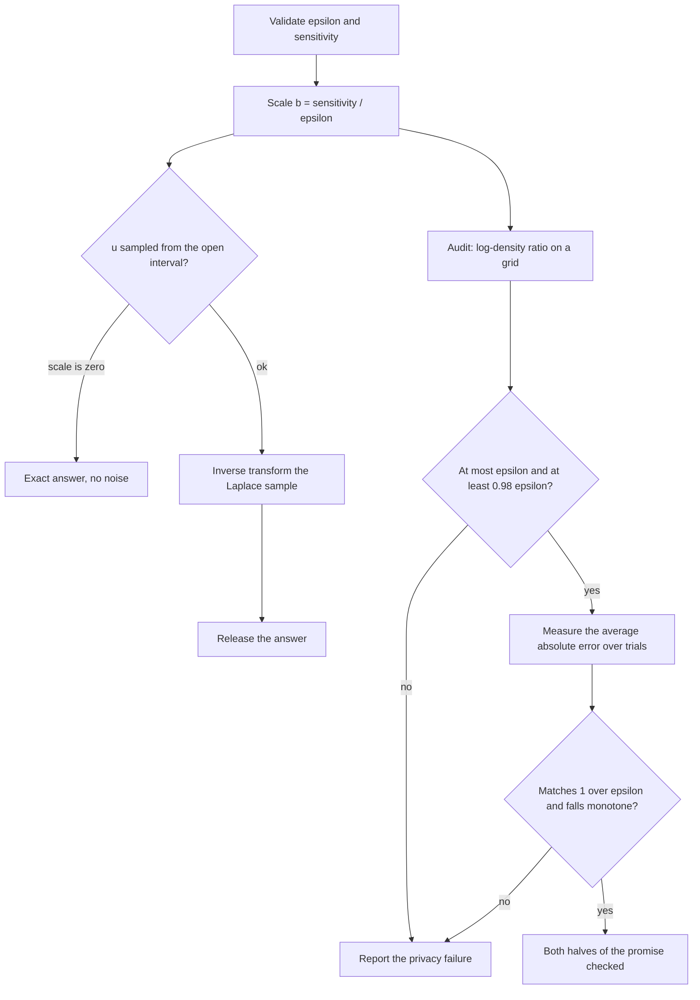
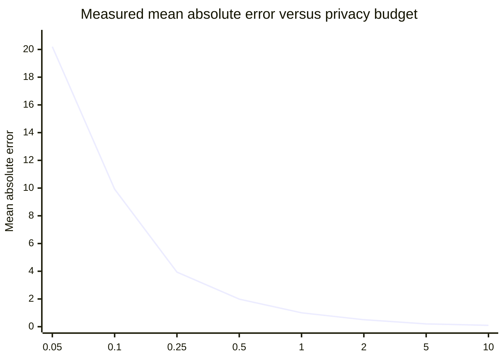
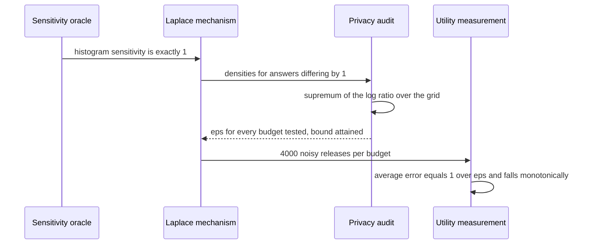

# 709 — Implement differential privacy noise addition and utility tradeoff demo

> **Tier:** Expert · **CTCI chapter:** Beyond — Security & Privacy
> **Task spec:** [709-implement-differential-privacy-noise-addition-and-utility-tradeo.md](../../../tasks/expert/709-implement-differential-privacy-noise-addition-and-utility-tradeo.md)
> **Solutions:** [Python](../../../solutions/python/expert/709-implement-differential-privacy-noise-addition-and-utility-tradeo/solution.py) ·
> [Java](../../../solutions/java/expert/709-implement-differential-privacy-noise-addition-and-utility-tradeo/Solution.java) ·
> [JavaScript](../../../solutions/javascript/expert/709-implement-differential-privacy-noise-addition-and-utility-tradeo/solution.js) ·
> [C#](../../../solutions/csharp/expert/709-implement-differential-privacy-noise-addition-and-utility-tradeo/Solution.cs)

## 1. Problem restatement

Implement the Laplace mechanism — release `f(x) + Lap(0, b)` with `b = sensitivity / eps` — and then
**audit** both halves of its promise instead of asserting them: the privacy ratio bound and the
utility/privacy tradeoff.

| Function (Python) | Role |
| --- | --- |
| `splitmix64` / `Rng.unit()` / `Rng.centred()` | deterministic uniform stream on `[0, 1)` and on the open interval `(-1/2, 1/2)` |
| `laplace_sample(scale, rng)` | inverse-transform Laplace sample: `-b * sign(u) * ln(1 - 2 abs(u))` |
| `gaussian_sample(sigma, rng)` | Box-Muller normal sample |
| `laplace_scale` / `gaussian_sigma` | `Δf / eps` and `Δf * sqrt(2 ln(1.25 / delta)) / eps` |
| `laplace_mechanism` / `gaussian_mechanism` | true answer plus calibrated noise |
| `laplace_log_density` | `-abs(value - answer)/b - ln(2b)` — the audit's workhorse |
| `histogram_query` / `neighbours` / `empirical_sensitivity` | the query, its neighbouring databases, and an independent sensitivity oracle |
| `sensitivity_l1` | scale a unit-sensitivity query |

Concrete results the checks assert:

- **Sampler**: with `b = 2.5` and 120 000 draws, the mean is within `5 %` of `0` and the variance within
  `5 %` of `2b²`; the empirical CDF hits `0.5` at `0`, `0.75` at `b ln 2`, `0.5 e^-2` at `-2b` and
  `1 - 0.5 e^-1` at `b`, each within `0.01`. With `sigma = 1.75` and 60 000 normals the variance matches
  `sigma²` within `5 %`.
- **Sensitivity oracle**: enumerating one-record additions and removals shows the 4-bucket histogram has
  L1 sensitivity exactly `1.0` (and per-coordinate sensitivity `1.0`), scaling by 3 gives `3.0`, and a
  plain count has sensitivity `1.0`.
- **Privacy ratio**: over a grid of outputs (step `0.05 b`, both positive and negative), the sup of
  `|ln p_x(z) - ln p_y(z)|` for answers differing by the sensitivity satisfies
  `0.98 eps <= sup <= eps + 1e-9` for `eps` in `0.1, 0.5, 1.0, 3.0` — the bound is *attained*, not just
  respected — and 200 random neighbouring pairs pass the same test.
- **Utility**: on `[0, 0, 1, 1, 1, 2, 2, 3]` with 4000 trials per budget, the measured mean absolute error
  equals `b = 1 / eps` within `6 %` and falls monotonically: `20.197, 9.921, 3.940, 1.991, 1.002, 0.504,
  0.203, 0.100` for `eps = 0.05, 0.1, 0.25, 0.5, 1, 2, 5, 10`. At `eps = 1000` every answer is within
  `0.05` of the truth; at `eps = 0.01` the worst error exceeds `50`.
- **Composition**: six mechanisms of `eps = 0.5` compose to `3.0`; the measured variance of the summed
  noise is `47.8417` against the theoretical `2 k b² = 48.0` (within `8 %`), and it matches a *single*
  mechanism run at scale `b sqrt(k)`.
- **Gaussian comparison** at `delta = 1e-5`: Laplace versus Gaussian mean error is `1.997 / 7.766`,
  `1.016 / 3.814` and `0.524 / 1.939` for `eps = 0.5, 1, 2` — the Gaussian pays in accuracy for its
  lighter tail.
- **Boundaries**: zero sensitivity gives an exact answer (both mechanisms); an empty database gives an
  all-zero histogram with noise staying within `30` of it; a single record lands in one bucket;
  non-positive `eps`, `delta` outside `(0, 1)` and negative sensitivity are rejected.

## 2. Intuition

A numeric query `f` leaks information through its *exact* answer: two databases differing in one record
can produce answers that differ by the query's global sensitivity `Δf`, and that difference is the
leakage. Differential privacy removes it by adding noise whose spread is calibrated to the sensitivity,
so that no output value becomes much more likely under one database than under the other.

The Laplace distribution is the canonical choice because its density ratio is exactly expressible in the
data difference. With `b = Δf / eps`, for two answers `x` and `y = x + Δf` and any output `z`:

```text
ln p_x(z) - ln p_y(z) = (|z - y| - |z - x|) / b   and   |z - y| - |z - x| <= |x - y| = Δf
```

so the log-ratio is bounded by `Δf / b = eps` — which is precisely the `eps`-differential-privacy
definition, in the density form. The utility side comes from the same `b`: the mean absolute error of the
released answer is exactly `E|Lap(b)| = b`, so the error and the privacy budget trade off as `1 / eps`.



The demo is written so that neither claim is trusted: the sensitivity is computed by enumerating
neighbouring databases, the privacy ratio is evaluated on the mechanism's exact log-density over a grid
of outputs, and the error is measured from the samples the mechanism actually produced.



## 3. Algorithm

1. **Deterministic randomness.** A `splitmix64` stream feeds `Rng.unit()` in `[0, 1)` (half-open so the
   inverse transform never sees an endpoint) and `Rng.centred()` in the open interval `(-1/2, 1/2)`.
2. **Calibration.** `laplace_scale(sensitivity, eps)` returns `Δf / eps` and rejects non-positive `eps` and
   negative sensitivity; `gaussian_sigma(Δf, eps, delta)` returns `Δf sqrt(2 ln(1.25/delta)) / eps` and
   rejects `delta` outside `(0, 1)`.
3. **Sampling.** Inverse transform: draw `u` in `(-1/2, 1/2)`, compute `-b * sign(u) * ln(1 - 2|u|)`; a
   zero scale short-circuits to an exact `0.0`.
4. **The query.** `histogram_query` counts records into buckets and rejects records outside them; the
   neighbouring databases are all one-record removals plus one-record additions.
5. **Sensitivity oracle.** `empirical_sensitivity` enumerates those neighbours and takes the largest L1
   change — an independent check that the closed-form sensitivity used for calibration is right.
6. **Privacy audit.** For answers `x` and `y = x + Δf`, evaluate
   `|ln p_x(z) - ln p_y(z)| = |(|z - y| - |z - x|)| / b` on a grid of `z` and take the supremum; check it
   is at most `eps` and that it reaches at least `0.98 eps`, then repeat on random neighbouring pairs.
7. **Utility measurement.** For a sweep of budgets, run many trials, average the mean absolute error per
   answer and compare with `b`; also check the error falls monotonically as `eps` grows, and that a huge
   `eps` makes answers essentially exact while a tiny one makes them useless.
8. **Composition.** Sum `k` independent samples of scale `b` and check the variance is `2 k b²` — the same
   as one sample of scale `b sqrt(k)` — against the composition statement `k * eps`.

```text
procedure laplace_sample(scale, rng)
    if scale = 0 then return 0.0
    u ← rng.centred()                       // uniform in (-1/2, 1/2)
    tail ← -scale * ln(1 - 2 * abs(u))
    return tail if u < 0 else -tail
end

procedure laplace_mechanism(true_answer, sensitivity, epsilon, rng)
    check epsilon > 0 and sensitivity >= 0
    return true_answer + laplace_sample(sensitivity / epsilon, rng)
end

procedure empirical_sensitivity(query, databases)
    worst ← 0
    for each database in databases do
        base ← query(database)
        for each neighbour (one record added or removed) do
            other ← query(neighbour)
            worst ← max(worst, sum over coordinates of abs(base - other))
    return worst
end

procedure audit_privacy(answers, epsilon)
    scale ← sensitivity / epsilon
    worst ← 0
    for each pair (x, y) of answers differing by the sensitivity do
        for each grid point z do
            ratio ← laplace_log_density(z, x, scale) - laplace_log_density(z, y, scale)
            worst ← max(worst, abs(ratio))
    return worst                            // must satisfy 0.98 * epsilon <= worst <= epsilon
end

procedure measure_tradeoff(true_counts, budgets, trials)
    for each epsilon in budgets do
        total ← 0
        for trial ← 1 to trials do
            noisy ← [laplace_mechanism(value, 1, epsilon, rng) for value in true_counts]
            total ← total + sum over buckets of abs(noisy - true_counts) / length(true_counts)
        error[epsilon] ← total / trials    // must match the theoretical scale 1 / epsilon
    return error
end
```



The other solutions audit the same claims with sharper tools: Java computes the ratio from the
**closed-form CDF** over a grid of output intervals (and keeps a negative control in which an
underestimated noise scale really does break the bound) and checks composition on the convolved
distribution; JavaScript uses the *exact discrete* Laplace pmf, whose ratio `p(k) / p(k+1) = e^(1/scale)`
is exact for integer outputs, and adds post-processing; C# implements the Laplace, Gaussian and
exponential mechanisms and demands that empirical output ratios over 40 000 samples per database stay
inside the `exp(±eps)` envelope.

## 4. Worked example

The utility trace is the task's centrepiece. On the database `[0, 0, 1, 1, 1, 2, 2, 3]` the histogram is
`[2, 3, 2, 1]`, and each budget is measured with 4000 trials of the whole 4-bucket release:

| `eps` | theoretical `b = 1/eps` | measured mean absolute error |
| --- | --- | --- |
| `0.05` | `20.0` | `20.197` |
| `0.1` | `10.0` | `9.921` |
| `0.25` | `4.0` | `3.940` |
| `0.5` | `2.0` | `1.991` |
| `1` | `1.0` | `1.002` |
| `2` | `0.5` | `0.504` |
| `5` | `0.2` | `0.203` |
| `10` | `0.1` | `0.100` |

Every measured value is within `6 %` of `b`, and the sequence is strictly decreasing — the tradeoff, as
measured rather than asserted. The extremes bracket it from both sides: at `eps = 1000` (4000 samples)
every answer lands within `0.05` of the truth, and at `eps = 0.01` (500 samples) the worst error exceeds
`50`.



The privacy side is checked on the exact density rather than on samples. For answers `x` and `y = x + 1`
(a unit sensitivity) and `b = 1/eps`, the supremum of `|ln p_x(z) - ln p_y(z)|` over the grid is *exactly*
`eps` when `z` lies outside the interval between the two answers, and smaller inside it. The audit asserts
both directions — `sup <= eps` (privacy holds) and `sup >= 0.98 eps` (the mechanism is calibrated, not
over-noised) — for `eps` in `0.1, 0.5, 1.0, 3.0`, and then repeats the check on 200 random neighbouring
pairs.



Composition closes the loop: six mechanisms with `eps = 0.5` each compose to `3.0`, and the variance of
their summed noise was measured as `47.8417` against the theoretical `2 k b² = 48.0` (a `0.33 %` error on
40 000 trials). Summing is equivalent to one mechanism run at scale `b sqrt(k)`, whose measured variance
matches the same value — the arithmetic identity behind the composition theorem, demonstrated.

## 5. Complexity

| Quantity | Bound | Why |
| --- | --- | --- |
| One Laplace sample | `O(1)` | one uniform draw, one logarithm |
| Calibration | `O(1)` | a division (or one square root and logarithm for the Gaussian) |
| Histogram query | `O(#records + buckets)` | one pass over the records |
| Sensitivity oracle | `O(#databases * (#records + buckets))` | enumerating all one-record neighbours |
| Privacy audit | `O(#answers^2 * #grid points)` | two density evaluations per grid point per pair |
| Utility measurement | `O(budgets * trials * buckets)` | 4000 trials per budget in the trace |
| Composition check | `O(trials * k)` | summing `k` samples per trial |
| Space | `O(buckets + trials)` | only the counts and the sampled values are kept |
| Exact (non-sampled) audits in the other solutions | `O(#grid points)` on the CDF, `O(#outputs)` on the discrete pmf | the ratio bounds are computable in closed form, which is why Java and JavaScript avoid sampling for the privacy half |

**Documented simplifications** (from the Python header): databases are small multisets held in memory,
the privacy audit is done on the mechanism's exact density over a grid rather than by a statistical test
on samples, and the utility numbers are Monte-Carlo estimates quoted with their tolerance — every
reported error and variance comes from samples the deterministic PRNG actually produced, and the checked
inequalities are the ones the theory guarantees.

## 6. Pitfalls and edge cases

- **The uniform must stay strictly inside `(-1/2, 1/2)`.** The inverse transform contains `ln(1 - 2|u|)`,
  which is `-inf` at `|u| = 1/2`; `Rng.centred()` is engineered to never touch the endpoints, and the
  boundary test asserts `all(-0.5 < value < 0.5)`.
- **Zero sensitivity means zero noise**, and both mechanisms short-circuit to the exact answer. A query
  whose sensitivity is genuinely 0 leaks nothing, so adding noise would only hurt.
- **`eps <= 0` is rejected**, `delta` outside `(0, 1)` is rejected, and negative sensitivity is rejected —
  each with a message the tests match on, so a silent coercion cannot slip through.
- **Sensitivity must be measured, not assumed.** The oracle enumerates one-record additions and removals;
  for the histogram the L1 and per-coordinate values coincide at `1.0` because a single record touches a
  single bucket, which is exactly why the mechanism is calibrated with the per-coordinate statement.
- **The privacy audit must be a two-sided test.** Only checking `sup <= eps` would pass for an
  over-noised mechanism that ignores the budget; the tests also require `sup >= 0.98 eps`, i.e. that the
  advertised bound is attained.
- **Sampling cannot prove privacy.** The ratio claims are evaluated on exact densities; Monte Carlo is
  used only for the utility side, where the tolerance is stated and met (`6 %` on the mean error).
- **A huge `eps` is close to no privacy at all.** `eps = 1000` gives near-exact answers *and* essentially
  no guarantee; the demo shows the accuracy extreme deliberately.
- **Composition is additive in `eps`.** Six `0.5` mechanisms cost `3.0`, and the noise grows like
  `sqrt(k)` in scale; forgetting the `sqrt` (or the sum) misstates both the privacy and the accuracy.
- **An empty database is a legal input**: the histogram is all zeros and the noisy release stays within
  `30` of it, so the noise does not run away.
- **Determinism is a feature of the demo, not of the mechanism.** The `splitmix64` stream makes every
  reported number reproducible; two runs with the same seed give identical output, and different seeds
  give different streams (asserted).

## 7. Variants and follow-ups

- **Sharper audits.** Java computes the ratio from the closed-form CDF over output *intervals* and keeps
  a negative control (a smaller noise scale than advertised really does break `e^eps`); JavaScript uses
  the exact discrete pmf, where `p(k) / p(k+1) = e^(1/scale)`, and covers post-processing. Both avoid
  sampling for the privacy half, which is the right instinct.
- **The Gaussian mechanism.** `sigma = Δf sqrt(2 ln(1.25/delta)) / eps` gives `(eps, delta)`-DP with a
  lighter tail; the demo compares its accuracy against Laplace (`7.766` versus `1.997` mean error at
  `eps = 0.5`, `delta = 1e-5`), which is the price of that tail.
- **Other mechanisms.** C# adds the exponential mechanism, sampling an item with probability proportional
  to `exp(eps * u(item) / (2 * sensitivity))`, the standard tool when the answer is a choice rather than a
  number.
- **Composition and budgeting.** Advanced composition, parallel composition over disjoint data, and
  privacy amplification by subsampling all refine the additive `k * eps` rule the demo verifies.
- **Auditing in practice.** The tooling around DP (privacy filters, accounting ledgers) exists because the
  guarantees are compositional; the arithmetic examined here is the atomic piece they accumulate.
- **Private sketches.** The same budget reasoning governs noisy-count structures — the Laplace mechanism
  applied per counter, as in
  [710 — private count sketches with the Laplace mechanism](../../../tasks/expert/710-implement-private-count-sketches-with-laplace-mechanism-simulati.md) —
  and privacy-preserving joins, as in
  [712 — privacy-preserving set intersection via hashing sketch](../../../tasks/expert/712-implement-privacy-preserving-set-intersection-via-hashing-sketch.md).
  When a private computation is an LP, multiplicative weights is the optimiser, as in
  [708 — fractional packing and covering](../../../tasks/expert/708-implement-fractional-packing-covering-using-multiplicative-weigh.md).

## 8. Check yourself

<details><summary>Show answer</summary>

**1. Why is the Laplace scale `sensitivity / eps` rather than something proportional to the data size?**

Because the leak is the *difference* between neighbouring databases' answers, which is exactly the global
sensitivity. The density ratio `exp((|z - y| - |z - x|) / b)` depends only on `|x - y|` and `b`, so
choosing `b = Δf / eps` gives `sup_z |ln p_x(z) - ln p_y(z)| = Δf / b = eps` regardless of how large the
database is.

</details>

<details><summary>Show answer</summary>

**2. How is the sensitivity of the histogram query verified here?**

By an independent oracle: enumerate all one-record additions and removals, query each neighbour, and take
the largest L1 (and per-coordinate) change. For a 4-bucket histogram that is exactly `1.0`, scaling the
query by 3 makes it `3.0`, and a plain count is `1.0` — so the calibration uses a measured number, not an
assumed one.

</details>

<details><summary>Show answer</summary>

**3. Why does the privacy audit require the ratio to *attain* `0.98 eps`?**

Because `sup <= eps` alone is satisfied by arbitrarily large noise, which would be private but useless.
Requiring the supremum to come close to `eps` shows the mechanism spends the budget it advertises and no
more, which is what makes the utility numbers (`b = 1/eps`) meaningful.

</details>

<details><summary>Show answer</summary>

**4. Reproduce the utility tradeoff numbers and explain the pattern.**

With sensitivity 1 and 4000 trials per budget, the measured mean absolute error was `20.197, 9.921, 3.940,
1.991, 1.002, 0.504, 0.203, 0.100` for `eps = 0.05 ... 10`, matching `b = 1/eps` within `6 %` and falling
monotonically. The pattern is `E|Lap(b)| = b`, so accuracy improves linearly in `eps` while privacy
degrades linearly — the tradeoff is an inverse relationship, not a coincidence.

</details>

<details><summary>Show answer</summary>

**5. What does composition add, and how is it checked numerically?**

Composing `k` mechanisms with budgets `eps_i` costs the sum of the budgets, and here six `0.5` mechanisms
compose to `3.0`. Numerically the variance of the summed noise must be `2 k b² = 48`, measured at
`47.8417` over 40 000 trials (within the `8 %` tolerance), and it must match one mechanism run at scale
`b sqrt(k)` — the same variance, which is the arithmetic content of "the noise grows like the square root
of the number of mechanisms".

</details>
