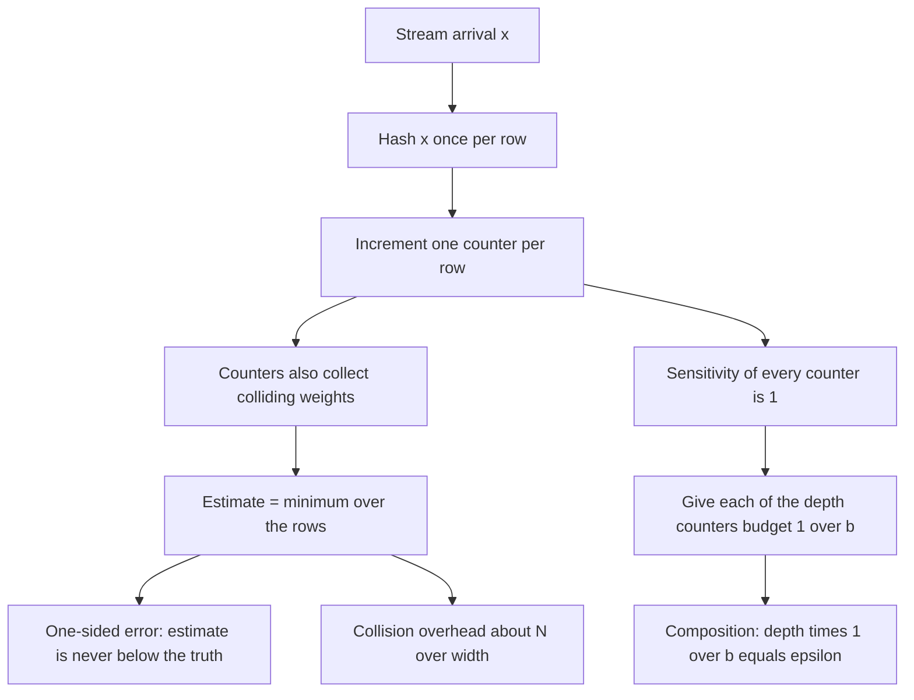
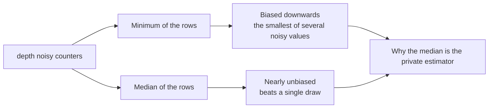
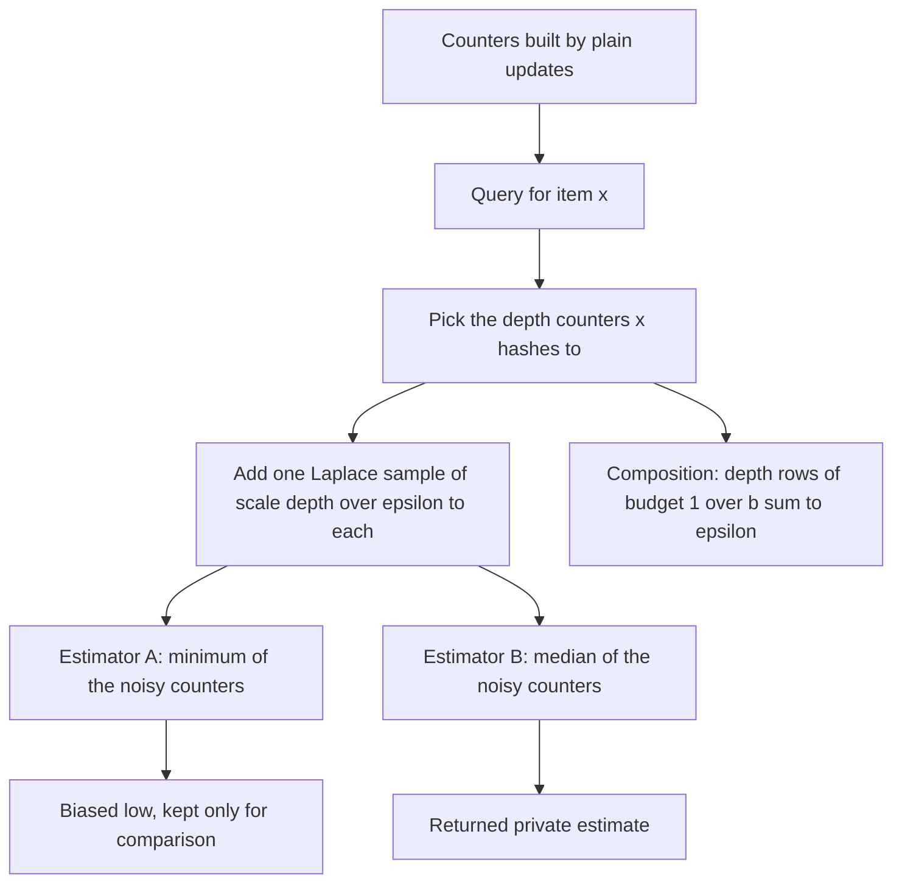
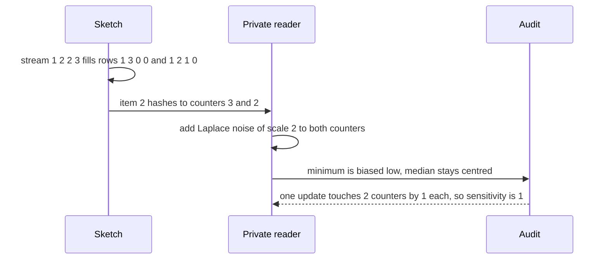

# 710 — Implement private count sketches with the Laplace mechanism

> **Tier:** Expert · **CTCI chapter:** Beyond — Security & Privacy
> **Task spec:** [710-implement-private-count-sketches-with-laplace-mechanism-simulati.md](../../../tasks/expert/710-implement-private-count-sketches-with-laplace-mechanism-simulati.md)
> **Solutions:** [Python](../../../solutions/python/expert/710-implement-private-count-sketches-with-laplace-mechanism-simulati/solution.py) ·
> [Java](../../../solutions/java/expert/710-implement-private-count-sketches-with-laplace-mechanism-simulati/Solution.java) ·
> [JavaScript](../../../solutions/javascript/expert/710-implement-private-count-sketches-with-laplace-mechanism-simulati/solution.js) ·
> [C#](../../../solutions/csharp/expert/710-implement-private-count-sketches-with-laplace-mechanism-simulati/Solution.cs)

## 1. Problem restatement

Answer "how often did `x` occur?" over a stream in constant space, and then release the answers under a
differential-privacy budget. The structure is the count-min sketch: `depth` rows of `width` counters, one
hash per row, each arrival increments one counter per row, and the estimate is the minimum of the item's
`depth` counters.

| Piece (Python) | Role |
| --- | --- |
| `CountMinSketch(width, depth, seed)` | multiply-shift hashing over `HASH_PRIME = 2^61 - 1`; `counts[row][slot]` |
| `positions(item)` | one slot per row: `((a * item + b) mod p) mod width` |
| `add(item)` / `add_conservative(item)` | plain increment, and the tight variant that only raises counters at the current minimum |
| `estimate(item)` / `row_estimates(item)` | the minimum over rows, and the per-row counters |
| `private_estimate(sketch, item, eps, rng)` | perturbs the item's `depth` counters with `Lap(0, depth / eps)`; returns the row minimum, the row **median** and the scale used |
| `counter_sensitivity(streams)` | the independent oracle: the largest counter change for one added or removed record |
| `synth_stream` / `true_counts` | deterministic heavy-hitter stream and its exact counts |

Why the privacy calibration is that cheap: **one update touches exactly one counter per row**, so every
single counter has sensitivity 1; a query reads `depth` counters, so giving each the budget `1 / b` makes
the `depth` rows compose to `depth * (1 / b) = eps` for that query.

Concrete results the checks assert:

- Sketch invariants on a 4000-item stream with alphabet 60 and heavy hitters `1, 2` using `(64, 5)`:
  `items_seen == 4000`, `total == 5 * 4000`, `estimate >= true count` for **every** item, no estimate
  exceeds `count + total`, the **average collision overhead is 4.050** against the `2 N / w` bound, and an
  item that never appeared estimates to `0`.
- Conservative updates never underestimate and are never larger than the plain estimate, and their average
  overhead is no bigger.
- Counter sensitivity is **exactly 1** for every prefix tested (`[]`, `[5]`, `[5, 5, 7]`,
  `[1, 2, 3, 4, 5, 6]`, `[9, 9, 9]`), and a single update touches exactly `depth = 4` counters, each by
  exactly one.
- Noise scale: with `eps = 0.5` and `depth = 6` the scale is exactly `12.0`; 60 000 samples are centred
  within `5 %` of `b` and have variance within `6 %` of `2b²`; 400 private reads all report the same `b`.
- Utility (`depth = 5`, `width = 1024`, 400 trials per budget, top 6 items): noise-only error
  `50.52, 26.61, 11.32, 5.69, 2.90, 1.50` for `eps = 0.05, 0.1, 0.25, 0.5, 1, 2` — each within
  `[0.2 b, 1.5 b]` — strictly decreasing, and never above the total error.
- The **median of the rows** beats one Laplace draw: with `b = 5` and `depth = 8`, one draw has mean
  absolute error `5.0` (within `5 %`) while the median's is `1.641`, still above `0.1 b`; the row
  *minimum* is worse than a single draw, which is why the median is the estimator used.
- Boundaries: an empty sketch estimates `0` with `b = depth / eps`; `(1, 1)` makes every estimate the
  total mass (`7`, even for absent items); `eps = 1e9` gives a nearly exact answer (`|error| < 0.01`);
  `width = 0`, `depth = 0` and non-positive `eps` are rejected; the private reader is deterministic.
- Heavy hitters: at `eps = 1` the top item is identified in at least `30` of `40` noisy trials.

## 2. Intuition

A count-min sketch trades exactness for space. Each item hashes to one counter per row; a counter
therefore accumulates the item's own weight *plus* the weight of everything that collides with it. Since
counters only grow, an estimate is **never below** the truth — the error is one-sided — and the smallest
of the `depth` counters is the least-contaminated one, which is why the minimum is the estimator. The
overhead is about `N / width` per item, which is exactly the price of using `width` slots instead of
unbounded memory.

Privacy rides on the same structure with almost no extra work. One arrival changes one counter per row,
so each counter has sensitivity 1 and the **count of updates is never read directly** — only noisy
counters are. Give each of the `depth` counters a budget of `1 / b`, and the composition rule makes the
query cost `depth / b = eps`.



The two estimators differ sharply once noise is added, and the checks measure it:



## 3. Algorithm

1. **Construction.** Validate `width >= 1` and `depth >= 1`; draw `depth` multiplier/offset pairs from a
   `splitmix64` stream; zero the counters.
2. **Update.** `add(item)` increments the item's slot in every row and counts the item. The conservative
   variant computes the current minimum of those slots and raises only the slots that equal it — provably
   never underestimating and never exceeding the plain sketch.
3. **Estimate.** `estimate(item)` returns the minimum over rows; `row_estimates` exposes the individual
   counters.
4. **Private answer.** `private_estimate` uses scale `b = depth / eps`, draws one Laplace sample per
   counter the item hashes to, and returns both the minimum and the median of the perturbed rows, plus the
   scale for auditing.
5. **Audit the calibration.** An independent oracle adds and removes one record at a time and takes the
   largest counter change (always 1); another check counts how many counters a single update touches
   (`depth`) and by how much (one each).
6. **Audit the noise.** Sample the injected law and compare mean and variance with `0` and `2b²`.
7. **Measure utility.** For a sweep of budgets, average the absolute error of the private estimator over
   many trials and compare against `b`; separate the *noise-only* error (against the noiseless
   median-of-rows baseline) from the *total* error, which also contains the collision cost.
8. **Check the estimator choice.** Compare one Laplace draw, the median of `depth` rows, and their
   minimum, and assert the ordering that justifies the median.

```text
procedure add(item)
    for row ← 0 to depth - 1 do
        slot ← ((multiplier[row] * item + offset[row]) mod HASH_PRIME) mod width
        counts[row][slot] ← counts[row][slot] + 1
    items_seen ← items_seen + 1
end

procedure add_conservative(item)
    rows ← the (row, slot) pairs of item
    smallest ← min over the rows of counts[row][slot]
    for each (row, slot) in rows do
        if counts[row][slot] = smallest then counts[row][slot] ← counts[row][slot] + 1
    items_seen ← items_seen + 1
end

procedure estimate(item)
    return min over rows of counts[row][slot of item in row]
end

procedure private_estimate(sketch, item, epsilon, rng)
    check epsilon > 0
    scale ← depth / epsilon
    noisy ← [counter + laplace_sample(scale, rng) for each of the item's depth counters]
    minimum ← min(noisy)
    median ← middle value of sorted(noisy)
    return minimum, median, scale
end

procedure counter_sensitivity(prefix)
    worst ← 0
    for each item that could be added (including unseen ones) do
        build the sketch of prefix and the sketch of prefix plus that item
        worst ← max(worst, largest absolute counter difference)
    return worst                              // must be exactly 1
end
```



Two neighbouring privatisations are documented across the solutions. Python and Java perturb the *answer*
(sensitivity 1, so `Lap(1 / eps)` per query for the released minimum) and Java notes that releasing the
whole counter matrix instead has L1 sensitivity `depth`, needing `Lap(depth / eps)` per cell. JavaScript
compares exactly those two: noisy cells cost `depth * width * eps_cell` by composition, so a fixed budget
forces `eps_cell = eps / (depth * width)` and the noise grows with the sketch size — which is why the
private *answer* is the standard construction. C# implements both, adding the median-of-rows estimator as
the robust alternative.

## 4. Worked example

A tiny instance makes the mechanics concrete: `width = 4`, `depth = 2`, seed `0xC0FFEE`, stream
`[1, 2, 2, 3]`.

| Item | Slots (row 0, row 1) |
| --- | --- |
| `1` | `[0, 2]` |
| `2` | `[1, 1]` |
| `3` | `[1, 0]` |
| `9` (never seen) | `[3, 0]` |

After the four updates the rows are `[1, 3, 0, 0]` and `[1, 2, 1, 0]`, so `total == 8 == depth * stream
length`. Estimates against the truth `1 -> 1`, `2 -> 2`, `3 -> 1`:

| Item | Row counters | Estimate | Truth | Note |
| --- | --- | --- | --- | --- |
| `1` | `[1, 1]` | `1` | `1` | no collision |
| `2` | `[3, 2]` | `2` | `2` | row 0 is inflated by item 3 colliding in slot 1 |
| `3` | `[3, 1]` | `1` | `1` | the minimum picks the clean row |
| `9` | `[0, 1]` | `0` | `0` | absent items can only collect collisions |

The conservative variant produces `[1, 2, 0, 0]` and `[1, 2, 1, 0]`, and `estimate(2)` is still `2` — the
same answer from a strictly tighter sketch.

Now read item `2` privately with `eps = 1`, so `b = depth / eps = 2`:

| Trial | Row minimum (noisy) | Row median (noisy) | Baseline `2` |
| --- | --- | --- | --- |
| 1 | `-0.885` | `1.632` | `2` |
| 2 | `4.126` | `5.258` | `2` |
| 3 | `2.642` | `3.384` | `2` |

The minimum of two noisy values is systematically low — it is the smaller of two draws, so it is biased
downwards by roughly `b` — while the median stays centred on the baseline. On the larger instance that
effect is measured as a mean error below `-0.3 b` for the minimum and `|mean| < 0.5 b` for the median,
which is exactly why the private estimator is the median.



The degenerate shapes are equally instructive: with `width = 1` and `depth = 1` every item hashes to the
only counter, so after seven arrivals every estimate — including for an absent item — is `7`. That is the
collision cost in its purest form, and the checks assert it.

## 5. Complexity

Let `w` be the width, `d` the depth, `N` the stream length and `Q` the number of queries.

| Quantity | Bound | Why |
| --- | --- | --- |
| Space | `O(w d)` counters plus `O(d)` hash parameters | the entire point of a sketch |
| One update | `O(d)` | one increment per row |
| One exact estimate | `O(d)` | `d` hash evaluations and a minimum |
| One private estimate | `O(d)` plus `d` Laplace samples | only the queried item's counters are perturbed |
| Privacy per query | `d * (1 / b) = eps` with `b = d / eps` | sequential composition over the `d` counters read |
| Sensitivity of one counter | `1` | one record increments or decrements one slot per row by one |
| Collision overhead | about `N / w` per item; asserted against `2 N / w` | a row's collisions carry the mass of colliding keys |
| Estimator bias | minimum biased low (about `b H_d`), median nearly unbiased | order statistics of Laplace draws |
| Median vs single draw | median error `< 1/b` times one draw's `b` (measured `1.641` against `5.0` at `d = 8`) | averaging order statistics |
| Releasing the whole matrix | L1 sensitivity `d`, so `Lap(d / eps)` per cell; noisy cells cost `d w eps_cell` | the alternative construction, compared in JavaScript and C# |
| Monte-Carlo measurements | 400 trials per budget, 20 000 trials per estimator comparison | tolerances (`5 %`, `6 %`, `8 %`) are stated in the checks |

**Documented simplifications** (Python header): the noise is applied once to the finished sketch (output
perturbation) rather than incrementally to every update, the hashes are a deterministic multiply-shift
family rather than keyed universal hashing, and the utility numbers are Monte-Carlo estimates quoted with
their tolerances.

## 6. Pitfalls and edge cases

- **Counters only grow, so the estimate is one-sided.** The checks assert `estimate >= truth` for every key
  of the stream; an estimate *below* the truth would mean a broken update, not a lucky collision.
- **The plain minimum is the wrong private estimator.** Taking the minimum of noisy counters biases the
  answer downwards; the demo measures `mean_minimum < -0.3 b` and `|mean_median| < 0.5 b` and returns the
  median.
- **Sensitivity must be audited, not assumed.** `counter_sensitivity` compares sketches built with and
  without one record and finds the largest counter change — exactly `1`, for every prefix tested — and a
  second check confirms one update touches exactly `depth` counters by one each.
- **Query-level beats counter-level privacy.** Perturbing every cell costs `depth * width` budget units by
  composition, so a fixed `eps` forces tiny per-cell budgets and huge noise; perturbing the answer costs
  `depth` units because only the queried counters are read.
- **`width = 1` is legal and instructive**: every estimate is the total mass, including for absent items.
  `width = 0` and `depth = 0` are rejected.
- **An absent item is not a zero-cost guarantee.** With noise, the perturbed estimate of an unseen item
  can be negative (the code documents `plain <= 0.0`), which is why private releases are usually clamped.
- **A huge `eps` is nearly exact** (`b < 1e-6` at `eps = 1e9`) and a tiny one is useless; the boundary
  test pins both ends.
- **Collision cost and noise are separate errors.** The utility sweep splits the total error into a
  noise-only part (against the noiseless median-of-rows baseline, measured within `[0.2 b, 1.5 b]`) and the
  collision part (never negative, and within `2 N / w`), so a wide sketch and a large budget can be
  distinguished as causes.
- **Determinism.** Hashes come from a fixed `splitmix64` seed and the noise from a `Rng` seed, so two runs
  with the same seed reproduce identical estimates; the checks assert it.
- **Heavy hitters need the robust estimator.** Identifying the top item at `eps = 1` succeeds in at least
  `30` of `40` trials using the median; using the biased minimum would do worse for the same budget.
- **Conservative updates are a free improvement, not a correctness fix.** They never underestimate and are
  never larger than the plain sketch, and their average overhead is no bigger — but they do not change the
  sensitivity argument.

## 7. Variants and follow-ups

- **Noisy counters versus private answers.** The two privatisations differ in cost by a factor of `width`:
  JavaScript implements both and shows the composition argument, and C# adds the median-of-rows estimator
  that makes the per-query version robust.
- **Standard error bounds.** With `w = ceil(e / eps_cm)` the overestimate is at most `eps_cm * N` with
  probability `1 - delta`; the solutions check the deterministic version of that statement (`2 N / w`) on
  measured overheads, and the Java header quotes the classical form.
- **Other primitives under the same budget.** Sketches for quantiles, frequencies and set membership all
  follow the same recipe: find the sensitivity of the released function, then calibrate the mechanism — the
  general theory is in
  [709 — differential privacy noise addition and the utility tradeoff](../../../tasks/expert/709-implement-differential-privacy-noise-addition-and-utility-tradeo.md).
- **Private set intersection.** Replacing "count" with "membership" and the curator with a protocol is the
  next step, implemented in
  [712 — privacy-preserving set intersection via hashing sketch](../../../tasks/expert/712-implement-privacy-preserving-set-intersection-via-hashing-sketch.md).
- **Keyed or cryptographic hashing.** Multiplying by a secret multiplier (as the multiply-shift family
  does) is what stops an adversary from forcing collisions; universal hashing with a keyed family is the
  standard strengthening, and the privacy analysis is unchanged.
- **Streaming and distributed settings.** The sketch merges by counter-wise addition, so private sketches
  also compose across shards — at the cost of adding the per-shard noise budgets, which is the same
  arithmetic as the `depth` rows here.

## 8. Check yourself

<details><summary>Show answer</summary>

**1. Why is the sensitivity of a single counter exactly 1?**

Because one stream record increments one slot per row by one: adding or removing a record changes each of
the `depth` counters it touches by at most one and leaves every other counter untouched. The independent
oracle in the solution verifies this by building sketches with and without an extra item and taking the
largest counter difference — always `1`.

</details>

<details><summary>Show answer</summary>

**2. Where does `b = depth / eps` come from?**

A private read inspects `depth` counters, each of sensitivity 1. Giving every counter a budget of `1 / b`
makes the composition over the rows exactly `depth / b`, so setting `b = depth / eps` makes the query cost
`eps`. The checks assert the arithmetic (`abs(depth * per_counter - epsilon) < 1e-12`) for several budgets
and confirm the reader always uses that scale.

</details>

<details><summary>Show answer</summary>

**3. On the tiny example, why is `estimate(2) = 2` even though one of its counters is 3?**

Because item `3` collides with item `2` in row 0, inflating that counter to `3` against a true count of
`2`, while row 1 holds the clean `2`. Counters can only over-count, so the minimum over the rows is the
least-contaminated value and equals the truth here.

</details>

<details><summary>Show answer</summary>

**4. Why does the solution return the median rather than the minimum of the noisy rows?**

Because the minimum of several noisy values is an extreme order statistic: it is biased downwards by
roughly the noise scale, and the measurements confirm it (mean error below `-0.3 b`, and worse than a
single draw). The median is nearly unbiased (`|mean| < 0.5 b`) and has a *smaller* mean absolute error than
one draw (`1.641` against `5.0` at `depth = 8`, `b = 5`), which matters for heavy-hitter identification.

</details>

<details><summary>Show answer</summary>

**5. What does perturbing every cell instead of every answer cost?**

By composition, releasing the whole `depth x width` matrix with per-cell budget `eps_cell` costs
`depth * width * eps_cell`, so a fixed total budget forces `eps_cell = eps / (depth * width)` and the
injected noise grows with the sketch size. Perturbing the answer reads only `depth` counters (sensitivity
1 each), so the budget per query is just `eps`; the solutions that implement both use this contrast as the
main lesson.

</details>
