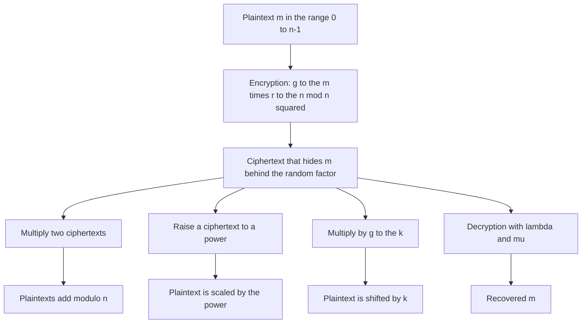
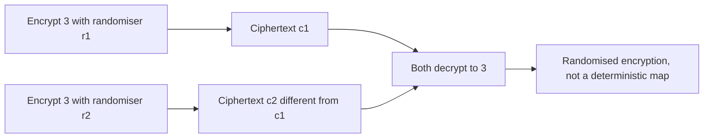
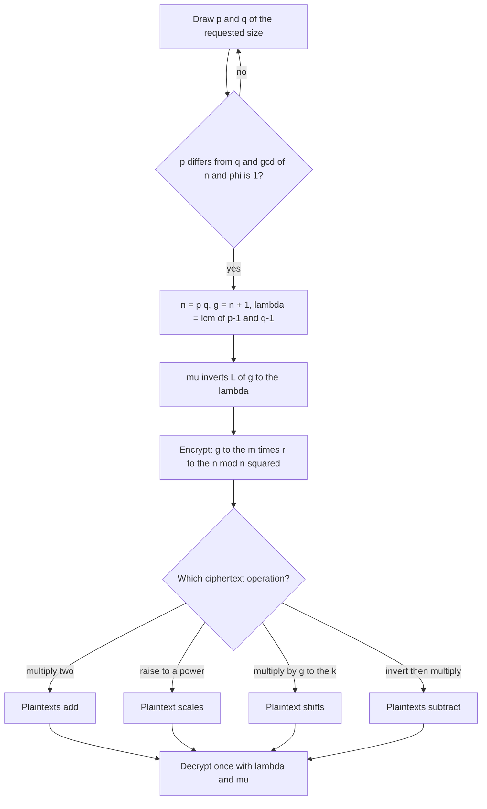
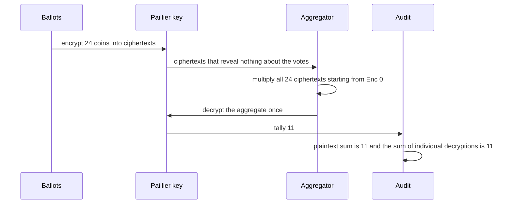

# 711 — Implement homomorphic encryption simple operations demo (Paillier)

> **Tier:** Expert · **CTCI chapter:** Beyond — Security & Privacy
> **Task spec:** [711-implement-homomorphic-encryption-simple-operations-demo-paillier.md](../../../tasks/expert/711-implement-homomorphic-encryption-simple-operations-demo-paillier.md)
> **Solutions:** [Python](../../../solutions/python/expert/711-implement-homomorphic-encryption-simple-operations-demo-paillier/solution.py) ·
> [Java](../../../solutions/java/expert/711-implement-homomorphic-encryption-simple-operations-demo-paillier/Solution.java) ·
> [JavaScript](../../../solutions/javascript/expert/711-implement-homomorphic-encryption-simple-operations-demo-paillier/solution.js) ·
> [C#](../../../solutions/csharp/expert/711-implement-homomorphic-encryption-simple-operations-demo-paillier/Solution.cs)

## 1. Problem restatement

Implement Paillier, an additively homomorphic public-key cryptosystem, and demonstrate the operations
that actually exist on ciphertexts. With `n = p q`, `g = n + 1`, `lambda = lcm(p-1, q-1)` and
`mu = L(g^lambda mod n^2)^-1 mod n` where `L(x) = (x - 1) / n`:

```text
Enc(m) = g^m * r^n mod n^2          (r random in Z_n*, so encryption is randomised)
Dec(c) = L(c^lambda mod n^2) * mu mod n
```

| Piece (Python) | Role |
| --- | --- |
| `splitmix64` / `Rng.bits(width)` / `Rng.below(bound)` / `Rng.coin()` | deterministic key material and randomisers |
| `is_probable_prime` / `generate_prime` | small trial division plus 24 Miller-Rabin rounds |
| `is_prime_by_trial_division` / `has_no_small_factor` | the independent primality oracle |
| `Paillier(bits, seed)` | key generation, `encrypt`, `decrypt`, `_l` |
| `add_ciphertexts`, `add_plaintext`, `multiply_plaintext`, `subtract_ciphertexts` | the four homomorphic operations |
| `test_ballot_tally_demo` | 24 encrypted ballots summed homomorphically, then audited |

The homomorphic identities, all verified exactly:

```text
Enc(a) * Enc(b) = Enc(a + b mod n)          (multiplying ciphertexts adds plaintexts)
Enc(m)^k        = Enc(m * k mod n)          (raising a ciphertext scales the plaintext)
Enc(m) * g^k    = Enc(m + k mod n)          (shifting by a known constant)
Enc(a) * Enc(b)^-1 = Enc(a - b mod n)       (subtraction by inverting)
```

Concrete results the checks assert:

- **Primality audit**: `is_probable_prime` agrees with trial division for every integer `2..599` and
  rejects the composites `121, 323, 899, 1763, 2491, 3599, 5293`; a generated 64-bit prime is
  `13330118179512897871`, has no small factor, and survives independent Miller-Rabin runs with three
  different seeds; `3 * prime` is rejected.
- **Key generation** (`bits = 96`, `seed = 0xABCDEF`): `p != q`, both factors are 96 bits and prime with
  no small factor, `n = p q`, the ciphertext modulus is `n^2`, `lambda = lcm(p-1, q-1)`,
  `gcd(n, phi(n)) = 1`, `g = n + 1`, `g^lambda ≡ 1 mod n`, and `mu` inverts `L(g^lambda) mod n`.
- **Round trips**: messages `0, 1, 2, n-1, n//2, 12345` and 12 random ones all satisfy
  `Dec(Enc(m)) == m`; `r = 1` gives a reproducible ciphertext, `r = 5` a different one, and both decrypt
  to `7`.
- **Randomisation**: 30 encryptions of `3` yield at least **27 distinct** ciphertexts, every one of them
  decrypts to `3`, and every ciphertext is coprime to `n`.
- **Homomorphic arithmetic** on 10 random pairs, plus: wraparound (`n-1` plus `5`), `Enc(0)` acting as the
  additive identity, scaling by `0` giving `Enc(0)`, scaling by `n-1` acting as negation, adding `n-1`
  subtracting one, `900 - 442` by inversion, and a ciphertext minus itself giving `Enc(0)`. A foreign key
  fails to decrypt in at least 2 of 3 attempts.
- **Aggregate arithmetic**: the product of 12 encrypted values decrypts to their plain sum, and scaling
  that aggregate by `3` and adding `10` shift the decrypted sum accordingly.
- **Ballot tally** (`bits = 112`): 24 encrypted ballots sum homomorphically to a tally that decrypts to
  **11**, equal to the plaintext count and to the sum of the individual decryptions; every ciphertext is
  a large residue different from `0`, `1`, `g` and `n`.

## 2. Intuition

Paillier hides a message inside a group where the exponent *is* the message: `g^m` encodes `m` in the
exponent modulo `n^2`, and the factor `r^n` — with `r` a random unit — masks it. Decryption only needs the
secret `lambda` to extract the exponent, which is why the public key can be published without revealing
anything about `m`.

The magic is what happens to the exponent when ciphertexts are combined. Exponents add under
multiplication, so `Enc(a) · Enc(b) = g^{a+b} (r_a r_b)^n = Enc(a + b)`, and raising to a power
multiplies the exponent: `Enc(m)^k = Enc(m k)`. Both operations keep the random masking intact, so the
scheme stays randomised while the *plaintext* arithmetic happens on ciphertexts alone. Multiplying two
ciphertexts, however, would square the mask in a way decryption cannot undo — that is the price of
additive-only homomorphism, and the solutions verify the identities that do hold instead of pretending.



The randomised mask is what makes the same message produce different ciphertexts, and the demo measures
that too:



## 3. Algorithm

1. **Deterministic randomness.** A `splitmix64` stream supplies `bits(width)` (an integer of the requested
   length with its top bit set), `below(bound)` (uniform in `[1, bound-1]`) and `coin()`.
2. **Primality.** Reject small factors with a trial-division table, then run Miller-Rabin with 24 rounds
   using random bases; `generate_prime` retries until a candidate passes and is odd.
3. **Key generation.** Draw `p` and `q` of the requested size with `p != q` and `gcd(p q, (p-1)(q-1)) = 1`;
   set `n = p q`, `n_square = n^2`, `g = n + 1`, `lambda = lcm(p-1, q-1)` and
   `mu = L(g^lambda mod n^2)^-1 mod n`.
4. **Encryption.** Validate `0 <= m < n`; take the supplied randomiser or draw one coprime to `n`;
   return `g^m * r^n mod n^2`.
5. **Decryption.** Validate `0 < c < n^2`; return `L(c^lambda mod n^2) * mu mod n`, where `L` asserts that
   its argument is congruent to `1 mod n`.
6. **Ciphertext addition.** `c1 * c2 mod n^2`.
7. **Plaintext scaling.** `c^k mod n^2` — this is exponentiation, not multiplication of ciphertexts.
8. **Constant shift.** `c * g^k mod n^2`.
9. **Subtraction.** `c1 * c2^{-1} mod n^2`, which requires `c2` to be invertible (it always is, being a unit
   by construction).
10. **Tally demo.** Encrypt each ballot, multiply the ciphertexts into one aggregate starting from `Enc(0)`,
    decrypt once, and compare with the plaintext sum and with the sum of the individual decryptions.

```text
procedure key_generation(bits, seed)
    repeat
        p ← generate_prime(bits)
        q ← generate_prime(bits)
    until p != q and gcd(p * q, (p - 1) * (q - 1)) = 1
    n ← p * q
    n_square ← n * n
    g ← n + 1
    lambda ← lcm(p - 1, q - 1)
    mu ← inverse of L(g^lambda mod n_square) modulo n
    return public key (n, g) and secret key (lambda, mu)
end

procedure encrypt(message, randomiser)
    check 0 <= message < n
    if randomiser is not given then draw units until gcd(randomiser, n) = 1
    check gcd(randomiser, n) = 1
    return g ^ message * randomiser ^ n mod n_square
end

procedure decrypt(ciphertext)
    check 0 < ciphertext < n_square
    return L(ciphertext ^ lambda mod n_square) * mu mod n
end

procedure homomorphic_operations
    add_ciphertexts(first, second)     return first * second mod n_square
    subtract_ciphertexts(first, second) return first * inverse(second) mod n_square
    multiply_plaintext(ciphertext, k)  return ciphertext ^ k mod n_square
    add_plaintext(ciphertext, k)       return ciphertext * g ^ k mod n_square
end
```



The four solutions differ only in the arithmetic substrate and the audits: Java uses a demo key of about
62 bits so `n^2` fits in a signed 64-bit integer, with an exact double-and-add `mulmod` and trial-division
primes (and shows re-randomisation by multiplying with a fresh `r'^n`); JavaScript uses 256-bit primes from
a seeded Miller-Rabin and checks a tiny 35-bit modulus exhaustively against the table of all encryptions of
all messages; C# restricts itself to the `r = 1` case as a sanity reduction to `g^m`, checks a tiny key
(`p = 11`, `q = 17`, so all 187 residues) exhaustively, and rejects every malformed input.

## 4. Worked example

A hand-checkable key: `p = 11`, `q = 17`. Then `n = 187`, `n^2 = 34969`, `g = 188`,
`lambda = lcm(10, 16) = 80` and `mu = 180`.

| Operation | Ciphertext | Decrypts to |
| --- | --- | --- |
| `Enc(5)` with `r = 2` | `25219` | `5` |
| `Enc(5)` with `r = 3` | `28873` | `5` — different ciphertext, same plaintext |
| `Enc(7)` with `r = 2` | `15495` | `7` |
| `Enc(5) * Enc(7) mod n^2` | `24799` | `12` — plaintexts added |
| `Enc(5)^3 mod n^2` | — | `15` — plaintext scaled by 3 |
| `Enc(5) * g^10 mod n^2` | — | `15` — plaintext shifted by 10 |
| `Enc(0)` with `r = 5` | `21057` | `0` — the additive identity |
| `Enc(186)` with `r = 7` | `2360` | `186` — the boundary message `n - 1` |

Every line follows from the identities: the two encryptions of `5` differ because the masks `r^n mod n^2`
differ, while decryption cancels the mask exactly; the product of the `5` and `7` ciphertexts decrypts to
`12`, and the three operations on ciphertexts move the plaintext by `+7`, `x3` and `+10` respectively.

The e-voting demo is the payoff, and its audit is what makes it credible:



On the `bits = 112` key the run reports `ballots=24` and `homomorphic_tally=11`: 24 ciphertexts multiplied
together and decrypted once give exactly the number of yes votes, and each individual ciphertext is a large
residue unrelated to `0`, `1`, `g` or `n` yet still decrypts to its own ballot.

## 5. Complexity

Let `k` be the bit length of `p` and `q`, so `n` has about `2k` bits.

| Operation | Cost | Why |
| --- | --- | --- |
| `is_probable_prime` | `O(rounds * k^3)` with schoolbook multiplication | 24 Miller-Rabin rounds, each a modular exponentiation |
| `generate_prime`, `below`, `coin` | `O(1)` PRNG steps plus `O(1)` bit operations | `splitmix64` per draw |
| Key generation | a few prime generations plus one modular inverse | the inverse is one extended Euclid (`pow(..., -1, n)`) |
| `encrypt` | one modular exponentiation `g^m` (modest exponent) plus one `r^n mod n^2` | `O(k^2)` multiplications with `O(k)`-bit numbers |
| `decrypt` | one exponentiation by `lambda` modulo `n^2` | the dominant cost, `O(k^3)` with schoolbook arithmetic |
| `add_ciphertexts`, `add_plaintext`, `subtract_ciphertexts` | one multiplication or one inversion modulo `n^2` | constant-time in the number of gates, not in bits |
| `multiply_plaintext` | one full exponentiation | the only expensive homomorphic operation |
| Tally of `B` ballots | `B` encryptions plus `B` multiplications, then **one** decryption | the point of the demo: decryption does not scale with the ballot count |
| Space | `O(k)` bits per ciphertext | one element of `Z_{n^2}` |

**Documented simplifications** (Python header): the modulus is only about 200 bits (a demo key, not a
secure one), there is no serialisation, no padding and no zero-knowledge proof of correct encryption, and
one deterministic PRNG stream supplies both key material and randomisers. Java states the same about its
~62-bit demo key, and the JavaScript and C# headers repeat that no security claim is made beyond
correctness and the verified algebraic identities.

## 6. Pitfalls and edge cases

- **The message must lie in `[0, n)`.** `encrypt` rejects `m = n` and negative messages outright; a
  homomorphic tally silently wrapping modulo `n` is arithmetic, not an error, but an out-of-range input is.
- **The randomiser must be a unit.** `gcd(r, n) = 1` is required (and checked), because `r^n` has to be
  invertible for the mask to cancel; the checks reject `r = p` explicitly.
- **Multiplicating two ciphertexts is not supported.** `Enc(a) * Enc(b)` adds, it does not multiply, and
  the search for `Enc(a b)` is a different (and much harder) cryptosystem.
- **Scaling by a plaintext factor is exponentiation**, so a factor of `0` yields `Enc(0)` and a factor of
  `n-1` acts as negation modulo `n`; a factor of exactly `n` is rejected because it is `0` modulo `n` and
  the API refuses the ambiguity.
- **Wraparound is silent arithmetic.** `(n-1) + 5` decrypts to `4`; the check asserts the modular result,
  and the aggregate test verifies separately that no wraparound happens in its small instance.
- **`L(x) = (x - 1) / n` is only defined for `x ≡ 1 mod n`**, and the implementation asserts it rather than
  letting integer division truncate silently.
- **A foreign key must fail.** When a ciphertext is reduced modulo another key's `n^2` and decrypted there,
  the recovered value is unrelated to the message; the check requires at least 2 of 3 attempts to fail.
- **`Enc(0)` is not a "zero ciphertext".** It is a valid, masked encryption of zero, which is exactly why it
  can serve as the additive identity of an aggregate.
- **Boundary messages round-trip**: `0`, `1`, `2`, `n//2` and `n-1` are all asserted, since `g^0 = 1` and
  `g^{n-1}` are the two extremes of the exponent range.
- **Determinism is a demo convenience.** Key material and randomisers come from one seeded stream, so runs
  reproduce exactly; that would be catastrophic in a real deployment, which is why the headers call it out.
- **Key sizes are not security.** A 96-bit or 62-bit modulus is trivially factorable; the solutions say so
  and claim only correctness of the algebra, not cryptographic strength.
- **A tiny key is worth more than a large one for testing.** C# enumerates all 187 residues of `p = 11`,
  `q = 17`, and JavaScript compares a 35-bit key against the full table of encryptions — exhaustive checks
  that a 2048-bit key could never give.

## 7. Variants and follow-ups

- **Re-randomisation.** Multiplying a ciphertext by a fresh `r'^n` produces a different ciphertext with the
  same plaintext, which is how a mix-net shuffles ballots; Java demonstrates the exchange.
- **Other homomorphic schemes.** Benaloh and Damgård-Jurik generalise Paillier (exponents modulo other
  values); ElGamal is multiplicatively homomorphic instead. Choosing between them is choosing which
  plaintext arithmetic the ciphertext arithmetic mirrors.
- **From one tally to a protocol.** Correctness of the *aggregation* is only half of e-voting: proofs of
  correct encryption, a threshold decryption ceremony and ballot independence are what turn this demo into
  a system, and the headers explicitly list them as out of scope.
- **Private aggregation in practice.** The same "encrypt, combine, decrypt once" pattern underlies private
  analytics — with the noise side of the budget handled as in
  [709 — differential privacy noise addition and the utility tradeoff](../../../tasks/expert/709-implement-differential-privacy-noise-addition-and-utility-tradeo.md)
  and [710 — private count sketches with the Laplace mechanism](../../../tasks/expert/710-implement-private-count-sketches-with-laplace-mechanism-simulati.md) —
  and the two-sided protocols of
  [712 — privacy-preserving set intersection via hashing sketch](../../../tasks/expert/712-implement-privacy-preserving-set-intersection-via-hashing-sketch.md).
- **Efficiency.** Double-and-add `mulmod` (Java) versus arbitrary-precision arithmetic (Python, JavaScript,
  C#) is the practical fork; production implementations use Montgomery or Barrett reduction on large moduli.

## 8. Check yourself

<details><summary>Show answer</summary>

**1. Why does `Enc(a) * Enc(b)` decrypt to `a + b`, and what fails for multiplication of ciphertexts?**

Because exponents add under multiplication: `(g^a r_a^n)(g^b r_b^n) = g^{a+b} (r_a r_b)^n`, which is a valid
encryption of `a + b` with the composite mask `r_a r_b`. Multiplying two ciphertexts to obtain `a * b` would
require extracting a product of exponents, which the decryption `L(c^lambda mod n^2) * mu mod n` cannot do
that way — hence "additive only".

</details>

<details><summary>Show answer</summary>

**2. What makes the encryption randomised, and how is that verified?**

The factor `r^n mod n^2` with a fresh unit `r` masks the exponent; different `r` values give different
ciphertexts of the same message. The checks encrypt `3` thirty times and require at least 27 distinct
ciphertexts, all of which decrypt to `3`, and the round-trip test shows `r = 1` is reproducible while
`r = 5` is not.

</details>

<details><summary>Show answer</summary>

**3. Reproduce the tiny example: with `p = 11`, `q = 17`, what are `Enc(5)` and `Enc(5)·Enc(7)`?**

`n = 187`, `n^2 = 34969`, `g = 188`, `lambda = 80`, `mu = 180`. With `r = 2`, `Enc(5) = 25219`; with `r = 3`
it is `28873` — a different ciphertext that also decrypts to `5`. `Enc(7)` with `r = 2` is `15495`, and the
product `24799` decrypts to `12`. `Enc(5)^3` and `Enc(5)·g^10` both decrypt to `15`.

</details>

<details><summary>Show answer</summary>

**4. Why is the e-voting tally a good demonstration of the scheme?**

Because the aggregation touches only ciphertexts: multiply all encrypted ballots into one aggregate
starting from `Enc(0)` and decrypt once at the end. The run reports 24 ballots tallied to 11, with each
ciphertext unrelated to its ballot yet decrypting to it, and the tally double-checked against the plaintext
sum and against the sum of the individual decryptions. Decryption cost stays constant in the number of
ballots.

</details>

<details><summary>Show answer</summary>

**5. Which checks are *negative* checks, and why do they matter?**

The foreign-key decryption (a ciphertext reduced modulo another key's `n^2` must not recover the message,
in at least 2 of 3 attempts), the out-of-range message, the non-unit randomiser, the out-of-range or
non-modular ciphertext, the factor `n`, and the `L(x)` precondition `x ≡ 1 mod n`. Without them a lookup
table or an accidental shortcut could pass the positive tests while the scheme would fail in any real use.

</details>
