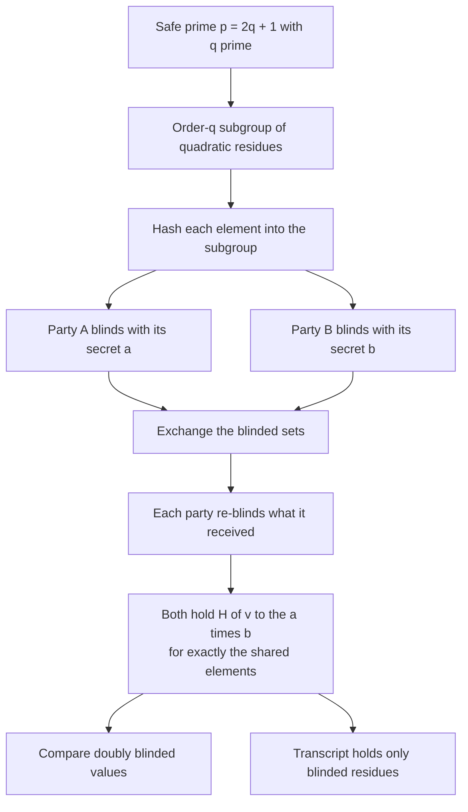
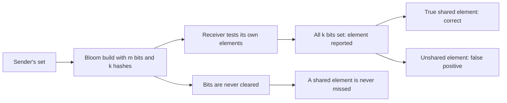
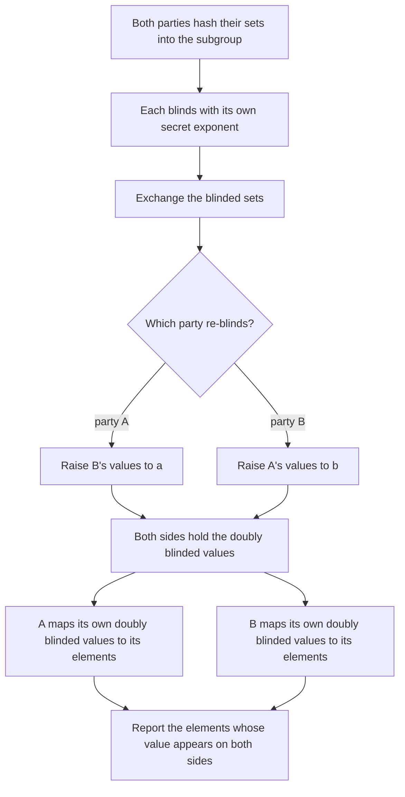
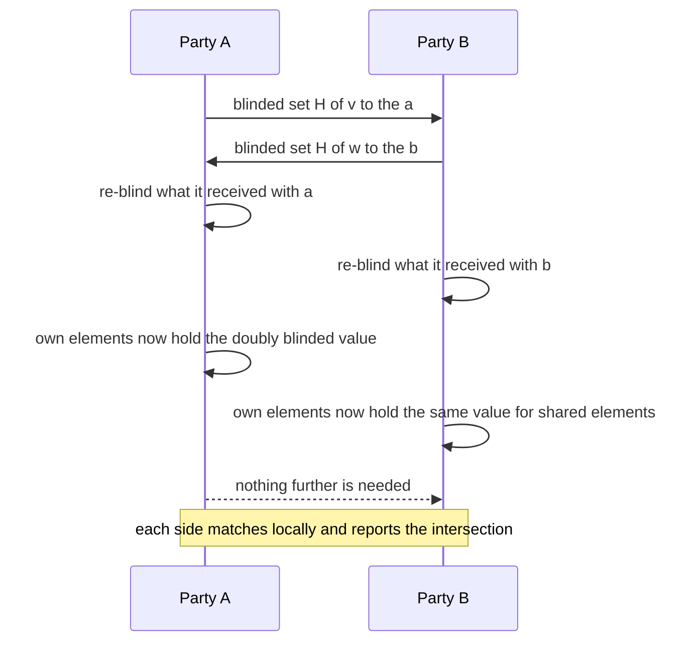

# 712 — Implement privacy-preserving set intersection via hashing sketch

> **Tier:** Expert · **CTCI chapter:** Beyond — Security & Privacy
> **Task spec:** [712-implement-privacy-preserving-set-intersection-via-hashing-sketch.md](../../../tasks/expert/712-implement-privacy-preserving-set-intersection-via-hashing-sketch.md)
> **Solutions:** [Python](../../../solutions/python/expert/712-implement-privacy-preserving-set-intersection-via-hashing-sketch/solution.py) ·
> [Java](../../../solutions/java/expert/712-implement-privacy-preserving-set-intersection-via-hashing-sketch/Solution.java) ·
> [JavaScript](../../../solutions/javascript/expert/712-implement-privacy-preserving-set-intersection-via-hashing-sketch/solution.js) ·
> [C#](../../../solutions/csharp/expert/712-implement-privacy-preserving-set-intersection-via-hashing-sketch/Solution.cs)

## 1. Problem restatement

Two parties each hold a private set and want the intersection — and nothing else. Two shapes are
implemented and checked against plaintext set algebra:

1. **Commutative-encryption PSI** (the Diffie-Hellman / Meadows style protocol). Fix the order-`q`
   subgroup of quadratic residues modulo a safe prime `p = 2q + 1` with generator `g`. Map each element to
   `H(v)`, blind with a secret exponent, exchange, re-blind, and compare: a value appears in both
   doubly-blinded sets exactly when the two parties share the element, because `(H(v)^a)^b = (H(v)^b)^a`.
2. **Bloom-filter sketch PSI** (Sander's method). One party sends a Bloom filter of its set, the other
   tests its own elements. It leaks a bounded amount and has false positives, so the code measures the
   false-positive rate against the closed form `(1 - e^(-k n / m))^k`.

| Piece (Python) | Role |
| --- | --- |
| `hash_bytes` / `hash_value` | deterministic 128-bit hash; only the mixed `splitmix64` output is used |
| `find_safe_prime` / `Group` | safe prime `p = 2q + 1`, generator of the order-`q` subgroup, `element`, `blind`, `secret_exponent` |
| `commutative_psi(set_a, set_b, group, hash_function)` | the two-round protocol; returns both parties' answers plus the transcript |
| `bloom_parameters` / `bloom_positions` / `bloom_build` / `bloom_test` | the sketch, with `m` and `k` from the target false-positive rate |
| `bloom_psi` / `bloom_size_estimate` | the sketch protocol and the `-(m/k) ln(1 - X/m)` size estimator |

Concrete results the checks assert:

- **Group setup**: `q` and `p` are prime for several independent Miller-Rabin seeds, `p == 2q + 1`, the
  generator satisfies `g^q ≡ 1 mod p`, `g` is not `0` or `1`, and `q` is not the full group order.
- **Blinding invariants** (40 random values): every hashed element lies in the order-`q` subgroup
  (`element^q ≡ 1`), the two orders of blinding commute, `x -> x^a` is injective on 200 elements for 8
  exponents, no blinded value equals a plaintext hash, and the blinding **destroys the ordering** of the
  inputs.
- **Intersection correctness**: seven curated pairs (empty, disjoint, identical, subset, singletons,
  overlapping ranges) and 12 random pairs of 30 drawn from an 80-element universe — both parties get
  exactly the plaintext intersection, with no duplicates.
- **Transcript**: no repeated entries, no plaintext hash among the transmitted values, every value a group
  residue, and the second round really re-blinds (`blind_a != doubly_a`).
- **Hash collisions are the only false positives**: with a deliberately broken map where `11` and `111`
  collide, party A reports `{11, 6}` — a strict superset whose extra element is exactly the colliding one —
  and party B reports `{111, 6}`; with the real map the answer is `{6}` again.
- **Bloom sketch**: for a 400-element set targeting `1 %`, `m = 3835` and `k = 7`; the measured
  false-positive rate is **0.0179** against the theoretical **0.0100**; no false negatives (all 120 shared
  values reported); the size estimate is within 15 % of 400.
- **Large instance**: `|A| = 1996`, `|B| = 1999` with 304 shared elements — the commutative protocol is
  exactly right for both parties and deterministic for fixed exponents, while the Bloom variant returns
  **343 candidates**, a superset with no false negatives.
- **Degenerate sketches**: a 1-bit sketch still finds the elements it contains and accepts everything else
  (the collision extreme); an empty sender or an empty receiver yields an empty intersection.

## 2. Intuition

The obstruction is that comparing sets requires comparing values, and comparing values reveals them. The
commutative-blinding trick removes the obstruction in one line of algebra: if each party raises the
other's blinded values to *its own* secret exponent, then because exponentiation commutes both parties
hold `H(v)^{ab}` — the *same* value for the same element, and a different, opaque value for anything else.
Matching on those doubly-blinded values is exactly set intersection, while the transcript contains only
blinded residues.

Two structural facts make it work, and both are verified rather than assumed. First, the map
`x -> x^a` is a **bijection** of the subgroup (the exponents are non-zero modulo the prime order `q`), so
blinding loses nothing and merges nothing. Second, the element map lands everything in the order-`q`
subgroup, so the group arithmetic stays inside a prime-order world where exponents are invertible.



The Bloom alternative trades exactness for a single round and a bit vector. It can only produce false
positives, because a query succeeds when *all* its bits are set and more bits can only be set by other
elements — never cleared:



## 3. Algorithm

1. **Group setup.** Find `q` prime and `p = 2q + 1` prime; pick a generator of the order-`q` subgroup by
   squaring a random base and checking `g^q ≡ 1 mod p` with `g` not in `{0, 1}`.
2. **Element map.** `element(value) = (hash_value(value) mod p + 2)^2 mod p` — the squaring forces the
   result into the quadratic-residue subgroup, and the offset avoids `0` and `1`.
3. **Blinding.** `blind(element, e) = element^e mod p` with a secret exponent drawn from `[1, q-1]`.
4. **Round one.** Party A sends `{H(v)^a}` for its elements; party B sends `{H(w)^b}`.
5. **Round two.** A re-blinds what it received with `a`, B re-blinds with `b`. Both now hold
   `H(v)^{ab}` for the other party's elements and for their own.
6. **Answers.** Each party builds a map from its own doubly-blinded values to its own elements and reports
   the elements whose doubly-blinded value appears in the other party's set — so each side computes the
   intersection independently.
7. **Bloom path.** Choose `m = ceil(-n ln(target) / (ln 2)^2)` and `k = round((m / n) ln 2)`; build the bit
   vector from the sender's set; test the receiver's elements against it; report the matches.
8. **Estimators and audits.** Estimate the sender's size as `-(m/k) ln(1 - X/m)` from the set bits `X`, and
   compare the measured false-positive rate with `(1 - e^{-k n / m})^k`; check that the transcript holds no
   plaintext hash and that blinding is injective.

```text
procedure commutative_psi(set_a, set_b, group, hash_function, seed_a, seed_b)
    exponent_a ← secret_exponent(seed_a)         // in [1, q - 1]
    exponent_b ← secret_exponent(seed_b)
    hashed_a ← [hash_function(value) for value in set_a]
    hashed_b ← [hash_function(value) for value in set_b]
    blind_a ← [blind(element, exponent_a) for element in hashed_a]
    blind_b ← [blind(element, exponent_b) for element in hashed_b]
    doubly_b ← [blind(value, exponent_a) for value in blind_b]     // A re-blinds B's values
    doubly_a ← [blind(value, exponent_b) for value in blind_a]     // B re-blinds A's values
    seen_by_a ← map from doubly_a values to A's own elements
    answer_a ← [seen_by_a[value] for value in doubly_b if value in seen_by_a]
    seen_by_b ← map from doubly_b values to B's own elements
    answer_b ← [seen_by_b[value] for value in doubly_a if value in seen_by_b]
    return answer_a, answer_b, transcript(blind_a, blind_b, doubly_a, doubly_b)
end

procedure bloom_parameters(capacity, target)
    bits ← max(1, ceil(-capacity * ln(target) / (ln 2)^2))
    hashes ← max(1, round(bits / capacity * ln 2))
    return bits, hashes
end

procedure bloom_psi(set_a, set_b, bits, hashes)
    sketch ← bit vector of length bits, all zero
    for each value in set_b do
        for each position of value under the `hashes` hash functions do sketch[position] ← 1
    found ← []
    for each value in set_a do
        if every position of value is set in sketch then found.append(value)
    return found                     // never misses a shared value, may report an unshared one
end

procedure bloom_size_estimate(sketch, bits, hashes)
    set_bits ← number of set bits
    return -(bits / hashes) * ln(1 - set_bits / bits)
end
```



The other solutions vary the substrate and add variants: Java uses the Mersenne prime `2^31 - 1` so every
product fits in a `long`, and its "hashing sketch" half is a communication saving — the client sends only
the `k` numerically smallest doubly-blinded values, which can never produce a false positive but has a
recall that grows with `k`; JavaScript uses `p = 2^61 - 1`, adds a **MinHash** sketch that estimates the
Jaccard index from `k` minima with error shrinking like `1/sqrt(k)`, and releases the estimated
intersection size under Laplace noise with sensitivity 1; C# follows Meadows' double-blinded hashing with a
shuffled return set and checks the group laws (commutation, exponent inverse, Fermat) explicitly.

## 4. Worked example

A hand-checkable group: `p = 23 = 2 * 11 + 1`, `q = 11`, generator `g = 4`. The order-11 subgroup is the
set of quadratic residues `{1, 2, 3, 4, 6, 8, 9, 12, 13, 16, 18}`. Suppose the element map sends `5 -> 2`,
`6 -> 13` and `7 -> 3`, party A holds `{5, 6}`, party B holds `{6, 7}`, and the secret exponents are
`a = 3`, `b = 5`.

| Step | Values |
| --- | --- |
| A blinds | `2^3 = 8` for element `5`, `13^3 mod 23 = 12` for element `6` |
| B blinds | `13^5 mod 23 = 4` for element `6`, `3^5 mod 23 = 13` for element `7` |
| A re-blinds what it received from B | `4^3 = 18` (element 6), `13^3 mod 23 = 12` (element 7) |
| B re-blinds what it received from A | `8^5 mod 23 = 16` (element 5), `12^5 mod 23 = 18` (element 6) |
| A's own doubly-blinded values | `{5: 16, 6: 18}` |
| B's own doubly-blinded values | `{6: 18, 7: 12}` |

The value `18` appears on both sides and belongs to element `6`; `16` and `12` are unmatched. Both
parties therefore report `{6}`, the true intersection — and the transcript `{8, 12, 4, 13}` contains only
opaque residues, never `2`, `13` or `3`.

Running the shipped protocol on a real key (order-6 setup, seed `0x1CE`, sets `{11, 5, 6}` and `{111, 6}`)
reproduces the same structure at scale:

| Quantity | Value |
| --- | --- |
| `p`, `q` | 64-bit safe prime and its prime order, with `g^q mod p = 1` |
| `H(11)`, `H(5)`, `H(6)`, `H(111)` | distinct 64-bit residues inside the subgroup |
| doubly-blinded values | A's map `{11: ..., 5: ..., 6: 8640572309601866323}` and B's `{111: ..., 6: 8640572309601866323}` |
| shared value | `8640572309601866323`, matching on both sides for element `6` |
| both answers | `[6]`, equal to the plaintext intersection |



The Bloom path is checked on a 400-element set with a 1 % target: `m = 3835`, `k = 7`, measured
false-positive rate **0.0179** against the analytic **0.0100**, and 120 of 120 shared elements recovered —
the no-false-negative property. On the large instance the two protocols behave exactly as their theories
predict: `|A| = 1996`, `|B| = 1999`, 304 shared elements, the commutative protocol reports all 304 for both
parties, and the Bloom variant reports **343** candidates, a superset containing every true element.

## 5. Complexity

Let `n_A`, `n_B` be the set sizes, `k` the Bloom hash count, `m` the sketch length and `r` the number of
cryptographic group operations per element.

| Quantity | Bound | Why |
| --- | --- | --- |
| Safe-prime search | a few dozen Miller-Rabin rounds of `O(bits^3)` | `q` and `2q + 1` both tested |
| Element mapping | one hash plus one modular squaring per element | `O(1)` group operations |
| Blinding (round one) | one exponentiation per element per party | the dominant cost, `O(log q)` multiplications each |
| Round two | one more exponentiation per received element | same order |
| Communication | `O(n_A + n_B)` group elements | the transcript, twice over |
| Matching | expected `O(n_A + n_B)` with hash maps | keys are group elements |
| Bloom build | `O(k n_B)` bit sets | one hash per bit position |
| Bloom query | `O(k n_A)` bit tests | no group arithmetic at all |
| Bloom false-positive rate | `(1 - e^{-k n_B / m})^k`; measured `0.0179` against `0.0100` at `m = 3835`, `k = 7` | the closed form the checks compare against |
| Bloom size estimate | `-(m/k) ln(1 - X/m)`, within 15 % of the true size | the standard occupancy estimator |
| Space | `O(n_A + n_B)` elements in the commutative protocol, `O(m)` bits in the Bloom one | the sketch is the space advantage |
| Java's truncated sketch | send the `k` smallest doubly-blinded values | saves bandwidth, costs recall, adds **no** false positives |

## 6. Pitfalls and edge cases

- **The element map must land inside the subgroup.** `element` squares the hashed value modulo `p` and adds
  an offset to avoid `0` and `1`; the checks verify `element^q ≡ 1 mod p` for every mapped element. A value
  outside the order-`q` subgroup can break the exponent arithmetic.
- **A zero exponent would destroy the blinding.** `secret_exponent` draws from `[1, q-1]`, which is also
  exactly the condition for `x -> x^a` to be a bijection; the injectivity of blinding on 200 elements is
  asserted for eight exponents.
- **Hash collisions become false positives, and the demo shows it.** With a deliberately broken map, the
  sets `{11, 5, 6}` and `{111, 6}` yield `{11, 6}` on one side and `{111, 6}` on the other: the reported
  intersection is a superset, and the extra element is precisely the colliding one. With the real map the
  answer is `{6}`. This is why the element map has to be collision-resistant, not merely deterministic.
- **The transcript must not contain plaintext hashes.** The check intersects every transcript collection
  with the set of plaintext hashes and requires the intersection to be empty, and it also confirms that the
  second round changes the values (`blind_a != doubly_a`).
- **Empty, disjoint, identical, subset and singleton sets** are all exercised: `([], [])` gives an empty
  answer, `([7], [8])` gives nothing, `([1,2,3], [1,2,3])` gives everything, and `([1..5], [2,4])` gives the
  subset — with no duplicates in the output.
- **Bloom filters never produce false negatives.** A shared element always has all its bits set, because
  bits are only ever set; the check requires all 120 shared elements to be reported.
- **The false-positive rate is measured, not assumed.** With `m = 3835` and `k = 7` the measured rate is
  `0.0179` against the analytic `0.0100`, asserted to stay below `3 x theory + 0.01` (small samples
  fluctuate; the analytic value is an expectation).
- **One hash position is enough to make a sketch useless.** A 1-bit, 1-hash sketch still finds its own
  elements and then accepts *everything* — the collision extreme, asserted explicitly.
- **An empty party yields an empty intersection** in both directions (empty sender, empty receiver).
- **Determinism is a demo convenience.** Exponents come from seeded PRNGs, so a run reproduces exactly;
  repeated runs are asserted to give identical answers.
- **What the protocol does *not* hide.** Both sides learn the intersection (that is the task) and, in this
  honest-but-curious two-round version, the sizes of the transmitted sets; the headers list the missing
  pieces — proofs of correct blinding, a negotiated group, and any malicious-security analysis.
- **Small groups are not secure.** A `2^31 - 1` modulus (Java) or a 40-bit order (Python) can be attacked
  directly; the solutions claim correctness of the algebra, not cryptographic strength.

## 7. Variants and follow-ups

- **Truncated sketches.** Java's variant sends only the `k` numerically smallest doubly-blinded values:
  a match is still a genuine intersection element (no false positives), but the client may miss some
  (recall grows with `k`). That is the bandwidth/recall dial of the "hashing sketch" in the task title.
- **MinHash for the size only.** JavaScript adds a min-hash sketch that estimates the Jaccard index from
  `k` minima, with error shrinking like `1/sqrt(k)`, when only the *number* of shared elements matters and
  sending elements is unacceptable.
- **Bloom prefiltering.** A Bloom filter can also be used as a cheap prefilter in front of the exact
  protocol, cutting the number of expensive group operations at the cost of a bounded false-positive rate.
- **Private release of the result size.** The intersection size is itself sensitive; JavaScript adds the
  Laplace mechanism with sensitivity 1 on top of the estimate, which is the natural place to reuse
  [709 — differential privacy noise addition and the utility tradeoff](../../../tasks/expert/709-implement-differential-privacy-noise-addition-and-utility-tradeo.md)
  and the sketch reasoning of
  [710 — private count sketches with the Laplace mechanism](../../../tasks/expert/710-implement-private-count-sketches-with-laplace-mechanism-simulati.md).
- **Additive homomorphism instead.** An alternative to commutative blinding keeps ciphertexts under
  Paillier and lets one party compute on them directly — see
  [711 — homomorphic encryption simple operations demo](../../../tasks/expert/711-implement-homomorphic-encryption-simple-operations-demo-paillier.md).
- **Security models.** The honest-but-curious two-round protocol becomes a real system only with proofs of
  correct blinding, a hash-into-group that is indifferentiable, and protection against a party that lies
  about its exponents.

## 8. Check yourself

<details><summary>Show answer</summary>

**1. Why does matching doubly-blinded values compute the intersection?**

Because exponentiation in a group commutes: `(H(v)^a)^b = (H(v)^b)^a = H(v)^{ab}`. Both parties can produce
that value for any element they hold, and only they can, so the values common to the two doubly-blinded
sets correspond exactly to shared elements. The intersection is computed on blinded data, and each party
assembles its own answer.

</details>

<details><summary>Show answer</summary>

**2. Why must the exponent map be a bijection, and what would break if it were not?**

The blinding has to lose no information: if `x -> x^a` were not injective, two distinct elements could
collide and be *reported* as shared when they are not. The exponents are non-zero modulo the prime order
`q`, which makes the map a bijection on the subgroup; the checks verify injectivity on 200 elements for
several exponents.

</details>

<details><summary>Show answer</summary>

**3. Reproduce the toy example: with `p = 23`, `q = 11`, `a = 3`, `b = 5`, what is the reported intersection?**

`H(5) = 2`, `H(6) = 13`, `H(7) = 3`. A blinds to `{8, 12}` (elements 5 and 6), B blinds to `{4, 13}`
(elements 6 and 7). A re-blinds B's values to `{18, 12}`; B re-blinds A's to `{16, 18}`. The only common
value is `18`, produced by element `6`, so both parties report `{6}` — and the transcript contains only
opaque residues.

</details>

<details><summary>Show answer</summary>

**4. Why can a Bloom sketch never produce a false negative, and how is its false-positive rate checked?**

Bits are only ever set, so if an element was inserted, all `k` of its positions are set and any test
succeeds — hence no false negatives. False positives come from other elements setting some of those bits.
The checks compare the measured rate (`0.0179`) with the closed form `(1 - e^{-k n / m})^k` (`0.0100`) on a
400-element set with `m = 3835`, `k = 7`, and separately verify that all 120 shared elements are found.

</details>

<details><summary>Show answer</summary>

**5. What does a hash collision do to each protocol, and how does the solution demonstrate it?**

In the commutative protocol a collision makes two distinct elements map to the same group element, so a
value that matches may belong to different plaintexts — the reported intersection becomes a superset. The
demo uses a deliberately broken map in which `11` and `111` collide and shows `{11, 6}` on one side and
`{111, 6}` on the other, with the extra element exactly the colliding one, then shows the real map
returning `{6}`. In the Bloom protocol the same effect appears as extra false positives, which is why its
rate is measured rather than assumed.

</details>
