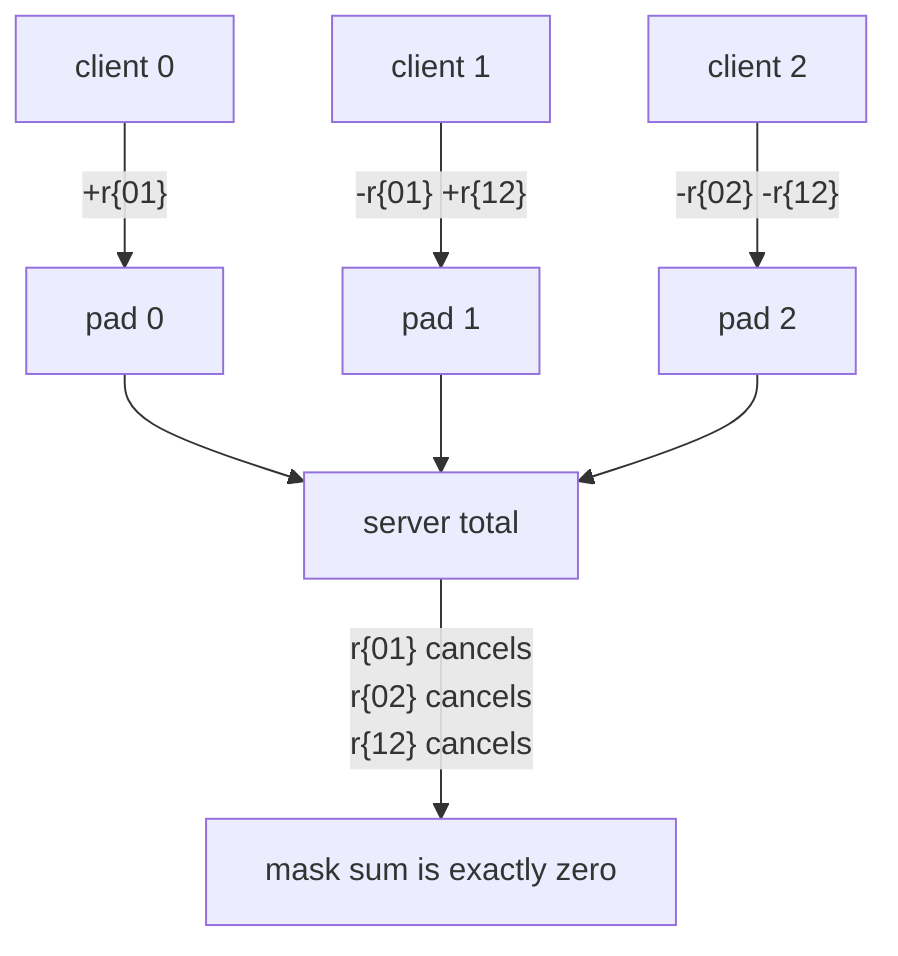
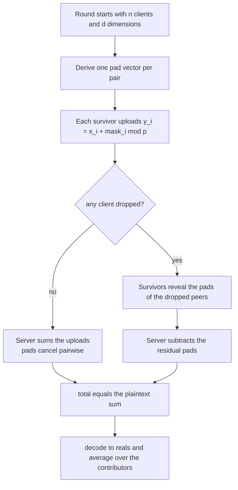
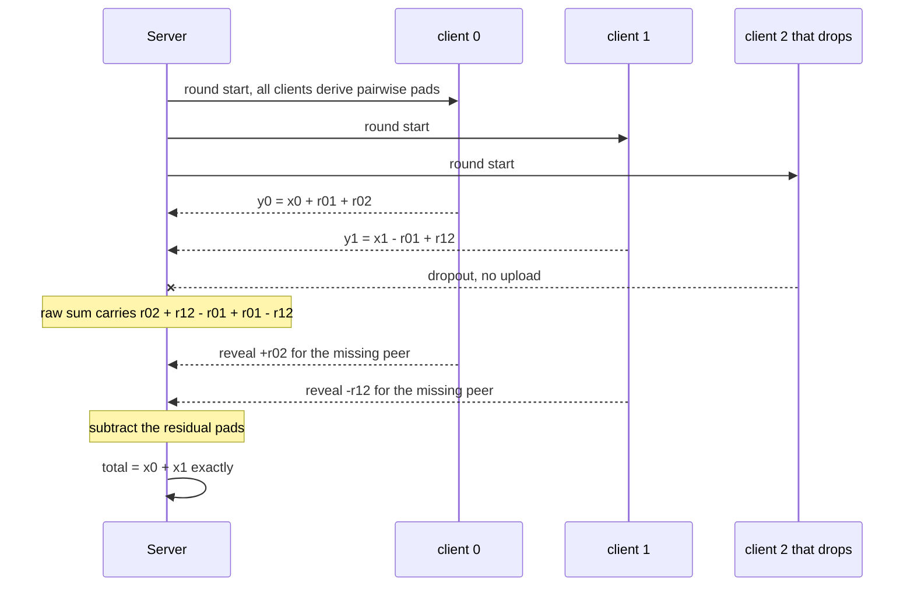
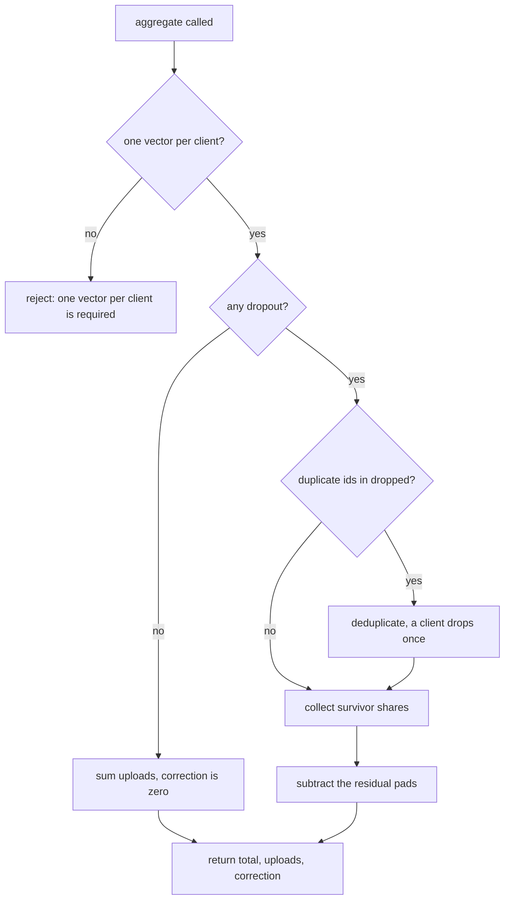

# 713 — Implement secure aggregation protocol sketch for federated averaging

> **Tier:** Expert · **CTCI chapter:** Beyond — Security & Privacy
> **Task spec:** [713-implement-secure-aggregation-protocol-sketch-for-federated-avera.md](../../../tasks/expert/713-implement-secure-aggregation-protocol-sketch-for-federated-avera.md)
> **Solutions:** [Python](../../../solutions/python/expert/713-implement-secure-aggregation-protocol-sketch-for-federated-avera/solution.py) ·
> [Java](../../../solutions/java/expert/713-implement-secure-aggregation-protocol-sketch-for-federated-avera/Solution.java) ·
> [JavaScript](../../../solutions/javascript/expert/713-implement-secure-aggregation-protocol-sketch-for-federated-avera/solution.js) ·
> [C#](../../../solutions/csharp/expert/713-implement-secure-aggregation-protocol-sketch-for-federated-avera/Solution.cs)

## 1. Problem restatement

Simulate one round of **secure aggregation** (Bonawitz et al.) over `n` clients and `d`-dimensional
update vectors: a server must learn the **sum** of the round's updates and nothing about any
individual update, even though every client hands it a value.

**Modelling contract.** These are honest-but-curious sketches, and each file says so in its header:

| What is simulated | What is *not* simulated |
| --- | --- |
| Pairwise seeds, produced by a deterministic PRNG (`splitmix64` in Python/C#, xorshift32 in JavaScript, a seeded stream in Java) instead of Diffie-Hellman | key agreement, session authentication, commitments over the uploads |
| Additive one-time pads over a prime field: `2^61 - 1` in Python and JavaScript, `2^31 - 1` in Java (so products fit in a 64-bit `long`) | a negotiated field size, malicious-server security |
| Dropout repair: Python and Java have survivors **reveal the seeds they shared with the dropouts**; JavaScript and C# secret-share the masks (**Shamir**) so survivors reconstruct them | a full robustness analysis against `n-1` colluding clients |
| Fixed-point arithmetic: Python scales reals by `2^16`; Java quantises into `[0, modulus)` and refuses negative inputs instead of wrapping them | real gradient magnitudes, DP noise, GPU numerics |

**What every file asserts** (`check`/`assert`/`ok` in each language): `sum_i mask_i = 0` exactly, the
server total equals the brute-force plaintext sum, each upload differs from its input and from the
other uploads, recovery reproduces the survivor sum for one / several / all-but-one dropouts,
encode-decode stays inside half a fixed-point step, and malformed input is rejected.

Interface (identical in all four solutions):

| Call | Meaning |
| --- | --- |
| `pair_mask(i, j)` | the symmetric pad shared by clients `i` and `j` |
| `mask(i)` | `sum_{j>i} r_ij - sum_{j<i} r_ji` element-wise, mod `p` |
| `upload(x_i, i)` | `y_i = x_i + mask(i) mod p` |
| `recovery_share(i, dropped)` | what survivor `i` reveals about each dropped peer |
| `aggregate(vectors, dropped)` | `(server_total, uploads, correction_applied)` |
| `plaintext_sum(vectors, dropped)` | the ignored ground truth used by the checks |

Concrete expected results taken from the checks:

- `sum_i mask_i == [0] * 5` for `clients ∈ {1, 2, 3, 7}` and `d = 5` (master seed `0xC0FFEE`); for one
  client the mask is all zeros, because it has nobody to share a pad with.
- 6 clients, `d = 4`, `x_i = (i + 1) * 0.5`: no dropouts → `10.5` per coordinate; dropouts `(0,)` →
  `10.0`; dropouts `(3, 4)` → `6.0 = 0.5 + 1.0 + 1.5 + 3.0`; dropouts `(1, 2, 3, 4, 5)` → the single
  survivor's own `3.0`, since nothing is left to hide.
- 4 clients, `d = 3`, all inputs `1.0`: the masked aggregate decodes to `4.0` under two *different*
  mask sets; changing client 2 to `2.0` moves only client 2's upload and makes the total `5.0`.
- Fixed point: `|decode(encode(v)) - v| ≤ 0.5 / 2^16` for `0.0, 1.0, -1.0, 0.5, -0.25, 123.456,
  -987.654, 1e-4`, and the 3-client aggregate of `[1.25, -0.5]`, `[0.75, 2.0]`, `[-3.0, 0.5]` decodes
  to `[-1.0, 2.0]` within `3 * 0.5 / 2^16`.
- Rejected: 0 clients, dimension 0, a wrong number of vectors, a vector of the wrong length.

## 2. Intuition

The naive round is a plain sum: every client sends `x_i`, the server adds. Efficient and completely
private-free — the server sees every update, and a federated average over one client's data is close
to that client's data. The second naive idea, "encrypt each upload", fails the other way: the server
holds ciphertexts it cannot add, so it learns nothing *including* the answer.

The insight is to make the **masks cancel by construction** rather than to hide the data. Each pair
`(i, j)` derives the same pseudorandom pad `r_ij`; client `i` adds it and client `j` subtracts it.
Every pair appears twice with opposite signs, so `sum_i mask_i = 0`, and the server's sum is the exact
plaintext sum. Individually, `y_i = x_i + mask_i` is a one-time pad over a huge field: changing any
mask changes the upload, and no single upload is meaningful.



Then comes the part that makes it a protocol instead of a trick: a client that **drops out** between
deriving its mask and uploading leaves its half of every pad behind. Its `+r` terms are gone while the
matching `-r` terms of the survivors are still there, so the raw sum of the surviving uploads is off
by exactly those pads. The repair is to let the survivors reveal *only* the seeds they shared with the
missing clients — material that is useless once the missing client's contribution is already gone —
so the server can subtract the residual and recover the survivor sum.

## 3. Algorithm

1. Fix the configuration: `clients = n`, `dimension = d`, `master_seed`. Derive one seed per unordered
   pair `(low, high)` and expand it into `d` field elements — that vector is `r_ij` for both sides.
2. `mask(i)` walks all `n - 1` peers: `+r_ij` for `j > i`, `-r_ji` for `j < i`, all mod `p`.
3. The server sends the round's model; each surviving client computes `y_i = x_i + mask(i)` element-wise
   mod `p` and uploads it.
4. The server sums the uploads mod `p`.
5. For each dropped client `u` and each survivor `i`, the survivor contributes
   `+r_iu` if `i < u` else `-r_iu` (the same sign rule it used in step 2). The server adds those shares
   and subtracts the total: the pads that no longer cancel are removed exactly.
6. Return `(total - correction) mod p`, plus the uploads and the correction for inspection.
7. Optional use: decode the field element back to a real number and divide by the number of
   contributors to get the federated average.

```text
procedure mask(client)
    total ← vector of d zeros
    for other ← 0 to clients - 1 do
        if other = client then continue
        pad ← pair_mask(client, other)                 // symmetric in its two arguments
        sign ← +1 if other > client else -1
        for index ← 0 to d - 1 do
            total[index] ← (total[index] + sign * pad[index]) mod PRIME
    return total

procedure pair_mask(first, second)
    low ← min(first, second);  high ← max(first, second)
    if low, high is not cached then
        seed ← hash_bytes("seed:" low ":" high ":" master_seed)
        cached ← [ hash_bytes("mask:" low ":" high ":" index, seed) mod PRIME
                    for index ← 0 to d - 1 ]
    return cached

procedure aggregate(vectors, dropped)
    survivors ← [ client in 0 .. clients - 1 with client not in dropped ]
    uploads ← { client: upload(vectors[client], client) for client in survivors }
    total ← sum of uploads.values() mod PRIME
    correction ← vector of d zeros
    for client in survivors do
        share ← recovery_share(client, dropped)        // pads shared with the missing peers
        correction ← (correction + share) mod PRIME
    return (total - correction) mod PRIME, uploads, correction
```



## 4. Worked example

Three clients, `d = 2`, pads written as vectors over `p = 2^61 - 1`. The pads themselves come from
`hash_bytes`/`splitmix64`; the interesting part is the bookkeeping of the signs.

| client `i` | `+r_ij` for `j > i` | `-r_ji` for `j < i` | `mask_i` |
| --- | --- | --- | --- |
| 0 | `r_01`, `r_02` | — | `r_01 + r_02` |
| 1 | `r_12` | `r_01` | `r_12 - r_01` |
| 2 | — | `r_02`, `r_12` | `-r_02 - r_12` |

Summing the column gives `r_01 + r_02 + r_12 - r_01 - r_02 - r_12 = 0` mod `p`, which is exactly what
`test_mask_cancellation` asserts for 1, 2, 3 and 7 clients. With the third client gone the raw sum of
`y_0` and `y_1` still carries `r_02 + r_12 - r_01 + r_01 - r_12`, i.e. the survivors' revealed shares
`+r_02` (client 0) and `-r_12` (client 1) add up to exactly that residual.

Dropouts, on 6 clients with `d = 4` and `x_i = (i + 1) * 0.5` (so `0.5, 1.0, 1.5, 2.0, 2.5, 3.0`):

| `dropped` | uploads received | correction | decoded total per coordinate |
| --- | --- | --- | --- |
| `()` | all 6 | `[0, 0, 0, 0]` | `10.5` |
| `(0,)` | 5 | non-zero | `10.0` |
| `(3, 4)` | 4 | non-zero | `6.0` |
| `(1, 2, 3, 4, 5)` | 1 (client 5) | non-zero | `3.0` — the survivor's own value |
| `(0, 0, 1)` | 5 | same as `(0, 1)` | `7.5`; a client can only drop once, so `dropped` is a set |



Two more observations the checks pin down: with **one** client the mask is `[0, 0, 0]` and the upload
*is* the plaintext (there is nothing to hide), and near the modulus the arithmetic still wraps
correctly — `[PRIME - 1, 1]`, `[1, PRIME - 1]`, `[0, 0]` sum to `[0, 0]`.

## 5. Complexity

With `n` clients, `d` dimensions and `m = |dropped|` dropouts:

| Quantity | Cost | Why the bound holds |
| --- | --- | --- |
| Pad generation | `O(n² d)` per round | one `d`-element vector per unordered pair, cached in `_pair_masks` so repeated calls are `O(d)` |
| `mask(i)` | `O(n d)` | `n - 1` pads, each touched once per coordinate |
| Upload | `O(d)` | a single element-wise add mod `p` |
| Server sum | `O(n d)` | one add per coordinate per upload |
| Correction | `O(n m d)` | every survivor walks the dropped set |
| Space | `O(n² d)` | the pad cache dominates; the Python file keeps it in a dict, Java a map, JavaScript a `Map` of `BigInt` arrays |
| Arithmetic per element | `O(1)` | Python/JS use 61-bit big integers, Java `long` with `2^31 - 1`, C# `ulong`/`long` |

The communication cost is the interesting one, and it is where the sketch differs from reality: each
client sends `d` field elements — the same `O(n d)` as sending the plaintexts — but a real deployment
also pays `O(n²)` seed agreements and, in the Shamir variants, shares of size `O(d)` per pair.
Alternatives the files compare against:

| Approach | Server learns | Communication | Extra machinery |
| --- | --- | --- | --- |
| Plain sum (the baseline that fails) | every `x_i` | `O(n d)` | none |
| Additive masking, no dropout handling | the sum, but a dropout corrupts it | `O(n d)` | pads only |
| Masking + seed reveal (Python, Java) | the sum, robustly | `O(n d)` | reveal `O(m)` seeds per survivor |
| Masking + Shamir shares (JavaScript, C#) | the sum, robustly | `O(n d)` plus shares | threshold reconstruction, tamper checksum |
| Fully homomorphic encryption | the sum, at high cost | `O(n d)` ciphertexts | out of scope here (see task 840) |

## 6. Pitfalls and edge cases

- **The sum must stay below `p / 2`.** Python's `decode` subtracts `PRIME` when the value exceeds
  `PRIME // 2`, so an aggregate that grows past half the field is interpreted as negative. Java states
  the same precondition and checks it explicitly rather than wrapping silently.
- **Signed inputs need a representation.** Java's quantiser shifts values into `[0, modulus)` and
  *refuses* negative entries; Python's `encode` handles negatives through the modulo and the checks
  confirm that three copies of `encode(-4.0)` decode to `-12.0`.
- **A client can only drop once.** `recovery_share` iterates `sorted(set(dropped))`, which is why
  `dropped = (0, 0, 1)` gives the same total as `(0, 1)`.
- **Everybody dropping is not an error, it is a degenerate case.** One survivor left means the server
  learns that client's vector exactly; the checks assert `total == vectors[5]` and document the leak
  instead of hiding it.
- **One client, or one dimension.** `mask(0) == [0, 0, 0]`, the upload equals the plaintext, and
  `SecureAggregation(0, 3)` / `SecureAggregation(3, 0)` raise before any work happens.
- **Field size matters.** A tiny modulus makes the pad guessable and breaks the "sum below `p / 2`"
  precondition; Java's `2^31 - 1` is chosen so products fit in a `long`, Python's and JavaScript's
  `2^61 - 1` so the demo has a large pad space (`log2(p) > 60.9`).
- **Determinism.** A fixed master seed reproduces uploads bit for bit; a different seed gives different
  uploads but the *same* aggregate, which is the whole point and is asserted for two mask sets.
- **What is genuinely leaked.** `n - 1` colluding clients can recover the remaining client's vector by
  subtracting their own inputs; the checks say so rather than claiming information-theoretic privacy
  against the clients.
- **Masked output is uniform.** Two clients with identical inputs (`[1.0, 1.0, 1.0]` each) still upload
  four distinct tuples; the checks assert `len({tuple(u)}) == 4`.



## 7. Variants and follow-ups

- The same federated round with stragglers, compression and a weighted average:
  [714 — federated averaging with stragglers and compression](../../../tasks/expert/714-implement-federated-averaging-simulation-with-stragglers-and-com.md).
- Quantify the leakage instead of eliminating it, and compare the utility loss:
  [709 — differential privacy noise addition and utility tradeoff](../../../tasks/expert/709-implement-differential-privacy-noise-addition-and-utility-tradeo.md).
- Heavier cryptography on the same interface: Paillier addition,
  [711 — homomorphic encryption simple operations demo](../../../tasks/expert/711-implement-homomorphic-encryption-simple-operations-demo-paillier.md),
  and its toy FHE relative [840](../../../tasks/master/840-implement-fully-homomorphic-encryption-demo-simple-arithmetic-to.md).
- Scaling the round out: [719 — parameter server simulation](../../../tasks/expert/719-implement-parameter-server-simulation-for-distributed-ml-trainin.md)
  and [720 — ring allreduce with a communication cost model](../../../tasks/expert/720-implement-ring-allreduce-simulation-and-communication-cost-model.md).
- The full pipeline, secure aggregation plus DP budgeting, lives one tier up:
  [829 — privacy-preserving federated learning](../../../tasks/master/829-implement-privacy-preserving-federated-learning-with-secure-aggr.md).

## 8. Check yourself

<details><summary>Show answer</summary>
**Why do the masks cancel even though each client picks its pads independently?** Because a pad is
attached to a *pair*, not to a client: both members derive the same vector from the same seed, one adds
it and the other subtracts it. In `sum_i mask_i` every `r_ij` therefore appears exactly twice, with
`+1` and `-1`, and the field arithmetic gives zero.
</details>

<details><summary>Show answer</summary>
**A client drops after the round starts. Why is revealing its shared seeds harmless?** The seeds only
let the server reconstruct the pads `r_uj` of the *missing* client `u`. Those pads exist to hide `x_u`,
and `x_u` never arrives, so subtracting them cannot reveal anything about a survivor's input — the
survivors only ever expose a mask they would otherwise have canceled.
</details>

<details><summary>Show answer</summary>
**Why does the Python check use `3 * 0.5 / SCALE` as the error bound for the aggregate instead of
`0.5 / SCALE`?** Each of the three inputs carries its own rounding error of at most half a step, and
errors add when the values are summed. Decoding the exact field sum therefore deviates from the exact
real sum by at most three half-steps.
</details>

<details><summary>Show answer</summary>
**What changes about the server's total when the master seed changes?** The individual uploads all
change — the checks assert that a different seed yields a different `y_0` — but the decoded total is
unchanged, because the pads still cancel. That mask-independence is exactly what
`test_hiding_property` verifies with two `SecureAggregation` instances over identical inputs.
</details>

<details><summary>Show answer</summary>
**With one client, what does the protocol actually guarantee?** Nothing beyond a plain sum: `mask(0)` is
all zeros, so the upload is the plaintext vector and the aggregate is that vector. The checks assert
this rather than pretending the protocol hides something from a one-client round.
</details>
