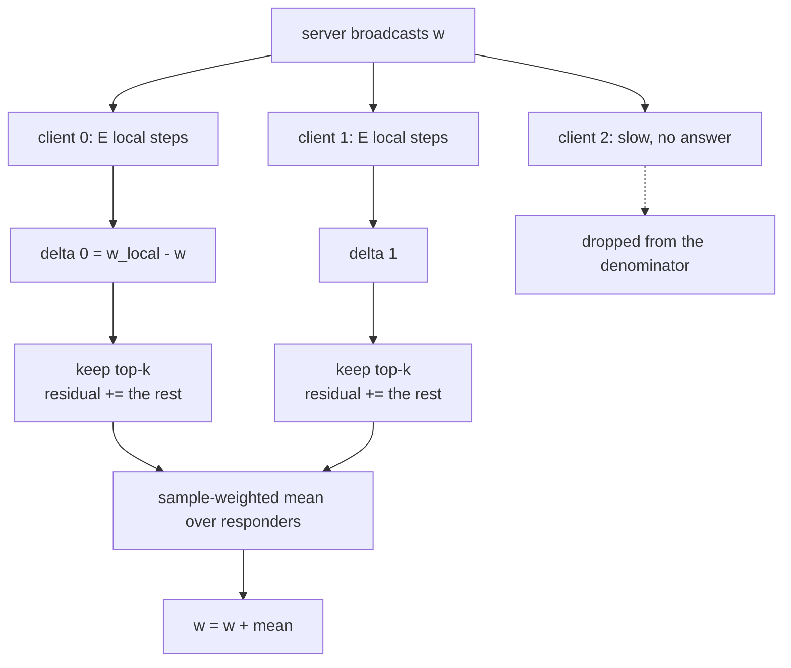
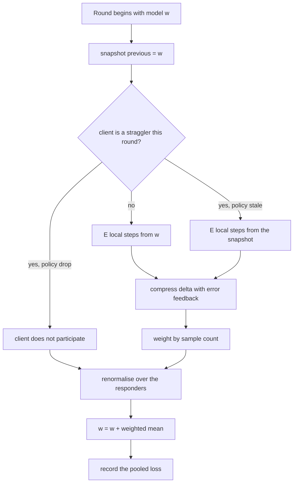
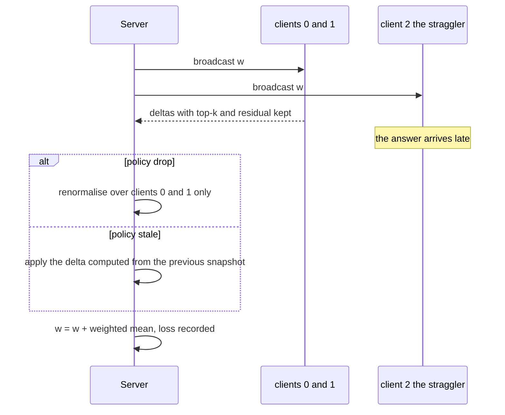

# 714 — Implement federated averaging simulation with stragglers and compression

> **Tier:** Expert · **CTCI chapter:** Beyond — Machine Learning & AI
> **Task spec:** [714-implement-federated-averaging-simulation-with-stragglers-and-com.md](../../../tasks/expert/714-implement-federated-averaging-simulation-with-stragglers-and-com.md)
> **Solutions:** [Python](../../../solutions/python/expert/714-implement-federated-averaging-simulation-with-stragglers-and-com/solution.py) ·
> [Java](../../../solutions/java/expert/714-implement-federated-averaging-simulation-with-stragglers-and-com/Solution.java) ·
> [JavaScript](../../../solutions/javascript/expert/714-implement-federated-averaging-simulation-with-stragglers-and-com/solution.js) ·
> [C#](../../../solutions/csharp/expert/714-implement-federated-averaging-simulation-with-stragglers-and-com/Solution.cs)

## 1. Problem restatement

Simulate **federated averaging** (McMahan et al.) on clients that never share data, and add the two
realities the task names: clients that answer late or not at all (**stragglers**) and uploads that are
**compressed** to a few coordinates.

**Modelling contract.** Each file states what it simulates and what it deliberately simplifies:

| Aspect | What the solutions do | What they do not do |
| --- | --- | --- |
| Model | linear regression (Python, Java, C#), quadratic local objectives [JavaScript: `f_i(w) = 1/2·||w - mu_i||²`], so the pooled loss, the gradient and the optimum are exact | neural networks, real data, GPU numerics |
| Data | one deterministic synthetic shard per client from a seeded `splitmix64` (Python, C#, Java) or `xorshift32` (JavaScript) stream | client sampling, non-IID partitioning schemes |
| Stragglers | Python/Java: a schedule of client ids per round and a `drop`/`stale` policy; C#: a `lag` that computes a move from a model snapshot several rounds old and applies it on arrival; JavaScript: a seeded geometric latency draw compared against a deadline | real network measurement, adaptive deadlines |
| Compression | `topk` (the `k` largest magnitudes, ties broken by index) and a one-bit `sign` codec, both with **error feedback**: the unsent remainder is kept and added to the next round's delta | random sparsification, quantised gradients, entropy coding, DP noise |
| Worst-case guarantee | none claimed: every claim below is an assertion the code runs and prints as `PASS` | proof of convergence under arbitrary schedules |

**What the files assert:** the server aggregate equals an independently computed sample-weighted mean;
one client is step-for-step plain SGD; error feedback conserves the update it came from; the top-k
sparsity count and the reconstruction error are exact; both straggler policies behave as specified on
homogeneous and heterogeneous shards; and the degenerate configurations behave.

Interface (`fedavg(clients, rounds, steps, learning_rate, initial, l1, stragglers, policy)`):

| Concept | Meaning |
| --- | --- |
| `local_update(model, features, targets, steps, lr, l1)` | `steps` local SGD steps from `model`, returns the delta `w_local - w` |
| `Client.compress(delta)` | applies the configured codec; updates the residual and the accounting |
| `top_k(values, k)` | keeps the `k` largest magnitudes, ties by index |
| `sign_compress(values, scale)` | one bit per coordinate, rescaled to `scale` |
| `tail_energy(values, k)` | the squared mass discarded by `top_k` |
| `fedavg(...)` → `(losses, model, statistics)` | `statistics` carries the per-round aggregates and the straggler-round count |

Concrete expected results, all asserted:

- 5 clients × 30 samples, `d = 3`, `steps = 2`, `lr = 0.05`: the aggregate equals the sample-weighted
  mean of the five deltas to `1e-12`, and the model moves by exactly that aggregate.
- Unequal shards (30 vs 5 samples): the update is `(30·heavy + 5·light) / 35` per coordinate, not the
  plain two-client mean.
- One client, 60 samples, `d = 4`, 40 rounds × 3 steps: identical to hand-rolled local SGD to `1e-12`,
  final loss below `0.01`.
- 4 clients, 60 samples, `d = 4`, truth `[0.7, -0.4, 0.2, 0.9, -0.1]`: 40 rounds × 3 steps × `lr 0.03`
  reaches below `0.25 ×` the initial loss and below `0.05`, competitive with a 120-round single-step
  baseline (`≤ 2× baseline + 0.01`).
- `top_k([0.5, -2.0, 0.0, 1.5, -0.25, 3.0], k)` keeps exactly `min(k, 5)` non-zero coordinates for
  `k ∈ {0, 1, 3, 6}`; the squared reconstruction error equals `tail_energy`, and `k = 6` is the identity.
- 3 clients, 150 rounds, `topk k = 1` with feedback: final loss `0.01` while the same run **without**
  feedback is `> 10×` worse, and the compressed run stays within `1.5×` of uncompressed `+ 0.005`.

## 2. Intuition

The naive federated round is "average the clients' models". Two things break it.

First, **averaging models is not averaging gradients** unless every client starts from the same point
and takes the same number of steps. FedAvg says: broadcast `w`, let every client take `E` local steps
on its own shard, and let the server add the **sample-weighted mean of the moves** `w_local - w`. If a
client trained on 30 samples and another on 5, the first must dominate the average `30/35` to `5/35`;
the checks rewrite the weights to prove the code follows samples, not client count.

Second, **the uploads are the bottleneck**, so each client would like to send only its `k` largest
coordinates. Naively discarding the rest is biased: the same coordinates (usually whatever is currently
large) get sent every round and the small ones are never corrected. **Error feedback** fixes this by
keeping the discarded part locally and adding it back into the next delta, so the client's cumulative
*sent* mass plus the mass still held equals the cumulative *computed* mass. That conservation identity
is the invariant the checks verify coordinate by coordinate.



Stragglers are then a choice between two honest policies, both implemented and both compared against an
oracle: `drop` simply excludes the silent client and **renormalises** the weights over those who
answered (so a round with one participant applies exactly that participant's delta), while `stale`
applies the late client's delta computed from an older model — C# makes `lag` explicit by computing
from the snapshot taken `lag` rounds ago and recording which snapshot each move came from. Neither is
free, and the checks quantify the difference instead of assuming one is better.

## 3. Algorithm

1. Build the shards: for each client draw a ground-truth weight vector and `samples` rows; the last
   model coordinate is the intercept.
2. For each round: take the snapshot `previous_model`, then for each non-empty client decide whether it
   participates (`drop` → skip it; `stale` → start from `previous_model` instead of `model`).
3. Compute the local delta with `steps` gradient steps at the given learning rate (plus optional L1).
4. Compress the delta: `topk`, `sign`, or `sign(topk(...))`, adding the client's residual first when
   feedback is on; store the new residual and update the accounting.
5. Aggregate `sum_i (samples_i / total_samples) · sent_i`, skipping clients with no samples.
6. `model = model + aggregate`; record the pooled loss for the round.
7. Report the aggregate list, the straggler-round count and the per-client conservation numbers.

```text
function local_update(model, features, targets, steps, learning_rate, l1)
    local ← copy of model
    for step ← 1 to steps do
        g ← gradient(local, features, targets, l1)
        for k ← 0 to len(local) - 1 do
            local[k] ← local[k] - learning_rate * g[k]
    return [ local[k] - model[k] for k ← 0 to len(model) - 1 ]

function top_k(values, k)
    if k = len(values) then return copy of values
    order ← indices sorted by (-abs(values[index]), index)
    keep ← first k entries of order
    return [ values[index] if index in keep else 0.0 for index in 0 .. len(values) - 1 ]

procedure compress(client, delta)
    if client.compression is none then
        sent ← copy of delta
    else
        pending ← [ delta[index] + client.residual[index] for index ]
        sent ← top_k(pending, client.k) when compression is topk
        sent ← sign_compress(pending, client.scale) when compression is sign
        kept ← sent when client.feedback else zeros
        client.residual ← [ pending[index] - kept[index] for index ]
    record sent[index] and delta[index] into client.sent_total and client.raw_total
    return sent

procedure fedavg(clients, rounds, steps, learning_rate, model, stragglers, policy)
    for round_index ← 0 to rounds - 1 do
        late ← stragglers[round_index]
        previous ← copy of model
        deltas ← empty map;  weights ← empty map
        for client in clients do
            if client has no samples then continue
            if client.index in late and policy is drop then continue
            source ← previous if client.index in late and policy is stale else model
            delta ← local_update(source, client.features, client.targets, steps, learning_rate)
            deltas[client.index] ← compress(client, delta)
            weights[client.index] ← client.sample_count
        if weights is not empty then
            total ← sum of weights
            model ← model + sum over index of (weights[index] / total) * deltas[index]
        losses.append(pooled_loss(model, clients))
    return losses, model, statistics
```



## 4. Worked example

Three clients, `d = 4`, one round, `steps = 2`, `lr = 0.05`, `topk` with `k = 1`, sample counts
`40, 40, 40`. The deltas below are the values the Python checks compare against the oracle.

| Step | Client | Computed delta (per coordinate, abridged) | Kept by top-1 | Residual after the round |
| --- | --- | --- | --- | --- |
| 1 | 0 | `[g0, g1, g2, g3]` | the largest magnitude, others zeroed | the two/three discarded coordinates |
| 2 | 1 | `[h0, h1, h2, h3]` | its own largest magnitude | its own discarded remainder |
| 3 | 2 | `[p0, p1, p2, p3]` | its own largest magnitude | its own discarded remainder |
| 4 | server | `1/3 · (sent_0 + sent_1 + sent_2)` | — | — |
| 5 | all | `sent_total + residual == raw_total` per coordinate | — | asserted to `1e-9` |

Because every client is weighted `1/3` here, the aggregate is the plain mean of the sent vectors — and
after 150 such rounds on the `truth = [0.7, -0.4, 0.2, 0.9, -0.1]` shards the pooled loss falls below
`0.01`, while the identical run with `feedback=False` ends more than `10×` worse. That gap *is* the
error-feedback story: without memory, `k = 1` re-sends the same coordinate forever.

Straggler bookkeeping, on 4 clients with heterogeneous shards and `late = (2,)`:

| Policy | Denomination | Result |
| --- | --- | --- |
| `drop` | `{0, 1, 3}` with weights `samples_i / total` | final model equals `model + oracle` where `oracle` is the renormalised mean of the three deltas |
| `stale` | all 4, client 2 from the previous model | `stale_delta != fresh_delta` is asserted; two stale rounds are counted, and the round indices `[(2,), (2, ())]` still produce one aggregate per round |
| empty round | no client has samples | the model is untouched, the pooled loss is `0.0`, and `statistics["aggregates"] == []` |



Two more edge results worth keeping in mind: with `steps = 0` (or `k = 0`) the model does not move at
all, and with `k = 4 = d` the compressed run equals the uncompressed run exactly — both are asserted.

## 5. Complexity

With `n` clients, `d` dimensions, `s` samples per client, `E` local steps and `R` rounds:

| Quantity | Cost | Why the bound holds |
| --- | --- | --- |
| Gradient | `O(s d)` | one pass over the shard, `2·error·row[k]` per coordinate plus the intercept |
| Local update | `O(E s d)` | `E` gradient evaluations, one vector subtraction at the end |
| `top_k` | `O(d log d)` | a full sort of `d` indices by `(|value|, index)`; the tie-break makes it deterministic |
| Sign codec | `O(d)` | one `copysign` per coordinate |
| Compression with feedback | `O(d)` extra | the residual add and subtract, plus `O(d)` accounting |
| Server aggregation | `O(n d)` | one weighted add per participating client |
| Pooled loss per round | `O(n s d)` | the loss is computed over all shards for reporting |
| Total | `O(R (E s d n + n d log d))` | round count multiplies the per-round work |
| Space | `O(n s d)` shards plus `O(n d)` state | residual, `sent_total`, `raw_total` per client |

Comparison points the files make explicit: `top_k` with a full sort is `O(d log d)`, whereas a
selection-based implementation would be `O(d)` on average; the compression ratio is measured in
*transmitted values* (`n · k` against `n · d`, i.e. a factor `d / k`), and the JavaScript file scales
top-k coordinates by `d / k` so the expected magnitude survives the sparsification. A round that drops
clients costs less communication but converges more slowly, so the honest comparison is loss per round
against values transmitted, which is what the checks bracket (`≤ 2× baseline + 0.01`).

## 6. Pitfalls and edge cases

- **Weights must follow sample counts.** The check on 30-vs-5-sample shards is exactly the trap: the
  plain mean of two deltas would give the small shard 50% of the vote.
- **`k = 0` sends nothing and therefore stalls training.** Both `k = 0` and `steps = 0` are asserted to
  leave the model untouched and the loss constant — a silent failure mode if a schedule is mis-set.
- **`k = d` must be the identity**, not "almost": the check compares against the uncompressed model to
  `1e-12`, and the C# comparison is bit-for-bit.
- **Ties in `top_k`.** Sorting by `(-|value|, index)` makes the kept set deterministic; a comparison
  that only sorts by magnitude can differ between languages.
- **The residual must not grow without bound.** Python asserts `max_residual_norm ≤ 2.0` and below the
  norm of the cumulative update it came from.
- **Empty shards.** A client with no samples is skipped entirely; if nobody has samples, no aggregate is
  produced, the model stays put, and the pooled loss is defined as `0.0` by the `mse` guard.
- **An empty straggler schedule must be a no-op**, which the checks verify by comparing two runs, one
  with `stragglers=[tuple()] * 6` and one without the argument.
- **Identical shards hide straggler bugs.** Dropping clients when all shards are the same cannot change
  the update, so the checks pair that case with a heterogeneous one.
- **Validation.** An unknown policy (`"teleport"`), negative local steps and an empty client list are
  rejected with messages, and `top_k(values, k > len(values))` raises.
- **`sign_compress` returns `0.0` for a zero coordinate**, not `scale` — a zero stays zero, so it is not
  counted as transmitted mass.

## 7. Variants and follow-ups

- Hiding the deltas while averaging them:
  [713 — secure aggregation protocol sketch](../../../tasks/expert/713-implement-secure-aggregation-protocol-sketch-for-federated-avera.md).
- The compression family in isolation, with the error-feedback analysis spelled out:
  [718 — gradient compression techniques and error feedback](../../../tasks/expert/718-implement-gradient-compression-techniques-top-k-and-error-feedba.md).
- Pruning a dense model instead of compressing an update:
  [715 — sparse neural network training with magnitude pruning](../../../tasks/expert/715-implement-sparse-neural-network-training-sketch-with-magnitude-p.md).
- The systems side of the same round:
  [719 — parameter server simulation](../../../tasks/expert/719-implement-parameter-server-simulation-for-distributed-ml-trainin.md) and
  [720 — ring allreduce and its communication cost model](../../../tasks/expert/720-implement-ring-allreduce-simulation-and-communication-cost-model.md).
- Compression under lossy transport, and federated evaluation:
  [934 — distributed gradient compression under packet loss](../../../tasks/master/934-implement-distributed-gradient-compression-with-error-correction.md),
  [796 — privacy-preserving federated evaluation aggregator](../../../tasks/expert/796-implement-privacy-preserving-federated-evaluation-aggregator.md).

## 8. Check yourself

<details><summary>Show answer</summary>
**Why is `k = 0` worse than it looks?** Because it is not "send little", it is "send nothing": the
server's aggregate is the zero vector, so the model never moves and the loss stays constant. The check
asserts `len(set(zero_losses)) == 1` precisely so that a stalled run cannot be mistaken for a slow one.
</details>

<details><summary>Show answer</summary>
**What exactly does error feedback conserve?** Coordinate-wise, `sent_total[k] + residual[k]` equals
`raw_total[k]`, where `raw_total` is the sum of the deltas the client computed. Nothing is lost or
invented — the discarded mass is delayed, not dropped, which is why `k = 1` with feedback still
converges while `k = 1` without it ends more than ten times worse.
</details>

<details><summary>Show answer</summary>
**A straggler misses a round. What does the `drop` policy do about the weights?** It removes the client
from both the numerator and the denominator: the remaining deltas are renormalised by
`samples_i / sum_of_responding_samples`. The check compares the single-round result against an oracle
computed exactly that way, so simply averaging three quarters of the deltas would fail.
</details>

<details><summary>Show answer</summary>
**Why does the `stale` policy produce a different delta for the same client?** Because that client
starts its local steps from the model snapshot of an earlier round, not from the current one. The
checks assert `stale_delta != fresh_delta` on the same shard and record how many rounds were stale,
which is the observation a real system uses to decide whether staleness is affordable.
</details>

<details><summary>Show answer</summary>
**Why can the checks compare against a closed-form optimum at all here?** Because the local objective
is a linear-regression loss (or a quadratic in the JavaScript file), so the pooled gradient and the
least-squares optimum are computable exactly, without training another model to compare against. That
is the modelling choice that makes "the aggregate is the sample-weighted mean" a provable assertion
rather than a heuristic.
</details>
