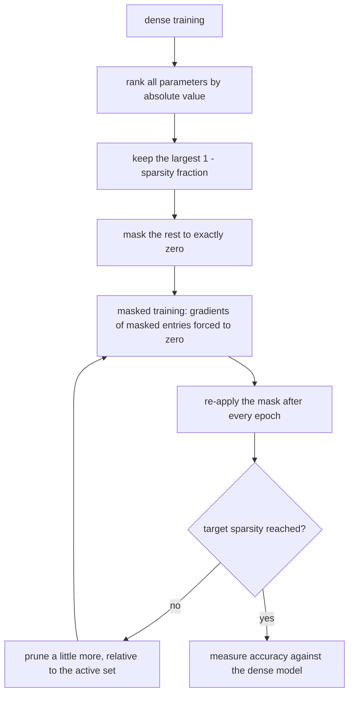
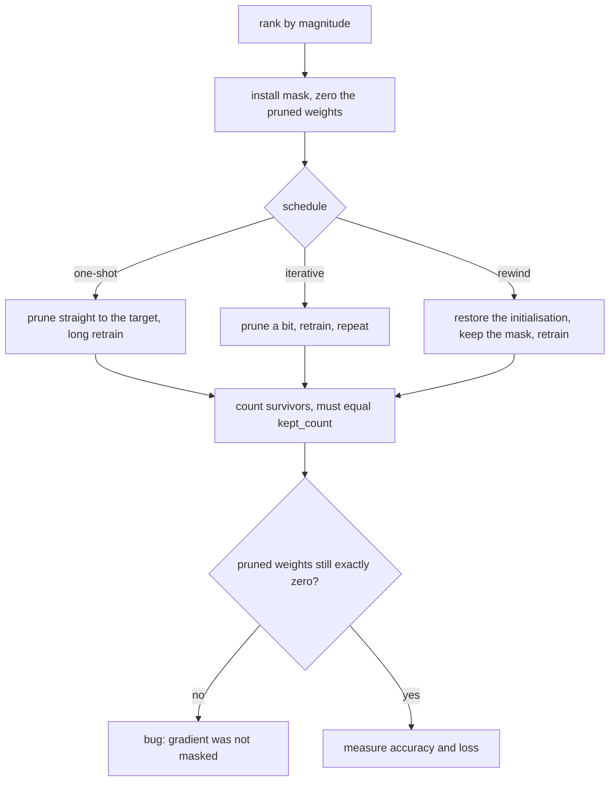
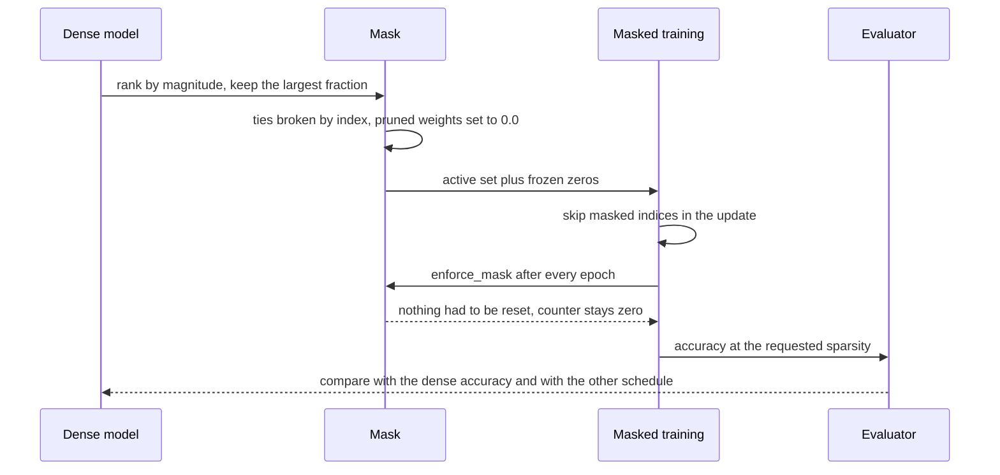

# 715 — Implement sparse neural network training sketch with magnitude pruning

> **Tier:** Expert · **CTCI chapter:** Beyond — Machine Learning & AI
> **Task spec:** [715-implement-sparse-neural-network-training-sketch-with-magnitude-p.md](../../../tasks/expert/715-implement-sparse-neural-network-training-sketch-with-magnitude-p.md)
> **Solutions:** [Python](../../../solutions/python/expert/715-implement-sparse-neural-network-training-sketch-with-magnitude-p/solution.py) ·
> [Java](../../../solutions/java/expert/715-implement-sparse-neural-network-training-sketch-with-magnitude-p/Solution.java) ·
> [JavaScript](../../../solutions/javascript/expert/715-implement-sparse-neural-network-training-sketch-with-magnitude-p/solution.js) ·
> [C#](../../../solutions/csharp/expert/715-implement-sparse-neural-network-training-sketch-with-magnitude-p/Solution.cs)

## 1. Problem restatement

Train a tiny neural network, delete the weights of smallest magnitude, keep training, and measure what
that costs: this is **magnitude pruning** (Han et al.) with the three schedules the literature uses —
one-shot, iterative, and lottery-ticket **rewinding**.

**Modelling contract.** Each file is a *sketch on a hand-written MLP*, not a sparse-kernel benchmark:

| | Python | Java | JavaScript | C# |
| --- | --- | --- | --- | --- |
| Architecture | 2 → `H` tanh → 1 sigmoid, `4H + 1` parameters (33 at `H = 8`) | input → ReLU hidden → softmax | 2 → 8 tanh → 1, described as 41 parameters | 3 → 5 tanh → 1 linear, 26 parameters |
| Gradient check | central finite differences of the loss, `|numeric - analytic| < 1e-4` | central finite differences | analytic only | all 26 partial derivatives against finite differences |
| Task | XOR-like sign product with label noise `0.08` | separable synthetic task | concentric circles | synthetic, full-batch descent |
| Simplifications | 240 samples, plain SGD, no momentum or weight decay, global (not per-layer) sparsity | full batch instead of minibatches, a single prune-and-finetune cycle | full-batch SGD with momentum, the mask makes arithmetic cheaper but not faster | flat `double` arrays, byte-level compression estimate instead of real packing |

**What is asserted, not assumed:** the exact sparsity count after every prune, the magnitude threshold
(every kept `|w|` is at least every dropped `|w|`), the frozen-zero invariant under further training,
`sparsity 0` being *bit-identical* to dense training, `sparsity 1` collapsing to the constant majority
predictor, accuracy retention at high sparsity, the iterative-versus-one-shot comparison, and
end-to-end determinism from a seed.

Interface (Python; the others mirror it):

| Call | Meaning |
| --- | --- |
| `Mlp(hidden, seed)` | flat `theta`, `initial` copy, boolean `mask`, update counters |
| `forward(x)` | returns `(probability, hidden activations)` |
| `gradients(x, label)` | analytic gradient of the cross-entropy |
| `train_epoch(...)` / `train(...)` | masked SGD; `enforce_mask()` runs after every epoch |
| `kept_count(size, sparsity)` | `size - round(sparsity * size)` — the single source of truth for rounding |
| `magnitude_mask(theta, sparsity)` | keep the largest `(1 - sparsity)` fraction, ties by index |
| `apply_mask(model, sparsity)` | install a fresh mask and zero the pruned weights |
| `prune_round(model, target)` | prune *relative to the currently active set*, keeping the mask monotone; returns how many were removed |

Concrete expected results, all asserted:

- `magnitude_mask([1.0, 1.0, 1.0], 1/3) == [True, True, False]` (ties by index);
  `magnitude_mask([1.0, 2.0], 1.0) == [False, False]`; `magnitude_mask([1.0, 2.0], 0.0) == [True, True]`;
  `sparsity` outside `[0, 1]` is rejected.
- Dense baseline: 150 samples, `hidden = 32`, 100 epochs, `lr = 0.2` reaches accuracy `≥ 0.85` with loss
  `< 0.35`, and nothing is pruned.
- 80% sparse + 40 epochs of retraining: the pruned coordinates are `0.0` before *and* after, and
  `masked_updates == 0` — the mask is enforced through the gradient, not by a post-hoc reset.
- Retention: accuracy `≥ 0.85` at 50%, 70% and 80% sparsity, never above `dense + 0.02`; at **90%** the
  rule collapses (`accuracy < accuracy at 80%`).
- Iterative pruning through targets 40% → 60% → 80% (40 epochs between rounds) is at worst `0.02` below
  one-shot pruning to 80% with a 100-epoch retrain, and both end at exactly the same sparsity.
- Rewinding: the same seed reproduces the initialisation, the rewound sparse ticket reaches `≥ 0.8`.
- Boundaries: `sparsity 0` is bit-identical to unmasked training; `sparsity 1` zeroes everything and the
  network predicts one class whose accuracy equals that class's frequency (the majority fraction).

## 2. Intuition

A trained network has far more parameters than it needs, so the blunt question is: *what happens if we
delete the smallest ones and keep training?* The naive answer — "prune, then train normally" — is
wrong: an unmasked optimiser immediately regrows the deleted weights, because their gradients are
generally non-zero.

So the deletion must be a **structural** commitment: keep a boolean `mask` alongside the weights, skip
masked coordinates in the update, and re-apply the mask after every epoch. Then "pruned" means exactly
`0.0` forever, and the whole pipeline reduces to arithmetic you can assert on.

The second insight is *when* you prune. Removing 80% in one shot and retraining asks the survivors to
compensate for a single catastrophic cut; removing 40%, retraining, then 60%, then 80% lets the network
absorb the damage in stages — the classic **iterative magnitude pruning** schedule. Rewinding asks a
third question: once a sparse *structure* is known to work, do the surviving weights have to be the
trained ones, or is the initialisation enough?



The picture also explains the failure mode the checks pin down: at 90% sparsity only about ten percent
of the weights survive, and on this task the XOR-like rule needs more capacity than that, so accuracy
drops below the 80% result. Nothing in the pipeline is allowed to claim otherwise.

## 3. Algorithm

1. Build the dataset deterministically: two features in `[-1, 1]`, label `1 if x·y > 0 else 0`, flipped
   with probability `0.08`.
2. Initialise the MLP from a seed, keeping a copy of the initial weights for rewinding.
3. Train densely for a reference accuracy and loss.
4. `magnitude_mask`: sort indices by `(-|theta[i]|, i)`, keep `kept_count(size, sparsity)` of them. The
   tie-break makes the mask deterministic across languages.
5. `apply_mask`: install the mask and force every masked weight to `0.0`.
6. Train with the mask: skip masked indices in the update, then call `enforce_mask()`, which counts any
   weight it had to reset (the counter must stay `0` when the gradient was properly masked).
7. Iterative schedule: for each intermediate target, prune relative to the *active* set (raising
   sparsity monotonically) and retrain; assert the survivor count equals `kept_count(size, target)`.
8. Rewind: restart from the stored initialisation, install the found mask, and retrain with the mask
   fixed.
9. Report retention per sparsity, the iterative/one-shot/rewound comparison, and the degenerate cases.

```text
function kept_count(size, sparsity)
    if sparsity < 0 or sparsity > 1 then reject "sparsity must lie in [0, 1]"
    return size - round(sparsity * size)

function magnitude_mask(theta, sparsity)
    keep ← kept_count(len(theta), sparsity)
    order ← indices sorted by (-abs(theta[index]), index)
    mask ← [false] * len(theta)
    for position ← 0 to keep - 1 do
        mask[order[position]] ← true
    return mask

procedure enforce_mask(model)
    for index ← 0 to model.size - 1 do
        if not model.mask[index] and model.theta[index] != 0.0 then
            model.theta[index] ← 0.0
            model.masked_updates ← model.masked_updates + 1

procedure train_epoch(model, features, labels, learning_rate)
    for (x, label) in zip(features, labels) do
        grad ← gradients(model, x, label)
        for index ← 0 to model.size - 1 do
            if model.mask[index] then
                model.theta[index] ← model.theta[index] - learning_rate * grad[index]
    enforce_mask(model)

function prune_round(model, target_sparsity)
    active ← [ index where model.mask[index] ]
    need ← len(active) - kept_count(model.size, target_sparsity)
    if need <= 0 then return 0
    order ← active sorted by (abs(theta[index]), index)
    for position ← 0 to need - 1 do
        model.mask[order[position]] ← false
        model.theta[order[position]] ← 0.0
    return need

procedure iterative_prune(model, targets, features, labels, epochs, learning_rate)
    for target in targets do
        prune_round(model, target)
        train(model, features, labels, epochs, learning_rate)
```



## 4. Worked example

Hold the mask fixed and watch one coordinate. `theta = [0.5, -2.0, 0.0, 1.5, -0.25, 3.0, -1.0, 0.75]`,
`sparsity = 0.5`, so `kept_count(8, 0.5) = 4`.

| Rank | Index | `|w|` | Kept? | Why |
| --- | --- | --- | --- | --- |
| 1 | 5 | `3.0` | yes | largest magnitude |
| 2 | 1 | `2.0` | yes | |
| 3 | 3 | `1.5` | yes | |
| 4 | 6 | `1.0` | yes | the fourth survivor; `min(kept |w|) = 1.0` |
| 5 | 7 | `0.75` | no | `max(dropped |w|) = 0.75 ≤ 1.0` |
| 6 | 0 | `0.5` | no | |
| 7 | 4 | `0.25` | no | |
| 8 | 2 | `0.0` | no | already zero, still masked |

The check reads that table back as `min(|kept|) ≥ max(|dropped|)`, which is what makes the rule
*magnitude* pruning rather than an arbitrary cut. Then the retraining trace on the 150-sample shard:

| Phase | Epochs | `lr` | What is measured |
| --- | --- | --- | --- |
| dense | 100 | 0.2 | accuracy `≥ 0.85`, loss `< 0.35`, `active == size` |
| mask 80% | 0 | — | `pruned == 0.0` exactly, `size - kept_count(size, 0.8)` zeros |
| masked train | 40 | 0.2 | masked coordinates unchanged, `masked_updates == 0`, some survivor moved |
| iterative 40/60/80% | 40 each | 0.2 | survivor count equals `kept_count` after each round |
| one-shot 80% | 100 | 0.2 | compared against the iterative run, same final sparsity |



The boundary cases finish the picture. `sparsity = 0` produces an all-true mask, and the checks require
the resulting `theta` to equal unmasked training **bit for bit**. `sparsity = 1` zeroes all 33
parameters; the network then outputs a constant, and its accuracy equals the frequency of that constant
class (the majority fraction of the labels) — a clean, provable collapse rather than a random result.

## 5. Complexity

With `P = 4H + 1` parameters, `N` samples and `E` epochs:

| Phase | Cost | Why the bound holds |
| --- | --- | --- |
| Forward + backward per sample | `O(P)` | `2H` inputs to the hidden layer, `H` activations, `H + 1` outputs — every parameter is touched once |
| Dense epoch | `O(N P)` | one gradient and one update per sample |
| Masked epoch | `O(N P)` | masked coordinates are *skipped*, not expanded into a sparse structure, so the Python/JS files do not save time — only memory and bytes |
| `magnitude_mask` | `O(P log P)` | a full sort by `(-|w|, index)`; a selection algorithm would give `O(P)` expected |
| `prune_round` | `O(P log P)` | same sort, restricted to the active set |
| Finite-difference gradient check | `O(P N)` loss evaluations | `2` loss passes per parameter |
| Space | `O(P)` | `theta`, `initial`, `mask`, plus `O(N)` samples |

The honest note: in Python, JavaScript and C# the mask **does not make training faster** — the loop
still visits every index and merely skips the update. The saving is storage and (for C#) the byte-level
compression estimate; a real sparse-aware implementation needs index structures or blocked layouts to
turn sparsity into throughput. Against that, the comparison that matters for the task is *accuracy per
parameter count* — the retention table — not wall-clock time.

| Schedule | Cuts | Retraining after each cut | End sparsity | Measured outcome |
| --- | --- | --- | --- | --- |
| Dense | 0 | — | 0% | reference accuracy, `active == size` |
| One-shot | 1 | one long run | target | accurate but needs the long retrain |
| Iterative | several | small runs between cuts | target | at worst `0.02` below one-shot at 80% |
| Rewind | 1 (structure found earlier) | from the initialisation | target | `≥ 0.8`, a *different* sparse solution |

## 6. Pitfalls and edge cases

- **Masked training must mask the gradient, not just reset afterwards.** The Python check asserts
  `model.masked_updates == 0` after 40 epochs, which fails the moment an update uses a masked weight.
- **Rounding is a single source of truth.** `kept_count` is the only place where
  `size - round(sparsity * size)` is computed, so the mask and the assertions cannot disagree.
- **Ties are the classic cross-language divergence.** `(1.0, 1.0, 1.0)` at `1/3` must give
  `[True, True, False]`; sorting by magnitude alone would leave the choice to the sort implementation.
- **`prune_round` is relative to the active set** and returns the number removed, so calling it twice
  for the same target returns `0` the second time — asserted on the already-satisfied one-shot model.
- **`sparsity = 0` must be a true no-op**, not "almost"; the check compares the whole `theta` vector with
  unmasked training for exact equality.
- **`sparsity = 1` is a defined state, not a crash.** All weights become `0.0`, `active == 0`, the
  prediction is a single class, and its accuracy equals that class's frequency; pruning it further is a
  no-op.
- **Rewinding needs the stored initialisation.** `Mlp(seed=0x99).initial` must reproduce exactly, and
  after rewinding the pruned coordinates must be `0.0` while survivors start from the initialisation.
- **The zero-vector trap for `magnitude_mask`.** A parameter that is already `0.0` still takes part in
  the ranking; it simply ranks last, which is what the table in section 4 shows.
- **Accuracy cannot be invented.** `retention[sparsity] ≤ dense_accuracy + 0.02` guards against a
  pruning bug that accidentally leaks labels or bypasses the mask.
- **Determinism.** Two runs with the same seeds produce identical `theta` *and* identical masks; the
  dataset, the initialisation and every schedule are seed-driven.

## 7. Variants and follow-ups

- Compressing the *updates* clients send rather than the model they keep:
  [718 — gradient compression with top-k and error feedback](../../../tasks/expert/718-implement-gradient-compression-techniques-top-k-and-error-feedba.md).
- Making the surviving weights small as well as few:
  [716 — quantized neural network inference simulation](../../../tasks/expert/716-implement-quantized-neural-network-inference-simulation-8-bit.md)
  and [717 — mixed-precision training utility](../../../tasks/expert/717-implement-mixed-precision-training-utility-fp16-fp32-accumulator.md).
- Pruning inside a federated round, where every client has its own sparse structure:
  [714 — federated averaging with stragglers and compression](../../../tasks/expert/714-implement-federated-averaging-simulation-with-stragglers-and-com.md).
- Larger-scale versions of the same idea: [819 — memory-efficient checkpointing for massive models](../../../tasks/master/819-implement-memory-efficient-checkpointing-for-massive-models-bloc.md)
  and [826 — automatic mixed-precision training pipeline](../../../tasks/master/826-implement-automatic-mixed-precision-training-full-pipeline-with.md).

## 8. Check yourself

<details><summary>Show answer</summary>
**Why does "prune and then train normally" not work?** Because nothing stops the optimiser from
re-growing the deleted weights: their gradients are non-zero, so the next update moves them away from
zero. Magnitude pruning only means something when the mask is part of the update rule, which is why the
solutions skip masked indices and re-apply the mask after every epoch.
</details>

<details><summary>Show answer</summary>
**What distinguishes iterative pruning from one-shot pruning in the checks?** The intermediate targets.
Iterative pruning walks 40% → 60% → 80% with 40 epochs of retraining after each cut, so the survivors
absorb one moderate cut at a time; one-shot jumps straight to 80% and compensates with a 100-epoch
retrain. Both must end at exactly `kept_count(size, 0.8)` survivors, and the iterative run must not be
more than `0.02` below the one-shot accuracy.
</details>

<details><summary>Show answer</summary>
**A fully pruned network still reports an accuracy above 0.5. Is that a bug?** No. Every parameter is
`0.0`, so the output is constant and the network predicts one class for every input; its accuracy is
therefore the frequency of that class in the dataset. The check asserts exactly this equality — and also
that the predicted class is one of the two label classes, so the "accuracy" cannot come from anything
else.
</details>

<details><summary>Show answer</summary>
**Why is `masked_updates` re-armed in `apply_mask` but asserted to be zero after training?** The counter
exists to detect a training-time resurrection: it counts coordinates that `enforce_mask` had to reset to
zero after an update. If the gradient were masked properly, no reset is ever needed, so
`masked_updates == 0` is a real statement about the optimiser, not about the pruning step.
</details>

<details><summary>Show answer</summary>
**What is the lottery-ticket part of the experiment, in one sentence?** Rewinding: after finding a
sparse mask on a trained model, restore the *initial* weights of the surviving coordinates, keep the
mask fixed, and retrain — the checks require that this still reaches `≥ 0.8` accuracy while being a
different solution from the trained model.
</details>
