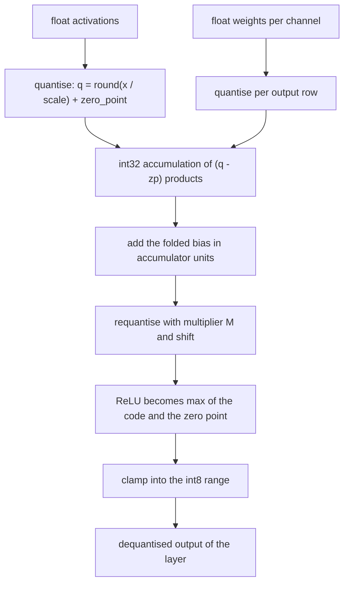
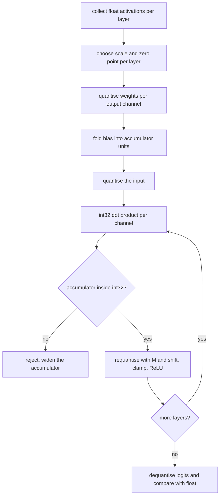
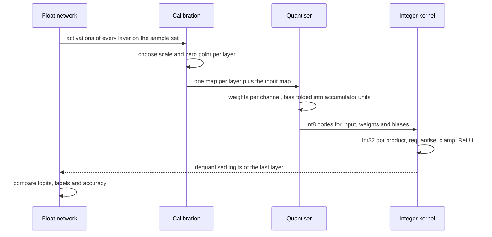

# 716 — Implement quantized neural network inference simulation (8-bit)

> **Tier:** Expert · **CTCI chapter:** Beyond — Machine Learning & AI
> **Task spec:** [716-implement-quantized-neural-network-inference-simulation-8-bit.md](../../../tasks/expert/716-implement-quantized-neural-network-inference-simulation-8-bit.md)
> **Solutions:** [Python](../../../solutions/python/expert/716-implement-quantized-neural-network-inference-simulation-8-bit/solution.py) ·
> [Java](../../../solutions/java/expert/716-implement-quantized-neural-network-inference-simulation-8-bit/Solution.java) ·
> [JavaScript](../../../solutions/javascript/expert/716-implement-quantized-neural-network-inference-simulation-8-bit/solution.js) ·
> [C#](../../../solutions/csharp/expert/716-implement-quantized-neural-network-inference-simulation-8-bit/Solution.cs)

## 1. Problem restatement

Replace every float multiply-accumulate of a small MLP with **integer** arithmetic, keep the error
measurable, and check that the quantised network still makes the same decisions as the float one.

**Modelling contract.** The files simulate the *arithmetic* of a post-training 8-bit pipeline, not a
GPU kernel and not a training recipe:

| Element | Contract |
| --- | --- |
| Quantisation | affine, `q = clamp(round(x / scale) + zero_point)`, `x ≈ scale · (q - zero_point)`, `scale = (max - min) / (qmax - qmin)` |
| Ranges | Python `[-128, 127]`; Java and C# use symmetric int8 weights (`[-127, 127]`, zero point 0) plus asymmetric uint8 activations (`[0, 255]`); JavaScript supports symmetric `[-128, 127]` and asymmetric `[0, 255]` |
| Weights | per-output-channel scales (one `(scale, zero_point)` triple per row), compared against a single per-tensor scale |
| Activations | per-tensor, calibrated by a min/max sweep over a sample set (post-training calibration, no training with quantisation in the loop) |
| Kernel | `acc = Σ (x_q[k] - x_zp)·(w_q[k] - w_zp)` in **int32**, then `out_q = clamp(round_shift(acc · M, shift) + out_zp)` |
| Not modelled | SIMD packing, lookup tables, per-group scales, an actual machine int32 accumulator in Python (there it is a validated Python integer), real trained weights |

**What is asserted:** every round trip inside half a quantisation step, the exact scale/zero-point
derivation (including the degenerate constant tensor and explicit saturation), per-channel beating
per-tensor on a channel-varying tensor, the int32 accumulator against a big-integer oracle plus its
overflow guard, integer requantisation within one quantised unit of the float rescale, quantised
logits and labels against the float reference, and 8-bit beating 4-bit as the bit width grows.

Interface (Python; the other files expose the same concepts):

| Call | Meaning |
| --- | --- |
| `choose_scale(values)` | `(scale, zero_point)` for the observed range, extended to include `0.0` |
| `quantize(values, ...)` / `quantize_signed(...)` | affine and symmetric code assignment |
| `quantize_per_channel(rows)` | one `(scale, zero_point, data)` triple per row |
| `requantize_multiplier(real_multiplier)` | `(M, shift)` with `M` an int32 |
| `round_shift(value, shift)` | arithmetic right shift, round-half-away-from-zero |
| `int32_matmul_dot(...)` | the zero-point-corrected dot product with a range guard |
| `integer_linear(...)` | one fully connected layer as an integer kernel |
| `calibrate(network, inputs)` | one scale per layer plus one for the input |
| `forward_quantized(...)` | the integer path, returning dequantised logits |

Concrete expected results, all asserted:

- `choose_scale([-3.0, 1.5, 4.0, 0.25])` gives `scale = 7.0 / 255` to `1e-12`; the real value `0.0`
  lands exactly on `zero_point` and dequantises back to `0.0`; the max and min are each representable
  within one scale; every value round trips within `scale / 2`.
- A positive-only range (`[5.0, 6.0, 7.0]`) is extended to include zero, and that extension still
  introduces no clipping.
- Saturation is reported, not hidden: quantising `[-100.0, 100.0]` with the scale of `[-1.0, 1.0]`
  clamps to `QMIN`/`QMAX` and is visibly wrong by more than `10.0`.
- Accumulator bounds: `255 · 255 · 64 < INT32_MAX` with a hundredfold margin; the guard rejects an
  overflowing dot product; in JavaScript the worst case `127 · 127 · K` fits int32 only while
  `K ≤ 133152`.
- Requantisation: over 400 random multipliers and 9 accumulator values each, the integer result is
  within `1.0 + 1e-9` of `acc · real_multiplier`; `round_shift(3, 1) == 2` and `round_shift(-3, 1) == -2`
  (symmetric rounding).
- Layer accuracy: for `[6, 10, 4]` with 12 inputs, every layer stays within `60 · out_scale` and within
  `4 ×` the analytic bound `Σ|w|·sx/2 + Σ|x|·sw/2 + sy/2 + sx·sw/2`.
- Full network `[4, 16, 8, 1]` on 150 inputs: worst logit gap `< 1.0`, label agreement `≥ 0.97`, and
  `|accuracy_quantized - accuracy_float| ≤ 0.03` while the float accuracy stays in `[0.1, 0.9]`.
- Bit width: mean absolute error at 8 bits is smaller than at 4 bits, by a factor `> 8`.

## 2. Intuition

The naive way to speed up inference is "use `float32` instead of `float64`", which saves memory but
leaves the multiplies intact. The insight behind 8-bit inference is that a matrix product can be done
**entirely in integers** if every tensor carries one shared affine map: store `q = round(x/scale) +
zero_point`, and then

```text
x · w  ≈  scale_x · scale_w · Σ (x_q[k] - x_zp)·(w_q[k] - w_zp)
```

so the sum is a pure integer accumulation and the two scales collapse into a single multiplier applied
once at the end. The kernel never sees a float.

Two details make the scheme exact where it can be and honest where it cannot.

1. **The range is extended to include zero**, so `0.0` maps onto a representable integer. That is what
   turns ReLU into a plain clamp at the zero point instead of an interpolation between codes.
2. **The final rescale is itself integer**: `x_scale · w_scale / out_scale` is pre-multiplied by
   `2^shift` and rounded into an int32 `M`, and the division becomes an arithmetic right shift with
   round-half-away-from-zero. Requantisation error is then a bounded number of quantised units rather
   than a float rounding mystery.



The accuracy story is then empirical but tightly bounded: the four solutions measure the round trip
(`≤ scale/2`), the requantisation (`≤ 1` unit), and the end-to-end decision agreement (`≥ 0.97` on the
`4 → 16 → 8 → 1` network), rather than claiming "indistinguishable from float".

## 3. Algorithm

1. **Calibrate.** Run the float network over a sample set, collect the activations of every layer, and
   compute one `(scale, zero_point)` per layer (plus one for the input). Python centres the last layer
   on zero via `quantize_signed`.
2. **Quantise the weights** per output channel, and fold each bias into accumulator units:
   `bias_acc = round(bias / (input_scale · weight_scale))` — the bias joins the accumulator directly.
3. **Quantise the input** with the input scale/zero point.
4. For each layer: compute the exact int32 dot product per output channel, add `bias_acc`, requantise
   with `M`/`shift`, apply ReLU as `max(code, out_zero)` on non-final layers, clamp to int8.
5. Feed the codes of layer `i` into layer `i + 1` together with layer `i + 1`'s own input scale.
6. Dequantise the final codes to logits, threshold at `0` for the label, and compare against the float
   reference: logits, labels, accuracy.
7. Report the worst logit gap, the agreement rate, and the 4-bit versus 8-bit error comparison.

```text
function choose_scale(values, qmin, qmax)
    if values is empty then reject "the calibration set cannot be empty"
    lowest ← min(min(values), 0.0)
    highest ← max(max(values), 0.0)
    if highest = lowest then return 1.0, 0
    scale ← (highest - lowest) / (qmax - qmin)
    zero_point ← clamp(round(qmin - lowest / scale), qmin, qmax)
    return scale, zero_point

function requantize_multiplier(real_multiplier, max_multiplier)
    if real_multiplier < 0 then reject "the multiplier must be non-negative"
    if real_multiplier = 0 then return 0, 0
    shift ← 0
    while real_multiplier * (1 << shift) < max_multiplier / 2 do
        shift ← shift + 1
    multiplier ← round(real_multiplier * (1 << shift))
    while multiplier >= max_multiplier do
        shift ← shift - 1
        multiplier ← round(real_multiplier * (1 << shift))
    return multiplier, shift

function round_shift(value, shift)
    if shift <= 0 then return value << (-shift)
    half ← 1 << (shift - 1)
    if value >= 0 then return (value + half) >> shift
    return -((-value + half) >> shift)

function int32_matmul_dot(x_q, x_zero, w_q, w_zero)
    total ← 0
    for index ← 0 to len(x_q) - 1 do
        total ← total + (x_q[index] - x_zero) * (w_q[index] - w_zero)
    if total < INT32_MIN or total > INT32_MAX then reject "the accumulator left the int32 range"
    return total

function integer_linear(x_q, x_scale, x_zero, channels, biases, out_scale, out_zero, relu)
    outputs ← empty list
    for channel ← 0 to len(channels) - 1 do
        (weight_scale, weight_zero, row) ← channels[channel]
        acc ← int32_matmul_dot(x_q, x_zero, row, weight_zero) + biases[channel]
        multiplier, shift ← requantize_multiplier(x_scale * weight_scale / out_scale)
        code ← round_shift(acc * multiplier, shift) + out_zero
        if relu then code ← max(code, out_zero)
        outputs.append(clamp(code, qmin, qmax))
    return outputs
```



## 4. Worked example

Take the elementwise map first, on `[-3.0, 1.5, 4.0, 0.25]` with `qmin = -128`, `qmax = 127`:

| Step | Value |
| --- | --- |
| observed range | `min = -3.0`, `max = 4.0`, extended to include `0.0` (already inside) |
| `scale` | `(4.0 - (-3.0)) / 255 = 7.0 / 255 ≈ 0.027451` |
| `zero_point` | `clamp(round(-128 - (-3.0)/scale), -128, 127)` — some code inside `[-128, 127]` |
| code of `4.0` | `round(4.0/scale) + zero_point`, which dequantises within one `scale` of `4.0` |
| code of `-3.0` | `round(-3.0/scale) + zero_point`, the other endpoint |
| code of `0.0` | exactly `zero_point`, and it dequantises to `0.0` |

The second table runs one layer of the `[6, 10, 4]` network on one input and shows which error terms
the checks bound:

| Source | Size of the error | Bound used |
| --- | --- | --- |
| input quantisation | `≤ scale_x / 2` per element | `Σ_k |w_k| · scale_x / 2` |
| weight quantisation | `≤ scale_w / 2` per element | `Σ_k |x_k| · scale_w / 2` |
| requantisation of the accumulator | `< 1` quantised unit | `out_scale / 2` |
| the extra product of the two half-steps | small second-order term | `scale_x · scale_w / 2` |
| ReLU clipping at the zero point | bounded by the clamp | covered by the `4 ×` slack |

That is the analytic bound the checks compute, and the measured error must be within `4 ×` of it. The
full-network trace on `4 → 16 → 8 → 1` with 150 inputs:

| Quantity | Asserted bound |
| --- | --- |
| worst `|quantized_logit - float_logit|` | `< 1.0`, and asserted to be `> 0.0` (quantisation does perturb) |
| label agreement | `≥ 0.97` |
| `|accuracy_quantized - accuracy_float|` | `≤ 0.03` |
| float accuracy (an untrained network) | inside `[0.1, 0.9]`, so it cannot be "always one label" |



## 5. Complexity

Let `L` be the number of layers, `K_l` the input width of layer `l`, `C_l` its output width (channels),
`N` calibration samples and `P = Σ K_l · C_l` the parameter count:

| Step | Cost | Why the bound holds |
| --- | --- | --- |
| Calibration | `O(N · Σ K_l C_l) = O(N P)` | the float network is run once per sample, activations collected |
| `choose_scale` per tensor | `O(len)` | one min and one max pass, one division, one round |
| Weight quantisation | `O(P)` | one divide-round-clamp per weight, per channel maps |
| Integer layer (one input) | `O(K_l · C_l)` | each weight participates in exactly one int32 multiply-accumulate |
| Full quantised inference | `O(P)` — the same asymptotics as float | integers are cheaper per operation, not fewer operations |
| Requantisation | `O(C_l)` | one multiplier/shift pair per output channel, computed once per layer |
| Space | `O(P)` int8 codes vs `O(4P)` bytes of float32 | the fourfold reduction is the real payload of the technique |
| Accumulator headroom | `K_l ≤ INT32_MAX / (255 · 255) = 33025` inputs, and `133152` for `127 · 127` products | the guard turns overflow into an assertion instead of silent wraparound |

The kernel-level comparison the files make explicit: **per-channel** weight scales beat a single
per-tensor scale whenever the channel magnitudes differ by orders of magnitude — the check builds rows
scaled by `1 + channel` and requires the per-channel quantiser to win. The requantisation error is also
a *rounding* error, bounded by roughly one quantised unit; the check measures the worst deviation over
400 multipliers and requires `≤ 1.0 + 1e-9` units, which is what lets a whole layer stay inside a
handful of quantised units of the float reference rather than drifting with the activation magnitudes.

## 6. Pitfalls and edge cases

- **A range that does not straddle zero must be extended to include it**, otherwise `0.0` has no exact
  code and ReLU stops being a clamp. The `[5.0, 6.0, 7.0]` case in the checks is exactly that.
- **A constant tensor has no resolution.** `[2.5, 2.5, 2.5]` becomes one repeated code and still lands
  within half a step; the all-zero tensor is given `scale = 1.0, zero_point = 0` and an all-zero code.
- **Saturation is a silent accuracy killer**, so it is surfaced: out-of-range inputs clamp to
  `QMIN`/`QMAX` and the check asserts the result is *wrong by design* (more than `10.0` off).
- **Accumulator overflow.** The worst case is `255 · 255 · K` (asymmetric × asymmetric), so the guard
  refuses to return a value outside int32; Python cannot overflow by accident, which is precisely why
  the range check exists there.
- **The multiplier must be non-negative and fit int32.** `requantize_multiplier(-0.5)` raises, a zero
  multiplier returns `(0, 0)`, and the loop backs `shift` down if `M` would not fit.
- **Rounding must be symmetric.** `round_shift(3, 1) == 2` and `round_shift(-3, 1) == -2`; a
  floor-based shift would bias every negative activation downward.
- **An empty calibration set is an error**, not "scale 1.0": `choose_scale([])` raises.
- **Over-tight saturating scales.** Passing the scale of `[-1.0, 1.0]` to data in `[-100, 100]` is
  legal and quietly catastrophic; the checks make that visible instead of trusting the caller.
- **The bias must be folded in accumulator units** (`bias / (input_scale · weight_scale)`), otherwise a
  layer's error scales with the bias magnitude instead of the rounding step.
- **Bit width is a trade-off with a floor.** Going from 8 bits to 4 bits cuts the error ratio by more
  than `8 ×` in the check, but the collapsed-scale cases above show what happens when the level count
  no longer covers the dynamic range.

## 7. Variants and follow-ups

- Keep the accumulator wide while the *training* stays in float:
  [717 — mixed-precision training utility with an FP16/FP32 accumulator](../../../tasks/expert/717-implement-mixed-precision-training-utility-fp16-fp32-accumulator.md).
- Fewer parameters instead of fewer bits:
  [715 — sparse neural network training with magnitude pruning](../../../tasks/expert/715-implement-sparse-neural-network-training-sketch-with-magnitude-p.md).
- The same quantiser used for retrieval rather than classification:
  [504 — product quantisation for approximate nearest neighbour](../../../tasks/advanced/504-implement-approximate-nearest-neighbor-with-product-quantization.md)
  and [766 — dense vector index with HNSW and quantisation](../../../tasks/expert/766-implement-dense-vector-index-with-hnsw-and-quantization-integrat.md).
- Quantised *matmul* as a linear-algebra problem:
  [726 — sparse-dense matrix multiply block algorithm](../../../tasks/expert/726-implement-sparse-dense-matrix-multiply-block-algorithm-optimizat.md).
- Where 8-bit numerics land in a full pipeline: [826 — automatic mixed-precision training](../../../tasks/master/826-implement-automatic-mixed-precision-training-full-pipeline-with.md).

## 8. Check yourself

<details><summary>Show answer</summary>
**Why must the calibration range be extended to include zero?** Because the affine map has a single
`zero_point`: an integer code represents exactly `0.0`. If the observed range were `[5, 7]`, zero would
fall outside the representable codes, ReLU could no longer be implemented as `max(code, zero_point)`,
and padding or any zero-valued activation would be clipped. Extending the range makes zero exact at the
cost of some resolution, and the checks require that this costs no clipping.
</details>

<details><summary>Show answer</summary>
**What is the multiply-accumulate actually doing in `integer_linear`?** It subtracts the zero points
first (`(x_q[k] - x_zp)·(w_q[k] - w_zp)`), accumulates exactly in int32, adds the bias already scaled into
those units, and then collapses `x_scale · w_scale / out_scale` into one int32 multiplier plus a right
shift. Only integer adds, multiplies and shifts touch the tensor data; the scales appear once per layer.
</details>

<details><summary>Show answer</summary>
**Why is `round_shift` written with a half-step bias instead of a plain `>>`?** A plain right shift
truncates towards negative infinity, which biases every negative accumulator downward by up to a full
unit. Adding `2^(shift-1)` and negating for negative values implements round-half-away-from-zero, so the
error is at most half a unit in both directions — the check asserts the symmetry with `3 → 2` and
`-3 → -2`.
</details>

<details><summary>Show answer</summary>
**The layer errors are compared against an analytic bound. Where does that bound come from?** Each
piece of the computation has its own half-step error: input quantisation contributes
`Σ|w|·scale_x/2`, weight quantisation `Σ|x|·scale_w/2`, requantisation about `scale_out/2`, and the
product of the two half-steps adds `scale_x·scale_w/2`. Summing them gives a first-order worst case,
and the measured error must stay within a factor of four of it — the slack absorbs the ReLU clamp at
the zero point.
</details>

<details><summary>Show answer</summary>
**Why does the accumulator guard matter more in C# and Java than in Python?** Because Python integers
grow arbitrarily, so an overflowing dot product would simply be a large number and the reported error
would silently grow. Java's `int` and C#'s `int` wrap around. The explicit range check makes every
language fail loudly (or widen the accumulator) rather than return a plausible-looking wrong answer.
</details>
