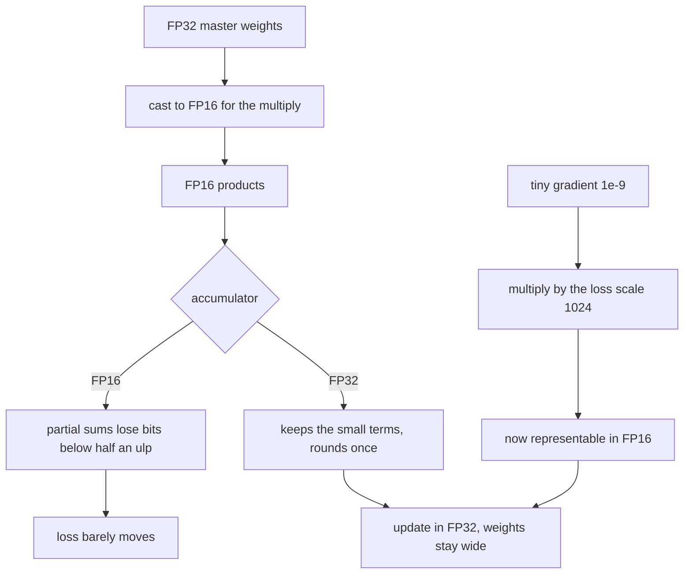
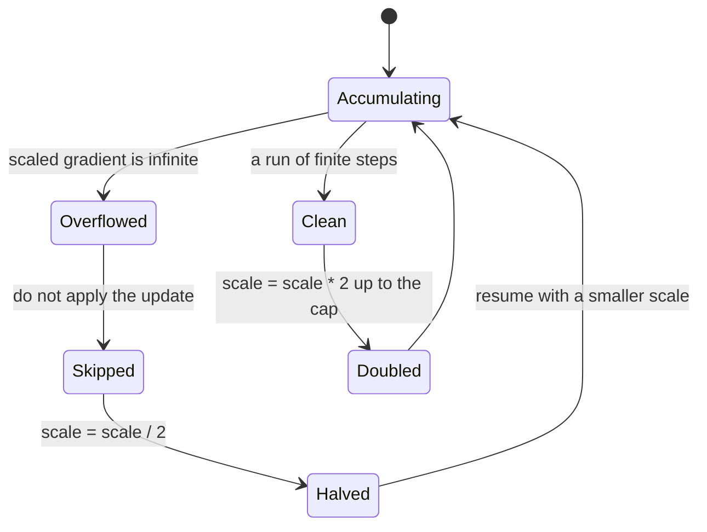
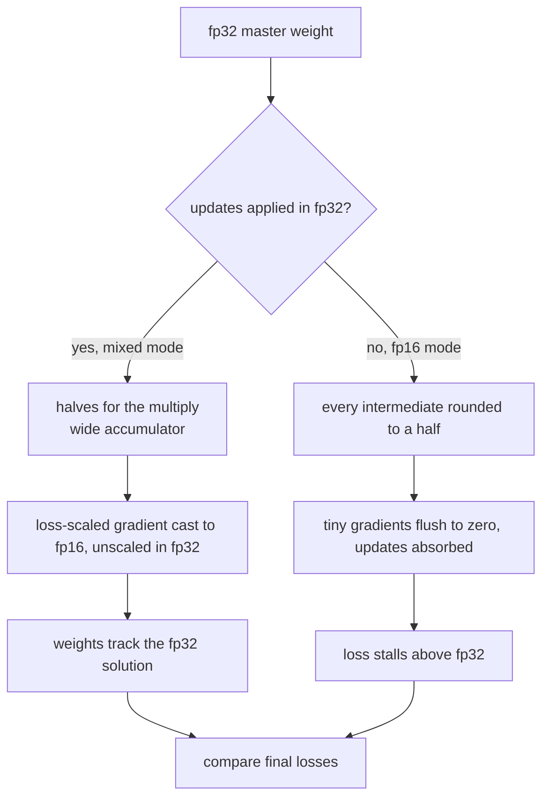
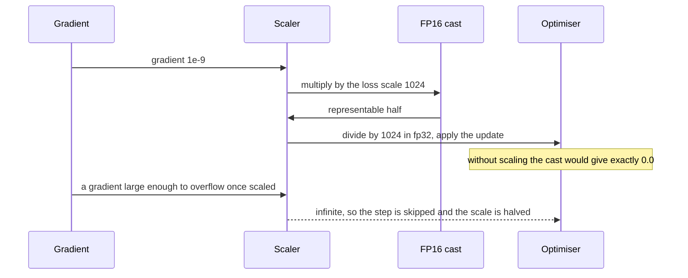

# 717 — Implement mixed-precision training utility (FP16/FP32 accumulator)

> **Tier:** Expert · **CTCI chapter:** Beyond — Machine Learning & AI
> **Task spec:** [717-implement-mixed-precision-training-utility-fp16-fp32-accumulator.md](../../../tasks/expert/717-implement-mixed-precision-training-utility-fp16-fp32-accumulator.md)
> **Solutions:** [Python](../../../solutions/python/expert/717-implement-mixed-precision-training-utility-fp16-fp32-accumulator/solution.py) ·
> [Java](../../../solutions/java/expert/717-implement-mixed-precision-training-utility-fp16-fp32-accumulator/Solution.java) ·
> [JavaScript](../../../solutions/javascript/expert/717-implement-mixed-precision-training-utility-fp16-fp32-accumulator/solution.js) ·
> [C#](../../../solutions/csharp/expert/717-implement-mixed-precision-training-utility-fp16-fp32-accumulator/Solution.cs)

## 1. Problem restatement

Implement the FP16 format from scratch, then measure the two tricks that make mixed-precision training
work — a wider **accumulator** and **loss scaling** — and show on a small model that mixed precision
reaches nearly the FP32 loss while all-FP16 does not.

**Modelling contract.** These are format-and-numerics simulations, not tensor-core benchmarks:

| Element | Contract |
| --- | --- |
| Format | IEEE 754 binary16: 1 sign, 5 exponent bits biased by 15, 10 mantissa bits, subnormals below `2^-14` with a `2^-24` step, round-to-nearest-even, overflow to infinity at `65520` |
| Oracle | Python audits the hand-written encoder against `struct` (`>e`), C# against `System.Half` on all 65536 patterns, Java against the published encodings, JavaScript against a self-contained reference decoder |
| Accumulators | `sum_fp16` rounds every partial sum to half precision; `sum_mixed` stores halves but accumulates in FP32 — the rule tensor cores implement |
| Loss scaling | `scaled_gradient(g, scale)` stores `to_fp16(g · scale)` and returns it divided by `scale`; Java/JavaScript also implement a dynamic scaler that halves the scale and skips a step on overflow |
| Not modelled | real tensor cores or fused multiply-add, tree-shaped reduction orders, dynamic scaling in every language, optimiser state beyond plain SGD |

**What is asserted:** bit-exact agreement with the reference encoder over thousands of random bit
patterns and every boundary case, the half-ulp bound for normal values, ties-to-even at the documented
points, the absorption demonstration, the FP32 accumulator's accuracy against an exact sum, loss
scaling rescuing a flushed gradient, how the dynamic scaler reacts to overflow, determinism, and a
three-way training comparison.

Interface (Python; the others mirror it):

| Call | Meaning |
| --- | --- |
| `encode_fp16(value)` / `decode_fp16(bits)` | the hand-written binary16 codec |
| `round_half_even(value)` | ties to the even integer |
| `to_fp16(value)` | round a float to the nearest half, still as a float |
| `ulp(value)` | the gap between neighbouring halfs around `|value|` |
| `sum_fp16(values)` / `sum_mixed(values)` / `sum_exact(values)` | three ways to add the same stream |
| `dot_mixed(a, b)` | FP16 operands, FP32 accumulator |
| `scaled_gradient(gradient, loss_scale)` | loss-scaling round trip |
| `train_linear(features, targets, steps, lr, mode, loss_scale)` | `fp32`, `mixed` or `fp16` training |

Concrete expected results, all asserted:

- `encode_fp16(1.0) == 0x3C00`, `encode_fp16(-0.0) == 0x8000`, `0x0001` is the smallest subnormal,
  `0x03FF` the largest subnormal, `0x0400` the smallest normal, `0x7BFF` is `65504.0`, and both
  `65520.0` and `65536.0` overflow to `0x7C00`.
- Ties-to-even: `to_fp16(2^-25) == 0.0`; `to_fp16(3·2^-25) == 2^-23`; `to_fp16(5·2^-25) == 2^-23`;
  `to_fp16(7·2^-25) == 2^-22`; `to_fp16(1.0 + 2^-11) == 1.0` and `to_fp16(1.0 + 3·2^-11) == 1.0 + 2^-9`;
  negatives behave symmetrically.
- Absorption: `sum_fp16([1.0] + [2^-11] * 1000)` is **exactly `1.0`**, while `sum_mixed` differs from the
  exact sum by less than `1e-6`.
- Overflow: `sum_fp16([65504.0, 65504.0])` is infinite; `sum_mixed` gives `131008.0`.
- Loss scaling: `to_fp16(1e-9) == 0.0` for both signs, while the same value scaled by `1024` survives
  and unscales to something below `1e-6`; `to_fp16(1e-7)` is representable without scaling.
- Training (48 samples, 3 features, 400 steps, `lr = 0.02`): FP32 reaches `< 1e-3`; mixed precision is
  within `2 × FP32 + 1e-6`; all-FP16 never beats FP32 but stays within `20 × FP32`; the per-update
  rounding loss of the pure FP16 path is measured between `1e-5` and `0.1`, and its weights stay finite.

## 2. Intuition

FP16 buys bandwidth and throughput at the cost of range and precision: about three decimal digits and
a maximum of `65504`. Two failure modes follow, and each has a one-line fix.

**Absorption.** Adding a small number to a large FP16 sum does nothing, because the gap between
representable halfs at magnitude `1.0` is `2^-10`. So `1.0 + 2^-11` is an exact tie that rounds back to
`1.0` — and a thousand such terms vanish entirely. Keeping the *running total* in FP32 fixes this: the
operands are still halves, the accumulator is not.

**Underflow.** A gradient of `1e-9` is far below the smallest subnormal `2^-24`, so casting it to FP16
gives zero and the update disappears. Multiplying the loss (and therefore every gradient) by a power of
two before the cast, and dividing it out in FP32 afterwards, moves the value into the representable
range without changing the maths.



Loss scaling has a failure mode of its own: if the scale is too large, the scaled gradient overflows to
infinity. The dynamic variant therefore watches for non-finite values, **skips that step entirely**,
halves the scale, and grows it again after a run of clean steps — a schedule the Java and JavaScript
files implement and assert, including the skipped-step counter.



## 3. Algorithm

1. Encode: handle NaN, zero (with its sign), overflow (`|x| ≥ 65520` → infinity), underflow
   (`|x| < 2^-25` → signed zero) and subnormals (`|x| < 2^-14`, step `2^-24`) before the normal path.
2. Normal path: split the magnitude with `frexp`, compute `biased = exponent - 1 + 15`, scale the
   fraction to 10 bits and round half-to-even; a carry bumps the exponent, possibly to overflow.
3. Decode: rebuild `(-1)^s · (1 + mantissa / 1024) · 2^(exponent - 15)`, with the exponent field `0`
   meaning subnormal and `31` meaning infinity or NaN.
4. Sum three ways: `sum_fp16` rounds each partial sum, `sum_mixed` accumulates exactly in FP32 while
   rounding the addends, `sum_exact` is the untruncated reference.
5. Loss-scale a gradient: multiply, cast, divide back; report how many updates flushed to zero and the
   worst relative rounding loss per update.
6. Train the linear model in `fp32`, `mixed` (halves for the multiply, FP32 master weights) and `fp16`
   (everything rounded), with the same data, seed and step count.
7. Compare the final losses, the distance between the mixed and FP32 weights, and the overflow schedule.

```text
function encode_fp16(value)
    if value is NaN then return 0x7E00
    sign ← 0x8000 if signbit(value) else 0x0000
    magnitude ← abs(value)
    if magnitude = 0 then return sign
    if magnitude >= 65520 then return sign | 0x7C00          // rounds up to infinity
    if magnitude < 2^-25 then return sign                    // below half the smallest subnormal
    if magnitude < 2^-14 then                                // subnormal, fixed step 2^-24
        mantissa ← round_half_even(magnitude / 2^-24)
        if mantissa >= 1024 then return sign | 0x0400        // rounded up into the normals
        return sign | mantissa
    fraction, exponent ← frexp(magnitude)
    biased ← exponent - 1 + 15
    mantissa ← round_half_even((fraction * 2 - 1) * 1024)
    if mantissa >= 1024 then
        mantissa ← mantissa - 1024
        biased ← biased + 1
    if biased >= 31 then
        return sign | (0x7C00 if magnitude >= 65520 else 0x7BFF)
    return sign | (biased << 10) | mantissa

function round_half_even(value)
    floor_value ← floor(value)
    remainder ← value - floor_value
    if remainder > 0.5 then return floor_value + 1
    if remainder < 0.5 then return floor_value
    return floor_value if floor_value is even else floor_value + 1

function sum_fp16(values)
    total ← 0.0
    for value in values do
        total ← to_fp16(total + to_fp16(value))
    return total

function sum_mixed(values)
    total ← 0.0
    for value in values do
        total ← total + to_fp16(value)                       // the addend is a half, the total is not
    return total

function scaled_gradient(gradient, loss_scale)
    if loss_scale <= 0 then reject "the loss scale must be positive"
    scaled ← to_fp16(gradient * loss_scale)
    return scaled / loss_scale, scaled
```



## 4. Worked example

The absorption trace, on `[1.0] + [2^-11] * 1000`:

| Accumulator | Step | Running total | Why |
| --- | --- | --- | --- |
| FP16 | start | `1.0` | exact |
| FP16 | add `2^-11` | `1.0` | the gap at `1.0` is `2^-10`; `2^-11` is an exact tie and rounds to the even mantissa |
| FP16 | 1000 adds later | **`1.0`** | every addend is absorbed; the check asserts equality, not an approximation |
| mixed | start | `1.0` | the total is an FP32 value |
| mixed | add `2^-11` | `1.00048828125…` | the addend is still a perfect half |
| mixed | 1000 adds later | `1.48828125` | within `1e-6` of the exact sum |

Rounding decisions the checks pin down:

| Input | Result | Reason |
| --- | --- | --- |
| `2^-25` | `0.0` | exactly half the smallest subnormal, tie to even (`0`) |
| `3 · 2^-25` | `2^-23` | 1.5 steps, tie rounds up to the even mantissa `2` |
| `5 · 2^-25` | `2^-23` | 2.5 steps, tie to the even `2` |
| `7 · 2^-25` | `2^-22` | 3.5 steps, tie to the even `4` |
| `1.0 + 2^-11` | `1.0` | tie at `1.0`, even mantissa wins |
| `1.0 + 3 · 2^-11` | `1.0 + 2^-9` | the next tie rounds up |
| `65520.0` | infinity (`0x7C00`) | the overflow midpoint; `65519.0` still rounds to `0x7BFF` |



Training comparison on 48 samples, 3 features, 400 steps, `lr = 0.02`:

| Mode | Arithmetic | Asserted outcome |
| --- | --- | --- |
| `fp32` | everything wide | loss decreases and ends `< 1e-3` |
| `mixed` | halves for the multiply, FP32 accumulation, loss-scaled gradients | loss within `2 × fp32 + 1e-6`; weights within `0.05` of FP32 |
| `fp16` | every intermediate rounded to a half | does not beat FP32, stays within `20 × fp32`, and its per-update rounding loss is measured in `(1e-5, 0.1)` |

## 5. Complexity

With `n` values to add, `k` parameters and `s` samples per step:

| Operation | Cost | Why the bound holds |
| --- | --- | --- |
| `encode_fp16` / `decode_fp16` | `O(1)` | bit manipulation plus one `frexp`/`ldexp`; no loops over the mantissa |
| `to_fp16` | `O(1)` | one encode plus one decode |
| `sum_fp16` / `sum_mixed` / `sum_exact` | `O(n)` | one rounding (or none) per addend, one add each |
| `dot_mixed(a, b)` | `O(n)` | `2n` casts and `n` FP32 multiply-adds — the casts are the extra cost over a plain dot product |
| Loss-scaled update | `O(k)` | multiply, cast, divide per parameter |
| One training step | `O(s k)` in all three modes | the modes differ in *where* rounding happens, not in the number of operations |
| Space | `2 bytes` per stored half against `4` per float | the point of the format; the FP32 master copy doubles it back, which is the actual mixed-precision budget |

The measured cost of the narrow format is the *precision* column, not the time column: the check
records the worst relative rounding loss of a pure-FP16 update (between `1e-5` and `0.1`), the number of
updates that flushed to zero, and the relative error of the two accumulators over 20 sums. On the
format itself, the half-ulp bound is the exact statement: for every normal value,
`|to_fp16(v) - v| ≤ ulp(v) / 2`. The alternative — keeping everything in FP32 — is accurate but twice
the memory and, on hardware with FP16 throughput, half the speed; the tutorial's numbers are the
utility side of that trade-off, not a benchmark.

## 6. Pitfalls and edge cases

- **Negative zero has its own bit pattern.** `encode_fp16(-0.0) == 0x8000` and it must decode with the
  sign intact; a `magnitude == 0` shortcut that forgets the sign is the classic bug.
- **Overflow has a midpoint.** `65519.0` rounds to the largest finite half `0x7BFF`, while `65520.0`
  rounds to infinity; the exponent-carry branch has to distinguish the two.
- **The underflow boundary is `2^-25`, not `2^-24`.** Half the smallest subnormal is an exact tie that
  rounds to zero, and the checks include both `2^-25` and `2^-26`.
- **Ties are always to the even mantissa**, in the subnormal range too (`5 · 2^-25 → 2^-23`,
  `7 · 2^-25 → 2^-22`); a "round half up" implementation fails those four checks immediately.
- **`struct` overflows instead of returning infinity**, so the Python reference helper has to map
  `OverflowError` to `0x7C00`/`0xFC00` — the oracle needs its own edge handling.
- **FP16 accumulation can overflow to infinity** where the FP32 accumulator does not: `65504 + 65504`
  is `inf` in the narrow format and `131008.0` in the wide one.
- **A zero loss scale is invalid** (`scaled_gradient(1.0, 0.0)` raises), and an unknown mode such as
  `"bfloat16"` is rejected before any work happens.
- **Small values are not always flushes.** `1e-7` is representable without scaling, just coarse; only
  values below `2^-24` (and their half-step neighbours) become zero. Claiming "small gradients vanish"
  without that distinction would be wrong.
- **Idempotence.** `to_fp16(to_fp16(v)) == to_fp16(v)` for representable values, including subnormals
  and the largest finite half — a cheap invariant that catches most encoder mistakes.
- **Determinism.** Two identical `mixed` runs produce the same loss history, so every printed number is
  reproducible from its seed.

## 7. Variants and follow-ups

- The other half of numeric efficiency: narrow the *storage* of a trained model instead of the
  accumulator:
  [716 — quantized neural network inference simulation](../../../tasks/expert/716-implement-quantized-neural-network-inference-simulation-8-bit.md).
- Fewer parameters rather than narrower numbers:
  [715 — sparse neural network training with magnitude pruning](../../../tasks/expert/715-implement-sparse-neural-network-training-sketch-with-magnitude-p.md).
- The full production pipeline this utility feeds into:
  [826 — automatic mixed-precision training full pipeline](../../../tasks/master/826-implement-automatic-mixed-precision-training-full-pipeline-with.md).
- Numerics checked across implementations, which is exactly the oracle trick used here:
  [932 — differential testing between CPU and GPU implementations](../../../tasks/master/932-implement-differential-testing-between-cpu-gpu-implementations-f.md).
- Where the accumulated update goes next:
  [718 — gradient compression with top-k and error feedback](../../../tasks/expert/718-implement-gradient-compression-techniques-top-k-and-error-feedba.md).

## 8. Check yourself

<details><summary>Show answer</summary>
**Why exactly does `sum_fp16([1.0] + [2^-11] * 1000)` return `1.0`?** The step size of binary16 around
`1.0` is `2^-10`, so `2^-11` is exactly half a step — a tie, and ties round to the even mantissa, which
is the one already stored. Every addend does the same thing, so the total never moves. Asserting
`== 1.0` rather than "approximately 1.0" is what makes the demonstration convincing.
</details>

<details><summary>Show answer</summary>
**What does the FP32 accumulator change if the operands are still halves?** It changes where rounding
happens. `sum_mixed` rounds each addend to a half (which is exact, since the data was already packaged
as halves) and then adds into an FP32 running total, so small terms accumulate instead of being
absorbed. That is exactly the mixed-precision rule: narrow storage, wide accumulation.
</details>

<details><summary>Show answer</summary>
**A gradient of `1e-9` is unrepresentable. How does loss scaling save it?** Multiply by `1024`: `1e-9`
becomes `1.024e-6`, comfortably above the smallest subnormal `2^-24 ≈ 5.96e-8`, so the FP16 cast keeps
it. Dividing by `1024` in FP32 restores the original magnitude before the update — the scale multiplied
both the loss and its gradients, so it cancels exactly. The checks verify both halves: the unscaled
value flushes to zero and the scaled one returns within `1e-6`.
</details>

<details><summary>Show answer</summary>
**What happens when the loss scale is too large?** The scaled gradient overflows to infinity. The
dynamic scaler detects the non-finite value, **skips that step** (so no infinity reaches the weights),
halves the scale, and doubles it again after a run of clean steps up to its cap. Both halves of that
schedule are asserted, including the skipped-step count.
</details>

<details><summary>Show answer</summary>
**Why does the check require `fp32_loss <= fp16_loss + 1e-9` rather than requiring FP16 to be much
worse?** Because the claim is only that the narrow format cannot buy accuracy it does not have: an
all-FP16 run may occasionally land close to FP32 on this easy problem, but it must never beat it, and
it must stay within a factor of twenty. Over-claiming "FP16 is useless" would be as dishonest as
claiming it is free.
</details>
