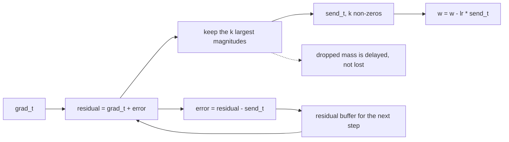
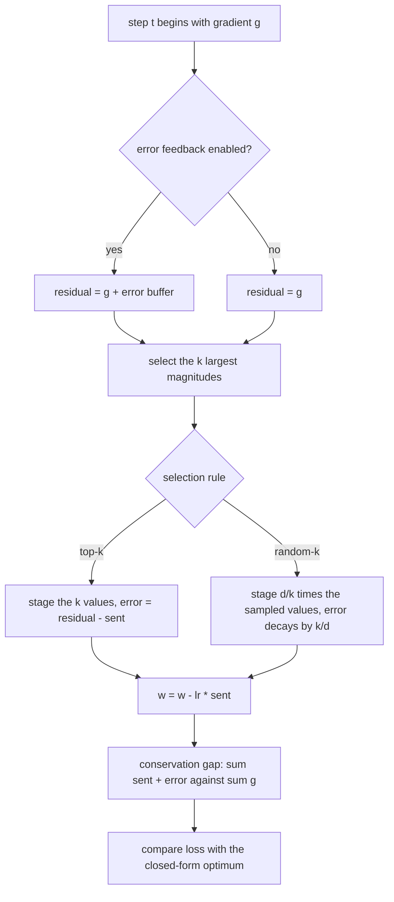
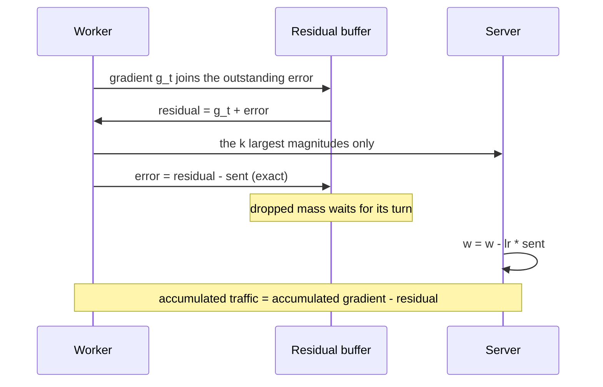

# 718 — Implement gradient compression techniques (top-k) and error feedback

> **Tier:** Expert · **CTCI chapter:** Beyond — Machine Learning & AI
> **Task spec:** [718-implement-gradient-compression-techniques-top-k-and-error-feedba.md](../../../tasks/expert/718-implement-gradient-compression-techniques-top-k-and-error-feedba.md)
> **Solutions:** [Python](../../../solutions/python/expert/718-implement-gradient-compression-techniques-top-k-and-error-feedba/solution.py) ·
> [Java](../../../solutions/java/expert/718-implement-gradient-compression-techniques-top-k-and-error-feedba/Solution.java) ·
> [JavaScript](../../../solutions/javascript/expert/718-implement-gradient-compression-techniques-top-k-and-error-feedba/solution.js) ·
> [C#](../../../solutions/csharp/expert/718-implement-gradient-compression-techniques-top-k-and-error-feedba/Solution.cs)

## 1. Problem restatement

A worker cannot afford to all-reduce a dense gradient of `d` values every step, so it ships only the
`k` entries of largest magnitude. Plain top-k is **biased** — a coordinate that never makes the cut is
never transmitted. **Error feedback** (Seide et al.) repairs that with one local accumulator.

**Modelling contract.** The compression is real; the training harness is a deliberately verifiable
stand-in:

| Element | Contract |
| --- | --- |
| Objective | `f(w) = ½ wᵀAw - bᵀw` with `A = diag(d_k) + u uᵀ` (SPD), so the exact minimiser is available through **Sherman-Morrison** and convergence is measured against ground truth |
| Training | plain SGD driven only by what the compressor emits; no momentum, no quantisation, no all-reduce (one worker) |
| Wire format | a dense staging array with the non-selected entries zeroed — Java and C# say so explicitly: this is not a real `(index, value)` sparse payload |
| Compressors | `TopKErrorFeedback` (exact top-k plus residual) and `RandomKErrorFeedback` (uniform sampling of `k` coordinates rescaled by `d/k`, which is unbiased in expectation) |
| Not modelled | DeepSpeed-scale top-k, PowerSGD low-rank compression, gradient quantisation, multi-worker synchronisation |

**What is asserted, exactly:** the top-k selection against a brute-force magnitude sort including
ties; the bitwise bookkeeping identity `r' = (r + g) - s`; the telescoping conservation identity
`Σ sent + residual = Σ grad`; a bounded residual; lossless `k = d`; the `k = 0` / empty / single-element
boundaries; statistical unbiasedness of random-k; the residual contraction needed when rescaling is
combined with feedback; and the learning-rate limit error feedback inherits from acting like momentum.

Interface (Python; the others mirror it):

| Call | Meaning |
| --- | --- |
| `top_k_indices(values, k)` | the `k` largest magnitudes, ties by index |
| `Quadratic(dim, seed)` | the SPD quadratic plus its `optimum` and `optimum_loss` |
| `TopKErrorFeedback(dim, k, use_error_feedback)` | `compress(grad)` returns the dense staging vector |
| `conservation_gap()` | `max_i |Σgrad_i - (Σsent_i + error_i)|`, zero for perfect feedback |
| `RandomKErrorFeedback(dim, k, seed)` | uniform `k`-of-`d` sampling with the `d/k` rescale and `error_decay` |
| `train(quad, compressor, steps, learning_rate)` | SGD driven by the compressed updates |

Concrete expected results, all asserted:

- `top_k_indices([2.0] * 6 + [1.0], 3) == [0, 1, 2]` (ties to the lowest indices) and
  `min |kept| ≥ max |dropped|` on the 40-value probe.
- `dim = 64`, `k = 8`, 300 steps, `lr = 0.1`: `sent_nonzeros == steps · k = 2400`,
  `conservation_gap() < 1e-9`, the final loss gap `< 1e-9`, and the distance to the optimum `< 1e-6`.
- The same budget without feedback: `conservation_gap() > 1e-3`, a loss gap more than `1000 ×` larger,
  and a distance more than `100 ×` larger — the biased baseline in one line.
- Boundary cases: a budget above `dim` clamps (`TopKErrorFeedback(9, 12).k == 9`), `k == dim` is
  loss-free to `1e-12`, `dim == 1` always sends its single coordinate and leaves **zero** residual, a
  zero gradient is a fixed point, and `k < 1` or `dim < 1` is rejected.
- `RandomKErrorFeedback(dim = 50, k = 5)` over 20000 draws: every coordinate is sampled eventually, the
  count spread is `< 12%` of the expected `draws · k / dim`, and for coordinates with `|residual| ≥ 1`
  the sample mean is within `8%` of the true value (the `d/k` rescale makes it unbiased).
- Raw random-k with the textbook recursion explodes (loss gap `> 1e30`); with `error_decay = k/dim` it
  reaches the optimum (`gap < 1e-9`, distance `< 1e-6`) and is reproducible from its seed.
- Step-size limit: with `k = 2`, `lr = 0.05` converges (`gap < 1e-6`) while `lr = 0.2` diverges
  (`gap > 1.0`), because the residual behaves like momentum.

## 2. Intuition

Top-k looks harmless: `k/d` of the coordinates are transmitted, so you "pay `k/d` of the bandwidth".
But the dropped coordinates are dropped **forever** if a coordinate is systematically small — and with
a skewed gradient the same handful of large coordinates wins the race every round, so the others never
move. The check quantifies it: the conservation gap of the plain run is above `1e-3` while the feedback
run's is below `1e-9`, and the resulting loss gap differs by more than three orders of magnitude.

Error feedback adds one buffer:

```text
residual_t = grad_t + error_{t-1}
send_t     = top_k(residual_t)
error_t    = residual_t - send_t
```

The dropped mass is **deferred, not destroyed**. Because `send_i` is either exactly `0` or exactly
`residual_i`, the subtraction is exact in IEEE arithmetic and the identity holds bit for bit. Summing
it over `T` steps gives the telescoping law

```text
Σ_{t≤T} send_t  =  Σ_{t≤T} grad_t  -  error_T
```

so the accumulated traffic reconstructs the accumulated gradient up to a bounded lag — and the lag
*rotates*: once a coordinate is transmitted its residual resets to zero and it drops out of the top-k,
letting neglected coordinates win later rounds.



The second compressor samples `k` coordinates uniformly and multiplies them by `d/k`. That is unbiased
in expectation, but combining it with the raw recursion is dangerous: a transmitted coordinate
contributes `d/k` times its residual, so its new error is `(d/k - 1) · value` — a *magnification*.
Contracting the residual by `k/d` fixes it, and the checks measure both behaviours (`> 1e30` gap
without contraction, `< 1e-9` with it).

## 3. Algorithm

1. Build the quadratic: `d_k ∈ [0.6, 1.4]`, `u_k ∈ [-0.35, 0.35]`, `b_k ∈ [-1, 1]` from a seeded
   stream; compute the optimum with Sherman-Morrison and verify the optimum's gradient vanishes.
2. `compress(grad)`: form the residual `grad + error` (or plain `grad` without feedback), select the
   `k` largest magnitudes with ties by index, stage those values, and update `error = residual - sent`.
3. Track `grad_total`, `sent_total`, `sent_nonzeros`, `steps` and the largest residual magnitude.
4. `conservation_gap()` compares `Σgrad` with `Σsent + error` per coordinate.
5. Train: `grad = quad.gradient(w)`, `sent = compress(grad)`, `w -= lr · sent`, record the loss.
6. Compare against the closed-form optimum (loss gap and distance) with and without feedback.
7. For `RandomKErrorFeedback`: sample `k` distinct coordinates by partial Fisher-Yates, rescale by
   `d/k`, decay the residual by `error_decay`, and check unbiasedness statistically.

```text
function top_k_indices(values, k)
    order ← indices sorted by (-abs(values[index]), index)
    return first k entries of order

procedure TopKErrorFeedback.compress(grad)
    if use_error_feedback then
        residual ← [ grad[index] + error[index] for index ]
    else
        residual ← copy of grad
    chosen ← top_k_indices(residual, k)
    sent ← vector of zeros of length dim
    for index in chosen do
        sent[index] ← residual[index]
    if use_error_feedback then
        error ← [ residual[index] - sent[index] for index ]
    grad_total ← grad_total + grad
    sent_total ← sent_total + sent
    sent_nonzeros ← sent_nonzeros + len(chosen)
    steps ← steps + 1
    return sent

function conservation_gap()
    return max over index of abs(grad_total[index] - (sent_total[index] + error[index]))

procedure RandomKErrorFeedback.compress(grad)
    residual ← [ grad[index] + error[index] for index ]
    chosen ← k distinct coordinates drawn by partial Fisher-Yates from the seeded stream
    sent ← zeros
    for index in chosen do
        sent[index] ← residual[index] * (dim / k)            // the unbiased rescale
    error ← [ error_decay * (residual[index] - sent[index]) for index ]
    record grad_total and sent_total
    return sent

procedure train(quad, compressor, steps, learning_rate)
    w ← zeros of length quad.dim
    for step ← 1 to steps do
        sent ← compressor.compress(quad.gradient(w))
        w ← [ w[index] - learning_rate * sent[index] for index ]
        record quad.loss(w)
    return w, losses
```



## 4. Worked example

A constant skewed gradient with `k = 1` and `d = 4` makes the bias visible without any training. Let
`g = [10, 5, 2.5, 1.25]` (so the ratio 2 : 1 : 0.5 : 0.25 never changes), and take two steps.

**Plain top-k (no feedback):**

| Step | Residual (= gradient) | Sent | Accumulated sent |
| --- | --- | --- | --- |
| 1 | `[10, 5, 2.5, 1.25]` | `[10, 0, 0, 0]` | `[10, 0, 0, 0]` |
| 2 | `[10, 5, 2.5, 1.25]` | `[10, 0, 0, 0]` | `[20, 0, 0, 0]` |
| 3 | `[10, 5, 2.5, 1.25]` | `[10, 0, 0, 0]` | `[30, 0, 0, 0]` |

`Σgrad` after three steps is `[30, 15, 7.5, 3.75]`, so three quarters of the gradient mass is missing
and the shortfall grows linearly forever. That is the `k/d = 1/4` shortfall the checks measure as
`conservation_gap() > 1e-3`.

**With error feedback:**

| Step | Residual before | Sent | Buffer after | Accumulated sent |
| --- | --- | --- | --- | --- |
| 1 | `[10, 5, 2.5, 1.25]` | `[10, 0, 0, 0]` | `[0, 5, 2.5, 1.25]` | `[10, 0, 0, 0]` |
| 2 | `[10, 10, 5, 2.5]` | `[0, 10, 0, 0]` | `[10, 0, 5, 2.5]` | `[10, 10, 0, 0]` |
| 3 | `[20, 5, 7.5, 3.75]` | `[20, 0, 0, 0]` | `[0, 5, 7.5, 3.75]` | `[30, 10, 0, 0]` |

Every coordinate is eventually served, the buffer never exceeds one truncation step, and the check
asserts the identity `Σsent + error == Σgrad` to `1e-9` — here `[30, 10, 0, 0] + [0, 5, 7.5, 3.75] =
[30, 15, 7.5, 3.75]`.

The measured 300-step run on the 64-dimensional quadratic:

| Run | `conservation_gap()` | Final loss gap vs optimum | Distance to optimum |
| --- | --- | --- | --- |
| top-k + error feedback (`k = 8`, `lr = 0.1`) | `< 1e-9` | `< 1e-9` | `< 1e-6` |
| plain top-k, same budget | `> 1e-3` | more than `1000 ×` larger | more than `100 ×` larger |
| random-k, raw recursion (`k = 8`, `lr = 0.01`) | — | `> 1e30` (explodes) | — |
| random-k, `error_decay = k/dim`, `lr = 0.1` | `< 1e-12` per step | `< 1e-9` | `< 1e-6` |



## 5. Complexity

With dimension `d`, budget `k`, `T` steps and one worker:

| Operation | Cost | Why the bound holds |
| --- | --- | --- |
| `top_k_indices` (sort) | `O(d log d)` | a full sort by `(-|value|, index)`; JavaScript uses a bounded **min-heap** single pass instead, which is `O(d log k)` |
| `TopKErrorFeedback.compress` | `O(d log d)` + `O(d)` | one selection plus one residual update and one bookkeeping pass |
| `RandomKErrorFeedback.compress` | `O(d)` expected | partial Fisher-Yates touches `k` positions, then one rescale pass |
| `conservation_gap` | `O(d)` | one difference per coordinate |
| One compressed SGD step | `O(d log d + d)` | the quadratic's gradient is `O(d)` (`u·w` is a single dot product) |
| Training `T` steps | `O(T · d log d)` | the compressor dominates, not the model |
| Wire payload | `2k` numbers against `d` | indices plus values; the checks confirm exactly `steps · k` transmitted values |
| Space | `O(d)` | the residual buffer plus the two accumulators |

Two comparisons the checks make concrete. First, **sort versus heap**: the output is identical (the
JavaScript heap is validated against the same brute-force oracle), only the asymptotics differ.
Second, the **learning-rate limit**: because the residual is not a fresh sample but an accumulation, it
acts like momentum, so the stable step size shrinks with `k`. With `k = 2` the run converges at
`lr = 0.05` and diverges at `lr = 0.2` — a real cost of the technique that a benchmark story usually
omits.

## 6. Pitfalls and edge cases

- **`k = 0` is rejected, not silently tolerated**: a zero budget sends nothing and would freeze
  training. `dim < 1` and `k > dim` for random-k are rejected too, while top-k *clamps* a budget above
  `dim` — the two behaviours are deliberately different and both asserted.
- **`k = d` must be lossless**: the staged vector equals the gradient to `1e-12` and the conservation
  gap stays below `1e-12`, i.e. an exact compressor accumulates no error.
- **A zero gradient is a fixed point.** Nothing is sent, the residual stays exactly `0.0`, and
  `max_error == 0.0`; a stale non-zero residual here would be a bug that only shows up at convergence.
- **A single coordinate leaves no residual** (`error == [0.0]`) because it is always transmitted.
- **Ties.** `[2.0] * 6 + [1.0]` with `k = 3` must return `[0, 1, 2]`; a different tie-break gives a
  different update and breaks determinism across languages.
- **Rescaling plus the raw recursion explodes.** The `d/k` factor multiplies a kept coordinate's
  residual by `d/k - 1` each round; the checks measure a loss gap above `1e30` for the raw recursion
  and require `error_decay = k/dim` to contract it instead.
- **"Unbiased" is a statistical claim**, so it is tested statistically: 20000 draws over 50 coordinates
  must cover every coordinate, spread the counts within `12%`, and reproduce values within `8%`.
- **Bounded lag, not free lunch.** The residual is asserted to stay below `10 ×` the largest accumulated
  gradient — one truncation step's worth of delay, which is exactly the price of the trick.
- **The wire really is sparse.** The accumulated traffic must touch strictly fewer coordinates than
  `dim` for `k = 8`, which distinguishes "sparsified" from "sparsified in name only".
- **Exact arithmetic where it can be.** Because `send_i` is either `0` or `residual_i`, the identity
  `r' = (r + g) - s` is bitwise (Java asserts it that way); tolerances are only needed for the summed
  quantities.

## 7. Variants and follow-ups

- The same sparsifier inside a federated round with stragglers:
  [714 — federated averaging simulation with stragglers and compression](../../../tasks/expert/714-implement-federated-averaging-simulation-with-stragglers-and-com.md).
- All-reduce instead of one worker, with the bandwidth model spelled out:
  [720 — ring allreduce and communication cost modelling](../../../tasks/expert/720-implement-ring-allreduce-simulation-and-communication-cost-model.md)
  and [719 — parameter server simulation](../../../tasks/expert/719-implement-parameter-server-simulation-for-distributed-ml-trainin.md).
- Where the compressed update goes next: [715 — sparse training with magnitude pruning](../../../tasks/expert/715-implement-sparse-neural-network-training-sketch-with-magnitude-p.md)
  and [717 — mixed-precision training utility](../../../tasks/expert/717-implement-mixed-precision-training-utility-fp16-fp32-accumulator.md).
- Compression under a hostile transport, with error correction: [934 — distributed gradient compression under packet loss](../../../tasks/master/934-implement-distributed-gradient-compression-with-error-correction.md).

## 8. Check yourself

<details><summary>Show answer</summary>
**Why is plain top-k called biased when it always sends the largest coordinates?** Because "largest"
is not "most important" over time: a coordinate that stays just below the cut is never transmitted, so
its contribution is missing from every update. The residual check makes it precise — the conservation
gap is non-zero (`> 1e-3` on the probe) and the shortfall `k/d` of the gradient mass grows linearly with
the step count, which is why the plain run stalls far from the optimum.
</details>

<details><summary>Show answer</summary>
**State the error-feedback identity and why it holds exactly.** `residual = grad + error`, `sent =
top_k(residual)`, `error' = residual - sent`. Every coordinate of `sent` is either exactly `0` or
exactly `residual_i`, so subtracting it is exact in IEEE arithmetic — no rounding is involved, and the
identity is bitwise rather than approximate. Summing over steps telescopes to
`Σ sent = Σ grad - error_T`.
</details>

<details><summary>Show answer</summary>
**Why does random-k need a decayed residual while top-k does not?** Top-k sends a coordinate's value
unchanged, so its new residual is `0` and the buffer only ever holds *unsent* mass. Random-k sends
`(d/k)·value`, so the new residual for a transmitted coordinate is `(d/k - 1)·value` — a magnification
whenever `d > k`. Contracting the recursion by `k/d` makes the residual a contraction instead, and the
checks measure the difference: the raw version's loss gap exceeds `1e30`, the contracted one lands
below `1e-9`.
</details>

<details><summary>Show answer</summary>
**Why does a 2-entry budget converge at `lr = 0.05` but diverge at `lr = 0.2`?** The residual is an
accumulator, so it carries information across steps — effectively a momentum term. Momentum tightens the
stability limit on the step size, and the ratio measured here is exactly the fourfold increase the check
uses (`gap < 1e-6` versus `gap > 1.0`). Nothing is wrong with the compressor; the learning rate simply
has to respect the added memory.
</details>

<details><summary>Show answer</summary>
**What does the conservation gap of a *correct* compressor look like after hundreds of steps?** Zero up
to summation roundoff: the check requires `< 1e-9` after 300 steps because each step's subtraction is
exact and only the accumulators' additions can round. That is also why the same check on the
feedback-free run is such a sharp contrast — there the gap is a real, growing shortfall.
</details>
