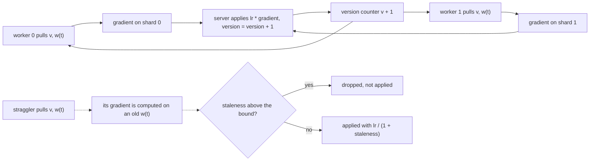
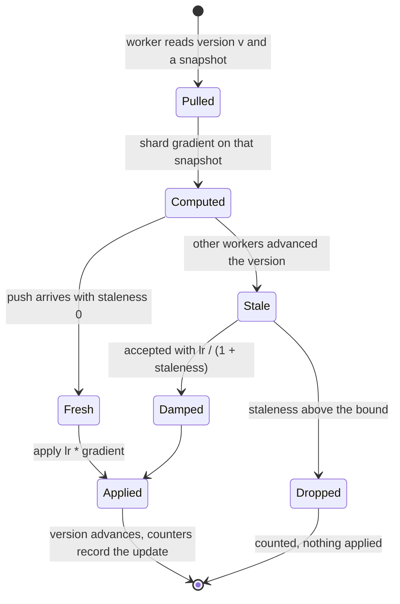
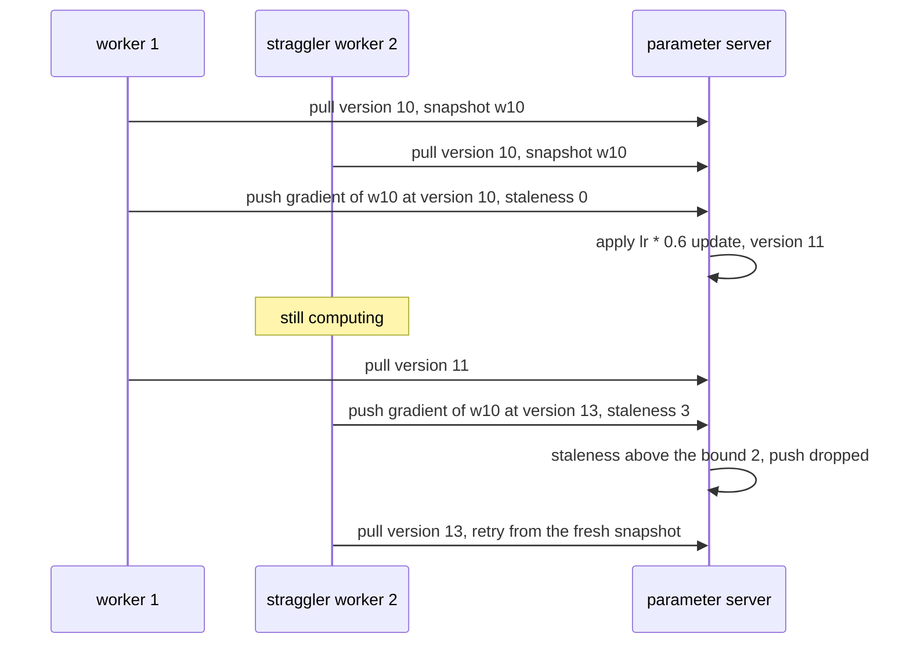

# 719 — Implement parameter server simulation for distributed ML training

> **Tier:** Expert · **CTCI chapter:** Ch 9 — System Design and Scalability
> **Task spec:** [719-implement-parameter-server-simulation-for-distributed-ml-trainin.md](../../../tasks/expert/719-implement-parameter-server-simulation-for-distributed-ml-trainin.md)
> **Solutions:** [Python](../../../solutions/python/expert/719-implement-parameter-server-simulation-for-distributed-ml-trainin/solution.py) ·
> [Java](../../../solutions/java/expert/719-implement-parameter-server-simulation-for-distributed-ml-trainin/Solution.java) ·
> [JavaScript](../../../solutions/javascript/expert/719-implement-parameter-server-simulation-for-distributed-ml-trainin/solution.js) ·
> [C#](../../../solutions/csharp/expert/719-implement-parameter-server-simulation-for-distributed-ml-trainin/Solution.cs)

## 1. Problem restatement

Simulate a **parameter server**: a versioned parameter store that workers pull from and push gradients
to, in a synchronous barrier schedule and in a bounded-staleness asynchronous one.

**Modelling contract.** The consistency semantics are real; the cluster is not:

| Element | Contract |
| --- | --- |
| Clock | abstract **ticks**. Python/JavaScript use a deterministic event queue (`pull` at the previous push time, so worker `i`'s first push lands at `i + latency`), C# models a fixed **staleness lag**, Java a per-worker `delay` in ticks. No sockets, threads or wall clocks |
| Objective | deterministic least squares / ridge regression whose optimum comes from the **normal equations**, solved by the project's own Gaussian elimination with partial pivoting — an oracle that shares no code with the trainers |
| Sharding | Python/JavaScript: one parameter vector, contiguous **data** shards. Java: the parameter vector is split into `S` **server shards**, one per process, each with its own version. The check asserts the shards tile the vector exactly once |
| Gradient weighting | each shard gradient is scaled by `1/n` over the *global* sample count, so summing shards reproduces the full-batch gradient exactly; C# adds the proportional slice `λ·(|S|/n)` of the L2 term so the same identity holds for ridge |
| Communication | a flat per-message byte count (Python: `vector_transfers · dim · 8`), plus counters for pulls, pushes, drops and applied updates. No bandwidth, queueing or retry model |
| Not modelled | quantisation of the wire payload, server-side parameter sharding in the Python/JavaScript models, straggler mitigation beyond the staleness bound, local mini-batches |

**What is asserted:** shards are contiguous, disjoint and exhaustive; synchronous SGD equals centralised
full-batch gradient descent to machine precision; a single worker can never go stale; the staleness
bound and the `lr/(1 + staleness)` damping hold for every logged update; the log replays to the same
parameters; async plateaus near but above the sync fixed point; and async applies far more updates per
unit of simulated wall clock.

Interface (Python; the others mirror it):

| Call | Meaning |
| --- | --- |
| `RegressionProblem(samples, dim, seed)` | dataset, `gradient(indices, w)`, `loss(w)`, `optimum()` |
| `make_shards(samples, workers)` | contiguous partition; fewer samples than workers is an error |
| `ParameterServer(problem, latencies, mode, learning_rate, staleness_bound)` | `w`, `version`, counters, `log` |
| `server.pull()` | `(version, snapshot)` — the snapshot is an immutable copy |
| `server.push(worker, pulled_version, pulled_w, gradient)` | apply or drop; returns whether it applied |
| `server.apply_aggregate(gradient)` | the post-barrier sync update, always fresh |
| `run_sync(server, rounds)` / `run_async(server, horizon)` | the two schedules |
| `scheduled_pushes(latencies, horizon)` | an independent count of the pushes the schedule must perform |
| `central_gd(problem, steps, lr)` | the reference trajectory |

Concrete expected results, all asserted (`240` samples, `dim = 6`, seed `0x7190`):

- `make_shards(240, 4)` gives four shards of 60 covering `range(240)`; `make_shards(242, 4)` gives
  `[61, 61, 60, 60]`; `make_shards(3, 4)` raises.
- The four shard gradients sum to the full-batch gradient to `1e-12`.
- Sync, 4 workers, latencies `[3, 4, 5, 3]`, `lr = 0.6`, 100 rounds: `applied == 100`, `dropped == 0`,
  the trajectory matches centralised GD to `1e-12`, the loss reaches the optimum within `1e-12`,
  `wall_time == 100 · 5 = 500` (the straggler sets the round), `staleness_histogram == {0: 100}`, and
  `communication_bytes() == 2 · 100 · 4 · 6 · 8`.
- One worker with latency 3 over a horizon of 300: exactly 100 applied updates, `max_staleness == 0`,
  and the same parameters as the reference run.
- Async, same latencies, `horizon = 600`, `lr = 0.5`, bound `2`: `scheduled_pushes == 667` and
  `applied + dropped == 667`; `max_staleness == 2` and no accepted update exceeds the bound;
  `dropped > 0` while `rejected_staleness > 2`; every log row satisfies
  `gradient == problem.gradient(shard, pulled_w)` to `1e-15` and `weight == lr / (1 + staleness)` to
  `1e-15`; replaying the log reproduces `w` to `1e-12`.
- Async quality: the final loss is within `1e-4` of the optimum and below `1/100` of the initial loss,
  yet more than `1e5 ×` the sync gap — a genuine plateau, not an exact fixed point.
- Throughput: in the 500 ticks one sync run needs for 100 updates, async with bound 3 schedules
  pushes at each worker's own cadence and applies **more than three times** as many updates for the
  same bytes per push; with bound `0` it drops strictly more than the bound-2 run while accepted
  updates stay perfectly fresh.
- Rejected configurations: an unknown mode, `lr = 0`, a negative bound. And two identical runs must
  produce identical logs and parameters.

## 2. Intuition

The naive distributed trainer is "every worker computes a gradient, everyone waits, the server adds
them". That is **synchronous SGD**: simple, exact, and hostage to the slowest worker — in the checks the
round costs `max(latencies) = 5` ticks even though three of the four workers finish sooner.

The naive fix is to stop waiting: apply each gradient as it arrives. That is **asynchronous SGD**, and
it introduces the problem this task is really about. A gradient is computed from the parameters its
worker *pulled*; by the time it is pushed, other workers have already moved the model. The difference
`version_now - pulled_version` is the **staleness** `s`. Applying a stale gradient is applying a
gradient of a function that no longer exists.

Two standard guards make it usable, and both are implemented and measured:

1. **Bound the staleness** (SSP style). A push with `s` above the bound is dropped, not applied. The
   checks make the rejected set observable (`dropped`, `rejected_staleness`).
2. **Damp by staleness.** Accepted updates use `lr / (1 + s)` instead of `lr`; the deeper the staleness,
   the smaller the step. Python and JavaScript apply exactly this factor and verify it in the log.



The exactness of sync, meanwhile, is not an accident of the code but an algebraic identity the checks
verify: because each shard gradient is divided by the **global** sample count `n`, the sum over a
partition of the samples equals the gradient over the union. That is what makes `run_sync` provably
identical to centralised gradient descent, and the test compares the two trajectories directly.

## 3. Algorithm

1. Build the problem and the shards; solve `XᵀXw = Xᵀy` with Gaussian elimination and check the
   optimum's gradient vanishes.
2. `run_sync(server, rounds)`: pin one snapshot per round, accumulate the shard gradients of the
   barrier snapshot, add `2 · workers` transfers, call `apply_aggregate`, and charge the round
   `max(latencies)` of wall time.
3. `run_async(server, horizon)`: seed a min-heap with each worker's first push at `i + latency`,
   initialised by a `pull()`. Pop the earliest event, compute the gradient **from that pull's
   snapshot**, push it, then re-pull and schedule the next push at `now + latency`.
4. `push`: `staleness = version - pulled_version`; in async, drop when
   `staleness > staleness_bound`; otherwise apply `-weight · gradient` with `weight = lr` (sync) or
   `lr / (1 + staleness)` (async), bump the version, and record the log row.
5. Track the total gradient shortfall over the log and assert the schedule's hand-computed push count.
6. Compare against `central_gd` (sync) and against the optimum (async), then compare update counts
   inside the same wall-clock budget.

```text
procedure push(server, worker, pulled_version, pulled_w, gradient)
    server.vector_transfers ← server.vector_transfers + 1
    staleness ← server.version - pulled_version
    if server.mode is async and staleness > server.staleness_bound then
        server.dropped ← server.dropped + 1
        server.rejected_staleness ← max(server.rejected_staleness, staleness)
        return false
    server.max_staleness ← max(server.max_staleness, staleness)
    histogram[staleness] ← histogram[staleness] + 1
    weight ← server.learning_rate if server.mode is sync else server.learning_rate / (1 + staleness)
    server.log.append((worker, pulled_version, pulled_w, gradient, weight, staleness))
    for j ← 0 to problem.dim - 1 do
        server.w[j] ← server.w[j] - weight * gradient[j]
    server.version ← server.version + 1
    server.applied ← server.applied + 1
    return true

procedure run_sync(server, rounds)
    for round ← 1 to rounds do
        snapshot ← copy of server.w
        total ← vector of zeros
        for worker ← 0 to len(server.shards) - 1 do
            total ← total + problem.gradient(server.shards[worker], snapshot)
        server.vector_transfers ← server.vector_transfers + 2 * len(server.shards)
        server.apply_aggregate(total)
        server.wall_time ← server.wall_time + max(server.latencies)
    return server

procedure run_async(server, horizon)
    pending ← min-heap of (time, worker)
    for worker ← 0 to workers - 1 do
        (version, snapshot) ← server.pull()
        push (worker + latency[worker], worker, latency[worker], version, snapshot)
    while pending is not empty do
        (now, worker, latency, version, snapshot) ← pop the earliest entry
        if now > horizon then break
        server.wall_time ← now
        grad ← problem.gradient(server.shards[worker], snapshot)
        server.push(worker, version, snapshot, grad)
        if now + latency <= horizon then
            (version, snapshot) ← server.pull()
            push (now + latency, worker, latency, version, snapshot)
```



## 4. Worked example

Sync versus async on the same four workers, latencies `[3, 4, 5, 3]`:

| Round | Sync | Async (bound 2) |
| --- | --- | --- |
| what one unit of work is | one barrier round = one full-batch step | one worker push = one partial step |
| wall time per update | `max(3, 4, 5, 3) = 5` ticks | the worker's own `latency` |
| updates in 500 ticks | `100` | more than `3 × 100` (the scheduled push count for that window is 554) |
| gradient freshness | `staleness_histogram == {0: 100}` | accepted staleness in `{0, 1, 2}`, `max_staleness == 2` |
| step size | `lr = 0.6` | `lr / (1 + s) ≤ 0.5` |
| final gap to the optimum | `< 1e-12` | `< 1e-4`, and `> 1e5 ×` the sync gap |
| communication | `2 · rounds · workers · dim · 8` bytes | `2 · (applied + dropped) · dim · 8` bytes |

Push accounting for the async run, `horizon = 600`, latencies `[3, 4, 5, 3]` — the same rule the
helper `scheduled_pushes` uses: worker `i` pushes at `i + latency, i + 2·latency, i + 3·latency, …`
while the time stays within the horizon.

| Worker | Latency | Push times (first three) | Pushes within 600 |
| --- | --- | --- | --- |
| 0 | 3 | `3, 6, 9` | `200` |
| 1 | 4 | `5, 9, 13` | `149` |
| 2 | 5 | `7, 12, 17` | `119` |
| 3 | 3 | `6, 9, 12` | `199` |
| total | | | **`667`** |

Of those 667 pushes, `applied + dropped == 667` is asserted, `dropped` is strictly between `0` and
667, and the rejected updates reached a staleness larger than the bound while no *accepted* update
exceeded it. Each accepted row of the log is then re-derived independently:

| Log field | Re-derived as | Tolerance |
| --- | --- | --- |
| `gradient` | `problem.gradient(shards[worker], pulled_w)` | `1e-15` |
| `weight` | `lr / (1 + staleness)` | `1e-15` |
| final `w` | `Σ (-weight · gradient)` over the log | `1e-12` |



The degenerate cases finish the story: a **single worker** can never be stale, so async collapses onto
plain gradient descent (`max_staleness == 0`, identical parameters); a bound of `0` accepts only
perfectly fresh pushes and therefore drops more than the bound-2 run; and a **zero learning rate** or a
negative bound is rejected up front rather than producing a silent no-op.

## 5. Complexity

With `n` samples, dimension `d`, `W` workers, `R` rounds and `T` simulated ticks:

| Operation | Cost | Why the bound holds |
| --- | --- | --- |
| Shard gradient | `O((n/W) · d)` | one pass over the shard's rows, `d` accumulators |
| Sync round | `O(n d)` + `O(W)` | every sample is touched once across the workers, then one `O(d)` server update |
| Sync run | `O(R n d)` | `R` rounds; wall clock `R · max(latency)` |
| Async run | `O(P · (n/W) · d)` for `P` pushes | one shard gradient per push, plus `O(log W)` heap operations |
| Server update | `O(d)` | `d` multiply-subtracts; the version bump is `O(1)` |
| Log bookkeeping | `O(P d)` space | the log keeps the pulled snapshot, gradient, weight and staleness of every push |
| Oracle (`optimum`) | `O(n d²)` to form `XᵀX`, `O(d³)` to solve | independent of the trainers, which is the point |

The comparison the files are built around is **updates per unit of wall clock** under the same byte
accounting: sync pays `max(latency)` per update, so one straggler caps the whole cluster, while async
pays each worker's own latency and applies more than three times as many updates in the same budget.
The price is the plateau: stale, damped updates do not reach the exact fixed point, and the checks
quantify the offset (`< 1e-4` from the optimum, `> 1e5 ×` the sync gap) rather than hiding it. Java and
C# make the same trade-off explicit from the other direction — a bounded-staleness schedule is never
refused, an over-stale push is, and the rejections are counted.

## 6. Pitfalls and edge cases

- **Shard gradients must be scaled by the global `n`**, not by the shard size; otherwise the sum of
  shards is not the full-batch gradient and sync SGD quietly trains a different objective. The identity
  is asserted to `1e-12` on a probe point.
- **A snapshot must be immutable.** `pull()` returns `list(self.w)`; handing out the live vector would
  make every "stale" gradient accidentally fresh and hide the whole point of the exercise.
- **Staleness is measured against the version at *apply* time**, not at pull time. Getting this
  backwards makes `max_staleness` collapse to zero and the damping factor vanish.
- **The bound must be checked before the damping**, and a dropped push must still be counted in the
  transfer and drop counters — silently discarding it would make `applied + dropped == scheduled_pushes`
  fail.
- **Async does not converge to the exact optimum.** The check requires the gap to be *above* `1e5 ×` the
  sync gap and *below* `1e-4`; a "converged" async run would actually indicate a damping bug.
- **`make_shards(3, 4)` is an error**, not four shards with one empty: an empty shard would make
  `max(latencies)`-style round costs and gradient sums meaningless.
- **A round costs the straggler**: `wall_time == rounds · max(latencies)` is asserted, and that single
  line is the entire motivation for asynchronous training.
- **Same-seed determinism.** The event queue's `(time, worker)` tie-break is what makes the push order,
  the log and the parameters reproducible; without it two runs would legitimately differ.
- **Validation catches configuration errors early**: an unknown mode, a non-positive learning rate and a
  negative staleness bound all raise before a single gradient is computed.
- **Bytes are counted per transfer, drops included**: the wire cost of a dropped push is real even
  though the update is not applied.

## 7. Variants and follow-ups

- The other collective that replaces the server: [720 — ring allreduce and its communication cost model](../../../tasks/expert/720-implement-ring-allreduce-simulation-and-communication-cost-model.md).
- Cheaper gradients to push: [718 — gradient compression with top-k and error feedback](../../../tasks/expert/718-implement-gradient-compression-techniques-top-k-and-error-feedba.md).
- Clients instead of workers, with data that never moves: [714 — federated averaging with stragglers and compression](../../../tasks/expert/714-implement-federated-averaging-simulation-with-stragglers-and-com.md).
- Elastic and fault-tolerant versions of the same cluster: [816 — distributed training with fault-tolerant all-reduce](../../../tasks/master/816-implement-distributed-training-system-with-fault-tolerant-all-re.md).
- The storage side of a long-running job: [721 — checkpoint compression and incremental checkpointing](../../../tasks/expert/721-implement-checkpoint-compression-and-incremental-checkpointing.md).

## 8. Check yourself

<details><summary>Show answer</summary>
**Why is synchronous SGD here *identical* to centralised gradient descent rather than merely similar?**
Because every shard gradient is divided by the global sample count `n`, so summing over a partition of
the samples telescopes into the full-batch gradient exactly; the barrier guarantees every worker used the
same parameters; and the server applies the sum once with the same learning rate. The checks compare the
two weight vectors to `1e-12` over 100 rounds, which is machine precision for this objective.
</details>

<details><summary>Show answer</summary>
**What does "staleness" mean precisely, and why is it bounded?** It is `version_at_apply - version_at_pull`:
how many accepted updates the model received while the worker was computing. Unbounded staleness means
applying gradients of a long-gone model, which drifts or diverges. Bounding it (SSP style) drops the
worst pushes, and the run reports the deepest staleness it *accepted* and the deepest it *rejected*.
</details>

<details><summary>Show answer</summary>
**Why damp by `lr / (1 + staleness)` instead of using `lr`?** A stale gradient is both out of date and
correlated with updates that have already been applied, so a full step overshoots. Dividing by
`1 + staleness` shrinks the step as the lag grows, which is the standard guard (and the same factor the
check re-derives for every row of the update log to `1e-15`). The residual effect is the observed
plateau: bounded-staleness async settles *near* the optimum instead of exactly on it.
</details>

<details><summary>Show answer</summary>
**One sync round needs 5 ticks because one worker has latency 5, yet the other three cost 3 or 4. What
does async do with that idle time, and what does it cost?** It applies each worker's gradient as soon as
it arrives, so the cluster performs more than three times as many updates in the same simulated window —
but every one of those updates is either perfectly fresh or damped by its staleness, and the extra pushes
also mean extra bytes on the wire (`2 · (applied + dropped) · dim · 8` in the Python counter).
</details>

<details><summary>Show answer</summary>
**Why does the test replay the update log?** To prove the log is a complete, faithful record: rebuilding
`Σ (-weight · gradient)` from the logged rows must reproduce the server's parameters to `1e-12`, and each
row's gradient must equal the shard gradient at the parameters that row's worker *pulled* (to `1e-15`).
That single check catches stale snapshots, wrong weighting and missing updates at once.
</details>
