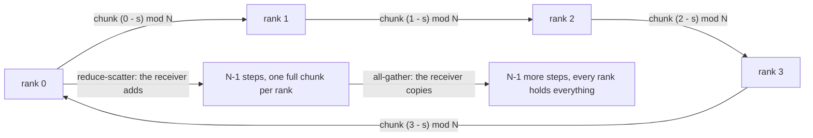
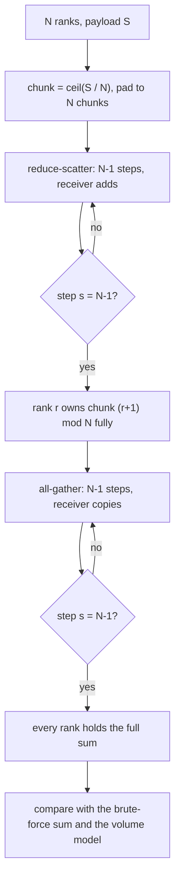
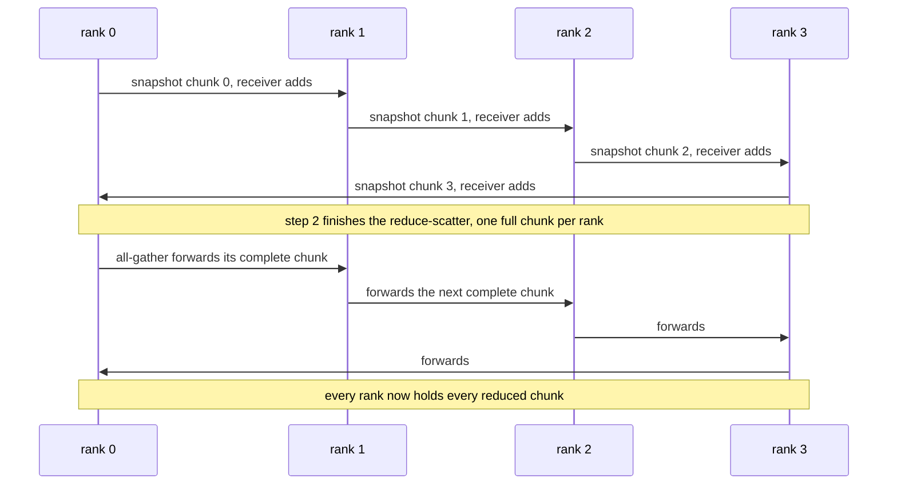

# 720 — Implement ring-allreduce simulation and communication cost modeling

> **Tier:** Expert · **CTCI chapter:** Ch 9 — System Design and Scalability
> **Task spec:** [720-implement-ring-allreduce-simulation-and-communication-cost-model.md](../../../tasks/expert/720-implement-ring-allreduce-simulation-and-communication-cost-model.md)
> **Solutions:** [Python](../../../solutions/python/expert/720-implement-ring-allreduce-simulation-and-communication-cost-model/solution.py) ·
> [Java](../../../solutions/java/expert/720-implement-ring-allreduce-simulation-and-communication-cost-model/Solution.java) ·
> [JavaScript](../../../solutions/javascript/expert/720-implement-ring-allreduce-simulation-and-communication-cost-model/solution.js) ·
> [C#](../../../solutions/csharp/expert/720-implement-ring-allreduce-simulation-and-communication-cost-model/Solution.cs)

## 1. Problem restatement

All-reduce means "every rank ends with the element-wise sum of everyone's buffer". The task is to
simulate the **ring** algorithm that does it in `2(N - 1)` point-to-point steps and to model what that
costs on the wire.

**Modelling contract.** The algorithm and its accounting are real; the network is not:

| Element | Contract |
| --- | --- |
| Execution | step-synchronous simulation inside one process. Python/Java build an explicit **in-flight snapshot** of every outgoing chunk before any buffer is touched, so a rank can never read a half-updated neighbour — the ring's simultaneity is honoured |
| Payload | integer-valued floats, so the reduced buffer can be compared to a brute-force sum with `==` rather than a tolerance |
| Chunking | Python pads to a multiple of `N` and charges the padding to the wire (then trims the result); C# splits with the remainder given to the lowest chunks, so ragged sizes need no padding; JavaScript requires divisibility and says so |
| Cost model | the classic `alpha + beta · bytes`: `T = 2(N - 1) · alpha + volume · beta`, with `volume = 2(N - 1) · ceil(S / N)` |
| Not modelled | congestion, overlap of communication with computation, tree or recursive-halving-doubling variants, non-additive reduction operators, datatype conversion, in-flight compression |
| Comparison points | a **broadcast all-reduce** (rank ships its whole buffer to every other rank: `(N - 1) · S` per rank), the **star** (gather to a server, then broadcast: `p` times worse per rank in bandwidth) and **recursive doubling** (a butterfly of `log2(p)` rounds) |

**What is asserted:** every rank ends with the exact brute-force sum; the per-rank byte counters equal
the hand formula; the message log follows the ring schedule; the reduce-scatter ownership mapping is
`(r + 1) mod N` with every other chunk still partial; the cost model decomposes into latency plus
bandwidth and is monotone in both; and every boundary and malformed configuration behaves.

Interface (Python; the others mirror it):

| Call | Meaning |
| --- | --- |
| `RingAllReduce(buffers)` | chunks the payload, exposes `log`, `bytes_sent`, `steps` |
| `reduce_scatter()` / `all_gather()` / `run()` | the two sweeps |
| `results()` | each rank's summed buffer, padding trimmed |
| `owned_chunks()` | what each rank holds after the reduce-scatter |
| `broadcast_allreduce(buffers)` | the naive baseline and its `(N - 1) · S` volume |
| `ring_volume_per_rank(nranks, size)` | `2(N - 1) · ceil(size / N)` |
| `ring_cost(nranks, size, alpha, beta)` | `2(N - 1) · alpha + volume · beta` |

Concrete expected results, all asserted:

- 4 ranks × 12 elements (chunk 3): the result equals the brute-force sum on every rank, the padding is
  trimmed to 12, `steps == 6 = 2(N - 1)`, `bytes_sent == [18, 18, 18, 18]` per rank,
  `Σ bytes_sent == 4 · 2 · 3 · 3 = 72`, and the log holds `4 · 6 = 24` messages.
- Every logged message goes to the successor `(sender + 1) mod 4` with chunk index `(sender - step) mod 4`;
  the all-gather phase's recorded steps are `{-1, 0, 1}`, i.e. the scatter schedule shifted by one chunk.
- After the reduce-scatter, rank `r` owns the complete sum of chunk `(r + 1) mod 4` (checked chunk by
  chunk against a brute-force reduction) and `steps == 3`.
- Volume model: `ring_volume_per_rank(16, 32) == 60` (`2 · 15 · 2`), `ring_volume_per_rank(3, 32) == 44`
  (`2 · 2 · 11`, two padded elements), and for `N ∈ {3, 4, 8, 16}` the ring's total traffic is strictly
  less than the broadcast baseline's (which for `N = 16`, `S = 32` is `15 · 32 = 480` per rank).
- Cost model: `ring_cost(8, 1024, 1.0, 0.0) < ring_cost(8, 1024, 1.0, 0.1)`;
  `ring_cost(8, 8, 1.0, 0.5) > ring_cost(4, 8, 1.0, 0.5)`; and
  `ring_cost(4, 8, 1.0, 0.5) - 6 · 1.0 == ring_volume_per_rank(4, 8) · 0.5` (latency plus bandwidth).
- Randomised cross-checks for `(N, S)` in `(1,7), (2,7), (3,10), (5,3), (6,13), (8,1), (4,40)` are exact,
  including payloads smaller than the ring and non-divisible ones.
- Boundaries: one rank → `steps == 0`, no bytes, the buffer is already reduced; empty payload → no bytes
  and an empty result; two ranks → the whole buffer per phase, `bytes_sent == [2, 2]`, `steps == 2`.
- Rejected: zero ranks, and buffers of unequal length.

## 2. Intuition

The naive all-reduce is a **broadcast scheme**: rank `r` sends its whole buffer to every other rank, or
everything funnels through one server that broadcasts the sum back. Either way each rank moves
`(N - 1) · S` elements, so the traffic per rank *grows with the cluster size* — doubling the ranks
doubles the cost. On a bandwidth-limited fabric that is the bottleneck of data-parallel training.

The ring changes the shape of the communication. Split every buffer into `N` chunks and let each rank
talk only to its successor, in `N - 1` steps of a reduce-scatter followed by `N - 1` steps of an
all-gather. Each rank then moves `2(N - 1)·S/N` elements — independent of `N` — at the price of `2(N - 1)`
*sequential* steps instead of one flat broadcast. Bandwidth-optimal, latency-heavy: that is the whole
trade-off, and the cost model makes it quantitative.



The subtle part is the simultaneity. In one ring step, rank `r` sends a chunk **and** receives a chunk
into the same buffer. If the code adds an arriving chunk before collecting the outgoing ones, a rank can
forward a value it only just received in the same step, and the algorithm's correctness proof no longer
applies. That is why the Python and Java implementations take a snapshot of every outgoing chunk first
and only then let receivers add or copy — a detail the checks inspect through the message log.

## 3. Algorithm

1. Chunk the payload: `chunk = ceil(S / N)`, pad each rank's buffer to `chunk · N` zeros (the padding is
   still charged to the wire).
2. **Reduce-scatter**, `s = 0 … N - 2`: rank `r` snapshots chunk `(r - s) mod N`, sends it to
   `(r + 1) mod N`, where the receiver *adds* it into the same slot. After `N - 1` steps rank `r` owns
   the complete sum of chunk `(r + 1) mod N` and every other chunk is still partial.
3. **All-gather**, using the same schedule with the step shifted by one: rank `r` sends
   `(r - s + 1) mod N`, the receiver *copies*. After `N - 1` more steps every rank holds every reduced
   chunk.
4. Charge one chunk per message to the sender's byte counter and append `(phase, step, sender,
   receiver, slot)` to the log.
5. Flatten each rank's chunks and trim to `S`.
6. Compare against the brute-force sum, the volume formula, the baseline volume and the cost model.

```text
function ring_volume_per_rank(nranks, size)
    chunk ← ceil(size / nranks) if size > 0 else 0
    return 2 * (nranks - 1) * chunk

function ring_cost(nranks, size, alpha, beta)
    return 2 * (nranks - 1) * alpha + ring_volume_per_rank(nranks, size) * beta

procedure send_step(ring, phase, step)
    for r ← 0 to ring.nranks - 1 do
        sender_of[r] ← copy of ring.state[r][(r - step) mod ring.nranks]
    for r ← 0 to ring.nranks - 1 do
        receiver ← (r + 1) mod ring.nranks
        slot ← (r - step) mod ring.nranks
        if phase is reduce-scatter then
            for j ← 0 to len(sender_of[r]) - 1 do
                ring.state[receiver][slot][j] ← ring.state[receiver][slot][j] + sender_of[r][j]
        else
            ring.state[receiver][slot] ← copy of sender_of[r]
        ring.bytes_sent[r] ← ring.bytes_sent[r] + chunk
        ring.log.append((phase, step, r, receiver, slot))
    ring.steps ← ring.steps + 1

procedure run(ring)
    for step ← 0 to ring.nranks - 2 do
        send_step(ring, "reduce-scatter", step)
    for step ← 0 to ring.nranks - 2 do
        send_step(ring, "all-gather", step - 1)          // the same schedule, shifted by one chunk
    return ring

function results(ring)
    out ← empty list
    for rank ← 0 to ring.nranks - 1 do
        flat ← concatenation of ring.state[rank][c] for c ← 0 to ring.nranks - 1
        out.append(first ring.size elements of flat)
    return out

function broadcast_allreduce(buffers)
    totals ← element-wise sum over all buffers
    volume_per_rank ← (len(buffers) - 1) * len(buffers[0])
    return totals, volume_per_rank
```



## 4. Worked example

Four ranks, twelve elements, chunk size 3. Each rank `r` starts with `[i + r for i in range(12)]`, and
slot `c` of rank `r` holds `r + 3c, r + 3c + 1, r + 3c + 2`.

**Reduce-scatter (3 steps, the receiver adds):**

| Step | Rank 0 sends | Rank 1 sends | Rank 2 sends | Rank 3 sends | Fully reduced after this step |
| --- | --- | --- | --- | --- | --- |
| 0 | slot 0 | slot 1 | slot 2 | slot 3 | — |
| 1 | slot 3 | slot 0 | slot 1 | slot 2 | — |
| 2 | slot 2 | slot 3 | slot 0 | slot 1 | rank 0 owns slot 1, rank 1 slot 2, rank 2 slot 3, rank 3 slot 0 |

The ownership column is the `(r + 1) mod 4` mapping the check verifies chunk by chunk: rank 0's slot 1
now holds the sum of slot 1 over all four ranks, rank 1's slot 2 the sum of slot 2, and so on. Every
other slot is still partial, which is why the all-gather is not redundant.

**All-gather (3 steps, recorded steps `-1, 0, 1`):** the same rotation, but the receiver copies, so each
fully reduced chunk is relayed around the ring until all four ranks hold all four chunks. Afterwards
every rank's flattened buffer is `[sum_i (i + r) for r in range(12)]`, which the check compares to
`brute_sum` with `==` (the payload is integer-valued, so the comparison is exact) and then trims back
to 12 elements.

Accounting for that run:

| Quantity | Value | Formula |
| --- | --- | --- |
| Steps | `6` | `2(N - 1)` |
| Messages in the log | `24` | one per rank per step |
| Bytes per rank | `18` | `2 · 3 · 3` = two phases × three steps × chunk 3 |
| Total bytes | `72` | `N · 2(N - 1) · chunk` |
| Broadcast baseline per rank | `36` | `(N - 1) · S = 3 · 12` |

Cost-model comparison at the two ends of the model:

| Configuration | `ring_volume_per_rank` | Broadcast volume per rank | Ratio |
| --- | --- | --- | --- |
| `N = 4`, `S = 12` | `2 · 3 · 3 = 18` | `3 · 12 = 36` | `2` |
| `N = 16`, `S = 32` | `2 · 15 · 2 = 60` | `15 · 32 = 480` | `8` |
| `N = 3`, `S = 32` | `2 · 2 · 11 = 44` (2 padded elements) | `2 · 32 = 64` | `≈ 1.45` |



Boundary behaviour: **one rank** needs zero steps and zero bytes and is already reduced; an **empty
payload** costs nothing and stays empty; **two ranks** exchange the whole buffer once per phase
(`bytes_sent == [2, 2]`, `steps == 2`); and a payload **smaller than the ring** (`N = 8`, `S = 1`) still
reduces exactly, with the padding charged and then trimmed.

## 5. Complexity

With `N` ranks, payload `S` elements, chunk `c = ceil(S / N)` and the model parameters `alpha`
(per-message latency) and `beta` (per-byte cost):

| Quantity | Value | Why the bound holds |
| --- | --- | --- |
| Steps | `2(N - 1)` | two sweeps of `N - 1` dependencies; each step's send is one chunk |
| Messages | `N · 2(N - 1)` | exactly one message per rank per step (asserted through the log length) |
| Bytes per rank | `2(N - 1) · c ≈ 2(N - 1)S/N` | independent of `N` → bandwidth-optimal |
| Total bytes | `N · 2(N - 1) · c` | `Σ bytes_sent`, asserted to the formula |
| Time | `2(N - 1)(alpha + beta · c)` | the `alpha + beta · bytes` model, decomposable into the two terms the checks assert |
| Padding cost | `≤ (N - 1)` extra elements per rank | only when `N ∤ S`; Python charges it explicitly |
| Space | `O(S)` per rank | the chunks live in place; one chunk per rank is in flight |

The comparison table the task is really about:

| Scheme | Per-rank volume | Sequential steps | When it wins |
| --- | --- | --- | --- |
| Broadcast all-reduce | `(N - 1) · S` | `1` (flat fabric) | tiny payloads, where `alpha` dominates |
| Ring | `2(N - 1) · S / N` | `2(N - 1)` | large payloads or many ranks: `N` times less traffic per rank, `N` times more latency |
| Star (gather + broadcast) | `≈ 2S` at the server, `2S` per rank | `2` phases | small clusters that can afford one hot server |
| Recursive doubling | `log2(N) · S` | `log2(N)` | latency-dominated regimes; worse in bandwidth than the ring for `N > 2` |

The JavaScript file finds the **crossover** between the flat broadcast and the ring by bisection, which
is the practical form of the same result: choose the ring beyond a payload size, the broadcast below it.

## 6. Pitfalls and edge cases

- **Snapshot before you add.** Without the in-flight copy, a rank can forward a chunk it just received
  in the same step, which breaks the schedule the log is checked against (`slot == (sender - step) mod N`).
- **The all-gather step index is shifted by one.** Sending `(r - s + 1) mod N` is exactly the scatter
  rule with the recorded step `s - 1`, which is why the log's gather steps are `{-1, 0, 1}` for `N = 4`.
- **Padding is charged to the wire.** `ring_volume_per_rank(3, 32) == 44`, not `42`, because
  `ceil(32/3) = 11`. Trimming the result does not trim the cost.
- **Payload smaller than the ring.** With `N = 8, S = 1` there are seven zero chunks per rank; the
  reduction is still exact and the volume is `2 · 7 · 1`.
- **One rank is not an error.** `steps == 0`, `bytes_sent == [0]`, and the result is the input — an
  important special case for code that divides by `N - 1`.
- **An empty payload costs nothing** in every phase, and `ring_volume_per_rank(4, 0) == 0` — a division
  by `N` that would otherwise be fine but a `ceil` guard that would not.
- **Two ranks send the whole buffer per phase** (`bytes_sent == [2, 2]`), which is the case where the
  "chunk" is the entire payload and the ring degenerates to an exchange.
- **Unequal buffers are rejected**, as is an empty rank list; averaging over ranks with different
  element counts is meaningless.
- **Integer payloads make the comparison exact.** Using random floats and an epsilon would hide an
  off-by-one chunk mapping; the solutions use integers (or a tolerance explicitly justified by the
  operation count).
- **Determinism.** The message schedule depends only on `N` and `S`, so two identical runs must produce
  identical logs, results and byte counters — asserted for all three.

## 7. Variants and follow-ups

- When the topology is a server instead of a ring: [719 — parameter server simulation](../../../tasks/expert/719-implement-parameter-server-simulation-for-distributed-ml-trainin.md).
- Fewer bytes per message rather than fewer messages: [718 — gradient compression with top-k and error feedback](../../../tasks/expert/718-implement-gradient-compression-techniques-top-k-and-error-feedba.md).
- The elastic, fault-tolerant version of this collective: [816 — distributed training with fault-tolerant all-reduce](../../../tasks/master/816-implement-distributed-training-system-with-fault-tolerant-all-re.md).
- Surviving a lost rank rather than tolerating its latency:
  [511 — checkpointed parallel map-reduce worker for crash recovery](../../../tasks/advanced/511-implement-checkpointed-parallel-map-reduce-worker-for-crash-reco.md).
- Restart bookkeeping when a collective fails mid-round:
  [481 — optimistic checkpointing and restart simulation](../../../tasks/advanced/481-implement-optimistic-checkpointing-restart-simulation.md).

## 8. Check yourself

<details><summary>Show answer</summary>
**Why is the ring bandwidth-optimal while a broadcast all-reduce is not?** Each rank must end with the
sum of `N` payloads, so in the ideal case it must receive at least `(N - 1)S/N` elements and send the
same. The ring achieves `2(N - 1)S/N` per rank, within a factor of two of that lower bound and
*independent of `N`*, whereas the broadcast scheme moves `(N - 1)S` per rank, which grows linearly with
the cluster size. The price is latency: `2(N - 1)` dependent steps instead of one flat exchange.
</details>

<details><summary>Show answer</summary>
**After the reduce-scatter, why does rank `r` own chunk `(r + 1) mod N`?** Because at each step rank `r`
forwards chunk `(r - s) mod N` to its successor while receiving chunk `(r - s - 1) mod N` to add. A chunk
visits all `N` ranks exactly once over the `N - 1` steps, and a chunk finishes its circuit at the rank
that added the last partial sum, which is `(r + 1) mod N` for the rank that started with it. The check
verifies the mapping chunk by chunk against a brute-force reduction, and also that the *other* chunks on
that rank are still partial.
</details>

<details><summary>Show answer</summary>
**Why must a step snapshot every outgoing chunk before any receiver updates its slot?** In a real ring the
send and the receive happen simultaneously. If the code lets rank `r + 1` add its arriving chunk before
rank `r + 1` has captured the chunk it is supposed to forward, then a value can be relayed twice in one
step and the `N - 1` step count no longer suffices. The snapshot encodes "all sends happen at once".
</details>

<details><summary>Show answer</summary>
**`S = 32` with `N = 3`: why is the per-rank volume 44 rather than 42?** Because `ceil(32 / 3) = 11`, so
every rank pads its payload to `33` elements and each of the six messages carries 11 elements. The
padding is real wire traffic even though the extra element is trimmed from the result — the hand formula
`2(N - 1) · ceil(S / N)` charges it, and the byte counter matches the formula rather than a stored
constant.
</details>

<details><summary>Show answer</summary>
**Under what conditions would you *not* use the ring?** When the payload is small enough that the
per-message latency dominates: the ring's `2(N - 1)` sequential steps cost `2(N - 1) · alpha` while a
flat broadcast needs far fewer messages, so below the crossover size the simpler scheme is faster. The
cost model `2(N - 1)(alpha + beta · S/N)` shows exactly where that flips, and the JavaScript solution
locates the crossover by bisection instead of assuming a value.
</details>
