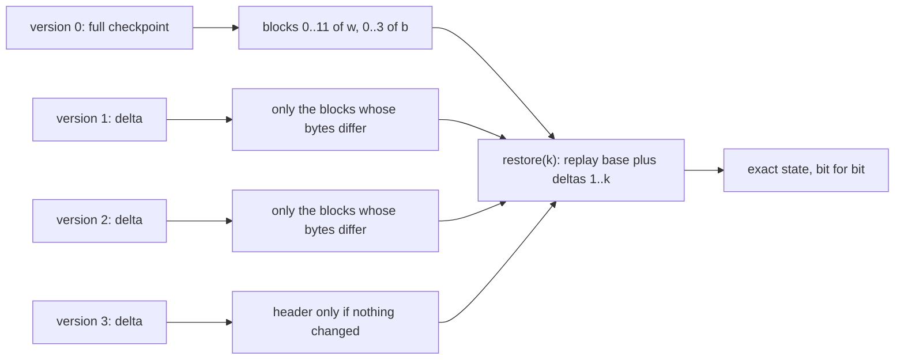
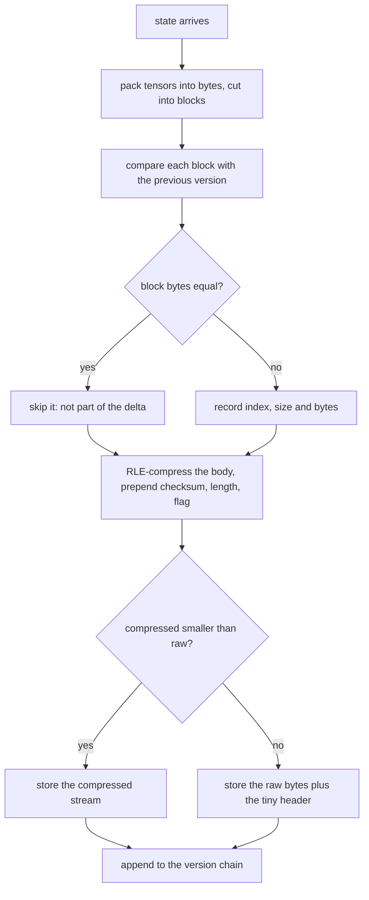
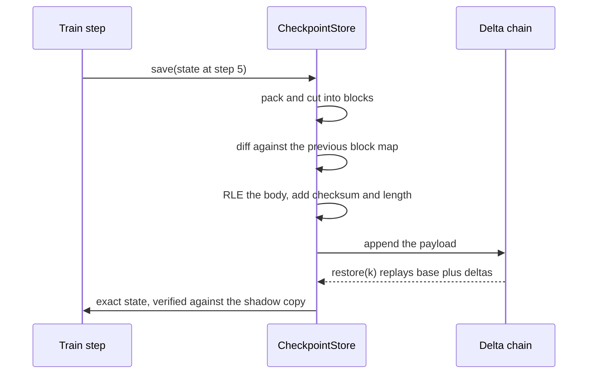

# 721 — Implement checkpoint compression and incremental checkpointing

> **Tier:** Expert · **CTCI chapter:** Beyond — Machine Learning & AI
> **Task spec:** [721-implement-checkpoint-compression-and-incremental-checkpointing.md](../../../tasks/expert/721-implement-checkpoint-compression-and-incremental-checkpointing.md)
> **Solutions:** [Python](../../../solutions/python/expert/721-implement-checkpoint-compression-and-incremental-checkpointing/solution.py) ·
> [Java](../../../solutions/java/expert/721-implement-checkpoint-compression-and-incremental-checkpointing/Solution.java) ·
> [JavaScript](../../../solutions/javascript/expert/721-implement-checkpoint-compression-and-incremental-checkpointing/solution.js) ·
> [C#](../../../solutions/csharp/expert/721-implement-checkpoint-compression-and-incremental-checkpointing/Solution.cs)

## 1. Problem restatement

A checkpoint is a dictionary of tensors. Writing all of it after every step dominates the storage budget
of a long run, so the task is to store one **full** checkpoint plus a chain of **deltas** that list only
what changed, and to restore *any* stored version exactly.

**Modelling contract.** The formats and the dirty-block logic are real; the filesystem is not:

| Element | Python | JavaScript | C# | Java |
| --- | --- | --- | --- | --- |
| Base payload | varint checksum + length + codec flag + RLE or raw bytes | `"CKP1"` header, zigzag varints per tensor | type byte + count + run-length-encoded zigzag varints | varint-style size estimate, no strict wire format |
| Delta payload | per-tensor dirty block list (index, size, bytes) plus added/removed names | per-tensor `kind` 0/1/2 (untouched / sparse index-gap pairs / full rewrite) | change bitmap + one XOR payload per changed block | changed block keys plus their new contents |
| Blocks | fixed slice of the packed bytes, final block ragged | fixed block per tensor, same policy | one 32-bit word per block | block array of integers |
| Integrity | FNV-1a checksum, truncated/corrupt payloads rejected | FNV-1a over all preceding bytes | — | — |
| Policy | RLE only used when it actually shrinks the payload | rewrite a tensor in full when more than half of its entries moved | fall back to a full image when more than half of the blocks changed | full checkpoint every `fullInterval` steps, deltas in between |
| Not modelled | background writers, multi-rank sharding, dedup beyond block deltas, a general-purpose compressor, real file I/O | | | |

**What is asserted:** bit-exact restore of every stored version against an independent shadow copy of
the whole history; the dirty-block set of each delta against a brute-force block-by-block comparison;
RLE round trips and "never grows"; the header-only delta of an unchanged state; ragged final blocks;
added and removed tensors; the measured storage advantage over full checkpoints; corrupt payloads
rejected; and determinism.

Interface (Python; the others mirror it):

| Call | Meaning |
| --- | --- |
| `pack(values)` / `unpack(blob)` | little-endian doubles, round-tripping bit for bit |
| `varint(n)` / `read_varint(data, pos)` | the variable-length integer codec |
| `rle_encode(data)` / `rle_decode(data)` | `varint(run) + byte` runs |
| `pack_payload(body)` / `unpack_payload(encoded)` | checksum + length + codec flag, the corruption gate |
| `CheckpointStore(block_size)` | `save(state)`, `restore(version)`, `stored_bytes`, `full_bytes`, `changed_blocks`, `added`, `removed` |
| `changed_blocks_bruteforce(previous, current, block_size)` | the independent dirty-block oracle |

Concrete expected results, all asserted:

- `rle_decode(rle_encode(x)) == x` for `bytes(range(256)) * 2`, an empty payload and a sparse
  `200 + 50 + 100` byte pattern, and `len(rle_encode(sparse)) < len(sparse) / 10`.
- `pack([1.5, -2.0])` equals `struct.pack("<2d", ...)`; doubles such as `0.1`, `1e300`, `-1e-300`
  round-trip exactly.
- A 6-version history (`w` of 96 elements in twelve 8-element blocks, `b` of 32 elements): every
  `restore(k)` equals the saved state (dict equality, not a tolerance), and
  `full_bytes(k) == len(pack(w)) + len(pack(b))`.
- Economics: each of the five deltas is smaller than `base / 5`, the whole delta chain costs less than
  a second full checkpoint (`stored_bytes(5) - base < base`), six versions fit inside two full
  checkpoints, and `stored_bytes(5) / (6 · full_bytes(0)) < 0.5`.
- The base payload body is the raw checkpoint plus a small header (`raw_sizes[0] <= full_bytes(0) + 64`),
  and the RLE codec already shrinks the base (`base_stored < full_bytes(0)`).
- An unchanged version yields no dirty blocks, a payload body under 12 bytes, and still restores.
- Ragged tail: 13 elements with `block_size = 8` → changing index 12 dirties exactly `[("t", 1)]`.
- Added and removed tensors are tracked; version 0 stays restorable after version 1 changes the schema.
- A flipped payload byte is rejected, as are an unknown version, a negative version, `block_size = 0`
  and a non-list tensor.

## 2. Intuition

The naive checkpointer writes everything every epoch: `O(model)` bytes per save, so a 1000-epoch run
stores 1000 copies of the model even though consecutive copies differ in a few parameters. The
observation that fixes it is that an optimiser update is **local** — a few blocks move, the rest are
byte-identical.

So slice each tensor into fixed-size **blocks** and store, per version, only the blocks whose bytes
differ from the previous version. The first version is therefore a full checkpoint and every later one
a delta. Restoring version `k` replays the base plus the `k - 1` deltas — a linear chain, which also
means the store must be able to *see* corruption rather than serve it silently.

Two compressions stack cheaply on top: a **run-length codec** for the payload (block lists and zero
regions compress well, and the codec is only used when it actually helps, so a payload never costs more
than raw plus a header) and, in the JavaScript and C# variants, a **fallback policy** that rewrites a
tensor or a whole image in full when most of it moved, because then a delta would be larger than the
thing it replaces.



The chain design also decides the cost model: restoring the newest version touches every delta, so the
*read* cost grows with the number of versions while the *write* cost per version stays tiny. That is why
the Java file keeps a full checkpoint every `fullInterval` steps — it bounds the replay length — and why
the C# file falls back to a full image once most blocks are dirty.

## 3. Algorithm

1. **Slice**: pack each tensor's values into bytes, cut them into `block_size · 8`-byte blocks; the last
   block of a tensor is ragged and still a block.
2. **Diff**: for every tensor, compare each block against the same offset in the previous version;
   collect the differing ones. Record tensors that appeared and those that disappeared.
3. **Encode**: write the entry count, then per tensor `name, dirty count, [(block index, size, bytes)]`,
   then the removed names. RLE-compress the body, prepend the checksum, the raw length and a flag saying
   whether the compressed stream was actually smaller.
4. **Store**: append the payload and the block map to the history.
5. **Restore(k)**: start empty, replay payloads `0..k`, applying `update(records)` per tensor and
   dropping the removed names, then concatenate each tensor's blocks in index order and `unpack`.
6. **Account**: `stored_bytes(k)` sums the resident payloads; `full_bytes(k)` is the raw size of the
   state, so the ratio is measurable against full checkpointing.
7. **Validate**: reject truncated payloads, unknown versions, corrupt checksums and non-list tensors.

```text
procedure save(store, state)
    for name, values in state do
        if values is not a list then reject "a tensor must be a list of floats"
    previous ← store.blocks[last] if store.blocks is not empty else empty map
    current ← empty map
    for name, values in state do
        blob ← pack(values)
        current[name] ← { index: blob[index * block_bytes : (index + 1) * block_bytes]
                          for index ← 0 to ceil(len(blob) / block_bytes) - 1 }
    body, changed, added ← encode_delta(previous, current)
    store.payloads.append(pack_payload(body))
    store.blocks.append(current)
    store.raw_sizes.append(len(body))
    store.changed_blocks ← changed
    store.added ← added
    store.removed ← sorted(names in previous but not in current)
    return len(store.payloads) - 1, len(store.payloads[last]), len(body)

function encode_delta(previous, current)
    body ← varint(len(current))
    for name in sorted(current) do
        dirty ← empty list
        for index in sorted(current[name]) do
            if previous.get(name, {}).get(index) != current[name][index] then
                dirty.append((index, current[name][index]))
        body ← body + varint(len(name)) + name + varint(len(dirty))
        for (index, chunk) in dirty do
            body ← body + varint(index) + varint(len(chunk)) + chunk
    for name in sorted(names in previous but not in current) do
        body ← body + varint(len(name)) + name
    return body, changed, added

procedure restore(store, version)
    if version < 0 or version >= len(store.payloads) then reject "unknown checkpoint version"
    blocks ← empty map
    for payload in store.payloads[0 .. version] do
        entries, removed ← decode_payload(unpack_payload(payload))
        for name, records in entries do
            blocks[name] ← blocks.get(name, {}) updated with records
        for name in removed do
            blocks.remove(name)
    restored ← empty map
    for name, records in blocks do
        restored[name] ← unpack(concatenation of records[index] for index in sorted(records))
    return restored
```



## 4. Worked example

The 6-version history from the checks: `w` has 96 doubles (twelve 8-element blocks), `b` has 32 doubles
(four blocks). Step `s` adds `1.0 + s` to `w[2s]` (one block) and, on even steps, sets `b[s] = 3.5`.

| Version | What changed | Dirty blocks | Payload | Notes |
| --- | --- | --- | --- | --- |
| 0 | everything | all 16 blocks (12 of `w`, 4 of `b`) | the base, RLE-compressed | `base_stored < full_bytes(0)` |
| 1 | `w[2] += 2.0` | `[("w", 0)]` | under `base / 5` | header + one block |
| 2 | `w[4] += 3.0`, `b[2] = 3.5` | `[("w", 0), ("b", 0)]` | under `base / 5` | two tensors in one delta |
| 3 | `w[6] += 4.0` | `[("w", 0)]` | under `base / 5` | |
| 4 | `w[8] += 5.0`, `b[4] = 3.5` | `[("w", 1), ("b", 1)]` | under `base / 5` | the next block of each |
| 5 | `w[10] += 6.0` | `[("w", 1)]` | under `base / 5` | |

Because the whole chain costs `stored_bytes(5) - base_stored < base_stored`, six versions fit inside two
full checkpoints, and the check requires the ratio `stored_bytes(5) / (6 · full_bytes(0))` to be below
`0.5` — i.e. the incremental store is at least twice as cheap as checkpointing everything.

Restoring version 4 replays five payloads:

| Payload | Applied | Cumulative block map for `w` |
| --- | --- | --- |
| 0 | all 12 blocks | blocks 0–11 from version 0 |
| 1 | block 0 | block 0 replaced by the version-1 bytes |
| 2 | block 0 | block 0 replaced again |
| 3 | block 0 | block 0 replaced again |
| 4 | block 1 | block 1 replaced; blocks 2–11 still from version 0 |

The concatenation of blocks 0–11 in index order is exactly the state that was saved, which is why the
check uses `==` and not an epsilon: `struct` round-trips doubles bit for bit.

Schema changes and degenerate shapes:

| Case | Behaviour asserted |
| --- | --- |
| Tensor added (`c`) and one removed (`b`) between versions | `"c" in store.added`, `store.removed == ["b"]`, the new version restores the new schema, version 0 still restores the old one |
| Ragged tail (13 elements, `block_size = 8`) | only `("t", 1)` is dirty, and it restores exactly |
| Unchanged state | `changed_blocks == []`, payload body under 12 bytes, restore still correct |
| Empty state `{}` | restores to `{}`, payload at most 12 bytes |
| `block_size = 1` | every changed value is its own block |



## 5. Complexity

With `n` tensor values, `B` blocks of `b` bytes each, `T` versions and `c` bytes changed per version:

| Operation | Cost | Why the bound holds |
| --- | --- | --- |
| Pack | `O(n)` | one `struct`/`BitConverter` pass over the values |
| Blocking | `O(B · b) = O(n)` | the bytes are sliced, not copied twice |
| Diff | `O(B · b) = O(n)` | a byte comparison per block, stopping at the first difference |
| Encode | `O(c + #tensors)` | only dirty blocks are written |
| RLE | `O(len(body))` | one pass, `varint(run) + byte` per run |
| `save` total | `O(n)` worst case (nothing dirty is `O(n)` **scan**, `O(1)` **write**) | the scan is unavoidable; the write is the part that shrinks |
| `restore(k)` | `O(n + Σ_{t≤k} c_t)` | replay every payload up to `k`, then concatenate |
| Space | `O(n)` base + `O(c_t)` per version | the whole point: bytes stored per version are proportional to the change, not the model |

The trade-off the design exposes: **write cheap, read linear in the number of deltas**. The Java file's
`fullInterval` bounds that replay length, and the C#/JavaScript fallback bounds write amplification
(a delta is never larger than a full image). Two comparisons the checks make concrete: an unchanged
version writes a header (under 12 bytes) instead of a model, and RLE makes the *base* smaller than the
raw checkpoint even before any delta exists (`base_stored < full_bytes(0)`).

## 6. Pitfalls and edge cases

- **The dirty-block oracle must be independent.** `changed_blocks_bruteforce` re-packs both states and
  compares block by block without using the store, so a bug in the delta encoder cannot hide behind its
  own bookkeeping.
- **Only the tail block may be ragged.** With 13 doubles and `block_size = 8`, the second block is 5
  doubles; the check requires block 1 to be the only dirty one when `t[12]` changes.
- **Byte-identical comparisons, not numeric ones.** A block is dirty iff its *bytes* differ, so `0.0` and
  `-0.0` would count as a change: the packing layer, not a `==` on floats, defines the granularity.
- **The codec must never grow a payload.** `pack_payload` compares the RLE length with the raw length and
  sets a flag; the check asserts every stored payload is at most the raw body plus a small header.
- **A no-op delta is a real case.** Saving an unchanged state produces no dirty blocks and a header-only
  payload, and it must still restore — a chain that assumed "every delta carries blocks" would break.
- **Schema changes are part of the delta.** Added tensor names must be written and removed ones recorded,
  or replay diverges silently when a tensor disappears in the middle of the chain.
- **Corruption must be detected, not repaired.** A single flipped byte in a payload fails the FNV-1a
  check and `unpack_payload` raises; tests also cover a truncated varint, a bad codec flag and a length
  mismatch.
- **Unknown and negative versions are errors** (`restore(99)`, `restore(-1)`), and `block_size = 0` is
  rejected before any division by the block size.
- **Storage claims must be measured.** The ratio is computed from the actual payload lengths, not
  estimated: `< 0.5` against six full checkpoints, with each delta under a fifth of the base.
- **Determinism.** Two stores fed the same history produce identical payload bytes (asserted by equality)
  and identical restores — the basis for the printed size report.

## 7. Variants and follow-ups

- Sharing work between checkpoints instead of storing deltas:
  [722 — gradient checkpointing and the recompute-versus-memory trade-off](../../../tasks/expert/722-implement-gradient-checkpointing-recompute-vs-memory-tradeoff.md).
- Block-level dedup at a much larger scale: [819 — memory-efficient checkpointing for massive models](../../../tasks/master/819-implement-memory-efficient-checkpointing-for-massive-models-bloc.md).
- Checkpointing inside a compute graph, both transparently and explicitly:
  [936 — transparent operator checkpointing and resume](../../../tasks/master/936-implement-transparent-operator-checkpointing-and-resume-in-compu.md)
  and [600 — advanced checkpoint/restore for long-running computations](../../../tasks/advanced/600-implement-advanced-checkpoint-restore-for-long-running-computati.md).
- Restart bookkeeping after a crash: [481 — optimistic checkpointing and restart simulation](../../../tasks/advanced/481-implement-optimistic-checkpointing-restart-simulation.md).

## 8. Check yourself

<details><summary>Show answer</summary>
**Why is version 0 a full checkpoint and every later version a delta?** Because the first save has no
previous version to diff against, so every block counts as dirty. The check asserts two consequences:
the base payload body is the raw checkpoint plus a small header, and each of the five following payloads
is smaller than a fifth of the base.
</details>

<details><summary>Show answer</summary>
**What exactly is a "block" here, and why does the granularity matter?** A fixed slice of the packed
tensor bytes (8 doubles in Python, one 32-bit word in C#, one fixed block per tensor elsewhere). It is
the smallest unit a delta can record. Coarser blocks write more than necessary; one-element blocks make
every change a separate record with its own index and size. The checks exercise `block_size = 1` and the
ragged tail so the boundary of the granularity is tested rather than assumed.
</details>

<details><summary>Show answer</summary>
**How does the store prove it recorded *exactly* the changed blocks?** `changed_blocks_bruteforce`
re-packs both versions independently, slices them into blocks itself and counts the positions that
differ, and the test compares that count with `store.changed_blocks` after every save. It also asserts no
block appears twice in one delta.
</details>

<details><summary>Show answer</summary>
**What is the cost of the chain, and how do the solutions bound it?** Writing is cheap (bytes
proportional to the change), but restoring version `k` must replay `k` payloads, so read cost grows with
history length. Java bounds it with a full checkpoint every `fullInterval` steps; C# and JavaScript bound
write amplification instead by falling back to a full image once more than half of the blocks (or
entries) changed, which guarantees a delta is never larger than what it replaces.
</details>

<details><summary>Show answer</summary>
**Why does the Python codec store a flag byte instead of always RLE-compressing?** Because RLE can
expand incompressible data: a stream of distinct bytes becomes two bytes per byte. The encoder compares
the compressed and raw lengths, sets the flag accordingly, and the test asserts every payload is at most
the raw body plus a tiny header — so the "compression" can never cost more than it saves.
</details>
