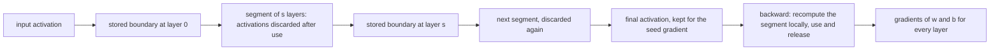
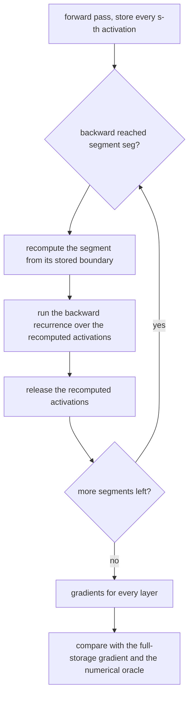
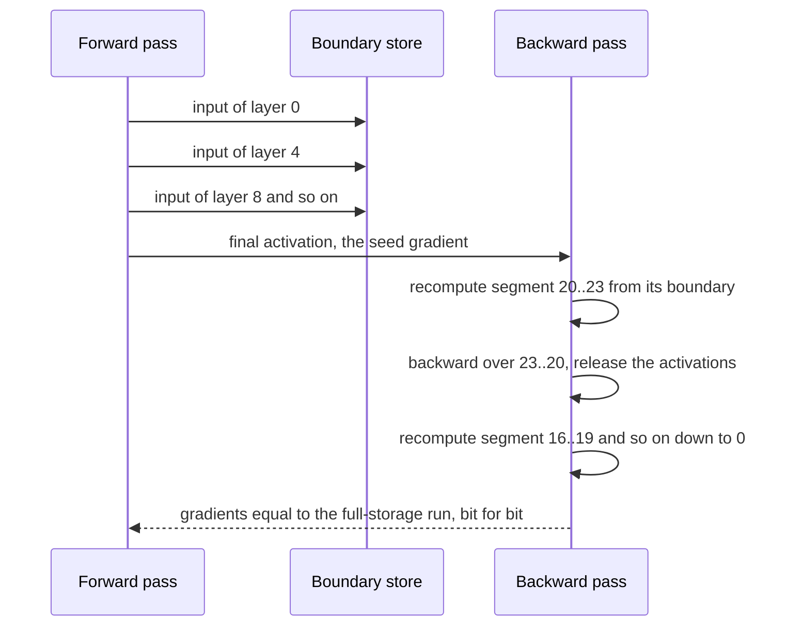

# 722 — Implement gradient checkpointing (recompute vs memory tradeoff)

> **Tier:** Expert · **CTCI chapter:** Beyond — Machine Learning & AI
> **Task spec:** [722-implement-gradient-checkpointing-recompute-vs-memory-tradeoff.md](../../../tasks/expert/722-implement-gradient-checkpointing-recompute-vs-memory-tradeoff.md)
> **Solutions:** [Python](../../../solutions/python/expert/722-implement-gradient-checkpointing-recompute-vs-memory-tradeoff/solution.py) ·
> [Java](../../../solutions/java/expert/722-implement-gradient-checkpointing-recompute-vs-memory-tradeoff/Solution.java) ·
> [JavaScript](../../../solutions/javascript/expert/722-implement-gradient-checkpointing-recompute-vs-memory-tradeoff/solution.js) ·
> [C#](../../../solutions/csharp/expert/722-implement-gradient-checkpointing-recompute-vs-memory-tradeoff/Solution.cs)

## 1. Problem restatement

Backpropagation needs the forward activations, so the naive implementation keeps all `L` of them alive.
**Gradient checkpointing** stores only every `s`-th activation and recomputes the rest inside each
segment during the backward pass. The task is to implement both schedules, prove the gradients match,
and **measure** the memory/compute trade-off rather than quote it.

**Modelling contract.** The recomputation logic is real; the memory number is a tracked count:

| Element | Contract |
| --- | --- |
| Model | a chain of `L` element-wise `tanh(w·x + b)` layers over a small activation vector, loss `½‖final‖²`, with the exact analytic backward pass (Python); Java a chain of `tanh(slope·x + bias)` with a layer-evaluation counter; JavaScript a real allocation counter around a pure `float64` forward |
| Exactness claim | recomputing an activation re-evaluates the *same expression order*, so the bits are identical; the checks compare gradients with `==` (Python) or `deepStrictEqual` (JavaScript) rather than a tolerance |
| Memory metric | Python/Java/C# count the peak number of *simultaneously live activation buffers* and compare it with the hand model `ceil(L/s) + min(s, L)`; JavaScript measures the peak of an actual allocator |
| Compute metric | a work counter of layer evaluations: one forward pass is `L · width` evaluations, the full-storage backward is `2 · forward`, the segmented one is `3 · forward` |
| Oracle | central finite differences of the loss for every layer parameter, which validates the backward pass independently of the checkpointing bookkeeping |
| Not modelled | real GPU memory, RNG state for stochastic layers, nested/recursive checkpointing, CPU offloading, planner-based segment selection |

**What is asserted:** the checkpointed gradient equals the full gradient for *every* segment size
(including both degenerate ones); the measured peak matches the hand model and stays below full
storage for intermediate `s`; the best `s` is near `sqrt(L)`; the extra compute is exactly one
re-forward; the analytic gradients match the numerical oracle; a gradient step taken with the
checkpointed gradients actually descends; and invalid segment sizes are rejected.

Interface (Python; the others mirror it):

| Call | Meaning |
| --- | --- |
| `Layer(weight, bias)` | `forward(x, work)` / `backward(x, out, grad_out, work)` |
| `backward_full(layers, x0, work)` | the reference: all activations resident |
| `backward_checkpointed(layers, x0, segment, work)` | boundaries plus per-segment recomputation; returns `{"stored", "peak"}` |
| `memory_model(depth, segment)` | `ceil(depth / segment) + min(segment, depth)` |
| `numerical_gradients(layers, x0, epsilon)` | the central-difference oracle |
| `model_loss(layers, x0)` | the loss and the work counter of one forward pass |

Concrete expected results, all asserted (depth `24`, width `4`):

- The full-storage peak is `L + 1 = 25`.
- For `segment ∈ {1, 2, 3, 4, 6, 8, 12, 24, 25}` the checkpointed `(grad_w, grad_b)` equals the
  reference **exactly**; `segment = 25 ≥ depth` degenerates to the full schedule.
- For every `segment` in `1…24`: `measured peak ≤ memory_model(24, segment) + 1`, the best segment lies
  in `[4, 6]` (near `sqrt(24) ≈ 4.9`), `2 · peak(best) ≤ depth + 1`, `peak(best) < peak(1)`, and
  `peak(24) == 25`.
- Work: a forward pass costs `depth · width = 96` evaluations, the full-storage backward costs
  `192 = 2 · 96`, and the segmented run costs at least `3 · 96 = 288` and strictly more than `192`.
- The oracle agrees with the analytic `d/dw` and `d/db` within `1e-6` on a 5-layer chain, and it sees
  real gradients (`|d/dw| > 1e-3` somewhere).
- One gradient step with `rate = 0.1` on the checkpointed gradients cuts the loss by more than an order
  of magnitude.
- Boundaries: a 1-layer chain works for `segment ∈ {1, 5}`; `segment = 0` is rejected.

## 2. Intuition

The naive backward pass is memory-linear for a structural reason: layer `i`'s gradient needs the input
it saw during the forward pass, so every activation must be kept until its layer is reached. With `L`
layers that is `L + 1` live buffers — and depth is exactly what modern networks increase.

Checkpointing exploits the fact that the forward pass is **cheap and pure**: given the input at a segment
boundary, the same computation reproduces the same activations bit for bit. So store only the boundary
activations, and when the backward pass reaches a segment, replay that segment's forward pass locally,
use the activations, and release them.

The trade is then a single parameter `s`:

```text
live buffers ≈ ceil(L / s)   (stored boundaries)
             + min(s, L)     (the activations being recomputed)
```

which is minimised near `s = √L`, giving `O(√L)` memory for exactly one extra forward pass. Both extremes
are bad in the same way: `s = 1` stores almost every activation, `s ≥ L` stores the input and recomputes
everything, and each ends up at `L + 1` buffers — so the measured peak curve is U-shaped, which the
checks sweep `1…24` to confirm.



The second half of the trade-off is easy to underestimate: `3 · forward` versus `2 · forward` is a 50%
increase in layer evaluations, but it buys a memory reduction from `L + 1` to `≈ 2√L` — for depth 24 the
measurements go from 25 buffers to about 10.

## 3. Algorithm

1. **Forward with boundaries.** Walk the chain once, keeping the input as boundary 0, and store the
   activation after every `segment`-th layer (never the final one, which is kept regardless).
2. **Backward, newest segment first.** For `seg = last … 0`: recompute the activations of that segment
   from its stored boundary, run the ordinary backward recurrence over them, then drop them.
3. **Track the peak.** Count the live buffers as stored boundaries plus the recomputed activations of the
   current segment (plus the final activation while the last segment runs) and keep the maximum.
4. **Work accounting.** Every `forward` and `backward` call adds `len(x)` evaluations to the shared
   counter, so `forward`, `full backward` and `segmented backward` can be compared exactly.
5. **Validate against the two oracles.** The reference `backward_full` for the gradients, and central
   differences for the gradient formula itself.
6. **Sweep `s = 1…L`**, record the measured peak, compare with `memory_model`, and find the minimiser.
7. **Use the gradient.** Take one deterministic step and confirm the loss drops.

```text
procedure backward_checkpointed(layers, x0, segment, work)
    depth ← len(layers)
    if segment < 1 then reject "segment size must be at least one layer"
    if segment >= depth then return backward_full(layers, x0, work)
    boundaries ← [ copy of x0 ]
    activation ← copy of x0
    for index ← 0 to depth - 1 do
        activation ← layers[index].forward(activation, work)
        if (index + 1) mod segment = 0 and index + 1 < depth then
            boundaries.append(copy of activation)
    grad_w ← zeros of length depth
    grad_b ← zeros of length depth
    grad ← loss_grad(activation)
    segments ← len(boundaries)
    peak ← segments + 1
    for seg ← segments - 1 down to 0 do
        start ← seg * segment
        end ← min(start + segment, depth)
        activations ← [ copy of boundaries[seg] ]
        for index ← start to end - 1 do
            activations.append(layers[index].forward(activations[last], work))
        live ← segments + (end - start) + (1 if seg = segments - 1 else 0)
        peak ← max(peak, live)
        for index ← end - 1 down to start do
            offset ← index - start
            grad_w[index], grad_b[index], grad ← layers[index].backward(
                activations[offset], activations[offset + 1], grad, work)
    return grad_w, grad_b, {stored: segments, peak: peak}

function memory_model(depth, segment)
    return ceil(depth / segment) + min(segment, depth)

procedure gradient_step(layers, x0, segment, rate)
    grad_w, grad_b, stats ← backward_checkpointed(layers, x0, segment, work)
    for index ← 0 to len(layers) - 1 do
        layers[index].w ← layers[index].w - rate * grad_w[index]
        layers[index].b ← layers[index].b - rate * grad_b[index]
    return stats
```



## 4. Worked example

Depth `L = 24`, width `4`, so one forward pass is `24 · 4 = 96` evaluations. Sweep the segment size:

| `segment s` | Stored boundaries `ceil(24/s)` | Recomputed per segment | Hand model `ceil(24/s) + s` | Full storage |
| --- | --- | --- | --- | --- |
| 1 | 24 | 1 | 25 | 25 |
| 2 | 12 | 2 | 14 | 25 |
| 3 | 8 | 3 | 11 | 25 |
| 4 | 6 | 4 | 10 | 25 |
| 5 | 5 | 5 | 10 | 25 |
| 6 | 4 | 6 | 10 | 25 |
| 8 | 3 | 8 | 11 | 25 |
| 12 | 2 | 12 | 14 | 25 |
| 24 | 1 | — | 25 (degenerate) | 25 |

The measured peak of live buffers follows that column (the check allows `+1` for the transient
activation), and the minimum lands in `[4, 6]` — `sqrt(24) ≈ 4.9`, as predicted. At `s = 4` the peak is
at most `11`, less than half of the `25` the naive schedule needs.

Compute accounting for the same chain:

| Run | Evaluations | Formula | Peak memory |
| --- | --- | --- | --- |
| Forward only | `96` | `L · width` | — |
| Full-storage backward | `192` | `2 × forward` | `25` |
| Segmented backward (`s = 4`) | `288` | `3 × forward` | `≤ 11` |

The segmented run is *strictly* more work than the full one (`288 > 192`) — a check, not an
approximation — and the recomputed activations are bitwise equal to the originals, which is why the
gradients can be compared with `==`.



Boundary cases: a **1-layer chain** gives the same gradients for `segment ∈ {1, 5}` (there is nothing to
recompute); `segment ≥ depth` routes straight to the full schedule; and `segment = 0` raises before any
work. A single gradient step with `rate = 0.1` reduces the loss by more than an order of magnitude, which
is the practical claim a training loop depends on.

## 5. Complexity

With `L` layers, activation width `w`, segment size `s` and `q = ceil(L / s)` segments:

| Quantity | Cost | Why the bound holds |
| --- | --- | --- |
| Forward (once) | `O(L w)` | one evaluation per layer element |
| Boundaries stored | `q = O(L / s)` activations | one per segment |
| Recomputed per segment | `O(s w)` | the segment is replayed once, in order |
| Recompute total | `O(L w)` — exactly one extra forward | every layer is replayed exactly once across all segments |
| Backward recurrence | `O(L w)` | one gradient per layer element, unchanged by checkpointing |
| Total work | `3 × forward` | forward, backward, re-forward |
| Peak live buffers | `q + min(s, L) ≈ L/s + s` | the stored boundaries plus the segment being recomputed |
| Optimal `s` | `√L` → peak `≈ 2√L` | minimising `L/s + s` gives `s = √L` |
| Naive peak | `L + 1` | every activation resident |

Comparison table, depth 24:

| Schedule | Peak buffers | Layer evaluations | Gradient |
| --- | --- | --- | --- |
| Store everything | `L + 1 = 25` | `2 × forward = 192` | exact |
| Checkpoint, `s = 4` | `≤ 11` | `3 × forward = 288` | bit-identical |
| Checkpoint, `s = 1` | `25` | `3 × forward` | bit-identical (nothing to save) |
| Checkpoint, `s ≥ L` | `25` | `3 × forward` | bit-identical (degenerates) |

The interesting rows are the last two: checkpointing is only useful for *interior* segment sizes, and the
optimum is `O(√L)` in both memory and the fraction of extra work — the classic sublinear-memory result.

## 6. Pitfalls and edge cases

- **Recomputation must be pure.** Any stochastic layer, dropout mask or RNG state would make the
  recomputed activations differ from the originals; the model here is deterministic by design and the
  files say that RNG state handling is out of scope.
- **The gradients must be compared exactly, not approximately.** If recomputation is bit-exact, `==`
  is the right test — a tolerance would hide an expression-order change that silently alters the result.
- **`segment = 1` is not "maximum saving".** It stores almost every activation, so the peak equals the
  naive one; the check asserts `peak(best) < peak(1)` precisely so this degenerate case cannot be sold as
  the optimum.
- **`segment ≥ depth` must degenerate cleanly** to the full schedule, including the reported peak of
  `L + 1` — a `brute force` route that is easy to forget.
- **The final activation belongs to the last segment.** The live-buffer count adds one extra while the
  last segment runs; forgetting it makes the model and the measurement disagree by one buffer.
- **The work counter must not be reset between phases.** Forward, backward and recomputation share it, or
  the `3 × forward` claim cannot be checked.
- **A depth-1 (or depth-0) chain is valid.** With one layer there is nothing to recompute and both
  schedules must produce the same gradients.
- **The numerical oracle is not optional.** Finite differences validate the backward formula itself;
  without it, an identically wrong forward and backward pass would still "match".
- **`segment = 0` is rejected** rather than treated as "no checkpointing".
- **The state is mutated by the gradient step**, so `build_chain` is called fresh where the checks need a
  pristine model — a subtle ordering trap in a test harness rather than in the algorithm.

## 7. Variants and follow-ups

- Choosing *which* tensors to keep when they are not a uniform chain: [724 — memory planner for computation graph scheduling](../../../tasks/expert/724-implement-memory-planner-for-computation-graph-scheduling-simple.md).
- Checkpointing the model to disk instead of recomputing it: [721 — checkpoint compression and incremental checkpointing](../../../tasks/expert/721-implement-checkpoint-compression-and-incremental-checkpointing.md).
- Materialising operator boundaries inside a graph: [723 — automatic batching (microbatch merging)](../../../tasks/expert/723-implement-automatic-batching-microbatch-merging-skeleton.md)
  and [725 — operator fusion simulation](../../../tasks/expert/725-implement-operator-fusion-simulation-for-compute-graph-speedups.md).
- Library-scale versions of the same trade-off: [936 — transparent operator checkpointing and resume](../../../tasks/master/936-implement-transparent-operator-checkpointing-and-resume-in-compu.md).

## 8. Check yourself

<details><summary>Show answer</summary>
**Why can the checkpointed gradients be compared with `==` instead of an epsilon?** Because recomputation
re-evaluates the same expression in the same order on the same inputs, so the floating-point result is
bit-identical to the original forward activation. Every subsequent operation then sees the same bits, so
the whole backward pass is reproduced exactly — and a tolerance would mask an accidental change of
expression order.
</details>

<details><summary>Show answer</summary>
**Why is the memory curve U-shaped in the segment size?** The live buffers are `ceil(L/s)` stored
boundaries plus up to `s` recomputed activations, so small `s` costs many boundaries and large `s` costs
long recomputation stretches. Both extremes approach `L + 1`, and the minimum is near `s = √L` — for
`L = 24` the sweep puts it in `[4, 6]`, and the hand model `ceil(24/s) + s` agrees with the measured peak.
</details>

<details><summary>Show answer</summary>
**What exactly is the compute price, and is it "one extra forward pass"?** Yes: every layer is replayed
exactly once across all segments, so the evaluation total is `3×` the forward instead of `2×`. The check
asserts `288` against a forward cost of `96` and a full-storage cost of `192`, i.e. the claim is verified
arithmetically rather than described.
</details>

<details><summary>Show answer</summary>
**Why does the harness also run a finite-difference check?** The checkpointing comparison proves the two
schedules agree with each other, not that either is correct. Central differences of the loss check the
gradient formula itself, so a shared bug in the analytic backward pass cannot pass unnoticed — the oracle
also has to see non-trivial gradients for the check to mean anything.
</details>

<details><summary>Show answer</summary>
**Which segment sizes are pointless, and what do the checks do about them?** `s = 1` stores almost every
activation and `s ≥ L` stores only the input; both end at the naive peak of `L + 1`, and both are inside
the swept range so the harness can assert `peak(best) < peak(1)` and `peak(24) == 25`. The sweep is the
point: the trade-off is measured across its whole range, not sampled at a guessed optimum.
</details>
