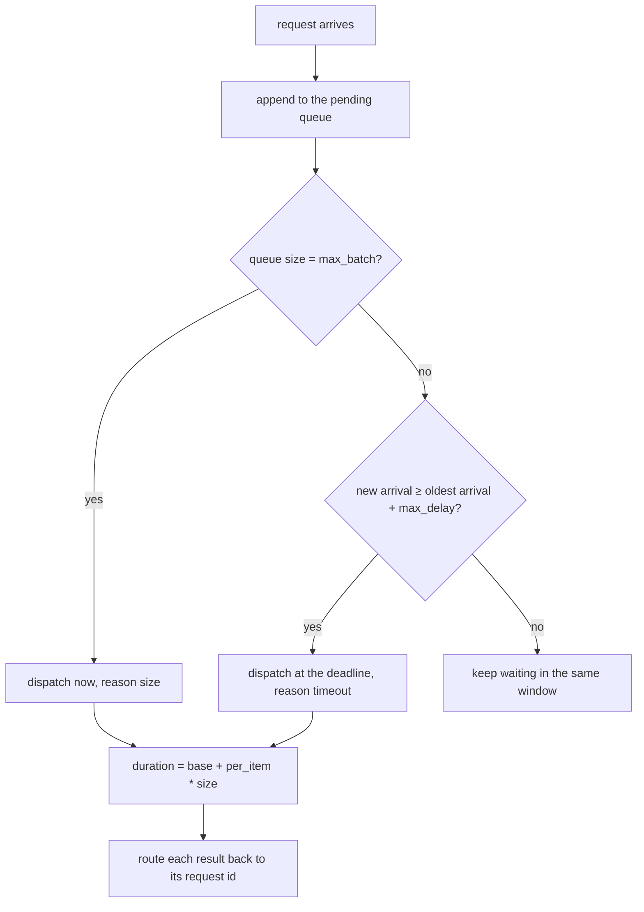
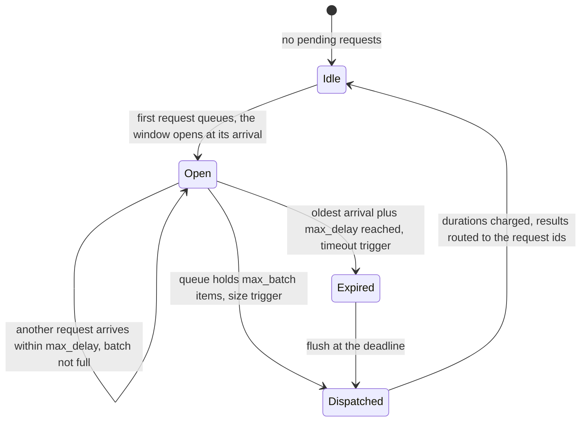
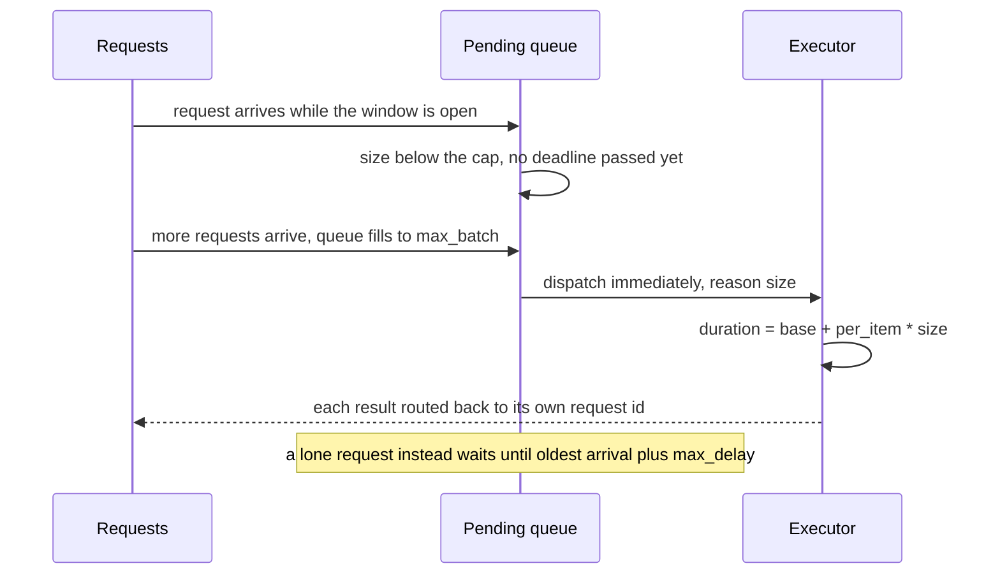

# 723 — Implement automatic batching (microbatch merging) skeleton

> **Tier:** Expert · **CTCI chapter:** Beyond — Machine Learning & AI
> **Task spec:** [723-implement-automatic-batching-microbatch-merging-skeleton.md](../../../tasks/expert/723-implement-automatic-batching-microbatch-merging-skeleton.md)
> **Solutions:** [Python](../../../solutions/python/expert/723-implement-automatic-batching-microbatch-merging-skeleton/solution.py) ·
> [Java](../../../solutions/java/expert/723-implement-automatic-batching-microbatch-merging-skeleton/Solution.java) ·
> [JavaScript](../../../solutions/javascript/expert/723-implement-automatic-batching-microbatch-merging-skeleton/solution.js) ·
> [C#](../../../solutions/csharp/expert/723-implement-automatic-batching-microbatch-merging-skeleton/Solution.cs)

## 1. Problem restatement

A serving loop that executes one request at a time pays the fixed per-kernel cost again and again.
**Automatic batching** merges whatever has arrived into one microbatch, amortising that cost, at the
price of letting each request wait. The task is the scheduler — the flush rules, the guarantees, and the
measured cost/latency trade-off.

**Modelling contract.** The scheduling logic is real; execution is a deterministic cost model:

| Element | Contract |
| --- | --- |
| Window | opens at the arrival of the first queued request; closes as soon as the queue holds `max_batch` items (size trigger, immediate) or the oldest pending request has waited `max_delay` (timeout trigger at `first_pending_arrival + max_delay`) |
| Execution | one micro-batch costs `base_cost + per_item_cost · size`; Python additionally performs **real per-item work** (`payload²`) routed back to the right request id, so results are checked, not just bookkeeping |
| Clock | Python/Java/JavaScript use an integer or float integer-valued tick model — no threads, no real device |
| Extras in the other files | JavaScript adds a `maxTokensPerBatch` work cap, padding buckets and sequence splitting ("micro" batching); Java includes the padding waste of ragged batches in its cost; C# serialises batches on a single executor (`start = max(window deadline, previous finish)`) |
| Not modelled | multiple model replicas, preemption, priority or fairness policies, per-request deadlines and cancellation, ragged-tensor construction on a real device, live demand instead of a trace |

**What is asserted:** every request is served exactly once, in arrival order, with a correct result; no
batch exceeds `max_batch`; no request waits more than `max_delay` before dispatch; size flushes occur
exactly at the arrival that filled the queue and timeout flushes exactly at the deadline; batch
durations follow the cost model; the partition matches the batch log; and the batching trade-off is
monotone in the cap.

Interface (Python; the others mirror it):

| Call | Meaning |
| --- | --- |
| `MicroBatcher(max_batch, max_delay, base_cost, per_item_cost)` | the scheduler and its cost model |
| `run(requests)` | `requests = [(request id, arrival, payload)]` in arrival order |
| `flush(pending, dispatch_time, reason)` | executes one micro-batch and records completions |
| `batches` | `(batch id, reason, dispatch, size, completion)` per flush |
| `completions` | `(request id, arrival, completion, latency, result, size, duration)` |
| `mean_latency()` / `mean_batch_size()` / `cost_per_item()` | the metrics the policy is judged by |
| `make_stream(payloads, gap, burst, idle_every, idle)` | a deterministic arrival trace |
| `oracle_results(requests)` | the expected per-request output |

Concrete expected results, all asserted (200 requests, `max_batch = 8`, `max_delay = 0.2`,
`base_cost = 1.0`, `per_item_cost = 0.05`):

- Every request is served exactly once, in arrival order, and `{id: result}` equals the oracle
  (`payload²`) to `1e-12`.
- Batch sizes are in `[1, 8]`, they cover the stream exactly once, batch ids are unique, and a bursty
  stream produces at least one batch of size 8.
- For every batch: the reason is `"size"` or `"timeout"`, `completion ≥ dispatch`, and
  `completion - dispatch == 1.0 + 0.05 · size` to `1e-12`. A size flush has size 8 and its dispatch time
  is one of the arrivals; a timeout flush dispatches at `first_pending_arrival + 0.2`.
- Latency bound: `completion - duration - arrival ≤ 0.2` for every request, and
  `latency ≤ max_delay + duration`; the mean latency is above `0.2`, so batching really does make
  requests wait.
- Trade-off versus one-per-batch: the unbatched run has the lower mean latency and the exact cost
  `200 · 1.05 = 210`, while the batched run costs less in total and **less than half per item**
  (`cost_per_item < 0.525`).
- Cap sweep `1, 2, 4, 8, 16, 32`: mean batch size is non-decreasing, cost per item non-increasing, and
  mean latency non-decreasing.
- Boundaries: a lone request waits for its timeout (`dispatch 1.5`, completion `2.6`, result `4.0`); an
  empty stream produces no batches and zero cost; a cap of 1 never merges and dispatches immediately; an
  arrival landing exactly on the deadline does **not** join the expiring batch.
- Rejected: `max_batch = 0`, a negative delay, a negative cost. Identical streams give identical logs.

## 2. Intuition

The naive server processes requests as they arrive. On a device where a step costs `alpha + beta · B`,
that means paying `alpha` for every single request even though the hardware would happily do eight at
once — the fixed cost is the dominant term.

The fix is to let requests **wait** in a queue and dispatch them together. But a queue with no bound is
a latency disaster, so the scheduler needs two independent triggers, and either may fire:

1. **size** — the queue reached `max_batch`, dispatch immediately at this arrival instant;
2. **timeout** — the *oldest* queued request has waited `max_delay`, dispatch at
   `first_arrival + max_delay` even if the batch is nearly empty.

That pair is what makes the latency guarantee *provable* rather than empirical: since the timeout is
measured from the oldest request's arrival and fires at its own deadline, no request can wait more than
`max_delay` to be dispatched, whatever the arrival pattern does. What it cannot bound is the total
latency, which includes the batch's own duration `base + per_item · size` — so bigger batches are
cheaper per item and slower per request, exactly the trade-off the checks measure.



The tuning knob is therefore `(max_batch, max_delay)`, and the harness sweeps the cap to show the shape
of the curve: mean batch size up, cost per item down, mean latency up. A server operator picks a point on
that curve; the code does not hard-code one.

## 3. Algorithm

1. Validate the configuration (`max_batch ≥ 1`, non-negative delay and costs).
2. Walk the arrival stream in order. Before queueing a request, check whether its arrival time is at or
   past `oldest_pending_arrival + max_delay`; if so, **flush the pending queue at that deadline first**
   (the new request must not join an expiring batch).
3. Append the request; if the queue now holds exactly `max_batch` items, flush immediately at the arrival
   instant with reason `"size"`.
4. At the end of the stream, flush whatever remains at `oldest_arrival + max_delay`.
5. `flush` computes `duration = base_cost + per_item_cost · size`, sets
   `completion = dispatch + duration`, records one completion row per request (with its own latency and
   result) and appends the batch row; the cost counter accumulates the durations.
6. Report mean batch size, mean latency, total cost and cost per item.
7. Compare against the cap-1 baseline and against the oracle results.

```text
procedure run(batcher, requests)
    pending ← empty list
    for (rid, arrival, payload) in requests do
        if pending is not empty and arrival >= pending[first].arrival + batcher.max_delay then
            deadline ← pending[first].arrival + batcher.max_delay
            flush(batcher, pending, deadline, "timeout")
            pending ← empty list
        pending.append((rid, arrival, payload))
        if len(pending) = batcher.max_batch then
            flush(batcher, pending, arrival, "size")
            pending ← empty list
    if pending is not empty then
        flush(batcher, pending, pending[first].arrival + batcher.max_delay, "timeout")
    return batcher

procedure flush(batcher, pending, dispatch_time, reason)
    size ← len(pending)
    if size = 0 then reject "an empty microbatch must never be dispatched"
    duration ← batcher.base_cost + batcher.per_item_cost * size
    completion ← dispatch_time + duration
    for (rid, arrival, payload) in pending do
        batcher.completions.append((rid, arrival, completion, completion - arrival,
                                    payload * payload, size, duration))
    batcher.batches.append((len(batcher.batches), reason, dispatch_time, size, completion))
    batcher.cost ← batcher.cost + duration

function cost_per_item(batcher)
    return batcher.cost / max(len(batcher.completions), 1)
```



## 4. Worked example

The primary trace: 200 requests arriving in bursts of two every `0.05` units, with an idle jump of `0.6`
every fifth group, `max_batch = 8`, `max_delay = 0.2`, `base = 1.0`, `per_item = 0.05`.

| Event | Pending | Decision | Dispatch | Duration | Completion |
| --- | --- | --- | --- | --- | --- |
| arrivals fill the queue to 8 | 8 | size trigger | at that arrival | `1.0 + 0.4 = 1.4` | `dispatch + 1.4` |
| a lone request, then silence | 1 | timeout | `arrival + 0.2` | `1.0 + 0.05 = 1.05` | `arrival + 1.25` |
| after an idle jump, two requests at once | 2 | timeout | `oldest + 0.2` | `1.1` | `oldest + 1.3` |

Aggregate behaviour of this stream versus the one-per-batch baseline:

| Configuration | Batches | Mean batch size | Total cost | Cost per item | Mean latency |
| --- | --- | --- | --- | --- | --- |
| `max_batch = 8`, `max_delay = 0.2` | fewer than 200 | > 1, with at least one full batch of 8 | `< 210` | `< 0.525` | `> 0.2` |
| `max_batch = 1` (baseline) | 200 | `1.0` | `200 · 1.05 = 210` exactly | `1.05` | lower than the batched run |

The check `batcher.cost_per_item() < solo.cost_per_item() / 2` is the quantified claim: merging halves
the per-item cost or better on this trace, and the price is a mean latency above the delay bound.

Cap sweep on the same stream (`max_delay = 0.2` throughout):

| `max_batch` | Mean batch size | Cost per item | Mean latency |
| --- | --- | --- | --- |
| 1 | `1.0` | `1.05` | smallest |
| 2 | larger | lower | larger |
| 4 | larger again | lower again | larger again |
| 8 | … | … | … |
| 16, 32 | non-decreasing | non-increasing | non-decreasing |

Boundary traces the harness pins down:

| Case | Input | Asserted outcome |
| --- | --- | --- |
| Lone request | `(0, 1.0, 2.0)`, `max_delay = 0.5`, `base = 1.0`, `per_item = 0.1` | one batch `(0, "timeout", 1.5, 1, 2.6)` and result `4.0` |
| Empty stream | `[]` | no batches, no completions, zero cost, zero mean latency |
| Cap of one | the 200-request stream, `max_batch = 1` | every batch has size 1 and every request dispatches at its own arrival |
| Arrival exactly on the deadline | arrivals `0.0`, `0.4`, `0.4` with `max_delay = 0.4` | the expiring batch flushes first (`(0, "timeout", 0.4, 1, 1.5)`) and the two late arrivals batch together |
| Spread versus bursty | the same payloads with `gap = 0.5` versus `gap = 0.05, burst = 8` | bursts give larger batches and a lower cost per item |



## 5. Complexity

With `N` requests, `B` dispatched batches, `C = max_batch` and arrival stream length `N`:

| Quantity | Cost | Why the bound holds |
| --- | --- | --- |
| Scheduling loop | `O(N)` | each request is appended once and each flush removes the queue |
| One flush | `O(size)` | one completion row per request, plus real per-item work in Python |
| Total execution cost | `Σ (base + per_item · size) = B · base + per_item · N` | the per-item term is fixed; only the launch count shrinks |
| Best case | `B = ceil(N / C)` | the queue always fills, so `base` is amortised over `C` items |
| Worst case | `B = N` | a spread-out stream triggers a timeout for every request |
| Queue space | `O(C)` | the window is capped by `max_batch` |
| Latency | `≤ max_delay + base + per_item · size` | the dispatch bound plus the batch's own duration, both asserted |

The economics in one line: total cost is `B · base + per_item · N`, so batching pays exactly when
`B` is much smaller than `N` — the launch count is the only thing that changes. That is why the checks
compare `cost_per_item` between the cap-8 and cap-1 runs (a factor of two or more) and why the cap sweep
is monotone in all three metrics. It is also why a bursty stream wins: with `burst = 8` and a `0.05` gap
the queue fills before any deadline, so the batches are maximal, whereas the `gap = 0.5` stream times out
with one or two items in each window.

## 6. Pitfalls and edge cases

- **An empty batch must never be dispatched.** `flush` raises on `size == 0`; a scheduler that flushes
  the idle window "just in case" would charge `base_cost` for nothing.
- **The timeout is measured from the *oldest* pending arrival, not from the last flush.** Getting this
  wrong either lets requests wait longer than `max_delay` or flushes prematurely on every arrival.
- **An arrival exactly at the deadline must not join the expiring batch.** The check uses arrivals
  `0.0, 0.4, 0.4` with `max_delay = 0.4` and requires the lone request to flush at `0.4` while the two
  late arrivals form the next batch; a `<`‑versus‑`≤` slip here changes the outcome.
- **`max_batch = 1` means no merging at all.** Every request dispatches at its own arrival; the harness
  asserts this explicitly so a cap of one cannot be mistaken for "batching with a small cap".
- **The latency bound is on the *wait*, not the total.** `latency ≤ max_delay + duration` is the honest
  statement, and the harness checks both halves separately (`completion - duration - arrival ≤ 0.2`).
- **Results must be routed back.** Python performs real per-item work and matches `{id: result}` against
  the oracle, which catches a shuffle bug that pure bookkeeping checks would miss.
- **Cost must be itemised, not assumed.** `completion - dispatch == base + per_item · size` is asserted
  per batch, and the unbatched total must equal `N · (base + per_item)` exactly.
- **An empty stream is legal** and must leave the scheduler with zero batches, zero cost and zero mean
  latency (not a division by zero).
- **`max_batch = 0`, a negative delay or a negative cost are rejected** up front rather than producing a
  degenerate schedule.
- **The harness mutates nothing shared**: each configuration is a fresh `MicroBatcher`, so two identical
  runs produce identical logs — asserted directly, which is what makes the reported metrics reproducible.

## 7. Variants and follow-ups

- The client-side analogue of the same latency/throughput question, with stragglers: [719 — parameter server simulation](../../../tasks/expert/719-implement-parameter-server-simulation-for-distributed-ml-trainin.md).
- Placing the intermediates of each batch: [724 — memory planner for computation graph scheduling](../../../tasks/expert/724-implement-memory-planner-for-computation-graph-scheduling-simple.md).
- Making one batch step cheaper: [725 — operator fusion simulation](../../../tasks/expert/725-implement-operator-fusion-simulation-for-compute-graph-speedups.md).
- Bounding what the batch may keep alive: [722 — gradient checkpointing and the recompute trade-off](../../../tasks/expert/722-implement-gradient-checkpointing-recompute-vs-memory-tradeoff.md).

## 8. Check yourself

<details><summary>Show answer</summary>
**Why are two flush triggers needed instead of just a size trigger?** A size-only batcher can wait
forever on an idle stream — one lone request never reaches the cap, so it is never served. The timeout
trigger dispatches at `oldest_arrival + max_delay`, which is what makes the latency bound provable:
every request is dispatched no later than `max_delay` after it (or the request before it) arrived.
</details>

<details><summary>Show answer</summary>
**Show that total cost is `B · base + per_item · N`.** Each flush charges `base + per_item · size`, and
the sizes sum to `N` because every request is served exactly once. The per-item term is therefore
independent of the batching policy; the policy only reduces the number of launches `B`, which is why
batching helps and why the harness only needs to compare launch counts and per-item costs.
</details>

<details><summary>Show answer</summary>
**Why does the harness test an arrival that lands exactly on the deadline?** Because the boundary decides
whether the new request joins the expiring batch. The implementation flushes the deadline batch *before*
queueing the newcomer, so with arrivals `0.0, 0.4, 0.4` and `max_delay = 0.4` the lone request is
dispatched at `0.4` and the two late arrivals form a separate batch — asserted, not left to chance.
</details>

<details><summary>Show answer</summary>
**What does the cap sweep demonstrate?** That the trade-off is monotone and tunable: as `max_batch` grows
the mean batch size is non-decreasing, the cost per item is non-increasing, and the mean latency is
non-increasing only in the other direction (it grows). Choosing a cap is choosing a point on that curve,
which is exactly the choice a serving operator makes between throughput and the latency SLO.
</details>

<details><summary>Show answer</summary>
**Why does a bursty stream beat a spread-out one with identical payloads?** Because the queue fills
before any deadline fires, so batches reach the cap and `B` is small. In the spread case every window
times out with one or two items, so `B` approaches `N` and each launch pays `base` for almost nothing —
the checks require strictly larger batches and a strictly lower cost per item for the bursty trace.
</details>
