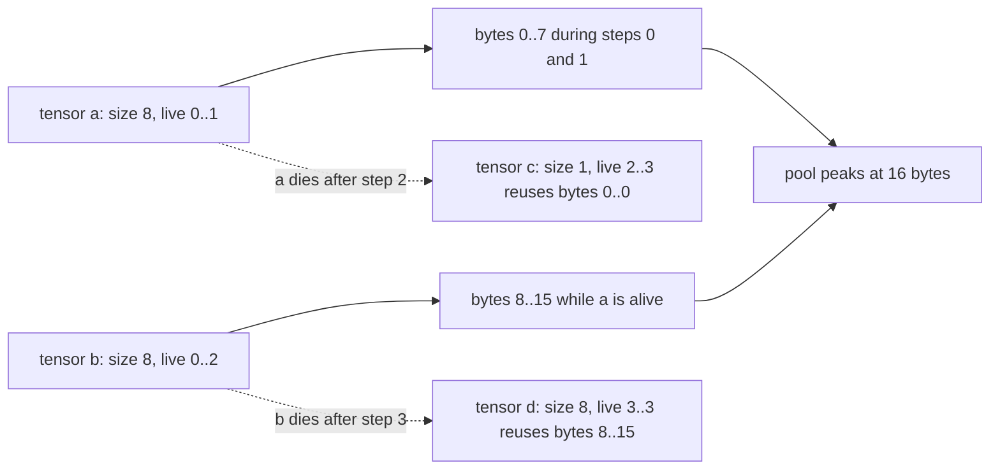
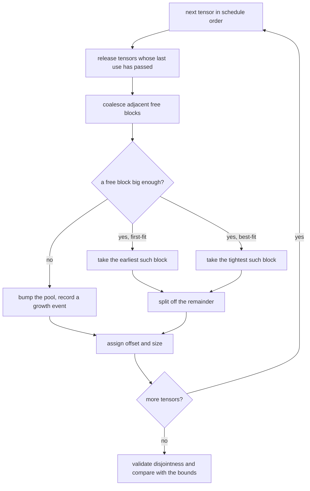
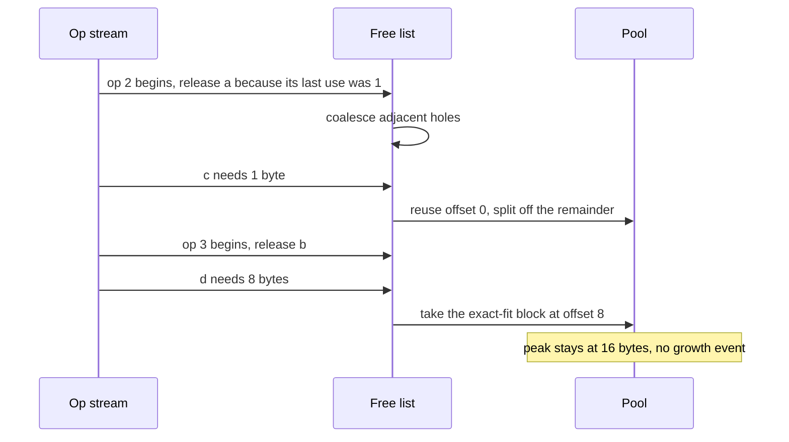

# 724 — Implement memory planner for computation graph scheduling (simple greedy)

> **Tier:** Expert · **CTCI chapter:** Beyond — Machine Learning & AI
> **Task spec:** [724-implement-memory-planner-for-computation-graph-scheduling-simple.md](../../../tasks/expert/724-implement-memory-planner-for-computation-graph-scheduling-simple.md)
> **Solutions:** [Python](../../../solutions/python/expert/724-implement-memory-planner-for-computation-graph-scheduling-simple/solution.py) ·
> [Java](../../../solutions/java/expert/724-implement-memory-planner-for-computation-graph-scheduling-simple/Solution.java) ·
> [JavaScript](../../../solutions/javascript/expert/724-implement-memory-planner-for-computation-graph-scheduling-simple/solution.js) ·
> [C#](../../../solutions/csharp/expert/724-implement-memory-planner-for-computation-graph-scheduling-simple/Solution.cs)

## 1. Problem restatement

Executing a graph in topological order with one fresh buffer per tensor costs the **sum** of all tensor
sizes. A memory planner instead puts them in one arena and reuses a region as soon as its previous owner
dies: a tensor is live from the op that defines it to the last op that consumes it, and two tensors whose
lifetimes do not meet may share bytes.

**Modelling contract.** The placement logic and the safety invariant are real; the memory is abstract:

| Element | Contract |
| --- | --- |
| Tensor | an integer size plus an inclusive lifetime `[defined, last_use]` supplied by the caller (Python/JavaScript/C#) or computed by an independent consumer scan (Java) — **no liveness analysis of a real framework** |
| Allocator | a free list with a bump pointer, coalescing adjacent free blocks on release; Python supports `first-fit` and `best-fit`, alignment rounding, and a limit on how small a request may be |
| Scheduling | Python/JavaScript/C# place tensors in a chosen order; Java also *schedules* by running the ready op that releases the most bytes, and enumerates **every** topological order by brute force on a small graph |
| Reference quantities | the peak live volume `Σ size` over simultaneously live tensors (a lower bound no allocator can beat) and the sum of all sizes (the no-reuse baseline) |
| Oracles | Python: a branch-and-bound placement search; C#/JavaScript: an exhaustive search over allocation orders; for unit-size tensors the problem is interval-graph colouring, whose optimum equals the maximum overlap |
| Not modelled | views, aliasing, in-place updates, rematerialisation, swizzling, device fragmentation, streams |

**What is asserted:** lifetimes overlap ⟹ blocks are disjoint (the whole contract), every block is at
least as large as its tensor, the peak sits between the live-volume bound and the sum of sizes, the pool
only grows when the free list could not serve a request, and neighbour coalescing removes fragmentation.

Interface (Python; the others mirror it):

| Call | Meaning |
| --- | --- |
| `Tensor(name, size, defined, last_use)` | validates `size > 0` and `last_use ≥ defined`; `overlaps(other)` |
| `MemoryPlanner(strategy, alignment)` | `plan(tensors)` → `name → (offset, size)`; also `peak`, `pool`, `free`, `released`, `growth_events` |
| `_release(step)` / `_coalesce()` / `_take(size)` | release dead tensors, merge adjacent holes, pick first/best fit and split the remainder |
| `max_live_bytes(tensors)` | the lower bound: the largest sum of simultaneously live sizes |
| `used_bytes(assignments)` | the highest byte touched: `max(offset + size)` |
| `validate(tensors, assignments)` | the independent pairwise lifetime/overlap checker |
| `optimal_peak_bruteforce(tensors)` | branch-and-bound placement oracle |

Concrete expected results, all asserted:

- Hand-checked example `a(8, 0..1)`, `b(8, 0..2)`, `c(1, 2..3)`, `d(8, 3..3)`:
  `a = (0, 8)`, `b = (8, 8)`, `c = (0, 1)` (reusing `a`'s released block), `peak == 16`,
  `max_live_bytes == 16`, `released == [("a", 2), ("b", 3)]`.
- Random graphs for both strategies with `(count, span) ∈ {(6, 4), (12, 6), (20, 3), (30, 20)}`: the
  placement validates, `max_live_bytes ≤ peak ≤ Σ sizes`, and `used_bytes(assignments) == planner.peak`.
- Unit-size tensors (`span = 1`) with `count ∈ {5, 9, 17}`: `peak == max_live_bytes`, so first-fit attains
  the interval-graph optimum, and `peak ≤ count`.
- Mixed sizes on six tiny graphs: `optimum ≤ best-fit`, `best-fit ≤ 2 · optimum`, `best-fit ≤ first-fit`.
- 24 random graphs of 10 tensors: `best-fit ≤ first-fit` on every one, and the two strategies agree on at
  least 12 of them — coalescing heals the fragmentation the strategy difference would otherwise expose.
  The strategy difference itself is asserted on a free list `[(0, 10), (12, 4)]` and a request of 4:
  first-fit takes offset 0, best-fit takes offset 12 and leaves `[(0, 10)]`.
- Boundaries: an empty graph plans `{}` with `peak == 0`; a single tensor lands at `(0, 12)`; five tensors
  of 4 that all overlap give `peak == 20` with `growth_events == 5`; a sequential chain with sizes
  `8, 7, 6, 5, 4` gives `peak == 8` with `growth_events == 1`.
- Coalescing: `x(4, 0..1)`, `y(4, 0..1)`, `z(8, 2..2)` gives `peak == 8` with `growth_events == 2` and
  `z = (0, 8)` — the merged hole is used without extending the pool.
- Rejected: size 0, an unordered lifetime, an unknown strategy, alignment 0, duplicate names.

## 2. Intuition

The naive plan allocates a fresh region for every tensor: safe, simple, and wasteful, because a tensor's
bytes are dead the moment its **last consumer** has run. Two observations follow.

The first is about *when* memory is freed: not at the end of the program, but at the last use. A tensor
consumed by op 3 is garbage before op 4 starts, so op 4's output may sit exactly where it was.

The second is about *where*: since overlapping lifetimes need disjoint bytes but non-overlapping ones do
not, the planner is packing intervals into a line — space reuse, not ownership. The invariant is simple
to state and easy to break: **two tensors whose lifetimes meet must not share a byte**.



A greedy planner is then three operations: release everything whose last use is in the past (merging
adjacent holes, or the freed bytes are unusable), take a hole big enough — first-fit takes the earliest,
best-fit the tightest — and only if none exists, extend the pool and record a growth event. That last
counter is what makes "the pool never grows for nothing" checkable.

## 3. Algorithm

1. Validate the tensors, sort them by `(defined, name)`, and reset the free list, the live map and the
   counters.
2. For each tensor in order: **release** every live tensor whose `last_use < defined` at this step, then
   **coalesce** adjacent free blocks.
3. Round the requested size up to the alignment; **take** a fitting block (first-fit = earliest offset,
   best-fit = smallest sufficient block) and split off any remainder.
4. If no block fits, bump the pool by the rounded size and increment `growth_events`.
5. Record the assignment and the live block, and update the peak with the current pool size.
6. Validate the result against the independent checker, and compare `used_bytes` with the two bounds.
7. Sweep strategies and graphs, and compare against the branch-and-bound oracle on tiny instances.

```text
procedure plan(planner, tensors)
    if names are not unique then reject "tensor names must be unique"
    planner.tensors ← tensors sorted by (defined, name)
    reset assignments, live, free, released, peak, pool, growth_events
    for tensor in planner.tensors do
        release_dead(planner, tensor.defined)
        wanted ← round_up(tensor.size, planner.alignment)
        start ← take(planner, wanted)
        if start is none then
            start ← planner.pool
            planner.pool ← planner.pool + wanted
            planner.growth_events ← planner.growth_events + 1
        planner.assignments[tensor.name] ← (start, tensor.size)
        planner.live[tensor.name] ← (start, tensor.size)
        planner.peak ← max(planner.peak, planner.pool)
    return copy of planner.assignments

procedure release_dead(planner, step)
    for tensor in planner.tensors do
        if tensor.last_use < step and tensor.name in planner.live then
            planner.free.append(planner.live.remove(tensor.name))
            planner.released.append((tensor.name, step))
    coalesce(planner)

procedure coalesce(planner)
    merged ← empty list
    for (start, size) in sorted(planner.free) do
        if merged is not empty and merged[last].start + merged[last].size = start then
            merged[last].size ← merged[last].size + size
        else
            merged.append((start, size))
    planner.free ← merged

function take(planner, size)
    candidates ← indices of planner.free where length >= size
    if candidates is empty then return none
    index ← candidates[first] when strategy is first-fit
    index ← argmin of (planner.free[index].length, planner.free[index].start) when best-fit
    (start, length) ← planner.free.remove(index)
    if length > size then
        planner.free.append((start + size, length - size))
        coalesce(planner)
    return start

function max_live_bytes(tensors)
    best ← 0
    for step in { tensor.defined and tensor.last_use for tensor in tensors } do
        total ← sum of tensor.size for tensor where tensor.defined <= step <= tensor.last_use
        best ← max(best, total)
    return best
```



## 4. Worked example

The hand-checked graph: `a(8, 0..1)`, `b(8, 0..2)`, `c(1, 2..3)`, `d(8, 3..3)`, first-fit.

| Step | Tensor | Released before this step | Free list before | Action | Free list after | Pool |
| --- | --- | --- | --- | --- | --- | --- |
| 0 | `a` (8) | — | `[]` | grow to 8, give `a` bytes 0–7 | `[]` | 8 |
| 0 | `b` (8) | — | `[]` | grow to 16, give `b` bytes 8–15 | `[]` | 16 |
| 2 | `c` (1) | `a` (last use 1) | `[(0, 8)]` | take offset 0, split 7 bytes | `[(1, 7)]` | 16 |
| 3 | `d` (8) | `b` (last use 2) | `[(1, 7), (8, 8)]` | `(1, 7)` is too small, take offset 8 | `[(1, 7)]` | 16 |

The pool peaks at 16 bytes, which is exactly `max_live_bytes` for this graph: at step 0 both `a` and `b`
are live, and no allocator can do better. `released == [("a", 2), ("b", 3)]` records that `a` was freed
when step 2 began and `b` when step 3 did.

Structured cases, each asserted:

| Graph | Peak | `growth_events` | What it demonstrates |
| --- | --- | --- | --- |
| Five tensors of size 4, all live `0..5` | `20` | `5` | maximum overlap: nothing can be shared |
| Sizes `8, 7, 6, 5, 4` with lifetimes `[i, i]` | `8` | `1` | a dead chain reuses one block |
| `x(4, 0..1)`, `y(4, 0..1)`, `z(8, 2..2)` | `8` | `2` | coalescing merges `x` and `y`'s holes so `z` fits at offset 0 |
| Empty graph | `0` | `0` | no allocation, no growth |
| Single tensor 12 | `12` | `1` | offset 0, no release |



Strategy comparison on a free list `[(0, 10), (12, 4)]` and a request of 4 bytes:

| Strategy | Chosen offset | Free list afterwards | Why |
| --- | --- | --- | --- |
| first-fit | `0` | `[(4, 6), (12, 4)]` | earliest block that fits |
| best-fit | `12` | `[(0, 10)]` | tightest block, and nothing had to be split |

Over 24 random 10-tensor graphs the two strategies never differ in the wrong direction
(`best-fit ≤ first-fit`) and agree on at least half of them, because **coalescing** already repairs the
fragmentation a first-fit choice would leave behind.

## 5. Complexity

With `n` tensors, `m` distinct steps and sizes up to `S` bytes:

| Quantity | Cost | Why the bound holds |
| --- | --- | --- |
| Sorting by `(defined, name)` | `O(n log n)` | the schedule order is total and deterministic |
| Release pass per step | `O(n)` | a linear scan for tensors whose last use has passed (a heap or interval tree makes it `O(log n)`) |
| Coalesce | `O(h log h)` for `h` free blocks | a sort by offset plus one merge pass |
| `take` | `O(h)` | scanning the free list for the first (or tightest) fitting block |
| Total planning | `O(n²)` worst case | `n` steps each scanning `O(n)` state; the practical cost is far smaller because `h` is the number of holes, not tensors |
| Peak pool | between `max_live_bytes` and `Σ sizes` | the lower bound is structural, the upper bound is "no reuse at all" |
| Validation | `O(n²)` | a full pairwise overlap test — deliberately independent of the planner |
| Branch-and-bound oracle | exponential | only ever run on tiny graphs (4 tensors), where it is exact |

Quality results the checks lean on:

| Workload | Result | Reason |
| --- | --- | --- |
| Unit sizes | `peak == peak live count` | unit tensors are interval-graph colouring, and greedy colouring in lifetime order is optimal |
| Mixed sizes, tiny graphs | `optimum ≤ best-fit ≤ 2 · optimum` | greedy is never better than the optimum and stays within a factor of two on the sampled instances |
| Random graphs | `best-fit ≤ first-fit` always; equal on ≥ half | coalescing makes the strategies converge |
| Chain of dead tensors | `peak == max size` | one block is reused forever |

## 6. Pitfalls and edge cases

- **A lifetime is inclusive at both ends.** `c`'s `defined = 2` and `a`'s `last_use = 1` mean they never
  meet; using `<` instead of `≤` in the overlap test would place them on the same bytes while both are
  live. The `overlaps` helper and the validator both use the inclusive form.
- **Release before allocate.** A tensor must be freed *when the step begins*, not after the new tensor
  is placed, or the check `c == (0, 1)` fails and the pool grows unnecessarily.
- **Coalescing is not optional.** Without merging adjacent holes the `x, y, z` case grows the pool a
  third time instead of reusing `(0, 8)`.
- **Duplicate tensor names are rejected.** They would silently overwrite one assignment and make the
  pairwise validator meaningless.
- **The reported peak must equal the highest byte actually touched** (`used_bytes(assignments)`), not the
  pool size after a bump that was never needed.
- **Growth events are the diagnostic.** Fully overlapping tensors give `growth_events == 5`; a dead chain
  gives `1`. A planner that grows the pool for a request the free list could have served would pass the
  safety check and waste memory — which is why the counter exists.
- **Unit sizes are the exactness case.** `peak == max_live_bytes` is asserted for `count ∈ {5, 9, 17}`,
  turning "the greedy is optimal here" into a checked claim for interval graphs.
- **Alignment can only hurt packing.** Sizes are rounded up before placement, so `peak` is measured in
  aligned bytes — the same rule a real allocator follows.
- **An empty graph is legal** and must not divide by anything or grow the pool.
- **Determinism.** The same graph planned twice gives the same placement: names break ties in the sort
  order, and the strategy only sees a sorted free list.

## 7. Variants and follow-ups

- Trading memory for recomputation rather than reusing bytes: [722 — gradient checkpointing and the recompute trade-off](../../../tasks/expert/722-implement-gradient-checkpointing-recompute-vs-memory-tradeoff.md).
- Shaping the ops that own those buffers: [725 — operator fusion simulation for compute graph speedups](../../../tasks/expert/725-implement-operator-fusion-simulation-for-compute-graph-speedups.md).
- Merging the requests that share one graph: [723 — automatic batching (microbatch merging)](../../../tasks/expert/723-implement-automatic-batching-microbatch-merging-skeleton.md).
- Block-level dedup of a stored plan: [819 — memory-efficient checkpointing for massive models](../../../tasks/master/819-implement-memory-efficient-checkpointing-for-massive-models-bloc.md).

## 8. Check yourself

<details><summary>Show answer</summary>
**What is the single invariant a memory planner must never break?** Two tensors whose lifetimes overlap
must occupy disjoint byte ranges. Everything else (size, offset, alignment) is bookkeeping around that
one property, which is why the validator re-derives it from the finished plan with a full pairwise sweep
instead of trusting the planner's own bookkeeping.
</details>

<details><summary>Show answer</summary>
**Why is the peak live volume a lower bound that no allocator can beat?** At any step, every tensor live
at that step must be resident simultaneously, and distinct tensors must occupy distinct bytes (they are
different data). So at any step the pool holds at least the sum of the live sizes; taking the maximum over
steps bounds the peak from below. `max_live_bytes` computes exactly that, and the checks require
`max_live_bytes ≤ peak ≤ Σ sizes`.
</details>

<details><summary>Show answer</summary>
**Why does first-fit attain the optimum for unit-size tensors?** With unit sizes the problem is colouring
an interval graph, where the chromatic number equals the maximum number of pairwise overlapping
intervals. Processing intervals in order of their definition and assigning the lowest free colour is
exactly greedy colouring of an interval graph with colours in lifetime order, which is optimal — so the
check can compare against the mathematical optimum (`peak == max_live_bytes`) instead of a heuristic
bound.
</details>

<details><summary>Show answer</summary>
**Why do first-fit and best-fit agree on most random graphs here?** Because of coalescing: when a tensor
dies, its block merges with adjacent free blocks, so a hole that first-fit "fragmented" is repaired as
soon as its neighbours are released. The strategies then differ mostly in *which* block is chosen, not in
how much the pool grows — which is why the check asserts `best-fit ≤ first-fit` on every graph, agreement
on at least half, and the choice difference on a hand-built free list `[(0, 10), (12, 4)]`.
</details>

<details><summary>Show answer</summary>
**What does `growth_events` measure, and why bother?** It counts the times the pool had to be extended
because the free list could not serve the request. A planner can be perfectly safe (no illegal overlap)
while still wasting memory by growing when a hole existed — the counter catches exactly that, and the
structured cases pin it down: `5` growth events for five fully overlapping tensors, `1` for a chain of
dead tensors, `2` for the coalescing example.
</details>
