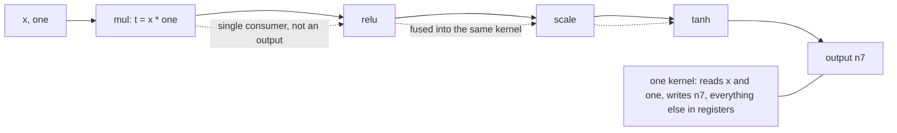
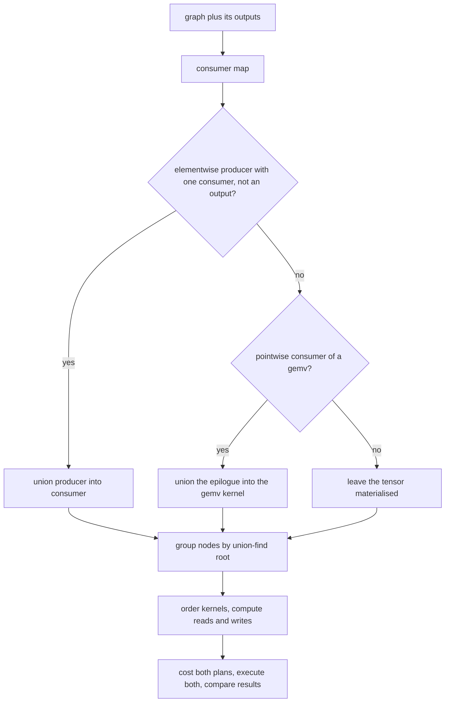
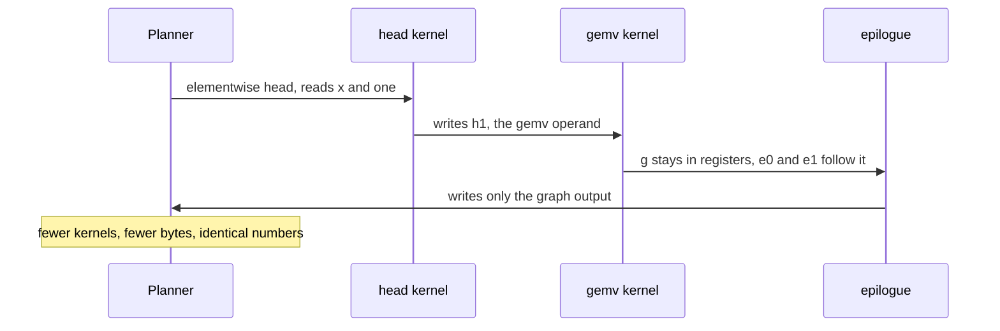

# 725 — Implement operator fusion simulation for compute graph speedups

> **Tier:** Expert · **CTCI chapter:** Beyond — Machine Learning & AI
> **Task spec:** [725-implement-operator-fusion-simulation-for-compute-graph-speedups.md](../../../tasks/expert/725-implement-operator-fusion-simulation-for-compute-graph-speedups.md)
> **Solutions:** [Python](../../../solutions/python/expert/725-implement-operator-fusion-simulation-for-compute-graph-speedups/solution.py) ·
> [Java](../../../solutions/java/expert/725-implement-operator-fusion-simulation-for-compute-graph-speedups/Solution.java) ·
> [JavaScript](../../../solutions/javascript/expert/725-implement-operator-fusion-simulation-for-compute-graph-speedups/solution.js) ·
> [C#](../../../solutions/csharp/expert/725-implement-operator-fusion-simulation-for-compute-graph-speedups/Solution.cs)

## 1. Problem restatement

Running a graph op by op materialises every intermediate: a kernel reads its inputs from memory, computes,
and writes its output back. For a chain of elementwise operators that traffic dominates the arithmetic, so
runtimes **fuse**: an elementwise producer with a single consumer that is not a graph output is evaluated
*inside* the consumer's kernel.

**Modelling contract.** The partitioning and the result-equality contract are real; performance is a byte
model:

| Element | Contract |
| --- | --- |
| Ops | Python/JavaScript: elementwise `add`, `mul`, `relu`, `scale`, `tanh` plus a non-elementwise `gemv`; Java: a `4×4` `matmul` plus `add`, `mul`, `relu`, `exp`; C#: elementwise ops plus `dot`/`reduce` as chain breakers |
| Fusion rules | **vertical**: producer is elementwise, has exactly one consumer, is not a graph output, and the consumer is elementwise (Python/JavaScript also allow a reduction or matmul consumer to absorb producers); **epilogue**: a pointwise consumer of a `gemv`/matmul joins the producer's kernel |
| Never fused | tensors with two or more consumers, graph outputs, and shape-changing ops (a `gemv`/`matmul`/`dot` is absorbed *into* nothing) — so no subexpression is ever recomputed |
| Execution | both plans are executed by an interpreter *with the same arithmetic in the same order*, so the fused result must be **identical** to the unfused one; C# streams each element through its group keeping one register per intermediate |
| Cost model | `launch + element · (external reads + materialised writes)` per kernel, with `launch = 8`, `element = 4` (bytes per element); C# counts elements, JavaScript recomputes traffic from the partition independently |
| Not modelled | tiling, layout/vectorisation choices, autotuning, cross-device planning, arithmetic-intensity models, register-pressure-based refusal, spill handling |

**What is asserted:** fused and unfused evaluation agree exactly on every materialised tensor and the fused
plan does *not* keep the intermediate ones; the materialised set is exactly the graph outputs plus the
multi-consumer tensors; no kernel contains two `gemv`/matmul ops; every fused node is a single-consumer
non-output producer of a node in the same kernel; the cost model matches an independent byte count; and the
degenerate graphs behave.

Interface (Python; the others mirror it):

| Call | Meaning |
| --- | --- |
| `Node(uid, op, inputs, param)` | validates the operator, its arity, and that a `gemv` has a matrix |
| `validate_graph(graph, inputs)` | every reference must point at an earlier tensor |
| `evaluate(graph, inputs)` | the unfused interpreter: one kernel per node, everything materialised |
| `consumers_map(graph)` | name → list of consuming node ids |
| `plan_fusion(graph, outputs)` | union-find partition into kernels, returned in topological order |
| `kernel_io(kernel, consumers, outputs)` | `(external reads, tensors that must be written)` |
| `traversal_cost(kernels, consumers, outputs, sizes, launch, element)` | the byte model |
| `evaluate_fused(graph, kernels, inputs, consumers, outputs)` | kernel-by-kernel execution with local intermediates |
| `materialised(kernels, consumers, outputs)` | what the plan actually stores |

Concrete expected results, all asserted:

- **Chain** of 8 `mul/tanh/scale` nodes: exactly **1** kernel, which reads only `["one", "x"]` and writes
  only `["n7"]`; the fused cost is less than half the unfused cost.
- **`gemv` in the middle** (`h0, h1, g, e0, e1`): kernel sizes `[2, 3]`, the `gemv` kernel is last, and no
  kernel holds two `gemv`s.
- **Epilogue** (`a, g, e`): kernel sizes `[1, 2]` with the `gemv` and its pointwise consumer sharing one
  kernel, and the operand `a` materialised.
- **Branching** (`b` with two consumers): `b` stays materialised and the plan needs 2 kernels, whether or
  not `b` is also an output.
- **All-`gemv` stack** of 3: 3 kernels (nothing fuses), and the cost equals a hand-rolled per-node byte
  count to the unit.
- **Mixed 7-node graph**: fewer kernels than nodes, cheaper than the unfused plan, every fused input
  satisfying the rule check, and identical results.
- Boundaries: empty graph → no kernels and cost `0`; single node → 1 kernel; a chain whose head is also an
  output → `[1, 1]` (the output blocks fusion).
- Rejected: an unknown operator, an arity mismatch, a `gemv` without a matrix, a tensor used before it is
  produced. Planning is deterministic.

## 2. Intuition

The naive executor pays for every intermediate **twice**: once when it is written and once when it is read.
A chain of elementwise ops illustrates the waste perfectly —

```text
unfused:  a + b -> t  |  t * c -> u  |  relu(u) -> y      3 kernels, 5 reads, 3 writes
fused:    relu((a + b) * c) -> y                          1 kernel,  3 reads, 1 write
```

— because the fused kernel streams over the data once and keeps `t` and `u` in registers.

The subtlety is *when fusion is legal*. Folding a producer into its consumer means its value is never
written to memory, which is only sound if exactly one consumer needs it, if nobody outside the kernel
observes it (a graph output must materialise), and if the consumer is not a shape-changing op that would
have to read a materialised input anyway. The epilogue rule is the mirror image: a pointwise consumer of a
matmul output is fine to append because the matmul's output tile is still in registers — but the matmul's
*input* cannot be swallowed the same way.



The correctness contract then follows automatically: if the fused kernel performs the same operations on
the same values in the same order, the numbers are bit-identical — which is why the harness executes both
plans and compares **every** materialised tensor exactly, and additionally checks that the fused plan has
*not* materialised the intermediates.

## 3. Algorithm

1. Validate the graph: every input tensor exists, every reference points at an earlier node, no duplicate
   names.
2. Build the consumer map: name → list of consuming node ids.
3. Partition with **union-find**:
   - for each elementwise node and each of its inputs, if the producer is elementwise with exactly one
     consumer and is not a graph output, union producer and consumer (vertical fusion);
   - for each non-elementwise node (`gemv`), look for an elementwise consumer whose only input is this
     node's output, and union them (epilogue fusion).
4. Group nodes by root and order each kernel topologically, then order the kernels by their earliest node.
5. `kernel_io`: reads are inputs produced outside the kernel; writes are tensors that are graph outputs or
   have a consumer in another kernel.
6. Cost both plans with `launch + element · (reads + writes)` and compare.
7. Execute both plans, compare all materialised tensors, and check that the intermediates were not kept.

```text
function plan_fusion(graph, outputs)
    by_id ← node lookup by uid
    consumers ← consumers_map(graph)
    parent ← union-find over node uids
    for node in graph do
        if node.elementwise then
            for name in node.inputs do
                producer ← by_id.get(name)
                if producer is not none
                   and len(consumers[producer.uid]) = 1
                   and producer.uid not in outputs
                   and node.elementwise then
                    union(producer.uid, node.uid)
        else if node.op is "gemv" then
            for other in graph do
                if other.inputs = [node.uid] and other.elementwise
                   and len(consumers[node.uid]) = 1 and node.uid not in outputs then
                    union(node.uid, other.uid)
    group nodes by find(uid), sort each group and the group list topologically
    return kernels

function kernel_io(kernel, consumers, outputs)
    inside ← { node.uid for node in kernel }
    reads ← [ name in node.inputs for node in kernel where name not in inside ]
    writes ← [ node.uid for node in kernel
               where node.uid in outputs or there is a consumer of node.uid outside inside ]
    return unique(reads), unique(writes)

function traversal_cost(kernels, consumers, outputs, sizes, launch, element)
    total ← 0
    for kernel in kernels do
        reads, writes ← kernel_io(kernel, consumers, outputs)
        moved ← sum of sizes[name] for name in reads plus for name in writes
        total ← total + launch + element * moved
    return total

procedure evaluate_fused(graph, kernels, inputs, consumers, outputs)
    values ← copy of inputs
    for kernel in kernels do
        local ← copy of values
        for node in kernel do
            local[node.uid] ← node.apply([ local[name] for name in node.inputs ])
        for name in kernel_io(kernel, consumers, outputs).writes do
            values[name] ← local[name]
    return values
```



## 4. Worked example

The 8-node chain `n0 = mul(x, one)`, then alternating `tanh`/`scale` up to `n7`, with `outputs = {"n7"}`:

| Node | Op | Inputs | Fusable into its consumer? | Reason |
| --- | --- | --- | --- | --- |
| `n0` | `mul` | `x`, `one` | yes | elementwise, one consumer, not an output |
| `n1` | `tanh` | `n0` | yes | same |
| … | … | … | yes | the chain is entirely single-consumer |
| `n6` | `tanh` | `n5` | yes | fuses into `n7` |
| `n7` | `scale` | `n6` | — | the chain's consumer; `n7` is the output |

Result: **1 kernel** whose `kernel_io` is reads `["one", "x"]`, writes `["n7"]`. The harness then compares
the two executions tensor by tensor and requires the fused run to hold no `n0…n6` at all.

Cost model, `launch = 8`, `element = 4`, sizes in elements (`x`, `one` have 4; each intermediate has 4):

| Plan | Kernels | Reads | Writes | Cost |
| --- | --- | --- | --- | --- |
| Unfused | 8 | `2 + 7` tensors | 8 tensors | `8 · 8 + 4 · (36 + 32)` — eight launches, every intermediate moved twice |
| Fused | 1 | `x`, `one` | `n7` | `8 + 4 · (8 + 4)` — one launch, intermediates in registers |

The check `fused_cost · 2 < unfused_cost` states the payoff precisely: an 8-deep elementwise chain wins by
more than 2×, and the only reason the win is not larger is that the model charges the same arithmetic in
both plans.

Structure of the other graphs, all asserted:

| Graph | Kernel sizes | Materialised | Why |
| --- | --- | --- | --- |
| `h0, h1, g(gemv), e0, e1` | `[2, 3]` | `h1` (the `gemv` operand), `e1` | the elementwise head fuses, the `gemv` absorbs its epilogue `e0, e1` |
| `a, g(gemv), e(tanh)` | `[1, 2]` | `a`, `e` | the epilogue joins the `gemv`, the operand cannot be swallowed |
| `b(relu), p, q, r` (`b` has two consumers) | `2` | `b` | a two-consumer tensor is never recomputed into one branch |
| `g0, g1, g2` (all `gemv`) | `3` | all | shape-changing ops break every chain |
| `k0(relu), k1(tanh)` with `outputs = {k0, k1}` | `[1, 1]` | `k0`, `k1` | an output blocks fusion even with one consumer |



## 5. Complexity

With `n` nodes, `e` edges, `B` materialised tensors and `K` kernels:

| Quantity | Cost | Why the bound holds |
| --- | --- | --- |
| Consumer map | `O(e)` | one entry per input edge |
| Union-find partition | `O(e · α(n))` | near-constant amortised per union with path compression |
| Kernel ordering | `O(n log n)` | sorting nodes and kernels by their position in the graph |
| `kernel_io` per kernel | `O(size of kernel)` | scan inputs and consults the consumer map |
| Cost model | `O(B)` | one size lookup per external read and write |
| Unfused execution | `O(n)` kernels, every intermediate materialised | `n` launches, `2·n` tensor passes |
| Fused execution | `O(K)` kernels, `O(B)` tensors stored | the same arithmetic, less traffic |
| Cost ratio | `K · launch + element · moved` | both terms shrink: fewer launches *and* fewer bytes |

What the checks establish about quality:

| Property | Statement |
| --- | --- |
| Correctness | the two executions agree on every materialised tensor, exactly |
| No hidden recomputation | every fused input is a single-consumer, non-output producer |
| No lost output | the materialised set is exactly outputs ∪ multi-consumer tensors |
| No illegal grouping | a kernel never mixes two shape-changing ops; branch points stay materialised |
| Cost fidelity | the model matches an independent per-node byte count on the all-`gemv` stack |
| Optimality pressure | JavaScript additionally compares the greedy partition against an exhaustive search over all partitions of small graphs, and requires equality on a chain |

## 6. Pitfalls and edge cases

- **Fusing a two-consumer tensor duplicates work.** The `b` graph is the test: because `b` feeds both `p`
  and `q`, it must stay in memory and the plan needs two kernels, whether or not `b` is also an output.
- **A graph output must be materialised.** The `k0 → k1` chain with `outputs = {k0, k1}` gives `[1, 1]`:
  the head is an output, so it cannot disappear into the consumer's kernel.
- **Shape-changing ops are walls.** An all-`gemv` stack gives 3 kernels, and the check also asserts that no
  kernel contains two of them — a partition that merged two `gemv`s would be unsound even if the numbers
  happened to match.
- **The operand of a matmul is not an epilogue.** In the `a, g, e` graph the *consumer* `e` joins the `gemv`
  kernel while the *producer* `a` stays materialised, because `g` would have to read it.
- **The `gemv` kernel must come last** in the `[2, 3]` split: ordering kernels by their earliest node keeps
  the schedule valid, which the check confirms through `kernel_io`.
- **Equality, not tolerance.** Both plans run identical loops, so `fused[name] == reference[name]` is
  required exactly; a tolerance would mask an accidental change of evaluation order (for instance fusing
  across a non-associative reformulation).
- **Not materialised is also checked.** For every produced intermediate that is not in the materialised
  set, `name not in fused` must hold — the absence of the buffer is part of the claim.
- **The cost model needs an oracle.** On the all-`gemv` stack the model is compared against a hand-rolled
  per-node byte count (`launch + element · (inputs + output)` summed over nodes), so the "fusion is cheaper"
  result cannot be an artefact of a buggy cost function.
- **An empty graph is valid** and plans no kernels with cost `0`; a single node is one kernel.
- **Validation is part of the contract**: an unknown operator, a wrong arity, a `gemv` without a matrix and a
  tensor used before definition are all rejected, and planning twice yields the same partition.

## 7. Variants and follow-ups

- Where the fused intermediates live: [724 — memory planner for computation graph scheduling](../../../tasks/expert/724-implement-memory-planner-for-computation-graph-scheduling-simple.md).
- Feeding the kernels: [723 — automatic batching (microbatch merging)](../../../tasks/expert/723-implement-automatic-batching-microbatch-merging-skeleton.md).
- Trading memory for recomputation inside the fused body: [722 — gradient checkpointing and the recompute trade-off](../../../tasks/expert/722-implement-gradient-checkpointing-recompute-vs-memory-tradeoff.md).
- A fused-kernel runtime at the next tier up: [933 — runtime that compiles high-level ops into fused kernels](../../../tasks/master/933-implement-runtime-that-compiles-high-level-ops-into-fused-kernel.md).

## 8. Check yourself

<details><summary>Show answer</summary>
**Why does the fused plan produce bit-identical numbers?** Because fusion changes *where* values live, not
*what* is computed: each op applies the same function to its operands, in the same order, in both plans.
The interpreter makes this explicit by executing the same `Node.apply` calls; a recomputation strategy that
reordered or reassociated arithmetic would break the equality the checks demand.
</details>

<details><summary>Show answer</summary>
**When is vertical fusion illegal?** When the producer has more than one consumer (fusing it into one branch
would evaluate it twice), when the producer is a graph output (its value must exist in memory), or when the
producer is shape-changing (`gemv`/matmul cannot be swallowed — the consumer would need a materialised
input). The `b` graph, the `k0/k1` output case and the all-`gemv` stack test exactly those three refusals.
</details>

<details><summary>Show answer</summary>
**What does the epilogue rule buy, and what does it not buy?** It appends a pointwise consumer of a matmul
output to the matmul kernel, because that output tile is still in registers — so `relu(g) → scale` costs no
extra memory traffic. It does *not* let the matmul swallow its own input: in the `a, g, e` graph, `a` stays
materialised, which the `[1, 2]` split and the materialised-set check confirm.
</details>

<details><summary>Show answer</summary>
**Why is the cost model compared against an independent byte count?** Because "fusion is cheaper" is only
meaningful if the accounting is right. On the all-`gemv` stack — where fusion is impossible — the model's
total must equal a per-node hand computation, which pins down the launch charge and the per-element charge
so the chain result (more than a 2× win) is trustworthy.
</details>

<details><summary>Show answer</summary>
**An 8-node chain becomes 1 kernel. What does that not tell you about performance?** That the win is large
in *modelled* terms (launches and moved elements), not that the fused kernel is fast in absolute terms:
the model has no tiling, vectorisation, occupancy or register-pressure term, and real compilers refuse to
fuse when the fused body would spill. The files state that simplification explicitly; the fused plan is
verified for correctness and for the byte/launch economy only.
</details>
