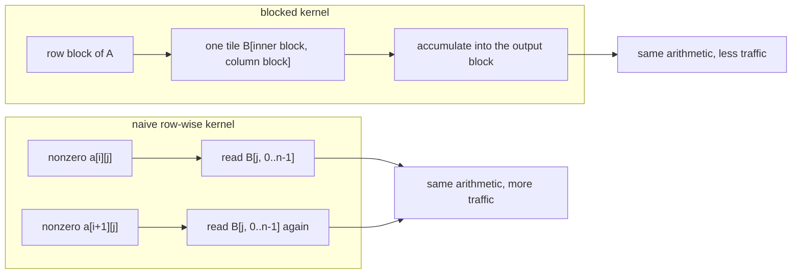
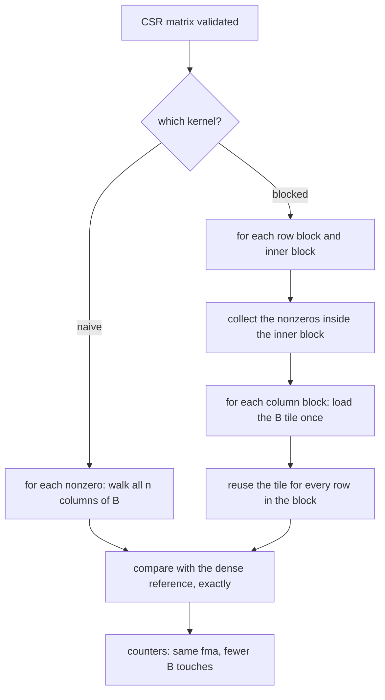
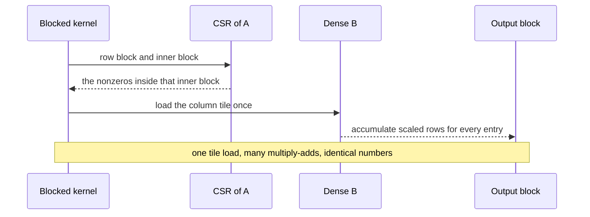

# 726 — Implement sparse-dense matrix multiply block algorithm optimizations

> **Tier:** Expert · **CTCI chapter:** Beyond — Numerical & Scientific Computing
> **Task spec:** [726-implement-sparse-dense-matrix-multiply-block-algorithm-optimizat.md](../../../tasks/expert/726-implement-sparse-dense-matrix-multiply-block-algorithm-optimizat.md)
> **Solutions:** [Python](../../../solutions/python/expert/726-implement-sparse-dense-matrix-multiply-block-algorithm-optimizat/solution.py) ·
> [Java](../../../solutions/java/expert/726-implement-sparse-dense-matrix-multiply-block-algorithm-optimizat/Solution.java) ·
> [JavaScript](../../../solutions/javascript/expert/726-implement-sparse-dense-matrix-multiply-block-algorithm-optimizat/solution.js) ·
> [C#](../../../solutions/csharp/expert/726-implement-sparse-dense-matrix-multiply-block-algorithm-optimizat/Solution.cs)

## 1. Problem restatement

Compute `C = A · B` with `A` an `m × k` **sparse** matrix in CSR (or BSR) and `B` a dense `k × n` matrix.
The arithmetic is fixed — each nonzero of `A` scales a whole row of `B` — so the only lever is **memory
traffic**, and the task is to measure that lever instead of timing it.

**Modelling contract.** The data structures, the kernels and the counter identities are real; the hardware
is a model:

| Element | Python | Java | JavaScript | C# |
| --- | --- | --- | --- | --- |
| Formats | CSR with an explicit validator, `from_dense`, `dense()` round trip | CSR, plus a fully associative **LRU cache** of fixed-size lines | triplet assembly with duplicate merging, CSR, **BSR** (blocked CSR with a tile index) | CSR plus **BCSR** (`br × bc` sub-blocks) |
| Kernels | `spmm_naive` (row-wise) and `spmm_blocked` (row × inner × column blocking) | row-wise versus column-panel blocked, counted in **cache misses** | CSR SpMM and block SpMM with zero-tile skipping | `CsrNaive`, `CsrBlocked`, `BcsrBlocked` with index-read/update counters |
| Metric | `b_reads` (elements of `B` touched) and `fma` (multiply-adds) | simulated LRU misses | tile density, index entries, multiply-add overhead | `indexReads`, `cUpdates`, `cWrites` |
| Equivalence | integer payloads, so all comparisons are **exact equalities** | blocked and row-wise accumulate each output in the same order, so results are bit-for-bit identical | BSR rebuilds the original matrix from its tiles | all three variants agree with the dense reference and a coordinate-wise brute force |
| Not modelled | scalar loops, no register blocking, no SIMD or compressed sparse block format, no threads, no sparse accumulator | the cache is a stand-in for real hardware | no vectorisation, no real hardware counters | 32-bit integers, counters describe layout effects |

**What is asserted:** the blocked result equals the naive result equals a dense reference exactly; the
blocked traversal reads strictly fewer `B` elements while performing **the same number of multiply-adds**
(and the FMA count equals `nnz · n`); the CSR invariant (monotone `row_ptr`, in-range sorted indices,
aligned values) is validated by an independent checker that also rejects malformed matrices; the row-block
sweep is monotone and the inner-block split must *not* change the traffic; and the degenerate shapes behave.

Interface (Python; the others mirror it):

| Call | Meaning |
| --- | --- |
| `CSR(rows, cols, row_ptr, col_idx, values)` | `validate()`, `nnz()`, `dense()`, `row(index)` |
| `from_dense(grid)` | CSR construction, dropping structural zeros |
| `spmm_naive(matrix, right)` | row-wise kernel returning `(out, {"b_reads", "fma"})` |
| `spmm_blocked(matrix, right, row_block, col_block, inner_block)` | blocked kernel, same counters |
| `dense_reference(left, right)` | the triple-loop ground truth |
| `random_sparse` / `random_dense` | deterministic inputs from a `splitmix64` stream |

Concrete expected results, all asserted:

- A generated `12 × 9` matrix at 30% density validates, `dense()` round-trips identically, and `nnz()`
  equals the number of stored values; the hand-built `CSR(3, 3, [0, 2, 2, 3], [0, 2, 1], [1, 2, 3])`
  densifies to `[[1, 0, 2], [0, 0, 0], [0, 3, 0]]` (an empty middle row).
- Correctness on `(rows, cols, inner, density) ∈ {(6, 5, 4, 40), (10, 8, 6, 20), (4, 4, 12, 100)}`: naive
  and blocked (with two different block shapes) both equal the dense reference **exactly**.
- Large case `64 × 48` sparse (25% density) times `48 × 40` dense: `fma == nnz · 40` for both kernels, the
  counts are identical, and `blocked[b_reads] · 4 < naive[b_reads]` while
  `naive[b_reads] == nnz · 40`.
- Row-block sweep `(4, 8, 16, 32, 64)` with `col_block = 40`, `inner_block = 8`: the `b_reads` sequence is
  non-increasing and `sweep[-1] · 4 < sweep[0]`.
- Inner-block split `(1, 2, 4, 8, 48)` at `row_block = 8`, `col_block = 16`: the set of `b_reads` values has
  exactly **one** element — the inner split only reorders the loop.
- Boundaries: a matrix with no nonzeros gives a zero result with `fma == 0` and `b_reads == 0`; a single row
  with two nonzeros and two output columns costs `4` FMAs; a single output column matches the reference; a
  fully dense CSR behaves; a zero dense operand gives a zero result.
- Rejected: a short `row_ptr`, a decreasing `row_ptr`, an out-of-range column, unsorted indices inside a
  row, misaligned values, a zero row block, a negative column block.

## 2. Intuition

The naive SpMM walks one CSR row and, for each nonzero `a[i][j]`, adds `a[i][j] · B[j, :]` into the output
row. That touches `n` elements of `B` **per nonzero**: `nnz · n` element touches, and unless `B`'s whole
width fits in cache, the same rows of `B` are dragged in again and again. The arithmetic is not the
problem — `nnz · n` multiply-adds is unavoidable — the *reuse* is.

The blocked kernel reorders the three loops so that a tile does double duty. Take a block of rows of `A`
and a block of columns of `B`:

```text
for row_block:                        # rows of A share the same B rows
    for inner_block:                  # the shared column indices of A
        for col_block:                # the tile of B reused by every row in the block
            load B[inner_block, col_block] once
            add its scaled rows into the output block
```

The tile of `B` is read once and used by every row of the row block that has a nonzero in that inner block,
so the traffic collapses toward `(nnz / shared) · col_block` instead of `nnz · n` — while the number of
multiply-adds is untouched, because every nonzero still multiplies the same `n` elements.



The JavaScript and C# solutions attack the complementary half of the problem: the *index* traffic. BSR/BCSR
stores one column index per `r × c` tile rather than per nonzero, which cuts the index reads by the tile
area — at the price of arithmetic on the zeros that remain inside a partially dense tile. That trade is
measured (tile density, index entries, multiply-add overhead) rather than assumed.

## 3. Algorithm

1. **Validate** the CSR structure: `row_ptr` has `rows + 1` entries, starts at 0, ends at `nnz`, is
   non-decreasing; `col_idx` aligns with `values`, stays in range, and is strictly increasing inside a row.
2. **Densify** for the oracle, and build the CSR from a dense grid by dropping zeros.
3. **Naive kernel**: for each row, for each `(column, value)`, count `n` reads of `B` and add
   `value · B[column][c]` for each `c`.
4. **Blocked kernel**: iterate row blocks, then inner (column) blocks, collecting the rows' nonzeros that
   fall in the inner block; then iterate column blocks, and for each column touched in that inner block load
   the tile segment once and reuse it for every `(row, value)` entry.
5. **Count** `b_reads` (one per tile segment load, not per reuse) and `fma` (one per scalar multiply-add) in
   both kernels; assert the counters and the results.
6. **Sweep** the row block (and prove the inner split is traffic-neutral), then test boundaries and rejected
   inputs.
7. Compare against the dense reference and report the ratio.

```text
function spmm_naive(matrix, right)
    matrix.validate()
    cols ← width of right
    out ← zeros of shape (matrix.rows, cols)
    counter ← {b_reads: 0, fma: 0}
    for row ← 0 to matrix.rows - 1 do
        for (column, value) in matrix.row(row) do
            counter.b_reads ← counter.b_reads + cols
            for c ← 0 to cols - 1 do
                counter.fma ← counter.fma + 1
                out[row][c] ← out[row][c] + value * right[column][c]
    return out, counter

function spmm_blocked(matrix, right, row_block, col_block, inner_block)
    matrix.validate()
    if any block size < 1 then reject "block sizes must be positive"
    cols ← width of right
    out ← zeros of shape (matrix.rows, cols)
    counter ← {b_reads: 0, fma: 0}
    for row_start ← 0 to matrix.rows - 1 step row_block do
        rows ← range(row_start, min(row_start + row_block, matrix.rows))
        for inner_start ← 0 to matrix.cols - 1 step inner_block do
            block_columns ← empty map from column to list of (row, value)
            for row in rows do
                for (column, value) in matrix.row(row) do
                    if inner_start <= column < inner_start + inner_block then
                        block_columns[column].append((row, value))
            if block_columns is empty then continue
            for col_start ← 0 to cols - 1 step col_block do
                width ← min(col_start + col_block, cols) - col_start
                for (column, entries) in sorted(block_columns) do
                    counter.b_reads ← counter.b_reads + width
                    segment ← right[column][col_start .. col_start + width - 1]
                    for (row, value) in entries do
                        for offset ← 0 to width - 1 do
                            counter.fma ← counter.fma + 1
                            out[row][col_start + offset] ← out[row][col_start + offset]
                                                             + value * segment[offset]
    return out, counter
```



## 4. Worked example

Structural walk on a tiny matrix, `A = CSR(3, 3, [0, 2, 2, 3], [0, 2, 1], [1, 2, 3])`, i.e.

| row | `row_ptr` slice | entries |
| --- | --- | --- |
| 0 | `[0, 2)` | `(col 0, 1)`, `(col 2, 2)` |
| 1 | `[2, 2)` | none — an empty row, which is legal |
| 2 | `[2, 3)` | `(col 1, 3)` |

`dense()` gives `[[1, 0, 2], [0, 0, 0], [0, 3, 0]]`, and the validator accepts it because `row_ptr` is
non-decreasing, the indices are in range and strictly increasing inside each row, and `values` aligns with
`col_idx`.

Traffic on the large case (`A` is `64 × 48` at 25% density, `B` is `48 × 40`, so `n = 40`):

| Kernel | `fma` | `b_reads` | Model |
| --- | --- | --- | --- |
| naive | `nnz · 40` | `nnz · 40` | one full row of `B` per nonzero |
| blocked, `row_block = 32`, `col_block = 40`, `inner_block = 8` | `nnz · 40` (identical) | far smaller — the check demands a factor above 4 | one tile load per (row block, inner block, touched column) |

The FMA identity `fma == nnz · n` is asserted for **both** kernels, which is the formal statement that
blocking changes locality, not arithmetic.

Row-block sweep at `col_block = 40`, `inner_block = 8`:

| `row_block` | `b_reads` | Reading |
| --- | --- | --- |
| 4 | largest | few rows share a tile |
| 8 | smaller | |
| 16 | smaller | |
| 32 | smaller | |
| 64 (the whole matrix) | smallest, and `sweep[-1] · 4 < sweep[0]` | every row shares every tile |

Inner-block split at `row_block = 8`, `col_block = 16`: `inner_block ∈ {1, 2, 4, 8, 48}` produces **one**
distinct `b_reads` value. The inner block decides *when* a tile is loaded, not *how often*.

Boundary results, all asserted:

| Case | Input | Result |
| --- | --- | --- |
| No nonzeros | `from_dense([[0,0,0],[0,0,0]])` times a `3 × 4` dense matrix | all-zero output, `fma == 0`, `b_reads == 0` |
| Single row | `CSR(1, 3, [0, 2], [0, 2], [3, 4])` times `3 × 2` dense | `fma == 2 · 2 = 4`, equals the reference |
| Single column | `CSR(2, 3, [0, 1, 2], [1, 1], [5, 6])` times `3 × 1` dense | matches the reference |
| Zero operand | the large matrix times a zero `48 × 3` matrix | all zeros |
| Fully dense CSR | density 100%, `4 × 12` | both kernels agree with the reference exactly |



## 5. Complexity

With `nnz` nonzeros, `m × k` sparse `A`, `k × n` dense `B`, row block `rb`, column block `cb` and inner
block `kb`:

| Quantity | Naive | Blocked | Why |
| --- | --- | --- | --- |
| Multiply-adds | `nnz · n` | `nnz · n` | every nonzero still scales a whole row of `B`; the count is asserted equal |
| `B` element touches | `nnz · n` | `Σ over (row block, inner block, touched column) of cb` | a tile is loaded once and reused by the whole row block |
| Index reads (CSR) | one per nonzero | one per nonzero scanned per block pass | the blocking does not change the index traffic — BSR does (C#: `nnz · ceil(n / block)`) |
| C# blocked | `cUpdates = nnz · n` (read-modify-write each time) | `cUpdates = 0`, `cWrites ≤ m · n` | the register buffer writes each output element once |
| C# BCSR | — | index reads drop to the **block count** | one index covers `br · bc` values, at the price of padding slots |
| Java cache model | misses grow with width once `B` leaves the LRU | misses fall as the panel fits | measured, not assumed; when `B` fits, both kernels miss equally |
| Space | CSR: `2 · nnz` words | plus the `rb × cb` register buffer | BSR/BCSR add padding up to `⌈nnz / (r·c)⌉ · r · c` slots |

The three-level trade the task is really about:

| Variant | Index traffic | Arithmetic | Reuse |
| --- | --- | --- | --- |
| CSR row-wise | `nnz` per pass | `nnz · n` | none across rows |
| CSR blocked (rows × columns) | `nnz · ceil(n / cb)` | `nnz · n` | one `B` tile per row block |
| BSR/BCSR | one index per tile | `nnz · n` plus arithmetic on in-tile zeros | tile-level vectorisation and zero-tile skipping |

## 6. Pitfalls and edge cases

- **Structural zeros must not be stored.** `from_dense` drops zeros, so `nnz` counts real values and a
  matrix with an empty row keeps a degenerate `row_ptr` slice (`[2, 2)`), which the validator must accept.
- **`row_ptr` must be non-decreasing and pinned at both ends.** The four malformed matrices the checks
  reject are a short `row_ptr`, a decreasing one, an out-of-range column and unsorted indices inside a row;
  each would otherwise silently read the wrong `B` row.
- **Indices inside a row must be *strictly* increasing.** An equal pair is a duplicate entry, which the
  validator refuses rather than summing silently.
- **Equality, not tolerance.** Integer payloads make all comparisons exact, so the blocked kernel's result
  can be compared with `==` against the naive kernel and the dense reference; a tolerance would hide a
  dropped or double-counted nonzero.
- **Blocking must not change the arithmetic.** `fma == nnz · n` is asserted for both kernels, and the inner
  split must leave `b_reads` invariant — the two checks together separate "reordering" from "optimising".
- **Block sizes are validated.** A zero row block or a negative column block is rejected before any loop
  runs.
- **An empty matrix is legal** and must produce zeros without touching `B` (`fma == 0`, `b_reads == 0`).
- **A zero dense operand is legal** and yields zeros: skipping zero columns of `B` (C#) must not change that.
- **The result must not depend on the block sizes.** The `(3, 4, 2)` and `(7, 5, 3)` shapes give the same
  matrix as the naive kernel, which is why the harness runs both.
- **Determinism.** Both kernels and the input generators are seeded, so the counters printed in the summary
  are reproducible; the same call twice gives the same output.

## 7. Variants and follow-ups

- The dense counterpart, and why *its* recursion cutoff matters: [727 — Strassen matrix multiplication and recursion cutoff tuning](../../../tasks/expert/727-implement-strassen-matrix-multiplication-and-recursion-cutoff-tu.md).
- Locality without blocking parameters: [728 — cache-oblivious matrix multiplication](../../../tasks/expert/728-implement-cache-oblivious-matrix-multiplication-idea-demo.md).
- Where a sparse layer's sparsity comes from: [715 — sparse neural network training with magnitude pruning](../../../tasks/expert/715-implement-sparse-neural-network-training-sketch-with-magnitude-p.md).
- Small-payload matrix products with an accuracy oracle: [595 — approximate matrix multiplication via sampling](../../../tasks/advanced/595-implement-approximate-matrix-multiplication-via-sampling.md).

## 8. Check yourself

<details><summary>Show answer</summary>
**Why is blocking "only" a locality optimisation, and how do the checks prove it?** Because the required
arithmetic is fixed: each of the `nnz` nonzeros must multiply `n` elements of `B`, so the multiply-add count
is `nnz · n` for any correct kernel. The blocking reorders the loops so a tile of `B` is loaded once and
reused by a whole row block, which shows up only in the `b_reads` counter. The checks assert
`fma_blocked == fma_naive == nnz · n` *and* `b_reads_blocked < b_reads_naive`, which is exactly the
statement "same work, less traffic".
</details>

<details><summary>Show answer</summary>
**Why does a wider row block reduce traffic, while the inner-block size does not matter?** A tile is loaded
once per `(row block, inner block, touched column)` and then reused by every row in that block that has a
nonzero in that inner block — so widening the row block increases the reuse. The inner block only controls
*which pass* a tile is loaded in; the number of loads is unchanged, which the harness verifies by comparing
the `b_reads` values for `inner_block ∈ {1, 2, 4, 8, 48}` and finding a single distinct value.
</details>

<details><summary>Show answer</summary>
**What does BSR/BCSR buy that CSR blocking does not?** Fewer *index* reads: CSR stores one column index per
nonzero, while a blocked format stores one index per `r × c` tile, which the C# file states as
`indexReads = nnz · ceil(n / block)` for the plain blocked kernel versus a block count for BCSR. The price
is arithmetic on zeros inside partially dense tiles and padding slots, so the block density decides who
wins — which is why the JavaScript file measures tile density instead of recommending a format outright.
</details>

<details><summary>Show answer</summary>
**Why is an empty row in the CSR a case worth testing?** Because it produces a degenerate slice
`row_ptr[row] == row_ptr[row + 1]`, which a kernel must skip without reading anything, and which an
off-by-one in the row loop would turn into a read of the next row's nonzeros. The hand-built 3×3 matrix with
an empty middle row exercises it directly, and `dense()` confirms the shape.
</details>

<details><summary>Show answer</summary>
**When does blocking buy nothing?** When `B` is small enough to stay resident: the Java solution's LRU model
shows the two kernels missing the same number of times in that regime, and the C# counters show the same
index traffic when the block count equals the nonzero count. Blocking pays exactly when the working set
stops fitting — the model reports that regime instead of claiming a universal speedup.
</details>
