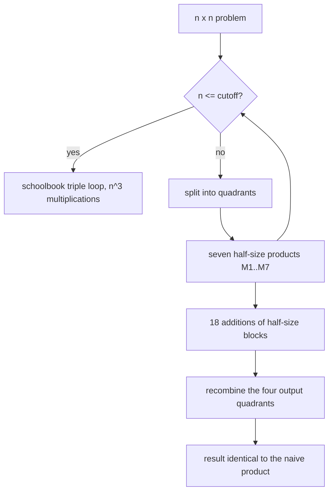
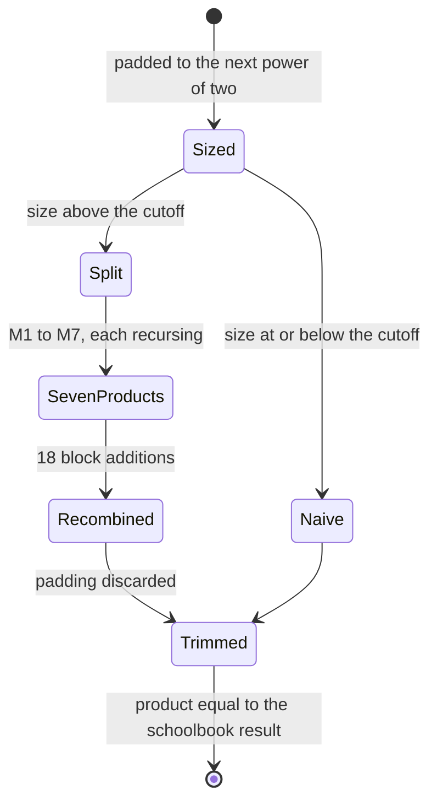
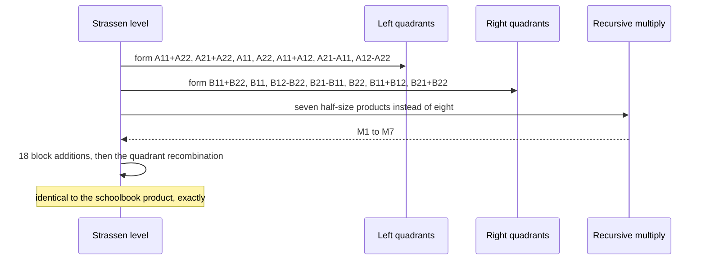

# 727 — Implement Strassen matrix multiplication and recursion cutoff tuning

> **Tier:** Expert · **CTCI chapter:** Beyond — Numerical & Scientific Computing
> **Task spec:** [727-implement-strassen-matrix-multiplication-and-recursion-cutoff-tu.md](../../../tasks/expert/727-implement-strassen-matrix-multiplication-and-recursion-cutoff-tu.md)
> **Solutions:** [Python](../../../solutions/python/expert/727-implement-strassen-matrix-multiplication-and-recursion-cutoff-tu/solution.py) ·
> [Java](../../../solutions/java/expert/727-implement-strassen-matrix-multiplication-and-recursion-cutoff-tu/Solution.java) ·
> [JavaScript](../../../solutions/javascript/expert/727-implement-strassen-matrix-multiplication-and-recursion-cutoff-tu/solution.js) ·
> [C#](../../../solutions/csharp/expert/727-implement-strassen-matrix-multiplication-and-recursion-cutoff-tu/Solution.cs)

## 1. Problem restatement

Multiply two square matrices with **Strassen's algorithm** — seven recursive half-size products instead of
eight — and then answer the question the algorithm actually raises: at which size should the recursion stop
in favour of the naive triple loop?

**Modelling contract.** The algorithm, the closed-form counts and the structural checks are real; the
"timing" is an operation count:

| Element | Contract |
| --- | --- |
| Entries | small integers (Python/Java/C#), so every comparison is **exact** — no floating-point tolerance anywhere; Java also asserts the entries stay far inside the 32-bit range so no check is measuring overflow |
| Counting | one multiplication and one addition each cost `1` in Python/Java; C# states its tuning objective explicitly (`a multiplication counts as three additions`) and derives `M(n, leaf) = n³ or 7·M(n/2, leaf)` and `A(n, leaf) = n³ or 7·A(n/2, leaf) + 18·(n/2)²` |
| Sizes | arbitrary square sizes are zero-**padded to the next power of two** and the padding is trimmed afterwards (the standard library approach); no mixed-radix/odd-even splitting |
| Structural check | each of the seven products `M1…M7` is compared against the naive product of *its own defining factor pair*, plus a rebuild of the original 4×4 product from the quadrants |
| Not modelled | blocked or vectorised kernels, memory-bandwidth models, Winograd-style variants, right-hand-side caching, measured wall-clock timings |

**What is asserted:** every result equals the naive product exactly for sizes `1, 2, 3, 4, 5, 7, 8, 11, 16,
17` and cutoffs `1, 2, 3, 4, 8, 32`; the multiplication count matches `7^levels · cutoff³`; cutoffs that
cover the whole matrix degenerate to the naive count exactly; and the tuned cost curve has an **interior**
minimum that beats both the naive algorithm and the extreme cutoffs.

Interface (Python; the others mirror it):

| Call | Meaning |
| --- | --- |
| `naive_multiply(left, right, counter)` | the schoolbook kernel; `counter` accumulates `mult` and `add` |
| `add_matrices(left, right, counter, sign)` | element-wise add or subtract, counted |
| `strassen_step(left, right, multiply, counter)` | one level: returns the seven products and the four output quadrants |
| `strassen_multiply(left, right, cutoff, counter)` | pad, recurse, trim |
| `levels_for(size, cutoff)` | how many levels before the base case |
| `predicted_multiplications(size, cutoff)` | `7^levels · min(cutoff, padded)³` |
| `cost_sweep(size, cutoffs, seed)` | `(cutoff, mult, add, total)` rows over the cutoff sweep |

Concrete expected results, all asserted:

- Structural: on hand-chosen 2×2 quadrants, `M1 = (A11+A22)(B11+B22)`, `M2 = (A21+A22)·B11`,
  `M3 = A11(B12−B22)`, `M4 = A22(B21−B11)`, `M5 = (A11+A12)·B22`, `M6 = (A21−A11)(B11+B12)`,
  `M7 = (A12−A22)(B21+B22)` — each equals the naive product of that pair — and the recombined quadrants
  equal the naive 4×4 product.
- Closed form: `predicted_multiplications(16, 4) == 7² · 4³ = 3136`,
  `predicted_multiplications(16, 16) == 16³ = 4096`, `predicted_multiplications(16, 8) == 7 · 8³ = 3584`,
  `predicted_multiplications(16, 1) == 7⁴ = 2401`; and for `size = 16` with cutoffs `1, 2, 4, 8, 16, 32`
  the measured counts equal the formula.
- A cutoff above the size (64 for a 16×16 problem) gives `mult == add == 16³`: the naive triple loop.
- Tuning on size 32 with cutoffs `1, 2, 4, 8, 16, 32, 64`: the largest cutoff costs the naive total
  `2 · 32³ = 65536`; the best interior cutoff has a total below it and fewer than half the multiplications;
  every sweep point matches the closed form; the sweep is deterministic.
- Boundaries: `[[3]]·[[4]] == [[12]]` for the 1×1 case; a zero operand gives zeros; `cutoff = 0`, non-square
  inputs and mismatched sizes are rejected.

## 2. Intuition

The naive triple loop is `n³` multiplications. Strassen's observation is that the eight products of the
quadrant decomposition are not independent: with seven carefully chosen combinations,

```text
M1 = (A11 + A22)(B11 + B22)      M5 = (A11 + A12) B22
M2 = (A21 + A22) B11             M6 = (A21 - A11)(B11 + B12)
M3 = A11 (B12 - B22)             M7 = (A12 - A22)(B21 + B22)
M4 = A22 (B21 - B11)
```

the four output quadrants can be recovered as sums and differences of the `Mi`, and
`M(n) = 7 · M(n/2)` gives `n^log₂7 ≈ n^2.807`. The price is 18 additions of half-size blocks *per level*,
which is why the naive kernel wins for small blocks and the recursion has to stop somewhere.

That "somewhere" is the whole engineering content of the algorithm, and it is a *tuning* problem: a cutoff
too small pays additions on tiny blocks where the constant dominates, a cutoff too large never recurses at
all, and the optimum sits strictly inside — which is what the sweep in section 4 shows.



Two implementation details turn out to matter more than the asymptotics. First, the seven products must be
checked *individually*: a mis-transcribed formula can still cancel out in the final recombined result on
careless test data, so the checks compare each `Mi` against the naive product of its defining pair on fixed
quadrants. Second, arbitrary sizes are handled by padding to the next power of two and trimming afterwards —
simple and wasteful, and stated as such, since odd/even splitting would be the economical alternative.

## 3. Algorithm

1. Validate: square inputs of the same size, `cutoff ≥ 1`.
2. Pad both operands to the next power of two with zeros.
3. If the padded size is at or below the cutoff, run the naive triple loop (counted) and trim.
4. Otherwise split into quadrants, form the four `A` combinations and the three-plus-one `B` combinations
   of the seven products, and recurse on each half-size product.
5. Recombine the quadrants:
   `C11 = M1 + M4 − M7 + M5`, `C12 = M3 + M5`, `C21 = M2 + M4`, `C22 = M1 + M3 − M6 + M2`.
6. Assemble the padded output, trim to the original size.
7. Count multiplications and additions, compare the count with `7^levels · cutoff³`, and sweep cutoffs to
   find the interior minimum of the total.

```text
function naive_multiply(left, right, counter)
    out ← zeros of size n
    for i ← 0 to n - 1 do
        for j ← 0 to n - 1 do
            total ← 0
            for t ← 0 to n - 1 do
                total ← total + left[i][t] * right[t][j]
                counter.mult ← counter.mult + 1
                counter.add ← counter.add + 1
            out[i][j] ← total
    return out

function strassen_step(left, right, multiply, counter)
    (a11, a12), (a21, a22) ← left
    (b11, b12), (b21, b22) ← right
    m1 ← multiply(add_matrices(a11, a22), add_matrices(b11, b22))
    m2 ← multiply(add_matrices(a21, a22), b11)
    m3 ← multiply(a11, add_matrices(b12, b22, sign = -1))
    m4 ← multiply(a22, add_matrices(b21, b11, sign = -1))
    m5 ← multiply(add_matrices(a11, a12), b22)
    m6 ← multiply(add_matrices(a21, a11, sign = -1), add_matrices(b11, b12))
    m7 ← multiply(add_matrices(a12, a22, sign = -1), add_matrices(b21, b22))
    c11 ← m1 + m4 - m7 + m5
    c12 ← m3 + m5
    c21 ← m2 + m4
    c22 ← m1 + m3 - m6 + m2
    return [m1 .. m7], [[c11, c12], [c21, c22]]

procedure strassen_multiply(left, right, cutoff, counter)
    if cutoff < 1 then reject "cutoff must be at least one"
    if inputs are not square and equally sized then reject "both inputs must be square"
    size ← smallest power of two >= n
    a ← pad(left, size);  b ← pad(right, size)
    if size <= cutoff then
        product ← naive_multiply(a, b, counter)
    else
        product ← recurse(a, b, cutoff, counter)
    return trim(product, n)

procedure recurse(a, b, cutoff, counter)
    if len(a) <= cutoff then return naive_multiply(a, b, counter)
    split a and b into quadrants
    _, quadrants ← strassen_step(quadrants_of(a), quadrants_of(b),
                                lambda x, y: recurse(x, y, cutoff, counter), counter)
    reassemble the quadrants into one block
    return block

function predicted_multiplications(size, cutoff)
    padded ← smallest power of two >= size
    effective ← min(cutoff, padded)
    return 7 ^ levels_for(padded, effective) * effective ^ 3
```



## 4. Worked example

The closed form on a 16×16 problem, one row per cutoff — the multiplications the run must perform
(`7^levels · cutoff³`), with the naive count `16³ = 4096` for comparison:

| Cutoff | Levels | Formula | Multiplications |
| --- | --- | --- | --- |
| 1 | 4 | `7⁴ · 1³` | `2401` |
| 2 | 3 | `7³ · 2³` | `2744` |
| 4 | 2 | `7² · 4³` | `3136` |
| 8 | 1 | `7 · 8³` | `3584` |
| 16 | 0 | `16³` | `4096` (the naive kernel) |
| 32 | 0 | `16³` | `4096` (cutoff above the size) |

The last row is the sanity check that the recursion really is bypassed: a cutoff above the problem size
produces exactly `mult == add == n³`.

The tuning sweep on a 32×32 instance (`naive_total = 2 · 32³ = 65536`):

| `cutoff` | What it means | Asserted property |
| --- | --- | --- |
| 1 | recurse down to single entries, maximum additions | not the optimum |
| 2, 4, 8, 16 | progressively coarser recursion | contains the **best interior** cutoff, whose total is below `65536` and whose multiplication count is below `65536 / 2` |
| 32 | no recursion at all | total equals the naive `65536` |
| 64 | cutoff above the size | also the naive total |

So the optimum is interior (`1 < cutoff < 32`), which is exactly the reason a cutoff parameter exists: the
asymptotic win `n^2.807` is real, but it only shows up above a size where the 18 additions per level stop
dominating.

Structural walk of one level on fixed quadrants:

| Step | Expression | Check |
| --- | --- | --- |
| products | `M1 = (A11+A22)(B11+B22)` … `M7` | each equals `naive_multiply` of its own factor pair |
| recombine | `C11 = M1+M4−M7+M5`, `C12 = M3+M5`, `C21 = M2+M4`, `C22 = M1+M3−M6+M2` | the reassembled 4×4 equals the naive 4×4 product |
| the seven-instead-of-eight claim | `M1…M7` replace eight products | the C# counter shows seven products at the top level of a 2×2 problem, eight for the naive kernel |



## 5. Complexity

With `n` the padded size, `L` the recursion depth (`n / 2^L ≤ cutoff`) and `leaf = min(cutoff, n)`:

| Quantity | Naive | Strassen (cutoff `c`) | Why |
| --- | --- | --- | --- |
| Multiplications | `n³` | `7^L · leaf³` | each level replaces 8 products with 7 |
| Asymptotic | `O(n³)` | `O(n^log₂7) ≈ O(n^2.807)` | the recurrence `M(n) = 7·M(n/2)` |
| Additions | `n³` counted (accumulate and add per term) | `Σ_levels 18 · (n/2^i)²` plus the leaves | 18 block additions per level, each `(n/2)²` additions |
| Recursion depth | `0` | `log₂(n / leaf)` | the cutoff decides |
| Space | `O(n²)` | `O(n² log n)` with naive allocation of intermediates | the seven `M` and the quadrant buffers |
| Padding cost | none | up to `4×` the work for odd sizes (`17 → 32`) | padding to the next power of two |
| Tuning objective | `n³` | interior minimum of `mult + add` | measured by the sweep, not assumed |

The comparison the task is really about is the **two-parameter** cost model, and the C# file spells it out:
`M(n, leaf) = 7·M(n/2, leaf)` against `n³`, `A(n, leaf) = 7·A(n/2, leaf) + 18·(n/2)²` against `n³`. Because
a multiplication and an addition have different constants on real hardware, the optimum depends on their
ratio — which C# states as "a multiplication counts as three additions" and Python/Java take as equal
weights. Different weights move the optimum; the *existence* of an interior optimum does not.

| Cutoff regime | Dominant cost | Consequence |
| --- | --- | --- |
| `cutoff = 1` | additions dominate (`18` per level, `log n` levels) | slower than the naive kernel |
| `cutoff ≈ √n` … `n/4` | balanced | the measured interior optimum |
| `cutoff ≥ n` | the naive `n³` kernel, no recursion | no win at all |

## 6. Pitfalls and edge cases

- **Check the seven products individually.** A wrong formula can cancel in the recombined result for
  careless data, so each `Mi` is compared against the naive product of its defining factor pair, and the
  recombined quadrants are compared against the naive 4×4 product of the flattened inputs.
- **Non-power-of-two sizes must be padded.** Sizes `1, 2, 3, 4, 5, 7, 8, 11, 16, 17` are all tested with
  cutoffs `1, 2, 3, 4, 8, 32`; the `11` and `17` cases exercise trimming after padding.
- **`cutoff ≥ n` must degenerate exactly to the naive kernel**, including the addition count
  (`mult == add == n³`), which catches an implementation that still pays quadrant overhead.
- **`cutoff = 0` is rejected**, and so are non-square and mismatched inputs — a squared-off recursion on
  ragged inputs would silently index out of range.
- **The asymptotic win is in multiplications, not in total operations.** At a small cutoff the added
  additions dominate; that is precisely why the sweep is part of the task and why the harness requires an
  *interior* optimum rather than "Strassen is faster".
- **Overflow.** Java asserts the integer entries stay far inside 32-bit range, so an exact comparison is
  not accidentally measuring wraparound.
- **Zero operands** must produce zeros (a valid path through the recursion, not a shortcut).
- **A 1×1 problem** must work with `cutoff = 1`: it is the base case of the whole construction.
- **Determinism.** The sweep is re-run with the same seed and must produce identical rows, so the printed
  counts are reproducible evidence rather than a one-off observation.
- **Counts must be measured, not just modelled.** Every sweep point's multiplication count is compared
  against the closed form, so the model and the recursion cannot drift apart.

## 7. Variants and follow-ups

- The sparsity-aware neighbour of this problem: [726 — sparse-dense matrix multiply block optimizations](../../../tasks/expert/726-implement-sparse-dense-matrix-multiply-block-algorithm-optimizat.md).
- Recursion without tuning parameters: [728 — cache-oblivious matrix multiplication](../../../tasks/expert/728-implement-cache-oblivious-matrix-multiplication-idea-demo.md).
- Recursion cutoffs as a general device: [722 — gradient checkpointing and the recompute trade-off](../../../tasks/expert/722-implement-gradient-checkpointing-recompute-vs-memory-tradeoff.md).
- Approximate products when the operand can be sampled: [595 — approximate matrix multiplication via sampling](../../../tasks/advanced/595-implement-approximate-matrix-multiplication-via-sampling.md).

## 8. Check yourself

<details><summary>Show answer</summary>
**Strassen replaces eight products with seven. Why is that not simply "an eighth faster"?** Because each
level also adds 18 additions of half-size blocks, plus the parentheses and recombination. The
multiplication count falls by `8/7` per level, but the total operation count falls only when the block is
large enough that the `n^2.807` growth beats the constant on those additions — which is exactly what the
cutoff decides, and why the sweep has an interior optimum rather than a monotone trend.
</details>

<details><summary>Show answer</summary>
**How does the harness check the count without trusting the implementation?** It compares the reported
multiplication counter with the closed form `7^levels · min(cutoff, padded)³`, where `levels` is derived
from the size and the cutoff. For a 16×16 problem that gives `7²·4³ = 3136` at cutoff 4, `7·8³ = 3584` at
cutoff 8, `7⁴ = 2401` at cutoff 1, and `16³ = 4096` at cutoff 16 — and for a cutoff above the size, the
naive count `mult == add == n³`.
</details>

<details><summary>Show answer</summary>
**Why compare each `Mi` separately instead of only the final product?** Because the recombination is a sum
of signed `Mi` terms: a transcription error in one formula can be cancelled by another on some inputs, and
the final comparison would pass. Checking `Mi` against `naive_multiply` of *its own defining factor pair*
catches a wrong `+`/`−` immediately, which the Python file does on fixed 2×2 quadrants.
</details>

<details><summary>Show answer</summary>
**What happens for sizes that are not powers of two, and what does it cost?** Both operands are zero-padded
to the next power of two and the padding is trimmed from the result. It is simple and it is wasteful — 17
becomes 32, roughly four times the arithmetic of the true size — which is why the files state
odd/even splitting as the economical alternative they did not implement. The sizes `11` and `17` in the
correctness sweep exist to prove the trim is right.
</details>

<details><summary>Show answer</summary>
**Why does the optimum depend on the machine, even though the counts do not?** Because the tuning objective
weights multiplications and additions differently: C# counts one multiplication as three additions, while
Python and Java weight them equally. The operation *counts* are exact and machine-independent; the location
of the interior minimum follows from the ratio of the two constants, which is why a cutoff is always a tuned
parameter rather than a theoretical one.
</details>
