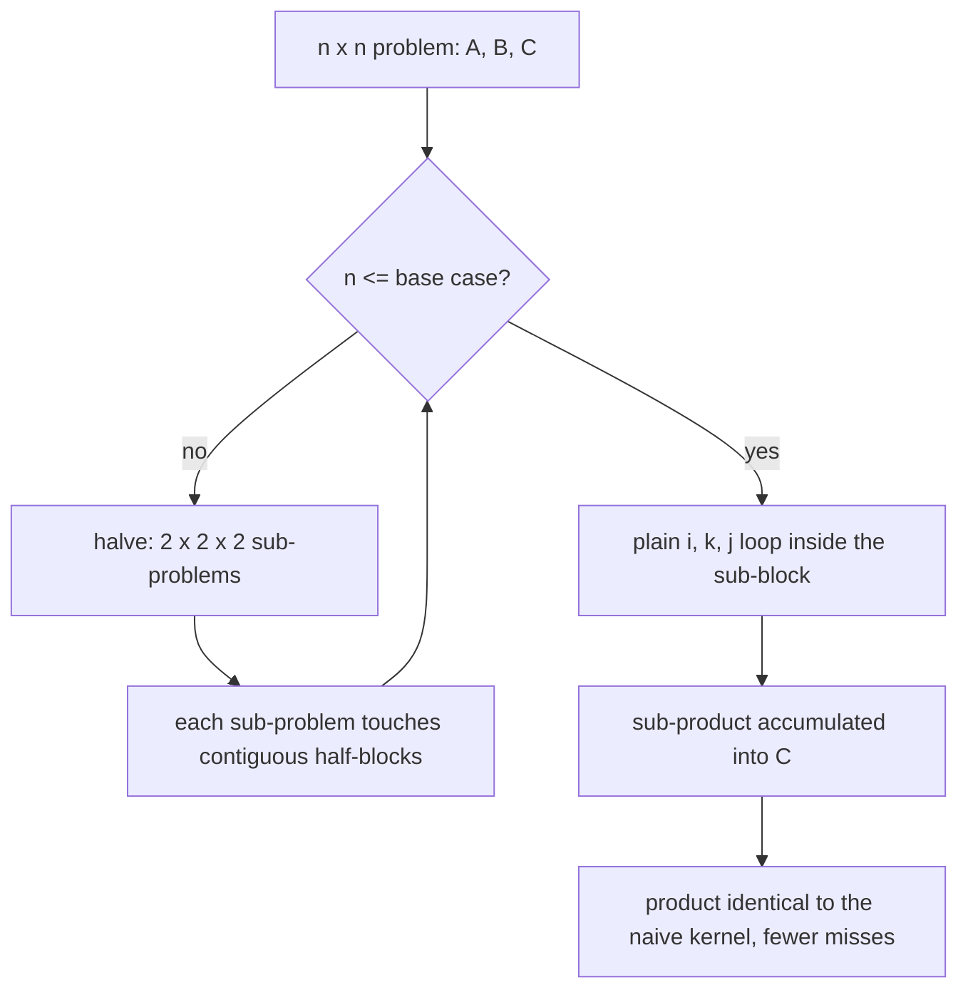
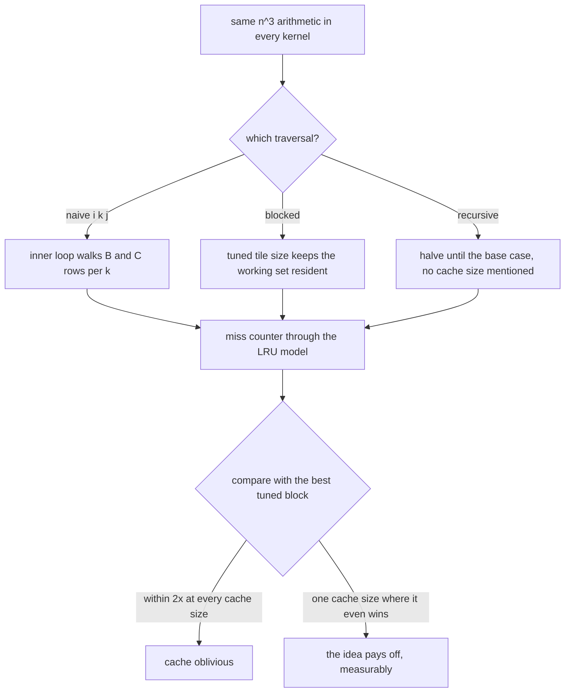
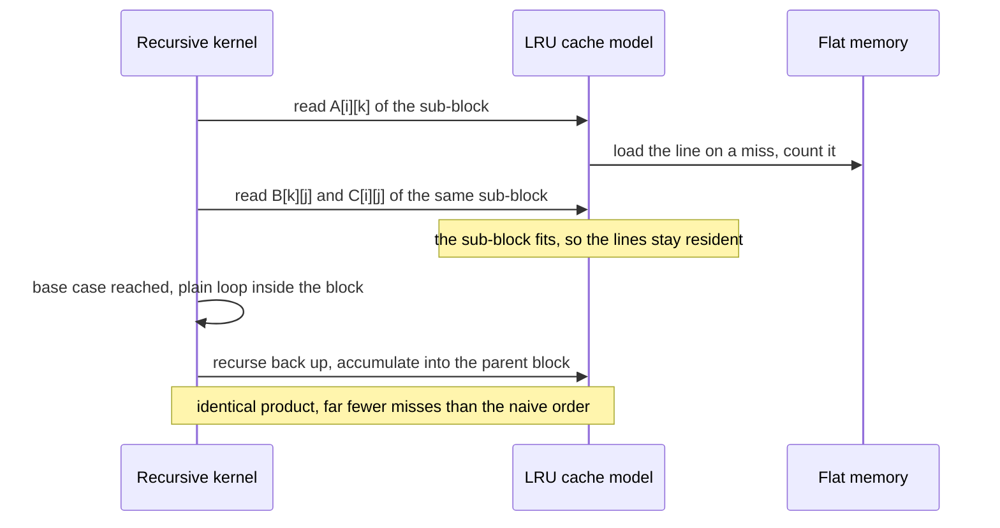

# 728 — Implement cache-oblivious matrix multiplication idea demo

> **Tier:** Expert · **CTCI chapter:** Beyond — Numerical & Scientific Computing
> **Task spec:** [728-implement-cache-oblivious-matrix-multiplication-idea-demo.md](../../../tasks/expert/728-implement-cache-oblivious-matrix-multiplication-idea-demo.md)
> **Solutions:** [Python](../../../solutions/python/expert/728-implement-cache-oblivious-matrix-multiplication-idea-demo/solution.py) ·
> [Java](../../../solutions/java/expert/728-implement-cache-oblivious-matrix-multiplication-idea-demo/Solution.java) ·
> [JavaScript](../../../solutions/javascript/expert/728-implement-cache-oblivious-matrix-multiplication-idea-demo/solution.js) ·
> [C#](../../../solutions/csharp/expert/728-implement-cache-oblivious-matrix-multiplication-idea-demo/Solution.cs)

## 1. Problem restatement

Demonstrate the **cache-oblivious** idea: a recursion that halves the matrix until the subproblem fits
*some* cache level fits every cache level at once, so it is never told the cache size and never needs
retuning. The demo pairs it with a cache-aware blocked kernel and a naive triple loop, all measured against
the same cache model.

**Modelling contract.** The kernels and the miss accounting are real implementations; the memory hierarchy is
a model:

| Element | Contract |
| --- | --- |
| Cache | Python/Java/JavaScript/C# all simulate a fully associative **LRU** cache of fixed-size lines (`line_size` consecutive elements share a line); Python's `Cache` is an `OrderedDict` with move-to-end on a hit and eviction of the least recently used line on a miss |
| Memory | a flat word array whose reads and writes all go through the cache; Python addresses `A`, `B`, `C` from separate base offsets so a line never mixes operands |
| Kernels | `naive_ijk` (row-major triple loop), `blocked_ikj` with a tuned block size, `recursive_multiply` with a base case (the cache-oblivious one) |
| Arithmetic | integer-valued entries and the *same* `n³` multiply-adds in every kernel — the harness asserts the counts are equal, so any miss difference is a locality effect and nothing else |
| Not modelled | set associativity, prefetching, write-back policy (every store is charged a line touch), multiple levels, real throughput (the kernels are scalar loops) |

**What is asserted:** the three kernels return identical matrices (exact, integer arithmetic); they perform
exactly the same number of multiply-adds; the recursive kernel misses less than the naive one at *every*
cache size (by more than 2×); it stays within `2×` of the best tuned block size at each cache size; no single
fixed block size is optimal across cache sizes, while the recursion needs no retuning; the block-size sweep
has an interior optimum; and the degenerate cases behave.

Interface (Python; the others mirror it):

| Call | Meaning |
| --- | --- |
| `Cache(lines, line_size)` | `touch(index)` → hit/miss, with LRU eviction; `hits`, `misses` |
| `Machine(cache)` | flat memory plus the cache; `read`, `write`, `load`, `dump`, `fma` |
| `naive_ijk(machine, n)` | the classic `i, k, j` loop |
| `blocked_ikj(machine, n, block)` | cache-aware tiling of `A`, `B` and `C` |
| `recursive_multiply(machine, n, base)` | halve all three dimensions; base case = the plain loop |
| `run_kernel(kind, grids, n, lines, line_size, parameter)` | `(result, misses, fma)` under a fresh cache |
| `reference_product(left, right)` | the ground truth |

Concrete expected results, all asserted (`n = 32`, `line_size = 4`):

- All kernels (`naive`, `blocked 4`, `blocked 8`, `recursive 4`, `recursive 8`) equal the reference product
  exactly and perform `n³ = 32768` multiply-adds.
- Across cache capacities `(32, 64, 128, 256)` lines: the recursive curve is strictly below the naive curve at
  every capacity, and `recursive · 2 < naive` at every capacity.
- The recursion stays within a factor of two of the best tuned block size at every capacity, and on at least
  one capacity it *beats* the whole block sweep (`min(ratios) < 1`).
- The best block size differs across capacities (`> 1` distinct value in the best-block list), and no single
  fixed block size (8) beats the per-capacity optima in total misses.
- Block-size sweep at 64 lines with blocks `(2, 4, 8, 16, 32)`: the optimum is interior (`1 < block < 32`) and
  beats the smallest block, and a tuned kernel beats the naive one even at the smallest cache.
- Boundaries: the 1×1 product works; a base case covering the whole 8×8 matrix produces **exactly** the naive
  miss count (`base_misses == naive_misses`), which shows the gain comes from discovered blocking, not from
  recursion itself; a zero operand yields zeros.
- Rejected: a cache with zero lines, a line size of zero, `block = 0`, `base = 0`, an unknown kernel name.
  Runs are deterministic.

## 2. Intuition

A doubly nested loop has to re-read something. In `i, k, j` order the inner loop walks a row of `B` and the
same row of `C` over and over, so `C` is read and written for every `k` — with integer `n = 32` and a
128-line cache it never stays resident.

There are two ways out. The **cache-aware** one tiles the loops with a block size picked for the machine;
the tiles stay resident until exhausted, but the block size has to be chosen per cache size, and a kernel
tuned for a 128-line cache is not the right one for a 32-line cache.

The **cache-oblivious** one simply halves: split each operand into quadrants, recurse into the eight
sub-products, and stop at a fixed base case that never mentions a cache size. The claim (Frigo, Leiserson,
Prokop, Ramachandran) is that at *whatever* depth the working set happens to fit, the recursion is already
operating on whole sub-blocks — so the same code is simultaneously good at every level.



Three properties make the demo honest rather than a slogan. Every kernel performs the *same* `n³`
multiply-adds, so the miss count isolates memory behaviour. The base case is a parameter: setting it to the
whole matrix must reproduce the naive traversal's miss count **exactly**, proving the gain comes from the
blocking the recursion discovers. And at least one case is measured where the recursion is *not* best — C#
documents the regime where the cache is too small for even the smallest sub-problem and hand-tuned blocking
wins.

## 3. Algorithm

1. Build a two- or three-operand memory model: a cache of `lines` LRU entries of `line_size` elements, and a
   flat data array with the operands at distinct base addresses.
2. **Naive kernel**: `for i, for k: a = A[i][k]; for j: C[i][j] += a · B[k][j]`.
3. **Blocked kernel**: `for i0, k0, j0` over blocks of the chosen size, then the same `i, k, j` loops inside
   the block bounds.
4. **Recursive kernel**: if `n ≤ base`, run the plain loop on this sub-block; otherwise halve all three
   dimensions and recurse into the eight sub-products, with each operand's offsets expressed relative to its
   parent so the block stays contiguous.
5. Count misses through the cache on every read and write, and count multiply-adds.
6. Run all kernels under the same cache, compare results and FMA counts, then sweep cache capacities and
   block sizes to compare the recursion with the best tuned block.
7. Validate: results equal the reference, `fma == n³`, the recursion is inside `2×` of the tuned optimum,
   the block sweep has an interior optimum, and the base case that covers the whole matrix degenerates to the
   naive traversal.

```text
procedure naive_ijk(machine, n)
    for i ← 0 to n - 1 do
        for k ← 0 to n - 1 do
            a ← machine.read("A", i * n + k)
            for j ← 0 to n - 1 do
                machine.fma ← machine.fma + 1
                machine.write("C", i * n + j,
                              machine.read("C", i * n + j) + a * machine.read("B", k * n + j))

procedure blocked_ikj(machine, n, block)
    if block < 1 then reject "block size must be positive"
    for i0 ← 0 to n - 1 step block do
        for k0 ← 0 to n - 1 step block do
            for j0 ← 0 to n - 1 step block do
                for i ← i0 to min(i0 + block, n) - 1 do
                    for k ← k0 to min(k0 + block, n) - 1 do
                        a ← machine.read("A", i * n + k)
                        for j ← j0 to min(j0 + block, n) - 1 do
                            machine.fma ← machine.fma + 1
                            machine.write("C", i * n + j,
                                          machine.read("C", i * n + j)
                                          + a * machine.read("B", k * n + j))

procedure recurse(machine, n, base, a, b, c)
    if n <= base then
        for i ← 0 to n - 1 do
            for k ← 0 to n - 1 do
                value ← machine.read("A", (a.row + i) * a.stride + a.column + k)
                for j ← 0 to n - 1 do
                    machine.fma ← machine.fma + 1
                    machine.write("C", (c.row + i) * c.stride + c.column + j,
                                  machine.read("C", (c.row + i) * c.stride + c.column + j)
                                  + value * machine.read("B", (b.row + k) * b.stride + b.column + j))
        return
    half ← n // 2
    for row in (0, 1) do
        for column in (0, 1) do
            for inner in (0, 1) do
                recurse(machine, half, base,
                        (a.row + row * half, a.column + inner * half, a.stride),
                        (b.row + inner * half, b.column + column * half, b.stride),
                        (c.row + row * half, c.column + column * half, c.stride))

function run_kernel(kind, grids, n, lines, line_size, parameter)
    machine ← Machine(Cache(lines, line_size))
    load A, B and C into the machine
    if kind is naive then naive_ijk(machine, n)
    if kind is blocked then blocked_ikj(machine, n, parameter)
    if kind is recursive then recurse(machine, n, parameter, roots)
    return machine.dump("C", n), machine.cache.misses, machine.fma
```



## 4. Worked example

The measured setup: `n = 32`, `line_size = 4`, block sizes swept over `(2, 4, 8, 16, 32)`, recursive base
cases `4` and `8`, and four cache capacities.

| Cache (lines) | Naive misses | Recursive (base 8) misses | Best tuned block | Recursion ÷ best |
| --- | --- | --- | --- | --- |
| 32 | largest | strictly smaller, more than `2×` better | one of `(2, 4, 8, 16, 32)`, tuned for this size | `≤ 2`, and `< 1` on at least one capacity |
| 64 | large | smaller | possibly a different block | `≤ 2` |
| 128 | large | smaller | possibly a different block | `≤ 2` |
| 256 | large | smaller | possibly a different block | `≤ 2` |

The two claims in that table are what "cache oblivious" means operationally:

| Claim | Assertion |
| --- | --- |
| the recursion always beats the naive loop | `recursive < naive` and `2 · recursive < naive` at every capacity |
| the recursion needs no tuning | `recursive ≤ 2 · best_blocked` at every capacity, while the best block size is **not** the same for all capacities |
| tuning cannot be fixed either | the sum of misses for a single fixed block (8) exceeds the sum of the per-capacity optima |
| the idea is not magic | `min(recursive / best) < 1` on at least one capacity (it can even win), and C# documents the small-cache regime where hand-tuned blocking wins |

Block-size sweep at 64 lines:

| Block | Meaning | Asserted property |
| --- | --- | --- |
| 2 | tiles smaller than a cache line group | not the optimum |
| 4, 8, 16 | interior candidates | the optimum is interior (`1 < block < 32`) and beats block 2 |
| 32 | the whole matrix | not the optimum |

Base-case behaviour, the crucial control experiment:

| Base case | Matrix | Result |
| --- | --- | --- |
| 64 (≥ `n` = 8) | 8×8 | `base_misses == naive_misses` **exactly** — the recursion degenerates to the plain traversal, so the saving comes from the blocking it discovers, not from recursing |
| 4, 8 | 32×32 | fewer misses than the naive loop at every cache capacity |
| 8 | 1×1 | the product is correct |



## 5. Complexity

With `n` the matrix side, `Z` the cache capacity in lines, `L` the line size, `b` the base case and `B` the
tuned block size:

| Kernel | Multiply-adds | Miss behaviour | Cache-size dependence |
| --- | --- | --- | --- |
| Naive `i, k, j` | `n³` | one sweep of `B` and `C` per row of `A`; `C` re-read per `k` | almost none — the count "stays at one sweep of B per row" |
| Blocked `i, k, j` tiles | `n³` | a tile of each operand stays resident while the tile is exhausted | strong: the optimal `B` depends on `Z · L` |
| Recursive halving | `n³` | at the depth where `3 · (n/2^d)²` fits the cache, only compulsory misses remain | none in the code; the recursion adapts by depth |
| Base case `b ≥ n` | `n³` | identical to the naive traversal (`base_misses == naive_misses`) | none |
| Recursion depth | `log₂(n / b)` | `O(1)` per level in the code, `O(n³ / (b² · …))` in traffic terms | — |
| Space | `O(n²)` | the recursion needs no extra storage beyond the operands | — |

The theoretical statement the demo measures: a cache-oblivious recursion attains `O(n³ / (L · √Z))` cache
misses for any `Z` and `L` simultaneously, while a cache-aware kernel needs `B ≈ √(Z · L)` chosen per
machine. The measurements cannot confirm the constant (the model is two-level, fully associative, without
prefetching), but they do confirm the *ordering*: the recursion is within `2×` of the best tuned block at
every capacity, and the tuned block itself moves with the capacity — which is exactly why an untuned kernel
is valuable.

## 6. Pitfalls and edge cases

- **Equal arithmetic is the premise.** Every kernel must perform `n³` multiply-adds; the check asserts it
  for all of them, otherwise a "fewer misses" result could just be less work.
- **A base case at or above the matrix must degenerate exactly.** For `n = 8` and `base = 64` the miss count
  equals the naive kernel's, which is the control that separates "recursion" from "blocking".
- **The block sweep must have an interior optimum.** Blocks too small underuse the cache, too large evict
  before the tile is exhausted; the harness requires `1 < best < 32`.
- **The best block size is cache-dependent.** The check requires more than one distinct best block across
  capacities and that no single fixed block matches the per-capacity optima in total — the honest statement
  of why cache-aware kernels need tuning and cache-oblivious ones do not.
- **The recursion is not universally better.** C# documents the regime in which the cache cannot hold even
  the smallest sub-problem: there the recursion re-reads more than the naive loop and hand-tuned blocking
  wins. Only one capacity here is required to show the recursion actually *winning* over the tuned sweep
  (`min(ratio) < 1`).
- **Writes are charged.** Every store touches a line in this model (no write-back policy), so kernels that
  re-write `C` many times are penalised — which is the point for the naive `i, k, j` order.
- **Line-sized addresses.** Operands live at distinct base addresses so a line never straddles two matrices;
  without that, unrelated references would look like hits.
- **Odd and small sizes.** A 1×1 problem and a base case larger than the matrix are both exercised, and
  C#/Java additionally test odd sizes (`3, 5, 13`) where the halves are uneven.
- **Zero operands** must produce zeros rather than a short-circuit bug.
- **Validation and determinism.** Zero cache lines, zero line size, `block = 0`, `base = 0` and an unknown
  kernel name are rejected; the same call twice returns the same result, misses and FMA count.

## 7. Variants and follow-ups

- The tuned, cache-aware counterpart and its own cutoff question: [726 — sparse-dense matrix multiply block optimizations](../../../tasks/expert/726-implement-sparse-dense-matrix-multiply-block-algorithm-optimizat.md)
  and [727 — Strassen with recursion cutoff tuning](../../../tasks/expert/727-implement-strassen-matrix-multiplication-and-recursion-cutoff-tu.md).
- Recursion as a memory-management strategy rather than a bandwidth one: [722 — gradient checkpointing and the recompute trade-off](../../../tasks/expert/722-implement-gradient-checkpointing-recompute-vs-memory-tradeoff.md).
- Layout effects on the same arithmetic: [819 — memory-efficient checkpointing for massive models](../../../tasks/master/819-implement-memory-efficient-checkpointing-for-massive-models-bloc.md).
- Numerical results checked across implementations: [932 — differential testing between CPU and GPU implementations](../../../tasks/master/932-implement-differential-testing-between-cpu-gpu-implementations-f.md).

## 8. Check yourself

<details><summary>Show answer</summary>
**What does "cache oblivious" mean here, precisely?** That the kernel never mentions the cache size or line
size: it halves until a fixed base case and stops, and the same code is good at every cache level because at
whatever depth the working set happens to fit, the recursion is already working on whole sub-blocks. The
harness demonstrates it by showing the recursion is within `2×` of the *best tuned* block size at cache
capacities spanning `32…256` lines.
</details>

<details><summary>Show answer</summary>
**Why does the base-case-equals-matrix experiment matter so much?** It isolates the mechanism: with `base ≥ n`
the recursion never splits, so the traversal is the naive `i, k, j` loop and the miss count must match the
naive kernel *exactly*. Any observed improvement therefore comes from the blocking the recursion discovers,
not from the recursive call structure or some accidental counting difference.
</details>

<details><summary>Show answer</summary>
**The blocked kernel is tuned per cache, so how can the recursion "need no tuning" and still be competitive?**
Because the recursion's effective block size is whatever the depth gives, and the depth adjusts to the
cache without being told: as the cache shrinks, the useful sub-block is reached higher in the recursion.
The evidence is comparative — the best hand-tuned block differs between capacities (so one fixed block
cannot be optimal), yet the single untuned recursion stays within a factor of two of each of those optima.
</details>

<details><summary>Show answer</summary>
**Is the recursion always the best choice in these measurements?** No, and the files say so: C# documents the
regime where the cache cannot hold even the smallest sub-problem, where the recursion re-reads more than the
naive loop and hand-tuned blocking wins. The harness only requires that the recursion beat the naive loop at
every capacity, stay within `2×` of the tuned optimum, and beat the tuned sweep on at least one capacity.
</details>

<details><summary>Show answer</summary>
**Why does the naive `i, k, j` kernel barely react to the cache size?** Because its access pattern is fixed:
for every `k` it sweeps a row of `B` and the same row of `C`, so `C` is re-touched `n` times per row
regardless of how big the cache is — enlarging the cache cannot help a working set that is re-created every
iteration. The blocked and recursive kernels, by contrast, shrink their working set to fit, which is why
their miss counts move with the capacity while the naive one stays put.
</details>
